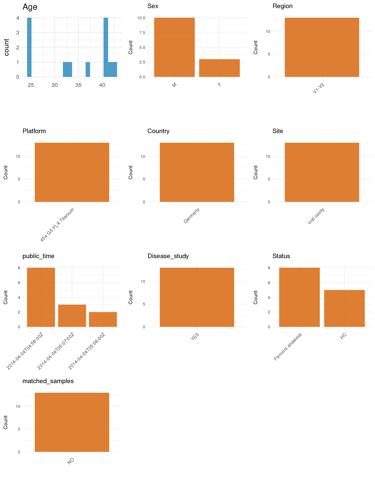

# Step 1: Obtain Initial Metadata from Each Project

This step sets the project directory and loads the raw SRA metadata.

```{r message=FALSE, warning=FALSE}
# Load libraries
library(dplyr)
library(ggplot2)
library(cowplot)

# (1) Setting working directory
project_id <- "PRJEB5069"

base_dir <- "E:/工作区/VSCode/RNAproject/collect_metadata_respon/project"
setwd(file.path(base_dir, project_id))

# (2) Loading raw SRA metadata file
sra_file <- "SraRunTable.csv"
initial_meta <- read.csv(sra_file, header = TRUE, stringsAsFactors = FALSE, check.names = FALSE)
```

# Step 2: Data Overview

First, you need to get an overview of the data, which includes two steps: reading the article and reading the initial metadata. This step is very IMPORTANT!

```{r message=FALSE, warning=FALSE}
# (1) Read paper.pdf first. Evidence confirmed from the paper and supplements:
# - Title: Mycoplasma salivarium as a Dominant Coloniser of Fanconi Anaemia Associated Oral Carcinoma
# - Study samples used here: H1-H5 from site B, FA_L1 sites A/B/E/F, and FA_T1 sites A/B/E/F
# - Site evidence from Figure 1/results: A = neighbouring gingiva, B = tongue lesion site, E/F = contralateral sites, controls sampled at site B
# - Platform and chemistry from methods: Roche/454 pyrosequencing / 454 GS FLX Titanium
# - sequencing_region = V1-V2 and pcr_primers = 27F-338R from methods and Figure S1
# - Table S1 confirms the sample labels FA_L1A/B/E/F and FA_T1A/B/E/F, but it does not add new host metadata columns
#
# (2) Raw SRA columns already present for the 19-column target table:
# - sample_id: Run
# - subject_id candidate: submitted sample label (FA_L1_F, FA_T1_B, H1_B, ...)
# - age: AGE
# - sex: fixed-position column 47 after header-shift audit
# - country: fixed-position column 24 after header-shift audit
# - site candidate: body_site
# - status candidate: disease_status plus sample label prefixes
# - public_time: ReleaseDate
head(initial_meta, 10)
ncol(initial_meta)
initial_meta[1:5, c(1, 2, 6, 8, 16, 24, 42, 45, 47)]
table(initial_meta[[8]])
table(initial_meta[[16]])
table(initial_meta[[24]])
table(initial_meta[[47]])
#
# (3) Remaining manual judgement for this project:
# - The paper does not resolve whether site E or F is the contralateral tongue versus contralateral gingiva, so those rows must not be guessed
# - The Subjects section reports FA_L1 as 27 years old, whereas deposited SRA AGE is 25 for all FA_L1 rows; keep the deposited row-level age and flag the discrepancy in source comments
# - For status, use site-specific lesion labels where explicit and otherwise keep the subject-level disease context for Fanconi anaemia rows
#
# The downloaded SraRunTable has a malformed header because one location field contains an embedded comma.
# Therefore this project continues to use fixed column positions verified during audit:
# 1 = Run, 2 = AGE, 6 = BioProject, 8 = body_site, 16 = disease_status,
# 24 = country, 42 = ReleaseDate, 45 = submitted sample name, 47 = sex.
```

# Step 3: Removing Control and Non-human Samples

First, we need to remove control samples(including both negative controls and positive controls) and non-human samples.

```{r}
# (1) Parameter setup
control_column <- ""
control_keywords <- c()

species_column <- ""
non_human_keywords <- c()

# (2) Remove controls and non-human samples. DO NOT need to modify code in this part, just run it.
n_samples <- nrow(initial_meta)
# Control evaluation
if (length(control_keywords) > 0) {
  if (is.null(control_column) || control_column == "") {
    stop("Error: control_keywords provided but control_column is missing.")
  }

  if (!(control_column %in% colnames(initial_meta))) {
    stop(sprintf("Error: Column '%s' not found in initial_meta.", control_column))
  }

  control_pattern <- paste(control_keywords, collapse = "|")
  control_text <- initial_meta[[control_column]]
  is_control <- grepl(control_pattern, control_text)

} else {
  is_control <- rep(FALSE, n_samples)
}

# Non-human evaluation
if (length(non_human_keywords) > 0) {
  if (is.null(species_column) || species_column == "") {
    stop("Error: non_human_keywords provided but species_column is missing.")
  }

  if (!(species_column %in% colnames(initial_meta))) {
    stop(sprintf("Error: Column '%s' not found in initial_meta.", species_column))
  }

  non_human_pattern <- paste(non_human_keywords, collapse = "|")
  species_text <- initial_meta[[species_column]]
  is_non_human <- grepl(non_human_pattern, species_text)
} else {
  is_non_human <- rep(FALSE, n_samples)
}

# Execute removal
samples_to_remove <- is_control | is_non_human
initial_meta <- initial_meta[!samples_to_remove, ]

cat("Initial samples counts:", n_samples, "\n")
cat("Removed control samples:", sum(is_control), "\n")
cat("Removed non-human samples:", sum(is_non_human), "\n")
cat("Total samples removed ", sum(samples_to_remove), "\n")
cat("Remaining samples after Step 2:", nrow(initial_meta), "\n")
```

# Step 4: Creating a Uniform Metadata Template

This step converts the raw SRA table into the standard metadata format used in our meta-analysis.

```{r}
raw_sample_name <- initial_meta[[45]]
raw_disease_status <- initial_meta[[16]]
raw_site <- initial_meta[[8]]
subject_id <- sub("_[A-Z]$", "", raw_sample_name)
site_code <- sub("^.*_([A-Z])$", "\\1", raw_sample_name)

metadata <- data.frame(
  bioproject = initial_meta[[6]],
  sample_id = initial_meta[[1]],
  subject_id = subject_id,
  age = suppressWarnings(as.numeric(initial_meta[[2]])),
  age_info = NA_character_,
  bmi = NA_real_,
  sex = case_when(
    initial_meta[[47]] == "male" ~ "M",
    initial_meta[[47]] == "female" ~ "F",
    TRUE ~ NA_character_
  ),
  sequencing_region = "V1-V2",
  platform = "454 GS FLX Titanium",
  country = initial_meta[[24]],
  raw_site = raw_site,
  raw_disease_status = raw_disease_status,
  raw_site_code = site_code,
  site = "pending",
  site_group = "oral",
  public_time = sub("T.*$", "", initial_meta[[42]]),
  pcr_primers = "27F-338R",
  title = "Mycoplasma salivarium as a Dominant Coloniser of Fanconi Anaemia Associated Oral Carcinoma",
  disease_study = "yes",
  raw_status = raw_sample_name,
  status = "pending",
  matched_samples = "pending",
  is_time_series = "no",
  stringsAsFactors = FALSE
)

# Source notes for non-obvious fields:
# - This SRA table has a malformed header, so audited column positions are used instead of fragile header names.
# - submitted sample labels are in column 45 and sex is in column 47 after correcting for the header shift caused by the malformed country field.
# - subject_id is derived by removing the trailing site code from the submitted sample label (e.g. FA_L1_F -> FA_L1).
# - sequencing_region, platform, pcr_primers, disease_study, and title are taken from paper.pdf and Figure S1, not from SRA instrument metadata.
# - The Subjects section reports FA_L1 as age 27, but deposited SRA AGE is 25 for all FA_L1 rows; this script preserves the row-level deposited ages and documents the discrepancy.
metadata$public_time <- as.Date(metadata$public_time)
```

# Step 5: Manually solving pending issues

This step involves two parts: (1) handle the columns with the `raw_` prefix, and next (2) handle the `site_group` and `matched_samples` columns.

```{r}
# (1) Handle the columns with the `raw_` prefix.
metadata <- metadata %>%
  mutate(
    site = case_when(
      grepl("^H", raw_status) & raw_site_code == "B" ~ "tongue",
      grepl("^FA_", raw_status) & raw_site_code == "B" & raw_disease_status == "tumor" ~ "tongue tumor surface",
      grepl("^FA_", raw_status) & raw_site_code == "B" & raw_disease_status == "leukoplakia/dysplasia" ~ "tongue leukoplakia surface",
      grepl("^FA_", raw_status) & raw_site_code == "A" ~ "gingiva",
      grepl("^FA_", raw_status) & raw_site_code %in% c("E", "F") ~ NA_character_,
      raw_site == "oral cavity" ~ "oral mucosa",
      TRUE ~ NA_character_
    ),
    status = case_when(
      grepl("^H", raw_status) ~ "HC",
      grepl("^FA_T1", raw_status) ~ "Fanconi anemia with OSCC",
      grepl("^FA_L1", raw_status) ~ "Fanconi anemia with leukoplakia",
      TRUE ~ NA_character_
    )
  )
# Figure 1 states that site A is neighbouring gingiva and site B is the tongue lesion site; controls were sampled only at site B.
# Figure 1 does not resolve whether site E or F is contralateral tongue versus contralateral gingiva, and Table S1 adds no useful site metadata, so those rows are set to NA instead of guessed.
# status keeps both the shared Fanconi anaemia background and the paper's study grouping: H* = HC, FA_L1* = Fanconi anemia with leukoplakia, FA_T1* = Fanconi anemia with OSCC; histologic descriptors such as normal mucosa are not used as status values.
```

```{r}
# (2) Filling the 'site_group' and 'matched_samples' columns
unique(metadata$site)
Oral_site = c("tongue", "tongue tumor surface", "tongue leukoplakia surface", "gingiva", "oral mucosa")
Gut_site = c("feces")

metadata <- metadata %>%
  mutate(site_group = case_when(
    site %in% Oral_site ~ "oral",
    site %in% Gut_site ~ "gut",
    TRUE ~ "other"
  ))

metadata$matched_samples <- ifelse(
  ave(metadata$subject_id, metadata$subject_id, FUN = length) > 1,
  "yes",
  "no"
)
# FA_L1 and FA_T1 each contribute matched oral samples from multiple sites, whereas H1-H5 contribute single site-B samples.
# This is a cross-site matched design, not a time-series study.
```

```{r}
# (3) check if there is pending value in metadata. If there is pending value, go on modify the metadata.
has_pending <- function(col) {
  if (is.character(col) || is.factor(col)) {
    any(col == "pending", na.rm = TRUE)
  } else {
    FALSE
  }
}

any_pending_value <- any(sapply(metadata, has_pending))

if (!any_pending_value) {
  message("Good! No cell contains the value 'pending'.")
} else {
  pending_cols <- names(metadata)[sapply(metadata, has_pending)]
  message("Columns containing 'pending': ", paste(pending_cols, collapse = ", "))
  message("Please continue to resolve these pending columns!")
}
```

# Step 6: Visualize the Metadata

This step makes a quick set of plots for checking the distribution of key metadata fields.

```{r}
plot_data <- metadata %>%
  select(-bioproject, -sample_id, -subject_id, -title, -raw_site, -raw_disease_status, -raw_status)

create_simple_plots <- function(data) {
  plots <- list()
  continuous_vars <- c("age", "bmi")

  for (col in colnames(data)) {
    if (all(is.na(data[[col]]))) {
      p <- ggplot() +
        annotate("text", x = 0.5, y = 0.5, label = "this column is NA", size = 6) +
        labs(title = col) +
        theme_void()
    } else if (col %in% continuous_vars && is.numeric(data[[col]])) {
      p <- ggplot(data, aes(x = .data[[col]])) +
        geom_histogram(fill = "blue", alpha = 0.6, bins = 20, na.rm = TRUE) +
        labs(title = col, x = col, y = "Count") +
        theme_minimal()
    } else {
      count_data <- as.data.frame(table(data[[col]], useNA = "ifany"))
      p <- ggplot(count_data, aes(x = reorder(Var1, -Freq), y = Freq)) +
        geom_col(fill = "red", alpha = 0.6) +
        labs(title = col, x = NULL, y = "Count") +
        theme_minimal() +
        theme(axis.text.x = element_text(angle = 15, hjust = 1))
    }
    plots[[col]] <- p
  }

  return(plots)
}

plots <- create_simple_plots(plot_data)
p <- plot_grid(plots$age,
               plots$bmi,
               plots$sex,
               plots$site,
               plots$site_group,
               plots$sequencing_region,
               plots$platform,
               plots$country,
               plots$status,
               plots$matched_samples,
               ncol = 3, align = "hv", axis = "lb")
ggsave("Metadata_Summary.png", plot = p, width = 8, height = 6, dpi = 150)
```

```{r}

```

# Step 7: Sort and export the metadata

This step saves the cleaned metadata table as the final `metadata_v2.csv` file.

```{r}
fixed_cols <- c("bioproject", "sample_id", "subject_id", "age", "age_info",
                "bmi", "sex", "platform", "sequencing_region", "pcr_primers",
                "country", "site", "site_group", "disease_study", "status",
                "title", "public_time", "matched_samples", "is_time_series")
metadata <- metadata %>%
  select(all_of(fixed_cols), starts_with("raw_"))

write.csv(metadata, file = "metadata_v2.csv", quote = TRUE, row.names = FALSE)
```
