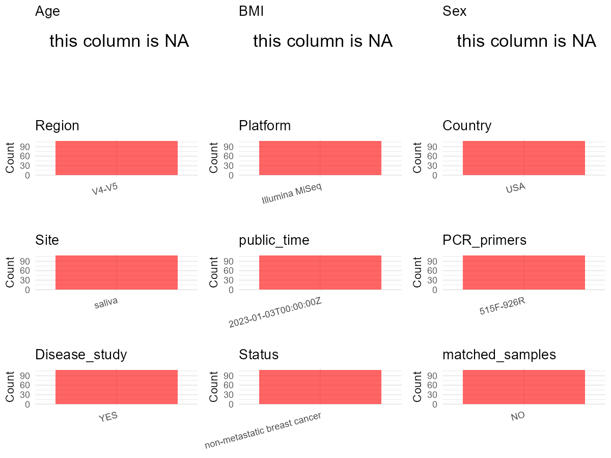

# Step 1: Obtain Initial Metadata from Each Project

To obtain the initial metadata:
1. Search for the BioProject ID (e.g., "PRJEBXXXX") on the [NCBI SRA website](https://www.ncbi.nlm.nih.gov/Traces/study/).
2. In the "Select" table, click on "Metadata" and download the file.
3. The downloaded file is typically named "SraRunTable.csv" and contains metadata for the project.
```{r}
library(tidyverse)
library(ggplot2)
library(cowplot)

setwd("C:/Users/zyc/Desktop/oral_project/data/projects/PRJEB51689")
initial_meta <- read.csv("SraRunTable.csv", header = TRUE) 
head(initial_meta)
```
# Step 2: Create a Uniform Metadata Template

The uniform metadata should include the following columns:

1. **BioProject**: Project ID (e.g., "PRJNA339212")
2. **Run**: Sample ID (e.g., "ERRXXXXXX" or "SRRXXXXXX")
3. **sample_name**: Original sample name submitted by the authors (not the database-assigned ID)
4. **Age**: Age of the subject (if available)
5. **BMI**: Body Mass Index (if available)
6. **Sex**: Sex of the subject ("F" or "M")
7. **Region**: Targeted 16S rRNA region (e.g., "V3-V4")
8. **Platform**: Sequencing platform (e.g., "Illumina MiSeq")
9. **Country**: Country of sample origin (e.g., "China")
10. **Site**: Sample site (e.g., "saliva", "dental plaque")
11. **public_time**: Data release date (format: "YYYY-MM-DD")
12. **PCR_primers**: PCR primers used (e.g., "515F-806R")
13. **title**: Title of the associated publication
14. **Disease_study**: Whether the study involves a disease ("YES" or "NO")
15. **Status**: Disease status (e.g., "T2DM", "HC"). Note: If the study includes both disease and healthy samples, this must be specified per sample.
16. **matched_samples**: matched samples ("YES" or "NO")
```{r}
metadata <- data.frame(
  BioProject = initial_meta$BioProject,
  Run = initial_meta$Run,
  sample_name = initial_meta$Sample_name,
  Age = NA,
  BMI = NA,
  Sex = NA,
  Platform = initial_meta$Instrument,
  # Country = initial_meta$geo_loc_name_country,
  # Site = initial_meta$isolation_source,
  public_time = initial_meta$ReleaseDate,
  stringsAsFactors = FALSE
)
```
# Step 3: Manually Add Information from the Publication

Some information (e.g. PCR primers, study title, disease status) must be manually extracted from the publication and added to the metadata.
```{r}
 # metadata <- metadata %>%
 #  mutate(Sex = recode(Sex, "female" = "F", "male" = "M"))
# metadata <-metadata%>%
#   mutate(Status = case_when(Site == "mucous" ~ "OSCC",
#                             Site == "dental plaque" ~ "OSCC",
#                             Site == "tumor" ~ "OSCC",
#                             TRUE ~ NA))

```

```{r}
metadata$Status <- "non-metastatic breast cancer"
metadata$Site <- "saliva"
metadata$Country <- "USA"
metadata$matched_samples <- "NO"
metadata$Region <- "V4-V5"
metadata$title <- "Chemotherapy-associated oral microbiome changes in breast cancer patients"
metadata$Disease_study <- "YES"
metadata$PCR_primers <- "515F-926R"
head(metadata)
```
# Step 4: Summarize and Validate the Metadata
```{r}
print(paste("Number of unique runs:", length(unique(metadata$Run))))
print(paste("Number of unique sample names:", length(unique(metadata$sample_name))))
```
# Step 5: Visualize the Metadata
```{r}
plot_data <- metadata %>%
  select(-BioProject, -Run, -sample_name, -title)

# Function to create simple plots for each column
create_simple_plots <- function(data) {
  plots <- list()

  for (col in colnames(data)) {
    # Check if the column is all NA
    if (all(is.na(data[[col]]))) {
      # Create an empty plot with text indicating all NA
      p <- ggplot() +
        annotate("text", x = 0.5, y = 0.5, label = "this column is NA", size = 6) +
        labs(title = col) +
        theme_void()
    } else if (is.numeric(data[[col]])) {
      # Numeric variable: histogram
      p <- ggplot(data, aes(x = .data[[col]])) +
        geom_histogram(fill = "blue", alpha = 0.6, bins = 20, na.rm = T) +
        labs(title = col) +
        theme_minimal()
    } else {
      # Categorical variable: bar plot (remove NA values)
      count_data <- as.data.frame(table(data[[col]], useNA = "ifany"))
      p <- ggplot(count_data, aes(x = reorder(Var1, -Freq), y = Freq)) +
        geom_col(fill = "red", alpha = 0.6) +
        labs(title = col, x = NULL, y = "Count") +
        theme_minimal() +
        theme(axis.text.x = element_text(angle = 15, hjust = 1))
    }
    plots[[col]] <- p
  }

  return(plots)
}


plots <- create_simple_plots(plot_data)
p<-plot_grid(plots$Age,
          plots$BMI,
          plots$Sex,
          plots$Region,
          plots$Platform,
          plots$Country,
          plots$Site,
          plots$public_time,
          plots$PCR_primers,
          plots$Disease_study,
          plots$Status,
          plots$matched_samples,# add
          ncol = 3, align = "hv", axis = "lb")
ggsave("Metadata_Summary.png", plot = p, width = 8, height = 6, dpi = 150)


```

```{r}

```
# Step 6: Finalize and Export the Metadata
```{r}
metadata <- metadata[, c(
  "BioProject", "Run", "sample_name", "Age", "BMI", "Sex",
  "Region", "Platform", "Country", "Site", "public_time",
  "PCR_primers", "title", "Disease_study", "Status","matched_samples"
)]


write.csv(metadata, file = "metadata.csv", quote = FALSE)

```
# Step 4: Creating a Uniform Metadata Template

This step converts the raw SRA table into the standard metadata format used in our meta-analysis.
The uniform metadata should include the following columns:
1. **bioproject**: Project ID from SRA or other database
   e.g. `PRJNA1234`, `CNP1234`, 'OEP1234', 'qiita_1234'
2. **sample_id**: SRA sample/run ID. Unique id for each sample!
   e.g. `DRR1234567`, `ERR1234567` and `SRR1234567`. If no such column exists, can use column like sample_name.
3. **subject_id**: subject id for each person if available.
   e.g. `patient_01`, `Host_03_before`, `subject12`
4. **age**: Age of the subject if available.
   e.g. `35`, `42` | not `adult`, `chilren`
5. **age_info**: If the age is not explicitly stated but approximate age range information is available, mark it in this column.
   e.g., `18-55`, `children`, `infant`, `elder`
6. **bmi**: Body Mass Index if available.
   e.g. `22.5`, `18.9` | not `normal`, `overweight`
7. **sex**: Sex of the subject.
   Mandatory to write as M/F | not `female`, `woman`
8. **sequencing_region**: Targeted 16S rRNA region.
   e.g. `V3-V4`, `V4` 
9. **platform**: Sequencing platform.
   e.g. `Illumina MiSeq`, `454 GS FLX Titanium`, `Ion Torrent`
10. **country**: Country of sample origin.
   e.g. `China`, `Japan` | not city name like `Beijing`
11. **site**: Sampling site. For oral and gut sites, specify the exact sites as detailed as possible. For example, if it is known to be supragingival plaque, do not record it as 'dental plaque', unless the original text provides only a vague description. 
    e.g. `saliva`, `tongue coating` | not broad term like `oral`
12. **site_group**: only accepts one of following three values: 'oral', 'gut', or 'other'.
13. **public_time**: Data release date. 
    e.g. `2021-06-22` | not `June 2021`
14. **pcr_primers**: PCR primers used.
    e.g. `515F-806R`, `27F-338R` | not primer sequences
15. **title**: Title of the associated publication.
16. **disease_study**: Whether the study involves disease samples. If it's not clear, can record as NA. Only three values accepted: 'yes', 'no' or NA
17. **status**: Disease status for each sample if available, else record as NA. Only accept following abbreviations, Write full names for all other diseases.
    HC: healthy control
    CD: Crohn's disease
    CRC: colorectal cancer
    COPD: chronic obstructive pulmonary disease
    HIV: human immunodeficiency virus
    ICU: intensive care unit
    OSCC: oral squamous cell carcinoma
    RA: rheumatoid arthritis
    UC: ulcerative colitis
18. **matched_samples**: Whether the subject has matched samples. Only accept 'yes' or 'no'.
19. **is_time_series**: Whether the study is a time series study. Only accept 'yes' or 'no'.

```{r}
# Extract columns from initial_meta as follows: (1) No modification needed → extract directly. (2) Modification needed → create a new column with the prefix raw_ and mark the original column as “pending”. (3) Need to find or determine based on the article.
metadata <- data.frame(
  bioproject = initial_meta$BioProject,
  sample_id = initial_meta$Run,
  subject_id = initial_meta$Sample_name,
  age = initial_meta$Age,
  age_info = NA,
  bmi = NA,
  raw_sex = NA, # if need modify, then create a column start with 'raw_'
  sex = "pending", # and mark as "pending"
  sequencing_region = 'V4-V5',
  platform = "Illumina MiSeq", # extract from methods section, NOT initial_meta
  country = initial_meta$geo_loc_name_country,
  raw_site = initial_meta$env_medium,
  site = "pending",
  site_group = "pending", # modify later
  public_time = initial_meta$ReleaseDate,
  pcr_primers = "515F-926R", # Format: xxF-xxR
  title = "Chemotherapy-associated oral microbiome changes in breast cancer patients,YES,non-metastatic breast cancer", # extract from article
  disease_study = "yes", # determine according to the article
  status = 'HC', 
  matched_samples = "pending", # modify later
  is_time_series = "yes", # determine according to the article
  stringsAsFactors = FALSE
)
metadata$public_time <- as.Date(metadata$public_time)
```


# Step 5: Manually solving pending issues

This step involves two parts: (1) handle the columns with the `raw_` prefix, and next (2) handle the `site_group` and `matched_samples` columns.

```{r}
# (1) Handle the columns with the `raw_` prefix.
# In this part, you need to customize the code based on the situation of the raw_ columns to obtain the content of the target columns. IMPORTANT: Add comments if the modification is not straightforward!!
metadata <- metadata$ # According to the 'family_relationship' column of initial_meta, 47 was matched to father; 48 were mother.
metadata$site <- metadata$raw_site
```

```{r}
# (2) Filling the 'site_group' and 'matched_samples' columns
# editing site_group
unique(metadata$site)
# EDIT HERE: add oral sites
Oral_site = c("Supragingival")
# EDIT HERE: add gut sites
Gut_site = c("none")
# just run
metadata <- metadata %>%
  mutate(site_group = case_when(
    site %in% Oral_site ~ "oral",
    site %in% Gut_site ~ "gut",
    TRUE ~ "other" 
  ))

# editing matched_samples, just run.
metadata$matched_samples <- ifelse(
  ave(metadata$subject_id, metadata$subject_id, FUN = length) > 1, 
  "yes", 
  "no"
)
```

```{r}
# (3) check if there is pending value in metadata. If there is pending value, go on modify the metadata.
# Function to check if a column contains "pending"
has_pending <- function(col) {
  if (is.character(col) || is.factor(col)) {
    any(col == "pending", na.rm = TRUE)
  } else {
    FALSE
  }
}

# Check for any pending value
any_pending_value <- any(sapply(metadata, has_pending))

if (!any_pending_value) {
  message("Good! No cell contains the value 'pending'.")
} else {
  pending_cols <- names(metadata)[sapply(metadata, has_pending)]
  message("Columns containing 'pending': ", paste(pending_cols, collapse = ", "))
  message("Please continue to resolve these pending columns!")
}
```

# Step 6: Visualize the Metadata

This step makes a quick set of plots for checking the distribution of key metadata fields.

```{r}
# Select columns for visualization, just run
plot_data <- metadata %>%
  select(-bioproject, -sample_id, -subject_id, -title)

create_simple_plots <- function(data) {
  plots <- list()
  continuous_vars <- c("age", "bmi")

  for (col in colnames(data)) {
    if (all(is.na(data[[col]]))) {
      p <- ggplot() +
        annotate("text", x = 0.5, y = 0.5, label = "this column is NA", size = 6) +
        labs(title = col) +
        theme_void()
    } else if (col %in% continuous_vars && is.numeric(data[[col]])) {
      p <- ggplot(data, aes(x = .data[[col]])) +
        geom_histogram(fill = "blue", alpha = 0.6, bins = 20, na.rm = TRUE) +
        labs(title = col, x = col, y = "Count") +
        theme_minimal()
    } else {
      count_data <- as.data.frame(table(data[[col]], useNA = "ifany"))
      p <- ggplot(count_data, aes(x = reorder(Var1, -Freq), y = Freq)) +
        geom_col(fill = "red", alpha = 0.6) +
        labs(title = col, x = NULL, y = "Count") +
        theme_minimal() +
        theme(axis.text.x = element_text(angle = 15, hjust = 1))
    }
    plots[[col]] <- p
  }

  return(plots)
}

# Generate and arrange plots
plots <- create_simple_plots(plot_data)
p <- plot_grid(plots$age,
               plots$age_info,
               plots$bmi,
               plots$sex,
               plots$site,
               plots$site_group,
               plots$sequencing_region,
               plots$platform,
               plots$country,
               # plots$pcr_primers,
               plots$status,
               plots$matched_samples,
               ncol = 3, align = "hv", axis = "lb")
ggsave("Metadata_Summary.png", plot = p, width = 8, height = 6, dpi = 150)
```

```{r}
# Insert Metadata_Summary.png into the current Rmd output

```

# Step 7: Sort and export the metadata

This step saves the cleaned metadata table as the final `metadata.csv` file.

```{r}
# Reorder the data frame
fixed_cols <- c("bioproject", "sample_id", "subject_id", "age", "age_info",
                "bmi", "sex", "platform", "sequencing_region", "pcr_primers", 
                "country", "site", "site_group", "disease_study", "status", 
                "title", "public_time", "matched_samples", "is_time_series")  
metadata <- metadata %>%
  select(all_of(fixed_cols), everything())

# save metadata 
# head(metadata)
write.csv(metadata, file = "metadata_v2.csv", quote = TRUE)
```


