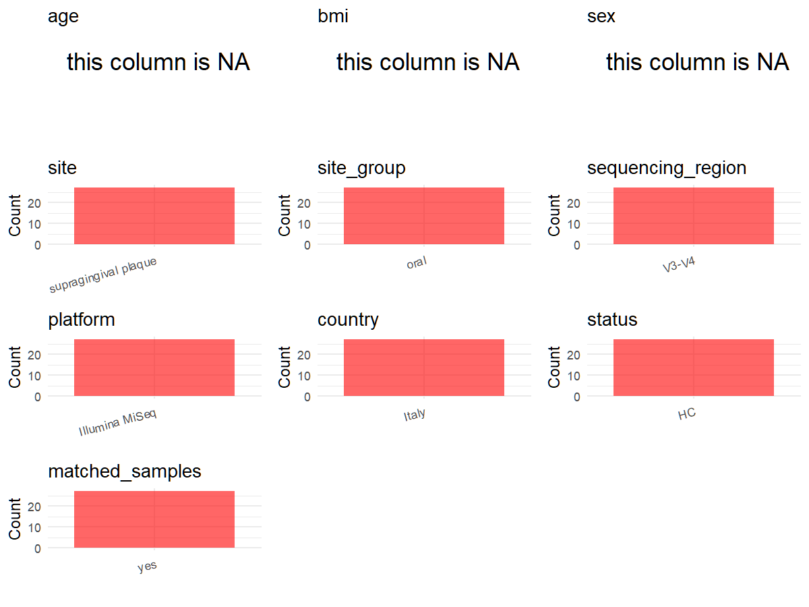

# Step 1: Obtain Initial Metadata from Each Project

This step sets the project directory and loads the raw SRA metadata.

```{r message=FALSE, warning=FALSE}
# Load libraries
library(dplyr)
library(ggplot2)
library(cowplot)

# (1) Setting working directory
project_id <- "PRJEB51725"

base_dir <- "E:/工作区/VSCode/RNAproject/collect_metadata_respon/project"
setwd(file.path(base_dir, project_id))

# (2) Loading raw SRA metadata file
sra_file <- "SraRunTable.csv"
initial_meta <- read.csv(sra_file, header = TRUE, stringsAsFactors = FALSE)
```

# Step 2: Data Overview

First, you need to get an overview of the data, which includes two steps: reading the article and reading the initial metadata. This step is very IMPORTANT!

```{r message=FALSE, warning=FALSE}
# (1) Read the article in the following order: abstract, the beginning of the results section, and the methods.
# Paper summary used for this project:
# - Title: Oral ecological environment modifications by hard-cheese: from pH to microbiome: a prospective cohort study based on 16S rRNA metabarcoding approach
# - Study design: prospective repeated-measures intervention study with three supragingival plaque samples per participant (A = T0, B = T1, C = T2)
# - Study population: nine oral-healthy adults from the University of Milan; Results report 5 females and 4 males with mean age 36 +- 4 years
# - Sample type for the retained human cohort: supragingival plaque
# - Sequencing from Methods: the V3-V4 region of the 16S rRNA was amplified with the Illumina 16S Metagenomic Sequencing Library Preparation kit and pooled libraries were run on MiSeq
# - The paper states that the V3 and V4 primer pairs were those included in the kit, but does not provide exact sequencing primer names or sequences
# - The article website lists Additional file 3 (Table S3) as OTU counts in all samples and Additional file 4 (Table S4) as per-timepoint full OTU lineage tables, but these supplementary files do not provide useful sample-level host metadata for the 19-column export
# - The ENA run table contains 27 Homo sapiens supragingival plaque rows plus 1 Bos taurus row (`Sample_name = Cow`), so the non-human row should be excluded before building the oral human metadata

# (2) IMPORTANT: MUST go through each column of initial_meta
head(initial_meta, 10)
colnames(initial_meta)
table(initial_meta$common_name)
table(initial_meta$Organism)
table(initial_meta$environment_.material.)
table(initial_meta$geo_loc_name_country)
table(initial_meta$ReleaseDate)
table(substr(initial_meta$Sample_name, 1, 1))
# SRA directly supports: sample_id from Run, country from geo_loc_name_country, public_time from ReleaseDate, and likely site from environment_(material).
# SRA pattern evidence suggests: Sample_name A1-A9, B1-B9, and C1-C9 encode the same 9 participants sampled at three study timepoints.
# Paper or supplements are still required for: age_info, sex summary, health-status interpretation, sequencing_region, platform, and pcr_primers.
# The single Bos taurus row has Sample_name Cow and does not belong to the retained human oral cohort.
# The letter prefix encodes the study timepoint (A = T0, B = T1, C = T2) while the numeric suffix identifies the participant.
```

# Step 3: Removing Control and Non-human Samples

First, we need to remove control samples(including both negative controls and positive controls) and non-human samples.

```{r}
# (1) Parameter setup
control_column <- "Sample_name"
control_keywords <- c("^Cow$")

species_column <- "Organism"
unique(initial_meta[[species_column]])
non_human_keywords <- c("Bos taurus")

# (2) Remove controls and non-human samples. DO NOT need to modify code in this part, just run it.
n_samples <- nrow(initial_meta)
# Control evaluation
if (length(control_keywords) > 0) {
  if (is.null(control_column) || control_column == "") {
    stop("Error: control_keywords provided but control_column is missing.")
  }

  if (!(control_column %in% colnames(initial_meta))) {
    stop(sprintf("Error: Column '%s' not found in initial_meta.", control_column))
  }

  control_pattern <- paste(control_keywords, collapse = "|")
  control_text <- initial_meta[[control_column]]
  is_control <- grepl(control_pattern, control_text)

} else {
  is_control <- rep(FALSE, n_samples)
}

# Non-human evaluation
if (length(non_human_keywords) > 0) {
  if (is.null(species_column) || species_column == "") {
    stop("Error: non_human_keywords provided but species_column is missing.")
  }

  if (!(species_column %in% colnames(initial_meta))) {
    stop(sprintf("Error: Column '%s' not found in initial_meta.", species_column))
  }

  non_human_pattern <- paste(non_human_keywords, collapse = "|")
  species_text <- initial_meta[[species_column]]
  is_non_human <- grepl(non_human_pattern, species_text)
} else {
  is_non_human <- rep(FALSE, n_samples)
}

# Execute removal
samples_to_remove <- is_control | is_non_human
initial_meta <- initial_meta[!samples_to_remove, ]

cat("Initial samples counts:", n_samples, "\n")
cat("Removed control samples:", sum(is_control), "\n")
cat("Removed non-human samples:", sum(is_non_human), "\n")
cat("Total samples removed ", sum(samples_to_remove), "\n")
cat("Remaining samples after Step 2:", nrow(initial_meta), "\n")
```

# Step 4: Creating a Uniform Metadata Template

This step converts the raw SRA table into the standard metadata format used in our meta-analysis.

```{r}
metadata <- data.frame(
  bioproject = initial_meta$BioProject,
  sample_id = initial_meta$Run,
  raw_subject_id = initial_meta$Sample_name,
  subject_id = sub("^[A-C]", "", initial_meta$Sample_name),
  age = NA_real_,
  age_info = "mean 36 +- 4 years; adults",
  bmi = NA_real_,
  sex = NA_character_,
  sequencing_region = "V3-V4",
  platform = "Illumina MiSeq",
  country = initial_meta$geo_loc_name_country,
  raw_site = initial_meta$Sample_name,
  site = "supragingival plaque",
  site_group = "pending",
  public_time = sub("T.*$", "", initial_meta$ReleaseDate),
  pcr_primers = NA_character_,
  title = "Oral ecological environment modifications by hard-cheese: from pH to microbiome: a prospective cohort study based on 16S rRNA metabarcoding approach",
  disease_study = "no",
  status = "HC",
  matched_samples = "pending",
  is_time_series = "yes",
  stringsAsFactors = FALSE
)

# Source notes for non-obvious fields:
# - raw_subject_id preserves the deposited Sample_name in the exported metadata.
# - raw_site preserves the deposited Sample_name because the A/B/C prefix is the row-level source used to infer the repeated-sampling structure behind subject_id.
# - subject_id is the numeric suffix of Sample_name because the paper defines three samples (A, B, C) from each patient at T0, T1, and T2.
# - age and bmi are unavailable per sample, so age_info keeps only the cohort-level summary reported in Results.
# - sex is left NA because the paper reports only cohort-level counts (5 females, 4 males), not per-sample assignments.
# - sequencing_region and platform come from the paper Methods, which state that the V3-V4 region was amplified and pooled libraries were run on MiSeq.
# - pcr_primers is left NA because the paper only says that the V3 and V4 primer pairs were those included in the Illumina kit and does not provide exact sequencing primer names or sequences.
# - status is set to HC because the Methods describe all participants as oral-healthy, periodontal healthy, free of caries, and without mucosal lesions.
metadata$public_time <- as.Date(metadata$public_time)
```

# Step 5: Manually solving pending issues

This step involves two parts: (1) handle the columns with the `raw_` prefix, and next (2) handle the `site_group` and `matched_samples` columns.

```{r}
# (1) raw_subject_id and raw_site are already carried in metadata to preserve the deposited Sample Name and isolation_source used for subject/site standardization.
metadata <- metadata
```

```{r}
# (2) Filling the 'site_group' and 'matched_samples' columns
unique(metadata$site)
Oral_site = c("supragingival plaque")
Gut_site = c("feces")

metadata <- metadata %>%
  mutate(site_group = case_when(
    site %in% Oral_site ~ "oral",
    site %in% Gut_site ~ "gut",
    TRUE ~ "other"
  ))

metadata$matched_samples <- ifelse(
  ave(metadata$subject_id, metadata$subject_id, FUN = length) > 1,
  "yes",
  "no"
)
# After excluding the cattle sample, each subject_id 1-9 appears at A, B, and C timepoints.
```

```{r}
# (3) check if there is pending value in metadata. If there is pending value, go on modify the metadata.
has_pending <- function(col) {
  if (is.character(col) || is.factor(col)) {
    any(col == "pending", na.rm = TRUE)
  } else {
    FALSE
  }
}

any_pending_value <- any(sapply(metadata, has_pending))

if (!any_pending_value) {
  message("Good! No cell contains the value 'pending'.")
} else {
  pending_cols <- names(metadata)[sapply(metadata, has_pending)]
  message("Columns containing 'pending': ", paste(pending_cols, collapse = ", "))
  message("Please continue to resolve these pending columns!")
}
```

# Step 6: Visualize the Metadata

This step makes a quick set of plots for checking the distribution of key metadata fields.

```{r}
plot_data <- metadata %>%
  select(-bioproject, -sample_id, -subject_id, -title)

create_simple_plots <- function(data) {
  plots <- list()
  continuous_vars <- c("age", "bmi")

  for (col in colnames(data)) {
    if (all(is.na(data[[col]]))) {
      p <- ggplot() +
        annotate("text", x = 0.5, y = 0.5, label = "this column is NA", size = 6) +
        labs(title = col) +
        theme_void()
    } else if (col %in% continuous_vars && is.numeric(data[[col]])) {
      p <- ggplot(data, aes(x = .data[[col]])) +
        geom_histogram(fill = "blue", alpha = 0.6, bins = 20, na.rm = TRUE) +
        labs(title = col, x = col, y = "Count") +
        theme_minimal()
    } else {
      count_data <- as.data.frame(table(data[[col]], useNA = "ifany"))
      p <- ggplot(count_data, aes(x = reorder(Var1, -Freq), y = Freq)) +
        geom_col(fill = "red", alpha = 0.6) +
        labs(title = col, x = NULL, y = "Count") +
        theme_minimal() +
        theme(axis.text.x = element_text(angle = 15, hjust = 1))
    }
    plots[[col]] <- p
  }

  return(plots)
}

plots <- create_simple_plots(plot_data)
p <- plot_grid(plots$age,
               plots$bmi,
               plots$sex,
               plots$site,
               plots$site_group,
               plots$sequencing_region,
               plots$platform,
               plots$country,
               plots$status,
               plots$matched_samples,
               ncol = 3, align = "hv", axis = "lb")
ggsave("Metadata_Summary.png", plot = p, width = 8, height = 6, dpi = 150)
```

```{r}

```

# Step 7: Sort and export the metadata

This step saves the cleaned metadata table as the final `metadata_v2.csv` file.

```{r}
fixed_cols <- c("bioproject", "sample_id", "subject_id", "age", "age_info",
                "bmi", "sex", "platform", "sequencing_region", "pcr_primers",
                "country", "site", "site_group", "disease_study", "status",
                "title", "public_time", "matched_samples", "is_time_series")
metadata <- metadata %>%
  select(all_of(fixed_cols), starts_with("raw_"))

write.csv(metadata, file = "metadata_v2.csv", quote = TRUE, row.names = FALSE)
```
