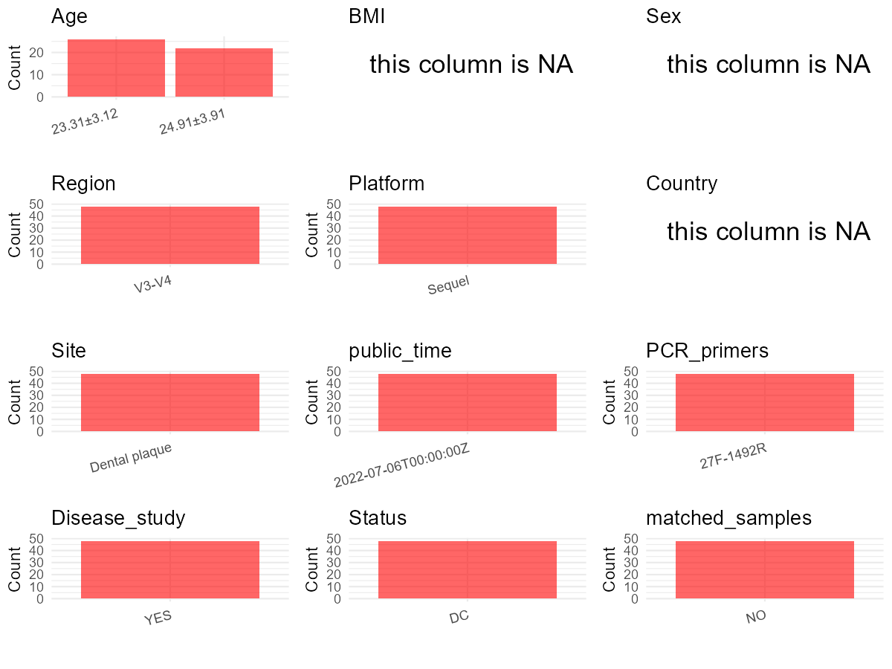

R Notebook: Metadata Processing Workflow
================

# Step 1: Obtain Initial Metadata from Each Project

To obtain the initial metadata: 1. Search for the BioProject ID (e.g.,
“PRJEBXXXX”) on the [NCBI SRA
website](https://www.ncbi.nlm.nih.gov/Traces/study/). 2. In the “Select”
table, click on “Metadata” and download the file. 3. The downloaded file
is typically named “SraRunTable.csv” and contains metadata for the
project.

``` r
# Load necessary libraries
library(dplyr)
library(ggplot2)
library(cowplot)

# Set working directory (update this path to your local directory)
setwd("D:/oral_project/PRJEB51987")

# Read the initial metadata files
initial_meta<-read.csv("SraRunTable.csv",header = T)

# Combine the two metadata files
#meta <- rbind(initial_meta, initial_meta1)

#Remove entries non-oral samples
#initial_meta <- subset(initial_meta,isolate %in% c("saliva","tongue coat"))

# Check the number of samples containing "HT" in Sample.Name (e.g., healthy controls)
#nrow(subset(meta, grepl("HT", Sample.Name)))

# Display the first few rows of the metadata
head(initial_meta)
```

    ##          Run Assay.Type AvgSpotLen    Bases BioProject     BioSample    Bytes
    ## 1 ERR9544370   AMPLICON       1517 25092532 PRJEB51987 SAMEA13819554 11577799
    ## 2 ERR9560177   AMPLICON       1505 29919064 PRJEB51987 SAMEA13819553 13942305
    ## 3 ERR9560178   AMPLICON       1518 20774805 PRJEB51987 SAMEA13819552  9683465
    ## 4 ERR9560179   AMPLICON       1534 29125901 PRJEB51987 SAMEA13819551 13671500
    ## 5 ERR9560180   AMPLICON       1523 30804043 PRJEB51987 SAMEA13819550 14203860
    ## 6 ERR9560181   AMPLICON       1516 22068266 PRJEB51987 SAMEA13819549 10191438
    ##                 Center.Name Consent DATASTORE.filetype DATASTORE.provider
    ## 1 TAIPAI MEDICAL UNIVERSITY  public     bam,run.zq,sra         gs,ncbi,s3
    ## 2 TAIPAI MEDICAL UNIVERSITY  public            bam,sra         gs,ncbi,s3
    ## 3 TAIPAI MEDICAL UNIVERSITY  public            bam,sra         gs,ncbi,s3
    ## 4 TAIPAI MEDICAL UNIVERSITY  public     bam,run.zq,sra         gs,ncbi,s3
    ## 5 TAIPAI MEDICAL UNIVERSITY  public     bam,run.zq,sra         gs,ncbi,s3
    ## 6 TAIPAI MEDICAL UNIVERSITY  public            bam,sra         gs,ncbi,s3
    ##                       DATASTORE.region ENA.FIRST.PUBLIC..run. ena_first_public
    ## 1 gs.us-east1,ncbi.public,s3.us-east-1             2022-07-01       2022-07-01
    ## 2 gs.us-east1,ncbi.public,s3.us-east-1             2022-07-01       2022-07-01
    ## 3 gs.us-east1,ncbi.public,s3.us-east-1             2022-07-01       2022-07-01
    ## 4 gs.us-east1,ncbi.public,s3.us-east-1             2022-07-01       2022-07-01
    ## 5 gs.us-east1,ncbi.public,s3.us-east-1             2022-07-01       2022-07-01
    ## 6 gs.us-east1,ncbi.public,s3.us-east-1             2022-07-01       2022-07-01
    ##   ENA.LAST.UPDATE..run. ena_last_update Experiment   external_id
    ## 1            2022-07-01      2022-07-01 ERX9081466 SAMEA13819554
    ## 2            2022-07-01      2022-07-01 ERX9111069 SAMEA13819553
    ## 3            2022-07-01      2022-07-01 ERX9111070 SAMEA13819552
    ## 4            2022-07-01      2022-07-01 ERX9111071 SAMEA13819551
    ## 5            2022-07-01      2022-07-01 ERX9111072 SAMEA13819550
    ## 6            2022-07-01      2022-07-01 ERX9111073 SAMEA13819549
    ##          INSDC_center_alias         INSDC_center_name   INSDC_first_public
    ## 1 Taipai Medical University taipai medical university 2022-07-01T00:18:59Z
    ## 2 Taipai Medical University taipai medical university 2022-07-01T00:18:59Z
    ## 3 Taipai Medical University taipai medical university 2022-07-01T00:18:59Z
    ## 4 Taipai Medical University taipai medical university 2022-07-01T00:18:59Z
    ## 5 Taipai Medical University taipai medical university 2022-07-01T00:18:59Z
    ## 6 Taipai Medical University taipai medical university 2022-07-01T00:18:59Z
    ##      INSDC_last_update INSDC_status Instrument Library.Name LibraryLayout
    ## 1 2022-07-01T00:18:59Z       public     Sequel           NA        SINGLE
    ## 2 2022-07-01T00:18:59Z       public     Sequel           NA        SINGLE
    ## 3 2022-07-01T00:18:59Z       public     Sequel           NA        SINGLE
    ## 4 2022-07-01T00:18:59Z       public     Sequel           NA        SINGLE
    ## 5 2022-07-01T00:18:59Z       public     Sequel           NA        SINGLE
    ## 6 2022-07-01T00:18:59Z       public     Sequel           NA        SINGLE
    ##   LibrarySelection LibrarySource                Organism    Platform
    ## 1              PCR   METAGENOMIC Alcyonidium gelatinosum PACBIO_SMRT
    ## 2              PCR   METAGENOMIC Alcyonidium gelatinosum PACBIO_SMRT
    ## 3              PCR   METAGENOMIC Alcyonidium gelatinosum PACBIO_SMRT
    ## 4              PCR   METAGENOMIC Alcyonidium gelatinosum PACBIO_SMRT
    ## 5              PCR   METAGENOMIC Alcyonidium gelatinosum PACBIO_SMRT
    ## 6              PCR   METAGENOMIC Alcyonidium gelatinosum PACBIO_SMRT
    ##            ReleaseDate          create_date version   Sample.Name   Sample_name
    ## 1 2022-07-06T00:00:00Z 2022-07-10T23:54:00Z       1 SAMEA13819554 Control_M1_11
    ## 2 2022-07-06T00:00:00Z 2022-07-10T23:36:00Z       1 SAMEA13819553 Control_M1_10
    ## 3 2022-07-06T00:00:00Z 2022-07-10T23:36:00Z       1 SAMEA13819552  Control_M1_9
    ## 4 2022-07-06T00:00:00Z 2022-07-10T23:36:00Z       1 SAMEA13819551  Control_M1_8
    ## 5 2022-07-06T00:00:00Z 2022-07-10T23:36:00Z       1 SAMEA13819550  Control_M1_7
    ## 6 2022-07-06T00:00:00Z 2022-07-10T23:36:00Z       1 SAMEA13819549  Control_M1_6
    ##   SRA.Study  Submitter_Id
    ## 1 ERP136656 Control_M1_11
    ## 2 ERP136656 Control_M1_10
    ## 3 ERP136656  Control_M1_9
    ## 4 ERP136656  Control_M1_8
    ## 5 ERP136656  Control_M1_7
    ## 6 ERP136656  Control_M1_6

# Step 2: Create a Uniform Metadata Template

The uniform metadata should include the following columns:

1.  **BioProject**: Project ID (e.g., “PRJNA339212”)
2.  **Run**: Sample ID (e.g., “ERRXXXXXX” or “SRRXXXXXX”)
3.  **sample_name**: Original sample name submitted by the authors (not
    the database-assigned ID)
4.  **Age**: Age of the subject (if available)
5.  **BMI**: Body Mass Index (if available)
6.  **Sex**: Sex of the subject (“F” or “M”)
7.  **Region**: Targeted 16S rRNA region (e.g., “V3-V4”)
8.  **Platform**: Sequencing platform (e.g., “Illumina MiSeq”)
9.  **Country**: Country of sample origin (e.g., “China”)
10. **Site**: Sample site (e.g., “saliva”, “dental plaque”)
11. **public_time**: Data release date (format: “YYYY-MM-DD”)
12. **PCR_primers**: PCR primers used (e.g., “515F-806R”)
13. **title**: Title of the associated publication
14. **Disease_study**: Whether the study involves a disease (“YES” or
    “NO”)
15. **Status**: Disease status (e.g., “T2DM”, “HC”). Note: If the study
    includes both disease and healthy samples, this must be specified
    per sample.
16. **matched_samples**: matched samples (“YES” or “NO”)

``` r
# Create a uniform metadata dataframe
metadata <- data.frame(
  BioProject = initial_meta$BioProject,
  Run = initial_meta$Run,
  sample_name = initial_meta$Sample_name,
  #Age = NA,
  BMI = NA,
  Sex = NA,
  Region = "V3-V4",
  Platform = initial_meta$Instrument,
  Country = NA,
  Site = "Dental plaque",
  public_time = initial_meta$ReleaseDate,
  stringsAsFactors = FALSE
)
```

``` r
metadata <- metadata %>%
  mutate(
    Age = case_when(
      grepl("Control", sample_name) ~ "24.91±3.91",  
      grepl("Xylitol", sample_name) ~ "23.31±3.12",  
    )
  )
```

# Step 3: Manually Add Information from the Publication

Some information (e.g. PCR primers, study title, disease status) must be
manually extracted from the publication and added to the metadata.

``` r
# Add information obtained from the publication
metadata$PCR_primers <- "27F-1492R"
metadata$title <- "Xylitol-Containing Chewing Gum Reduces Cariogenic and Periodontopathic Bacteria in Dental Plaque-Microbiome Investigation"
metadata$Disease_study <- "YES"
# Assign disease status based on sample_name patterns
metadata$Status<-"DC"

#get subjects id according to sample id
metadata$sample_name<-gsub("Control_|Xylitol_","",metadata$sample_name)
#get subjects id with Saliva available
keep_subjects<-subset(metadata,Site %in% "Dental plaque")
#remove subjects without Saliva samples
metadata<-subset(metadata,sample_name %in% keep_subjects$sample_name)
#get subjects sampling counts
sample_counts <- table(metadata$sample_name)
# Create matched_samples column, any subjects have >=2 samples will be label "YES", otherwise "NO"
 metadata <- metadata %>%
  group_by(sample_name) %>%
  mutate(
    sample_count = n(),
    unique_sites = n_distinct(Site),
    matched_samples = ifelse(sample_count >= 2 & unique_sites >= 2, "YES", "NO")
  ) %>%
  select(-sample_count, -unique_sites)  # 移除临时列
```

# Step 4: Summarize and Validate the Metadata

``` r
# Check the number of unique runs and sample names
print(paste("Number of unique runs:", length(unique(metadata$Run))))
```

    ## [1] "Number of unique runs: 48"

``` r
print(paste("Number of unique sample names:", length(unique(metadata$sample_name))))
```

    ## [1] "Number of unique sample names: 26"

# Step 5: Visualize the Metadata

``` r

```


# Step 6: Finalize and Export the Metadata

``` r
# Reorder columns to match the desired format
metadata <- metadata[, c(
  "BioProject", "Run", "sample_name", "Age", "BMI", "Sex", 
  "Region", "Platform", "Country", "Site", "public_time", 
  "PCR_primers", "title", "Disease_study", "Status","matched_samples"
)]

# Export the uniform metadata to a CSV file
write.csv(metadata, file = "metadata.csv", quote = TRUE)
head(metadata)
```

    ## # A tibble: 6 × 16
    ## # Groups:   sample_name [6]
    ##   BioProject Run     sample_name Age   BMI   Sex   Region Platform Country Site 
    ##   <chr>      <chr>   <chr>       <chr> <lgl> <lgl> <chr>  <chr>    <lgl>   <chr>
    ## 1 PRJEB51987 ERR954… M1_11       24.9… NA    NA    V3-V4  Sequel   NA      Dent…
    ## 2 PRJEB51987 ERR956… M1_10       24.9… NA    NA    V3-V4  Sequel   NA      Dent…
    ## 3 PRJEB51987 ERR956… M1_9        24.9… NA    NA    V3-V4  Sequel   NA      Dent…
    ## 4 PRJEB51987 ERR956… M1_8        24.9… NA    NA    V3-V4  Sequel   NA      Dent…
    ## 5 PRJEB51987 ERR956… M1_7        24.9… NA    NA    V3-V4  Sequel   NA      Dent…
    ## 6 PRJEB51987 ERR956… M1_6        24.9… NA    NA    V3-V4  Sequel   NA      Dent…
    ## # ℹ 6 more variables: public_time <chr>, PCR_primers <chr>, title <chr>,
    ## #   Disease_study <chr>, Status <chr>, matched_samples <chr>

## Notes for Students:

1.  **Metadata Accuracy**: Always cross-check the metadata with the
    original publication to ensure accuracy.
2.  **Manual Entries**: Columns like `PCR_primers`, and `Status` often
    require manual entry based on the publication.
3.  **Disease Status**: Be careful when assigning `Status`—some studies
    include both disease and healthy samples.
4.  **Visualization**: The plots help quickly identify the distribution
    of values in each column, which is useful for quality control.
5.  **Reproducibility**: Update the working directory and file paths to
    match your local environment.
