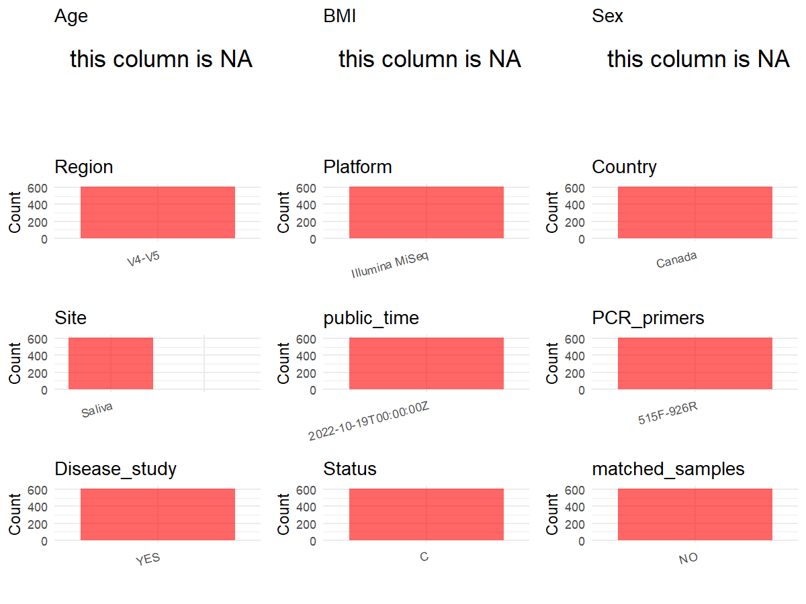

R Notebook: Metadata Processing Workflow
================

# Step 1: Obtain Initial Metadata from Each Project

To obtain the initial metadata: 1. Search for the BioProject ID (e.g.,
“PRJEBXXXX”) on the [NCBI SRA
website](https://www.ncbi.nlm.nih.gov/Traces/study/). 2. In the “Select”
table, click on “Metadata” and download the file. 3. The downloaded file
is typically named “SraRunTable.csv” and contains metadata for the
project.

``` r
# Load necessary libraries
library(dplyr)
library(ggplot2)
library(cowplot)

# Set working directory (update this path to your local directory)
setwd("E:/bioproject/PRJEB56605")

# Read the initial metadata files
initial_meta <- read.csv("SraRunTable.csv", header = T) 

# Display the first few rows of the metadata
head(initial_meta)
```

    ##           Run Assay.Type AvgSpotLen    Bases BioProject      BioSample    Bytes
    ## 1 ERR10358793   AMPLICON        601 22120926 PRJEB56605 SAMEA111455908 14625642
    ## 2 ERR10358794   AMPLICON        601 22220197 PRJEB56605 SAMEA111455886 14482313
    ## 3 ERR10358795   AMPLICON        601 29946943 PRJEB56605 SAMEA111455909 19797324
    ## 4 ERR10358796   AMPLICON        601 44891638 PRJEB56605 SAMEA111455875 27746800
    ## 5 ERR10358797   AMPLICON        601 57801973 PRJEB56605 SAMEA111455880 36656811
    ## 6 ERR10358798   AMPLICON        601 19099560 PRJEB56605 SAMEA111455920 12197609
    ##            Center.Name       Collection_Date common_name Consent
    ## 1 DALHOUSIE UNIVERSITY 2009-01-01/2015-01-01       human  public
    ## 2 DALHOUSIE UNIVERSITY 2009-01-01/2015-01-01       human  public
    ## 3 DALHOUSIE UNIVERSITY 2009-01-01/2015-01-01       human  public
    ## 4 DALHOUSIE UNIVERSITY 2009-01-01/2015-01-01       human  public
    ## 5 DALHOUSIE UNIVERSITY 2009-01-01/2015-01-01       human  public
    ## 6 DALHOUSIE UNIVERSITY 2009-01-01/2015-01-01       human  public
    ##   DATASTORE.filetype DATASTORE.provider                     DATASTORE.region
    ## 1   fastq,run.zq,sra         gs,ncbi,s3 gs.us-east1,ncbi.public,s3.us-east-1
    ## 2   fastq,run.zq,sra         gs,ncbi,s3 gs.us-east1,ncbi.public,s3.us-east-1
    ## 3   fastq,run.zq,sra         gs,ncbi,s3 gs.us-east1,ncbi.public,s3.us-east-1
    ## 4   fastq,run.zq,sra         gs,ncbi,s3 gs.us-east1,ncbi.public,s3.us-east-1
    ## 5   fastq,run.zq,sra         gs,ncbi,s3 gs.us-east1,ncbi.public,s3.us-east-1
    ## 6   fastq,run.zq,sra         gs,ncbi,s3 gs.us-east1,ncbi.public,s3.us-east-1
    ##   ENA.FIRST.PUBLIC..run. ena_first_public ENA.LAST.UPDATE..run. ena_last_update
    ## 1             2022-10-18       2022-10-18            2022-10-18      2022-10-18
    ## 2             2022-10-18       2022-10-18            2022-10-18      2022-10-18
    ## 3             2022-10-18       2022-10-18            2022-10-18      2022-10-18
    ## 4             2022-10-18       2022-10-18            2022-10-18      2022-10-18
    ## 5             2022-10-18       2022-10-18            2022-10-18      2022-10-18
    ## 6             2022-10-18       2022-10-18            2022-10-18      2022-10-18
    ##   Experiment    external_id geo_loc_name_country geo_loc_name_country_continent
    ## 1 ERX9890905 SAMEA111455908               Canada                  North America
    ## 2 ERX9890906 SAMEA111455886               Canada                  North America
    ## 3 ERX9890907 SAMEA111455909               Canada                  North America
    ## 4 ERX9890908 SAMEA111455875               Canada                  North America
    ## 5 ERX9890909 SAMEA111455880               Canada                  North America
    ## 6 ERX9890910 SAMEA111455920               Canada                  North America
    ##   geographic_location_.country_and.or_sea. geographic_location_.latitude.
    ## 1                                   Canada                         44.682
    ## 2                                   Canada                         44.682
    ## 3                                   Canada                         44.682
    ## 4                                   Canada                         44.682
    ## 5                                   Canada                         44.682
    ## 6                                   Canada                         44.682
    ##   geographic_location_.longitude.    INSDC_center_name   INSDC_first_public
    ## 1                        -63.7443 DALHOUSIE UNIVERSITY 2022-10-18T00:27:52Z
    ## 2                        -63.7443 DALHOUSIE UNIVERSITY 2022-10-18T00:27:51Z
    ## 3                        -63.7443 DALHOUSIE UNIVERSITY 2022-10-18T00:27:52Z
    ## 4                        -63.7443 DALHOUSIE UNIVERSITY 2022-10-18T00:27:51Z
    ## 5                        -63.7443 DALHOUSIE UNIVERSITY 2022-10-18T00:27:51Z
    ## 6                        -63.7443 DALHOUSIE UNIVERSITY 2022-10-18T00:27:53Z
    ##      INSDC_last_update INSDC_status     Instrument
    ## 1 2022-10-18T00:27:52Z       public Illumina MiSeq
    ## 2 2022-10-18T00:27:51Z       public Illumina MiSeq
    ## 3 2022-10-18T00:27:52Z       public Illumina MiSeq
    ## 4 2022-10-18T00:27:51Z       public Illumina MiSeq
    ## 5 2022-10-18T00:27:51Z       public Illumina MiSeq
    ## 6 2022-10-18T00:27:53Z       public Illumina MiSeq
    ##                      Library.Name LibraryLayout LibrarySelection LibrarySource
    ## 1 16S rRNA V4 - V5 (515FB - 926R)        PAIRED              PCR   METAGENOMIC
    ## 2 16S rRNA V4 - V5 (515FB - 926R)        PAIRED              PCR   METAGENOMIC
    ## 3 16S rRNA V4 - V5 (515FB - 926R)        PAIRED              PCR   METAGENOMIC
    ## 4 16S rRNA V4 - V5 (515FB - 926R)        PAIRED              PCR   METAGENOMIC
    ## 5 16S rRNA V4 - V5 (515FB - 926R)        PAIRED              PCR   METAGENOMIC
    ## 6 16S rRNA V4 - V5 (515FB - 926R)        PAIRED              PCR   METAGENOMIC
    ##       Organism Platform
    ## 1 Homo sapiens ILLUMINA
    ## 2 Homo sapiens ILLUMINA
    ## 3 Homo sapiens ILLUMINA
    ## 4 Homo sapiens ILLUMINA
    ## 5 Homo sapiens ILLUMINA
    ## 6 Homo sapiens ILLUMINA
    ##                                                                                                         project_name
    ## 1 Investigating the oral microbiome in retrospective and prospective cases of prostate\\, colon\\, and breast cancer
    ## 2 Investigating the oral microbiome in retrospective and prospective cases of prostate\\, colon\\, and breast cancer
    ## 3 Investigating the oral microbiome in retrospective and prospective cases of prostate\\, colon\\, and breast cancer
    ## 4 Investigating the oral microbiome in retrospective and prospective cases of prostate\\, colon\\, and breast cancer
    ## 5 Investigating the oral microbiome in retrospective and prospective cases of prostate\\, colon\\, and breast cancer
    ## 6 Investigating the oral microbiome in retrospective and prospective cases of prostate\\, colon\\, and breast cancer
    ##            ReleaseDate          create_date version    Sample.Name Sample_name
    ## 1 2022-10-19T00:00:00Z 2022-10-25T03:42:00Z       1 SAMEA111455908   100318135
    ## 2 2022-10-19T00:00:00Z 2022-10-25T03:25:00Z       1 SAMEA111455886   100332235
    ## 3 2022-10-19T00:00:00Z 2022-10-25T03:25:00Z       1 SAMEA111455909   100339235
    ## 4 2022-10-19T00:00:00Z 2022-10-25T03:46:00Z       1 SAMEA111455875   100426535
    ## 5 2022-10-19T00:00:00Z 2022-10-25T03:44:00Z       1 SAMEA111455880   100631635
    ## 6 2022-10-19T00:00:00Z 2022-10-25T03:25:00Z       1 SAMEA111455920   100697835
    ##   Sequencing_method SRA.Study Submitter_Id broad.scale_environmental_context
    ## 1    Illumina MiSeq ERP141561    100318135                             Human
    ## 2    Illumina MiSeq ERP141561    100332235                             Human
    ## 3    Illumina MiSeq ERP141561    100339235                             Human
    ## 4    Illumina MiSeq ERP141561    100426535                             Human
    ## 5    Illumina MiSeq ERP141561    100631635                             Human
    ## 6    Illumina MiSeq ERP141561    100697835                             Human
    ##   environmental_medium local_environmental_context   INSDC_center_alias
    ## 1               Saliva                        Oral DALHOUSIE UNIVERSITY
    ## 2               Saliva                        Oral DALHOUSIE UNIVERSITY
    ## 3               Saliva                        Oral DALHOUSIE UNIVERSITY
    ## 4               Saliva                        Oral DALHOUSIE UNIVERSITY
    ## 5               Saliva                        Oral DALHOUSIE UNIVERSITY
    ## 6               Saliva                        Oral DALHOUSIE UNIVERSITY
    ##   Scientific_Name environment_.biome. environment_.feature.
    ## 1                                                          
    ## 2                                                          
    ## 3                                                          
    ## 4                                                          
    ## 5                                                          
    ## 6                                                          
    ##   environment_.material. human_oral_environmental_package investigation_type
    ## 1                                                                           
    ## 2                                                                           
    ## 3                                                                           
    ## 4                                                                           
    ## 5                                                                           
    ## 6

# Step 2: Create a Uniform Metadata Template

The uniform metadata should include the following columns:

1.  **BioProject**: Project ID (e.g., “PRJNA339212”)
2.  **Run**: Sample ID (e.g., “ERRXXXXXX” or “SRRXXXXXX”)
3.  **sample_name**: Original sample name submitted by the authors (not
    the database-assigned ID)
4.  **Age**: Age of the subject (if available)
5.  **BMI**: Body Mass Index (if available)
6.  **Sex**: Sex of the subject (“F” or “M”)
7.  **Region**: Targeted 16S rRNA region (e.g., “V3-V4”)
8.  **Platform**: Sequencing platform (e.g., “Illumina MiSeq”)
9.  **Country**: Country of sample origin (e.g., “China”)
10. **Site**: Sample site (e.g., “saliva”, “dental plaque”)
11. **public_time**: Data release date (format: “YYYY-MM-DD”)
12. **PCR_primers**: PCR primers used (e.g., “515F-806R”)
13. **title**: Title of the associated publication
14. **Disease_study**: Whether the study involves a disease (“YES” or
    “NO”)
15. **Status**: Disease status (e.g., “T2DM”, “HC”). Note: If the study
    includes both disease and healthy samples, this must be specified
    per sample.
16. **matched_samples**: matched samples (“YES” or “NO”)

``` r
# Create a uniform metadata dataframe
metadata<-data.frame(
  BioProject=initial_meta$BioProject,
  Run=initial_meta$Run,
  sample_name=initial_meta$Submitter_Id,
  Age = NA, 
  BMI = NA, 
  Sex = NA,  
  Platform=initial_meta$Instrument,
  Country=initial_meta$geo_loc_name_country,
  Site=initial_meta$environmental_medium,
  public_time=initial_meta$ReleaseDate,
  matched_samples = NA,
  stringsAsFactors = FALSE
)
```

# Step 3: Manually Add Information from the Publication

Some information (e.g. PCR primers, study title, disease status) must be
manually extracted from the publication and added to the metadata.

``` r
# Add information obtained from the publication
metadata$Region <- "V4-V5"
metadata$PCR_primers <- "515F-926R"
metadata$title <- "Investigating the oral microbiome in retrospective and prospective cases of prostate colon and breast cancer"
metadata$Disease_study <- "YES"
# Assign disease status based on sample_name patterns
metadata$Status <- "C"

#extract subject id by remove prefix of sample_name
metadata$sample_name <- gsub("^100", "", metadata$sample_name)

# Check initial data distribution
cat("Initial sample distribution:\n")
```

    ## Initial sample distribution:

``` r
table(metadata$sample_name)
```

    ## 
    ##       000735       004035       007135       020735       027335       029435 
    ##            1            1            1            1            1            1 
    ##       045735       048035       059635       060135       080235       095035 
    ##            1            1            1            1            1            1 
    ##    101021735    101036035    101037435    101097535  101099635-2    101103735 
    ##            1            1            1            1            1            1 
    ##    101105735    101108635    101108735    101111035    101111135    101112435 
    ##            1            1            1            1            1            1 
    ##    101112935    101113335    101114735    101119135    101122935    101165335 
    ##            1            1            1            1            1            1 
    ##    101170635    101234335    101256335    101264135    101275435    101282235 
    ##            1            1            1            1            1            1 
    ##    101285035    101290735    101303635    101321135    101324935    101341635 
    ##            1            1            1            1            1            1 
    ##    101342635    101350135    101371735    101379535  101383435-2    101387135 
    ##            1            1            1            1            1            1 
    ##    101401035    101497235    101517735    101524535    101530735    101546235 
    ##            1            1            1            1            1            1 
    ##    101547535    101549035    101570335    101584435    101642135    101643035 
    ##            1            1            1            1            1            1 
    ##    101691435    101691935    101699535    101700635    101700835    101701035 
    ##            1            1            1            1            1            1 
    ##    101710135    101711635    101716135    101784132    101859435    101861635 
    ##            1            1            1            1            1            1 
    ##    101884835    101906335    101912635    101912935    101928235  101939335-2 
    ##            1            1            1            1            1            1 
    ##    101941035    101943235    101944035    101946435    101948935    101970935 
    ##            1            1            1            1            1            1 
    ##    101974535    101981135    101982235    101994635    102005035    102017735 
    ##            1            1            1            1            1            1 
    ##    102019835    102026035    102038735    102070635  102077035-2  102077235-2 
    ##            1            1            1            1            1            1 
    ##    102078235    102078635    102087935    102090935    102100135    102103835 
    ##            1            1            1            1            1            1 
    ##    102104835    102115335    102119335    102125935    102127535    102142135 
    ##            1            1            1            1            1            1 
    ##    102147835    102150335    102156735    102172335    102179335    102198735 
    ##            1            1            1            1            1            1 
    ##    102236235    102244335    102272935    102294235    102295835    102305235 
    ##            1            1            1            1            1            1 
    ##    102319135    102339235    102348535    102361035    102365035    102386135 
    ##            1            1            1            1            1            1 
    ##    102389035  102401035-2    102401335    102403335    102412235  102413135-2 
    ##            1            1            1            1            1            1 
    ##       102435    102490535    102495535    102497235    102502435    102503335 
    ##            1            1            1            1            1            1 
    ##    102510035    102510135    102512735    102517335    102518235    102527935 
    ##            1            1            1            1            1            1 
    ##    102535735    102546335    102551135 102559435-2W  102562935-2    102565235 
    ##            1            1            1            1            1            1 
    ##    102565435    102567135  102568135-2    102569335    102585335    102588335 
    ##            1            1            1            1            1            1 
    ##    102589735    102589835    102592035    102607535    102607635    102608935 
    ##            1            1            1            1            1            1 
    ##  102615035-2    102615635  102615935-2    102629335    102630135    102631535 
    ##            1            1            1            1            1            1 
    ##    102640435    102649735    102651335    102659535    102662435       107235 
    ##            1            1            1            1            1            1 
    ##       113535       120135       151935       153935       156735       161935 
    ##            1            1            1            1            1            1 
    ##       164435       165535       166835       168235       264035       274135 
    ##            1            1            1            1            1            1 
    ##       277935       318135       329635       332235       336935       339235 
    ##            1            1            1            1            1            1 
    ##       350635       356135    362711981    362711988    362711993    362711996 
    ##            1            1            1            1            1            1 
    ##    362711997    362711998    362711999    362712006    362712008    362712011 
    ##            1            1            1            1            1            1 
    ##    362712015    362712018    362712024    362712033    362712035    362712036 
    ##            1            1            1            1            1            1 
    ##    362712044    362712045    362712048    362712054    362712055    362712164 
    ##            1            1            1            1            1            1 
    ##    362712165    362712176    362712178    362712181    362712186    362712187 
    ##            1            1            1            1            1            1 
    ##    362712188    362712189    362712193    362712197    362712203    362712206 
    ##            1            1            1            1            1            1 
    ##    362712207    362712208    362712210    362712215    362712220    362712229 
    ##            1            1            1            1            1            1 
    ##    362712238    362712241    362712247    362712846    362712851    362712865 
    ##            1            1            1            1            1            1 
    ##    362712880    362712883    362712921    362713018    362713028    362713043 
    ##            1            1            1            1            1            1 
    ##    362713047    362713054    362713058    362713068    362713075    362713092 
    ##            1            1            1            1            1            1 
    ##    362713093    362713106    362713108    362713281    362713327    362713331 
    ##            1            1            1            1            1            1 
    ##    362713339    362713370    362713371    362713372    362713387    362713391 
    ##            1            1            1            1            1            1 
    ##    362713887    362713893    362713894    362713896    362713911    362713913 
    ##            1            1            1            1            1            1 
    ##    362713921    362713924    362713927    362713937    362713946    362713951 
    ##            1            1            1            1            1            1 
    ##    362713971    362714073    362714075    362714081    362714122    362714124 
    ##            1            1            1            1            1            1 
    ##    362714130    362714142    362714148    362714152    362714164    362714165 
    ##            1            1            1            1            1            1 
    ##    362714265    362714274    362714275    362714279    362714282    362714284 
    ##            1            1            1            1            1            1 
    ##    362714290    362714291    362714292    362714295    362714296    362714299 
    ##            1            1            1            1            1            1 
    ##    362714301    362714302    362714303    362714305    362714308    362714309 
    ##            1            1            1            1            1            1 
    ##    362714313    362714321    362714325    362714326    362714332    362714333 
    ##            1            1            1            1            1            1 
    ##    362714339    362714340    362714341    362714345    362714356    362714357 
    ##            1            1            1            1            1            1 
    ##    362715044    362715063    362715064    362715065    362715074    362715075 
    ##            1            1            1            1            1            1 
    ##    362715076    362715082    362715083    362715087    362715093    362715097 
    ##            1            1            1            1            1            1 
    ##    362715102    362715104    362715105    362715106    362715107    362715110 
    ##            1            1            1            1            1            1 
    ##    362715115    362715116    362715226    362715230    362715237    362715247 
    ##            1            1            1            1            1            1 
    ##    362715249    362715251    362715257    362715266    362715271    362715274 
    ##            1            1            1            1            1            1 
    ##    362715275    362715280    362715291    362715293    362715304    362715305 
    ##            1            1            1            1            1            1 
    ##    362715309    362715310    362715318    362734860    362735516    362735669 
    ##            1            1            1            1            1            1 
    ##    362735696    362735700    362735702    362735706    362735709    362735711 
    ##            1            1            1            1            1            1 
    ##    362735717    362735720    362735724    362735727    362735732    362735737 
    ##            1            1            1            1            1            1 
    ##    362735739    362735746    362735753    362735761    362736245    362736288 
    ##            1            1            1            1            1            1 
    ##    362736311    362736636    362736664    362736666    362736673    362736680 
    ##            1            1            1            1            1            1 
    ##    362736684    362736698    362736714    362737394    362737395    362737403 
    ##            1            1            1            1            1            1 
    ##    362737412    362737422    362737424    362737439    362737441    362737448 
    ##            1            1            1            1            1            1 
    ##    362737450    362737452    362737456    362737464    362737469    362738073 
    ##            1            1            1            1            1            1 
    ##    362738074    362738077    362738084    362738086    362738088    362738093 
    ##            1            1            1            1            1            1 
    ##    362738103    362738104    362738109    362738121    362738131    362738140 
    ##            1            1            1            1            1            1 
    ##    362738141    362738142    362738144    362738151    362738154    362738161 
    ##            1            1            1            1            1            1 
    ##    362738354    362738356    362738359    362738360    362738366    362738369 
    ##            1            1            1            1            1            1 
    ##    362738378    362738379    362738380    362738392    362738394    362738396 
    ##            1            1            1            1            1            1 
    ##    362738400    362738401    362738402    362738405    362738408    362738411 
    ##            1            1            1            1            1            1 
    ##    362738412    362738413    362738418    362738419    362738423    362738428 
    ##            1            1            1            1            1            1 
    ##    362738434    362738435    362738439    362738442    362738445    362738446 
    ##            1            1            1            1            1            1 
    ##    362738748    362738752    362738770    362738776    362738806    362738822 
    ##            1            1            1            1            1            1 
    ##    362738832    365440512    365440564    365440571    365440572    365441356 
    ##            1            1            1            1            1            1 
    ##    365442040    365442044    365442060    365442081    365442092    365442093 
    ##            1            1            1            1            1            1 
    ##    365442583    365442854    365442869    365442878    365443294    365443297 
    ##            1            1            1            1            1            1 
    ##    365443318    365443589    365444066    365444076    365444078    365444082 
    ##            1            1            1            1            1            1 
    ##    365444083    365444089    365444091    365444094    365444102    365444103 
    ##            1            1            1            1            1            1 
    ##    365444109    365444111    365444112    365444119    365444122    365444136 
    ##            1            1            1            1            1            1 
    ##    365444149    365444150    365444157    365444159    365444160    365444182 
    ##            1            1            1            1            1            1 
    ##    365444184    365444187    365444200    365444218    365444220    365444233 
    ##            1            1            1            1            1            1 
    ##    365445061    365445068    365445107    365446942    365446973    365446980 
    ##            1            1            1            1            1            1 
    ##    365447013    365447037    365447050    365447071    365447097    365447107 
    ##            1            1            1            1            1            1 
    ##    365447108    365447123    365448284    365448285    365448286    365448290 
    ##            1            1            1            1            1            1 
    ##    365448299    365448300    365448309    365448321    365448323    365448326 
    ##            1            1            1            1            1            1 
    ##    365448337    365448354       385235       389335       393435       402635 
    ##            1            1            1            1            1            1 
    ##       403635       408735       410135       425235       426535       443735 
    ##            1            1            1            1            1            1 
    ##       448735       453535       473335       481935       483435       494435 
    ##            1            1            1            1            1            1 
    ##       496935       519235       563735       567835       576735       579635 
    ##            1            1            1            1            1            1 
    ##       591235       594135       599435       631635       638135       638835 
    ##            1            1            1            1            1            1 
    ##       680835       697835       700535       715935       733935       752535 
    ##            1            1            1            1            1            1 
    ##       759735       765935       768635       769535       769735       771835 
    ##            1            1            1            1            1            1 
    ##       774835       774935       775035       776435       778735       787735 
    ##            1            1            1            1            1            1 
    ##       790335       791135       792035       793235       798935       800735 
    ##            1            1            1            1            1            1 
    ##       801335       805135       809735       811035       814335       815535 
    ##            1            1            1            1            1            1 
    ##       816935       817535       825635       829735       847435       850935 
    ##            1            1            1            1            1            1 
    ##       860735       868235       873735       875835       876135       879535 
    ##            1            1            1            1            1            1 
    ##       886435       887035       887135       887935       948735       964735 
    ##            1            1            1            1            1            1 
    ##       967735       969835       975235 
    ##            1            1            1

``` r
table(metadata$Site)
```

    ## 
    ##        Saliva 
    ##      1    608

``` r
# Calculate sampling frequency per subject
sample_counts <- table(metadata$sample_name)
cat("\nNumber of samples per subject:\n")
```

    ## 
    ## Number of samples per subject:

``` r
print(sample_counts)
```

    ## 
    ##       000735       004035       007135       020735       027335       029435 
    ##            1            1            1            1            1            1 
    ##       045735       048035       059635       060135       080235       095035 
    ##            1            1            1            1            1            1 
    ##    101021735    101036035    101037435    101097535  101099635-2    101103735 
    ##            1            1            1            1            1            1 
    ##    101105735    101108635    101108735    101111035    101111135    101112435 
    ##            1            1            1            1            1            1 
    ##    101112935    101113335    101114735    101119135    101122935    101165335 
    ##            1            1            1            1            1            1 
    ##    101170635    101234335    101256335    101264135    101275435    101282235 
    ##            1            1            1            1            1            1 
    ##    101285035    101290735    101303635    101321135    101324935    101341635 
    ##            1            1            1            1            1            1 
    ##    101342635    101350135    101371735    101379535  101383435-2    101387135 
    ##            1            1            1            1            1            1 
    ##    101401035    101497235    101517735    101524535    101530735    101546235 
    ##            1            1            1            1            1            1 
    ##    101547535    101549035    101570335    101584435    101642135    101643035 
    ##            1            1            1            1            1            1 
    ##    101691435    101691935    101699535    101700635    101700835    101701035 
    ##            1            1            1            1            1            1 
    ##    101710135    101711635    101716135    101784132    101859435    101861635 
    ##            1            1            1            1            1            1 
    ##    101884835    101906335    101912635    101912935    101928235  101939335-2 
    ##            1            1            1            1            1            1 
    ##    101941035    101943235    101944035    101946435    101948935    101970935 
    ##            1            1            1            1            1            1 
    ##    101974535    101981135    101982235    101994635    102005035    102017735 
    ##            1            1            1            1            1            1 
    ##    102019835    102026035    102038735    102070635  102077035-2  102077235-2 
    ##            1            1            1            1            1            1 
    ##    102078235    102078635    102087935    102090935    102100135    102103835 
    ##            1            1            1            1            1            1 
    ##    102104835    102115335    102119335    102125935    102127535    102142135 
    ##            1            1            1            1            1            1 
    ##    102147835    102150335    102156735    102172335    102179335    102198735 
    ##            1            1            1            1            1            1 
    ##    102236235    102244335    102272935    102294235    102295835    102305235 
    ##            1            1            1            1            1            1 
    ##    102319135    102339235    102348535    102361035    102365035    102386135 
    ##            1            1            1            1            1            1 
    ##    102389035  102401035-2    102401335    102403335    102412235  102413135-2 
    ##            1            1            1            1            1            1 
    ##       102435    102490535    102495535    102497235    102502435    102503335 
    ##            1            1            1            1            1            1 
    ##    102510035    102510135    102512735    102517335    102518235    102527935 
    ##            1            1            1            1            1            1 
    ##    102535735    102546335    102551135 102559435-2W  102562935-2    102565235 
    ##            1            1            1            1            1            1 
    ##    102565435    102567135  102568135-2    102569335    102585335    102588335 
    ##            1            1            1            1            1            1 
    ##    102589735    102589835    102592035    102607535    102607635    102608935 
    ##            1            1            1            1            1            1 
    ##  102615035-2    102615635  102615935-2    102629335    102630135    102631535 
    ##            1            1            1            1            1            1 
    ##    102640435    102649735    102651335    102659535    102662435       107235 
    ##            1            1            1            1            1            1 
    ##       113535       120135       151935       153935       156735       161935 
    ##            1            1            1            1            1            1 
    ##       164435       165535       166835       168235       264035       274135 
    ##            1            1            1            1            1            1 
    ##       277935       318135       329635       332235       336935       339235 
    ##            1            1            1            1            1            1 
    ##       350635       356135    362711981    362711988    362711993    362711996 
    ##            1            1            1            1            1            1 
    ##    362711997    362711998    362711999    362712006    362712008    362712011 
    ##            1            1            1            1            1            1 
    ##    362712015    362712018    362712024    362712033    362712035    362712036 
    ##            1            1            1            1            1            1 
    ##    362712044    362712045    362712048    362712054    362712055    362712164 
    ##            1            1            1            1            1            1 
    ##    362712165    362712176    362712178    362712181    362712186    362712187 
    ##            1            1            1            1            1            1 
    ##    362712188    362712189    362712193    362712197    362712203    362712206 
    ##            1            1            1            1            1            1 
    ##    362712207    362712208    362712210    362712215    362712220    362712229 
    ##            1            1            1            1            1            1 
    ##    362712238    362712241    362712247    362712846    362712851    362712865 
    ##            1            1            1            1            1            1 
    ##    362712880    362712883    362712921    362713018    362713028    362713043 
    ##            1            1            1            1            1            1 
    ##    362713047    362713054    362713058    362713068    362713075    362713092 
    ##            1            1            1            1            1            1 
    ##    362713093    362713106    362713108    362713281    362713327    362713331 
    ##            1            1            1            1            1            1 
    ##    362713339    362713370    362713371    362713372    362713387    362713391 
    ##            1            1            1            1            1            1 
    ##    362713887    362713893    362713894    362713896    362713911    362713913 
    ##            1            1            1            1            1            1 
    ##    362713921    362713924    362713927    362713937    362713946    362713951 
    ##            1            1            1            1            1            1 
    ##    362713971    362714073    362714075    362714081    362714122    362714124 
    ##            1            1            1            1            1            1 
    ##    362714130    362714142    362714148    362714152    362714164    362714165 
    ##            1            1            1            1            1            1 
    ##    362714265    362714274    362714275    362714279    362714282    362714284 
    ##            1            1            1            1            1            1 
    ##    362714290    362714291    362714292    362714295    362714296    362714299 
    ##            1            1            1            1            1            1 
    ##    362714301    362714302    362714303    362714305    362714308    362714309 
    ##            1            1            1            1            1            1 
    ##    362714313    362714321    362714325    362714326    362714332    362714333 
    ##            1            1            1            1            1            1 
    ##    362714339    362714340    362714341    362714345    362714356    362714357 
    ##            1            1            1            1            1            1 
    ##    362715044    362715063    362715064    362715065    362715074    362715075 
    ##            1            1            1            1            1            1 
    ##    362715076    362715082    362715083    362715087    362715093    362715097 
    ##            1            1            1            1            1            1 
    ##    362715102    362715104    362715105    362715106    362715107    362715110 
    ##            1            1            1            1            1            1 
    ##    362715115    362715116    362715226    362715230    362715237    362715247 
    ##            1            1            1            1            1            1 
    ##    362715249    362715251    362715257    362715266    362715271    362715274 
    ##            1            1            1            1            1            1 
    ##    362715275    362715280    362715291    362715293    362715304    362715305 
    ##            1            1            1            1            1            1 
    ##    362715309    362715310    362715318    362734860    362735516    362735669 
    ##            1            1            1            1            1            1 
    ##    362735696    362735700    362735702    362735706    362735709    362735711 
    ##            1            1            1            1            1            1 
    ##    362735717    362735720    362735724    362735727    362735732    362735737 
    ##            1            1            1            1            1            1 
    ##    362735739    362735746    362735753    362735761    362736245    362736288 
    ##            1            1            1            1            1            1 
    ##    362736311    362736636    362736664    362736666    362736673    362736680 
    ##            1            1            1            1            1            1 
    ##    362736684    362736698    362736714    362737394    362737395    362737403 
    ##            1            1            1            1            1            1 
    ##    362737412    362737422    362737424    362737439    362737441    362737448 
    ##            1            1            1            1            1            1 
    ##    362737450    362737452    362737456    362737464    362737469    362738073 
    ##            1            1            1            1            1            1 
    ##    362738074    362738077    362738084    362738086    362738088    362738093 
    ##            1            1            1            1            1            1 
    ##    362738103    362738104    362738109    362738121    362738131    362738140 
    ##            1            1            1            1            1            1 
    ##    362738141    362738142    362738144    362738151    362738154    362738161 
    ##            1            1            1            1            1            1 
    ##    362738354    362738356    362738359    362738360    362738366    362738369 
    ##            1            1            1            1            1            1 
    ##    362738378    362738379    362738380    362738392    362738394    362738396 
    ##            1            1            1            1            1            1 
    ##    362738400    362738401    362738402    362738405    362738408    362738411 
    ##            1            1            1            1            1            1 
    ##    362738412    362738413    362738418    362738419    362738423    362738428 
    ##            1            1            1            1            1            1 
    ##    362738434    362738435    362738439    362738442    362738445    362738446 
    ##            1            1            1            1            1            1 
    ##    362738748    362738752    362738770    362738776    362738806    362738822 
    ##            1            1            1            1            1            1 
    ##    362738832    365440512    365440564    365440571    365440572    365441356 
    ##            1            1            1            1            1            1 
    ##    365442040    365442044    365442060    365442081    365442092    365442093 
    ##            1            1            1            1            1            1 
    ##    365442583    365442854    365442869    365442878    365443294    365443297 
    ##            1            1            1            1            1            1 
    ##    365443318    365443589    365444066    365444076    365444078    365444082 
    ##            1            1            1            1            1            1 
    ##    365444083    365444089    365444091    365444094    365444102    365444103 
    ##            1            1            1            1            1            1 
    ##    365444109    365444111    365444112    365444119    365444122    365444136 
    ##            1            1            1            1            1            1 
    ##    365444149    365444150    365444157    365444159    365444160    365444182 
    ##            1            1            1            1            1            1 
    ##    365444184    365444187    365444200    365444218    365444220    365444233 
    ##            1            1            1            1            1            1 
    ##    365445061    365445068    365445107    365446942    365446973    365446980 
    ##            1            1            1            1            1            1 
    ##    365447013    365447037    365447050    365447071    365447097    365447107 
    ##            1            1            1            1            1            1 
    ##    365447108    365447123    365448284    365448285    365448286    365448290 
    ##            1            1            1            1            1            1 
    ##    365448299    365448300    365448309    365448321    365448323    365448326 
    ##            1            1            1            1            1            1 
    ##    365448337    365448354       385235       389335       393435       402635 
    ##            1            1            1            1            1            1 
    ##       403635       408735       410135       425235       426535       443735 
    ##            1            1            1            1            1            1 
    ##       448735       453535       473335       481935       483435       494435 
    ##            1            1            1            1            1            1 
    ##       496935       519235       563735       567835       576735       579635 
    ##            1            1            1            1            1            1 
    ##       591235       594135       599435       631635       638135       638835 
    ##            1            1            1            1            1            1 
    ##       680835       697835       700535       715935       733935       752535 
    ##            1            1            1            1            1            1 
    ##       759735       765935       768635       769535       769735       771835 
    ##            1            1            1            1            1            1 
    ##       774835       774935       775035       776435       778735       787735 
    ##            1            1            1            1            1            1 
    ##       790335       791135       792035       793235       798935       800735 
    ##            1            1            1            1            1            1 
    ##       801335       805135       809735       811035       814335       815535 
    ##            1            1            1            1            1            1 
    ##       816935       817535       825635       829735       847435       850935 
    ##            1            1            1            1            1            1 
    ##       860735       868235       873735       875835       876135       879535 
    ##            1            1            1            1            1            1 
    ##       886435       887035       887135       887935       948735       964735 
    ##            1            1            1            1            1            1 
    ##       967735       969835       975235 
    ##            1            1            1

``` r
# Create matched_samples column
metadata$matched_samples <- ifelse(metadata$sample_name %in% names(sample_counts[sample_counts >= 2]), "YES", "NO")
```

# Step 4: Summarize and Validate the Metadata

``` r
# Check the number of unique runs and sample names
print(paste("Number of unique runs:", length(unique(metadata$Run))))
```

    ## [1] "Number of unique runs: 609"

``` r
print(paste("Number of unique sample names:", length(unique(metadata$sample_name))))
```

    ## [1] "Number of unique sample names: 609"

# Step 5: Visualize the Metadata

``` r

```

<!-- -->

# Step 6: Finalize and Export the Metadata

``` r
# Reorder columns to match the desired format
metadata <- metadata[, c(
  "BioProject", "Run", "sample_name", "Age", "BMI", "Sex", 
  "Region", "Platform", "Country", "Site", "public_time", 
  "PCR_primers", "title", "Disease_study", "Status", "matched_samples"
)]

# Export the uniform metadata to a CSV file
write.csv(metadata, file = "metadata.csv", quote = FALSE)
head(metadata)
```

    ##   BioProject         Run sample_name Age BMI Sex Region       Platform Country
    ## 1 PRJEB56605 ERR10358793      318135  NA  NA  NA  V4-V5 Illumina MiSeq  Canada
    ## 2 PRJEB56605 ERR10358794      332235  NA  NA  NA  V4-V5 Illumina MiSeq  Canada
    ## 3 PRJEB56605 ERR10358795      339235  NA  NA  NA  V4-V5 Illumina MiSeq  Canada
    ## 4 PRJEB56605 ERR10358796      426535  NA  NA  NA  V4-V5 Illumina MiSeq  Canada
    ## 5 PRJEB56605 ERR10358797      631635  NA  NA  NA  V4-V5 Illumina MiSeq  Canada
    ## 6 PRJEB56605 ERR10358798      697835  NA  NA  NA  V4-V5 Illumina MiSeq  Canada
    ##     Site          public_time PCR_primers
    ## 1 Saliva 2022-10-19T00:00:00Z   515F-926R
    ## 2 Saliva 2022-10-19T00:00:00Z   515F-926R
    ## 3 Saliva 2022-10-19T00:00:00Z   515F-926R
    ## 4 Saliva 2022-10-19T00:00:00Z   515F-926R
    ## 5 Saliva 2022-10-19T00:00:00Z   515F-926R
    ## 6 Saliva 2022-10-19T00:00:00Z   515F-926R
    ##                                                                                                          title
    ## 1 Investigating the oral microbiome in retrospective and prospective cases of prostate colon and breast cancer
    ## 2 Investigating the oral microbiome in retrospective and prospective cases of prostate colon and breast cancer
    ## 3 Investigating the oral microbiome in retrospective and prospective cases of prostate colon and breast cancer
    ## 4 Investigating the oral microbiome in retrospective and prospective cases of prostate colon and breast cancer
    ## 5 Investigating the oral microbiome in retrospective and prospective cases of prostate colon and breast cancer
    ## 6 Investigating the oral microbiome in retrospective and prospective cases of prostate colon and breast cancer
    ##   Disease_study Status matched_samples
    ## 1           YES      C              NO
    ## 2           YES      C              NO
    ## 3           YES      C              NO
    ## 4           YES      C              NO
    ## 5           YES      C              NO
    ## 6           YES      C              NO

## Notes for Students:

1.  **Metadata Accuracy**: Always cross-check the metadata with the
    original publication to ensure accuracy.
2.  **Manual Entries**: Columns like `PCR_primers`, and `Status` often
    require manual entry based on the publication.
3.  **Disease Status**: Be careful when assigning `Status`—some studies
    include both disease and healthy samples.
4.  **Visualization**: The plots help quickly identify the distribution
    of values in each column, which is useful for quality control.
5.  **Reproducibility**: Update the working directory and file paths to
    match your local environment.
