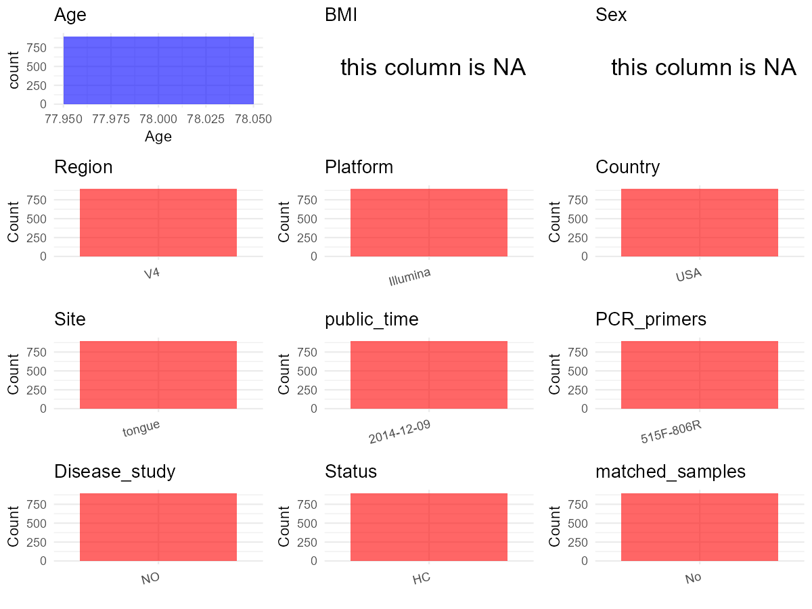

R Notebook: Metadata Processing Workflow
================

# Step 1: Obtain Initial Metadata from Each Project

To obtain the initial metadata: 1. Search for the BioProject ID (e.g.,
“PRJEBXXXX”) on the [NCBI SRA
website](https://www.ncbi.nlm.nih.gov/Traces/study/). 2. In the “Select”
table, click on “Metadata” and download the file. 3. The downloaded file
is typically named “SraRunTable.csv” and contains metadata for the
project.

``` r
# Load necessary libraries
library(dplyr)
library(ggplot2)
library(cowplot)

# Set working directory (update this path to your local directory)
setwd("D:/oral_project/PRJEB5726")

# Read the initial metadata files
initial_meta<-read.csv("SraRunTable.csv",header = T)

# Combine the two metadata files
#meta <- rbind(initial_meta, initial_meta1)

#Remove entries non-oral samples
#initial_meta <- subset(initial_meta,isolate %in% c("saliva","tongue coat"))

# Check the number of samples containing "HT" in Sample.Name (e.g., healthy controls)
#nrow(subset(meta, grepl("HT", Sample.Name)))

# Display the first few rows of the metadata
head(initial_meta)
```

    ##   PUBLIC       Run age_unit altitude ambiguoustimepoint anonymized_name
    ## 1      n ERR441042       78        0                 No          T20246
    ## 2      n ERR441043       78        0                 No          T20277
    ## 3      n ERR441044       78        0                 No          T20959
    ## 4      n ERR441045       78        0                 No          T20972
    ## 5      n ERR441046       78        0                 No          T20693
    ## 6      n ERR441047       78        0                 No          T20297
    ##   antibiotic_disturbance anytimeseries Assay.Type assigned_from_geo AvgSpotLen
    ## 1                     No           Yes   AMPLICON                 n         99
    ## 2                     No           Yes   AMPLICON                 n         99
    ## 3                    Yes           Yes   AMPLICON                 n         99
    ## 4                     No           Yes   AMPLICON                 n         99
    ## 5                    Yes           Yes   AMPLICON                 n         99
    ## 6                     No           Yes   AMPLICON                 n         99
    ##     Bases BioProject    BioSample BodySite   Bytes   Center.Name
    ## 1 5062513  PRJEB5726 SAMEA2385745   tongue 3958938 CCME-COLORADO
    ## 2 1871338  PRJEB5726 SAMEA2385746   tongue 1463304 CCME-COLORADO
    ## 3 6351500  PRJEB5726 SAMEA2385747   tongue 4867113 CCME-COLORADO
    ## 4 4827960  PRJEB5726 SAMEA2385748   tongue 3744182 CCME-COLORADO
    ## 5 6461814  PRJEB5726 SAMEA2385749   tongue 4939024 CCME-COLORADO
    ## 6 4871322  PRJEB5726 SAMEA2385750   tongue 3811867 CCME-COLORADO
    ##             common_name Consent Control DATASTORE.filetype DATASTORE.provider
    ## 1 human oral metagenome  public      no   fastq,run.zq,sra     ena,gs,ncbi,s3
    ## 2 human oral metagenome  public      no   fastq,run.zq,sra     ena,gs,ncbi,s3
    ## 3 human oral metagenome  public      no   fastq,run.zq,sra     ena,gs,ncbi,s3
    ## 4 human oral metagenome  public      no   fastq,run.zq,sra     ena,gs,ncbi,s3
    ## 5 human oral metagenome  public      no   fastq,run.zq,sra     ena,gs,ncbi,s3
    ## 6 human oral metagenome  public      no   fastq,run.zq,sra     ena,gs,ncbi,s3
    ##                           DATASTORE.region Depth elevation
    ## 1 ena,gs.us-east1,ncbi.public,s3.us-east-1     0  2124.399
    ## 2 ena,gs.us-east1,ncbi.public,s3.us-east-1     0  2124.399
    ## 3 ena,gs.us-east1,ncbi.public,s3.us-east-1     0  2124.399
    ## 4 ena,gs.us-east1,ncbi.public,s3.us-east-1     0  2124.399
    ## 5 ena,gs.us-east1,ncbi.public,s3.us-east-1     0  1624.098
    ## 6 ena,gs.us-east1,ncbi.public,s3.us-east-1     0  2124.399
    ##   ENA.FIRST.PUBLIC..run. ENA_first_public ENA.LAST.UPDATE..run. ENA_last_update
    ## 1             2014-10-31       2014-10-31            2018-11-16      2014-02-28
    ## 2             2014-10-31       2014-10-31            2018-11-16      2014-02-28
    ## 3             2014-10-31       2014-10-31            2018-11-16      2014-02-28
    ## 4             2014-10-31       2014-10-31            2018-11-16      2014-02-28
    ## 5             2014-10-31       2014-10-31            2018-11-16      2014-02-28
    ## 6             2014-10-31       2014-10-31            2018-11-16      2014-02-28
    ##          env_biome                   env_feature  env_matter
    ## 1 ENVO:urban biome ENVO:human-associated habitat ENVO:saliva
    ## 2 ENVO:urban biome ENVO:human-associated habitat ENVO:saliva
    ## 3 ENVO:urban biome ENVO:human-associated habitat ENVO:saliva
    ## 4 ENVO:urban biome ENVO:human-associated habitat ENVO:saliva
    ## 5 ENVO:urban biome ENVO:human-associated habitat ENVO:saliva
    ## 6 ENVO:urban biome ENVO:human-associated habitat ENVO:saliva
    ##   experiment_center..exp.
    ## 1                    CCME
    ## 2                    CCME
    ## 3                    CCME
    ## 4                    CCME
    ## 5                    CCME
    ## 6                    CCME
    ##                                             experiment_design_description..exp.
    ## 1 Skin, oral and fecal samples from Students at CU-Boulder, NAU and NC State U.
    ## 2 Skin, oral and fecal samples from Students at CU-Boulder, NAU and NC State U.
    ## 3 Skin, oral and fecal samples from Students at CU-Boulder, NAU and NC State U.
    ## 4 Skin, oral and fecal samples from Students at CU-Boulder, NAU and NC State U.
    ## 5 Skin, oral and fecal samples from Students at CU-Boulder, NAU and NC State U.
    ## 6 Skin, oral and fecal samples from Students at CU-Boulder, NAU and NC State U.
    ##   Experiment experiment_title..exp.  external_id foreheadtimeseries
    ## 1  ERX407806             Flores_SMP SAMEA2385745                 No
    ## 2  ERX407807             Flores_SMP SAMEA2385746                 No
    ## 3  ERX407808             Flores_SMP SAMEA2385747                 No
    ## 4  ERX407809             Flores_SMP SAMEA2385748                 No
    ## 5  ERX407810             Flores_SMP SAMEA2385749                 No
    ## 6  ERX407811             Flores_SMP SAMEA2385750                 No
    ##   geo_loc_name_country geo_loc_name_country_continent
    ## 1                  USA                  North America
    ## 2                  USA                  North America
    ## 3                  USA                  North America
    ## 4                  USA                  North America
    ## 5                  USA                  North America
    ## 6                  USA                  North America
    ##   geographic_location_.country_and.or_sea. guttimeseries host_common_name
    ## 1                                 USA: GAZ            No            human
    ## 2                                 USA: GAZ            No            human
    ## 3                                 USA: GAZ            No            human
    ## 4                                 USA: GAZ            No            human
    ## 5                                 USA: GAZ            No            human
    ## 6                                 USA: GAZ            No            human
    ##   host_subject_id host_taxid idantibioticdisturbance idmenstruationdisturbance
    ## 1     2148:NAU132       9606                      No                       Yes
    ## 2     2148:NAU161       9606                      No                        No
    ## 3     2148:NAU136       9606                     Yes                       Yes
    ## 4     2148:NAU154       9606                      No                       Yes
    ## 5     2148:CUB033       9606                     Yes                       Yes
    ## 6     2148:NAU149       9606                      No                        No
    ##   illumina_technology INSDC_center_alias
    ## 1               HiSeq      CCME-COLORADO
    ## 2               HiSeq      CCME-COLORADO
    ## 3               HiSeq      CCME-COLORADO
    ## 4               HiSeq      CCME-COLORADO
    ## 5               HiSeq      CCME-COLORADO
    ## 6               HiSeq      CCME-COLORADO
    ##                                                            INSDC_center_name
    ## 1 Colorado Center for Microbial Ecology\\, University of Colorado at Boulder
    ## 2 Colorado Center for Microbial Ecology\\, University of Colorado at Boulder
    ## 3 Colorado Center for Microbial Ecology\\, University of Colorado at Boulder
    ## 4 Colorado Center for Microbial Ecology\\, University of Colorado at Boulder
    ## 5 Colorado Center for Microbial Ecology\\, University of Colorado at Boulder
    ## 6 Colorado Center for Microbial Ecology\\, University of Colorado at Boulder
    ##     INSDC_first_public    INSDC_last_update INSDC_status  Instrument LATITUDE
    ## 1 2014-10-31T17:03:10Z 2014-02-28T16:59:03Z       public unspecified 35.20135
    ## 2 2014-10-31T17:03:10Z 2014-02-28T16:59:03Z       public unspecified 35.20135
    ## 3 2014-10-31T17:03:10Z 2014-02-28T16:59:03Z       public unspecified 35.20135
    ## 4 2014-10-31T17:03:10Z 2014-02-28T16:59:03Z       public unspecified 35.20135
    ## 5 2014-10-31T17:03:10Z 2014-02-28T16:59:04Z       public unspecified 40.01499
    ## 6 2014-10-31T17:03:10Z 2014-02-28T16:59:04Z       public unspecified 35.20135
    ##   Library.Name LibraryLayout LibrarySelection LibrarySource LONGITUDE
    ## 1   T20246:107        SINGLE              PCR   METAGENOMIC -111.6393
    ## 2   T20277:132        SINGLE              PCR   METAGENOMIC -111.6393
    ## 3   T20959:638        SINGLE              PCR   METAGENOMIC -111.6393
    ## 4   T20972:650        SINGLE              PCR   METAGENOMIC -111.6393
    ## 5   T20693:432        SINGLE              PCR   METAGENOMIC -105.2706
    ## 6   T20297:150        SINGLE              PCR   METAGENOMIC -111.6393
    ##   menstruation_disturbance mislabeledprobabove0point05
    ## 1                      Yes                        TRUE
    ## 2                       No                       FALSE
    ## 3                      Yes                       FALSE
    ## 4                      Yes                       FALSE
    ## 5                      Yes                       FALSE
    ## 6                       No                       FALSE
    ##   mislabeledprobabove0point10 mislabeledprobabove0point15
    ## 1                        TRUE                       FALSE
    ## 2                       FALSE                       FALSE
    ## 3                       FALSE                       FALSE
    ## 4                       FALSE                       FALSE
    ## 5                       FALSE                       FALSE
    ## 6                       FALSE                       FALSE
    ##   mislabeledprobabove0point20 mislabeledprobabove0point25
    ## 1                       FALSE                       FALSE
    ## 2                       FALSE                       FALSE
    ## 3                       FALSE                       FALSE
    ## 4                       FALSE                       FALSE
    ## 5                       FALSE                       FALSE
    ## 6                       FALSE                       FALSE
    ##   mislabeledprobabove0point30 mislabeledprobabove0point35
    ## 1                       FALSE                       FALSE
    ## 2                       FALSE                       FALSE
    ## 3                       FALSE                       FALSE
    ## 4                       FALSE                       FALSE
    ## 5                       FALSE                       FALSE
    ## 6                       FALSE                       FALSE
    ##   mislabeledprobabove0point40 mislabeledprobabove0point45
    ## 1                       FALSE                       FALSE
    ## 2                       FALSE                       FALSE
    ## 3                       FALSE                       FALSE
    ## 4                       FALSE                       FALSE
    ## 5                       FALSE                       FALSE
    ## 6                       FALSE                       FALSE
    ##   mislabeledprobabove0point50 mislabeledprobabove0point55
    ## 1                       FALSE                       FALSE
    ## 2                       FALSE                       FALSE
    ## 3                       FALSE                       FALSE
    ## 4                       FALSE                       FALSE
    ## 5                       FALSE                       FALSE
    ## 6                       FALSE                       FALSE
    ##   mislabeledprobabove0point60 mislabeledprobabove0point65
    ## 1                       FALSE                       FALSE
    ## 2                       FALSE                       FALSE
    ## 3                       FALSE                       FALSE
    ## 4                       FALSE                       FALSE
    ## 5                       FALSE                       FALSE
    ## 6                       FALSE                       FALSE
    ##   mislabeledprobabove0point70 mislabeledprobabove0point75
    ## 1                       FALSE                       FALSE
    ## 2                       FALSE                       FALSE
    ## 3                       FALSE                       FALSE
    ## 4                       FALSE                       FALSE
    ## 5                       FALSE                       FALSE
    ## 6                       FALSE                       FALSE
    ##   mislabeledprobabove0point80 mislabeledprobabove0point85
    ## 1                       FALSE                       FALSE
    ## 2                       FALSE                       FALSE
    ## 3                       FALSE                       FALSE
    ## 4                       FALSE                       FALSE
    ## 5                       FALSE                       FALSE
    ## 6                       FALSE                       FALSE
    ##   mislabeledprobabove0point90 mislabeledprobabove0point95
    ## 1                       FALSE                       FALSE
    ## 2                       FALSE                       FALSE
    ## 3                       FALSE                       FALSE
    ## 4                       FALSE                       FALSE
    ## 5                       FALSE                       FALSE
    ## 6                       FALSE                       FALSE
    ##   mislabeledprobabove0point99 num_sequences..exp.              Organism
    ## 1                       FALSE               50936 human oral metagenome
    ## 2                       FALSE               18848 human oral metagenome
    ## 3                       FALSE               63934 human oral metagenome
    ## 4                       FALSE               48577 human oral metagenome
    ## 5                       FALSE               65070 human oral metagenome
    ## 6                       FALSE               49053 human oral metagenome
    ##   palmtimeseries                                 pcr_primers..exp.
    ## 1             No FWD:GTGCCAGCMGCCGCGGTAA; REV:GGACTACHVGGGTWTCTAAT
    ## 2             No FWD:GTGCCAGCMGCCGCGGTAA; REV:GGACTACHVGGGTWTCTAAT
    ## 3             No FWD:GTGCCAGCMGCCGCGGTAA; REV:GGACTACHVGGGTWTCTAAT
    ## 4             No FWD:GTGCCAGCMGCCGCGGTAA; REV:GGACTACHVGGGTWTCTAAT
    ## 5             No FWD:GTGCCAGCMGCCGCGGTAA; REV:GGACTACHVGGGTWTCTAAT
    ## 6             No FWD:GTGCCAGCMGCCGCGGTAA; REV:GGACTACHVGGGTWTCTAAT
    ##   personalidsicknessdisturbance platform..exp. Platform primerplate
    ## 1                            No       Illumina ILLUMINA           4
    ## 2                            No       Illumina ILLUMINA           6
    ## 3                           Yes       Illumina ILLUMINA          10
    ## 4                           Yes       Illumina ILLUMINA           4
    ## 5                           Yes       Illumina ILLUMINA           6
    ## 6                           Yes       Illumina ILLUMINA           5
    ##            ReleaseDate row_number..exp. run_center..exp. run_date..exp.
    ## 1 2014-12-09T00:00:00Z              107             CCME         7/7/12
    ## 2 2014-12-09T00:00:00Z              132             CCME         7/7/12
    ## 3 2014-12-09T00:00:00Z              638             CCME         7/7/12
    ## 4 2014-12-09T00:00:00Z              650             CCME         7/7/12
    ## 5 2014-12-09T00:00:00Z              432             CCME         7/7/12
    ## 6 2014-12-09T00:00:00Z              150             CCME         7/7/12
    ##   samp_size sample_center..exp. Sample_ID  Sample.Name
    ## 1      0.1g                CCME   1161978 SAMEA2385745
    ## 2      0.1g                CCME   1161979 SAMEA2385746
    ## 3      0.1g                CCME   1161980 SAMEA2385747
    ## 4      0.1g                CCME   1161981 SAMEA2385748
    ## 5      0.1g                CCME   1161982 SAMEA2385749
    ## 6      0.1g                CCME   1161983 SAMEA2385750
    ##                      Sample_name sampleantibioticdisturbance
    ## 1 T20246,qiime_study_2148:T20246                          No
    ## 2 T20277,qiime_study_2148:T20277                          No
    ## 3 T20959,qiime_study_2148:T20959                          No
    ## 4 T20972,qiime_study_2148:T20972                          No
    ## 5 T20693,qiime_study_2148:T20693                          No
    ## 6 T20297,qiime_study_2148:T20297                          No
    ##   samplemenstruationdisturbance      sampleplate samplesicknessdisturbance
    ## 1                           Yes               10                        No
    ## 2                            No               12                        No
    ## 3                            No Week1TongueCombo                        No
    ## 4                            No               10                        No
    ## 5                            No               12                        No
    ## 6                            No               11                        No
    ##     sequencing_meth..exp. sickness_disturbance SRA.Study study_center..exp.
    ## 1 Sequencing by synthesis                   No ERP005150               CCME
    ## 2 Sequencing by synthesis                  Yes ERP005150               CCME
    ## 3 Sequencing by synthesis                  Yes ERP005150               CCME
    ## 4 Sequencing by synthesis                  Yes ERP005150               CCME
    ## 5 Sequencing by synthesis                  Yes ERP005150               CCME
    ## 6 Sequencing by synthesis                  Yes ERP005150               CCME
    ##              Submitter_Id target_gene..exp. target_subfragment..exp. taxon_id
    ## 1 qiime_study_2148:T20246          16S rRNA                       V4   447426
    ## 2 qiime_study_2148:T20277          16S rRNA                       V4   447426
    ## 3 qiime_study_2148:T20959          16S rRNA                       V4   447426
    ## 4 qiime_study_2148:T20972          16S rRNA                       V4   447426
    ## 5 qiime_study_2148:T20693          16S rRNA                       V4   447426
    ## 6 qiime_study_2148:T20297          16S rRNA                       V4   447426
    ##   tonguetimeseries   type_sample Well          create_date version university
    ## 1              Yes tongue sample   E7 2014-12-09T23:03:00Z       1        NAU
    ## 2              Yes tongue sample   B6 2014-12-10T02:10:00Z       1        NAU
    ## 3              Yes tongue sample   E7 2014-12-09T23:05:00Z       1        NAU
    ## 4              Yes tongue sample  C10 2014-12-10T02:09:00Z       1        NAU
    ## 5              Yes tongue sample   D7 2014-12-10T02:09:00Z       1         CU
    ## 6              Yes tongue sample   A4 2014-12-09T23:05:00Z       1        NAU
    ##   weekssincestart       body_habitat  body_product     body_site startweek
    ## 1             5.0 UBERON:oral cavity UBERON:saliva UBERON:tongue         1
    ## 2             7.0 UBERON:oral cavity UBERON:saliva UBERON:tongue         1
    ## 3             0.0 UBERON:oral cavity UBERON:saliva UBERON:tongue         1
    ## 4             9.0 UBERON:oral cavity UBERON:saliva UBERON:tongue         1
    ## 5             0.5 UBERON:oral cavity UBERON:saliva UBERON:tongue         1
    ## 6             7.0 UBERON:oral cavity UBERON:saliva UBERON:tongue         1
    ##   stopweek totalindividualweeks weekdescription weeknumber observedotus
    ## 1       10                   10          week.6          6        263.0
    ## 2       10                    9          week.7          7        140.1
    ## 3       10                   10          week.1          1        136.1
    ## 4       10                   10          week.9          9        175.6
    ## 5       10                   10          week.2          2        128.3
    ## 6       14                   13          week.7          7        152.6
    ##         pd sequencecountabove10000 shannonevenness gender Antibiotics appendix
    ## 1 20.73294                   48532        5.138794 female over.a.year       no
    ## 2 12.36884                   17934        3.939174   male over.a.year       no
    ## 3 11.36277                   61186        3.775188 female        week       no
    ## 4 15.01176                   46501        4.150085 female within.year       no
    ## 5 11.06113                   62402        3.534535 female within.year       no
    ## 6 14.16295                   46855        4.811601   male within.year       no
    ##   artificialtanning asthma beestingallergies bitefingernails brushteeth
    ## 1                no     no                no              no      daily
    ## 2                no     no                no              no      daily
    ## 3                no     no                no              no      daily
    ## 4                no     no                no              no      daily
    ## 5                no     no                no             yes      daily
    ## 6                no     no                no             yes      daily
    ##   campusdining cats chickenpox csection dailymultivitamin Diabetes     Diet
    ## 1           no   no        yes       no                no       no omnivore
    ## 2          yes   no         no       no               yes       no omnivore
    ## 3           no   no        yes       no               yes       no omnivore
    ## 4           no   no         no       no               yes       no omnivore
    ## 5           no   no        yes      yes               yes       no omnivore
    ## 6           no   no        yes       no                no       no omnivore
    ##   dogs dominanthand drinkalcohol
    ## 1  yes        right       rarely
    ## 2   no        right occasionally
    ## 3   no        right       rarely
    ## 4   no        right occasionally
    ## 5   no        right occasionally
    ## 6  yes        right    regularly

# Step 2: Create a Uniform Metadata Template

The uniform metadata should include the following columns:

1.  **BioProject**: Project ID (e.g., “PRJNA339212”)
2.  **Run**: Sample ID (e.g., “ERRXXXXXX” or “SRRXXXXXX”)
3.  **sample_name**: Original sample name submitted by the authors (not
    the database-assigned ID)
4.  **Age**: Age of the subject (if available)
5.  **BMI**: Body Mass Index (if available)
6.  **Sex**: Sex of the subject (“F” or “M”)
7.  **Region**: Targeted 16S rRNA region (e.g., “V3-V4”)
8.  **Platform**: Sequencing platform (e.g., “Illumina MiSeq”)
9.  **Country**: Country of sample origin (e.g., “China”)
10. **Site**: Sample site (e.g., “saliva”, “dental plaque”)
11. **public_time**: Data release date (format: “YYYY-MM-DD”)
12. **PCR_primers**: PCR primers used (e.g., “515F-806R”)
13. **title**: Title of the associated publication
14. **Disease_study**: Whether the study involves a disease (“YES” or
    “NO”)
15. **Status**: Disease status (e.g., “T2DM”, “HC”). Note: If the study
    includes both disease and healthy samples, this must be specified
    per sample.
16. **matched_samples**: matched samples (“YES” or “NO”)

``` r
# Create a uniform metadata dataframe
metadata <- data.frame(
  BioProject = initial_meta$BioProject,
  Run = initial_meta$Run,
  sample_name = initial_meta$host_subject_id,
  Age = initial_meta$age_unit,
  BMI = NA,
  Sex = NA,
  Region = initial_meta$target_subfragment..exp.,
  Platform = initial_meta$platform..exp.,
  Country = initial_meta$geo_loc_name_country,
  Site = gsub("UBERON:", "", initial_meta$body_site),
  public_time = "2014-12-09",
  PCR_primers = "515F-806R",
  stringsAsFactors = FALSE
)
```

# Step 3: Manually Add Information from the Publication

Some information (e.g. PCR primers, study title, disease status) must be
manually extracted from the publication and added to the metadata.

``` r
# Add information obtained from the publication
metadata$title <- "Temporal variability is a personalized feature of the human microbiome"
metadata$Disease_study <- "NO"
# Assign disease status based on sample_name patterns
metadata$Status <- "HC"

#get subjects id with Saliva available
keep_subjects<-subset(metadata,Site %in% "tongue")
#remove subjects without Saliva samples
metadata<-subset(metadata,sample_name %in% keep_subjects$sample_name)
#get subjects sampling counts
sample_counts <- table(metadata$sample_name)
# Create matched_samples column, any subjects have >=2 samples will be label "YES", otherwise "NO"
metadata$matched_samples="No"
```

# Step 4: Summarize and Validate the Metadata

``` r
# Check the number of unique runs and sample names
print(paste("Number of unique runs:", length(unique(metadata$Run))))
```

    ## [1] "Number of unique runs: 897"

``` r
print(paste("Number of unique sample names:", length(unique(metadata$sample_name))))
```

    ## [1] "Number of unique sample names: 121"

# Step 5: Visualize the Metadata

``` r

```

<!-- -->

# Step 6: Finalize and Export the Metadata

``` r
# Reorder columns to match the desired format
metadata <- metadata[, c(
  "BioProject", "Run", "sample_name", "Age", "BMI", "Sex", 
  "Region", "Platform", "Country", "Site", "public_time", 
  "PCR_primers", "title", "Disease_study", "Status","matched_samples"
)]

# Export the uniform metadata to a CSV file
write.csv(metadata, file = "metadata.csv", quote = FALSE)
head(metadata)
```

    ##   BioProject       Run sample_name Age BMI Sex Region Platform Country   Site
    ## 1  PRJEB5726 ERR441042 2148:NAU132  78  NA  NA     V4 Illumina     USA tongue
    ## 2  PRJEB5726 ERR441043 2148:NAU161  78  NA  NA     V4 Illumina     USA tongue
    ## 3  PRJEB5726 ERR441044 2148:NAU136  78  NA  NA     V4 Illumina     USA tongue
    ## 4  PRJEB5726 ERR441045 2148:NAU154  78  NA  NA     V4 Illumina     USA tongue
    ## 5  PRJEB5726 ERR441046 2148:CUB033  78  NA  NA     V4 Illumina     USA tongue
    ## 6  PRJEB5726 ERR441047 2148:NAU149  78  NA  NA     V4 Illumina     USA tongue
    ##   public_time PCR_primers
    ## 1  2014-12-09   515F-806R
    ## 2  2014-12-09   515F-806R
    ## 3  2014-12-09   515F-806R
    ## 4  2014-12-09   515F-806R
    ## 5  2014-12-09   515F-806R
    ## 6  2014-12-09   515F-806R
    ##                                                                    title
    ## 1 Temporal variability is a personalized feature of the human microbiome
    ## 2 Temporal variability is a personalized feature of the human microbiome
    ## 3 Temporal variability is a personalized feature of the human microbiome
    ## 4 Temporal variability is a personalized feature of the human microbiome
    ## 5 Temporal variability is a personalized feature of the human microbiome
    ## 6 Temporal variability is a personalized feature of the human microbiome
    ##   Disease_study Status matched_samples
    ## 1            NO     HC              No
    ## 2            NO     HC              No
    ## 3            NO     HC              No
    ## 4            NO     HC              No
    ## 5            NO     HC              No
    ## 6            NO     HC              No

## Notes for Students:

1.  **Metadata Accuracy**: Always cross-check the metadata with the
    original publication to ensure accuracy.
2.  **Manual Entries**: Columns like `PCR_primers`, and `Status` often
    require manual entry based on the publication.
3.  **Disease Status**: Be careful when assigning `Status`—some studies
    include both disease and healthy samples.
4.  **Visualization**: The plots help quickly identify the distribution
    of values in each column, which is useful for quality control.
5.  **Reproducibility**: Update the working directory and file paths to
    match your local environment.
