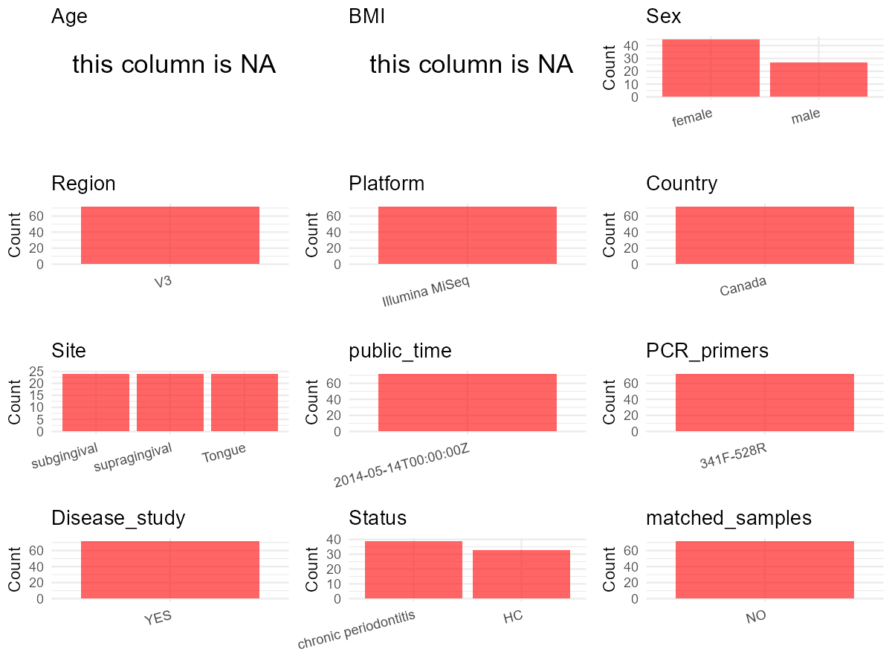

# Step 1: Obtain Initial Metadata from Each Project

To obtain the initial metadata: 1. Search for the BioProject ID (e.g.,
“PRJEBXXXX”) on the [NCBI SRA
website](https://www.ncbi.nlm.nih.gov/Traces/study/). 2. In the “Select”
table, click on “Metadata” and download the file. 3. The downloaded file
is typically named “SraRunTable.csv” and contains metadata for the
project.

    library(tidyverse)
    library(ggplot2)
    library(cowplot)

    setwd("C:/Users/zyc/Desktop/oral_project/data/projects/PRJEB6047")
    initial_meta <- read.csv("SraRunTable.csv", header = TRUE) 
    head(initial_meta)

    ##         Run AGE AnalysisSampleID Assay.Type AvgSpotLen    Bases BioProject    BioSample body_site    Bytes            Center.Name
    ## 1 ERR494349  71               35   AMPLICON        302 16055528  PRJEB6047 SAMEA2500584     mouth 10480471 UNIVERSITY OF WATERLOO
    ## 2 ERR494350  71               34   AMPLICON        302 14582070  PRJEB6047 SAMEA2500583     mouth  9602816 UNIVERSITY OF WATERLOO
    ## 3 ERR494351  71               33   AMPLICON        302 14290942  PRJEB6047 SAMEA2500582     mouth  9411535 UNIVERSITY OF WATERLOO
    ## 4 ERR494352  37               62   AMPLICON        302 11901518  PRJEB6047 SAMEA2500611     mouth  7837840 UNIVERSITY OF WATERLOO
    ## 5 ERR494353  37               61   AMPLICON        302 16558660  PRJEB6047 SAMEA2500610     mouth 10841457 UNIVERSITY OF WATERLOO
    ## 6 ERR494354  37               60   AMPLICON        302 14134204  PRJEB6047 SAMEA2500609     mouth  9146338 UNIVERSITY OF WATERLOO
    ##   Collection_Date Consent DATASTORE.filetype DATASTORE.provider                         DATASTORE.region     Diet disease_status
    ## 1            2010  public   fastq,run.zq,sra     ena,gs,ncbi,s3 ena,gs.us-east1,ncbi.public,s3.us-east-1 omnivore  periodontitis
    ## 2            2010  public   fastq,run.zq,sra     ena,gs,ncbi,s3 ena,gs.us-east1,ncbi.public,s3.us-east-1 omnivore  periodontitis
    ## 3            2010  public   fastq,run.zq,sra     ena,gs,ncbi,s3 ena,gs.us-east1,ncbi.public,s3.us-east-1 omnivore  periodontitis
    ## 4            2010  public   fastq,run.zq,sra     ena,gs,ncbi,s3 ena,gs.us-east1,ncbi.public,s3.us-east-1 omnivore  periodontitis
    ## 5            2010  public   fastq,run.zq,sra     ena,gs,ncbi,s3 ena,gs.us-east1,ncbi.public,s3.us-east-1 omnivore  periodontitis
    ## 6            2010  public   fastq,run.zq,sra     ena,gs,ncbi,s3 ena,gs.us-east1,ncbi.public,s3.us-east-1 omnivore  periodontitis
    ##   ENA.FIRST.PUBLIC..run. ENA_first_public ENA.LAST.UPDATE..run. ENA_last_update environment_.biome. environment_.feature.
    ## 1             2014-05-05       2014-05-06            2018-11-16      2016-10-21               human                 mouth
    ## 2             2014-05-05       2014-05-06            2018-11-16      2016-10-21               human                 mouth
    ## 3             2014-05-05       2014-05-06            2018-11-16      2016-10-21               human                 mouth
    ## 4             2014-05-05       2014-05-06            2018-11-16      2016-10-21               human                 mouth
    ## 5             2014-05-05       2014-05-06            2018-11-16      2016-10-21               human                 mouth
    ## 6             2014-05-05       2014-05-06            2018-11-16      2016-10-21               human                 mouth
    ##   environment_.material. Experiment  external_id geo_loc_name_country geo_loc_name_country_continent geographic_location_.country_and.or_sea.
    ## 1                 plaque  ERX459765 SAMEA2500584               Canada                  North America                                   Canada
    ## 2                 plaque  ERX459766 SAMEA2500583               Canada                  North America                                   Canada
    ## 3                 plaque  ERX459767 SAMEA2500582               Canada                  North America                                   Canada
    ## 4                 plaque  ERX459768 SAMEA2500611               Canada                  North America                                   Canada
    ## 5                 plaque  ERX459769 SAMEA2500610               Canada                  North America                                   Canada
    ## 6                 plaque  ERX459770 SAMEA2500609               Canada                  North America                                   Canada
    ##   geographic_location_.country_and.or_sea geographic_location_.countryand.orsea  region. geographic_location_.latitude.
    ## 1                                  Canada                                Canada 43.65573                      -79.38743
    ## 2                                  Canada                                Canada 43.65573                      -79.38743
    ## 3                                  Canada                                Canada 43.65573                      -79.38743
    ## 4                                  Canada                                Canada 43.65573                      -79.38743
    ## 5                                  Canada                                Canada 43.65573                      -79.38743
    ## 6                                  Canada                                Canada 43.65573                      -79.38743
    ##   geographic_location_.longitude. host_subject_id humam_oral_environmental_package     INSDC_center_alias    INSDC_center_name
    ## 1                              D1      human-oral           UNIVERSITY OF WATERLOO UNIVERSITY OF WATERLOO 2014-05-06T17:00:43Z
    ## 2                              D1      human-oral           UNIVERSITY OF WATERLOO UNIVERSITY OF WATERLOO 2014-05-06T17:00:43Z
    ## 3                              D1      human-oral           UNIVERSITY OF WATERLOO UNIVERSITY OF WATERLOO 2014-05-06T17:00:43Z
    ## 4                             D10      human-oral           UNIVERSITY OF WATERLOO UNIVERSITY OF WATERLOO 2014-05-06T17:00:43Z
    ## 5                             D10      human-oral           UNIVERSITY OF WATERLOO UNIVERSITY OF WATERLOO 2014-05-06T17:00:43Z
    ## 6                             D10      human-oral           UNIVERSITY OF WATERLOO UNIVERSITY OF WATERLOO 2014-05-06T17:00:43Z
    ##     INSDC_first_public INSDC_last_update   INSDC_status     Instrument Investigation_type Library.Name LibraryLayout LibrarySelection
    ## 1 2016-10-21T09:43:45Z            public Illumina MiSeq mimarks-survey        unspecified       PAIRED           PCR      METAGENOMIC
    ## 2 2016-10-21T09:43:46Z            public Illumina MiSeq mimarks-survey        unspecified       PAIRED           PCR      METAGENOMIC
    ## 3 2016-10-21T09:43:46Z            public Illumina MiSeq mimarks-survey        unspecified       PAIRED           PCR      METAGENOMIC
    ## 4 2016-10-21T09:43:46Z            public Illumina MiSeq mimarks-survey        unspecified       PAIRED           PCR      METAGENOMIC
    ## 5 2016-10-21T09:43:46Z            public Illumina MiSeq mimarks-survey        unspecified       PAIRED           PCR      METAGENOMIC
    ## 6 2016-10-21T09:43:46Z            public Illumina MiSeq mimarks-survey        unspecified       PAIRED           PCR      METAGENOMIC
    ##           LibrarySource Organism
    ## 1 human oral metagenome ILLUMINA
    ## 2 human oral metagenome ILLUMINA
    ## 3 human oral metagenome ILLUMINA
    ## 4 human oral metagenome ILLUMINA
    ## 5 human oral metagenome ILLUMINA
    ## 6 human oral metagenome ILLUMINA
    ##                                                                                                               Platform         project_name
    ## 1 Community structure analysis in chronic periodontitis and novel oral sampling sites for detecting disease indicators 2014-05-14T00:00:00Z
    ## 2 Community structure analysis in chronic periodontitis and novel oral sampling sites for detecting disease indicators 2014-05-14T00:00:00Z
    ## 3 Community structure analysis in chronic periodontitis and novel oral sampling sites for detecting disease indicators 2014-05-14T00:00:00Z
    ## 4 Community structure analysis in chronic periodontitis and novel oral sampling sites for detecting disease indicators 2014-05-14T00:00:00Z
    ## 5 Community structure analysis in chronic periodontitis and novel oral sampling sites for detecting disease indicators 2014-05-14T00:00:00Z
    ## 6 Community structure analysis in chronic periodontitis and novel oral sampling sites for detecting disease indicators 2014-05-14T00:00:00Z
    ##    ReleaseDate              Sample.Name Sample_name  sample_region Sequencing_method       sex                SRA.Study Submitter_Id
    ## 1 SAMEA2500584    GalimanasHall_D1_Subg        Subg Illumina MiSeq            female ERP005509    GalimanasHall_D1_Subg          123
    ## 2 SAMEA2500583   GalimanasHall_D1_Supra       Supra Illumina MiSeq            female ERP005509   GalimanasHall_D1_Supra          123
    ## 3 SAMEA2500582  GalimanasHall_D1_Tongue      Tongue Illumina MiSeq            female ERP005509  GalimanasHall_D1_Tongue          123
    ## 4 SAMEA2500611   GalimanasHall_D10_Subg        Subg Illumina MiSeq              male ERP005509   GalimanasHall_D10_Subg          140
    ## 5 SAMEA2500610  GalimanasHall_D10_Supra       Supra Illumina MiSeq              male ERP005509  GalimanasHall_D10_Supra          140
    ## 6 SAMEA2500609 GalimanasHall_D10_Tongue      Tongue Illumina MiSeq              male ERP005509 GalimanasHall_D10_Tongue          140
    ##             total_mass create_date version
    ## 1 2014-05-07T12:35:00Z           1      NA
    ## 2 2014-05-07T12:35:00Z           1      NA
    ## 3 2014-05-07T12:36:00Z           1      NA
    ## 4 2014-05-07T12:36:00Z           1      NA
    ## 5 2014-05-07T12:36:00Z           1      NA
    ## 6 2014-05-07T12:36:00Z           1      NA

# Step 2: Create a Uniform Metadata Template

The uniform metadata should include the following columns:

1.  **BioProject**: Project ID (e.g., “PRJNA339212”)
2.  **Run**: Sample ID (e.g., “ERRXXXXXX” or “SRRXXXXXX”)
3.  **sample\_name**: Original sample name submitted by the authors (not
    the database-assigned ID)
4.  **Age**: Age of the subject (if available)
5.  **BMI**: Body Mass Index (if available)
6.  **Sex**: Sex of the subject (“F” or “M”)
7.  **Region**: Targeted 16S rRNA region (e.g., “V3-V4”)
8.  **Platform**: Sequencing platform (e.g., “Illumina MiSeq”)
9.  **Country**: Country of sample origin (e.g., “China”)
10. **Site**: Sample site (e.g., “saliva”, “dental plaque”)
11. **public\_time**: Data release date (format: “YYYY-MM-DD”)
12. **PCR\_primers**: PCR primers used (e.g., “515F-806R”)
13. **title**: Title of the associated publication
14. **Disease\_study**: Whether the study involves a disease (“YES” or
    “NO”)
15. **Status**: Disease status (e.g., “T2DM”, “HC”). Note: If the study
    includes both disease and healthy samples, this must be specified
    per sample.
16. **matched\_samples**: matched samples (“YES” or “NO”)

<!-- -->

    metadata <- data.frame(
      BioProject = initial_meta$BioProject,
      Run = initial_meta$Run,
      sample_name = initial_meta$Sample.Name,
      Age = NA,
      BMI = NA,
      Sex = initial_meta$Sequencing_method,
      Platform = initial_meta$sample_region,
      Country = initial_meta$geo_loc_name_country,
      Site = initial_meta$Sample_name,
      public_time = initial_meta$project_name,
      Status = initial_meta$Sample.Name,
      stringsAsFactors = FALSE
    )

# Step 3: Manually Add Information from the Publication

Some information (e.g. PCR primers, study title, disease status) must be
manually extracted from the publication and added to the metadata.

    metadata <- metadata %>% mutate(Site = case_when(
      Site == "Subg" ~ "subgingival",
      Site == "Supra" ~ "supragingival",
      TRUE ~ Site
    ))

    metadata <- metadata %>% mutate(Status = case_when(
      grepl("D",Status) ~ "chronic periodontitis",
      grepl("H",Status) ~ "HC"
    ))

    # metadata <- metadata %>%
     #  mutate(Sex = recode(Sex, "female" = "F", "male" = "M"))
    # metadata <-metadata%>%
    #   mutate(Status = case_when(Site == "mucous" ~ "OSCC",
    #                             Site == "dental plaque" ~ "OSCC",
    #                             Site == "tumor" ~ "OSCC",
    #                             TRUE ~ NA))

    metadata$matched_samples <- "NO"
    metadata$Region <- "V3"
    metadata$title <- "Bacterial community composition of chronic periodontitis and novel oral sampling sites for detecting disease indicators"
    metadata$Disease_study <- "YES"
    metadata$PCR_primers <- "341F-528R"
    head(metadata)

    ##   BioProject       Run              sample_name Age BMI    Sex       Platform Country          Site          public_time
    ## 1  PRJEB6047 ERR494349    GalimanasHall_D1_Subg  NA  NA female Illumina MiSeq  Canada   subgingival 2014-05-14T00:00:00Z
    ## 2  PRJEB6047 ERR494350   GalimanasHall_D1_Supra  NA  NA female Illumina MiSeq  Canada supragingival 2014-05-14T00:00:00Z
    ## 3  PRJEB6047 ERR494351  GalimanasHall_D1_Tongue  NA  NA female Illumina MiSeq  Canada        Tongue 2014-05-14T00:00:00Z
    ## 4  PRJEB6047 ERR494352   GalimanasHall_D10_Subg  NA  NA   male Illumina MiSeq  Canada   subgingival 2014-05-14T00:00:00Z
    ## 5  PRJEB6047 ERR494353  GalimanasHall_D10_Supra  NA  NA   male Illumina MiSeq  Canada supragingival 2014-05-14T00:00:00Z
    ## 6  PRJEB6047 ERR494354 GalimanasHall_D10_Tongue  NA  NA   male Illumina MiSeq  Canada        Tongue 2014-05-14T00:00:00Z
    ##                  Status matched_samples Region
    ## 1 chronic periodontitis              NO     V3
    ## 2 chronic periodontitis              NO     V3
    ## 3 chronic periodontitis              NO     V3
    ## 4 chronic periodontitis              NO     V3
    ## 5 chronic periodontitis              NO     V3
    ## 6 chronic periodontitis              NO     V3
    ##                                                                                                                     title Disease_study
    ## 1 Bacterial community composition of chronic periodontitis and novel oral sampling sites for detecting disease indicators           YES
    ## 2 Bacterial community composition of chronic periodontitis and novel oral sampling sites for detecting disease indicators           YES
    ## 3 Bacterial community composition of chronic periodontitis and novel oral sampling sites for detecting disease indicators           YES
    ## 4 Bacterial community composition of chronic periodontitis and novel oral sampling sites for detecting disease indicators           YES
    ## 5 Bacterial community composition of chronic periodontitis and novel oral sampling sites for detecting disease indicators           YES
    ## 6 Bacterial community composition of chronic periodontitis and novel oral sampling sites for detecting disease indicators           YES
    ##   PCR_primers
    ## 1   341F-528R
    ## 2   341F-528R
    ## 3   341F-528R
    ## 4   341F-528R
    ## 5   341F-528R
    ## 6   341F-528R

# Step 4: Summarize and Validate the Metadata

    print(paste("Number of unique runs:", length(unique(metadata$Run))))

    ## [1] "Number of unique runs: 72"

    print(paste("Number of unique sample names:", length(unique(metadata$sample_name))))

    ## [1] "Number of unique sample names: 72"

# Step 5: Visualize the Metadata

    plot_data <- metadata %>%
      select(-BioProject, -Run, -sample_name, -title)

    # Function to create simple plots for each column
    create_simple_plots <- function(data) {
      plots <- list()

      for (col in colnames(data)) {
        # Check if the column is all NA
        if (all(is.na(data[[col]]))) {
          # Create an empty plot with text indicating all NA
          p <- ggplot() +
            annotate("text", x = 0.5, y = 0.5, label = "this column is NA", size = 6) +
            labs(title = col) +
            theme_void()
        } else if (is.numeric(data[[col]])) {
          # Numeric variable: histogram
          p <- ggplot(data, aes(x = .data[[col]])) +
            geom_histogram(fill = "blue", alpha = 0.6, bins = 20, na.rm = T) +
            labs(title = col) +
            theme_minimal()
        } else {
          # Categorical variable: bar plot (remove NA values)
          count_data <- as.data.frame(table(data[[col]], useNA = "ifany"))
          p <- ggplot(count_data, aes(x = reorder(Var1, -Freq), y = Freq)) +
            geom_col(fill = "red", alpha = 0.6) +
            labs(title = col, x = NULL, y = "Count") +
            theme_minimal() +
            theme(axis.text.x = element_text(angle = 15, hjust = 1))
        }
        plots[[col]] <- p
      }

      return(plots)
    }

    plots <- create_simple_plots(plot_data)
    p<-plot_grid(plots$Age,
              plots$BMI,
              plots$Sex,
              plots$Region,
              plots$Platform,
              plots$Country,
              plots$Site,
              plots$public_time,
              plots$PCR_primers,
              plots$Disease_study,
              plots$Status,
              plots$matched_samples,# add
              ncol = 3, align = "hv", axis = "lb")
    ggsave("Metadata_Summary.png", plot = p, width = 8, height = 6, dpi = 150)

    

 \# Step 6: Finalize and Export the Metadata

    metadata <- metadata[, c(
      "BioProject", "Run", "sample_name", "Age", "BMI", "Sex",
      "Region", "Platform", "Country", "Site", "public_time",
      "PCR_primers", "title", "Disease_study", "Status","matched_samples"
    )]

    write.csv(metadata, file = "metadata.csv", quote = FALSE)
