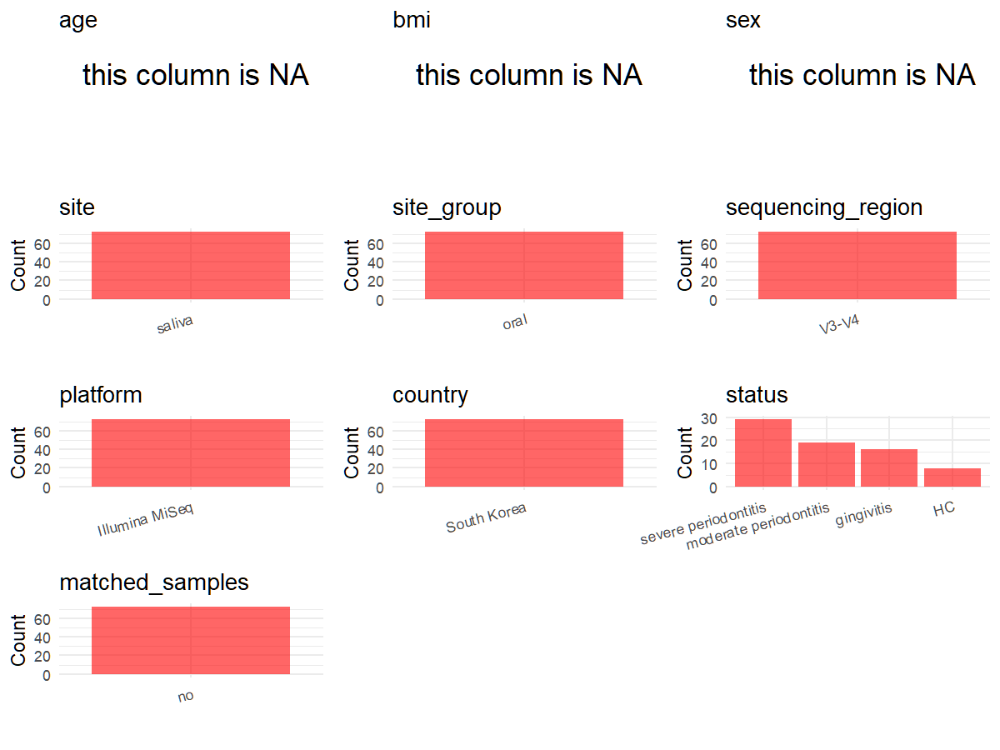

# Step 1: Obtain Initial Metadata from Each Project

This step sets the project directory and loads the raw SRA metadata.

```{r message=FALSE, warning=FALSE}
# Load libraries
library(dplyr)
library(ggplot2)
library(cowplot)

# (1) Setting working directory
project_id <- "PRJEB61123"

base_dir <- "E:/工作区/VSCode/RNAproject/collect_metadata_respon/project"
setwd(file.path(base_dir, project_id))

# (2) Loading raw SRA metadata file
sra_file <- "SraRunTable.csv"
initial_meta <- read.csv(sra_file, header = TRUE, stringsAsFactors = FALSE)

# (3) Loading sample-level status mapping recovered from public ENA BioSample records
# How to verify this file manually:
#   a. take a BioSample accession from SraRunTable.csv, e.g. SAMEA112896358
#   b. open https://www.ebi.ac.uk/ena/browser/api/xml/{BioSample}
#   c. read the SAMPLE/TITLE field in the XML, which stores labels such as Healthy or Gingivitis
#   d. confirm that the XML alias matches Sample.Name in SraRunTable.csv
status_file <- "sample_status_from_ENA_BioSample_TITLE.csv"
status_meta <- read.csv(status_file, header = TRUE, stringsAsFactors = FALSE)
```

# Step 2: Data Overview

First, you need to get an overview of the data, which includes two steps: reading the article and reading the initial metadata. This step is very IMPORTANT!

```{r message=FALSE, warning=FALSE}
# (1) Read the article in the following order: abstract, the beginning of the results section, and the methods.
# Paper summary used for this project:
# - Title: Characteristics of the Salivary Microbiota in Periodontal Diseases and Potential Roles of Individual Bacterial Species To Predict the Severity of Periodontal Disease
# - Study design: cross-sectional mouth-rinse saliva study across four periodontal-status groups
# - Cohort size in the paper: 72 saliva samples total from 8 periodontally healthy controls, 16 gingivitis, 19 moderate periodontitis, and 29 severe periodontitis subjects
# - Recruitment context from Methods: Ajou University Dental Hospital, Republic of Korea
# - Sequencing from Methods: amplification of the 16S rRNA V3 and V4 regions and sequencing on Illumina MiSeq
# - Supplemental file 1 contains qPCR primer tables and group-level comparisons only; it does not provide a sample-level manifest for status, sex, age, or BMI
# - Exact 16S sequencing primer names are not stated in the accessible paper text or supplemental file reviewed here, so pcr_primers should remain NA

# (2) IMPORTANT: MUST go through each column of initial_meta
head(initial_meta, 10)
colnames(initial_meta)
table(initial_meta$Instrument)
table(initial_meta$Organism)
table(initial_meta$LibrarySource)
table(substr(initial_meta$Sample.Name, 1, 1))
table(substr(initial_meta$Sample.Name, 1, 2))
# All deposited rows are oral metagenome samples with Illumina MiSeq listed in the run table.
# Sample names begin with H, TG, or TP and each appears only once, so this is not a matched or longitudinal dataset.
# The run-table identifiers split as H/TG/TP rather than H/G/MP/SP, so prefixes alone are not reliable.
# However, the ENA BioSample XML record provides row-level group labels through SAMPLE/TITLE and can be used to resolve status for all 72 samples.
# To check one sample manually, use the BioSample accession from SraRunTable.csv and open https://www.ebi.ac.uk/ena/browser/api/xml/{BioSample}, then compare XML alias with Sample.Name and read SAMPLE/TITLE.
```

# Step 3: Removing Control and Non-human Samples

First, we need to remove control samples(including both negative controls and positive controls) and non-human samples.

```{r}
# (1) Parameter setup
control_column <- ""
control_keywords <- c()

species_column <- "Organism"
unique(initial_meta[[species_column]])
non_human_keywords <- c()

# (2) Remove controls and non-human samples. DO NOT need to modify code in this part, just run it.
n_samples <- nrow(initial_meta)
# Control evaluation
if (length(control_keywords) > 0) {
  if (is.null(control_column) || control_column == "") {
    stop("Error: control_keywords provided but control_column is missing.")
  }

  if (!(control_column %in% colnames(initial_meta))) {
    stop(sprintf("Error: Column '%s' not found in initial_meta.", control_column))
  }

  control_pattern <- paste(control_keywords, collapse = "|")
  control_text <- initial_meta[[control_column]]
  is_control <- grepl(control_pattern, control_text)

} else {
  is_control <- rep(FALSE, n_samples)
}

# Non-human evaluation
if (length(non_human_keywords) > 0) {
  if (is.null(species_column) || species_column == "") {
    stop("Error: non_human_keywords provided but species_column is missing.")
  }

  if (!(species_column %in% colnames(initial_meta))) {
    stop(sprintf("Error: Column '%s' not found in initial_meta.", species_column))
  }

  non_human_pattern <- paste(non_human_keywords, collapse = "|")
  species_text <- initial_meta[[species_column]]
  is_non_human <- grepl(non_human_pattern, species_text)
} else {
  is_non_human <- rep(FALSE, n_samples)
}

# Execute removal
samples_to_remove <- is_control | is_non_human
initial_meta <- initial_meta[!samples_to_remove, ]

cat("Initial samples counts:", n_samples, "\n")
cat("Removed control samples:", sum(is_control), "\n")
cat("Removed non-human samples:", sum(is_non_human), "\n")
cat("Total samples removed ", sum(samples_to_remove), "\n")
cat("Remaining samples after Step 2:", nrow(initial_meta), "\n")
```

# Step 4: Creating a Uniform Metadata Template

This step converts the raw SRA table into the standard metadata format used in our meta-analysis.

```{r}
metadata <- data.frame(
  bioproject = initial_meta$BioProject,
  sample_id = initial_meta$Run,
  subject_id = initial_meta$Sample.Name,
  age = NA_real_,
  age_info = "adults; group means reported separately by disease severity",
  bmi = NA_real_,
  sex = NA_character_,
  sequencing_region = "V3-V4",
  platform = "Illumina MiSeq",
  country = "South Korea",
  site = "saliva",
  site_group = "pending",
  public_time = sub("T.*$", "", initial_meta$ReleaseDate),
  pcr_primers = NA_character_,
  title = "Characteristics of the Salivary Microbiota in Periodontal Diseases and Potential Roles of Individual Bacterial Species To Predict the Severity of Periodontal Disease",
  disease_study = "yes",
  raw_status = initial_meta$Sample.Name,
  matched_samples = "no",
  is_time_series = "no",
  stringsAsFactors = FALSE
)

metadata <- metadata %>%
  left_join(status_meta, by = c("raw_status" = "sample_name"))

# Column-wise evidence audit:
# - bioproject: direct from SraRunTable.csv column BioProject.
# - sample_id: direct from SraRunTable.csv column Run.
# - subject_id: direct from SraRunTable.csv column Sample.Name because each deposited saliva sample appears once and no repeated-measures structure is described.
# - age: set to NA because neither SraRunTable.csv nor the reviewed paper/supplement provides per-sample age values.
# - age_info: from the paper cohort description and Table 1 summary; the study enrolled adults and reports age only as group-level summaries by disease severity.
# - bmi: set to NA because no per-sample or group BMI values were identified in the reviewed paper or supplement.
# - sex: set to NA because the paper reports sex composition only at group level, not per sample.
# - sequencing_region: from the Methods section stating amplification of the 16S rRNA V3 and V4 regions.
# - platform: from the Methods section stating sequencing on Illumina MiSeq; this agrees with SraRunTable.csv column Instrument.
# - country: from the Methods recruitment site at Ajou University Dental Hospital, Republic of Korea; normalized to South Korea for project consistency.
# - site: from the paper sampling description of mouth-rinse saliva / saliva samples, not from the generic SRA Organism label oral metagenome.
# - site_group: derived from site = saliva, therefore oral.
# - public_time: direct from SraRunTable.csv column ReleaseDate after stripping the time suffix.
# - pcr_primers: set to NA because the paper and supplemental file do not provide exact 16S sequencing primer names; Supplemental 1 lists qPCR primers only and is not valid evidence for sequencing primers.
# - title: direct from the paper title.
# - disease_study: from the study design comparing healthy, gingivitis, moderate periodontitis, and severe periodontitis groups.
# - raw_status: uses Sample.Name as the merge key for row-level status mapping.
# - status: merged from sample_status_from_ENA_BioSample_TITLE.csv. This table stores sample_name, status, source_biosample_accession, and source_note, and was built from the public ENA BioSample XML SAMPLE/TITLE field for each BioSample accession in SraRunTable.csv. To re-check one row, open https://www.ebi.ac.uk/ena/browser/api/xml/{BioSample}, confirm XML alias = Sample.Name, and read SAMPLE/TITLE. Verified counts are Healthy = 8, Gingivitis = 16, Moderate periodontitis = 19, Severe periodontitis = 29, matching the paper cohort counts.
# - matched_samples: set to no because each Sample.Name occurs once in SraRunTable.csv and no matched multi-site design is described in the paper.
# - is_time_series: set to no because the study is cross-sectional and no longitudinal follow-up sampling is described.
metadata$public_time <- as.Date(metadata$public_time)
```

# Step 5: Manually solving pending issues

This step involves two parts: (1) handle the columns with the `raw_` prefix, and next (2) handle the `site_group` and `matched_samples` columns.

```{r}
# (1) Validate the merged status table.
# sample_status_from_ENA_BioSample_TITLE.csv was created from public ENA BioSample XML TITLE fields.
stopifnot(nrow(metadata) == nrow(initial_meta))
stopifnot(!any(is.na(metadata$status)))
table(metadata$status)
# Prefixes alone are misleading in this project. The merged table is the authoritative row-level mapping used here and should reproduce the paper counts HC = 8, gingivitis = 16, moderate periodontitis = 19, severe periodontitis = 29.
```

```{r}
# (2) Filling the 'site_group' and 'matched_samples' columns
unique(metadata$site)
Oral_site = c("saliva")
Gut_site = c("feces")

metadata <- metadata %>%
  mutate(site_group = case_when(
    site %in% Oral_site ~ "oral",
    site %in% Gut_site ~ "gut",
    TRUE ~ "other"
  ))

metadata$matched_samples <- "no"
# Each subject_id appears only once in the deposited run table, so there are no matched repeated samples.
```

```{r}
# (3) check if there is pending value in metadata. If there is pending value, go on modify the metadata.
has_pending <- function(col) {
  if (is.character(col) || is.factor(col)) {
    any(col == "pending", na.rm = TRUE)
  } else {
    FALSE
  }
}

any_pending_value <- any(sapply(metadata, has_pending))

if (!any_pending_value) {
  message("Good! No cell contains the value 'pending'.")
} else {
  pending_cols <- names(metadata)[sapply(metadata, has_pending)]
  message("Columns containing 'pending': ", paste(pending_cols, collapse = ", "))
  message("Please continue to resolve these pending columns!")
}
```

# Step 6: Visualize the Metadata

This step makes a quick set of plots for checking the distribution of key metadata fields.

```{r}
plot_data <- metadata %>%
  select(-bioproject, -sample_id, -subject_id, -title)

create_simple_plots <- function(data) {
  plots <- list()
  continuous_vars <- c("age", "bmi")

  for (col in colnames(data)) {
    if (all(is.na(data[[col]]))) {
      p <- ggplot() +
        annotate("text", x = 0.5, y = 0.5, label = "this column is NA", size = 6) +
        labs(title = col) +
        theme_void()
    } else if (col %in% continuous_vars && is.numeric(data[[col]])) {
      p <- ggplot(data, aes(x = .data[[col]])) +
        geom_histogram(fill = "blue", alpha = 0.6, bins = 20, na.rm = TRUE) +
        labs(title = col, x = col, y = "Count") +
        theme_minimal()
    } else {
      count_data <- as.data.frame(table(data[[col]], useNA = "ifany"))
      p <- ggplot(count_data, aes(x = reorder(Var1, -Freq), y = Freq)) +
        geom_col(fill = "red", alpha = 0.6) +
        labs(title = col, x = NULL, y = "Count") +
        theme_minimal() +
        theme(axis.text.x = element_text(angle = 15, hjust = 1))
    }
    plots[[col]] <- p
  }

  return(plots)
}

plots <- create_simple_plots(plot_data)
p <- plot_grid(plots$age,
               plots$bmi,
               plots$sex,
               plots$site,
               plots$site_group,
               plots$sequencing_region,
               plots$platform,
               plots$country,
               plots$status,
               plots$matched_samples,
               ncol = 3, align = "hv", axis = "lb")
ggsave("Metadata_Summary.png", plot = p, width = 8, height = 6, dpi = 150)
```

```{r}

```

# Step 7: Sort and export the metadata

This step saves the cleaned metadata table as the final `metadata_v2.csv` file.

```{r}
fixed_cols <- c("bioproject", "sample_id", "subject_id", "age", "age_info",
                "bmi", "sex", "platform", "sequencing_region", "pcr_primers",
                "country", "site", "site_group", "disease_study", "status",
                "title", "public_time", "matched_samples", "is_time_series")
metadata <- metadata %>%
  select(all_of(fixed_cols), starts_with("raw_"))

write.csv(metadata, file = "metadata_v2.csv", quote = TRUE, row.names = FALSE)
```
