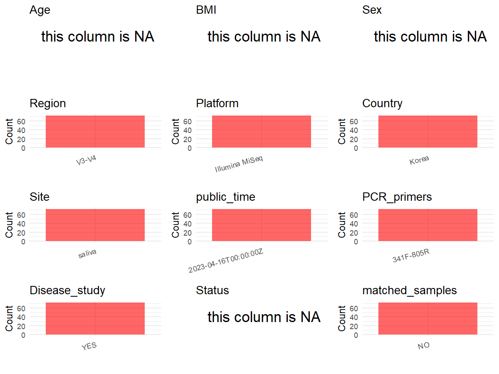

R Notebook: Metadata Processing Workflow
================

# Step 1: Obtain Initial Metadata from Each Project

To obtain the initial metadata: 1. Search for the BioProject ID (e.g.,
“PRJEBXXXX”) on the [NCBI SRA
website](https://www.ncbi.nlm.nih.gov/Traces/study/). 2. In the “Select”
table, click on “Metadata” and download the file. 3. The downloaded file
is typically named “SraRunTable.csv” and contains metadata for the
project.

``` r
# Load necessary libraries
library(dplyr)
library(ggplot2)
library(cowplot)

# Set working directory (update this path to your local directory)
setwd("D:/metadata/PRJEB61123")

# Read the initial metadata files
initial_meta<-read.csv("SraRunTable.csv",header = T)

# Combine the two metadata files
#meta <- rbind(initial_meta, initial_meta1)

#Remove entries non-oral samples
#initial_meta <- subset(initial_meta,isolate %in% c("saliva","tongue coat"))

# Check the number of samples containing "HT" in Sample.Name (e.g., healthy controls)
#nrow(subset(meta, grepl("HT", Sample.Name)))

# Display the first few rows of the metadata
head(initial_meta)
```

    ##           Run Assay.Type AvgSpotLen    Bases BioProject      BioSample    Bytes
    ## 1 ERR11218923   AMPLICON        500 31690365 PRJEB61123 SAMEA112896350 21077196
    ## 2 ERR11218924   AMPLICON        501 32770439 PRJEB61123 SAMEA112896351 22082631
    ## 3 ERR11218925   AMPLICON        501 28303754 PRJEB61123 SAMEA112896352 18851771
    ## 4 ERR11218926   AMPLICON        501 54560111 PRJEB61123 SAMEA112896353 37331527
    ## 5 ERR11218927   AMPLICON        501 40432345 PRJEB61123 SAMEA112896354 27447385
    ## 6 ERR11218928   AMPLICON        500 23180476 PRJEB61123 SAMEA112896355 15622042
    ##                          Center.Name Consent DATASTORE.filetype
    ## 1 AJOU UNIVERSITY SCHOOL OF MEDICINE  public   fastq,run.zq,sra
    ## 2 AJOU UNIVERSITY SCHOOL OF MEDICINE  public   fastq,run.zq,sra
    ## 3 AJOU UNIVERSITY SCHOOL OF MEDICINE  public   fastq,run.zq,sra
    ## 4 AJOU UNIVERSITY SCHOOL OF MEDICINE  public   fastq,run.zq,sra
    ## 5 AJOU UNIVERSITY SCHOOL OF MEDICINE  public   fastq,run.zq,sra
    ## 6 AJOU UNIVERSITY SCHOOL OF MEDICINE  public   fastq,run.zq,sra
    ##   DATASTORE.provider                     DATASTORE.region
    ## 1         gs,ncbi,s3 gs.us-east1,ncbi.public,s3.us-east-1
    ## 2         gs,ncbi,s3 gs.us-east1,ncbi.public,s3.us-east-1
    ## 3         gs,ncbi,s3 gs.us-east1,ncbi.public,s3.us-east-1
    ## 4         gs,ncbi,s3 gs.us-east1,ncbi.public,s3.us-east-1
    ## 5         gs,ncbi,s3 gs.us-east1,ncbi.public,s3.us-east-1
    ## 6         gs,ncbi,s3 gs.us-east1,ncbi.public,s3.us-east-1
    ##   ENA.FIRST.PUBLIC..run.      ena_first_public ENA.LAST.UPDATE..run.
    ## 1              2023/4/15 2023-04-15,2023-04-15             2023/4/15
    ## 2              2023/4/15 2023-04-15,2023-04-15             2023/4/15
    ## 3              2023/4/15 2023-04-15,2023-04-15             2023/4/15
    ## 4              2023/4/15 2023-04-15,2023-04-15             2023/4/15
    ## 5              2023/4/15 2023-04-15,2023-04-15             2023/4/15
    ## 6              2023/4/15 2023-04-15,2023-04-15             2023/4/15
    ##         ena_last_update  Experiment     Instrument
    ## 1 2023-04-15,2023-04-15 ERX10645023 Illumina MiSeq
    ## 2 2023-04-15,2023-04-15 ERX10645024 Illumina MiSeq
    ## 3 2023-04-15,2023-04-15 ERX10645025 Illumina MiSeq
    ## 4 2023-04-15,2023-04-15 ERX10645026 Illumina MiSeq
    ## 5 2023-04-15,2023-04-15 ERX10645027 Illumina MiSeq
    ## 6 2023-04-15,2023-04-15 ERX10645028 Illumina MiSeq
    ##                                      Library.Name LibraryLayout
    ## 1 Invitrogen, Quanti-iT PicoGreen dsDNA Assay Kit        PAIRED
    ## 2 Invitrogen, Quanti-iT PicoGreen dsDNA Assay Kit        PAIRED
    ## 3 Invitrogen, Quanti-iT PicoGreen dsDNA Assay Kit        PAIRED
    ## 4 Invitrogen, Quanti-iT PicoGreen dsDNA Assay Kit        PAIRED
    ## 5 Invitrogen, Quanti-iT PicoGreen dsDNA Assay Kit        PAIRED
    ## 6 Invitrogen, Quanti-iT PicoGreen dsDNA Assay Kit        PAIRED
    ##   LibrarySelection LibrarySource        Organism        organism Platform
    ## 1           RANDOM   METAGENOMIC oral metagenome oral metagenome ILLUMINA
    ## 2           RANDOM   METAGENOMIC oral metagenome oral metagenome ILLUMINA
    ## 3           RANDOM   METAGENOMIC oral metagenome oral metagenome ILLUMINA
    ## 4           RANDOM   METAGENOMIC oral metagenome oral metagenome ILLUMINA
    ## 5           RANDOM   METAGENOMIC oral metagenome oral metagenome ILLUMINA
    ## 6           RANDOM   METAGENOMIC oral metagenome oral metagenome ILLUMINA
    ##            ReleaseDate          create_date version Sample.Name scientific_name
    ## 1 2023-04-16T00:00:00Z 2023-07-26T16:51:00Z       1       H11-1 oral metagenome
    ## 2 2023-04-16T00:00:00Z 2023-07-26T16:51:00Z       1       H16-1 oral metagenome
    ## 3 2023-04-16T00:00:00Z 2023-07-26T16:51:00Z       1       H17-1 oral metagenome
    ## 4 2023-04-16T00:00:00Z 2023-07-26T16:51:00Z       1        H2-1 oral metagenome
    ## 5 2023-04-16T00:00:00Z 2023-07-26T16:51:00Z       1        H3-1 oral metagenome
    ## 6 2023-04-16T00:00:00Z 2023-07-26T16:51:00Z       1        H6-1 oral metagenome
    ##   SRA.Study
    ## 1 ERP146221
    ## 2 ERP146221
    ## 3 ERP146221
    ## 4 ERP146221
    ## 5 ERP146221
    ## 6 ERP146221

# Step 2: Create a Uniform Metadata Template

The uniform metadata should include the following columns:

1.  **BioProject**: Project ID (e.g., “PRJNA339212”)
2.  **Run**: Sample ID (e.g., “ERRXXXXXX” or “SRRXXXXXX”)
3.  **sample_name**: Original sample name submitted by the authors (not
    the database-assigned ID)
4.  **Age**: Age of the subject (if available)
5.  **BMI**: Body Mass Index (if available)
6.  **Sex**: Sex of the subject (“F” or “M”)
7.  **Region**: Targeted 16S rRNA region (e.g., “V3-V4”)
8.  **Platform**: Sequencing platform (e.g., “Illumina MiSeq”)
9.  **Country**: Country of sample origin (e.g., “China”)
10. **Site**: Sample site (e.g., “saliva”, “dental plaque”)
11. **public_time**: Data release date (format: “YYYY-MM-DD”)
12. **PCR_primers**: PCR primers used (e.g., “515F-806R”)
13. **title**: Title of the associated publication
14. **Disease_study**: Whether the study involves a disease (“YES” or
    “NO”)
15. **Status**: Disease status (e.g., “T2DM”, “HC”). Note: If the study
    includes both disease and healthy samples, this must be specified
    per sample.
16. **matched_samples**: matched samples (“YES” or “NO”)

``` r
# Create a uniform metadata dataframe
metadata <- data.frame(
  BioProject = initial_meta$BioProject,
  Run = initial_meta$Run,
  sample_name = initial_meta$Sample.Name,
  Age = NA,
  BMI = NA,
  Sex=NA,
  Region = "V3-V4",
  Platform = initial_meta$Instrument,
  Country = "Korea",
  Site = "saliva",
  public_time = initial_meta$ReleaseDate,
  stringsAsFactors = FALSE
)
```

# Step 3: Manually Add Information from the Publication

Some information (e.g. PCR primers, study title, disease status) must be
manually extracted from the publication and added to the metadata.

``` r
# Add information obtained from the publication
metadata$PCR_primers <- "341F-805R"
metadata$title <- "Characteristics of the Salivary Microbiota in Periodontal Diseases and Potential Roles of Individual Bacterial Species To Predict the Severity of Periodontal Disease"
metadata$Disease_study <- "YES"
# Assign disease status based on sample_name patterns
metadata$Status<-"NA"

keep_subjects <- unique(subset(metadata, Site == "saliva")$sample_name)
metadata <- subset(metadata, sample_name %in% keep_subjects)


metadata$matched_samples <- "NO"
```

# Step 4: Summarize and Validate the Metadata

``` r
# Check the number of unique runs and sample names
print(paste("Number of unique runs:", length(unique(metadata$Run))))
```

    ## [1] "Number of unique runs: 72"

``` r
print(paste("Number of unique sample names:", length(unique(metadata$sample_name))))
```

    ## [1] "Number of unique sample names: 72"

# Step 5: Visualize the Metadata

``` r

```

<!-- -->

# Step 6: Finalize and Export the Metadata

``` r
# Reorder columns to match the desired format
metadata <- metadata[, c(
  "BioProject", "Run", "sample_name", "Age", "BMI", "Sex", 
  "Region", "Platform", "Country", "Site", "public_time", 
  "PCR_primers", "title", "Disease_study", "Status","matched_samples"
)]

# Export the uniform metadata to a CSV file
write.csv(metadata, file = "metadata.csv", quote = FALSE)
head(metadata)
```

    ##   BioProject         Run sample_name Age BMI Sex Region       Platform Country
    ## 1 PRJEB61123 ERR11218923       H11-1  NA  NA  NA  V3-V4 Illumina MiSeq   Korea
    ## 2 PRJEB61123 ERR11218924       H16-1  NA  NA  NA  V3-V4 Illumina MiSeq   Korea
    ## 3 PRJEB61123 ERR11218925       H17-1  NA  NA  NA  V3-V4 Illumina MiSeq   Korea
    ## 4 PRJEB61123 ERR11218926        H2-1  NA  NA  NA  V3-V4 Illumina MiSeq   Korea
    ## 5 PRJEB61123 ERR11218927        H3-1  NA  NA  NA  V3-V4 Illumina MiSeq   Korea
    ## 6 PRJEB61123 ERR11218928        H6-1  NA  NA  NA  V3-V4 Illumina MiSeq   Korea
    ##     Site          public_time PCR_primers
    ## 1 saliva 2023-04-16T00:00:00Z   341F-805R
    ## 2 saliva 2023-04-16T00:00:00Z   341F-805R
    ## 3 saliva 2023-04-16T00:00:00Z   341F-805R
    ## 4 saliva 2023-04-16T00:00:00Z   341F-805R
    ## 5 saliva 2023-04-16T00:00:00Z   341F-805R
    ## 6 saliva 2023-04-16T00:00:00Z   341F-805R
    ##                                                                                                                                                                   title
    ## 1 Characteristics of the Salivary Microbiota in Periodontal Diseases and Potential Roles of Individual Bacterial Species To Predict the Severity of Periodontal Disease
    ## 2 Characteristics of the Salivary Microbiota in Periodontal Diseases and Potential Roles of Individual Bacterial Species To Predict the Severity of Periodontal Disease
    ## 3 Characteristics of the Salivary Microbiota in Periodontal Diseases and Potential Roles of Individual Bacterial Species To Predict the Severity of Periodontal Disease
    ## 4 Characteristics of the Salivary Microbiota in Periodontal Diseases and Potential Roles of Individual Bacterial Species To Predict the Severity of Periodontal Disease
    ## 5 Characteristics of the Salivary Microbiota in Periodontal Diseases and Potential Roles of Individual Bacterial Species To Predict the Severity of Periodontal Disease
    ## 6 Characteristics of the Salivary Microbiota in Periodontal Diseases and Potential Roles of Individual Bacterial Species To Predict the Severity of Periodontal Disease
    ##   Disease_study Status matched_samples
    ## 1           YES     NA              NO
    ## 2           YES     NA              NO
    ## 3           YES     NA              NO
    ## 4           YES     NA              NO
    ## 5           YES     NA              NO
    ## 6           YES     NA              NO

## Notes for Students:

1.  **Metadata Accuracy**: Always cross-check the metadata with the
    original publication to ensure accuracy.
2.  **Manual Entries**: Columns like `PCR_primers`, and `Status` often
    require manual entry based on the publication.
3.  **Disease Status**: Be careful when assigning `Status`—some studies
    include both disease and healthy samples.
4.  **Visualization**: The plots help quickly identify the distribution
    of values in each column, which is useful for quality control.
5.  **Reproducibility**: Update the working directory and file paths to
    match your local environment.
