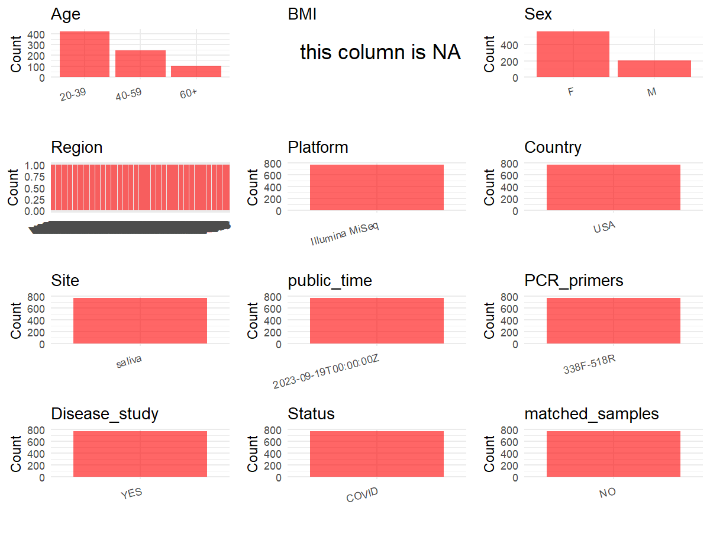

R Notebook: Metadata Processing Workflow
================

# Step 1: Obtain Initial Metadata from Each Project

To obtain the initial metadata: 1. Search for the BioProject ID (e.g.,
“PRJEBXXXX”) on the [NCBI SRA
website](https://www.ncbi.nlm.nih.gov/Traces/study/). 2. In the “Select”
table, click on “Metadata” and download the file. 3. The downloaded file
is typically named “SraRunTable.csv” and contains metadata for the
project.

``` r
# Load necessary libraries
library(dplyr)
library(ggplot2)
library(cowplot)

# Set working directory (update this path to your local directory)
setwd("E:/bioproject/PRJEB62655")

# Read the initial metadata files
initial_meta <- read.csv("SraRunTable.csv", header = T) 

# Display the first few rows of the metadata
head(initial_meta)
```

    ##           Run Assay.Type AvgSpotLen barcode..exp.   Bases BioProject
    ## 1 ERR11484361   AMPLICON        250  AAGCGTACATTG 3070000 PRJEB62655
    ## 2 ERR11484362   AMPLICON        250  TAGTTCGGTGAC 8671500 PRJEB62655
    ## 3 ERR11484363   AMPLICON        250  TCAACTATGTCT 7053000 PRJEB62655
    ## 4 ERR11484364   AMPLICON        250  CGTCGCAGCCTT 4770250 PRJEB62655
    ## 5 ERR11484365   AMPLICON        250  CGTCGCAGCCTT 5150750 PRJEB62655
    ## 6 ERR11484366   AMPLICON        250  CCGCCAGCTTTG 3998000 PRJEB62655
    ##        BioSample   Bytes  center_name..exp.
    ## 1 SAMEA113553424 1991408 Rutgers University
    ## 2 SAMEA113553425 5881384 Rutgers University
    ## 3 SAMEA113553426 4838127 Rutgers University
    ## 4 SAMEA113553427 3209523 Rutgers University
    ## 5 SAMEA113553428 2990753 Rutgers University
    ## 6 SAMEA113553429 2655050 Rutgers University
    ##                                          Center.Name center_project_name..exp.
    ## 1 UNIVERSITY OF CALIFORNIA SAN DIEGO MICROBIOME INIT              COVID saliva
    ## 2 UNIVERSITY OF CALIFORNIA SAN DIEGO MICROBIOME INIT              COVID saliva
    ## 3 UNIVERSITY OF CALIFORNIA SAN DIEGO MICROBIOME INIT              COVID saliva
    ## 4 UNIVERSITY OF CALIFORNIA SAN DIEGO MICROBIOME INIT              COVID saliva
    ## 5 UNIVERSITY OF CALIFORNIA SAN DIEGO MICROBIOME INIT              COVID saliva
    ## 6 UNIVERSITY OF CALIFORNIA SAN DIEGO MICROBIOME INIT              COVID saliva
    ##      Cohort collection_timestamp concentration_16s Consent DATASTORE.filetype
    ## 1 unexposed             2020/4/1          3.91E+07  public   fastq,run.zq,sra
    ## 2 unexposed             2020/4/1          1.70E+07  public   fastq,run.zq,sra
    ## 3 unexposed             2020/4/1          2.18E+06  public   fastq,run.zq,sra
    ## 4 unexposed             2020/4/1          1.50E+07  public   fastq,run.zq,sra
    ## 5 unexposed             2020/4/1          1.01E+07  public   fastq,run.zq,sra
    ## 6 unexposed             2020/4/1          2.91E+07  public   fastq,run.zq,sra
    ##   DATASTORE.provider                     DATASTORE.region dna_extracted
    ## 1         gs,ncbi,s3 gs.us-east1,ncbi.public,s3.us-east-1          TRUE
    ## 2         gs,ncbi,s3 gs.us-east1,ncbi.public,s3.us-east-1          TRUE
    ## 3         gs,ncbi,s3 gs.us-east1,ncbi.public,s3.us-east-1          TRUE
    ## 4         gs,ncbi,s3 gs.us-east1,ncbi.public,s3.us-east-1          TRUE
    ## 5         gs,ncbi,s3 gs.us-east1,ncbi.public,s3.us-east-1          TRUE
    ## 6         gs,ncbi,s3 gs.us-east1,ncbi.public,s3.us-east-1          TRUE
    ##   elevation    emp_status          empo_1                       empo_2
    ## 1        21 EMP_Processed Host-associated Host-associated (non-saline)
    ## 2        21 EMP_Processed Host-associated Host-associated (non-saline)
    ## 3        21 EMP_Processed Host-associated Host-associated (non-saline)
    ## 4        21 EMP_Processed Host-associated Host-associated (non-saline)
    ## 5        21 EMP_Processed Host-associated Host-associated (non-saline)
    ## 6        21 EMP_Processed Host-associated Host-associated (non-saline)
    ##                empo_3                        empo_4 ENA.FIRST.PUBLIC..run.
    ## 1 Animal (non-saline) Animal secretion (non-saline)              2023/8/12
    ## 2 Animal (non-saline) Animal secretion (non-saline)              2023/8/12
    ## 3 Animal (non-saline) Animal secretion (non-saline)              2023/8/12
    ## 4 Animal (non-saline) Animal secretion (non-saline)              2023/8/12
    ## 5 Animal (non-saline) Animal secretion (non-saline)              2023/8/12
    ## 6 Animal (non-saline) Animal secretion (non-saline)              2023/8/12
    ##   ENA.LAST.UPDATE..run.   env_biome              env_feature env_material
    ## 1             2023/8/12 urban biome human-associated habitat       saliva
    ## 2             2023/8/12 urban biome human-associated habitat       saliva
    ## 3             2023/8/12 urban biome human-associated habitat       saliva
    ## 4             2023/8/12 urban biome human-associated habitat       saliva
    ## 5             2023/8/12 urban biome human-associated habitat       saliva
    ## 6             2023/8/12 urban biome human-associated habitat       saliva
    ##   env_package  Experiment Host_age host_age_units host_common_name
    ## 1  human-oral ERX10890539      60+          years            human
    ## 2  human-oral ERX10890540      60+          years            human
    ## 3  human-oral ERX10890541      60+          years            human
    ## 4  human-oral ERX10890542      60+          years            human
    ## 5  human-oral ERX10890543      60+          years            human
    ## 6  human-oral ERX10890544      60+          years            human
    ##   host_scientific_name host_subject_id host_taxid INSDC_center_name
    ## 1         Homo sapiens              29       9606            UCSDMI
    ## 2         Homo sapiens              29       9606            UCSDMI
    ## 3         Homo sapiens              29       9606            UCSDMI
    ## 4         Homo sapiens              29       9606            UCSDMI
    ## 5         Homo sapiens              29       9606            UCSDMI
    ## 6         Homo sapiens              29       9606            UCSDMI
    ##       Instrument LATITUDE        Library.Name LibraryLayout LibrarySelection
    ## 1 Illumina MiSeq   40.524 15066.RCC.00029.w00        SINGLE              PCR
    ## 2 Illumina MiSeq   40.524 15066.RCC.00029.w02        SINGLE              PCR
    ## 3 Illumina MiSeq   40.524 15066.RCC.00029.w04        SINGLE              PCR
    ## 4 Illumina MiSeq   40.524 15066.RCC.00029.w08        SINGLE              PCR
    ## 5 Illumina MiSeq   40.524 15066.RCC.00029.w16        SINGLE              PCR
    ## 6 Illumina MiSeq   40.524 15066.RCC.00029.w24        SINGLE              PCR
    ##   LibrarySource longitude                Organism
    ## 1   METAGENOMIC   -74.469 human saliva metagenome
    ## 2   METAGENOMIC   -74.469 human saliva metagenome
    ## 3   METAGENOMIC   -74.469 human saliva metagenome
    ## 4   METAGENOMIC   -74.469 human saliva metagenome
    ## 5   METAGENOMIC   -74.469 human saliva metagenome
    ## 6   METAGENOMIC   -74.469 human saliva metagenome
    ##                                   pcr_primers..exp. physical_specimen_location
    ## 1 FWD:GTGCCAGCMGCCGCGGTAA; REV:GGACTACHVGGGTWTCTAAT         Rutgers University
    ## 2 FWD:GTGCCAGCMGCCGCGGTAA; REV:GGACTACHVGGGTWTCTAAT         Rutgers University
    ## 3 FWD:GTGCCAGCMGCCGCGGTAA; REV:GGACTACHVGGGTWTCTAAT         Rutgers University
    ## 4 FWD:GTGCCAGCMGCCGCGGTAA; REV:GGACTACHVGGGTWTCTAAT         Rutgers University
    ## 5 FWD:GTGCCAGCMGCCGCGGTAA; REV:GGACTACHVGGGTWTCTAAT         Rutgers University
    ## 6 FWD:GTGCCAGCMGCCGCGGTAA; REV:GGACTACHVGGGTWTCTAAT         Rutgers University
    ##   physical_specimen_remaining Platform           primer..exp.
    ## 1                       FALSE ILLUMINA CCGGACTACHVGGGTWTCTAAT
    ## 2                       FALSE ILLUMINA CCGGACTACHVGGGTWTCTAAT
    ## 3                       FALSE ILLUMINA CCGGACTACHVGGGTWTCTAAT
    ## 4                       FALSE ILLUMINA CCGGACTACHVGGGTWTCTAAT
    ## 5                       FALSE ILLUMINA CCGGACTACHVGGGTWTCTAAT
    ## 6                       FALSE ILLUMINA CCGGACTACHVGGGTWTCTAAT
    ##            ReleaseDate   run_center..exp. run_date..exp.          create_date
    ## 1 2023-09-19T00:00:00Z Rutgers University      2021/6/10 2023-10-05T07:42:00Z
    ## 2 2023-09-19T00:00:00Z Rutgers University      2021/6/10 2023-10-05T07:42:00Z
    ## 3 2023-09-19T00:00:00Z Rutgers University      2021/6/10 2023-09-26T04:31:00Z
    ## 4 2023-09-19T00:00:00Z Rutgers University      2021/6/10 2023-10-05T07:42:00Z
    ## 5 2023-09-19T00:00:00Z Rutgers University      2021/6/10 2023-10-05T07:42:00Z
    ## 6 2023-09-19T00:00:00Z Rutgers University      2021/6/10 2023-10-05T07:42:00Z
    ##   version  run_prefix..exp.    Sample.Name                         Sample_name
    ## 1       1 COVID-saliva-lib1 SAMEA113553424 qiita_sid_15066:15066.RCC.00029.w00
    ## 2       1 COVID-saliva-lib1 SAMEA113553425 qiita_sid_15066:15066.RCC.00029.w02
    ## 3       1 COVID-saliva-lib1 SAMEA113553426 qiita_sid_15066:15066.RCC.00029.w04
    ## 4       1 COVID-saliva-lib1 SAMEA113553427 qiita_sid_15066:15066.RCC.00029.w08
    ## 5       1 COVID-saliva-lib2 SAMEA113553428 qiita_sid_15066:15066.RCC.00029.w16
    ## 6       1 COVID-saliva-lib1 SAMEA113553429 qiita_sid_15066:15066.RCC.00029.w24
    ##   sample_type         Scientific_Name sequencing_method..exp.    sex SRA.Study
    ## 1      saliva human saliva metagenome Sequencing by Synthesis female ERP147768
    ## 2      saliva human saliva metagenome Sequencing by Synthesis female ERP147768
    ## 3      saliva human saliva metagenome Sequencing by Synthesis female ERP147768
    ## 4      saliva human saliva metagenome Sequencing by Synthesis female ERP147768
    ## 5      saliva human saliva metagenome Sequencing by Synthesis female ERP147768
    ## 6      saliva human saliva metagenome Sequencing by Synthesis female ERP147768
    ##                          Submitter_Id symptom_severity target_gene..exp.
    ## 1 qiita_sid_15066:15066.RCC.00029.w00   Never Positive          16S rRNA
    ## 2 qiita_sid_15066:15066.RCC.00029.w02   Never Positive          16S rRNA
    ## 3 qiita_sid_15066:15066.RCC.00029.w04   Never Positive          16S rRNA
    ## 4 qiita_sid_15066:15066.RCC.00029.w08   Never Positive          16S rRNA
    ## 5 qiita_sid_15066:15066.RCC.00029.w16   Never Positive          16S rRNA
    ## 6 qiita_sid_15066:15066.RCC.00029.w24   Never Positive          16S rRNA
    ##   target_subfragment..exp. visit_week_number visit_week_relative_to_covid hcw
    ## 1                     V514                 0                           -2  No
    ## 2                     V250                 2                            0  No
    ## 3                     V521                 4                            2  No
    ## 4                     V144                 8                            6  No
    ## 5                     V432                16                           14  No
    ## 6                     V122                24                           22  No
    ##   ena_first_public ena_last_update external_id INSDC_first_public
    ## 1                                                                
    ## 2                                                                
    ## 3                                                                
    ## 4                                                                
    ## 5                                                                
    ## 6                                                                
    ##   INSDC_last_update INSDC_status
    ## 1                               
    ## 2                               
    ## 3                               
    ## 4                               
    ## 5                               
    ## 6

# Step 2: Create a Uniform Metadata Template

The uniform metadata should include the following columns:

1.  **BioProject**: Project ID (e.g., “PRJNA339212”)
2.  **Run**: Sample ID (e.g., “ERRXXXXXX” or “SRRXXXXXX”)
3.  **sample_name**: Original sample name submitted by the authors (not
    the database-assigned ID)
4.  **Age**: Age of the subject (if available)
5.  **BMI**: Body Mass Index (if available)
6.  **Sex**: Sex of the subject (“F” or “M”)
7.  **Region**: Targeted 16S rRNA region (e.g., “V3-V4”)
8.  **Platform**: Sequencing platform (e.g., “Illumina MiSeq”)
9.  **Country**: Country of sample origin (e.g., “China”)
10. **Site**: Sample site (e.g., “saliva”, “dental plaque”)
11. **public_time**: Data release date (format: “YYYY-MM-DD”)
12. **PCR_primers**: PCR primers used (e.g., “515F-806R”)
13. **title**: Title of the associated publication
14. **Disease_study**: Whether the study involves a disease (“YES” or
    “NO”)
15. **Status**: Disease status (e.g., “T2DM”, “HC”). Note: If the study
    includes both disease and healthy samples, this must be specified
    per sample.
16. **matched_samples**: matched samples (“YES” or “NO”)

``` r
# Create a uniform metadata dataframe
metadata <- data.frame(
  BioProject = initial_meta$BioProject,
  Run = initial_meta$Run,
  sample_name = initial_meta$Library.Name,
  Age = initial_meta$Host_age,
  BMI = NA, 
  Sex = initial_meta$sex,
  Region = initial_meta$target_subfragment..exp.,
  Platform = initial_meta$Instrument,
  Site = initial_meta$env_material,
  public_time = initial_meta$ReleaseDate,
  matched_samples = NA,
  stringsAsFactors = FALSE
)

# Use abbreviations to indicate gender
metadata <- metadata %>%
  mutate(Sex = recode(Sex, "female" = "F", "male" = "M"))
```

# Step 3: Manually Add Information from the Publication

Some information (e.g. PCR primers, study title, disease status) must be
manually extracted from the publication and added to the metadata.

``` r
# Add information obtained from the publication
metadata$Country <- "USA"
metadata$PCR_primers <- "338F-518R"
metadata$title <- "Saliva microbiome in relation to SARS-CoV-2 infection in a prospective cohort of healthy US adults"
metadata$Disease_study <- "YES"
# Assign disease status based on sample_name patterns
metadata$Status <- "COVID"

#extract subject id by remove prefix of sample_name
metadata$sample_name <- gsub("15066.RCC.", "", metadata$sample_name)

# Check initial data distribution
cat("Initial sample distribution:\n")
```

    ## Initial sample distribution:

``` r
table(metadata$sample_name)
```

    ## 
    ## 00029.w00 00029.w02 00029.w04 00029.w08 00029.w16 00029.w24 00030.w00 00030.w02 
    ##         1         1         1         1         1         1         1         1 
    ## 00030.w04 00030.w08 00030.w16 00030.w24 00033.w00 00033.w02 00033.w04 00033.w08 
    ##         1         1         1         1         1         1         1         1 
    ## 00033.w16 00033.w24 00037.w00 00037.w02 00037.w04 00037.w08 00037.w16 00037.w24 
    ##         1         1         1         1         1         1         1         1 
    ## 00042.w00 00042.w02 00042.w04 00042.w08 00042.w16 00042.w24 00093.w00 00093.w04 
    ##         1         1         1         1         1         1         1         1 
    ## 00093.w08 00093.w16 00093.w24 00094.w00 00094.w04 00094.w08 00094.w16 00094.w24 
    ##         1         1         1         1         1         1         1         1 
    ## 00106.w00 00106.w02 00106.w04 00106.w08 00106.w16 00106.w24 00114.w00 00114.w02 
    ##         1         1         1         1         1         1         1         1 
    ## 00114.w04 00114.w08 00114.w16 00114.w24 00134.w00 00134.w02 00134.w04 00134.w08 
    ##         1         1         1         1         1         1         1         1 
    ## 00134.w16 00134.w24 00147.w00 00147.w02 00147.w04 00147.w08 00147.w16 00147.w24 
    ##         1         1         1         1         1         1         1         1 
    ## 00152.w00 00152.w02 00152.w04 00152.w08 00152.w16 00152.w24 00167.w00 00167.w02 
    ##         1         1         1         1         1         1         1         1 
    ## 00167.w04 00167.w08 00167.w16 00167.w24 00202.w00 00202.w02 00202.w04 00202.w08 
    ##         1         1         1         1         1         1         1         1 
    ## 00218.w00 00218.w02 00218.w04 00218.w08 00218.w24 00232.w00 00232.w02 00232.w04 
    ##         1         1         1         1         1         1         1         1 
    ## 00232.w08 00232.w16 00232.w24 00239.w00 00239.w02 00239.w04 00239.w08 00239.w16 
    ##         1         1         1         1         1         1         1         1 
    ## 00239.w24 00244.w00 00244.w04 00244.w08 00244.w16 00244.w24 00247.w00 00247.w02 
    ##         1         1         1         1         1         1         1         1 
    ## 00247.w04 00247.w08 00247.w16 00247.w24 00254.w00 00254.w08 00254.w16 00254.w24 
    ##         1         1         1         1         1         1         1         1 
    ## 00266.w00 00266.w02 00266.w04 00266.w08 00266.w16 00266.w24 00275.w00 00275.w02 
    ##         1         1         1         1         1         1         1         1 
    ## 00275.w04 00275.w08 00275.w24 00288.w00 00288.w02 00288.w04 00288.w08 00288.w16 
    ##         1         1         1         1         1         1         1         1 
    ## 00288.w24 00298.w00 00298.w02 00298.w04 00298.w08 00298.w16 00298.w24 00299.w00 
    ##         1         1         1         1         1         1         1         1 
    ## 00299.w02 00299.w04 00299.w08 00299.w16 00299.w24 00439.w00 00439.w02 00439.w04 
    ##         1         1         1         1         1         1         1         1 
    ## 00439.w08 00439.w16 00440.w00 00440.w02 00440.w04 00440.w08 00440.w16 00440.w24 
    ##         1         1         1         1         1         1         1         1 
    ## 00454.w00 00454.w02 00454.w04 00454.w08 00454.w16 00454.w24 00721.w00 00721.w02 
    ##         1         1         1         1         1         1         1         1 
    ## 00721.w04 00721.w08 00721.w16 00721.w24 00737.w00 00737.w02 00737.w04 00737.w08 
    ##         1         1         1         1         1         1         1         1 
    ## 00806.w00 00806.w02 00806.w04 00806.w08 00867.w00 00867.w08 00867.w16 00867.w24 
    ##         1         1         1         1         1         1         1         1 
    ## 00899.w00 00899.w02 00899.w04 00899.w08 00899.w16 00899.w24 00955.w00 00955.w02 
    ##         1         1         1         1         1         1         1         1 
    ## 00955.w04 00955.w08 00955.w16 00955.w24 01058.w00 01058.w02 01058.w04 01058.w08 
    ##         1         1         1         1         1         1         1         1 
    ## 01058.w16 01058.w24 01117.w00 01117.w02 01117.w04 01117.w08 01117.w16 01117.w24 
    ##         1         1         1         1         1         1         1         1 
    ## 01118.w00 01118.w02 01118.w04 01118.w08 01118.w16 01118.w24 01231.w00 01231.w02 
    ##         1         1         1         1         1         1         1         1 
    ## 01231.w04 01231.w08 01231.w16 01231.w24 01335.w00 01335.w02 01335.w04 01335.w08 
    ##         1         1         1         1         1         1         1         1 
    ## 01335.w16 01335.w24 01345.w02 01345.w04 01345.w08 01345.w16 01345.w24 01354.w00 
    ##         1         1         1         1         1         1         1         1 
    ## 01354.w02 01354.w04 01354.w08 01354.w16 01354.w24 01374.w00 01374.w02 01374.w04 
    ##         1         1         1         1         1         1         1         1 
    ## 01374.w08 01374.w16 01374.w24 01450.w00 01450.w02 01450.w08 01462.w00 01462.w02 
    ##         1         1         1         1         1         1         1         1 
    ## 01462.w04 01462.w08 01462.w16 01462.w24 01470.w00 01470.w02 01470.w04 01470.w08 
    ##         1         1         1         1         1         1         1         1 
    ## 01470.w16 01470.w24 01509.w00 01509.w02 01509.w04 01509.w08 01509.w16 01509.w24 
    ##         1         1         1         1         1         1         1         1 
    ## 01541.w00 01541.w02 01541.w04 01541.w08 01667.w00 01667.w02 01667.w04 01667.w08 
    ##         1         1         1         1         1         1         1         1 
    ## 01667.w16 01667.w24 01706.w00 01706.w04 01706.w08 01706.w16 01706.w24 01714.w00 
    ##         1         1         1         1         1         1         1         1 
    ## 01714.w02 01714.w04 01714.w08 01714.w16 01714.w24 01729.w00 01729.w02 01729.w08 
    ##         1         1         1         1         1         1         1         1 
    ## 01729.w16 01729.w24 01731.w00 01731.w02 01734.w00 01734.w02 01734.w04 01734.w08 
    ##         1         1         1         1         1         1         1         1 
    ## 01734.w16 01734.w24 01747.w00 01747.w02 01747.w08 01747.w16 01747.w24 01751.w00 
    ##         1         1         1         1         1         1         1         1 
    ## 01751.w02 01751.w04 01751.w08 01751.w16 01751.w24 01795.w00 01795.w02 01795.w08 
    ##         1         1         1         1         1         1         1         1 
    ## 01795.w16 01795.w24 01802.w00 01802.w04 01802.w08 01802.w16 01802.w24 01816.w00 
    ##         1         1         1         1         1         1         1         1 
    ## 01816.w02 01816.w04 01816.w08 01816.w16 01816.w24 01822.w00 01822.w02 01822.w04 
    ##         1         1         1         1         1         1         1         1 
    ## 01822.w08 01822.w16 01835.w00 01835.w02 01835.w04 01835.w08 01835.w16 01835.w24 
    ##         1         1         1         1         1         1         1         1 
    ## 01879.w00 01879.w02 01879.w04 01879.w08 01884.w00 01884.w02 01884.w04 01884.w08 
    ##         1         1         1         1         1         1         1         1 
    ## 01884.w16 01884.w24 01951.w00 01951.w04 01951.w08 01951.w16 01951.w24 01969.w00 
    ##         1         1         1         1         1         1         1         1 
    ## 01969.w02 01969.w04 01969.w08 01969.w16 02013.w00 02013.w02 02013.w04 02013.w08 
    ##         1         1         1         1         1         1         1         1 
    ## 02013.w16 02013.w24 02032.w00 02032.w02 02032.w04 02032.w08 02032.w16 02032.w24 
    ##         1         1         1         1         1         1         1         1 
    ## 02035.w00 02035.w02 02035.w04 02035.w08 02035.w16 02035.w24 02037.w00 02037.w02 
    ##         1         1         1         1         1         1         1         1 
    ## 02037.w04 02037.w08 02037.w16 02037.w24 02103.w00 02103.w02 02103.w04 02103.w08 
    ##         1         1         1         1         1         1         1         1 
    ## 02103.w16 02103.w24 02113.w00 02113.w02 02113.w04 02113.w08 02113.w16 02113.w24 
    ##         1         1         1         1         1         1         1         1 
    ## 02186.w00 02186.w02 02186.w04 02186.w08 02186.w16 02186.w24 02262.w00 02262.w02 
    ##         1         1         1         1         1         1         1         1 
    ## 02262.w04 02262.w08 02262.w16 02319.w00 02319.w02 02319.w04 02319.w08 02319.w16 
    ##         1         1         1         1         1         1         1         1 
    ## 02319.w24 02335.w00 02335.w02 02335.w04 02335.w08 02335.w16 02335.w24 02345.w00 
    ##         1         1         1         1         1         1         1         1 
    ## 02345.w02 02345.w04 02345.w08 02345.w16 02345.w24 02352.w00 02352.w02 02352.w04 
    ##         1         1         1         1         1         1         1         1 
    ## 02352.w08 02352.w16 02421.w00 02421.w02 02421.w04 02421.w08 02421.w16 02421.w24 
    ##         1         1         1         1         1         1         1         1 
    ## 02473.w00 02473.w02 02473.w04 02473.w08 02473.w16 02473.w24 02486.w00 02486.w02 
    ##         1         1         1         1         1         1         1         1 
    ## 02486.w04 02486.w08 02486.w16 02486.w24 02555.w00 02555.w02 02555.w04 02555.w08 
    ##         1         1         1         1         1         1         1         1 
    ## 02555.w16 02555.w24 02573.w00 02573.w02 02573.w04 02573.w08 02573.w16 02573.w24 
    ##         1         1         1         1         1         1         1         1 
    ## 02611.w00 02611.w02 02611.w04 02611.w08 02611.w24 02643.w00 02643.w02 02643.w04 
    ##         1         1         1         1         1         1         1         1 
    ## 02643.w08 02643.w16 02643.w24 02672.w00 02672.w02 02672.w04 02672.w08 02672.w16 
    ##         1         1         1         1         1         1         1         1 
    ## 02672.w24 02685.w00 02685.w02 02685.w04 02685.w08 02685.w16 02685.w24 02714.w00 
    ##         1         1         1         1         1         1         1         1 
    ## 02714.w02 02714.w04 02714.w08 02714.w16 02714.w24 02718.w00 02718.w02 02718.w04 
    ##         1         1         1         1         1         1         1         1 
    ## 02718.w08 02718.w16 02718.w24 02765.w00 02765.w02 02765.w04 02765.w08 02765.w16 
    ##         1         1         1         1         1         1         1         1 
    ## 02765.w24 02773.w00 02773.w02 02773.w04 02773.w08 02773.w16 02773.w24 02830.w00 
    ##         1         1         1         1         1         1         1         1 
    ## 02830.w02 02830.w04 02830.w08 02830.w16 02830.w24 02834.w00 02834.w02 02834.w04 
    ##         1         1         1         1         1         1         1         1 
    ## 02834.w08 02834.w16 02834.w24 02840.w00 02840.w02 02840.w04 02840.w08 02840.w16 
    ##         1         1         1         1         1         1         1         1 
    ## 02840.w24 02842.w00 02842.w02 02842.w04 02842.w08 02842.w16 02842.w24 02850.w00 
    ##         1         1         1         1         1         1         1         1 
    ## 02850.w02 02850.w04 02850.w08 02850.w16 02850.w24 02915.w00 02915.w02 02915.w04 
    ##         1         1         1         1         1         1         1         1 
    ## 02915.w08 02915.w16 02915.w24 02966.w00 02966.w02 02966.w04 02966.w08 02966.w16 
    ##         1         1         1         1         1         1         1         1 
    ## 02966.w24 02990.w00 02990.w02 02990.w04 02990.w08 02990.w16 02990.w24 03015.w00 
    ##         1         1         1         1         1         1         1         1 
    ## 03015.w02 03015.w04 03015.w08 03015.w16 03015.w24 03016.w00 03016.w02 03016.w04 
    ##         1         1         1         1         1         1         1         1 
    ## 03016.w08 03016.w16 03016.w24 03067.w00 03067.w02 03067.w04 03090.w00 03090.w02 
    ##         1         1         1         1         1         1         1         1 
    ## 03090.w04 03090.w08 03090.w16 03090.w24 03095.w00 03095.w02 03095.w04 03095.w08 
    ##         1         1         1         1         1         1         1         1 
    ## 03095.w16 03095.w24 03102.w00 03102.w04 03102.w08 03102.w16 03102.w24 03103.w00 
    ##         1         1         1         1         1         1         1         1 
    ## 03103.w02 03103.w04 03103.w08 03103.w16 03103.w24 03135.w00 03135.w02 03135.w04 
    ##         1         1         1         1         1         1         1         1 
    ## 03135.w08 03135.w16 03135.w24 03178.w00 03178.w02 03178.w04 03178.w08 03178.w16 
    ##         1         1         1         1         1         1         1         1 
    ## 03194.w00 03194.w04 03194.w08 03207.w00 03207.w02 03207.w04 03207.w08 03207.w16 
    ##         1         1         1         1         1         1         1         1 
    ## 03207.w24 03247.w00 03247.w02 03247.w04 03247.w08 03247.w16 03247.w24 03268.w00 
    ##         1         1         1         1         1         1         1         1 
    ## 03268.w02 03268.w04 03268.w08 03268.w16 03268.w24 03357.w00 03357.w02 03357.w04 
    ##         1         1         1         1         1         1         1         1 
    ## 03357.w08 03357.w16 03357.w24 03376.w00 03376.w02 03376.w04 03376.w08 03376.w16 
    ##         1         1         1         1         1         1         1         1 
    ## 03376.w24 03385.w00 03385.w02 03385.w04 03385.w08 03385.w16 03406.w00 03406.w02 
    ##         1         1         1         1         1         1         1         1 
    ## 03406.w04 03406.w08 03406.w16 03406.w24 03432.w00 03432.w02 03432.w04 03432.w08 
    ##         1         1         1         1         1         1         1         1 
    ## 03432.w16 03432.w24 03483.w00 03483.w02 03483.w04 03483.w08 03483.w16 03483.w24 
    ##         1         1         1         1         1         1         1         1 
    ## 03496.w00 03496.w02 03496.w04 03496.w08 03496.w16 03496.w24 03500.w00 03500.w02 
    ##         1         1         1         1         1         1         1         1 
    ## 03500.w04 03500.w08 03500.w24 03502.w00 03502.w02 03502.w04 03502.w08 03502.w16 
    ##         1         1         1         1         1         1         1         1 
    ## 03502.w24 03506.w00 03506.w02 03506.w04 03526.w00 03526.w02 03526.w04 03526.w08 
    ##         1         1         1         1         1         1         1         1 
    ## 03526.w16 03526.w24 03527.w00 03527.w02 03527.w04 03527.w08 03527.w16 03527.w24 
    ##         1         1         1         1         1         1         1         1 
    ## 03533.w00 03533.w02 03533.w04 03533.w08 03533.w16 03533.w24 03538.w00 03538.w02 
    ##         1         1         1         1         1         1         1         1 
    ## 03538.w04 03538.w08 03538.w16 03538.w24 03696.w00 03696.w02 03696.w04 03696.w08 
    ##         1         1         1         1         1         1         1         1 
    ## 03696.w16 03696.w24 03705.w00 03705.w02 03705.w04 03705.w08 03705.w16 03705.w24 
    ##         1         1         1         1         1         1         1         1 
    ## 03710.w00 03710.w02 03710.w08 03710.w16 03710.w24 03752.w00 03752.w02 03752.w04 
    ##         1         1         1         1         1         1         1         1 
    ## 03752.w08 03752.w16 03752.w24 03775.w00 03775.w02 03775.w04 03775.w08 03775.w16 
    ##         1         1         1         1         1         1         1         1 
    ## 03775.w24 03798.w00 03798.w02 03798.w04 03798.w08 03798.w16 03798.w24 03897.w00 
    ##         1         1         1         1         1         1         1         1 
    ## 03920.w00 03920.w02 03920.w04 03920.w08 03920.w16 03920.w24 03929.w00 03929.w02 
    ##         1         1         1         1         1         1         1         1 
    ## 03929.w04 03929.w08 03929.w16 03929.w24 03944.w00 03944.w02 03944.w04 03944.w08 
    ##         1         1         1         1         1         1         1         1 
    ## 03944.w16 03944.w24 03953.w00 03953.w02 03953.w04 03953.w08 03953.w16 03953.w24 
    ##         1         1         1         1         1         1         1         1 
    ## 04022.w00 04022.w02 04022.w04 04022.w08 04022.w16 04022.w24 04041.w00 04041.w02 
    ##         1         1         1         1         1         1         1         1 
    ## 04041.w04 04041.w08 04041.w16 04041.w24 04058.w00 04058.w02 04058.w04 04058.w08 
    ##         1         1         1         1         1         1         1         1 
    ## 04058.w16 04058.w24 
    ##         1         1

``` r
table(metadata$Site)
```

    ## 
    ## saliva 
    ##    770

``` r
# Calculate sampling frequency per subject
sample_counts <- table(metadata$sample_name)
cat("\nNumber of samples per subject:\n")
```

    ## 
    ## Number of samples per subject:

``` r
print(sample_counts)
```

    ## 
    ## 00029.w00 00029.w02 00029.w04 00029.w08 00029.w16 00029.w24 00030.w00 00030.w02 
    ##         1         1         1         1         1         1         1         1 
    ## 00030.w04 00030.w08 00030.w16 00030.w24 00033.w00 00033.w02 00033.w04 00033.w08 
    ##         1         1         1         1         1         1         1         1 
    ## 00033.w16 00033.w24 00037.w00 00037.w02 00037.w04 00037.w08 00037.w16 00037.w24 
    ##         1         1         1         1         1         1         1         1 
    ## 00042.w00 00042.w02 00042.w04 00042.w08 00042.w16 00042.w24 00093.w00 00093.w04 
    ##         1         1         1         1         1         1         1         1 
    ## 00093.w08 00093.w16 00093.w24 00094.w00 00094.w04 00094.w08 00094.w16 00094.w24 
    ##         1         1         1         1         1         1         1         1 
    ## 00106.w00 00106.w02 00106.w04 00106.w08 00106.w16 00106.w24 00114.w00 00114.w02 
    ##         1         1         1         1         1         1         1         1 
    ## 00114.w04 00114.w08 00114.w16 00114.w24 00134.w00 00134.w02 00134.w04 00134.w08 
    ##         1         1         1         1         1         1         1         1 
    ## 00134.w16 00134.w24 00147.w00 00147.w02 00147.w04 00147.w08 00147.w16 00147.w24 
    ##         1         1         1         1         1         1         1         1 
    ## 00152.w00 00152.w02 00152.w04 00152.w08 00152.w16 00152.w24 00167.w00 00167.w02 
    ##         1         1         1         1         1         1         1         1 
    ## 00167.w04 00167.w08 00167.w16 00167.w24 00202.w00 00202.w02 00202.w04 00202.w08 
    ##         1         1         1         1         1         1         1         1 
    ## 00218.w00 00218.w02 00218.w04 00218.w08 00218.w24 00232.w00 00232.w02 00232.w04 
    ##         1         1         1         1         1         1         1         1 
    ## 00232.w08 00232.w16 00232.w24 00239.w00 00239.w02 00239.w04 00239.w08 00239.w16 
    ##         1         1         1         1         1         1         1         1 
    ## 00239.w24 00244.w00 00244.w04 00244.w08 00244.w16 00244.w24 00247.w00 00247.w02 
    ##         1         1         1         1         1         1         1         1 
    ## 00247.w04 00247.w08 00247.w16 00247.w24 00254.w00 00254.w08 00254.w16 00254.w24 
    ##         1         1         1         1         1         1         1         1 
    ## 00266.w00 00266.w02 00266.w04 00266.w08 00266.w16 00266.w24 00275.w00 00275.w02 
    ##         1         1         1         1         1         1         1         1 
    ## 00275.w04 00275.w08 00275.w24 00288.w00 00288.w02 00288.w04 00288.w08 00288.w16 
    ##         1         1         1         1         1         1         1         1 
    ## 00288.w24 00298.w00 00298.w02 00298.w04 00298.w08 00298.w16 00298.w24 00299.w00 
    ##         1         1         1         1         1         1         1         1 
    ## 00299.w02 00299.w04 00299.w08 00299.w16 00299.w24 00439.w00 00439.w02 00439.w04 
    ##         1         1         1         1         1         1         1         1 
    ## 00439.w08 00439.w16 00440.w00 00440.w02 00440.w04 00440.w08 00440.w16 00440.w24 
    ##         1         1         1         1         1         1         1         1 
    ## 00454.w00 00454.w02 00454.w04 00454.w08 00454.w16 00454.w24 00721.w00 00721.w02 
    ##         1         1         1         1         1         1         1         1 
    ## 00721.w04 00721.w08 00721.w16 00721.w24 00737.w00 00737.w02 00737.w04 00737.w08 
    ##         1         1         1         1         1         1         1         1 
    ## 00806.w00 00806.w02 00806.w04 00806.w08 00867.w00 00867.w08 00867.w16 00867.w24 
    ##         1         1         1         1         1         1         1         1 
    ## 00899.w00 00899.w02 00899.w04 00899.w08 00899.w16 00899.w24 00955.w00 00955.w02 
    ##         1         1         1         1         1         1         1         1 
    ## 00955.w04 00955.w08 00955.w16 00955.w24 01058.w00 01058.w02 01058.w04 01058.w08 
    ##         1         1         1         1         1         1         1         1 
    ## 01058.w16 01058.w24 01117.w00 01117.w02 01117.w04 01117.w08 01117.w16 01117.w24 
    ##         1         1         1         1         1         1         1         1 
    ## 01118.w00 01118.w02 01118.w04 01118.w08 01118.w16 01118.w24 01231.w00 01231.w02 
    ##         1         1         1         1         1         1         1         1 
    ## 01231.w04 01231.w08 01231.w16 01231.w24 01335.w00 01335.w02 01335.w04 01335.w08 
    ##         1         1         1         1         1         1         1         1 
    ## 01335.w16 01335.w24 01345.w02 01345.w04 01345.w08 01345.w16 01345.w24 01354.w00 
    ##         1         1         1         1         1         1         1         1 
    ## 01354.w02 01354.w04 01354.w08 01354.w16 01354.w24 01374.w00 01374.w02 01374.w04 
    ##         1         1         1         1         1         1         1         1 
    ## 01374.w08 01374.w16 01374.w24 01450.w00 01450.w02 01450.w08 01462.w00 01462.w02 
    ##         1         1         1         1         1         1         1         1 
    ## 01462.w04 01462.w08 01462.w16 01462.w24 01470.w00 01470.w02 01470.w04 01470.w08 
    ##         1         1         1         1         1         1         1         1 
    ## 01470.w16 01470.w24 01509.w00 01509.w02 01509.w04 01509.w08 01509.w16 01509.w24 
    ##         1         1         1         1         1         1         1         1 
    ## 01541.w00 01541.w02 01541.w04 01541.w08 01667.w00 01667.w02 01667.w04 01667.w08 
    ##         1         1         1         1         1         1         1         1 
    ## 01667.w16 01667.w24 01706.w00 01706.w04 01706.w08 01706.w16 01706.w24 01714.w00 
    ##         1         1         1         1         1         1         1         1 
    ## 01714.w02 01714.w04 01714.w08 01714.w16 01714.w24 01729.w00 01729.w02 01729.w08 
    ##         1         1         1         1         1         1         1         1 
    ## 01729.w16 01729.w24 01731.w00 01731.w02 01734.w00 01734.w02 01734.w04 01734.w08 
    ##         1         1         1         1         1         1         1         1 
    ## 01734.w16 01734.w24 01747.w00 01747.w02 01747.w08 01747.w16 01747.w24 01751.w00 
    ##         1         1         1         1         1         1         1         1 
    ## 01751.w02 01751.w04 01751.w08 01751.w16 01751.w24 01795.w00 01795.w02 01795.w08 
    ##         1         1         1         1         1         1         1         1 
    ## 01795.w16 01795.w24 01802.w00 01802.w04 01802.w08 01802.w16 01802.w24 01816.w00 
    ##         1         1         1         1         1         1         1         1 
    ## 01816.w02 01816.w04 01816.w08 01816.w16 01816.w24 01822.w00 01822.w02 01822.w04 
    ##         1         1         1         1         1         1         1         1 
    ## 01822.w08 01822.w16 01835.w00 01835.w02 01835.w04 01835.w08 01835.w16 01835.w24 
    ##         1         1         1         1         1         1         1         1 
    ## 01879.w00 01879.w02 01879.w04 01879.w08 01884.w00 01884.w02 01884.w04 01884.w08 
    ##         1         1         1         1         1         1         1         1 
    ## 01884.w16 01884.w24 01951.w00 01951.w04 01951.w08 01951.w16 01951.w24 01969.w00 
    ##         1         1         1         1         1         1         1         1 
    ## 01969.w02 01969.w04 01969.w08 01969.w16 02013.w00 02013.w02 02013.w04 02013.w08 
    ##         1         1         1         1         1         1         1         1 
    ## 02013.w16 02013.w24 02032.w00 02032.w02 02032.w04 02032.w08 02032.w16 02032.w24 
    ##         1         1         1         1         1         1         1         1 
    ## 02035.w00 02035.w02 02035.w04 02035.w08 02035.w16 02035.w24 02037.w00 02037.w02 
    ##         1         1         1         1         1         1         1         1 
    ## 02037.w04 02037.w08 02037.w16 02037.w24 02103.w00 02103.w02 02103.w04 02103.w08 
    ##         1         1         1         1         1         1         1         1 
    ## 02103.w16 02103.w24 02113.w00 02113.w02 02113.w04 02113.w08 02113.w16 02113.w24 
    ##         1         1         1         1         1         1         1         1 
    ## 02186.w00 02186.w02 02186.w04 02186.w08 02186.w16 02186.w24 02262.w00 02262.w02 
    ##         1         1         1         1         1         1         1         1 
    ## 02262.w04 02262.w08 02262.w16 02319.w00 02319.w02 02319.w04 02319.w08 02319.w16 
    ##         1         1         1         1         1         1         1         1 
    ## 02319.w24 02335.w00 02335.w02 02335.w04 02335.w08 02335.w16 02335.w24 02345.w00 
    ##         1         1         1         1         1         1         1         1 
    ## 02345.w02 02345.w04 02345.w08 02345.w16 02345.w24 02352.w00 02352.w02 02352.w04 
    ##         1         1         1         1         1         1         1         1 
    ## 02352.w08 02352.w16 02421.w00 02421.w02 02421.w04 02421.w08 02421.w16 02421.w24 
    ##         1         1         1         1         1         1         1         1 
    ## 02473.w00 02473.w02 02473.w04 02473.w08 02473.w16 02473.w24 02486.w00 02486.w02 
    ##         1         1         1         1         1         1         1         1 
    ## 02486.w04 02486.w08 02486.w16 02486.w24 02555.w00 02555.w02 02555.w04 02555.w08 
    ##         1         1         1         1         1         1         1         1 
    ## 02555.w16 02555.w24 02573.w00 02573.w02 02573.w04 02573.w08 02573.w16 02573.w24 
    ##         1         1         1         1         1         1         1         1 
    ## 02611.w00 02611.w02 02611.w04 02611.w08 02611.w24 02643.w00 02643.w02 02643.w04 
    ##         1         1         1         1         1         1         1         1 
    ## 02643.w08 02643.w16 02643.w24 02672.w00 02672.w02 02672.w04 02672.w08 02672.w16 
    ##         1         1         1         1         1         1         1         1 
    ## 02672.w24 02685.w00 02685.w02 02685.w04 02685.w08 02685.w16 02685.w24 02714.w00 
    ##         1         1         1         1         1         1         1         1 
    ## 02714.w02 02714.w04 02714.w08 02714.w16 02714.w24 02718.w00 02718.w02 02718.w04 
    ##         1         1         1         1         1         1         1         1 
    ## 02718.w08 02718.w16 02718.w24 02765.w00 02765.w02 02765.w04 02765.w08 02765.w16 
    ##         1         1         1         1         1         1         1         1 
    ## 02765.w24 02773.w00 02773.w02 02773.w04 02773.w08 02773.w16 02773.w24 02830.w00 
    ##         1         1         1         1         1         1         1         1 
    ## 02830.w02 02830.w04 02830.w08 02830.w16 02830.w24 02834.w00 02834.w02 02834.w04 
    ##         1         1         1         1         1         1         1         1 
    ## 02834.w08 02834.w16 02834.w24 02840.w00 02840.w02 02840.w04 02840.w08 02840.w16 
    ##         1         1         1         1         1         1         1         1 
    ## 02840.w24 02842.w00 02842.w02 02842.w04 02842.w08 02842.w16 02842.w24 02850.w00 
    ##         1         1         1         1         1         1         1         1 
    ## 02850.w02 02850.w04 02850.w08 02850.w16 02850.w24 02915.w00 02915.w02 02915.w04 
    ##         1         1         1         1         1         1         1         1 
    ## 02915.w08 02915.w16 02915.w24 02966.w00 02966.w02 02966.w04 02966.w08 02966.w16 
    ##         1         1         1         1         1         1         1         1 
    ## 02966.w24 02990.w00 02990.w02 02990.w04 02990.w08 02990.w16 02990.w24 03015.w00 
    ##         1         1         1         1         1         1         1         1 
    ## 03015.w02 03015.w04 03015.w08 03015.w16 03015.w24 03016.w00 03016.w02 03016.w04 
    ##         1         1         1         1         1         1         1         1 
    ## 03016.w08 03016.w16 03016.w24 03067.w00 03067.w02 03067.w04 03090.w00 03090.w02 
    ##         1         1         1         1         1         1         1         1 
    ## 03090.w04 03090.w08 03090.w16 03090.w24 03095.w00 03095.w02 03095.w04 03095.w08 
    ##         1         1         1         1         1         1         1         1 
    ## 03095.w16 03095.w24 03102.w00 03102.w04 03102.w08 03102.w16 03102.w24 03103.w00 
    ##         1         1         1         1         1         1         1         1 
    ## 03103.w02 03103.w04 03103.w08 03103.w16 03103.w24 03135.w00 03135.w02 03135.w04 
    ##         1         1         1         1         1         1         1         1 
    ## 03135.w08 03135.w16 03135.w24 03178.w00 03178.w02 03178.w04 03178.w08 03178.w16 
    ##         1         1         1         1         1         1         1         1 
    ## 03194.w00 03194.w04 03194.w08 03207.w00 03207.w02 03207.w04 03207.w08 03207.w16 
    ##         1         1         1         1         1         1         1         1 
    ## 03207.w24 03247.w00 03247.w02 03247.w04 03247.w08 03247.w16 03247.w24 03268.w00 
    ##         1         1         1         1         1         1         1         1 
    ## 03268.w02 03268.w04 03268.w08 03268.w16 03268.w24 03357.w00 03357.w02 03357.w04 
    ##         1         1         1         1         1         1         1         1 
    ## 03357.w08 03357.w16 03357.w24 03376.w00 03376.w02 03376.w04 03376.w08 03376.w16 
    ##         1         1         1         1         1         1         1         1 
    ## 03376.w24 03385.w00 03385.w02 03385.w04 03385.w08 03385.w16 03406.w00 03406.w02 
    ##         1         1         1         1         1         1         1         1 
    ## 03406.w04 03406.w08 03406.w16 03406.w24 03432.w00 03432.w02 03432.w04 03432.w08 
    ##         1         1         1         1         1         1         1         1 
    ## 03432.w16 03432.w24 03483.w00 03483.w02 03483.w04 03483.w08 03483.w16 03483.w24 
    ##         1         1         1         1         1         1         1         1 
    ## 03496.w00 03496.w02 03496.w04 03496.w08 03496.w16 03496.w24 03500.w00 03500.w02 
    ##         1         1         1         1         1         1         1         1 
    ## 03500.w04 03500.w08 03500.w24 03502.w00 03502.w02 03502.w04 03502.w08 03502.w16 
    ##         1         1         1         1         1         1         1         1 
    ## 03502.w24 03506.w00 03506.w02 03506.w04 03526.w00 03526.w02 03526.w04 03526.w08 
    ##         1         1         1         1         1         1         1         1 
    ## 03526.w16 03526.w24 03527.w00 03527.w02 03527.w04 03527.w08 03527.w16 03527.w24 
    ##         1         1         1         1         1         1         1         1 
    ## 03533.w00 03533.w02 03533.w04 03533.w08 03533.w16 03533.w24 03538.w00 03538.w02 
    ##         1         1         1         1         1         1         1         1 
    ## 03538.w04 03538.w08 03538.w16 03538.w24 03696.w00 03696.w02 03696.w04 03696.w08 
    ##         1         1         1         1         1         1         1         1 
    ## 03696.w16 03696.w24 03705.w00 03705.w02 03705.w04 03705.w08 03705.w16 03705.w24 
    ##         1         1         1         1         1         1         1         1 
    ## 03710.w00 03710.w02 03710.w08 03710.w16 03710.w24 03752.w00 03752.w02 03752.w04 
    ##         1         1         1         1         1         1         1         1 
    ## 03752.w08 03752.w16 03752.w24 03775.w00 03775.w02 03775.w04 03775.w08 03775.w16 
    ##         1         1         1         1         1         1         1         1 
    ## 03775.w24 03798.w00 03798.w02 03798.w04 03798.w08 03798.w16 03798.w24 03897.w00 
    ##         1         1         1         1         1         1         1         1 
    ## 03920.w00 03920.w02 03920.w04 03920.w08 03920.w16 03920.w24 03929.w00 03929.w02 
    ##         1         1         1         1         1         1         1         1 
    ## 03929.w04 03929.w08 03929.w16 03929.w24 03944.w00 03944.w02 03944.w04 03944.w08 
    ##         1         1         1         1         1         1         1         1 
    ## 03944.w16 03944.w24 03953.w00 03953.w02 03953.w04 03953.w08 03953.w16 03953.w24 
    ##         1         1         1         1         1         1         1         1 
    ## 04022.w00 04022.w02 04022.w04 04022.w08 04022.w16 04022.w24 04041.w00 04041.w02 
    ##         1         1         1         1         1         1         1         1 
    ## 04041.w04 04041.w08 04041.w16 04041.w24 04058.w00 04058.w02 04058.w04 04058.w08 
    ##         1         1         1         1         1         1         1         1 
    ## 04058.w16 04058.w24 
    ##         1         1

``` r
# Create matched_samples column
metadata$matched_samples <- ifelse(metadata$sample_name %in% names(sample_counts[sample_counts >= 2]), "YES", "NO")

cat("\nMatched samples distribution:\n")
```

    ## 
    ## Matched samples distribution:

``` r
table(metadata$matched_samples)
```

    ## 
    ##  NO 
    ## 770

``` r
# Identify samples for removal: single samples excluding saliva and tongue coat
single_samples <- names(sample_counts[sample_counts == 1])
samples_to_remove <- metadata$sample_name %in% single_samples & 
                     !(metadata$Site %in% c("saliva", "tongue coat"))

cat("\nNumber of samples to be removed:", sum(samples_to_remove), "\n")
```

    ## 
    ## Number of samples to be removed: 0

``` r
# Remove identified samples
metadata_clean <- metadata[!samples_to_remove, ]

cat("\nFinal sample distribution after cleaning:\n")
```

    ## 
    ## Final sample distribution after cleaning:

``` r
table(metadata_clean$sample_name)
```

    ## 
    ## 00029.w00 00029.w02 00029.w04 00029.w08 00029.w16 00029.w24 00030.w00 00030.w02 
    ##         1         1         1         1         1         1         1         1 
    ## 00030.w04 00030.w08 00030.w16 00030.w24 00033.w00 00033.w02 00033.w04 00033.w08 
    ##         1         1         1         1         1         1         1         1 
    ## 00033.w16 00033.w24 00037.w00 00037.w02 00037.w04 00037.w08 00037.w16 00037.w24 
    ##         1         1         1         1         1         1         1         1 
    ## 00042.w00 00042.w02 00042.w04 00042.w08 00042.w16 00042.w24 00093.w00 00093.w04 
    ##         1         1         1         1         1         1         1         1 
    ## 00093.w08 00093.w16 00093.w24 00094.w00 00094.w04 00094.w08 00094.w16 00094.w24 
    ##         1         1         1         1         1         1         1         1 
    ## 00106.w00 00106.w02 00106.w04 00106.w08 00106.w16 00106.w24 00114.w00 00114.w02 
    ##         1         1         1         1         1         1         1         1 
    ## 00114.w04 00114.w08 00114.w16 00114.w24 00134.w00 00134.w02 00134.w04 00134.w08 
    ##         1         1         1         1         1         1         1         1 
    ## 00134.w16 00134.w24 00147.w00 00147.w02 00147.w04 00147.w08 00147.w16 00147.w24 
    ##         1         1         1         1         1         1         1         1 
    ## 00152.w00 00152.w02 00152.w04 00152.w08 00152.w16 00152.w24 00167.w00 00167.w02 
    ##         1         1         1         1         1         1         1         1 
    ## 00167.w04 00167.w08 00167.w16 00167.w24 00202.w00 00202.w02 00202.w04 00202.w08 
    ##         1         1         1         1         1         1         1         1 
    ## 00218.w00 00218.w02 00218.w04 00218.w08 00218.w24 00232.w00 00232.w02 00232.w04 
    ##         1         1         1         1         1         1         1         1 
    ## 00232.w08 00232.w16 00232.w24 00239.w00 00239.w02 00239.w04 00239.w08 00239.w16 
    ##         1         1         1         1         1         1         1         1 
    ## 00239.w24 00244.w00 00244.w04 00244.w08 00244.w16 00244.w24 00247.w00 00247.w02 
    ##         1         1         1         1         1         1         1         1 
    ## 00247.w04 00247.w08 00247.w16 00247.w24 00254.w00 00254.w08 00254.w16 00254.w24 
    ##         1         1         1         1         1         1         1         1 
    ## 00266.w00 00266.w02 00266.w04 00266.w08 00266.w16 00266.w24 00275.w00 00275.w02 
    ##         1         1         1         1         1         1         1         1 
    ## 00275.w04 00275.w08 00275.w24 00288.w00 00288.w02 00288.w04 00288.w08 00288.w16 
    ##         1         1         1         1         1         1         1         1 
    ## 00288.w24 00298.w00 00298.w02 00298.w04 00298.w08 00298.w16 00298.w24 00299.w00 
    ##         1         1         1         1         1         1         1         1 
    ## 00299.w02 00299.w04 00299.w08 00299.w16 00299.w24 00439.w00 00439.w02 00439.w04 
    ##         1         1         1         1         1         1         1         1 
    ## 00439.w08 00439.w16 00440.w00 00440.w02 00440.w04 00440.w08 00440.w16 00440.w24 
    ##         1         1         1         1         1         1         1         1 
    ## 00454.w00 00454.w02 00454.w04 00454.w08 00454.w16 00454.w24 00721.w00 00721.w02 
    ##         1         1         1         1         1         1         1         1 
    ## 00721.w04 00721.w08 00721.w16 00721.w24 00737.w00 00737.w02 00737.w04 00737.w08 
    ##         1         1         1         1         1         1         1         1 
    ## 00806.w00 00806.w02 00806.w04 00806.w08 00867.w00 00867.w08 00867.w16 00867.w24 
    ##         1         1         1         1         1         1         1         1 
    ## 00899.w00 00899.w02 00899.w04 00899.w08 00899.w16 00899.w24 00955.w00 00955.w02 
    ##         1         1         1         1         1         1         1         1 
    ## 00955.w04 00955.w08 00955.w16 00955.w24 01058.w00 01058.w02 01058.w04 01058.w08 
    ##         1         1         1         1         1         1         1         1 
    ## 01058.w16 01058.w24 01117.w00 01117.w02 01117.w04 01117.w08 01117.w16 01117.w24 
    ##         1         1         1         1         1         1         1         1 
    ## 01118.w00 01118.w02 01118.w04 01118.w08 01118.w16 01118.w24 01231.w00 01231.w02 
    ##         1         1         1         1         1         1         1         1 
    ## 01231.w04 01231.w08 01231.w16 01231.w24 01335.w00 01335.w02 01335.w04 01335.w08 
    ##         1         1         1         1         1         1         1         1 
    ## 01335.w16 01335.w24 01345.w02 01345.w04 01345.w08 01345.w16 01345.w24 01354.w00 
    ##         1         1         1         1         1         1         1         1 
    ## 01354.w02 01354.w04 01354.w08 01354.w16 01354.w24 01374.w00 01374.w02 01374.w04 
    ##         1         1         1         1         1         1         1         1 
    ## 01374.w08 01374.w16 01374.w24 01450.w00 01450.w02 01450.w08 01462.w00 01462.w02 
    ##         1         1         1         1         1         1         1         1 
    ## 01462.w04 01462.w08 01462.w16 01462.w24 01470.w00 01470.w02 01470.w04 01470.w08 
    ##         1         1         1         1         1         1         1         1 
    ## 01470.w16 01470.w24 01509.w00 01509.w02 01509.w04 01509.w08 01509.w16 01509.w24 
    ##         1         1         1         1         1         1         1         1 
    ## 01541.w00 01541.w02 01541.w04 01541.w08 01667.w00 01667.w02 01667.w04 01667.w08 
    ##         1         1         1         1         1         1         1         1 
    ## 01667.w16 01667.w24 01706.w00 01706.w04 01706.w08 01706.w16 01706.w24 01714.w00 
    ##         1         1         1         1         1         1         1         1 
    ## 01714.w02 01714.w04 01714.w08 01714.w16 01714.w24 01729.w00 01729.w02 01729.w08 
    ##         1         1         1         1         1         1         1         1 
    ## 01729.w16 01729.w24 01731.w00 01731.w02 01734.w00 01734.w02 01734.w04 01734.w08 
    ##         1         1         1         1         1         1         1         1 
    ## 01734.w16 01734.w24 01747.w00 01747.w02 01747.w08 01747.w16 01747.w24 01751.w00 
    ##         1         1         1         1         1         1         1         1 
    ## 01751.w02 01751.w04 01751.w08 01751.w16 01751.w24 01795.w00 01795.w02 01795.w08 
    ##         1         1         1         1         1         1         1         1 
    ## 01795.w16 01795.w24 01802.w00 01802.w04 01802.w08 01802.w16 01802.w24 01816.w00 
    ##         1         1         1         1         1         1         1         1 
    ## 01816.w02 01816.w04 01816.w08 01816.w16 01816.w24 01822.w00 01822.w02 01822.w04 
    ##         1         1         1         1         1         1         1         1 
    ## 01822.w08 01822.w16 01835.w00 01835.w02 01835.w04 01835.w08 01835.w16 01835.w24 
    ##         1         1         1         1         1         1         1         1 
    ## 01879.w00 01879.w02 01879.w04 01879.w08 01884.w00 01884.w02 01884.w04 01884.w08 
    ##         1         1         1         1         1         1         1         1 
    ## 01884.w16 01884.w24 01951.w00 01951.w04 01951.w08 01951.w16 01951.w24 01969.w00 
    ##         1         1         1         1         1         1         1         1 
    ## 01969.w02 01969.w04 01969.w08 01969.w16 02013.w00 02013.w02 02013.w04 02013.w08 
    ##         1         1         1         1         1         1         1         1 
    ## 02013.w16 02013.w24 02032.w00 02032.w02 02032.w04 02032.w08 02032.w16 02032.w24 
    ##         1         1         1         1         1         1         1         1 
    ## 02035.w00 02035.w02 02035.w04 02035.w08 02035.w16 02035.w24 02037.w00 02037.w02 
    ##         1         1         1         1         1         1         1         1 
    ## 02037.w04 02037.w08 02037.w16 02037.w24 02103.w00 02103.w02 02103.w04 02103.w08 
    ##         1         1         1         1         1         1         1         1 
    ## 02103.w16 02103.w24 02113.w00 02113.w02 02113.w04 02113.w08 02113.w16 02113.w24 
    ##         1         1         1         1         1         1         1         1 
    ## 02186.w00 02186.w02 02186.w04 02186.w08 02186.w16 02186.w24 02262.w00 02262.w02 
    ##         1         1         1         1         1         1         1         1 
    ## 02262.w04 02262.w08 02262.w16 02319.w00 02319.w02 02319.w04 02319.w08 02319.w16 
    ##         1         1         1         1         1         1         1         1 
    ## 02319.w24 02335.w00 02335.w02 02335.w04 02335.w08 02335.w16 02335.w24 02345.w00 
    ##         1         1         1         1         1         1         1         1 
    ## 02345.w02 02345.w04 02345.w08 02345.w16 02345.w24 02352.w00 02352.w02 02352.w04 
    ##         1         1         1         1         1         1         1         1 
    ## 02352.w08 02352.w16 02421.w00 02421.w02 02421.w04 02421.w08 02421.w16 02421.w24 
    ##         1         1         1         1         1         1         1         1 
    ## 02473.w00 02473.w02 02473.w04 02473.w08 02473.w16 02473.w24 02486.w00 02486.w02 
    ##         1         1         1         1         1         1         1         1 
    ## 02486.w04 02486.w08 02486.w16 02486.w24 02555.w00 02555.w02 02555.w04 02555.w08 
    ##         1         1         1         1         1         1         1         1 
    ## 02555.w16 02555.w24 02573.w00 02573.w02 02573.w04 02573.w08 02573.w16 02573.w24 
    ##         1         1         1         1         1         1         1         1 
    ## 02611.w00 02611.w02 02611.w04 02611.w08 02611.w24 02643.w00 02643.w02 02643.w04 
    ##         1         1         1         1         1         1         1         1 
    ## 02643.w08 02643.w16 02643.w24 02672.w00 02672.w02 02672.w04 02672.w08 02672.w16 
    ##         1         1         1         1         1         1         1         1 
    ## 02672.w24 02685.w00 02685.w02 02685.w04 02685.w08 02685.w16 02685.w24 02714.w00 
    ##         1         1         1         1         1         1         1         1 
    ## 02714.w02 02714.w04 02714.w08 02714.w16 02714.w24 02718.w00 02718.w02 02718.w04 
    ##         1         1         1         1         1         1         1         1 
    ## 02718.w08 02718.w16 02718.w24 02765.w00 02765.w02 02765.w04 02765.w08 02765.w16 
    ##         1         1         1         1         1         1         1         1 
    ## 02765.w24 02773.w00 02773.w02 02773.w04 02773.w08 02773.w16 02773.w24 02830.w00 
    ##         1         1         1         1         1         1         1         1 
    ## 02830.w02 02830.w04 02830.w08 02830.w16 02830.w24 02834.w00 02834.w02 02834.w04 
    ##         1         1         1         1         1         1         1         1 
    ## 02834.w08 02834.w16 02834.w24 02840.w00 02840.w02 02840.w04 02840.w08 02840.w16 
    ##         1         1         1         1         1         1         1         1 
    ## 02840.w24 02842.w00 02842.w02 02842.w04 02842.w08 02842.w16 02842.w24 02850.w00 
    ##         1         1         1         1         1         1         1         1 
    ## 02850.w02 02850.w04 02850.w08 02850.w16 02850.w24 02915.w00 02915.w02 02915.w04 
    ##         1         1         1         1         1         1         1         1 
    ## 02915.w08 02915.w16 02915.w24 02966.w00 02966.w02 02966.w04 02966.w08 02966.w16 
    ##         1         1         1         1         1         1         1         1 
    ## 02966.w24 02990.w00 02990.w02 02990.w04 02990.w08 02990.w16 02990.w24 03015.w00 
    ##         1         1         1         1         1         1         1         1 
    ## 03015.w02 03015.w04 03015.w08 03015.w16 03015.w24 03016.w00 03016.w02 03016.w04 
    ##         1         1         1         1         1         1         1         1 
    ## 03016.w08 03016.w16 03016.w24 03067.w00 03067.w02 03067.w04 03090.w00 03090.w02 
    ##         1         1         1         1         1         1         1         1 
    ## 03090.w04 03090.w08 03090.w16 03090.w24 03095.w00 03095.w02 03095.w04 03095.w08 
    ##         1         1         1         1         1         1         1         1 
    ## 03095.w16 03095.w24 03102.w00 03102.w04 03102.w08 03102.w16 03102.w24 03103.w00 
    ##         1         1         1         1         1         1         1         1 
    ## 03103.w02 03103.w04 03103.w08 03103.w16 03103.w24 03135.w00 03135.w02 03135.w04 
    ##         1         1         1         1         1         1         1         1 
    ## 03135.w08 03135.w16 03135.w24 03178.w00 03178.w02 03178.w04 03178.w08 03178.w16 
    ##         1         1         1         1         1         1         1         1 
    ## 03194.w00 03194.w04 03194.w08 03207.w00 03207.w02 03207.w04 03207.w08 03207.w16 
    ##         1         1         1         1         1         1         1         1 
    ## 03207.w24 03247.w00 03247.w02 03247.w04 03247.w08 03247.w16 03247.w24 03268.w00 
    ##         1         1         1         1         1         1         1         1 
    ## 03268.w02 03268.w04 03268.w08 03268.w16 03268.w24 03357.w00 03357.w02 03357.w04 
    ##         1         1         1         1         1         1         1         1 
    ## 03357.w08 03357.w16 03357.w24 03376.w00 03376.w02 03376.w04 03376.w08 03376.w16 
    ##         1         1         1         1         1         1         1         1 
    ## 03376.w24 03385.w00 03385.w02 03385.w04 03385.w08 03385.w16 03406.w00 03406.w02 
    ##         1         1         1         1         1         1         1         1 
    ## 03406.w04 03406.w08 03406.w16 03406.w24 03432.w00 03432.w02 03432.w04 03432.w08 
    ##         1         1         1         1         1         1         1         1 
    ## 03432.w16 03432.w24 03483.w00 03483.w02 03483.w04 03483.w08 03483.w16 03483.w24 
    ##         1         1         1         1         1         1         1         1 
    ## 03496.w00 03496.w02 03496.w04 03496.w08 03496.w16 03496.w24 03500.w00 03500.w02 
    ##         1         1         1         1         1         1         1         1 
    ## 03500.w04 03500.w08 03500.w24 03502.w00 03502.w02 03502.w04 03502.w08 03502.w16 
    ##         1         1         1         1         1         1         1         1 
    ## 03502.w24 03506.w00 03506.w02 03506.w04 03526.w00 03526.w02 03526.w04 03526.w08 
    ##         1         1         1         1         1         1         1         1 
    ## 03526.w16 03526.w24 03527.w00 03527.w02 03527.w04 03527.w08 03527.w16 03527.w24 
    ##         1         1         1         1         1         1         1         1 
    ## 03533.w00 03533.w02 03533.w04 03533.w08 03533.w16 03533.w24 03538.w00 03538.w02 
    ##         1         1         1         1         1         1         1         1 
    ## 03538.w04 03538.w08 03538.w16 03538.w24 03696.w00 03696.w02 03696.w04 03696.w08 
    ##         1         1         1         1         1         1         1         1 
    ## 03696.w16 03696.w24 03705.w00 03705.w02 03705.w04 03705.w08 03705.w16 03705.w24 
    ##         1         1         1         1         1         1         1         1 
    ## 03710.w00 03710.w02 03710.w08 03710.w16 03710.w24 03752.w00 03752.w02 03752.w04 
    ##         1         1         1         1         1         1         1         1 
    ## 03752.w08 03752.w16 03752.w24 03775.w00 03775.w02 03775.w04 03775.w08 03775.w16 
    ##         1         1         1         1         1         1         1         1 
    ## 03775.w24 03798.w00 03798.w02 03798.w04 03798.w08 03798.w16 03798.w24 03897.w00 
    ##         1         1         1         1         1         1         1         1 
    ## 03920.w00 03920.w02 03920.w04 03920.w08 03920.w16 03920.w24 03929.w00 03929.w02 
    ##         1         1         1         1         1         1         1         1 
    ## 03929.w04 03929.w08 03929.w16 03929.w24 03944.w00 03944.w02 03944.w04 03944.w08 
    ##         1         1         1         1         1         1         1         1 
    ## 03944.w16 03944.w24 03953.w00 03953.w02 03953.w04 03953.w08 03953.w16 03953.w24 
    ##         1         1         1         1         1         1         1         1 
    ## 04022.w00 04022.w02 04022.w04 04022.w08 04022.w16 04022.w24 04041.w00 04041.w02 
    ##         1         1         1         1         1         1         1         1 
    ## 04041.w04 04041.w08 04041.w16 04041.w24 04058.w00 04058.w02 04058.w04 04058.w08 
    ##         1         1         1         1         1         1         1         1 
    ## 04058.w16 04058.w24 
    ##         1         1

``` r
table(metadata_clean$Site)
```

    ## 
    ## saliva 
    ##    770

``` r
table(metadata_clean$matched_samples)
```

    ## 
    ##  NO 
    ## 770

``` r
# Use cleaned dataset for subsequent analysis
metadata <- metadata_clean
```

# Step 4: Summarize and Validate the Metadata

``` r
# Check the number of unique runs and sample names
print(paste("Number of unique runs:", length(unique(metadata$Run))))
```

    ## [1] "Number of unique runs: 770"

``` r
print(paste("Number of unique sample names:", length(unique(metadata$sample_name))))
```

    ## [1] "Number of unique sample names: 770"

# Step 5: Visualize the Metadata

``` r

```

<!-- -->

# Step 6: Finalize and Export the Metadata

``` r
# Reorder columns to match the desired format
metadata <- metadata[, c(
  "BioProject", "Run", "sample_name", "Age", "BMI", "Sex", 
  "Region", "Platform", "Country", "Site", "public_time", 
  "PCR_primers", "title", "Disease_study", "Status", "matched_samples"
)]

# Export the uniform metadata to a CSV file
write.csv(metadata, file = "metadata.csv", quote = FALSE)
head(metadata)
```

    ##   BioProject         Run sample_name Age BMI Sex Region       Platform Country
    ## 1 PRJEB62655 ERR11484361   00029.w00 60+  NA   F   V514 Illumina MiSeq     USA
    ## 2 PRJEB62655 ERR11484362   00029.w02 60+  NA   F   V250 Illumina MiSeq     USA
    ## 3 PRJEB62655 ERR11484363   00029.w04 60+  NA   F   V521 Illumina MiSeq     USA
    ## 4 PRJEB62655 ERR11484364   00029.w08 60+  NA   F   V144 Illumina MiSeq     USA
    ## 5 PRJEB62655 ERR11484365   00029.w16 60+  NA   F   V432 Illumina MiSeq     USA
    ## 6 PRJEB62655 ERR11484366   00029.w24 60+  NA   F   V122 Illumina MiSeq     USA
    ##     Site          public_time PCR_primers
    ## 1 saliva 2023-09-19T00:00:00Z   338F-518R
    ## 2 saliva 2023-09-19T00:00:00Z   338F-518R
    ## 3 saliva 2023-09-19T00:00:00Z   338F-518R
    ## 4 saliva 2023-09-19T00:00:00Z   338F-518R
    ## 5 saliva 2023-09-19T00:00:00Z   338F-518R
    ## 6 saliva 2023-09-19T00:00:00Z   338F-518R
    ##                                                                                                title
    ## 1 Saliva microbiome in relation to SARS-CoV-2 infection in a prospective cohort of healthy US adults
    ## 2 Saliva microbiome in relation to SARS-CoV-2 infection in a prospective cohort of healthy US adults
    ## 3 Saliva microbiome in relation to SARS-CoV-2 infection in a prospective cohort of healthy US adults
    ## 4 Saliva microbiome in relation to SARS-CoV-2 infection in a prospective cohort of healthy US adults
    ## 5 Saliva microbiome in relation to SARS-CoV-2 infection in a prospective cohort of healthy US adults
    ## 6 Saliva microbiome in relation to SARS-CoV-2 infection in a prospective cohort of healthy US adults
    ##   Disease_study Status matched_samples
    ## 1           YES  COVID              NO
    ## 2           YES  COVID              NO
    ## 3           YES  COVID              NO
    ## 4           YES  COVID              NO
    ## 5           YES  COVID              NO
    ## 6           YES  COVID              NO

## Notes for Students:

1.  **Metadata Accuracy**: Always cross-check the metadata with the
    original publication to ensure accuracy.
2.  **Manual Entries**: Columns like `PCR_primers`, and `Status` often
    require manual entry based on the publication.
3.  **Disease Status**: Be careful when assigning `Status`—some studies
    include both disease and healthy samples.
4.  **Visualization**: The plots help quickly identify the distribution
    of values in each column, which is useful for quality control.
5.  **Reproducibility**: Update the working directory and file paths to
    match your local environment.
