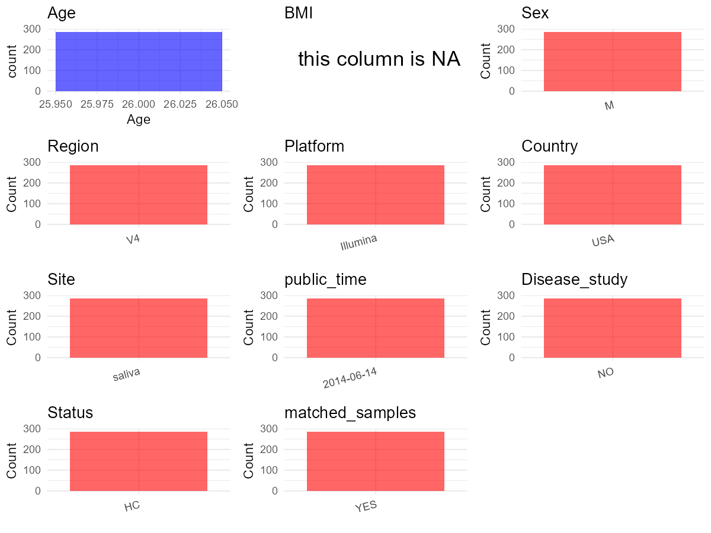

R Notebook: Metadata Processing Workflow
================

# Step 1: Obtain Initial Metadata from Each Project

To obtain the initial metadata: 1. Search for the BioProject ID (e.g.,
“PRJEBXXXX”) on the [NCBI SRA
website](https://www.ncbi.nlm.nih.gov/Traces/study/). 2. In the “Select”
table, click on “Metadata” and download the file. 3. The downloaded file
is typically named “SraRunTable.csv” and contains metadata for the
project.

``` r
# Load necessary libraries
library(dplyr)
library(ggplot2)
library(cowplot)

# Set working directory (update this path to your local directory)
setwd("D:/oral_project/PRJEB6518")

# Read the initial metadata files
initial_meta<-read.csv("SraRunTable.csv",header = T)

# Combine the two metadata files
#meta <- rbind(initial_meta, initial_meta1)

#Remove entries non-oral samples
#initial_meta <- subset(initial_meta,isolate %in% c("saliva","tongue coat"))
initial_meta <- initial_meta[initial_meta$Organism != "human gut metagenome", ]
# Check the number of samples containing "HT" in Sample.Name (e.g., healthy controls)
#nrow(subset(meta, grepl("HT", Sample.Name)))

# Display the first few rows of the metadata
head(initial_meta)
```

    ##          Run AGE age_unit altitude anonymized_name Assay.Type assigned_from_geo
    ## 14 ERR531454  26       78        0       Saliva184   AMPLICON                 n
    ## 15 ERR531455  26       78        0        Saliva84   AMPLICON                 n
    ## 16 ERR531456  26       78        0       Saliva207   AMPLICON                 n
    ## 23 ERR531463  26       78        0        Saliva64   AMPLICON                 n
    ## 26 ERR531466  26       78        0       Saliva209   AMPLICON                 n
    ## 27 ERR531467  26       78        0       Saliva144   AMPLICON                 n
    ##    AvgSpotLen    Bases BioProject    BioSample       body_habitat
    ## 14         95 33467043  PRJEB6518 SAMEA2592382 UBERON:oral cavity
    ## 15         94 25870569  PRJEB6518 SAMEA2592383 UBERON:oral cavity
    ## 16         94 26819099  PRJEB6518 SAMEA2592384 UBERON:oral cavity
    ## 23         94 38150985  PRJEB6518 SAMEA2592391 UBERON:oral cavity
    ## 26         95 33897562  PRJEB6518 SAMEA2592394 UBERON:oral cavity
    ## 27         94 24561716  PRJEB6518 SAMEA2592395 UBERON:oral cavity
    ##    body_mass_index  body_product     body_site    Bytes   Center.Name
    ## 14            19.4 UBERON:tongue UBERON:saliva 28545774 CCME-COLORADO
    ## 15            19.4 UBERON:tongue UBERON:saliva 22003680 CCME-COLORADO
    ## 16            19.4 UBERON:tongue UBERON:saliva 23197124 CCME-COLORADO
    ## 23            19.4 UBERON:tongue UBERON:saliva 32488994 CCME-COLORADO
    ## 26            19.4 UBERON:tongue UBERON:saliva 29065101 CCME-COLORADO
    ## 27            19.4 UBERON:tongue UBERON:saliva 21241844 CCME-COLORADO
    ##    Collection_Date           common_name Consent DATASTORE.filetype
    ## 14            2011 human oral metagenome  public   fastq,run.zq,sra
    ## 15            2011 human oral metagenome  public   fastq,run.zq,sra
    ## 16            2011 human oral metagenome  public   fastq,run.zq,sra
    ## 23            2011 human oral metagenome  public   fastq,run.zq,sra
    ## 26            2011 human oral metagenome  public   fastq,run.zq,sra
    ## 27            2011 human oral metagenome  public   fastq,run.zq,sra
    ##    DATASTORE.provider                         DATASTORE.region Depth     Diet
    ## 14     ena,gs,ncbi,s3 ena,gs.us-east1,ncbi.public,s3.us-east-1     0 omnivore
    ## 15     ena,gs,ncbi,s3 ena,gs.us-east1,ncbi.public,s3.us-east-1     0 omnivore
    ## 16     ena,gs,ncbi,s3 ena,gs.us-east1,ncbi.public,s3.us-east-1     0 omnivore
    ## 23     ena,gs,ncbi,s3 ena,gs.us-east1,ncbi.public,s3.us-east-1     0 omnivore
    ## 26     ena,gs,ncbi,s3 ena,gs.us-east1,ncbi.public,s3.us-east-1     0 omnivore
    ## 27     ena,gs,ncbi,s3 ena,gs.us-east1,ncbi.public,s3.us-east-1     0 omnivore
    ##    elevation ENA.FIRST.PUBLIC..run.     ENA_first_public ENA.LAST.UPDATE..run.
    ## 14    256.05             2014-06-14 2014-06-14T17:03:01Z            2018-11-16
    ## 15    256.05             2014-06-14 2014-06-14T17:03:01Z            2018-11-16
    ## 16    256.05             2014-06-14 2014-06-14T17:03:01Z            2018-11-16
    ## 23    256.05             2014-06-14 2014-06-14T17:03:01Z            2018-11-16
    ## 26    256.05             2014-06-14 2014-06-14T17:03:01Z            2018-11-16
    ## 27    256.05             2014-06-14 2014-06-14T17:03:01Z            2018-11-16
    ##         ENA_last_update        env_biome                   env_feature
    ## 14 2018-03-09T11:14:40Z ENVO:urban biome ENVO:human-associated habitat
    ## 15 2018-03-09T11:14:40Z ENVO:urban biome ENVO:human-associated habitat
    ## 16 2018-03-09T11:14:40Z ENVO:urban biome ENVO:human-associated habitat
    ## 23 2018-03-09T11:14:55Z ENVO:urban biome ENVO:human-associated habitat
    ## 26 2018-03-09T11:14:55Z ENVO:urban biome ENVO:human-associated habitat
    ## 27 2018-03-09T11:14:56Z ENVO:urban biome ENVO:human-associated habitat
    ##     env_matter experiment_center..exp. experiment_design_description..exp.
    ## 14 ENVO:saliva                    CCME        daily microbiota time-series
    ## 15 ENVO:saliva                    CCME        daily microbiota time-series
    ## 16 ENVO:saliva                    CCME        daily microbiota time-series
    ## 23 ENVO:saliva                    CCME        daily microbiota time-series
    ## 26 ENVO:saliva                    CCME        daily microbiota time-series
    ## 27 ENVO:saliva                    CCME        daily microbiota time-series
    ##    Experiment                 experiment_title..exp.  external_id
    ## 14  ERX496657 MIT daily human microbiota time-series SAMEA2592382
    ## 15  ERX496658 MIT daily human microbiota time-series SAMEA2592383
    ## 16  ERX496659 MIT daily human microbiota time-series SAMEA2592384
    ## 23  ERX496666 MIT daily human microbiota time-series SAMEA2592391
    ## 26  ERX496669 MIT daily human microbiota time-series SAMEA2592394
    ## 27  ERX496670 MIT daily human microbiota time-series SAMEA2592395
    ##    geo_loc_name_country geo_loc_name_country_continent
    ## 14                  USA                  North America
    ## 15                  USA                  North America
    ## 16                  USA                  North America
    ## 23                  USA                  North America
    ## 26                  USA                  North America
    ## 27                  USA                  North America
    ##    geographic_location_.country_and.or_sea. host_subject_id host_taxid
    ## 14                                 USA: GAZ     2202:DonorA       9606
    ## 15                                 USA: GAZ     2202:DonorA       9606
    ## 16                                 USA: GAZ     2202:DonorA       9606
    ## 23                                 USA: GAZ     2202:DonorA       9606
    ## 26                                 USA: GAZ     2202:DonorA       9606
    ## 27                                 USA: GAZ     2202:DonorA       9606
    ##    illumina_technology INSDC_center_name   INSDC_first_public
    ## 14               GAIIx     CCME-COLORADO 2014-06-14T17:03:01Z
    ## 15               GAIIx     CCME-COLORADO 2014-06-14T17:03:01Z
    ## 16               GAIIx     CCME-COLORADO 2014-06-14T17:03:01Z
    ## 23               GAIIx     CCME-COLORADO 2014-06-14T17:03:01Z
    ## 26               GAIIx     CCME-COLORADO 2014-06-14T17:03:01Z
    ## 27               GAIIx     CCME-COLORADO 2014-06-14T17:03:01Z
    ##       INSDC_last_update INSDC_status  Instrument LATITUDE  Library.Name
    ## 14 2018-03-09T11:14:40Z       public unspecified    37.09  Saliva184:94
    ## 15 2018-03-09T11:14:40Z       public unspecified    37.09  Saliva84:269
    ## 16 2018-03-09T11:14:40Z       public unspecified    37.09 Saliva207:120
    ## 23 2018-03-09T11:14:55Z       public unspecified    37.09  Saliva64:247
    ## 26 2018-03-09T11:14:55Z       public unspecified    37.09 Saliva209:122
    ## 27 2018-03-09T11:14:56Z       public unspecified    37.09  Saliva144:50
    ##    LibraryLayout LibrarySelection LibrarySource LONGITUDE num_sequences..exp.
    ## 14        SINGLE              PCR   METAGENOMIC    -95.71              350892
    ## 15        SINGLE              PCR   METAGENOMIC    -95.71              273301
    ## 16        SINGLE              PCR   METAGENOMIC    -95.71              284116
    ## 23        SINGLE              PCR   METAGENOMIC    -95.71              404290
    ## 26        SINGLE              PCR   METAGENOMIC    -95.71              355993
    ## 27        SINGLE              PCR   METAGENOMIC    -95.71              259008
    ##                 Organism                                 pcr_primers..exp.
    ## 14 human oral metagenome FWD:GTGCCAGCMGCCGCGGTAA; REV:GGACTACHVGGGTWTCTAAT
    ## 15 human oral metagenome FWD:GTGCCAGCMGCCGCGGTAA; REV:GGACTACHVGGGTWTCTAAT
    ## 16 human oral metagenome FWD:GTGCCAGCMGCCGCGGTAA; REV:GGACTACHVGGGTWTCTAAT
    ## 23 human oral metagenome FWD:GTGCCAGCMGCCGCGGTAA; REV:GGACTACHVGGGTWTCTAAT
    ## 26 human oral metagenome FWD:GTGCCAGCMGCCGCGGTAA; REV:GGACTACHVGGGTWTCTAAT
    ## 27 human oral metagenome FWD:GTGCCAGCMGCCGCGGTAA; REV:GGACTACHVGGGTWTCTAAT
    ##    platform..exp. Platform public          ReleaseDate row_number..exp.
    ## 14       Illumina ILLUMINA      n 2014-06-14T00:00:00Z               94
    ## 15       Illumina ILLUMINA      n 2014-06-14T00:00:00Z              269
    ## 16       Illumina ILLUMINA      n 2014-06-14T00:00:00Z              120
    ## 23       Illumina ILLUMINA      n 2014-06-14T00:00:00Z              247
    ## 26       Illumina ILLUMINA      n 2014-06-14T00:00:00Z              122
    ## 27       Illumina ILLUMINA      n 2014-06-14T00:00:00Z               50
    ##    run_center..exp. run_date..exp. samp_size sample_center..exp. Sample_ID
    ## 14           CGS-GL        5/14/11    .1\\,g                 MIT   1247334
    ## 15           CGS-GL        5/14/11    .1\\,g                 MIT   1247335
    ## 16           CGS-GL        5/14/11    .1\\,g                 MIT   1247336
    ## 23           CGS-GL        5/14/11    .1\\,g                 MIT   1247343
    ## 26           CGS-GL        5/14/11    .1\\,g                 MIT   1247346
    ## 27           CGS-GL        5/14/11    .1\\,g                 MIT   1247347
    ##     Sample.Name Sample_name       scientific_name   sequencing_meth..exp. sex
    ## 14 SAMEA2592382   Saliva184 human oral metagenome sequencing by synthesis  47
    ## 15 SAMEA2592383    Saliva84 human oral metagenome sequencing by synthesis  47
    ## 16 SAMEA2592384   Saliva207 human oral metagenome sequencing by synthesis  47
    ## 23 SAMEA2592391    Saliva64 human oral metagenome sequencing by synthesis  47
    ## 26 SAMEA2592394   Saliva209 human oral metagenome sequencing by synthesis  47
    ## 27 SAMEA2592395   Saliva144 human oral metagenome sequencing by synthesis  47
    ##    SRA.Study study_center..exp.               Submitter_Id target_gene..exp.
    ## 14 ERP006059                MIT qiime_study_2202:Saliva184          16S rRNA
    ## 15 ERP006059                MIT  qiime_study_2202:Saliva84          16S rRNA
    ## 16 ERP006059                MIT qiime_study_2202:Saliva207          16S rRNA
    ## 23 ERP006059                MIT  qiime_study_2202:Saliva64          16S rRNA
    ## 26 ERP006059                MIT qiime_study_2202:Saliva209          16S rRNA
    ## 27 ERP006059                MIT qiime_study_2202:Saliva144          16S rRNA
    ##    target_subfragment..exp. taxon_id collection_day          create_date
    ## 14                       V4   447426            240 2014-06-15T00:00:00Z
    ## 15                       V4   447426            131 2014-06-15T00:21:00Z
    ## 16                       V4   447426            275 2014-06-15T00:21:00Z
    ## 23                       V4   447426            108 2014-06-15T00:28:00Z
    ## 26                       V4   447426            276 2014-06-15T00:11:00Z
    ## 27                       V4   447426            200 2014-06-15T00:20:00Z
    ##    version nutrition_calcium nutrition_calorie nutrition_carb
    ## 14       1                NA                NA             NA
    ## 15       1            220.58           2413.26       241.6760
    ## 16       1                NA                NA             NA
    ## 23       1                NA                NA             NA
    ## 26       1                NA                NA             NA
    ## 27       1            920.80           1961.47       287.2226
    ##    nutrition_cholesterol nutrition_fat nutrition_fiber nutrition_protein
    ## 14                    NA            NA              NA                NA
    ## 15                148.60       98.8840          10.056          138.6180
    ## 16                    NA            NA              NA                NA
    ## 23                    NA            NA              NA                NA
    ## 26                    NA            NA              NA                NA
    ## 27                166.64       48.6578          22.848           67.5906
    ##    nutrition_satfat nutrition_sodium nutrition_sugar
    ## 14               NA               NA              NA
    ## 15         25.08556          2611.52         67.9378
    ## 16               NA               NA              NA
    ## 23               NA               NA              NA
    ## 26               NA               NA              NA
    ## 27         21.39772          3861.58        102.1968

# Step 2: Create a Uniform Metadata Template

The uniform metadata should include the following columns:

1.  **BioProject**: Project ID (e.g., “PRJNA339212”)
2.  **Run**: Sample ID (e.g., “ERRXXXXXX” or “SRRXXXXXX”)
3.  **sample_name**: Original sample name submitted by the authors (not
    the database-assigned ID)
4.  **Age**: Age of the subject (if available)
5.  **BMI**: Body Mass Index (if available)
6.  **Sex**: Sex of the subject (“F” or “M”)
7.  **Region**: Targeted 16S rRNA region (e.g., “V3-V4”)
8.  **Platform**: Sequencing platform (e.g., “Illumina MiSeq”)
9.  **Country**: Country of sample origin (e.g., “China”)
10. **Site**: Sample site (e.g., “saliva”, “dental plaque”)
11. **public_time**: Data release date (format: “YYYY-MM-DD”)
12. **PCR_primers**: PCR primers used (e.g., “515F-806R”)
13. **title**: Title of the associated publication
14. **Disease_study**: Whether the study involves a disease (“YES” or
    “NO”)
15. **Status**: Disease status (e.g., “T2DM”, “HC”). Note: If the study
    includes both disease and healthy samples, this must be specified
    per sample.
16. **matched_samples**: matched samples (“YES” or “NO”)

``` r
# Create a uniform metadata dataframe
metadata <- data.frame(
  BioProject = initial_meta$BioProject,
  Run = initial_meta$Run,
  sample_name = initial_meta$host_subject_id,
  Age = initial_meta$AGE,
  BMI = NA,
  Sex=initial_meta$sex,
  Region = initial_meta$target_subfragment..exp.,
  Platform = initial_meta$platform..exp.,
  Country = initial_meta$geo_loc_name_country,
  Site = "saliva",
  public_time = "2014-06-14",
  PCR_primers = initial_meta$pcr_primers..exp.,
  stringsAsFactors = FALSE
)
```

``` r
metadata <- metadata %>%
  mutate(Sex = recode(Sex, "48" = "F", "47" = "M"))
```

# Step 3: Manually Add Information from the Publication

Some information (e.g. PCR primers, study title, disease status) must be
manually extracted from the publication and added to the metadata.

``` r
# Add information obtained from the publication
metadata$title <- "Host lifestyle affects human microbiota on daily timescales"
metadata$Disease_study <- "NO"
# Assign disease status based on sample_name patterns
metadata$Status <- "HC"

#extract subject id by remove prefix of sample_name
metadata$sample_name <- gsub("Saliva", "", metadata$sample_name)

# Check initial data distribution
cat("Initial sample distribution:\n")
```

    ## Initial sample distribution:

``` r
table(metadata$sample_name)
```

    ## 
    ## 2202:DonorA 
    ##         286

``` r
table(metadata$Site)
```

    ## 
    ## saliva 
    ##    286

``` r
# Calculate sampling frequency per subject
sample_counts <- table(metadata$sample_name)
cat("\nNumber of samples per subject:\n")
```

    ## 
    ## Number of samples per subject:

``` r
print(sample_counts)
```

    ## 
    ## 2202:DonorA 
    ##         286

``` r
# Create matched_samples column
metadata$matched_samples <- ifelse(metadata$sample_name %in% names(sample_counts[sample_counts >= 2]), "YES", "NO")

cat("\nMatched samples distribution:\n")
```

    ## 
    ## Matched samples distribution:

``` r
table(metadata$matched_samples)
```

    ## 
    ## YES 
    ## 286

``` r
# Identify samples for removal: single samples excluding saliva and tongue coat
single_samples <- names(sample_counts[sample_counts == 1])
samples_to_remove <- metadata$sample_name %in% single_samples & 
                     !(metadata$Site %in% c("saliva", "tongue coat"))

cat("\nNumber of samples to be removed:", sum(samples_to_remove), "\n")
```

    ## 
    ## Number of samples to be removed: 0

``` r
# Remove identified samples
metadata_clean <- metadata[!samples_to_remove, ]

cat("\nFinal sample distribution after cleaning:\n")
```

    ## 
    ## Final sample distribution after cleaning:

``` r
table(metadata_clean$sample_name)
```

    ## 
    ## 2202:DonorA 
    ##         286

``` r
table(metadata_clean$Site)
```

    ## 
    ## saliva 
    ##    286

``` r
table(metadata_clean$matched_samples)
```

    ## 
    ## YES 
    ## 286

``` r
# Use cleaned dataset for subsequent analysis
metadata <- metadata_clean
```

# Step 4: Summarize and Validate the Metadata

``` r
# Check the number of unique runs and sample names
print(paste("Number of unique runs:", length(unique(metadata$Run))))
```

    ## [1] "Number of unique runs: 286"

``` r
print(paste("Number of unique sample names:", length(unique(metadata$sample_name))))
```

    ## [1] "Number of unique sample names: 1"

# Step 5: Visualize the Metadata

``` r

```

<!-- -->

# Step 6: Finalize and Export the Metadata

``` r
# Reorder columns to match the desired format
metadata <- metadata[, c(
  "BioProject", "Run", "sample_name", "Age", "BMI", "Sex", 
  "Region", "Platform", "Country", "Site", "public_time", 
  "PCR_primers", "title", "Disease_study", "Status","matched_samples"
)]

# Export the uniform metadata to a CSV file
write.csv(metadata, file = "metadata.csv", quote = FALSE)
head(metadata)
```

    ##   BioProject       Run sample_name Age BMI Sex Region Platform Country   Site
    ## 1  PRJEB6518 ERR531454 2202:DonorA  26  NA   M     V4 Illumina     USA saliva
    ## 2  PRJEB6518 ERR531455 2202:DonorA  26  NA   M     V4 Illumina     USA saliva
    ## 3  PRJEB6518 ERR531456 2202:DonorA  26  NA   M     V4 Illumina     USA saliva
    ## 4  PRJEB6518 ERR531463 2202:DonorA  26  NA   M     V4 Illumina     USA saliva
    ## 5  PRJEB6518 ERR531466 2202:DonorA  26  NA   M     V4 Illumina     USA saliva
    ## 6  PRJEB6518 ERR531467 2202:DonorA  26  NA   M     V4 Illumina     USA saliva
    ##   public_time                                       PCR_primers
    ## 1  2014-06-14 FWD:GTGCCAGCMGCCGCGGTAA; REV:GGACTACHVGGGTWTCTAAT
    ## 2  2014-06-14 FWD:GTGCCAGCMGCCGCGGTAA; REV:GGACTACHVGGGTWTCTAAT
    ## 3  2014-06-14 FWD:GTGCCAGCMGCCGCGGTAA; REV:GGACTACHVGGGTWTCTAAT
    ## 4  2014-06-14 FWD:GTGCCAGCMGCCGCGGTAA; REV:GGACTACHVGGGTWTCTAAT
    ## 5  2014-06-14 FWD:GTGCCAGCMGCCGCGGTAA; REV:GGACTACHVGGGTWTCTAAT
    ## 6  2014-06-14 FWD:GTGCCAGCMGCCGCGGTAA; REV:GGACTACHVGGGTWTCTAAT
    ##                                                         title Disease_study
    ## 1 Host lifestyle affects human microbiota on daily timescales            NO
    ## 2 Host lifestyle affects human microbiota on daily timescales            NO
    ## 3 Host lifestyle affects human microbiota on daily timescales            NO
    ## 4 Host lifestyle affects human microbiota on daily timescales            NO
    ## 5 Host lifestyle affects human microbiota on daily timescales            NO
    ## 6 Host lifestyle affects human microbiota on daily timescales            NO
    ##   Status matched_samples
    ## 1     HC             YES
    ## 2     HC             YES
    ## 3     HC             YES
    ## 4     HC             YES
    ## 5     HC             YES
    ## 6     HC             YES

## Notes for Students:

1.  **Metadata Accuracy**: Always cross-check the metadata with the
    original publication to ensure accuracy.
2.  **Manual Entries**: Columns like `PCR_primers`, and `Status` often
    require manual entry based on the publication.
3.  **Disease Status**: Be careful when assigning `Status`—some studies
    include both disease and healthy samples.
4.  **Visualization**: The plots help quickly identify the distribution
    of values in each column, which is useful for quality control.
5.  **Reproducibility**: Update the working directory and file paths to
    match your local environment.
