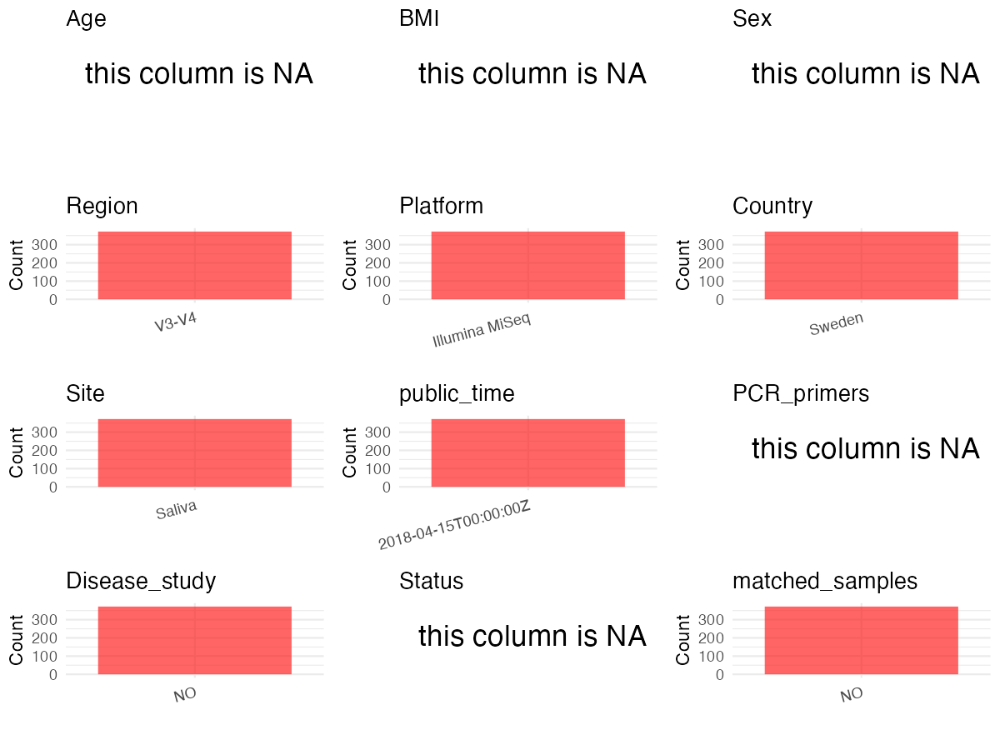

R Notebook: Metadata Processing Workflow
================

# Step 1: Obtain Initial Metadata from Each Project

To obtain the initial metadata: 1. Search for the BioProject ID (e.g.,
“PRJEBXXXX”) on the [NCBI SRA
website](https://www.ncbi.nlm.nih.gov/Traces/study/). 2. In the “Select”
table, click on “Metadata” and download the file. 3. The downloaded file
is typically named “SraRunTable.csv” and contains metadata for the
project.

``` r
# Load necessary libraries
library(dplyr)
library(ggplot2)
library(cowplot)
library(stringr)
# Set working directory (update this path to your local directory)
setwd("/Users/dongbiao/Documents/oral/global-oral-microbiome/data/projects/PRJEB66628")

# Read the initial metadata files
initial_meta <- read.csv("SraRunTable.csv",header = T) %>% filter(`Sample.Name` != "Mock.DNA.even")
 
head(initial_meta)
```

    ##          Run Assay.Type AvgSpotLen    Bases BioProject      BioSample    Bytes
    ## 1 ERR2104435   AMPLICON        464 37306250 PRJEB66628 SAMEA104225676 18383114
    ## 2 ERR2104436   AMPLICON        464  8176557 PRJEB66628 SAMEA104225677  4064582
    ## 3 ERR2104437   AMPLICON        463  5179699 PRJEB66628 SAMEA104225678  2656446
    ## 4 ERR2104438   AMPLICON        462 12647080 PRJEB66628 SAMEA104225679  6452262
    ## 5 ERR2104439   AMPLICON        462  3640341 PRJEB66628 SAMEA104225680  1866299
    ## 6 ERR2104440   AMPLICON        464 32430092 PRJEB66628 SAMEA104225681 16007968
    ##                                          Center.Name Collection_Date
    ## 1 INSTITUTO DE AGROQUIMICA Y TECNOLOGIA DE ALIMENTOS            2001
    ## 2 INSTITUTO DE AGROQUIMICA Y TECNOLOGIA DE ALIMENTOS            2001
    ## 3 INSTITUTO DE AGROQUIMICA Y TECNOLOGIA DE ALIMENTOS            2001
    ## 4 INSTITUTO DE AGROQUIMICA Y TECNOLOGIA DE ALIMENTOS            2001
    ## 5 INSTITUTO DE AGROQUIMICA Y TECNOLOGIA DE ALIMENTOS            2001
    ## 6 INSTITUTO DE AGROQUIMICA Y TECNOLOGIA DE ALIMENTOS            2001
    ##   common_name Consent DATASTORE.filetype DATASTORE.provider
    ## 1       human  public   fastq,run.zq,sra     ena,gs,ncbi,s3
    ## 2       human  public   fastq,run.zq,sra     ena,gs,ncbi,s3
    ## 3       human  public   fastq,run.zq,sra     ena,gs,ncbi,s3
    ## 4       human  public   fastq,run.zq,sra     ena,gs,ncbi,s3
    ## 5       human  public   fastq,run.zq,sra     ena,gs,ncbi,s3
    ## 6       human  public   fastq,run.zq,sra     ena,gs,ncbi,s3
    ##                           DATASTORE.region ENA.FIRST.PUBLIC..run.
    ## 1 ena,gs.us-east1,ncbi.public,s3.us-east-1             2018-04-14
    ## 2 ena,gs.us-east1,ncbi.public,s3.us-east-1             2018-04-14
    ## 3 ena,gs.us-east1,ncbi.public,s3.us-east-1             2018-04-14
    ## 4 ena,gs.us-east1,ncbi.public,s3.us-east-1             2018-04-14
    ## 5 ena,gs.us-east1,ncbi.public,s3.us-east-1             2018-04-14
    ## 6 ena,gs.us-east1,ncbi.public,s3.us-east-1             2018-04-14
    ##   ENA_first_public ENA.LAST.UPDATE..run. ena_last_update environment_.biome.
    ## 1       2018-04-14            2018-11-16      2017-08-24                Oral
    ## 2       2018-04-14            2018-11-16      2017-08-24                Oral
    ## 3       2018-04-14            2018-11-16      2017-08-24                Oral
    ## 4       2018-04-14            2018-11-16      2017-08-24                Oral
    ## 5       2018-04-14            2018-11-16      2017-08-24                Oral
    ## 6       2018-04-14            2018-11-16      2017-08-24                Oral
    ##   environment_.feature. environment_.material. Experiment    external_id
    ## 1           Oral cavity                 Saliva ERX2161721 SAMEA104225676
    ## 2           Oral cavity                 Saliva ERX2161722 SAMEA104225677
    ## 3           Oral cavity                 Saliva ERX2161723 SAMEA104225678
    ## 4           Oral cavity                 Saliva ERX2161724 SAMEA104225679
    ## 5           Oral cavity                 Saliva ERX2161725 SAMEA104225680
    ## 6           Oral cavity                 Saliva ERX2161726 SAMEA104225681
    ##   geo_loc_name_country geo_loc_name_country_continent
    ## 1               Sweden                         Europe
    ## 2               Sweden                         Europe
    ## 3               Sweden                         Europe
    ## 4               Sweden                         Europe
    ## 5               Sweden                         Europe
    ## 6               Sweden                         Europe
    ##   geographic_location_.country_and.or_sea. geographic_location_.latitude.
    ## 1                                   Sweden                       59.33258
    ## 2                                   Sweden                       59.33258
    ## 3                                   Sweden                       59.33258
    ## 4                                   Sweden                       59.33258
    ## 5                                   Sweden                       59.33258
    ## 6                                   Sweden                       59.33258
    ##   geographic_location_.longitude. human_oral_environmental_package
    ## 1                         18.0649                       human-oral
    ## 2                         18.0649                       human-oral
    ## 3                         18.0649                       human-oral
    ## 4                         18.0649                       human-oral
    ## 5                         18.0649                       human-oral
    ## 6                         18.0649                       human-oral
    ##   INSDC_center_alias
    ## 1          IATA-CSIC
    ## 2          IATA-CSIC
    ## 3          IATA-CSIC
    ## 4          IATA-CSIC
    ## 5          IATA-CSIC
    ## 6          IATA-CSIC
    ##                                                                                           INSDC_center_name
    ## 1 Instituto de Agroquimica y Tecnologia de Alimentos (IATA)\\, The Spanish National Research Council (CSIC)
    ## 2 Instituto de Agroquimica y Tecnologia de Alimentos (IATA)\\, The Spanish National Research Council (CSIC)
    ## 3 Instituto de Agroquimica y Tecnologia de Alimentos (IATA)\\, The Spanish National Research Council (CSIC)
    ## 4 Instituto de Agroquimica y Tecnologia de Alimentos (IATA)\\, The Spanish National Research Council (CSIC)
    ## 5 Instituto de Agroquimica y Tecnologia de Alimentos (IATA)\\, The Spanish National Research Council (CSIC)
    ## 6 Instituto de Agroquimica y Tecnologia de Alimentos (IATA)\\, The Spanish National Research Council (CSIC)
    ##     INSDC_first_public    INSDC_last_update INSDC_status     Instrument
    ## 1 2018-04-14T17:02:44Z 2017-08-24T17:44:14Z       public Illumina MiSeq
    ## 2 2018-04-14T17:02:44Z 2017-08-24T17:44:14Z       public Illumina MiSeq
    ## 3 2018-04-14T17:02:44Z 2017-08-24T17:44:14Z       public Illumina MiSeq
    ## 4 2018-04-14T17:02:44Z 2017-08-24T17:44:14Z       public Illumina MiSeq
    ## 5 2018-04-14T17:02:44Z 2017-08-24T17:44:14Z       public Illumina MiSeq
    ## 6 2018-04-14T17:02:44Z 2017-08-24T17:44:14Z       public Illumina MiSeq
    ##   investigation_type Library.Name LibraryLayout LibrarySelection LibrarySource
    ## 1         metagenome  unspecified        SINGLE              PCR       GENOMIC
    ## 2         metagenome  unspecified        SINGLE              PCR       GENOMIC
    ## 3         metagenome  unspecified        SINGLE              PCR       GENOMIC
    ## 4         metagenome  unspecified        SINGLE              PCR       GENOMIC
    ## 5         metagenome  unspecified        SINGLE              PCR       GENOMIC
    ## 6         metagenome  unspecified        SINGLE              PCR       GENOMIC
    ##       Organism Platform
    ## 1 Homo sapiens ILLUMINA
    ## 2 Homo sapiens ILLUMINA
    ## 3 Homo sapiens ILLUMINA
    ## 4 Homo sapiens ILLUMINA
    ## 5 Homo sapiens ILLUMINA
    ## 6 Homo sapiens ILLUMINA
    ##                                                                                                         project_name
    ## 1 Development of the oral microbiome during childhood: an ecological succession associated with dental health status
    ## 2 Development of the oral microbiome during childhood: an ecological succession associated with dental health status
    ## 3 Development of the oral microbiome during childhood: an ecological succession associated with dental health status
    ## 4 Development of the oral microbiome during childhood: an ecological succession associated with dental health status
    ## 5 Development of the oral microbiome during childhood: an ecological succession associated with dental health status
    ## 6 Development of the oral microbiome during childhood: an ecological succession associated with dental health status
    ##            ReleaseDate    Sample.Name        Sample_name Sequencing_method
    ## 1 2018-04-15T00:00:00Z SAMEA104225676 101_12M.join.fq.gz    Illumina MiSeq
    ## 2 2018-04-15T00:00:00Z SAMEA104225677 101_24M.join.fq.gz    Illumina MiSeq
    ## 3 2018-04-15T00:00:00Z SAMEA104225678  101_6M.join.fq.gz    Illumina MiSeq
    ## 4 2018-04-15T00:00:00Z SAMEA104225679  101_7Y.join.fq.gz    Illumina MiSeq
    ## 5 2018-04-15T00:00:00Z SAMEA104225680 102_24M.join.fq.gz    Illumina MiSeq
    ## 6 2018-04-15T00:00:00Z SAMEA104225681  102_3M.join.fq.gz    Illumina MiSeq
    ##   SRA.Study       Submitter_Id          create_date version
    ## 1 ERP068977 101_12M.join.fq.gz 2018-04-15T08:08:00Z       1
    ## 2 ERP068977 101_24M.join.fq.gz 2018-04-15T08:08:00Z       1
    ## 3 ERP068977  101_6M.join.fq.gz 2018-04-15T08:08:00Z       1
    ## 4 ERP068977  101_7Y.join.fq.gz 2018-04-15T08:08:00Z       1
    ## 5 ERP068977 102_24M.join.fq.gz 2018-04-15T08:08:00Z       1
    ## 6 ERP068977  102_3M.join.fq.gz 2018-04-15T08:08:00Z       1

# Step 2: Create a Uniform Metadata Template

The uniform metadata should include the following columns:

1.  **BioProject**: Project ID (e.g., “PRJNA339212”)
2.  **Run**: Sample ID (e.g., “ERRXXXXXX” or “SRRXXXXXX”)
3.  **sample_name**: Original sample name submitted by the authors (not
    the database-assigned ID)
4.  **Age**: Age of the subject (if available)
5.  **BMI**: Body Mass Index (if available)
6.  **Sex**: Sex of the subject (“F” or “M”)
7.  **Region**: Targeted 16S rRNA region (e.g., “V3-V4”)
8.  **Platform**: Sequencing platform (e.g., “Illumina MiSeq”)
9.  **Country**: Country of sample origin (e.g., “China”)
10. **Site**: Sample site (e.g., “saliva”, “dental plaque”)
11. **public_time**: Data release date (format: “YYYY-MM-DD”)
12. **PCR_primers**: PCR primers used (e.g., “515F-806R”)
13. **title**: Title of the associated publication
14. **Disease_study**: Whether the study involves a disease (“YES” or
    “NO”)
15. **Status**: Disease status (e.g., “T2DM”, “HC”). Note: If the study
    includes both disease and healthy samples, this must be specified
    per sample.
16. **matched_samples** : matched samples (“YES” or “NO”)

``` r
# Create a uniform metadata dataframe
metadata <- data.frame(
  BioProject = initial_meta$BioProject,
  Run = initial_meta$Run,
  sample_name = initial_meta$Sample_name,
  Age = NA,
  BMI = NA,
  Sex= NA,
  Region = "V3-V4",
  Platform = initial_meta$Instrument,
  Country = initial_meta$geo_loc_name_country,
  Site = initial_meta$`environment_.material.`,
  public_time = initial_meta$ReleaseDate,
  stringsAsFactors = FALSE
)
```

# Step 3: Manually Add Information from the Publication

Some information (e.g. PCR primers, study title, disease status) must be
manually extracted from the publication and added to the metadata.

``` r
# Add information obtained from the publication
metadata$PCR_primers <- NA
metadata$title <- "Oral microbiome development during childhood: an ecological succession influenced by postnatal factors and associated with tooth decay"
metadata$Disease_study <- "NO"

# Assign disease status based on sample_name patterns
metadata$Status <- NA

# Create matched_samples column
metadata$matched_samples <- "NO"

# Check initial data distribution
cat("Initial sample distribution:\n")
```

    ## Initial sample distribution:

``` r
table(metadata$sample_name)
```

    ## 
    ## 101_12M.join.fq.gz 101_24M.join.fq.gz  101_6M.join.fq.gz  101_7Y.join.fq.gz 
    ##                  1                  1                  1                  1 
    ## 102_24M.join.fq.gz  102_3M.join.fq.gz  102_6M.join.fq.gz  102_7Y.join.fq.gz 
    ##                  1                  1                  1                  1 
    ## 106_12M.join.fq.gz  106_3M.join.fq.gz  106_6M.join.fq.gz  106_7Y.join.fq.gz 
    ##                  1                  1                  1                  1 
    ## 107_12M.join.fq.gz  107_6M.join.fq.gz  112_6M.join.fq.gz 115_12M.join.fq.gz 
    ##                  1                  1                  1                  1 
    ##  115_3M.join.fq.gz  115_6M.join.fq.gz  115_7Y.join.fq.gz 117_12M.join.fq.gz 
    ##                  1                  1                  1                  1 
    ##  117_3M.join.fq.gz  117_6M.join.fq.gz  117_7Y.join.fq.gz 118_12M.join.fq.gz 
    ##                  1                  1                  1                  1 
    ## 118_24M.join.fq.gz  118_3M.join.fq.gz  118_7Y.join.fq.gz  119_3M.join.fq.gz 
    ##                  1                  1                  1                  1 
    ##  119_6M.join.fq.gz  119_7Y.join.fq.gz 121_12M.join.fq.gz  121_3M.join.fq.gz 
    ##                  1                  1                  1                  1 
    ##  121_6M.join.fq.gz  121_7Y.join.fq.gz 123_24M.join.fq.gz  123_3M.join.fq.gz 
    ##                  1                  1                  1                  1 
    ##  123_6M.join.fq.gz  123_7Y.join.fq.gz 127_12M.join.fq.gz  127_3M.join.fq.gz 
    ##                  1                  1                  1                  1 
    ##  127_6M.join.fq.gz  127_7Y.join.fq.gz 129_12M.join.fq.gz 129_24M.join.fq.gz 
    ##                  1                  1                  1                  1 
    ##  129_6M.join.fq.gz  129_7Y.join.fq.gz 135_12M.join.fq.gz 135_24M.join.fq.gz 
    ##                  1                  1                  1                  1 
    ##  135_3M.join.fq.gz  135_6M.join.fq.gz  135_7Y.join.fq.gz 137_12M.join.fq.gz 
    ##                  1                  1                  1                  1 
    ##  137_6M.join.fq.gz  137_7Y.join.fq.gz 143_12M.join.fq.gz  143_6M.join.fq.gz 
    ##                  1                  1                  1                  1 
    ## 148_12M.join.fq.gz  148_6M.join.fq.gz  148_7Y.join.fq.gz  150_7Y.join.fq.gz 
    ##                  1                  1                  1                  1 
    ## 201_12M.join.fq.gz 201_24M.join.fq.gz  201_3M.join.fq.gz  201_6M.join.fq.gz 
    ##                  1                  1                  1                  1 
    ##  201_7Y.join.fq.gz 203_12M.join.fq.gz 203_24M.join.fq.gz  203_6M.join.fq.gz 
    ##                  1                  1                  1                  1 
    ##  204_3M.join.fq.gz  204_6M.join.fq.gz  204_7Y.join.fq.gz 205_12M.join.fq.gz 
    ##                  1                  1                  1                  1 
    ## 205_24M.join.fq.gz  205_6M.join.fq.gz  205_7Y.join.fq.gz 209_12M.join.fq.gz 
    ##                  1                  1                  1                  1 
    ## 209_24M.join.fq.gz  209_3M.join.fq.gz  209_6M.join.fq.gz  209_7Y.join.fq.gz 
    ##                  1                  1                  1                  1 
    ## 210_12M.join.fq.gz 210_24M.join.fq.gz  210_3M.join.fq.gz  210_6M.join.fq.gz 
    ##                  1                  1                  1                  1 
    ##  210_7Y.join.fq.gz 212_12M.join.fq.gz 212_24M.join.fq.gz  212_3M.join.fq.gz 
    ##                  1                  1                  1                  1 
    ##  212_6M.join.fq.gz  212_7Y.join.fq.gz 214_24M.join.fq.gz  214_3M.join.fq.gz 
    ##                  1                  1                  1                  1 
    ##  214_6M.join.fq.gz  214_7Y.join.fq.gz 215_12M.join.fq.gz 215_24M.join.fq.gz 
    ##                  1                  1                  1                  1 
    ##  215_3M.join.fq.gz  215_6M.join.fq.gz  215_7Y.join.fq.gz 220_12M.join.fq.gz 
    ##                  1                  1                  1                  1 
    ## 220_24M.join.fq.gz  220_3M.join.fq.gz  220_6M.join.fq.gz  220_7Y.join.fq.gz 
    ##                  1                  1                  1                  1 
    ## 223_12M.join.fq.gz 223_24M.join.fq.gz  223_3M.join.fq.gz  223_6M.join.fq.gz 
    ##                  1                  1                  1                  1 
    ##  223_7Y.join.fq.gz 224_12M.join.fq.gz 224_24M.join.fq.gz  224_3M.join.fq.gz 
    ##                  1                  1                  1                  1 
    ##  224_6M.join.fq.gz  224_7Y.join.fq.gz 225_12M.join.fq.gz 225_24M.join.fq.gz 
    ##                  1                  1                  1                  1 
    ##  225_3M.join.fq.gz  225_6M.join.fq.gz  225_7Y.join.fq.gz 226_12M.join.fq.gz 
    ##                  1                  1                  1                  1 
    ## 226_24M.join.fq.gz  226_3M.join.fq.gz  226_6M.join.fq.gz  226_7Y.join.fq.gz 
    ##                  1                  1                  1                  1 
    ## 228_12M.join.fq.gz  228_3M.join.fq.gz  228_6M.join.fq.gz 232_12M.join.fq.gz 
    ##                  1                  1                  1                  1 
    ## 232_24M.join.fq.gz  232_3M.join.fq.gz  232_6M.join.fq.gz  232_7Y.join.fq.gz 
    ##                  1                  1                  1                  1 
    ## 233_12M.join.fq.gz 233_24M.join.fq.gz  233_6M.join.fq.gz  233_7Y.join.fq.gz 
    ##                  1                  1                  1                  1 
    ## 237_12M.join.fq.gz 237_24M.join.fq.gz  237_3M.join.fq.gz  237_6M.join.fq.gz 
    ##                  1                  1                  1                  1 
    ##  237_7Y.join.fq.gz  239_3M.join.fq.gz  239_6M.join.fq.gz  239_7Y.join.fq.gz 
    ##                  1                  1                  1                  1 
    ## 240_24M.join.fq.gz  240_3M.join.fq.gz  240_6M.join.fq.gz  240_7Y.join.fq.gz 
    ##                  1                  1                  1                  1 
    ## 241_12M.join.fq.gz 241_24M.join.fq.gz  241_3M.join.fq.gz  241_6M.join.fq.gz 
    ##                  1                  1                  1                  1 
    ##  241_7Y.join.fq.gz 243_24M.join.fq.gz  243_3M.join.fq.gz  243_6M.join.fq.gz 
    ##                  1                  1                  1                  1 
    ##  243_7Y.join.fq.gz 245_24M.join.fq.gz  245_3M.join.fq.gz  245_6M.join.fq.gz 
    ##                  1                  1                  1                  1 
    ##  246_3M.join.fq.gz  246_6M.join.fq.gz  246_7Y.join.fq.gz 248_12M.join.fq.gz 
    ##                  1                  1                  1                  1 
    ## 248_24M.join.fq.gz  248_3M.join.fq.gz  248_6M.join.fq.gz  248_7Y.join.fq.gz 
    ##                  1                  1                  1                  1 
    ## 253_24M.join.fq.gz  253_3M.join.fq.gz  253_6M.join.fq.gz 254_12M.join.fq.gz 
    ##                  1                  1                  1                  1 
    ## 254_24M.join.fq.gz  254_3M.join.fq.gz  254_6M.join.fq.gz  254_7Y.join.fq.gz 
    ##                  1                  1                  1                  1 
    ## 255_12M.join.fq.gz 255_24M.join.fq.gz  255_3M.join.fq.gz  255_6M.join.fq.gz 
    ##                  1                  1                  1                  1 
    ##  255_7Y.join.fq.gz 258_12M.join.fq.gz 258_24M.join.fq.gz  258_3M.join.fq.gz 
    ##                  1                  1                  1                  1 
    ##  258_6M.join.fq.gz  258_7Y.join.fq.gz 260_12M.join.fq.gz 260_24M.join.fq.gz 
    ##                  1                  1                  1                  1 
    ##  260_3M.join.fq.gz  260_6M.join.fq.gz  260_7Y.join.fq.gz 261_24M.join.fq.gz 
    ##                  1                  1                  1                  1 
    ##  261_3M.join.fq.gz  261_6M.join.fq.gz  261_7Y.join.fq.gz 262_12M.join.fq.gz 
    ##                  1                  1                  1                  1 
    ## 262_24M.join.fq.gz  262_3M.join.fq.gz  262_6M.join.fq.gz  264_3M.join.fq.gz 
    ##                  1                  1                  1                  1 
    ##  264_6M.join.fq.gz 265_12M.join.fq.gz 265_24M.join.fq.gz  265_3M.join.fq.gz 
    ##                  1                  1                  1                  1 
    ##  265_6M.join.fq.gz  267_7Y.join.fq.gz 269_12M.join.fq.gz 269_24M.join.fq.gz 
    ##                  1                  1                  1                  1 
    ##  269_3M.join.fq.gz  269_6M.join.fq.gz  269_7Y.join.fq.gz 270_12M.join.fq.gz 
    ##                  1                  1                  1                  1 
    ## 270_24M.join.fq.gz  270_3M.join.fq.gz  270_6M.join.fq.gz  270_7Y.join.fq.gz 
    ##                  1                  1                  1                  1 
    ## 271_12M.join.fq.gz 271_24M.join.fq.gz  271_3M.join.fq.gz  271_6M.join.fq.gz 
    ##                  1                  1                  1                  1 
    ##  271_7Y.join.fq.gz 301_12M.join.fq.gz 301_24M.join.fq.gz  301_6M.join.fq.gz 
    ##                  1                  1                  1                  1 
    ##  301_7Y.join.fq.gz 302_12M.join.fq.gz 302_24M.join.fq.gz  302_3M.join.fq.gz 
    ##                  1                  1                  1                  1 
    ##  302_6M.join.fq.gz  302_7Y.join.fq.gz 303_24M.join.fq.gz  303_3M.join.fq.gz 
    ##                  1                  1                  1                  1 
    ##  303_6M.join.fq.gz  303_7Y.join.fq.gz 305_12M.join.fq.gz 305_24M.join.fq.gz 
    ##                  1                  1                  1                  1 
    ##  305_3M.join.fq.gz  305_6M.join.fq.gz  305_7Y.join.fq.gz 315_24M.join.fq.gz 
    ##                  1                  1                  1                  1 
    ##  315_6M.join.fq.gz  315_7Y.join.fq.gz 317_12M.join.fq.gz  317_6M.join.fq.gz 
    ##                  1                  1                  1                  1 
    ##  317_7Y.join.fq.gz 321_12M.join.fq.gz  321_3M.join.fq.gz  321_6M.join.fq.gz 
    ##                  1                  1                  1                  1 
    ##  321_7Y.join.fq.gz 324_12M.join.fq.gz 324_24M.join.fq.gz  324_3M.join.fq.gz 
    ##                  1                  1                  1                  1 
    ##  324_6M.join.fq.gz  324_7Y.join.fq.gz 326_24M.join.fq.gz  326_6M.join.fq.gz 
    ##                  1                  1                  1                  1 
    ##  326_7Y.join.fq.gz  327_3M.join.fq.gz  327_6M.join.fq.gz  327_7Y.join.fq.gz 
    ##                  1                  1                  1                  1 
    ## 330_12M.join.fq.gz 330_24M.join.fq.gz  330_3M.join.fq.gz  330_6M.join.fq.gz 
    ##                  1                  1                  1                  1 
    ##  330_7Y.join.fq.gz 335_12M.join.fq.gz 335_24M.join.fq.gz  335_6M.join.fq.gz 
    ##                  1                  1                  1                  1 
    ##  335_7Y.join.fq.gz 337_12M.join.fq.gz 337_24M.join.fq.gz  337_3M.join.fq.gz 
    ##                  1                  1                  1                  1 
    ##  337_6M.join.fq.gz  337_7Y.join.fq.gz 348_12M.join.fq.gz  348_3M.join.fq.gz 
    ##                  1                  1                  1                  1 
    ##  348_6M.join.fq.gz  348_7Y.join.fq.gz 349_24M.join.fq.gz  349_3M.join.fq.gz 
    ##                  1                  1                  1                  1 
    ##  349_6M.join.fq.gz  349_7Y.join.fq.gz 352_12M.join.fq.gz 352_24M.join.fq.gz 
    ##                  1                  1                  1                  1 
    ##  352_3M.join.fq.gz  352_6M.join.fq.gz  352_7Y.join.fq.gz 362_12M.join.fq.gz 
    ##                  1                  1                  1                  1 
    ## 362_24M.join.fq.gz  362_3M.join.fq.gz  362_6M.join.fq.gz  362_7Y.join.fq.gz 
    ##                  1                  1                  1                  1 
    ## 364_12M.join.fq.gz 364_24M.join.fq.gz  364_3M.join.fq.gz  364_6M.join.fq.gz 
    ##                  1                  1                  1                  1 
    ##  364_7Y.join.fq.gz 366_12M.join.fq.gz 366_24M.join.fq.gz  366_3M.join.fq.gz 
    ##                  1                  1                  1                  1 
    ##  366_6M.join.fq.gz  366_7Y.join.fq.gz 368_12M.join.fq.gz 368_24M.join.fq.gz 
    ##                  1                  1                  1                  1 
    ##  368_3M.join.fq.gz  368_6M.join.fq.gz  368_7Y.join.fq.gz 402_12M.join.fq.gz 
    ##                  1                  1                  1                  1 
    ## 402_24M.join.fq.gz  402_3M.join.fq.gz  402_6M.join.fq.gz  402_7Y.join.fq.gz 
    ##                  1                  1                  1                  1 
    ## 404_12M.join.fq.gz  404_3M.join.fq.gz  404_7Y.join.fq.gz 405_24M.join.fq.gz 
    ##                  1                  1                  1                  1 
    ##  405_3M.join.fq.gz  405_7Y.join.fq.gz 406_12M.join.fq.gz 406_24M.join.fq.gz 
    ##                  1                  1                  1                  1 
    ##  406_3M.join.fq.gz  406_6M.join.fq.gz  406_7Y.join.fq.gz 408_12M.join.fq.gz 
    ##                  1                  1                  1                  1 
    ## 408_24M.join.fq.gz  408_6M.join.fq.gz  408_7Y.join.fq.gz 410_12M.join.fq.gz 
    ##                  1                  1                  1                  1 
    ## 410_24M.join.fq.gz  410_3M.join.fq.gz  410_6M.join.fq.gz  410_7Y.join.fq.gz 
    ##                  1                  1                  1                  1 
    ## 414_12M.join.fq.gz 414_24M.join.fq.gz  414_3M.join.fq.gz  414_6M.join.fq.gz 
    ##                  1                  1                  1                  1 
    ##  414_7Y.join.fq.gz 415_12M.join.fq.gz 415_24M.join.fq.gz  415_3M.join.fq.gz 
    ##                  1                  1                  1                  1 
    ##  415_6M.join.fq.gz  415_7Y.join.fq.gz 416_12M.join.fq.gz 416_24M.join.fq.gz 
    ##                  1                  1                  1                  1 
    ##  416_3M.join.fq.gz  416_7Y.join.fq.gz 417_12M.join.fq.gz 417_24M.join.fq.gz 
    ##                  1                  1                  1                  1 
    ##  417_3M.join.fq.gz  417_7Y.join.fq.gz 418_12M.join.fq.gz  418_3M.join.fq.gz 
    ##                  1                  1                  1                  1 
    ##  418_6M.join.fq.gz  418_7Y.join.fq.gz 421_12M.join.fq.gz  421_3M.join.fq.gz 
    ##                  1                  1                  1                  1 
    ##  421_6M.join.fq.gz  421_7Y.join.fq.gz 423_12M.join.fq.gz 423_24M.join.fq.gz 
    ##                  1                  1                  1                  1 
    ##  423_3M.join.fq.gz  423_6M.join.fq.gz  423_7Y.join.fq.gz 427_12M.join.fq.gz 
    ##                  1                  1                  1                  1 
    ## 427_24M.join.fq.gz  427_3M.join.fq.gz  427_7Y.join.fq.gz 429_12M.join.fq.gz 
    ##                  1                  1                  1                  1 
    ## 429_24M.join.fq.gz  429_3M.join.fq.gz  429_6M.join.fq.gz  429_7Y.join.fq.gz 
    ##                  1                  1                  1                  1

``` r
table(metadata$Site)
```

    ## 
    ## Saliva 
    ##    372

# Step 4: Summarize and Validate the Metadata

``` r
# Check the number of unique runs and sample names
print(paste("Number of unique runs:", length(unique(metadata$Run))))
```

    ## [1] "Number of unique runs: 372"

``` r
print(paste("Number of unique sample names:", length(unique(metadata$sample_name))))
```

    ## [1] "Number of unique sample names: 372"

# Step 5: Visualize the Metadata

``` r
# Select columns for visualization
plot_data <- metadata %>%
  select(-BioProject, -Run, -sample_name, -title)

# Function to create simple plots for each column
create_simple_plots <- function(data) {
  plots <- list()
  
  for (col in colnames(data)) {
    # Check if the column is all NA
    if (all(is.na(data[[col]]))) {
      # Create an empty plot with text indicating all NA
      p <- ggplot() +
        annotate("text", x = 0.5, y = 0.5, label = "this column is NA", size = 6) +
        labs(title = col) +
        theme_void()
    } else if (is.numeric(data[[col]])) {
      # Numeric variable: histogram
      p <- ggplot(data, aes(x = .data[[col]])) +
        geom_histogram(fill = "blue", alpha = 0.6, bins = 20, na.rm = TRUE) +
        labs(title = col) +
        theme_minimal()
    } else {
      # Categorical variable: bar plot (remove NA values)
      count_data <- as.data.frame(table(data[[col]], useNA = "ifany"))
      p <- ggplot(count_data, aes(x = reorder(Var1, -Freq), y = Freq)) +
        geom_col(fill = "red", alpha = 0.6) +
        labs(title = col, x = NULL, y = "Count") +
        theme_minimal() +
        theme(axis.text.x = element_text(angle = 15, hjust = 1))
    }
    plots[[col]] <- p
  }
  
  return(plots)
}

# Generate and arrange plots
plots <- create_simple_plots(plot_data)
p<-plot_grid(plots$Age, 
          plots$BMI, 
          plots$Sex, 
          plots$Region, 
          plots$Platform, 
          plots$Country, 
          plots$Site,
          plots$public_time, 
          plots$PCR_primers,
          plots$Disease_study,
          plots$Status,
          plots$matched_samples,# add 
          ncol = 3, align = "hv", axis = "lb")
ggsave("Metadata_Summary.png", plot = p, width = 8, height = 6, dpi = 150)
```

``` r

```


# Step 6: Finalize and Export the Metadata

``` r
# Reorder columns to match the desired format
metadata <- metadata[, c(
  "BioProject", "Run", "sample_name", "Age", "BMI", "Sex", 
  "Region", "Platform", "Country", "Site", "public_time", 
  "PCR_primers", "title", "Disease_study", "Status","matched_samples"
)]

# Export the uniform metadata to a CSV file
write.csv(metadata, file = "metadata.csv", quote = FALSE)
head(metadata)
```

    ##   BioProject        Run        sample_name Age BMI Sex Region       Platform
    ## 1 PRJEB66628 ERR2104435 101_12M.join.fq.gz  NA  NA  NA  V3-V4 Illumina MiSeq
    ## 2 PRJEB66628 ERR2104436 101_24M.join.fq.gz  NA  NA  NA  V3-V4 Illumina MiSeq
    ## 3 PRJEB66628 ERR2104437  101_6M.join.fq.gz  NA  NA  NA  V3-V4 Illumina MiSeq
    ## 4 PRJEB66628 ERR2104438  101_7Y.join.fq.gz  NA  NA  NA  V3-V4 Illumina MiSeq
    ## 5 PRJEB66628 ERR2104439 102_24M.join.fq.gz  NA  NA  NA  V3-V4 Illumina MiSeq
    ## 6 PRJEB66628 ERR2104440  102_3M.join.fq.gz  NA  NA  NA  V3-V4 Illumina MiSeq
    ##   Country   Site          public_time PCR_primers
    ## 1  Sweden Saliva 2018-04-15T00:00:00Z          NA
    ## 2  Sweden Saliva 2018-04-15T00:00:00Z          NA
    ## 3  Sweden Saliva 2018-04-15T00:00:00Z          NA
    ## 4  Sweden Saliva 2018-04-15T00:00:00Z          NA
    ## 5  Sweden Saliva 2018-04-15T00:00:00Z          NA
    ## 6  Sweden Saliva 2018-04-15T00:00:00Z          NA
    ##                                                                                                                                    title
    ## 1 Oral microbiome development during childhood: an ecological succession influenced by postnatal factors and associated with tooth decay
    ## 2 Oral microbiome development during childhood: an ecological succession influenced by postnatal factors and associated with tooth decay
    ## 3 Oral microbiome development during childhood: an ecological succession influenced by postnatal factors and associated with tooth decay
    ## 4 Oral microbiome development during childhood: an ecological succession influenced by postnatal factors and associated with tooth decay
    ## 5 Oral microbiome development during childhood: an ecological succession influenced by postnatal factors and associated with tooth decay
    ## 6 Oral microbiome development during childhood: an ecological succession influenced by postnatal factors and associated with tooth decay
    ##   Disease_study Status matched_samples
    ## 1            NO     NA              NO
    ## 2            NO     NA              NO
    ## 3            NO     NA              NO
    ## 4            NO     NA              NO
    ## 5            NO     NA              NO
    ## 6            NO     NA              NO

## Notes for Students:

1.  **Metadata Accuracy**: Always cross-check the metadata with the
    original publication to ensure accuracy.
2.  **Manual Entries**: Columns like `PCR_primers`, and `Status` often
    require manual entry based on the publication.
3.  **Disease Status**: Be careful when assigning `Status`—some studies
    include both disease and healthy samples.
4.  **Visualization**: The plots help quickly identify the distribution
    of values in each column, which is useful for quality control.
5.  **Reproducibility**: Update the working directory and file paths to
    match your local environment.
