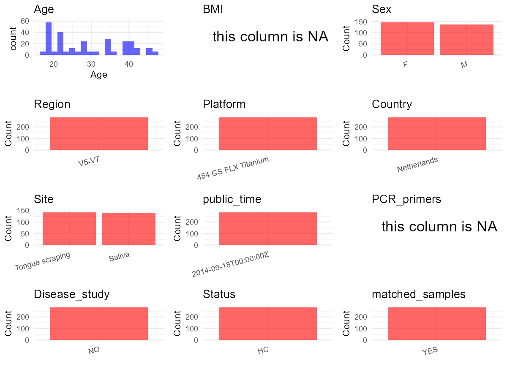

R Notebook: Metadata Processing Workflow
================

# Step 1: Obtain Initial Metadata from Each Project

To obtain the initial metadata: 1. Search for the BioProject ID (e.g.,
“PRJEBXXXX”) on the [NCBI SRA
website](https://www.ncbi.nlm.nih.gov/Traces/study/). 2. In the “Select”
table, click on “Metadata” and download the file. 3. The downloaded file
is typically named “SraRunTable.csv” and contains metadata for the
project.

``` r
# Load necessary libraries
library(dplyr)
library(ggplot2)
library(cowplot)

# Set working directory (update this path to your local directory)
setwd("D:/oral_project/PRJEB6781")

# Read the initial metadata files
initial_meta<-read.csv("SraRunTable.csv",header = T)

# Combine the two metadata files
#meta <- rbind(initial_meta, initial_meta1)

#Remove entries non-oral samples
#initial_meta <- subset(initial_meta,isolate %in% c("saliva","tongue coat"))

# Check the number of samples containing "HT" in Sample.Name (e.g., healthy controls)
#nrow(subset(meta, grepl("HT", Sample.Name)))

# Display the first few rows of the metadata
head(initial_meta)
```

    ##         Run AGE Assay.Type AvgSpotLen   Bases BioProject    BioSample  Bytes
    ## 1 ERR618776  35   AMPLICON        299  705597  PRJEB6781 SAMEA2672934 480172
    ## 2 ERR618777  35   AMPLICON        327 1146038  PRJEB6781 SAMEA2672935 741667
    ## 3 ERR618778  35   AMPLICON        302  695622  PRJEB6781 SAMEA2672936 475764
    ## 4 ERR618779  35   AMPLICON        307  933490  PRJEB6781 SAMEA2672937 629230
    ## 5 ERR618780  35   AMPLICON        316  913272  PRJEB6781 SAMEA2672938 617439
    ## 6 ERR618781  39   AMPLICON        321 1445040  PRJEB6781 SAMEA2672939 951180
    ##   Center.Name Collection_Date common_name Consent Couple_Id DATASTORE.filetype
    ## 1         TNO      2012-07-01       human  public  Couple 1   fastq,run.zq,sra
    ## 2         TNO      2012-07-01       human  public  Couple 1   fastq,run.zq,sra
    ## 3         TNO      2012-07-01       human  public  Couple 2   fastq,run.zq,sra
    ## 4         TNO      2012-07-01       human  public  Couple 3   fastq,run.zq,sra
    ## 5         TNO      2012-07-01       human  public  Couple 5   fastq,run.zq,sra
    ## 6         TNO      2012-07-01       human  public  Couple 6   fastq,run.zq,sra
    ##   DATASTORE.provider                         DATASTORE.region Donor.Acceptor
    ## 1     ena,gs,ncbi,s3 ena,gs.us-east1,ncbi.public,s3.us-east-1              D
    ## 2     ena,gs,ncbi,s3 ena,gs.us-east1,ncbi.public,s3.us-east-1              D
    ## 3     ena,gs,ncbi,s3 ena,gs.us-east1,ncbi.public,s3.us-east-1              D
    ## 4     ena,gs,ncbi,s3 ena,gs.us-east1,ncbi.public,s3.us-east-1              D
    ## 5     ena,gs,ncbi,s3 ena,gs.us-east1,ncbi.public,s3.us-east-1              D
    ## 6     ena,gs,ncbi,s3 ena,gs.us-east1,ncbi.public,s3.us-east-1              A
    ##   ENA.FIRST.PUBLIC..run. ENA.LAST.UPDATE..run. environment_.biome.
    ## 1             2014-09-17            2018-11-16    Human associated
    ## 2             2014-09-17            2018-11-16    Human associated
    ## 3             2014-09-17            2018-11-16    Human associated
    ## 4             2014-09-17            2018-11-16    Human associated
    ## 5             2014-09-17            2018-11-16    Human associated
    ## 6             2014-09-17            2018-11-16    Human associated
    ##   environment_.feature. environment_.material. Experiment  external_id
    ## 1                 Mouth                 Saliva  ERX575547 SAMEA2672934
    ## 2                 Mouth                 Saliva  ERX575548 SAMEA2672935
    ## 3                 Mouth                 Saliva  ERX575549 SAMEA2672936
    ## 4                 Mouth                 Saliva  ERX575550 SAMEA2672937
    ## 5                 Mouth                 Saliva  ERX575551 SAMEA2672938
    ## 6                 Mouth                 Saliva  ERX575552 SAMEA2672939
    ##   geo_loc_name_country geo_loc_name_country_continent
    ## 1          Netherlands                         Europe
    ## 2          Netherlands                         Europe
    ## 3          Netherlands                         Europe
    ## 4          Netherlands                         Europe
    ## 5          Netherlands                         Europe
    ## 6          Netherlands                         Europe
    ##   geographic_location_.country_and.or_sea. geographic_location_.latitude.
    ## 1                              Netherlands                       52.36609
    ## 2                              Netherlands                       52.36609
    ## 3                              Netherlands                       52.36609
    ## 4                              Netherlands                       52.36609
    ## 5                              Netherlands                       52.36609
    ## 6                              Netherlands                       52.36609
    ##   geographic_location_.longitude. host.associated_environmental_package
    ## 1                        4.916525                       host-associated
    ## 2                        4.916525                       host-associated
    ## 3                        4.916525                       host-associated
    ## 4                        4.916525                       host-associated
    ## 5                        4.916525                       host-associated
    ## 6                        4.916525                       host-associated
    ##   host_body_product host_sex INSDC_center_name   INSDC_first_public
    ## 1            Saliva   female               TNO 2014-07-30T11:25:28Z
    ## 2            Saliva   female               TNO 2014-09-17T17:04:10Z
    ## 3            Saliva   female               TNO 2014-09-17T17:04:10Z
    ## 4            Saliva   female               TNO 2014-09-17T17:04:10Z
    ## 5            Saliva   female               TNO 2014-09-17T17:04:10Z
    ## 6            Saliva   female               TNO 2014-09-17T17:04:10Z
    ##      INSDC_last_update INSDC_status          Instrument investigation_type
    ## 1 2016-10-21T09:39:01Z       public 454 GS FLX Titanium     mimarks-survey
    ## 2 2016-10-21T09:39:01Z       public 454 GS FLX Titanium     mimarks-survey
    ## 3 2016-10-21T09:39:01Z       public 454 GS FLX Titanium     mimarks-survey
    ## 4 2016-10-21T09:39:01Z       public 454 GS FLX Titanium     mimarks-survey
    ## 5 2016-10-21T09:39:01Z       public 454 GS FLX Titanium     mimarks-survey
    ## 6 2016-10-21T09:39:01Z       public 454 GS FLX Titanium     mimarks-survey
    ##   Library.Name LibraryLayout LibrarySelection LibrarySource     Organism
    ## 1  unspecified        SINGLE              PCR         OTHER Homo sapiens
    ## 2  unspecified        SINGLE              PCR         OTHER Homo sapiens
    ## 3  unspecified        SINGLE              PCR         OTHER Homo sapiens
    ## 4  unspecified        SINGLE              PCR         OTHER Homo sapiens
    ## 5  unspecified        SINGLE              PCR         OTHER Homo sapiens
    ## 6  unspecified        SINGLE              PCR         OTHER Homo sapiens
    ##   Platform                                    project_name          ReleaseDate
    ## 1    LS454 Shaping the oral microbiota by intimate kissing 2014-09-18T00:00:00Z
    ## 2    LS454 Shaping the oral microbiota by intimate kissing 2014-09-18T00:00:00Z
    ## 3    LS454 Shaping the oral microbiota by intimate kissing 2014-09-18T00:00:00Z
    ## 4    LS454 Shaping the oral microbiota by intimate kissing 2014-09-18T00:00:00Z
    ## 5    LS454 Shaping the oral microbiota by intimate kissing 2014-09-18T00:00:00Z
    ## 6    LS454 Shaping the oral microbiota by intimate kissing 2014-09-18T00:00:00Z
    ##   Reported_Kissing_with_partner_Frequency          create_date version
    ## 1                             2 or 3/week 2014-09-25T19:05:00Z       1
    ## 2                             2 or 3/week 2014-09-25T19:10:00Z       1
    ## 3                             2 or 3/week 2014-09-25T19:10:00Z       1
    ## 4                             2 or 3/week 2014-09-25T19:05:00Z       1
    ## 5                             2 or 3/week 2014-09-25T19:10:00Z       1
    ## 6                                  7/week 2014-09-25T19:05:00Z       1
    ##    Sample.Name      Sample_name sampling_time_point Sequencing_method SRA.Study
    ## 1 SAMEA2672934 Oral-Microbiota1                   1    MiSeq Illumina ERP006418
    ## 2 SAMEA2672935 Oral-Microbiota2                   1    MiSeq Illumina ERP006418
    ## 3 SAMEA2672936 Oral-Microbiota3                   2    MiSeq Illumina ERP006418
    ## 4 SAMEA2672937 Oral-Microbiota4                   3    MiSeq Illumina ERP006418
    ## 5 SAMEA2672938 Oral-Microbiota5                   3    MiSeq Illumina ERP006418
    ## 6 SAMEA2672939 Oral-Microbiota6                   1    MiSeq Illumina ERP006418
    ##       Submitter_Id Time_since_last_intimate_kissing_with_partner
    ## 1 Oral-Microbiota1                                   2 to 3 days
    ## 2 Oral-Microbiota2                                   3 to 3 days
    ## 3 Oral-Microbiota3                                   4 to 3 days
    ## 4 Oral-Microbiota4                                   5 to 3 days
    ## 5 Oral-Microbiota5                                   6 to 3 days
    ## 6 Oral-Microbiota6                                         2days
    ##   ENA_first_public ENA_last_update INSDC_center_alias ENA.FIRST.PUBLIC
    ## 1       2014-07-30      2016-10-21                TNO                 
    ## 2       2014-09-17      2016-10-21                TNO                 
    ## 3       2014-09-17      2016-10-21                TNO                 
    ## 4       2014-09-17      2016-10-21                TNO                 
    ## 5       2014-09-17      2016-10-21                TNO                 
    ## 6       2014-09-17      2016-10-21                TNO                 
    ##   ENA.LAST.UPDATE Scientific_Name
    ## 1                                
    ## 2                                
    ## 3                                
    ## 4                                
    ## 5                                
    ## 6

# Step 2: Create a Uniform Metadata Template

The uniform metadata should include the following columns:

1.  **BioProject**: Project ID (e.g., “PRJNA339212”)
2.  **Run**: Sample ID (e.g., “ERRXXXXXX” or “SRRXXXXXX”)
3.  **sample_name**: Original sample name submitted by the authors (not
    the database-assigned ID)
4.  **Age**: Age of the subject (if available)
5.  **BMI**: Body Mass Index (if available)
6.  **Sex**: Sex of the subject (“F” or “M”)
7.  **Region**: Targeted 16S rRNA region (e.g., “V3-V4”)
8.  **Platform**: Sequencing platform (e.g., “Illumina MiSeq”)
9.  **Country**: Country of sample origin (e.g., “China”)
10. **Site**: Sample site (e.g., “saliva”, “dental plaque”)
11. **public_time**: Data release date (format: “YYYY-MM-DD”)
12. **PCR_primers**: PCR primers used (e.g., “515F-806R”)
13. **title**: Title of the associated publication
14. **Disease_study**: Whether the study involves a disease (“YES” or
    “NO”)
15. **Status**: Disease status (e.g., “T2DM”, “HC”). Note: If the study
    includes both disease and healthy samples, this must be specified
    per sample.
16. **matched_samples**: matched samples (“YES” or “NO”)

``` r
# Create a uniform metadata dataframe
metadata <- data.frame(
  BioProject = initial_meta$BioProject,
  Run = initial_meta$Run,
  sample_name = initial_meta$Couple_Id,
  Age = initial_meta$AGE,
  BMI = NA,
  Sex = initial_meta$host_sex,
  Region = "V5-V7",
  Platform = initial_meta$Instrument,
  Country = initial_meta$geo_loc_name_country,
  Site = initial_meta$environment_.material.,
  public_time = initial_meta$ReleaseDate,
  stringsAsFactors = FALSE
)
```

``` r
metadata <- metadata %>%
  mutate(
    Sex = case_when(
      Sex == "female" ~ "F",
      Sex == "male" ~ "M",
    )
  )
```

# Step 3: Manually Add Information from the Publication

Some information (e.g. PCR primers, study title, disease status) must be
manually extracted from the publication and added to the metadata.

``` r
# Add information obtained from the publication
metadata$PCR_primers <- NA
metadata$title <- "Shaping the oral microbiota through intimate kissing"
metadata$Disease_study <- "NO"
# Assign disease status based on sample_name patterns
metadata$Status<-"HC"

# 获取样本ID（去除"Couple"前缀）
metadata$sample_name <- gsub("Couple ", "", metadata$sample_name)

# 按夫妇ID和样本类型分组统计
sample_types_per_couple <- metadata %>%
  group_by(sample_name) %>%
  summarise(
    has_saliva = any(Site == "Saliva"),
    has_tongue = any(Site == "Tongue scraping"),
    sample_count = n()
  )

# 标记同时有唾液和舌头样本的夫妇
sample_types_per_couple$multi_site <- ifelse(
  sample_types_per_couple$has_saliva & sample_types_per_couple$has_tongue,
  "YES", 
  "NO"
)

# 合并回原数据
metadata <- metadata %>%
  left_join(sample_types_per_couple, by = "sample_name")

# 创建matched_samples列（保留原有逻辑）
metadata$matched_samples <- ifelse(
  metadata$sample_count >= 2, 
  "YES", 
  "NO"
)
```

# Step 4: Summarize and Validate the Metadata

``` r
# Check the number of unique runs and sample names
print(paste("Number of unique runs:", length(unique(metadata$Run))))
```

    ## [1] "Number of unique runs: 284"

``` r
print(paste("Number of unique sample names:", length(unique(metadata$sample_name))))
```

    ## [1] "Number of unique sample names: 21"

# Step 5: Visualize the Metadata

``` r

```


# Step 6: Finalize and Export the Metadata

``` r
# Reorder columns to match the desired format
metadata <- metadata[, c(
  "BioProject", "Run", "sample_name", "Age", "BMI", "Sex", 
  "Region", "Platform", "Country", "Site", "public_time", 
  "PCR_primers", "title", "Disease_study", "Status","matched_samples"
)]

# Export the uniform metadata to a CSV file
write.csv(metadata, file = "metadata.csv", quote = TRUE)
head(metadata)
```

    ##   BioProject       Run sample_name Age BMI Sex Region            Platform
    ## 1  PRJEB6781 ERR618776           1  35  NA   F  V5-V7 454 GS FLX Titanium
    ## 2  PRJEB6781 ERR618777           1  35  NA   F  V5-V7 454 GS FLX Titanium
    ## 3  PRJEB6781 ERR618778           2  35  NA   F  V5-V7 454 GS FLX Titanium
    ## 4  PRJEB6781 ERR618779           3  35  NA   F  V5-V7 454 GS FLX Titanium
    ## 5  PRJEB6781 ERR618780           5  35  NA   F  V5-V7 454 GS FLX Titanium
    ## 6  PRJEB6781 ERR618781           6  39  NA   F  V5-V7 454 GS FLX Titanium
    ##       Country   Site          public_time PCR_primers
    ## 1 Netherlands Saliva 2014-09-18T00:00:00Z          NA
    ## 2 Netherlands Saliva 2014-09-18T00:00:00Z          NA
    ## 3 Netherlands Saliva 2014-09-18T00:00:00Z          NA
    ## 4 Netherlands Saliva 2014-09-18T00:00:00Z          NA
    ## 5 Netherlands Saliva 2014-09-18T00:00:00Z          NA
    ## 6 Netherlands Saliva 2014-09-18T00:00:00Z          NA
    ##                                                  title Disease_study Status
    ## 1 Shaping the oral microbiota through intimate kissing            NO     HC
    ## 2 Shaping the oral microbiota through intimate kissing            NO     HC
    ## 3 Shaping the oral microbiota through intimate kissing            NO     HC
    ## 4 Shaping the oral microbiota through intimate kissing            NO     HC
    ## 5 Shaping the oral microbiota through intimate kissing            NO     HC
    ## 6 Shaping the oral microbiota through intimate kissing            NO     HC
    ##   matched_samples
    ## 1             YES
    ## 2             YES
    ## 3             YES
    ## 4             YES
    ## 5             YES
    ## 6             YES

## Notes for Students:

1.  **Metadata Accuracy**: Always cross-check the metadata with the
    original publication to ensure accuracy.
2.  **Manual Entries**: Columns like `PCR_primers`, and `Status` often
    require manual entry based on the publication.
3.  **Disease Status**: Be careful when assigning `Status`—some studies
    include both disease and healthy samples.
4.  **Visualization**: The plots help quickly identify the distribution
    of values in each column, which is useful for quality control.
5.  **Reproducibility**: Update the working directory and file paths to
    match your local environment.
