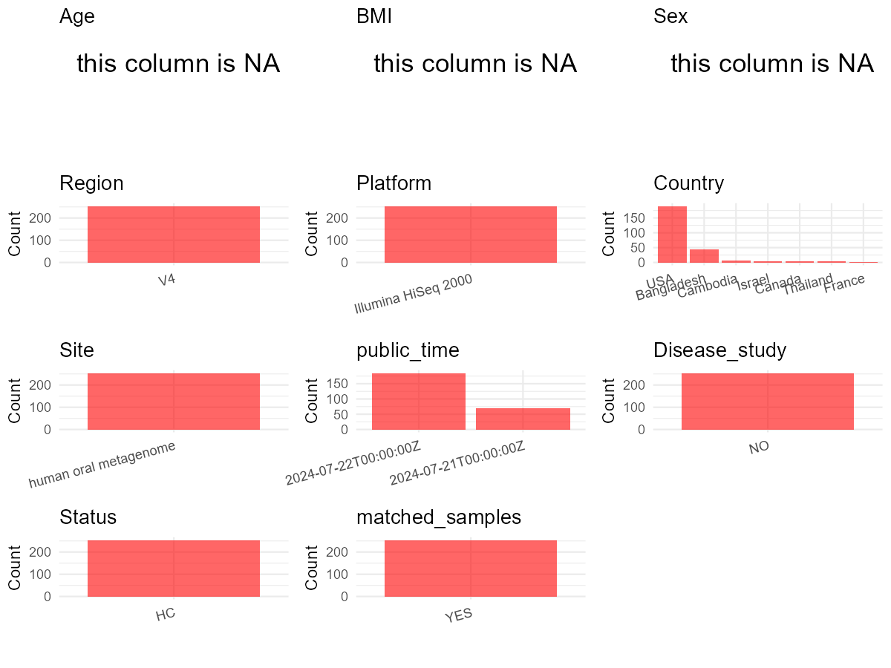

R Notebook: Metadata Processing Workflow
================

# Step 1: Obtain Initial Metadata from Each Project

To obtain the initial metadata: 1. Search for the BioProject ID (e.g.,
“PRJEBXXXX”) on the [NCBI SRA
website](https://www.ncbi.nlm.nih.gov/Traces/study/). 2. In the “Select”
table, click on “Metadata” and download the file. 3. The downloaded file
is typically named “SraRunTable.csv” and contains metadata for the
project.

``` r
# Load necessary libraries
library(dplyr)
library(ggplot2)
library(cowplot)

# Set working directory (update this path to your local directory)
setwd("D:/oral_project/PRJEB69530")

# Read the initial metadata files
initial_meta<-read.csv("SraRunTable.csv",header = T)

# Combine the two metadata files
#meta <- rbind(initial_meta, initial_meta1)

#Remove entries non-oral samples
#initial_meta <- subset(initial_meta,isolate %in% c("saliva","tongue coat"))
initial_meta <- initial_meta[initial_meta$Organism != "human gut metagenome", ]
initial_meta <- initial_meta[initial_meta$Organism != "human skin metagenome", ]
initial_meta <- initial_meta[initial_meta$Organism != "metagenome", ]
# Check the number of samples containing "HT" in Sample.Name (e.g., healthy controls)
#nrow(subset(meta, grepl("HT", Sample.Name)))

# Display the first few rows of the metadata
head(initial_meta)
```

    ##            Run anonymized_name Assay.Type AvgSpotLen barcode..exp.   Bases
    ## 1  ERR12266234             M03   AMPLICON         99  TGCGCTGAATGT 6077187
    ## 3  ERR12266238             M03   AMPLICON         99  TGGAGTAGGTGG 6389316
    ## 5  ERR12266242             M03   AMPLICON         99  ACCGGTATGTAC 3681628
    ## 12 ERR12266264             M02   AMPLICON         99  ATCGCACAGTAA 3707090
    ## 15 ERR12266277             M01   AMPLICON         99  CTCTCTCACTTG 5793351
    ## 17 ERR12266284             M02   AMPLICON         99  TAACGTGTGTGC 3773681
    ##    BioProject      BioSample   Bytes center_name..exp.
    ## 1  PRJEB69530 SAMEA114622785 4386365              CCME
    ## 3  PRJEB69530 SAMEA114622789 4506689              CCME
    ## 5  PRJEB69530 SAMEA114622793 2605179              CCME
    ## 12 PRJEB69530 SAMEA114622815 2658265              CCME
    ## 15 PRJEB69530 SAMEA114622828 4073507              CCME
    ## 17 PRJEB69530 SAMEA114622835 2709857              CCME
    ##                                           Center.Name center_project_name..exp.
    ## 1  UNIVERSITY OF CALIFORNIA SAN DIEGO MICROBIOME INIT         Bangladesh_Travel
    ## 3  UNIVERSITY OF CALIFORNIA SAN DIEGO MICROBIOME INIT         Bangladesh_Travel
    ## 5  UNIVERSITY OF CALIFORNIA SAN DIEGO MICROBIOME INIT         Bangladesh_Travel
    ## 12 UNIVERSITY OF CALIFORNIA SAN DIEGO MICROBIOME INIT         Bangladesh_Travel
    ## 15 UNIVERSITY OF CALIFORNIA SAN DIEGO MICROBIOME INIT         Bangladesh_Travel
    ## 17 UNIVERSITY OF CALIFORNIA SAN DIEGO MICROBIOME INIT         Bangladesh_Travel
    ##    Collection_Date collection_timestamp Consent COUNTRY DATASTORE.filetype
    ## 1       2012-01-13           2012-04-09  public     USA   fastq,run.zq,sra
    ## 3       2012-01-14           2012-04-11  public     USA   fastq,run.zq,sra
    ## 5       2012-01-16           2012-02-16  public     USA   fastq,run.zq,sra
    ## 12      2012-01-19           2012-02-11  public     USA   fastq,run.zq,sra
    ## 15      2012-01-20           2012-03-20  public     USA   fastq,run.zq,sra
    ## 17      2012-01-20           2012-02-23  public     USA   fastq,run.zq,sra
    ##    DATASTORE.provider                     DATASTORE.region
    ## 1          gs,ncbi,s3 gs.us-east1,ncbi.public,s3.us-east-1
    ## 3          gs,ncbi,s3 gs.us-east1,ncbi.public,s3.us-east-1
    ## 5          gs,ncbi,s3 gs.us-east1,ncbi.public,s3.us-east-1
    ## 12         gs,ncbi,s3 gs.us-east1,ncbi.public,s3.us-east-1
    ## 15         gs,ncbi,s3 gs.us-east1,ncbi.public,s3.us-east-1
    ## 17         gs,ncbi,s3 gs.us-east1,ncbi.public,s3.us-east-1
    ##    ENA.FIRST.PUBLIC..run.                ena_first_public ENA.LAST.UPDATE..run.
    ## 1              2023-11-16            2023-11-16T01:29:03Z            2023-11-16
    ## 3              2023-11-16            2023-11-16T01:29:03Z            2023-11-16
    ## 5              2023-11-16            2023-11-16T01:29:03Z            2023-11-16
    ## 12             2023-11-16 2023-11-16T01:29:02Z,2023-11-16            2023-11-16
    ## 15             2023-11-16            2023-11-16T01:29:02Z            2023-11-16
    ## 17             2023-11-16 2023-11-16T01:29:01Z,2023-11-16            2023-11-16
    ##                    ena_last_update epoch_time experiment_center..exp.
    ## 1             2023-11-16T01:29:03Z 1200096000                    CCME
    ## 3             2023-11-16T01:29:03Z 1200182400                    CCME
    ## 5             2023-11-16T01:29:03Z 1200355200                    CCME
    ## 12 2023-11-16,2023-11-16T01:29:02Z 1200614400                    CCME
    ## 15            2023-11-16T01:29:02Z 1200700800                    CCME
    ## 17 2023-11-16,2023-11-16T01:29:01Z 1200700800                    CCME
    ##     Experiment geo_loc_name_country geo_loc_name_country_continent
    ## 1  ERX11676478                  USA                  North America
    ## 3  ERX11676482                  USA                  North America
    ## 5  ERX11676486                  USA                  North America
    ## 12 ERX11676508                  USA                  North America
    ## 15 ERX11676521                  USA                  North America
    ## 17 ERX11676528                  USA                  North America
    ##    geographic_location_.country_and.or_sea. host_subject_id          Instrument
    ## 1                                       USA        1015:M03 Illumina HiSeq 2000
    ## 3                                       USA        1015:M03 Illumina HiSeq 2000
    ## 5                                       USA        1015:M03 Illumina HiSeq 2000
    ## 12                                      USA        1015:M02 Illumina HiSeq 2000
    ## 15                                      USA        1015:M01 Illumina HiSeq 2000
    ## 17                                      USA        1015:M02 Illumina HiSeq 2000
    ##       Library.Name LibraryLayout LibrarySelection LibrarySource linker..exp.
    ## 1  1015.1.13.M03.M        SINGLE              PCR   METAGENOMIC           GT
    ## 3  1015.1.14.M03.M        SINGLE              PCR   METAGENOMIC           GT
    ## 5  1015.1.16.M03.M        SINGLE              PCR   METAGENOMIC           GT
    ## 12 1015.1.19.M02.M        SINGLE              PCR   METAGENOMIC           GT
    ## 15 1015.1.20.M01.M        SINGLE              PCR   METAGENOMIC           GT
    ## 17 1015.1.20.M02.M        SINGLE              PCR   METAGENOMIC           GT
    ##                 Organism                                 pcr_primers..exp.
    ## 1  human oral metagenome FWD:GTGCCAGCMGCCGCGGTAA; REV:GGACTACHVGGGTWTCTAAT
    ## 3  human oral metagenome FWD:GTGCCAGCMGCCGCGGTAA; REV:GGACTACHVGGGTWTCTAAT
    ## 5  human oral metagenome FWD:GTGCCAGCMGCCGCGGTAA; REV:GGACTACHVGGGTWTCTAAT
    ## 12 human oral metagenome FWD:GTGCCAGCMGCCGCGGTAA; REV:GGACTACHVGGGTWTCTAAT
    ## 15 human oral metagenome FWD:GTGCCAGCMGCCGCGGTAA; REV:GGACTACHVGGGTWTCTAAT
    ## 17 human oral metagenome FWD:GTGCCAGCMGCCGCGGTAA; REV:GGACTACHVGGGTWTCTAAT
    ##    Platform          primer..exp.          ReleaseDate run_center..exp.
    ## 1  ILLUMINA GTGTGCCAGCMGCCGCGGTAA 2024-07-21T00:00:00Z             CCME
    ## 3  ILLUMINA GTGTGCCAGCMGCCGCGGTAA 2024-07-22T00:00:00Z             CCME
    ## 5  ILLUMINA GTGTGCCAGCMGCCGCGGTAA 2024-07-22T00:00:00Z             CCME
    ## 12 ILLUMINA GTGTGCCAGCMGCCGCGGTAA 2024-07-21T00:00:00Z             CCME
    ## 15 ILLUMINA GTGTGCCAGCMGCCGCGGTAA 2024-07-22T00:00:00Z             CCME
    ## 17 ILLUMINA GTGTGCCAGCMGCCGCGGTAA 2024-07-22T00:00:00Z             CCME
    ##    run_date..exp.          create_date version               run_prefix..exp.
    ## 1         2/25/13 2024-07-30T21:57:00Z       1 Bangladesh_FO_16s_NoIndex_L003
    ## 3         2/25/13 2024-07-31T01:53:00Z       1 Bangladesh_FO_16s_NoIndex_L003
    ## 5         2/25/13 2024-07-30T22:07:00Z       1 Bangladesh_FO_16s_NoIndex_L003
    ## 12        2/25/13 2024-07-30T21:47:00Z       1 Bangladesh_FO_16s_NoIndex_L003
    ## 15        2/25/13 2024-07-30T22:07:00Z       1 Bangladesh_FO_16s_NoIndex_L003
    ## 17        2/25/13 2024-07-31T02:11:00Z       1 Bangladesh_FO_16s_NoIndex_L003
    ##    samp_collect_device..exp. sample_center..exp.                    Sample.Name
    ## 1                       swab                CCME                 SAMEA114622785
    ## 3                       swab                CCME                 SAMEA114622789
    ## 5                       swab                CCME                 SAMEA114622793
    ## 12                      swab                CCME qiita_sid_1015:1015.1.19.M02.M
    ## 15                      swab                CCME                 SAMEA114622828
    ## 17                      swab                CCME qiita_sid_1015:1015.1.20.M02.M
    ##          Scientific_Name   sequencing_meth..exp. SRA.Study target_gene..exp.
    ## 1  human oral metagenome Sequencing by synthesis ERP154464          16S rRNA
    ## 3  human oral metagenome Sequencing by synthesis ERP154464          16S rRNA
    ## 5  human oral metagenome Sequencing by synthesis ERP154464          16S rRNA
    ## 12 human oral metagenome Sequencing by synthesis ERP154464          16S rRNA
    ## 15 human oral metagenome Sequencing by synthesis ERP154464          16S rRNA
    ## 17 human oral metagenome Sequencing by synthesis ERP154464          16S rRNA
    ##    target_subfragment..exp.    external_id INSDC_center_name
    ## 1                        V4 SAMEA114622785            UCSDMI
    ## 3                        V4 SAMEA114622789            UCSDMI
    ## 5                        V4 SAMEA114622793            UCSDMI
    ## 12                       V4                                 
    ## 15                       V4 SAMEA114622828            UCSDMI
    ## 17                       V4                                 
    ##      INSDC_first_public    INSDC_last_update INSDC_status
    ## 1  2023-11-16T01:29:03Z 2023-11-16T01:29:03Z       public
    ## 3  2023-11-16T01:29:03Z 2023-11-16T01:29:03Z       public
    ## 5  2023-11-16T01:29:03Z 2023-11-16T01:29:03Z       public
    ## 12                                                       
    ## 15 2023-11-16T01:29:02Z 2023-11-16T01:29:02Z       public
    ## 17                                                       
    ##                       Sample_name                   Submitter_Id
    ## 1  qiita_sid_1015:1015.1.13.M03.M qiita_sid_1015:1015.1.13.M03.M
    ## 3  qiita_sid_1015:1015.1.14.M03.M qiita_sid_1015:1015.1.14.M03.M
    ## 5  qiita_sid_1015:1015.1.16.M03.M qiita_sid_1015:1015.1.16.M03.M
    ## 12                                                              
    ## 15 qiita_sid_1015:1015.1.20.M01.M qiita_sid_1015:1015.1.20.M01.M
    ## 17                                                              
    ##                 organism
    ## 1                       
    ## 3                       
    ## 5                       
    ## 12 human oral metagenome
    ## 15                      
    ## 17 human oral metagenome

# Step 2: Create a Uniform Metadata Template

The uniform metadata should include the following columns:

1.  **BioProject**: Project ID (e.g., “PRJNA339212”)
2.  **Run**: Sample ID (e.g., “ERRXXXXXX” or “SRRXXXXXX”)
3.  **sample_name**: Original sample name submitted by the authors (not
    the database-assigned ID)
4.  **Age**: Age of the subject (if available)
5.  **BMI**: Body Mass Index (if available)
6.  **Sex**: Sex of the subject (“F” or “M”)
7.  **Region**: Targeted 16S rRNA region (e.g., “V3-V4”)
8.  **Platform**: Sequencing platform (e.g., “Illumina MiSeq”)
9.  **Country**: Country of sample origin (e.g., “China”)
10. **Site**: Sample site (e.g., “saliva”, “dental plaque”)
11. **public_time**: Data release date (format: “YYYY-MM-DD”)
12. **PCR_primers**: PCR primers used (e.g., “515F-806R”)
13. **title**: Title of the associated publication
14. **Disease_study**: Whether the study involves a disease (“YES” or
    “NO”)
15. **Status**: Disease status (e.g., “T2DM”, “HC”). Note: If the study
    includes both disease and healthy samples, this must be specified
    per sample.
16. **matched_samples**: matched samples (“YES” or “NO”)

``` r
# Create a uniform metadata dataframe
metadata <- data.frame(
  BioProject = initial_meta$BioProject,
  Run = initial_meta$Run,
  sample_name = initial_meta$anonymized_name,
  Age = NA,
  BMI = NA,
  Sex = NA,
  Region = initial_meta$target_subfragment..exp.,
  Platform = initial_meta$Instrument,
  Country = initial_meta$COUNTRY,
  Site = initial_meta$Organism,
  public_time = initial_meta$ReleaseDate,
  PCR_primers = initial_meta$pcr_primers..exp.,
  stringsAsFactors = FALSE
)
```

# Step 3: Manually Add Information from the Publication

Some information (e.g. PCR primers, study title, disease status) must be
manually extracted from the publication and added to the metadata.

``` r
# Add information obtained from the publication
metadata$title <- "Ecological relationships between human gut bacteria predicted from analysis of dense microbiome time series data from US travelers in Bangladesh"
metadata$Disease_study <- "NO"
# Assign disease status based on sample_name patterns
metadata$Status <- "HC"


# Calculate sampling frequency per subject
sample_counts <- table(metadata$sample_name)
cat("\nNumber of samples per subject:\n")
```

    ## 
    ## Number of samples per subject:

``` r
print(sample_counts)
```

    ## 
    ## F01 M01 M02 M03 
    ##  54  78  37  85

``` r
# Create matched_samples column
metadata$matched_samples <- ifelse(metadata$sample_name %in% names(sample_counts[sample_counts >= 2]), "YES", "NO")

cat("\nMatched samples distribution:\n")
```

    ## 
    ## Matched samples distribution:

``` r
table(metadata$matched_samples)
```

    ## 
    ## YES 
    ## 254

``` r
# Identify samples for removal: single samples excluding saliva and tongue coat
single_samples <- names(sample_counts[sample_counts == 1])
samples_to_remove <- metadata$sample_name %in% single_samples & 
                     !(metadata$Site %in% c("saliva", "tongue coat"))

cat("\nNumber of samples to be removed:", sum(samples_to_remove), "\n")
```

    ## 
    ## Number of samples to be removed: 0

``` r
# Remove identified samples
metadata_clean <- metadata[!samples_to_remove, ]

cat("\nFinal sample distribution after cleaning:\n")
```

    ## 
    ## Final sample distribution after cleaning:

``` r
table(metadata_clean$sample_name)
```

    ## 
    ## F01 M01 M02 M03 
    ##  54  78  37  85

``` r
table(metadata_clean$Site)
```

    ## 
    ## human oral metagenome 
    ##                   254

``` r
table(metadata_clean$matched_samples)
```

    ## 
    ## YES 
    ## 254

``` r
# Use cleaned dataset for subsequent analysis
metadata <- metadata_clean
```

# Step 4: Summarize and Validate the Metadata

``` r
# Check the number of unique runs and sample names
print(paste("Number of unique runs:", length(unique(metadata$Run))))
```

    ## [1] "Number of unique runs: 254"

``` r
print(paste("Number of unique sample names:", length(unique(metadata$sample_name))))
```

    ## [1] "Number of unique sample names: 4"

# Step 5: Visualize the Metadata

``` r

```

<!-- -->

# Step 6: Finalize and Export the Metadata

``` r
# Reorder columns to match the desired format
metadata <- metadata[, c(
  "BioProject", "Run", "sample_name", "Age", "BMI", "Sex", 
  "Region", "Platform", "Country", "Site", "public_time", 
  "PCR_primers", "title", "Disease_study", "Status","matched_samples"
)]

# Export the uniform metadata to a CSV file
write.csv(metadata, file = "metadata.csv", quote = FALSE)
head(metadata)
```

    ##   BioProject         Run sample_name Age BMI Sex Region            Platform
    ## 1 PRJEB69530 ERR12266234         M03  NA  NA  NA     V4 Illumina HiSeq 2000
    ## 2 PRJEB69530 ERR12266238         M03  NA  NA  NA     V4 Illumina HiSeq 2000
    ## 3 PRJEB69530 ERR12266242         M03  NA  NA  NA     V4 Illumina HiSeq 2000
    ## 4 PRJEB69530 ERR12266264         M02  NA  NA  NA     V4 Illumina HiSeq 2000
    ## 5 PRJEB69530 ERR12266277         M01  NA  NA  NA     V4 Illumina HiSeq 2000
    ## 6 PRJEB69530 ERR12266284         M02  NA  NA  NA     V4 Illumina HiSeq 2000
    ##   Country                  Site          public_time
    ## 1     USA human oral metagenome 2024-07-21T00:00:00Z
    ## 2     USA human oral metagenome 2024-07-22T00:00:00Z
    ## 3     USA human oral metagenome 2024-07-22T00:00:00Z
    ## 4     USA human oral metagenome 2024-07-21T00:00:00Z
    ## 5     USA human oral metagenome 2024-07-22T00:00:00Z
    ## 6     USA human oral metagenome 2024-07-22T00:00:00Z
    ##                                         PCR_primers
    ## 1 FWD:GTGCCAGCMGCCGCGGTAA; REV:GGACTACHVGGGTWTCTAAT
    ## 2 FWD:GTGCCAGCMGCCGCGGTAA; REV:GGACTACHVGGGTWTCTAAT
    ## 3 FWD:GTGCCAGCMGCCGCGGTAA; REV:GGACTACHVGGGTWTCTAAT
    ## 4 FWD:GTGCCAGCMGCCGCGGTAA; REV:GGACTACHVGGGTWTCTAAT
    ## 5 FWD:GTGCCAGCMGCCGCGGTAA; REV:GGACTACHVGGGTWTCTAAT
    ## 6 FWD:GTGCCAGCMGCCGCGGTAA; REV:GGACTACHVGGGTWTCTAAT
    ##                                                                                                                                              title
    ## 1 Ecological relationships between human gut bacteria predicted from analysis of dense microbiome time series data from US travelers in Bangladesh
    ## 2 Ecological relationships between human gut bacteria predicted from analysis of dense microbiome time series data from US travelers in Bangladesh
    ## 3 Ecological relationships between human gut bacteria predicted from analysis of dense microbiome time series data from US travelers in Bangladesh
    ## 4 Ecological relationships between human gut bacteria predicted from analysis of dense microbiome time series data from US travelers in Bangladesh
    ## 5 Ecological relationships between human gut bacteria predicted from analysis of dense microbiome time series data from US travelers in Bangladesh
    ## 6 Ecological relationships between human gut bacteria predicted from analysis of dense microbiome time series data from US travelers in Bangladesh
    ##   Disease_study Status matched_samples
    ## 1            NO     HC             YES
    ## 2            NO     HC             YES
    ## 3            NO     HC             YES
    ## 4            NO     HC             YES
    ## 5            NO     HC             YES
    ## 6            NO     HC             YES

## Notes for Students:

1.  **Metadata Accuracy**: Always cross-check the metadata with the
    original publication to ensure accuracy.
2.  **Manual Entries**: Columns like `PCR_primers`, and `Status` often
    require manual entry based on the publication.
3.  **Disease Status**: Be careful when assigning `Status`—some studies
    include both disease and healthy samples.
4.  **Visualization**: The plots help quickly identify the distribution
    of values in each column, which is useful for quality control.
5.  **Reproducibility**: Update the working directory and file paths to
    match your local environment.
