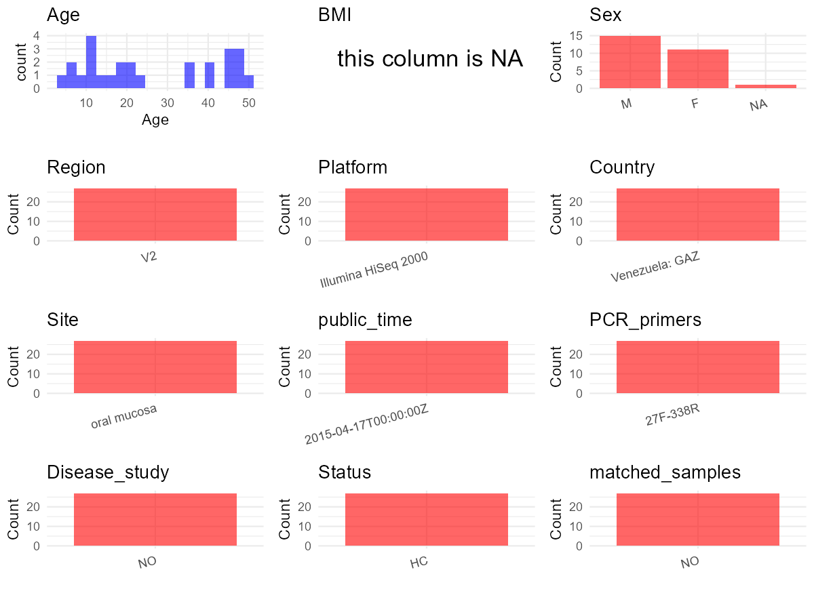

R Notebook: Metadata Processing Workflow
================

# Step 1: Obtain Initial Metadata from Each Project

To obtain the initial metadata: 1. Search for the BioProject ID (e.g.,
“PRJEBXXXX”) on the [NCBI SRA
website](https://www.ncbi.nlm.nih.gov/Traces/study/). 2. In the “Select”
table, click on “Metadata” and download the file. 3. The downloaded file
is typically named “SraRunTable.csv” and contains metadata for the
project.

``` r
# Load necessary libraries
library(dplyr)
library(ggplot2)
library(cowplot)

# Set working directory (update this path to your local directory)
setwd("D:/oral_project/PRJEB7825")

# Read the initial metadata files
initial_meta<-read.csv("SraRunTable.csv",header = T)

# Combine the two metadata files
#meta <- rbind(initial_meta, initial_meta1)

#Remove entries non-oral samples
#initial_meta <- subset(initial_meta,isolate %in% c("saliva","tongue coat"))

# Check the number of samples containing "HT" in Sample.Name (e.g., healthy controls)
#nrow(subset(meta, grepl("HT", Sample.Name)))

# Display the first few rows of the metadata
head(initial_meta)
```

    ##         Run age_unit altitude anonymized_name Assay.Type assigned_from_geo
    ## 1 ERR687936    years        0          MG.BI1      OTHER             False
    ## 2 ERR687937    years        0         MG.BI10      OTHER             False
    ## 3 ERR687938    years        0         MG.BI11      OTHER             False
    ## 4 ERR687939    years        0         MG.BI12      OTHER             False
    ## 5 ERR687940    years        0         MG.BI13      OTHER             False
    ## 6 ERR687941    years        0         MG.BI14      OTHER             False
    ##   AvgSpotLen barcodesequence..exp.   Bases BioProject    BioSample body_habitat
    ## 1        127          ATGTACGGCGAC 3709214  PRJEB7825 SAMEA3139737  UBERON:skin
    ## 2        126          CACAGTGGACGT 1633394  PRJEB7825 SAMEA3139738  UBERON:skin
    ## 3        125          CAGACATTGCGT  383127  PRJEB7825 SAMEA3139739  UBERON:skin
    ## 4        125          CAGTCGAAGCTG  223509  PRJEB7825 SAMEA3139740  UBERON:skin
    ## 5        125          CATCTGTAGCGA 1288167  PRJEB7825 SAMEA3139741  UBERON:skin
    ## 6        126          ATACAGAGCTCC  533478  PRJEB7825 SAMEA3139742  UBERON:skin
    ##   body_product          body_site   Bytes center_name..exp.
    ## 1 UBERON:sebum UBERON:skin of arm 3011281              CCME
    ## 2 UBERON:sebum UBERON:skin of arm 1366731              CCME
    ## 3 UBERON:sebum UBERON:skin of arm  364364              CCME
    ## 4 UBERON:sebum UBERON:skin of arm  233457              CCME
    ## 5 UBERON:sebum UBERON:skin of arm 1096639              CCME
    ## 6 UBERON:sebum UBERON:skin of arm  486421              CCME
    ##                                          Center.Name
    ## 1 COLORADO CENTER FOR MICROBIAL ECOLOGY, UNIVERSITY 
    ## 2 COLORADO CENTER FOR MICROBIAL ECOLOGY, UNIVERSITY 
    ## 3 COLORADO CENTER FOR MICROBIAL ECOLOGY, UNIVERSITY 
    ## 4 COLORADO CENTER FOR MICROBIAL ECOLOGY, UNIVERSITY 
    ## 5 COLORADO CENTER FOR MICROBIAL ECOLOGY, UNIVERSITY 
    ## 6 COLORADO CENTER FOR MICROBIAL ECOLOGY, UNIVERSITY 
    ##               center_project_name..exp. Collection_Date collection_timestamp
    ## 1 Dominguez_Perisipiwei_skin_oral_fecal         4/25/09  2009-04-25 00:00:00
    ## 2 Dominguez_Perisipiwei_skin_oral_fecal         4/25/09  2009-04-25 00:00:00
    ## 3 Dominguez_Perisipiwei_skin_oral_fecal         4/25/09  2009-04-25 00:00:00
    ## 4 Dominguez_Perisipiwei_skin_oral_fecal         4/25/09  2009-04-25 00:00:00
    ## 5 Dominguez_Perisipiwei_skin_oral_fecal         4/25/09  2009-04-25 00:00:00
    ## 6 Dominguez_Perisipiwei_skin_oral_fecal         4/25/09  2009-04-25 00:00:00
    ##             common_name Consent        COUNTRY DATASTORE.filetype
    ## 1 human skin metagenome  public Venezuela: GAZ   fastq,run.zq,sra
    ## 2 human skin metagenome  public Venezuela: GAZ   fastq,run.zq,sra
    ## 3 human skin metagenome  public Venezuela: GAZ   fastq,run.zq,sra
    ## 4 human skin metagenome  public Venezuela: GAZ   fastq,run.zq,sra
    ## 5 human skin metagenome  public Venezuela: GAZ   fastq,run.zq,sra
    ## 6 human skin metagenome  public Venezuela: GAZ   fastq,run.zq,sra
    ##   DATASTORE.provider                         DATASTORE.region Depth
    ## 1     ena,gs,ncbi,s3 ena,gs.us-east1,ncbi.public,s3.us-east-1     0
    ## 2     ena,gs,ncbi,s3 ena,gs.us-east1,ncbi.public,s3.us-east-1     0
    ## 3     ena,gs,ncbi,s3 ena,gs.us-east1,ncbi.public,s3.us-east-1     0
    ## 4     ena,gs,ncbi,s3 ena,gs.us-east1,ncbi.public,s3.us-east-1     0
    ## 5     ena,gs,ncbi,s3 ena,gs.us-east1,ncbi.public,s3.us-east-1     0
    ## 6     ena,gs,ncbi,s3 ena,gs.us-east1,ncbi.public,s3.us-east-1     0
    ##   dna_extracted elevation emp_status..exp. ENA.FIRST.PUBLIC..run.
    ## 1          True  89.84744          NOT_EMP             2015-04-16
    ## 2          True  89.84744          NOT_EMP             2015-04-16
    ## 3          True  89.84744          NOT_EMP             2015-04-16
    ## 4          True  89.84744          NOT_EMP             2015-04-16
    ## 5          True  89.84744          NOT_EMP             2015-04-16
    ## 6          True  89.84744          NOT_EMP             2015-04-16
    ##       ENA_first_public ENA.LAST.UPDATE..run.      ENA_last_update
    ## 1 2015-04-16T17:02:02Z            2018-11-16 2018-03-09T12:15:49Z
    ## 2 2015-04-16T17:02:02Z            2018-11-16 2018-03-09T12:15:49Z
    ## 3 2015-04-16T17:02:02Z            2018-11-16 2018-03-09T12:15:49Z
    ## 4 2015-04-16T17:02:02Z            2018-11-16 2018-03-09T12:15:49Z
    ## 5 2015-04-16T17:02:02Z            2018-11-16 2018-03-09T12:15:49Z
    ## 6 2015-04-16T17:02:02Z            2018-11-16 2018-03-09T12:15:49Z
    ##            env_biome                   env_feature env_matter
    ## 1 ENVO:village biome ENVO:human-associated habitat ENVO:sebum
    ## 2 ENVO:village biome ENVO:human-associated habitat ENVO:sebum
    ## 3 ENVO:village biome ENVO:human-associated habitat ENVO:sebum
    ## 4 ENVO:village biome ENVO:human-associated habitat ENVO:sebum
    ## 5 ENVO:village biome ENVO:human-associated habitat ENVO:sebum
    ## 6 ENVO:village biome ENVO:human-associated habitat ENVO:sebum
    ##                                                          experiment_design_description..exp.
    ## 1 samples of, skin, saliva and feces from Perisipiwei as part of western acculturation study
    ## 2 samples of, skin, saliva and feces from Perisipiwei as part of western acculturation study
    ## 3 samples of, skin, saliva and feces from Perisipiwei as part of western acculturation study
    ## 4 samples of, skin, saliva and feces from Perisipiwei as part of western acculturation study
    ## 5 samples of, skin, saliva and feces from Perisipiwei as part of western acculturation study
    ## 6 samples of, skin, saliva and feces from Perisipiwei as part of western acculturation study
    ##   Experiment  external_id
    ## 1  ERX632930 SAMEA3139737
    ## 2  ERX632931 SAMEA3139738
    ## 3  ERX632932 SAMEA3139739
    ## 4  ERX632933 SAMEA3139740
    ## 5  ERX632934 SAMEA3139741
    ## 6  ERX632935 SAMEA3139742
    ##                                                  file_path..exp.
    ## 1  /projects/qiita_data/working_dir/6jcIl1/10052.MG.BI1.fastq.gz
    ## 2 /projects/qiita_data/working_dir/6jcIl1/10052.MG.BI10.fastq.gz
    ## 3 /projects/qiita_data/working_dir/6jcIl1/10052.MG.BI11.fastq.gz
    ## 4 /projects/qiita_data/working_dir/6jcIl1/10052.MG.BI12.fastq.gz
    ## 5 /projects/qiita_data/working_dir/6jcIl1/10052.MG.BI13.fastq.gz
    ## 6 /projects/qiita_data/working_dir/6jcIl1/10052.MG.BI14.fastq.gz
    ##   file_type..exp. host_common_name host_subject_id host_taxid
    ## 1           fastq            human               1       9606
    ## 2           fastq            human              10       9606
    ## 3           fastq            human              11       9606
    ## 4           fastq            human              12       9606
    ## 5           fastq            human              13       9606
    ## 6           fastq            human              14       9606
    ##   illumina_technology..exp. INSDC_center_name   INSDC_first_public
    ## 1                     GAIIx     CCME-COLORADO 2015-04-16T17:02:02Z
    ## 2                     GAIIx     CCME-COLORADO 2015-04-16T17:02:02Z
    ## 3                     GAIIx     CCME-COLORADO 2015-04-16T17:02:02Z
    ## 4                     GAIIx     CCME-COLORADO 2015-04-16T17:02:02Z
    ## 5                     GAIIx     CCME-COLORADO 2015-04-16T17:02:02Z
    ## 6                     GAIIx     CCME-COLORADO 2015-04-16T17:02:02Z
    ##      INSDC_last_update INSDC_status  Instrument key_seq..exp. LATITUDE
    ## 1 2018-03-09T12:15:49Z       public unspecified           NaN  6.42375
    ## 2 2018-03-09T12:15:49Z       public unspecified           NaN  6.42375
    ## 3 2018-03-09T12:15:49Z       public unspecified           NaN  6.42375
    ## 4 2018-03-09T12:15:49Z       public unspecified           NaN  6.42375
    ## 5 2018-03-09T12:15:49Z       public unspecified           NaN  6.42375
    ## 6 2018-03-09T12:15:49Z       public unspecified           NaN  6.42375
    ##   library_construction_protocol..exp.  Library.Name LibraryLayout
    ## 1                      Illumina GAIIx  10052.MG.BI1        SINGLE
    ## 2                      Illumina GAIIx 10052.MG.BI10        SINGLE
    ## 3                      Illumina GAIIx 10052.MG.BI11        SINGLE
    ## 4                      Illumina GAIIx 10052.MG.BI12        SINGLE
    ## 5                      Illumina GAIIx 10052.MG.BI13        SINGLE
    ## 6                      Illumina GAIIx 10052.MG.BI14        SINGLE
    ##   LibrarySelection LibrarySource linker..exp. linkerprimersequence..exp.
    ## 1      unspecified   METAGENOMIC           TC       AGAGTTTGATCCTGGCTCAG
    ## 2      unspecified   METAGENOMIC           TC       AGAGTTTGATCCTGGCTCAG
    ## 3      unspecified   METAGENOMIC           TC       AGAGTTTGATCCTGGCTCAG
    ## 4      unspecified   METAGENOMIC           TC       AGAGTTTGATCCTGGCTCAG
    ## 5      unspecified   METAGENOMIC           TC       AGAGTTTGATCCTGGCTCAG
    ## 6      unspecified   METAGENOMIC           TC       AGAGTTTGATCCTGGCTCAG
    ##   LONGITUDE              Organism
    ## 1 -66.58973 human skin metagenome
    ## 2 -66.58973 human skin metagenome
    ## 3 -66.58973 human skin metagenome
    ## 4 -66.58973 human skin metagenome
    ## 5 -66.58973 human skin metagenome
    ## 6 -66.58973 human skin metagenome
    ##                                   pcr_primers..exp. physical_specimen_location
    ## 1 FWD:AGAGTTTGATCCTGGCTCAG; REV:TGCTGCCTCCCGTAGGAGT                        UPR
    ## 2 FWD:AGAGTTTGATCCTGGCTCAG; REV:TGCTGCCTCCCGTAGGAGT                        UPR
    ## 3 FWD:AGAGTTTGATCCTGGCTCAG; REV:TGCTGCCTCCCGTAGGAGT                        UPR
    ## 4 FWD:AGAGTTTGATCCTGGCTCAG; REV:TGCTGCCTCCCGTAGGAGT                        UPR
    ## 5 FWD:AGAGTTTGATCCTGGCTCAG; REV:TGCTGCCTCCCGTAGGAGT                        UPR
    ## 6 FWD:AGAGTTTGATCCTGGCTCAG; REV:TGCTGCCTCCCGTAGGAGT                        UPR
    ##   physical_specimen_remaining platform..exp. Platform public region..exp.
    ## 1                        True       Illumina ILLUMINA   True          NaN
    ## 2                        True       Illumina ILLUMINA   True          NaN
    ## 3                        True       Illumina ILLUMINA   True          NaN
    ## 4                        True       Illumina ILLUMINA   True          NaN
    ## 5                        True       Illumina ILLUMINA   True          NaN
    ## 6                        True       Illumina ILLUMINA   True          NaN
    ##            ReleaseDate required_sample_info_status run_center..exp.
    ## 1 2015-04-17T00:00:00Z                   completed             CCME
    ## 2 2015-04-17T00:00:00Z                   completed             CCME
    ## 3 2015-04-17T00:00:00Z                   completed             CCME
    ## 4 2015-04-17T00:00:00Z                   completed             CCME
    ## 5 2015-04-17T00:00:00Z                   completed             CCME
    ## 6 2015-04-17T00:00:00Z                   completed             CCME
    ##   run_date..exp.          create_date version run_prefix..exp. samp_size..exp.
    ## 1        5/14/11 2017-08-03T11:37:00Z       1     s_4_sequence            .1,g
    ## 2        5/14/11 2017-08-03T12:16:00Z       1     s_4_sequence            .1,g
    ## 3        5/14/11 2017-08-03T11:52:00Z       1     s_4_sequence            .1,g
    ## 4        5/14/11 2017-08-03T11:52:00Z       1     s_4_sequence            .1,g
    ## 5        5/14/11 2017-08-03T11:55:00Z       1     s_4_sequence            .1,g
    ## 6        5/14/11 2017-08-03T11:55:00Z       1     s_4_sequence            .1,g
    ##         sample_center..exp.  Sample.Name                 Sample_name
    ## 1 University of Puerto Rico SAMEA3139737  qiime_ppdid_4:10052.MG.BI1
    ## 2 University of Puerto Rico SAMEA3139738 qiime_ppdid_4:10052.MG.BI10
    ## 3 University of Puerto Rico SAMEA3139739 qiime_ppdid_4:10052.MG.BI11
    ## 4 University of Puerto Rico SAMEA3139740 qiime_ppdid_4:10052.MG.BI12
    ## 5 University of Puerto Rico SAMEA3139741 qiime_ppdid_4:10052.MG.BI13
    ## 6 University of Puerto Rico SAMEA3139742 qiime_ppdid_4:10052.MG.BI14
    ##   sample_type       scientific_name   sequencing_meth..exp. SRA.Study
    ## 1        Skin human skin metagenome sequencing by synthesis ERP008799
    ## 2        Skin human skin metagenome sequencing by synthesis ERP008799
    ## 3        Skin human skin metagenome sequencing by synthesis ERP008799
    ## 4        Skin human skin metagenome sequencing by synthesis ERP008799
    ## 5        Skin human skin metagenome sequencing by synthesis ERP008799
    ## 6        Skin human skin metagenome sequencing by synthesis ERP008799
    ##          study_center..exp.                Submitter_Id target_gene..exp.
    ## 1 University of Puerto Rico  qiime_ppdid_4:10052.MG.BI1          16S rRNA
    ## 2 University of Puerto Rico qiime_ppdid_4:10052.MG.BI10          16S rRNA
    ## 3 University of Puerto Rico qiime_ppdid_4:10052.MG.BI11          16S rRNA
    ## 4 University of Puerto Rico qiime_ppdid_4:10052.MG.BI12          16S rRNA
    ## 5 University of Puerto Rico qiime_ppdid_4:10052.MG.BI13          16S rRNA
    ## 6 University of Puerto Rico qiime_ppdid_4:10052.MG.BI14          16S rRNA
    ##   target_subfragment..exp.                                         diet_type
    ## 1                       V2 hunter gatherer diet, cassava crops, local fruits
    ## 2                       V2 hunter gatherer diet, cassava crops, local fruits
    ## 3                       V2 hunter gatherer diet, cassava crops, local fruits
    ## 4                       V2 hunter gatherer diet, cassava crops, local fruits
    ## 5                       V2 hunter gatherer diet, cassava crops, local fruits
    ## 6                       V2 hunter gatherer diet, cassava crops, local fruits
    ##   ethnic_group village_shabono_name AGE    sex
    ## 1     Yanomami        Yanomani 2008  10   male
    ## 2     Yanomami        Yanomani 2008  40   male
    ## 3     Yanomami        Yanomani 2008  11   male
    ## 4     Yanomami        Yanomani 2008  45 female
    ## 5     Yanomami        Yanomani 2008  48 female
    ## 6     Yanomami        Yanomani 2008  47 female

# Step 2: Create a Uniform Metadata Template

The uniform metadata should include the following columns:

1.  **BioProject**: Project ID (e.g., “PRJNA339212”)
2.  **Run**: Sample ID (e.g., “ERRXXXXXX” or “SRRXXXXXX”)
3.  **sample_name**: Original sample name submitted by the authors (not
    the database-assigned ID)
4.  **Age**: Age of the subject (if available)
5.  **BMI**: Body Mass Index (if available)
6.  **Sex**: Sex of the subject (“F” or “M”)
7.  **Region**: Targeted 16S rRNA region (e.g., “V3-V4”)
8.  **Platform**: Sequencing platform (e.g., “Illumina MiSeq”)
9.  **Country**: Country of sample origin (e.g., “China”)
10. **Site**: Sample site (e.g., “saliva”, “dental plaque”)
11. **public_time**: Data release date (format: “YYYY-MM-DD”)
12. **PCR_primers**: PCR primers used (e.g., “515F-806R”)
13. **title**: Title of the associated publication
14. **Disease_study**: Whether the study involves a disease (“YES” or
    “NO”)
15. **Status**: Disease status (e.g., “T2DM”, “HC”). Note: If the study
    includes both disease and healthy samples, this must be specified
    per sample.
16. **matched_samples**: matched samples (“YES” or “NO”)

``` r
# Create a uniform metadata dataframe
metadata <- data.frame(
  BioProject = initial_meta$BioProject,
  Run = initial_meta$Run,
  sample_name = initial_meta$Library.Name,
  Age = initial_meta$AGE,
  BMI = NA,
  Sex=initial_meta$sex,
  Region = initial_meta$target_subfragment..exp.,
  Platform = "Illumina HiSeq 2000",
  Country = initial_meta$COUNTRY,
  Site = replace(initial_meta$body_site, initial_meta$body_site == "UBERON:mouth", "oral mucosa"),
  public_time = initial_meta$ReleaseDate,
  PCR_primers = "27F-338R",
  stringsAsFactors = FALSE
)
```

``` r
metadata <- metadata %>%
  mutate(Sex = recode(Sex, "female" = "F", "male" = "M",.default = NA_character_))
```

# Step 3: Manually Add Information from the Publication

Some information (e.g. PCR primers, study title, disease status) must be
manually extracted from the publication and added to the metadata.

``` r
# Add information obtained from the publication
metadata$title <- "The microbiome of uncontacted Amerindians"
metadata$Disease_study <- "NO"
# Assign disease status based on sample_name patterns
metadata$Status <- "HC"

#get subjects id with Saliva available
keep_subjects<-subset(metadata,Site %in% "oral mucosa")
#remove subjects without Saliva samples
metadata<-subset(metadata,sample_name %in% keep_subjects$sample_name)
#get subjects sampling counts
sample_counts <- table(metadata$sample_name)
# Create matched_samples column, any subjects have >=2 samples will be label "YES", otherwise "NO"
metadata$matched_samples <- ifelse(metadata$sample_name %in% names(sample_counts[sample_counts >= 2]), "YES", "NO")
```

# Step 4: Summarize and Validate the Metadata

``` r
# Check the number of unique runs and sample names
print(paste("Number of unique runs:", length(unique(metadata$Run))))
```

    ## [1] "Number of unique runs: 27"

``` r
print(paste("Number of unique sample names:", length(unique(metadata$sample_name))))
```

    ## [1] "Number of unique sample names: 27"

# Step 5: Visualize the Metadata

``` r

```


# Step 6: Finalize and Export the Metadata

``` r
# Reorder columns to match the desired format
metadata <- metadata[, c(
  "BioProject", "Run", "sample_name", "Age", "BMI", "Sex", 
  "Region", "Platform", "Country", "Site", "public_time", 
  "PCR_primers", "title", "Disease_study", "Status","matched_samples"
)]

# Export the uniform metadata to a CSV file
write.csv(metadata, file = "metadata.csv", quote = FALSE)
head(metadata)
```

    ##    BioProject       Run  sample_name Age BMI Sex Region            Platform
    ## 40  PRJEB7825 ERR687975 10052.MG.O10  40  NA   M     V2 Illumina HiSeq 2000
    ## 41  PRJEB7825 ERR687976 10052.MG.O11  11  NA   M     V2 Illumina HiSeq 2000
    ## 42  PRJEB7825 ERR687977 10052.MG.O12  45  NA   F     V2 Illumina HiSeq 2000
    ## 43  PRJEB7825 ERR687978 10052.MG.O13  48  NA   F     V2 Illumina HiSeq 2000
    ## 44  PRJEB7825 ERR687979 10052.MG.O14  47  NA   F     V2 Illumina HiSeq 2000
    ## 45  PRJEB7825 ERR687980 10052.MG.O16  45  NA   F     V2 Illumina HiSeq 2000
    ##           Country        Site          public_time PCR_primers
    ## 40 Venezuela: GAZ oral mucosa 2015-04-17T00:00:00Z    27F-338R
    ## 41 Venezuela: GAZ oral mucosa 2015-04-17T00:00:00Z    27F-338R
    ## 42 Venezuela: GAZ oral mucosa 2015-04-17T00:00:00Z    27F-338R
    ## 43 Venezuela: GAZ oral mucosa 2015-04-17T00:00:00Z    27F-338R
    ## 44 Venezuela: GAZ oral mucosa 2015-04-17T00:00:00Z    27F-338R
    ## 45 Venezuela: GAZ oral mucosa 2015-04-17T00:00:00Z    27F-338R
    ##                                        title Disease_study Status
    ## 40 The microbiome of uncontacted Amerindians            NO     HC
    ## 41 The microbiome of uncontacted Amerindians            NO     HC
    ## 42 The microbiome of uncontacted Amerindians            NO     HC
    ## 43 The microbiome of uncontacted Amerindians            NO     HC
    ## 44 The microbiome of uncontacted Amerindians            NO     HC
    ## 45 The microbiome of uncontacted Amerindians            NO     HC
    ##    matched_samples
    ## 40              NO
    ## 41              NO
    ## 42              NO
    ## 43              NO
    ## 44              NO
    ## 45              NO

## Notes for Students:

1.  **Metadata Accuracy**: Always cross-check the metadata with the
    original publication to ensure accuracy.
2.  **Manual Entries**: Columns like `PCR_primers`, and `Status` often
    require manual entry based on the publication.
3.  **Disease Status**: Be careful when assigning `Status`—some studies
    include both disease and healthy samples.
4.  **Visualization**: The plots help quickly identify the distribution
    of values in each column, which is useful for quality control.
5.  **Reproducibility**: Update the working directory and file paths to
    match your local environment.
