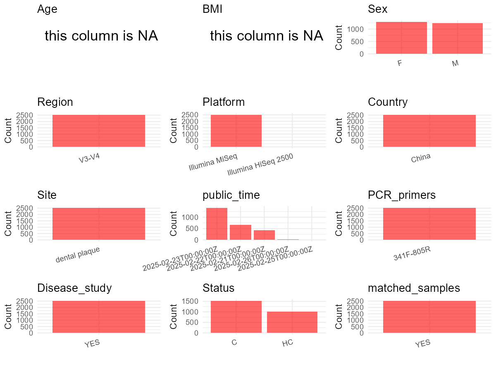

R Notebook: Metadata Processing Workflow
================

# Step 1: Obtain Initial Metadata from Each Project

To obtain the initial metadata: 1. Search for the BioProject ID (e.g.,
“PRJEBXXXX”) on the [NCBI SRA
website](https://www.ncbi.nlm.nih.gov/Traces/study/). 2. In the “Select”
table, click on “Metadata” and download the file. 3. The downloaded file
is typically named “SraRunTable.csv” and contains metadata for the
project.

``` r
# Load necessary libraries
library(dplyr)
library(ggplot2)
library(cowplot)
library(stringr)

# Set working directory (update this path to your local directory)
setwd("E:/bioproject/PRJEB86033")

# Read the initial metadata files
initial_meta <- read.csv("SraRunTable.csv", header = T) 

# Display the first few rows of the metadata
head(initial_meta)
```

    ##           Run anonymized_name Assay.Type AvgSpotLen    Bases BioProject
    ## 1 ERR14648080        SAMPLE10   AMPLICON        272 14071648 PRJEB86033
    ## 2 ERR14648081       SAMPLE100   AMPLICON        272 12905040 PRJEB86033
    ## 3 ERR14648082       SAMPLE101   AMPLICON        272 14947488 PRJEB86033
    ## 4 ERR14648083       SAMPLE102   AMPLICON        272 13282576 PRJEB86033
    ## 5 ERR14648085       SAMPLE104   AMPLICON        272 12982288 PRJEB86033
    ## 6 ERR14648086       SAMPLE105   AMPLICON        272 12212528 PRJEB86033
    ##        BioSample    Bytes center_name..exp.
    ## 1 SAMEA117741011  9622457 HKU + QIBEBT, CAS
    ## 2 SAMEA117741012  8343713 HKU + QIBEBT, CAS
    ## 3 SAMEA117741013 11073876 HKU + QIBEBT, CAS
    ## 4 SAMEA117741014  8584287 HKU + QIBEBT, CAS
    ## 5 SAMEA117741016  9618330 HKU + QIBEBT, CAS
    ## 6 SAMEA117741017  9027042 HKU + QIBEBT, CAS
    ##                                          Center.Name Collection_Date
    ## 1 UNIVERSITY OF CALIFORNIA SAN DIEGO MICROBIOME INIT            2015
    ## 2 UNIVERSITY OF CALIFORNIA SAN DIEGO MICROBIOME INIT            2015
    ## 3 UNIVERSITY OF CALIFORNIA SAN DIEGO MICROBIOME INIT            2015
    ## 4 UNIVERSITY OF CALIFORNIA SAN DIEGO MICROBIOME INIT            2015
    ## 5 UNIVERSITY OF CALIFORNIA SAN DIEGO MICROBIOME INIT            2015
    ## 6 UNIVERSITY OF CALIFORNIA SAN DIEGO MICROBIOME INIT            2015
    ##   collection_timestamp Consent   COUNTRY DATASTORE.filetype DATASTORE.provider
    ## 1            2015-2016  public Hong Kong   fastq,run.zq,sra         gs,ncbi,s3
    ## 2            2015-2016  public Hong Kong   fastq,run.zq,sra         gs,ncbi,s3
    ## 3            2015-2016  public Hong Kong   fastq,run.zq,sra         gs,ncbi,s3
    ## 4            2015-2016  public Hong Kong   fastq,run.zq,sra         gs,ncbi,s3
    ## 5            2015-2016  public Hong Kong   fastq,run.zq,sra         gs,ncbi,s3
    ## 6            2015-2016  public Hong Kong   fastq,run.zq,sra         gs,ncbi,s3
    ##                       DATASTORE.region dmfs_host dmfs_tooth dna_extracted
    ## 1 gs.us-east1,ncbi.public,s3.us-east-1         0          0          TRUE
    ## 2 gs.us-east1,ncbi.public,s3.us-east-1         1          0          TRUE
    ## 3 gs.us-east1,ncbi.public,s3.us-east-1         4          0          TRUE
    ## 4 gs.us-east1,ncbi.public,s3.us-east-1         1          0          TRUE
    ## 5 gs.us-east1,ncbi.public,s3.us-east-1         1          0          TRUE
    ## 6 gs.us-east1,ncbi.public,s3.us-east-1         4          0          TRUE
    ##   elevation          empo_1                       empo_2              empo_3
    ## 1         0 Host-associated Host-associated (non-saline) Animal (non-saline)
    ## 2         0 Host-associated Host-associated (non-saline) Animal (non-saline)
    ## 3         0 Host-associated Host-associated (non-saline) Animal (non-saline)
    ## 4         0 Host-associated Host-associated (non-saline) Animal (non-saline)
    ## 5         0 Host-associated Host-associated (non-saline) Animal (non-saline)
    ## 6         0 Host-associated Host-associated (non-saline) Animal (non-saline)
    ##                          empo_4 ENA.FIRST.PUBLIC..run. ENA_first_public
    ## 1 Animal secretion (non-saline)              2025/2/21        2025/2/21
    ## 2 Animal secretion (non-saline)              2025/2/21        2025/2/21
    ## 3 Animal secretion (non-saline)              2025/2/21        2025/2/21
    ## 4 Animal secretion (non-saline)              2025/2/21        2025/2/21
    ## 5 Animal secretion (non-saline)              2025/2/21        2025/2/21
    ## 6 Animal secretion (non-saline)              2025/2/21        2025/2/21
    ##   ENA.LAST.UPDATE..run.   env_biome              env_feature     env_material
    ## 1             2025/2/21 urban biome human-associated habitat organic material
    ## 2             2025/2/21 urban biome human-associated habitat organic material
    ## 3             2025/2/21 urban biome human-associated habitat organic material
    ## 4             2025/2/21 urban biome human-associated habitat organic material
    ## 5             2025/2/21 urban biome human-associated habitat organic material
    ## 6             2025/2/21 urban biome human-associated habitat organic material
    ##   env_package  Experiment future_status_tooth gender geo_loc_name_country
    ## 1  human-oral ERX14049208          ConfidentH      B            Hong Kong
    ## 2  human-oral ERX14049209                 C_H      B            Hong Kong
    ## 3  human-oral ERX14049210                 C_H      B            Hong Kong
    ## 4  human-oral ERX14049211                 C_H      B            Hong Kong
    ## 5  human-oral ERX14049213                 C_H      B            Hong Kong
    ## 6  human-oral ERX14049214                 C_H      B            Hong Kong
    ##   geo_loc_name_country_continent geo_loc_name
    ## 1                           Asia    Hong Kong
    ## 2                           Asia    Hong Kong
    ## 3                           Asia    Hong Kong
    ## 4                           Asia    Hong Kong
    ## 5                           Asia    Hong Kong
    ## 6                           Asia    Hong Kong
    ##   geographic_location_.country_and.or_sea.     Host_age host_age_units
    ## 1                                Hong Kong not provided          years
    ## 2                                Hong Kong not provided          years
    ## 3                                Hong Kong not provided          years
    ## 4                                Hong Kong not provided          years
    ## 5                                Hong Kong not provided          years
    ## 6                                Hong Kong not provided          years
    ##    host_body_habitat host_body_mass_index    host_body_product host_body_site
    ## 1 UBERON:oral cavity       not applicable UBERON:dental plaque   UBERON:tooth
    ## 2 UBERON:oral cavity       not applicable UBERON:dental plaque   UBERON:tooth
    ## 3 UBERON:oral cavity       not applicable UBERON:dental plaque   UBERON:tooth
    ## 4 UBERON:oral cavity       not applicable UBERON:dental plaque   UBERON:tooth
    ## 5 UBERON:oral cavity       not applicable UBERON:dental plaque   UBERON:tooth
    ## 6 UBERON:oral cavity       not applicable UBERON:dental plaque   UBERON:tooth
    ##   host_common_name  host_height host_height_units host_life_stage
    ## 1            human not provided                cm        juvenile
    ## 2            human not provided                cm        juvenile
    ## 3            human not provided                cm        juvenile
    ## 4            human not provided                cm        juvenile
    ## 5            human not provided                cm        juvenile
    ## 6            human not provided                cm        juvenile
    ##   host_scientific_name host_sex host_subject_id host_taxid  host_weight
    ## 1         Homo sapiens     male            A100       9606 not provided
    ## 2         Homo sapiens     male            A154       9606 not provided
    ## 3         Homo sapiens     male            A154       9606 not provided
    ## 4         Homo sapiens     male            A154       9606 not provided
    ## 5         Homo sapiens     male            A154       9606 not provided
    ## 6         Homo sapiens     male            A154       9606 not provided
    ##   host_weight_units hostgroup HostID INSDC_center_name INSDC_status
    ## 1                kg       H2H   A100            UCSDMI       public
    ## 2                kg       C2C   A154            UCSDMI       public
    ## 3                kg       C2C   A154            UCSDMI       public
    ## 4                kg       C2C   A154            UCSDMI       public
    ## 5                kg       C2C   A154            UCSDMI       public
    ## 6                kg       C2C   A154            UCSDMI       public
    ##       Instrument LATITUDE    Library.Name LibraryLayout LibrarySelection
    ## 1 Illumina MiSeq     22.3  14341.SAMPLE10        SINGLE              PCR
    ## 2 Illumina MiSeq     22.3 14341.SAMPLE100        SINGLE              PCR
    ## 3 Illumina MiSeq     22.3 14341.SAMPLE101        SINGLE              PCR
    ## 4 Illumina MiSeq     22.3 14341.SAMPLE102        SINGLE              PCR
    ## 5 Illumina MiSeq     22.3 14341.SAMPLE104        SINGLE              PCR
    ## 6 Illumina MiSeq     22.3 14341.SAMPLE105        SINGLE              PCR
    ##   LibrarySource longitude Month   nicheap nicheicm nichelr nicheul
    ## 1   METAGENOMIC     114.2    67 Posterior    Molar    Left   Upper
    ## 2   METAGENOMIC     114.2    49 Posterior    Molar    Left   Upper
    ## 3   METAGENOMIC     114.2    56 Posterior    Molar    Left   Upper
    ## 4   METAGENOMIC     114.2    49 Posterior    Molar    Left   Upper
    ## 5   METAGENOMIC     114.2    49 Posterior    Molar    Left   Lower
    ## 6   METAGENOMIC     114.2    56 Posterior    Molar    Left   Lower
    ##                Organism physical_specimen_location physical_specimen_remaining
    ## 1 human oral metagenome                        HKU                       FALSE
    ## 2 human oral metagenome                        HKU                       FALSE
    ## 3 human oral metagenome                        HKU                       FALSE
    ## 4 human oral metagenome                        HKU                       FALSE
    ## 5 human oral metagenome                        HKU                       FALSE
    ## 6 human oral metagenome                        HKU                       FALSE
    ##   Platform position position_tooth qiita_sample_type          ReleaseDate
    ## 1 ILLUMINA      T64             T4     dental plaque 2025-02-22T00:00:00Z
    ## 2 ILLUMINA      T64             T4     dental plaque 2025-02-22T00:00:00Z
    ## 3 ILLUMINA      T64             T4     dental plaque 2025-02-22T00:00:00Z
    ## 4 ILLUMINA      T65             T5     dental plaque 2025-02-22T00:00:00Z
    ## 5 ILLUMINA      T74             T4     dental plaque 2025-02-22T00:00:00Z
    ## 6 ILLUMINA      T74             T4     dental plaque 2025-02-22T00:00:00Z
    ##   run_center..exp.          create_date version    run_prefix..exp.
    ## 1        OE_biotec 2025-03-07T00:12:00Z       1  AWGB16SAA05317-5-7
    ## 2        OE_biotec 2025-03-03T18:38:00Z       1 AWGB16SAA05443-7-11
    ## 3        OE_biotec 2025-03-06T10:19:00Z       1  AWGB16SAA05452-8-7
    ## 4        OE_biotec 2025-03-06T10:18:00Z       1 AWGB16SAA05444-7-12
    ## 5        OE_biotec 2025-03-06T10:21:00Z       1  AWGB16SAA05445-8-1
    ## 6        OE_biotec 2025-03-06T10:22:00Z       1  AWGB16SAA05454-8-9
    ##      Sample.Name                     Sample_name   sample_type
    ## 1 SAMEA117741011  qiita_sid_14341:14341.SAMPLE10 dental plaque
    ## 2 SAMEA117741012 qiita_sid_14341:14341.SAMPLE100 dental plaque
    ## 3 SAMEA117741013 qiita_sid_14341:14341.SAMPLE101 dental plaque
    ## 4 SAMEA117741014 qiita_sid_14341:14341.SAMPLE102 dental plaque
    ## 5 SAMEA117741016 qiita_sid_14341:14341.SAMPLE104 dental plaque
    ## 6 SAMEA117741017 qiita_sid_14341:14341.SAMPLE105 dental plaque
    ##         Scientific_Name   sequencing_meth..exp.    sex SRA.Study status_host
    ## 1 human oral metagenome Sequencing by synthesis female ERP169403           H
    ## 2 human oral metagenome Sequencing by synthesis female ERP169403           C
    ## 3 human oral metagenome Sequencing by synthesis female ERP169403           C
    ## 4 human oral metagenome Sequencing by synthesis female ERP169403           C
    ## 5 human oral metagenome Sequencing by synthesis female ERP169403           C
    ## 6 human oral metagenome Sequencing by synthesis female ERP169403           C
    ##   status_tooth                    Submitter_Id timepoint         x         y
    ## 1            H  qiita_sid_14341:14341.SAMPLE10        T4 0.6200585 0.5288878
    ## 2            H qiita_sid_14341:14341.SAMPLE100        T3 0.6200585 0.5288878
    ## 3            H qiita_sid_14341:14341.SAMPLE101        T5 0.6200585 0.5288878
    ## 4            H qiita_sid_14341:14341.SAMPLE102        T3 0.6950439 0.2516267
    ## 5            H qiita_sid_14341:14341.SAMPLE104        T3 0.6250731 0.5235239
    ## 6            H qiita_sid_14341:14341.SAMPLE105        T5 0.6250731 0.5235239
    ##       z barcode..exp.
    ## 1  0.12         AAAAA
    ## 2  0.12         AAAAA
    ## 3  0.12         AAAAA
    ## 4  0.10         AAAAA
    ## 5 -0.12         AAAAA
    ## 6 -0.12         AAAAA
    ##                                                                        pcr_primers..exp.
    ## 1 Forward primer: 341F (CCTACGGGNGGCWGCAG), Reverse primer: 805R (GACTACHVGGGTATCTAATCC)
    ## 2 Forward primer: 341F (CCTACGGGNGGCWGCAG), Reverse primer: 805R (GACTACHVGGGTATCTAATCC)
    ## 3 Forward primer: 341F (CCTACGGGNGGCWGCAG), Reverse primer: 805R (GACTACHVGGGTATCTAATCC)
    ## 4 Forward primer: 341F (CCTACGGGNGGCWGCAG), Reverse primer: 805R (GACTACHVGGGTATCTAATCC)
    ## 5 Forward primer: 341F (CCTACGGGNGGCWGCAG), Reverse primer: 805R (GACTACHVGGGTATCTAATCC)
    ## 6 Forward primer: 341F (CCTACGGGNGGCWGCAG), Reverse primer: 805R (GACTACHVGGGTATCTAATCC)
    ##   target_gene..exp. target_subfragment..exp. center_project_name..exp.
    ## 1          16S rRNA             V3-V4 region                          
    ## 2          16S rRNA             V3-V4 region                          
    ## 3          16S rRNA             V3-V4 region                          
    ## 4          16S rRNA             V3-V4 region                          
    ## 5          16S rRNA             V3-V4 region                          
    ## 6          16S rRNA             V3-V4 region

# Step 2: Create a Uniform Metadata Template

The uniform metadata should include the following columns:

1.  **BioProject**: Project ID (e.g., “PRJNA339212”)
2.  **Run**: Sample ID (e.g., “ERRXXXXXX” or “SRRXXXXXX”)
3.  **sample_name**: Original sample name submitted by the authors (not
    the database-assigned ID)
4.  **Age**: Age of the subject (if available)
5.  **BMI**: Body Mass Index (if available)
6.  **Sex**: Sex of the subject (“F” or “M”)
7.  **Region**: Targeted 16S rRNA region (e.g., “V3-V4”)
8.  **Platform**: Sequencing platform (e.g., “Illumina MiSeq”)
9.  **Country**: Country of sample origin (e.g., “China”)
10. **Site**: Sample site (e.g., “saliva”, “dental plaque”)
11. **public_time**: Data release date (format: “YYYY-MM-DD”)
12. **PCR_primers**: PCR primers used (e.g., “515F-806R”)
13. **title**: Title of the associated publication
14. **Disease_study**: Whether the study involves a disease (“YES” or
    “NO”)
15. **Status**: Disease status (e.g., “T2DM”, “HC”). Note: If the study
    includes both disease and healthy samples, this must be specified
    per sample.
16. **matched_samples**: matched samples (“YES” or “NO”)

``` r
# Create a uniform metadata dataframe
metadata <- data.frame(
  BioProject = initial_meta$BioProject,
  Run = initial_meta$Run,
  sample_name = initial_meta$HostID,
  Age = NA,
  BMI = NA,
  Sex = initial_meta$host_sex,
  Region = "V3-V4",
  Platform = initial_meta$Instrument,
  Site = initial_meta$qiita_sample_type,
  public_time = initial_meta$ReleaseDate,
  Status = initial_meta$status_host,
  matched_samples = NA,
  stringsAsFactors = FALSE
)

# Use abbreviations to indicate gender
metadata <- metadata %>%
  mutate(Sex = recode(Sex, "female" = "F", "male" = "M"))
```

# Step 3: Manually Add Information from the Publication

Some information (e.g. PCR primers, study title, disease status) must be
manually extracted from the publication and added to the metadata.

``` r
# Add information obtained from the publication
metadata$Country <- "China"
metadata$PCR_primers <- "341F-805R"
metadata$title <- "Single-tooth resolved whole-mouth prediction of early childhood caries
via spatiotemporal variations of plaque microbiota"
metadata$Disease_study <- "YES"
# Assign disease status based on sample_name patterns
metadata <- metadata %>%
  mutate(Status = recode(Status, "C" = "C", "H" = "HC"))

# Check initial data distribution
cat("Initial sample distribution:\n")
```

    ## Initial sample distribution:

``` r
table(metadata$sample_name)
```

    ## 
    ##        A1       A10      A100      A103      A104      A125      A126       A13 
    ##        37        41        28        25        31        24        16        32 
    ##       A14      A143      A146       A15      A151      A154       A16       A17 
    ##        34        26        14        35        18        18        14        41 
    ##       A18        A2     A20.2       A21       A24     A24.2       A25       A27 
    ##        38        29        21        32        14        15        10        30 
    ##       A29        A3       A30      A301       A33       A34       A35       A37 
    ##        27        25        14        18        14        42        32        38 
    ##       A38        A4       A41       A43       A46       A47       A49       A50 
    ##        14        37        27        20        13        22        32        27 
    ##       A51       A52       A53       A54       A56       A57       A58        A6 
    ##        26        35        26        27        42        18        23        31 
    ##       A61       A64       A65       A67        A7       A70       A72       A73 
    ##        23        29        26        14        22        20        10        18 
    ##       A76       A77       A78        A8       A80       A82       A83       A84 
    ##        19        18        28        22         8        34        29        25 
    ##       A87       A88        A9       A91       A93       A95       A97       A98 
    ##        22        30        27        36        36        36        36        37 
    ##       A99 ECCV_1_10 ECCV_1_14 ECCV_1_21 ECCV_1_23 ECCV_1_24  ECCV_1_5 ECCV_2_15 
    ##        33        40        40        40        40        40        40        40 
    ## ECCV_2_16 ECCV_2_24 ECCV_2_26 ECCV_2_27 ECCV_3_10 ECCV_3_21 ECCV_3_22  ECCV_3_3 
    ##        40        40        40        40        38        40        40        40 
    ##  ECCV_3_5 
    ##        39

``` r
table(metadata$Site)
```

    ## 
    ## dental plaque 
    ##          2528

``` r
# Calculate sampling frequency per subject
sample_counts <- table(metadata$sample_name)
cat("\nNumber of samples per subject:\n")
```

    ## 
    ## Number of samples per subject:

``` r
print(sample_counts)
```

    ## 
    ##        A1       A10      A100      A103      A104      A125      A126       A13 
    ##        37        41        28        25        31        24        16        32 
    ##       A14      A143      A146       A15      A151      A154       A16       A17 
    ##        34        26        14        35        18        18        14        41 
    ##       A18        A2     A20.2       A21       A24     A24.2       A25       A27 
    ##        38        29        21        32        14        15        10        30 
    ##       A29        A3       A30      A301       A33       A34       A35       A37 
    ##        27        25        14        18        14        42        32        38 
    ##       A38        A4       A41       A43       A46       A47       A49       A50 
    ##        14        37        27        20        13        22        32        27 
    ##       A51       A52       A53       A54       A56       A57       A58        A6 
    ##        26        35        26        27        42        18        23        31 
    ##       A61       A64       A65       A67        A7       A70       A72       A73 
    ##        23        29        26        14        22        20        10        18 
    ##       A76       A77       A78        A8       A80       A82       A83       A84 
    ##        19        18        28        22         8        34        29        25 
    ##       A87       A88        A9       A91       A93       A95       A97       A98 
    ##        22        30        27        36        36        36        36        37 
    ##       A99 ECCV_1_10 ECCV_1_14 ECCV_1_21 ECCV_1_23 ECCV_1_24  ECCV_1_5 ECCV_2_15 
    ##        33        40        40        40        40        40        40        40 
    ## ECCV_2_16 ECCV_2_24 ECCV_2_26 ECCV_2_27 ECCV_3_10 ECCV_3_21 ECCV_3_22  ECCV_3_3 
    ##        40        40        40        40        38        40        40        40 
    ##  ECCV_3_5 
    ##        39

``` r
# Create matched_samples column
metadata$matched_samples <- ifelse(metadata$sample_name %in% names(sample_counts[sample_counts >= 2]), "YES", "NO")
```

# Step 4: Summarize and Validate the Metadata

``` r
# Check the number of unique runs and sample names
print(paste("Number of unique runs:", length(unique(metadata$Run))))
```

    ## [1] "Number of unique runs: 2528"

``` r
print(paste("Number of unique sample names:", length(unique(metadata$sample_name))))
```

    ## [1] "Number of unique sample names: 89"

# Step 5: Visualize the Metadata

``` r

```


# Step 6: Finalize and Export the Metadata

``` r
# Reorder columns to match the desired format
metadata <- metadata[, c(
  "BioProject", "Run", "sample_name", "Age", "BMI", "Sex", 
  "Region", "Platform", "Country", "Site", "public_time", 
  "PCR_primers", "title", "Disease_study", "Status", "matched_samples"
)]

# Export the uniform metadata to a CSV file
write.csv(metadata, file = "metadata.csv", quote = TRUE)
head(metadata)
```

    ##   BioProject         Run sample_name Age BMI Sex Region       Platform Country
    ## 1 PRJEB86033 ERR14648080        A100  NA  NA   M  V3-V4 Illumina MiSeq   China
    ## 2 PRJEB86033 ERR14648081        A154  NA  NA   M  V3-V4 Illumina MiSeq   China
    ## 3 PRJEB86033 ERR14648082        A154  NA  NA   M  V3-V4 Illumina MiSeq   China
    ## 4 PRJEB86033 ERR14648083        A154  NA  NA   M  V3-V4 Illumina MiSeq   China
    ## 5 PRJEB86033 ERR14648085        A154  NA  NA   M  V3-V4 Illumina MiSeq   China
    ## 6 PRJEB86033 ERR14648086        A154  NA  NA   M  V3-V4 Illumina MiSeq   China
    ##            Site          public_time PCR_primers
    ## 1 dental plaque 2025-02-22T00:00:00Z   341F-805R
    ## 2 dental plaque 2025-02-22T00:00:00Z   341F-805R
    ## 3 dental plaque 2025-02-22T00:00:00Z   341F-805R
    ## 4 dental plaque 2025-02-22T00:00:00Z   341F-805R
    ## 5 dental plaque 2025-02-22T00:00:00Z   341F-805R
    ## 6 dental plaque 2025-02-22T00:00:00Z   341F-805R
    ##                                                                                                                        title
    ## 1 Single-tooth resolved whole-mouth prediction of early childhood caries\nvia spatiotemporal variations of plaque microbiota
    ## 2 Single-tooth resolved whole-mouth prediction of early childhood caries\nvia spatiotemporal variations of plaque microbiota
    ## 3 Single-tooth resolved whole-mouth prediction of early childhood caries\nvia spatiotemporal variations of plaque microbiota
    ## 4 Single-tooth resolved whole-mouth prediction of early childhood caries\nvia spatiotemporal variations of plaque microbiota
    ## 5 Single-tooth resolved whole-mouth prediction of early childhood caries\nvia spatiotemporal variations of plaque microbiota
    ## 6 Single-tooth resolved whole-mouth prediction of early childhood caries\nvia spatiotemporal variations of plaque microbiota
    ##   Disease_study Status matched_samples
    ## 1           YES     HC             YES
    ## 2           YES      C             YES
    ## 3           YES      C             YES
    ## 4           YES      C             YES
    ## 5           YES      C             YES
    ## 6           YES      C             YES

## Notes for Students:

1.  **Metadata Accuracy**: Always cross-check the metadata with the
    original publication to ensure accuracy.
2.  **Manual Entries**: Columns like `PCR_primers`, and `Status` often
    require manual entry based on the publication.
3.  **Disease Status**: Be careful when assigning `Status`—some studies
    include both disease and healthy samples.
4.  **Visualization**: The plots help quickly identify the distribution
    of values in each column, which is useful for quality control.
5.  **Reproducibility**: Update the working directory and file paths to
    match your local environment.
