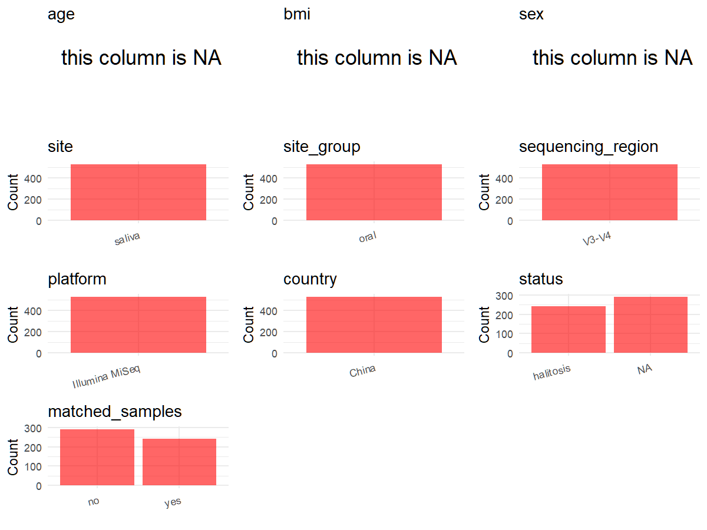

# Step 1: Obtain Initial Metadata from Each Project

This step sets the project directory and loads the raw SRA metadata.

```{r message=FALSE, warning=FALSE}
# Load libraries
library(dplyr)
library(ggplot2)
library(cowplot)

# (1) Setting working directory
project_id <- "PRJNA1149521"

base_dir <- "E:/工作区/VSCode/RNAproject/collect_metadata_respon/project"
setwd(file.path(base_dir, project_id))

# (2) Loading raw SRA metadata file
sra_file <- "SraRunTable.csv"
initial_meta <- read.csv(sra_file, header = TRUE, stringsAsFactors = FALSE, check.names = FALSE)
```

# Step 2: Data Overview

First, you need to get an overview of the data, which includes two steps: reading the article and reading the initial metadata. This step is very IMPORTANT!

```{r message=FALSE, warning=FALSE}
# (1) Read the article in the following order: abstract, the beginning of the results section, and the methods.
# Paper summary used for this project:
# - Title: hTAS2R38 polymorphisms modulate oral microbiota and influence the prevalence and treatment outcome of halitosis
# - Study design: one cross-sectional study plus one prospective 6-month intervention follow-up study
# - Cross-sectional cohort: 689 participants were enrolled, and 290 saliva samples were randomly selected for 16S rRNA sequencing
# - Prospective cohort: 60 halitosis patients were followed at baseline, 1 month, 3 months, and 6 months, yielding 240 saliva samples for 16S rRNA sequencing
# - Study population: adults aged 18 to 50 years residing in Sichuan Province, China
# - Sample type for this metadata: saliva
# - Sequencing from Methods: bacterial 16S rRNA V3-V4 sequencing using primers 338F and 806R on Illumina MiSeq PE300
# - Data availability states that both hTAS2R38 SNP data and 16S sequencing data were deposited under the same BioProject, so the SRA run table mixes microbiome rows with SNP-genotyping rows and must be filtered carefully
# - Supplementary Material 1 contains Figures S1-S11 and Tables S1-S17. Table S9 and Table S10 provide only cohort-level summaries for the 290 cross-sectional 16S samples, not sample-level IDs or per-sample phenotype labels.
# - Representative NCBI BioSample records for both CS and Co saliva runs contain only host/site/date/location-style attributes and do not expose per-sample status, genotype, age, sex, or explicit timepoint fields.

# (2) IMPORTANT: MUST go through each column of initial_meta
head(initial_meta, 10)
colnames(initial_meta)
table(initial_meta$Instrument)
table(initial_meta$isolation_source)
table(initial_meta$sample_type)
table(initial_meta$tissue, useNA = "ifany")
table(initial_meta$geo_loc_name_country)
table(initial_meta$ReleaseDate)
table(substr(initial_meta$`Sample Name`, 1, 2))
# Relevant raw columns already present in SRA for the 19-column schema:
# - sample_id: Run
# - subject_id candidate: Sample Name
# - country: geo_loc_name_country
# - public_time: ReleaseDate
# - site/filtering support: isolation_source, sample_type, tissue, Instrument, Platform
# Raw fields that are not usable at the 530-saliva-run level:
# - AGE and sex are populated for the 689 buccal-mucosa SNP rows, not for the 530 saliva 16S rows
# Fields that must come from the paper or supplementary materials:
# - sequencing_region, platform, pcr_primers, disease_study, status interpretation, matched design, and time-series interpretation
# Fields still unresolved after checking Supplementary Material 1 and representative NCBI BioSample pages:
# - per-sample status for CS samples
# - per-sample age, sex, and genotype for the 530 saliva 16S rows
# Among 1219 deposited rows, only 530 rows are saliva 16S samples sequenced on Illumina MiSeq.
# CS-prefixed samples are the 290 cross-sectional saliva samples.
# Co-prefixed samples are the 240 prospective saliva samples with subject_timepoint pattern Co<id>_<timepoint>.
# C-prefixed rows generated on AB 5500xl Genetic Analyzer are buccal mucosa hTAS2R38 genotyping records and are excluded from the microbiome metadata.
```

# Step 3: Removing Control and Non-human Samples

First, we need to remove control samples(including both negative controls and positive controls) and non-human samples.

```{r}
# (1) Parameter setup
control_column <- "Instrument"
control_keywords <- c("AB 5500xl Genetic Analyzer")

species_column <- "HOST"
unique(initial_meta[[species_column]])
non_human_keywords <- c()

# (2) Remove controls and non-human samples. DO NOT need to modify code in this part, just run it.
n_samples <- nrow(initial_meta)
# Control evaluation
if (length(control_keywords) > 0) {
  if (is.null(control_column) || control_column == "") {
    stop("Error: control_keywords provided but control_column is missing.")
  }

  if (!(control_column %in% colnames(initial_meta))) {
    stop(sprintf("Error: Column '%s' not found in initial_meta.", control_column))
  }

  control_pattern <- paste(control_keywords, collapse = "|")
  control_text <- initial_meta[[control_column]]
  is_control <- grepl(control_pattern, control_text)

} else {
  is_control <- rep(FALSE, n_samples)
}

# Non-human evaluation
if (length(non_human_keywords) > 0) {
  if (is.null(species_column) || species_column == "") {
    stop("Error: non_human_keywords provided but species_column is missing.")
  }

  if (!(species_column %in% colnames(initial_meta))) {
    stop(sprintf("Error: Column '%s' not found in initial_meta.", species_column))
  }

  non_human_pattern <- paste(non_human_keywords, collapse = "|")
  species_text <- initial_meta[[species_column]]
  is_non_human <- grepl(non_human_pattern, species_text)
} else {
  is_non_human <- rep(FALSE, n_samples)
}

# Execute removal
samples_to_remove <- is_control | is_non_human
initial_meta <- initial_meta[!samples_to_remove, ]
initial_meta <- initial_meta[initial_meta$isolation_source == "saliva" & initial_meta$Instrument == "Illumina MiSeq", ]

cat("Initial source rows:", n_samples, "\n")
cat("Excluded non-16S buccal-mucosa SNP/genotyping rows:", sum(is_control), "\n")
cat("Removed non-human samples:", sum(is_non_human), "\n")
cat("Rows retained for microbiome metadata:", nrow(initial_meta), "\n")
# Expected retained rows: 530 = 290 cross-sectional saliva samples + 240 prospective saliva samples.
```

# Step 4: Creating a Uniform Metadata Template

This step converts the raw SRA table into the standard metadata format used in our meta-analysis.

```{r}
raw_subject_id <- initial_meta$`Sample Name`
subject_id <- ifelse(
  grepl("^Co", raw_subject_id),
  sub("_(\\d+)$", "", raw_subject_id),
  raw_subject_id
)

metadata <- data.frame(
  bioproject = initial_meta$BioProject,
  sample_id = initial_meta$Run,
  raw_subject_id = raw_subject_id,
  subject_id = subject_id,
  age = NA_real_,
  age_info = "18-50 years",
  bmi = NA_real_,
  sex = NA_character_,
  sequencing_region = "V3-V4",
  platform = "Illumina MiSeq",
  country = initial_meta$geo_loc_name_country,
  site = "saliva",
  site_group = "pending",
  public_time = sub("T.*$", "", initial_meta$ReleaseDate),
  pcr_primers = "338F-806R",
  title = "hTAS2R38 polymorphisms modulate oral microbiota and influence the prevalence and treatment outcome of halitosis",
  disease_study = "yes",
  raw_status = initial_meta$`Sample Name`,
  status = ifelse(grepl("^Co", initial_meta$`Sample Name`), "halitosis", NA_character_),
  matched_samples = "pending",
  is_time_series = "no",
  stringsAsFactors = FALSE
)

# Source notes for non-obvious fields:
# - raw_subject_id stores the original SRA Sample Name so the exported metadata preserves the exact row-level label used to derive subject_id.
# - subject_id keeps CS identifiers as-is for the cross-sectional cohort, and removes the trailing _timepoint suffix from Co samples so each prospective participant has one stable ID across four visits.
# - raw_status stores the original SRA Sample Name because the halitosis mapping for Co rows is inferred from that deposited label pattern rather than from an explicit status column.
# - age is unavailable per sample in the 530 saliva 16S rows, so age_info records the study-level eligibility range from the Methods.
# - bmi is left NA because neither the SRA saliva rows, the main paper, nor Supplementary Material 1 provide per-sample BMI values for the sequenced saliva subset.
# - sex is left NA because the saliva 16S rows do not contain row-level sex values; the paper reports sex at cohort level only, the populated sex column in SRA belongs to the separate 689-row SNP dataset, and representative NCBI BioSample pages for saliva runs also lack sex attributes.
# - sequencing_region, platform, and pcr_primers come from the Methods section: V3-V4 amplified with primers 338F/806R and sequenced on Illumina MiSeq PE300.
# - country follows the SRA column geo_loc_name_country, which is consistently China and agrees with the paper recruitment location in Sichuan Province, China.
# - status is set to halitosis for Co samples because the prospective cohort is explicitly 60 halitosis patients; cross-sectional CS samples are left NA because neither the deposited sample names, Supplementary Material 1, nor representative NCBI BioSample records provide sample-level healthy-versus-halitosis labels.
# - is_time_series is set to no for all rows because the repeated Co sampling is an intervention follow-up design rather than an untreated longitudinal time-series design.
# NA summary for this project:
# - age = NA: no per-sample age values for the 530 saliva 16S rows; only study-level range 18-50 years is available.
# - bmi = NA: no BMI information for the sequenced saliva samples was identified.
# - sex = NA: no per-sample sex values for the saliva 16S rows were identified.
# - status = NA for CS samples only: the 290 cross-sectional saliva runs cannot be mapped to healthy versus halitosis at the sample level with currently available evidence.
metadata$public_time <- as.Date(metadata$public_time)
```

# Step 5: Manually solving pending issues

This step involves two parts: (1) handle the columns with the `raw_` prefix, and next (2) handle the `site_group` and `matched_samples` columns.

```{r}
# (1) raw_subject_id and raw_status are already carried in metadata to preserve the deposited Sample Name used for subject_id and status interpretation.
metadata <- metadata
```

```{r}
# (2) Filling the 'site_group' and 'matched_samples' columns
unique(metadata$site)
Oral_site = c("saliva")
Gut_site = c("feces")

metadata <- metadata %>%
  mutate(site_group = case_when(
    site %in% Oral_site ~ "oral",
    site %in% Gut_site ~ "gut",
    TRUE ~ "other"
  ))

metadata$matched_samples <- ifelse(
  ave(metadata$subject_id, metadata$subject_id, FUN = length) > 1,
  "yes",
  "no"
)
# CS subjects appear once, while each Co subject appears at four intervention follow-up visits.
```

```{r}
# (3) check if there is pending value in metadata. If there is pending value, go on modify the metadata.
has_pending <- function(col) {
  if (is.character(col) || is.factor(col)) {
    any(col == "pending", na.rm = TRUE)
  } else {
    FALSE
  }
}

any_pending_value <- any(sapply(metadata, has_pending))

if (!any_pending_value) {
  message("Good! No cell contains the value 'pending'.")
} else {
  pending_cols <- names(metadata)[sapply(metadata, has_pending)]
  message("Columns containing 'pending': ", paste(pending_cols, collapse = ", "))
  message("Please continue to resolve these pending columns!")
}

# Check NA fields that are intentionally retained for this project.
colSums(is.na(metadata[c("age", "bmi", "sex", "status")]))
# Expected interpretation:
# - age: all NA because only cohort-level age range is available.
# - bmi: all NA because no BMI data were identified for sequenced saliva samples.
# - sex: all NA because no row-level sex values were provided for saliva 16S runs.
# - status: NA only in cross-sectional CS samples because sample-level healthy/halitosis labels are unavailable.
```

# Step 6: Visualize the Metadata

This step makes a quick set of plots for checking the distribution of key metadata fields.

```{r}
plot_data <- metadata %>%
  select(-bioproject, -sample_id, -subject_id, -title)

create_simple_plots <- function(data) {
  plots <- list()
  continuous_vars <- c("age", "bmi")

  for (col in colnames(data)) {
    if (all(is.na(data[[col]]))) {
      p <- ggplot() +
        annotate("text", x = 0.5, y = 0.5, label = "this column is NA", size = 6) +
        labs(title = col) +
        theme_void()
    } else if (col %in% continuous_vars && is.numeric(data[[col]])) {
      p <- ggplot(data, aes(x = .data[[col]])) +
        geom_histogram(fill = "blue", alpha = 0.6, bins = 20, na.rm = TRUE) +
        labs(title = col, x = col, y = "Count") +
        theme_minimal()
    } else {
      count_data <- as.data.frame(table(data[[col]], useNA = "ifany"))
      p <- ggplot(count_data, aes(x = reorder(Var1, -Freq), y = Freq)) +
        geom_col(fill = "red", alpha = 0.6) +
        labs(title = col, x = NULL, y = "Count") +
        theme_minimal() +
        theme(axis.text.x = element_text(angle = 15, hjust = 1))
    }
    plots[[col]] <- p
  }

  return(plots)
}

plots <- create_simple_plots(plot_data)
p <- plot_grid(plots$age,
               plots$bmi,
               plots$sex,
               plots$site,
               plots$site_group,
               plots$sequencing_region,
               plots$platform,
               plots$country,
               plots$status,
               plots$matched_samples,
               ncol = 3, align = "hv", axis = "lb")
ggsave("Metadata_Summary.png", plot = p, width = 8, height = 6, dpi = 150)
```

```{r}

```

# Step 7: Sort and export the metadata

This step saves the cleaned metadata table as the final `metadata_v2.csv` file.

```{r}
fixed_cols <- c("bioproject", "sample_id", "subject_id", "age", "age_info",
                "bmi", "sex", "platform", "sequencing_region", "pcr_primers",
                "country", "site", "site_group", "disease_study", "status",
                "title", "public_time", "matched_samples", "is_time_series")
metadata <- metadata %>%
  select(all_of(fixed_cols), starts_with("raw_"))

write.csv(metadata, file = "metadata_v2.csv", quote = TRUE, row.names = FALSE)
```
