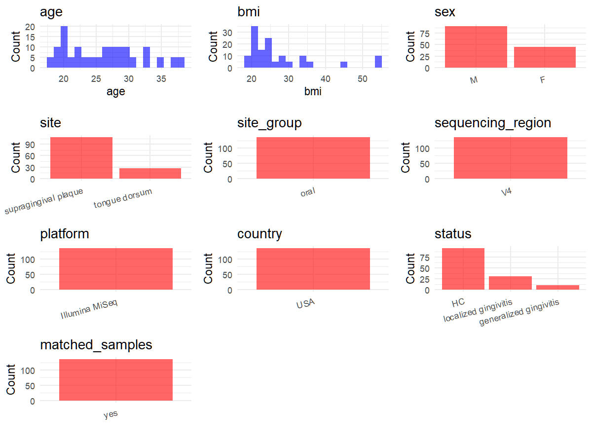

R Notebook: Metadata Processing Workflow
================

# Step 1: Obtain Initial Metadata from Each Project

To obtain the initial metadata: 1. Search for the BioProject ID (e.g.,
“PRJEBXXXX”) on the [NCBI SRA
website](https://www.ncbi.nlm.nih.gov/Traces/study/). 2. In the “Select”
table, click on “Metadata” and download the file. 3. The downloaded file
is typically named “SraRunTable.csv” and contains metadata for the
project.

``` r
# Load necessary libraries
library(dplyr)
library(ggplot2)
library(cowplot)

# Set working directory (update this path to your local directory)
setwd("E:/bioproject/PRJNA1154284")

# Read the initial metadata files
initial_meta <- read.csv("SraRunTable.csv", header = T) 

# Display the first few rows of the metadata
head(initial_meta)
```

    ##           Run Assay.Type AvgSpotLen    Bases   BioProject    BioSample
    ## 1 SRR30477748   AMPLICON        502 23966986 PRJNA1154284 SAMN43410193
    ## 2 SRR30477749   AMPLICON        502 45049982 PRJNA1154284 SAMN43410192
    ## 3 SRR30477750   AMPLICON        502 40142430 PRJNA1154284 SAMN43410191
    ## 4 SRR30477751   AMPLICON        502 52581990 PRJNA1154284 SAMN43410190
    ## 5 SRR30477752   AMPLICON        502 38122382 PRJNA1154284 SAMN43410189
    ## 6 SRR30477753   AMPLICON        502 28298744 PRJNA1154284 SAMN43410188
    ##                BioSampleModel    Bytes                  Center.Name
    ## 1 Metagenome or environmental 13097393 NOVA SOUTHEASTERN UNIVERSITY
    ## 2 Metagenome or environmental 24570300 NOVA SOUTHEASTERN UNIVERSITY
    ## 3 Metagenome or environmental 21723006 NOVA SOUTHEASTERN UNIVERSITY
    ## 4 Metagenome or environmental 28088904 NOVA SOUTHEASTERN UNIVERSITY
    ## 5 Metagenome or environmental 20340009 NOVA SOUTHEASTERN UNIVERSITY
    ## 6 Metagenome or environmental 15685201 NOVA SOUTHEASTERN UNIVERSITY
    ##   Collection_Date Consent DATASTORE.filetype DATASTORE.provider
    ## 1      2021-01-01  public   fastq,run.zq,sra         gs,ncbi,s3
    ## 2      2021-01-01  public   fastq,run.zq,sra         gs,ncbi,s3
    ## 3      2021-01-01  public   fastq,run.zq,sra         gs,ncbi,s3
    ## 4      2021-01-01  public   fastq,run.zq,sra         gs,ncbi,s3
    ## 5      2021-01-01  public   fastq,run.zq,sra         gs,ncbi,s3
    ## 6      2021-01-01  public   fastq,run.zq,sra         gs,ncbi,s3
    ##                       DATASTORE.region  Experiment geo_loc_name_country
    ## 1 gs.us-east1,ncbi.public,s3.us-east-1 SRX25902775                  USA
    ## 2 gs.us-east1,ncbi.public,s3.us-east-1 SRX25902774                  USA
    ## 3 gs.us-east1,ncbi.public,s3.us-east-1 SRX25902773                  USA
    ## 4 gs.us-east1,ncbi.public,s3.us-east-1 SRX25902772                  USA
    ## 5 gs.us-east1,ncbi.public,s3.us-east-1 SRX25902771                  USA
    ## 6 gs.us-east1,ncbi.public,s3.us-east-1 SRX25902770                  USA
    ##   geo_loc_name_country_continent                    geo_loc_name         HOST
    ## 1                  North America USA: Florida\\, Fort Lauderdale Homo sapiens
    ## 2                  North America USA: Florida\\, Fort Lauderdale Homo sapiens
    ## 3                  North America USA: Florida\\, Fort Lauderdale Homo sapiens
    ## 4                  North America USA: Florida\\, Fort Lauderdale Homo sapiens
    ## 5                  North America USA: Florida\\, Fort Lauderdale Homo sapiens
    ## 6                  North America USA: Florida\\, Fort Lauderdale Homo sapiens
    ##       Instrument isolation_source         lat_lon Library.Name LibraryLayout
    ## 1 Illumina MiSeq           Plaque 26.08 N 80.24 W      FN13-UR        PAIRED
    ## 2 Illumina MiSeq    Tongue scrape 26.08 N 80.24 W       FN22-T        PAIRED
    ## 3 Illumina MiSeq           Plaque 26.08 N 80.24 W      FN50-UR        PAIRED
    ## 4 Illumina MiSeq           Plaque 26.08 N 80.24 W      FN33-LL        PAIRED
    ## 5 Illumina MiSeq    Tongue scrape 26.08 N 80.24 W       FN13-T        PAIRED
    ## 6 Illumina MiSeq           Plaque 26.08 N 80.24 W      FN26-LR        PAIRED
    ##   LibrarySelection LibrarySource oral_cavity_sampling_location        Organism
    ## 1              PCR   METAGENOMIC                       FN13-UR oral metagenome
    ## 2              PCR   METAGENOMIC                        FN22-T oral metagenome
    ## 3              PCR   METAGENOMIC                       FN50-UR oral metagenome
    ## 4              PCR   METAGENOMIC                       FN33-LL oral metagenome
    ## 5              PCR   METAGENOMIC                        FN13-T oral metagenome
    ## 6              PCR   METAGENOMIC                       FN26-LR oral metagenome
    ##   Platform          ReleaseDate          create_date version Sample.Name
    ## 1 ILLUMINA 2024-09-27T00:00:00Z 2024-08-29T18:01:00Z       1     FN13-UR
    ## 2 ILLUMINA 2024-09-27T00:00:00Z 2024-08-29T18:00:00Z       1      FN22-T
    ## 3 ILLUMINA 2024-09-27T00:00:00Z 2024-08-29T18:00:00Z       1     FN50-UR
    ## 4 ILLUMINA 2024-09-27T00:00:00Z 2024-08-29T18:00:00Z       1     FN33-LL
    ## 5 ILLUMINA 2024-09-27T00:00:00Z 2024-08-29T18:00:00Z       1      FN13-T
    ## 6 ILLUMINA 2024-09-27T00:00:00Z 2024-08-29T18:00:00Z       1     FN26-LR
    ##   SRA.Study
    ## 1 SRP529475
    ## 2 SRP529475
    ## 3 SRP529475
    ## 4 SRP529475
    ## 5 SRP529475
    ## 6 SRP529475

# Step 2: Create a Uniform Metadata Template

The uniform metadata should include the following columns:

1.  **BioProject**: Project ID (e.g., “PRJNA339212”)
2.  **Run**: Sample ID (e.g., “ERRXXXXXX” or “SRRXXXXXX”)
3.  **sample_name**: Original sample name submitted by the authors (not
    the database-assigned ID)
4.  **Age**: Age of the subject (if available)
5.  **BMI**: Body Mass Index (if available)
6.  **Sex**: Sex of the subject (“F” or “M”)
7.  **Region**: Targeted 16S rRNA region (e.g., “V3-V4”)
8.  **Platform**: Sequencing platform (e.g., “Illumina MiSeq”)
9.  **Country**: Country of sample origin (e.g., “China”)
10. **Site**: Sample site (e.g., “saliva”, “dental plaque”)
11. **public_time**: Data release date (format: “YYYY-MM-DD”)
12. **PCR_primers**: PCR primers used (e.g., “515F-806R”)
13. **title**: Title of the associated publication
14. **Disease_study**: Whether the study involves a disease (“YES” or
    “NO”)
15. **Status**: Disease status (e.g., “T2DM”, “HC”). Note: If the study
    includes both disease and healthy samples, this must be specified
    per sample.
16. **matched_samples**: matched samples (“YES” or “NO”)

``` r
# Create a uniform metadata dataframe
metadata <- data.frame(
  BioProject = initial_meta$BioProject,
  Run = initial_meta$Run,
  sample_name = initial_meta$Sample.Name,
  Age = "18-60", 
  BMI = NA,  
  Sex = NA,
  Region = "V4",
  Platform = initial_meta$Instrument,
  Country = initial_meta$geo_loc_name_country,
  Site = initial_meta$isolation_source,
  public_time = initial_meta$ReleaseDate,
  stringsAsFactors = FALSE
)
```

# Step 3: Manually Add Information from the Publication

Some information (e.g. PCR primers, study title, disease status) must be
manually extracted from the publication and added to the metadata.

``` r
# Add information obtained from the publication
metadata$PCR_primers <- "515F-806R"
metadata$title <- "Supragingival plaque microbiomes in a diverse south florida population"
metadata$Disease_study <- "NO"
# Assign disease status based on sample_name patterns
metadata$Status <- "HC"

#extract subject id by remove prefix of sample_name
metadata$sample_name <- gsub("-.*", "", metadata$sample_name)

# Check initial data distribution
cat("Initial sample distribution:\n")
```

    ## Initial sample distribution:

``` r
table(metadata$sample_name)
```

    ## 
    ##  FN02  FN08  FN10  FN11  FN13  FN16  FN22  FN24  FN25  FN26  FN27  FN31  FN32 
    ##     5     5     5     5     5     5     5     5     5     5     5     5     5 
    ##  FN33  FN34  FN35  FN36  FN37  FN39  FN40  FN43  FN47  FN50  FN52 FN54a FN54b 
    ##     5     5     5     5     5     5     5     5     5     5     5     5     5 
    ##  FN71 
    ##     5

``` r
table(metadata$Site)
```

    ## 
    ##        Plaque Tongue scrape 
    ##           108            27

``` r
# Calculate sampling frequency per subject
sample_counts <- table(metadata$sample_name)
cat("\nNumber of samples per subject:\n")
```

    ## 
    ## Number of samples per subject:

``` r
print(sample_counts)
```

    ## 
    ##  FN02  FN08  FN10  FN11  FN13  FN16  FN22  FN24  FN25  FN26  FN27  FN31  FN32 
    ##     5     5     5     5     5     5     5     5     5     5     5     5     5 
    ##  FN33  FN34  FN35  FN36  FN37  FN39  FN40  FN43  FN47  FN50  FN52 FN54a FN54b 
    ##     5     5     5     5     5     5     5     5     5     5     5     5     5 
    ##  FN71 
    ##     5

``` r
# Create matched_samples column
metadata$matched_samples <- ifelse(metadata$sample_name %in% names(sample_counts[sample_counts >= 2]), "YES", "NO")

cat("\nMatched samples distribution:\n")
```

    ## 
    ## Matched samples distribution:

``` r
table(metadata$matched_samples)
```

    ## 
    ## YES 
    ## 135

``` r
# Identify samples for removal: single samples excluding saliva and tongue coat
single_samples <- names(sample_counts[sample_counts == 1])
samples_to_remove <- metadata$sample_name %in% single_samples & 
                     !(metadata$Site %in% c("saliva", "tongue coat", "Tongue coating"))

cat("\nNumber of samples to be removed:", sum(samples_to_remove), "\n")
```

    ## 
    ## Number of samples to be removed: 0

``` r
# Remove identified samples
metadata_clean <- metadata[!samples_to_remove, ]

cat("\nFinal sample distribution after cleaning:\n")
```

    ## 
    ## Final sample distribution after cleaning:

``` r
table(metadata_clean$sample_name)
```

    ## 
    ##  FN02  FN08  FN10  FN11  FN13  FN16  FN22  FN24  FN25  FN26  FN27  FN31  FN32 
    ##     5     5     5     5     5     5     5     5     5     5     5     5     5 
    ##  FN33  FN34  FN35  FN36  FN37  FN39  FN40  FN43  FN47  FN50  FN52 FN54a FN54b 
    ##     5     5     5     5     5     5     5     5     5     5     5     5     5 
    ##  FN71 
    ##     5

``` r
table(metadata_clean$Site)
```

    ## 
    ##        Plaque Tongue scrape 
    ##           108            27

``` r
table(metadata_clean$matched_samples)
```

    ## 
    ## YES 
    ## 135

``` r
# Use cleaned dataset for subsequent analysis
metadata <- metadata_clean
```

# Step 4: Summarize and Validate the Metadata

``` r
# Check the number of unique runs and sample names
print(paste("Number of unique runs:", length(unique(metadata$Run))))
```

    ## [1] "Number of unique runs: 135"

``` r
print(paste("Number of unique sample names:", length(unique(metadata$sample_name))))
```

    ## [1] "Number of unique sample names: 27"

# Step 5: Visualize the Metadata

``` r

```

<!-- -->

# Step 6: Finalize and Export the Metadata

``` r
# Reorder columns to match the desired format
metadata <- metadata[, c(
  "BioProject", "Run", "sample_name", "Age", "BMI", "Sex", 
  "Region", "Platform", "Country", "Site", "public_time", 
  "PCR_primers", "title", "Disease_study", "Status", "matched_samples"
)]

# Export the uniform metadata to a CSV file
write.csv(metadata, file = "metadata.csv", quote = FALSE)
head(metadata)
```

    ##     BioProject         Run sample_name   Age BMI Sex Region       Platform
    ## 1 PRJNA1154284 SRR30477748        FN13 18-60  NA  NA     V4 Illumina MiSeq
    ## 2 PRJNA1154284 SRR30477749        FN22 18-60  NA  NA     V4 Illumina MiSeq
    ## 3 PRJNA1154284 SRR30477750        FN50 18-60  NA  NA     V4 Illumina MiSeq
    ## 4 PRJNA1154284 SRR30477751        FN33 18-60  NA  NA     V4 Illumina MiSeq
    ## 5 PRJNA1154284 SRR30477752        FN13 18-60  NA  NA     V4 Illumina MiSeq
    ## 6 PRJNA1154284 SRR30477753        FN26 18-60  NA  NA     V4 Illumina MiSeq
    ##   Country          Site          public_time PCR_primers
    ## 1     USA        Plaque 2024-09-27T00:00:00Z   515F-806R
    ## 2     USA Tongue scrape 2024-09-27T00:00:00Z   515F-806R
    ## 3     USA        Plaque 2024-09-27T00:00:00Z   515F-806R
    ## 4     USA        Plaque 2024-09-27T00:00:00Z   515F-806R
    ## 5     USA Tongue scrape 2024-09-27T00:00:00Z   515F-806R
    ## 6     USA        Plaque 2024-09-27T00:00:00Z   515F-806R
    ##                                                                    title
    ## 1 Supragingival plaque microbiomes in a diverse south florida population
    ## 2 Supragingival plaque microbiomes in a diverse south florida population
    ## 3 Supragingival plaque microbiomes in a diverse south florida population
    ## 4 Supragingival plaque microbiomes in a diverse south florida population
    ## 5 Supragingival plaque microbiomes in a diverse south florida population
    ## 6 Supragingival plaque microbiomes in a diverse south florida population
    ##   Disease_study Status matched_samples
    ## 1            NO     HC             YES
    ## 2            NO     HC             YES
    ## 3            NO     HC             YES
    ## 4            NO     HC             YES
    ## 5            NO     HC             YES
    ## 6            NO     HC             YES

## Notes for Students:

1.  **Metadata Accuracy**: Always cross-check the metadata with the
    original publication to ensure accuracy.
2.  **Manual Entries**: Columns like `PCR_primers`, and `Status` often
    require manual entry based on the publication.
3.  **Disease Status**: Be careful when assigning `Status`—some studies
    include both disease and healthy samples.
4.  **Visualization**: The plots help quickly identify the distribution
    of values in each column, which is useful for quality control.
5.  **Reproducibility**: Update the working directory and file paths to
    match your local environment.
