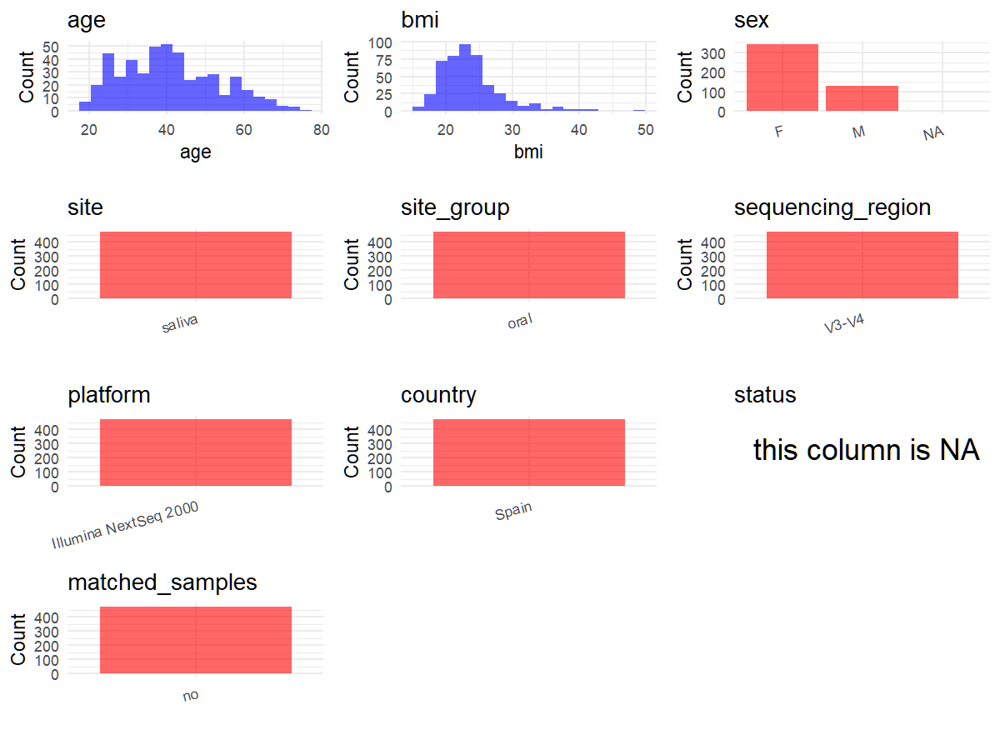

# Step 1: Obtain Initial Metadata from Each Project

This step sets the project directory and loads the raw SRA metadata.

```{r message=FALSE, warning=FALSE}
# Load libraries
library(dplyr)
library(ggplot2)
library(cowplot)

# (1) Setting working directory
project_id <- "PRJNA1162741"

base_dir <- "E:/工作区/VSCode/RNAproject/collect_metadata_respon/project"
setwd(file.path(base_dir, project_id))

# (2) Loading raw SRA metadata file
sra_file <- "SraRunTable.csv"
initial_meta <- read.csv(sra_file, header = TRUE, stringsAsFactors = FALSE)
```

# Step 2: Data Overview

First, you need to get an overview of the data, which includes two steps: reading the article and reading the initial metadata. This step is very IMPORTANT!

```{r message=FALSE, warning=FALSE}
# (1) Read the article in the following order: abstract, the beginning of the results section, and the methods.
# Paper summary used for this project:
# - Title: Probing the oral-brain connection: oral microbiome patterns in a large community cohort with anxiety, depression, and trauma symptoms and periodontal outcomes
# - Study design: population-based community saliva cohort combining Población Inn cohort and TRIAD cohort
# - Deposited sequencing rows: 471 saliva 16S rows from distinct participants
# - Downstream analysis cohort in the paper: 470 individuals after pre-processing and one low-read sample removal, but the deposited SRA metadata contains 471 rows
# - Sample type for this metadata: saliva
# - Country and recruitment context from Methods: Spain, with recruitment in Madrid, Barcelona, and Oviedo municipalities
# - Participant eligibility: Spanish residents aged 18 years or older; no antibiotics within the previous 6 months; no psychotic, personality, or neurodegenerative disorders
# - Sequencing from Methods: 16S rRNA gene V3-V4 amplicons sequenced on the Illumina NextSeq2000 platform
# - Supplementary Material methods explicitly provide the sequencing primer constructs and support the core amplicon primers CCTACGGGNGGCWGCAG and GACTACHVGGGTATCTAATCC
# - Mental-health symptom groups in the paper overlap (depressive, trait anxiety, state anxiety, PTSD) and are reported as cohort-level comparisons rather than a single mutually exclusive per-sample label
# - The PDF text mentions Supplementary Table 4 for predicted functional results; local Supplementary Tables 1-2 reviewed here are statistical result tables rather than sample-level metadata tables

# (2) IMPORTANT: MUST go through each column of initial_meta
head(initial_meta, 10)
colnames(initial_meta)
table(initial_meta$Instrument)
table(initial_meta$env_medium)
table(initial_meta$env_local_scale)
table(initial_meta$geo_loc_name_country)
table(initial_meta$host_sex, useNA = "ifany")
table(sub("\\d+$", "", initial_meta$`Sample Name`))
table(duplicated(initial_meta$host_subject_id))
nrow(initial_meta)
# Raw fields already available for the 19-column schema:
# - sample_id: Run
# - subject_id: host_subject_id
# - age: Host_Age
# - bmi: host_body_mass_index
# - sex: host_sex
# - country: geo_loc_name_country
# - public_time: ReleaseDate
# - site/site_group support: env_medium = saliva; env_local_scale = mouth
# Fields that must come from the paper or supplements rather than SRA:
# - title, sequencing_region, platform, pcr_primers, disease_study, status, age_info,
#   matched_samples, is_time_series
# Current audit summary:
# - All 471 deposited rows are human saliva oral metagenome samples from Spain.
# - Sample names are unique and use prefixes P, PT, PTV, PTO, and PTB.
# - host_subject_id is unique per row, so this is not a matched-sample or longitudinal dataset.
# - One deposited row (PT150) is missing host age, BMI, and sex in SRA metadata.
# - Local Supplementary Material and Supplementary Tables 1-2 have now been reviewed; the tables are statistical
#   result tables rather than sample-level metadata tables.
# - Sample-name prefixes also do not support a reliable status mapping: SRA contains P=186, PT=234, PTB=20,
#   PTO=17, and PTV=14 rows, which do not match the paper's overlapping analysis groups such as 306 symptomatic,
#   164 healthy controls, 148 depressive symptoms, 281 trait anxiety symptoms, or 73 PTSD symptoms.
# - Because the paper groups overlap and no sample-level assignment table was found, status should remain NA.
# - Still needs manual confirmation from additional supplements or the article landing page: any sample-level
#   symptom/periodontal annotation table, and the identity of the one low-read sample excluded from the paper's
#   470-participant analysis but still present in the 471-row SRA deposit.
```

# Step 3: Removing Control and Non-human Samples

First, we need to remove control samples(including both negative controls and positive controls) and non-human samples.

```{r}
# (1) Parameter setup
control_column <- ""
control_keywords <- c()

species_column <- "Host"
unique(initial_meta[[species_column]])
non_human_keywords <- c()

# (2) Remove controls and non-human samples. DO NOT need to modify code in this part, just run it.
n_samples <- nrow(initial_meta)
# Control evaluation
if (length(control_keywords) > 0) {
  if (is.null(control_column) || control_column == "") {
    stop("Error: control_keywords provided but control_column is missing.")
  }

  if (!(control_column %in% colnames(initial_meta))) {
    stop(sprintf("Error: Column '%s' not found in initial_meta.", control_column))
  }

  control_pattern <- paste(control_keywords, collapse = "|")
  control_text <- initial_meta[[control_column]]
  is_control <- grepl(control_pattern, control_text)

} else {
  is_control <- rep(FALSE, n_samples)
}

# Non-human evaluation
if (length(non_human_keywords) > 0) {
  if (is.null(species_column) || species_column == "") {
    stop("Error: non_human_keywords provided but species_column is missing.")
  }

  if (!(species_column %in% colnames(initial_meta))) {
    stop(sprintf("Error: Column '%s' not found in initial_meta.", species_column))
  }

  non_human_pattern <- paste(non_human_keywords, collapse = "|")
  species_text <- initial_meta[[species_column]]
  is_non_human <- grepl(non_human_pattern, species_text)
} else {
  is_non_human <- rep(FALSE, n_samples)
}

# Execute removal
samples_to_remove <- is_control | is_non_human
initial_meta <- initial_meta[!samples_to_remove, ]

cat("Initial samples counts:", n_samples, "\n")
cat("Removed control samples:", sum(is_control), "\n")
cat("Removed non-human samples:", sum(is_non_human), "\n")
cat("Total samples removed ", sum(samples_to_remove), "\n")
cat("Remaining samples after Step 2:", nrow(initial_meta), "\n")
```

# Step 4: Creating a Uniform Metadata Template

This step converts the raw SRA table into the standard metadata format used in our meta-analysis.

```{r}
metadata <- data.frame(
  bioproject = initial_meta$BioProject,
  sample_id = initial_meta$Run,
  subject_id = initial_meta$host_subject_id,
  age = suppressWarnings(as.numeric(initial_meta$Host_Age)),
  age_info = "adult participants; eligibility age >=18 years; total cohort median age 40.0 years (IQR 31.0-50.0)",
  bmi = suppressWarnings(as.numeric(initial_meta$host_body_mass_index)),
  raw_sex = initial_meta$host_sex,
  sex = "pending",
  sequencing_region = "V3-V4",
  platform = "Illumina NextSeq 2000",
  country = initial_meta$geo_loc_name_country,
  site = "saliva",
  site_group = "pending",
  public_time = sub("T.*$", "", initial_meta$ReleaseDate),
  pcr_primers = "F-CCTACGGGNGGCWGCAG,R-GACTACHVGGGTATCTAATCC",
  title = "Probing the oral-brain connection: oral microbiome patterns in a large community cohort with anxiety, depression, and trauma symptoms, and periodontal outcomes",
  disease_study = "yes",
  status = NA_character_,
  matched_samples = "no",
  is_time_series = "no",
  stringsAsFactors = FALSE
)

# Evidence source map for core fields:
# - bioproject/sample_id/public_time come directly from BioProject, Run, and ReleaseDate in SraRunTable.csv.
# - subject_id uses host_subject_id because every retained row has a unique participant identifier.
# - age and bmi come from Host_Age and host_body_mass_index in SraRunTable.csv; PT150 lacks both and remains NA.
# - raw_sex preserves the original host_sex values from SraRunTable.csv, and sex is standardized in Step 5; PT150 lacks sex and remains NA.
# - age_info comes from the paper cohort description and Tables 1-4, which report an adult cohort with median age 40.0 years (IQR 31.0-50.0).
# - country comes directly from geo_loc_name_country in SraRunTable.csv; all rows are Spain.
# - site is set to saliva from the Methods; env_medium = saliva and env_local_scale = mouth provide matching SRA support.
# - sequencing_region and platform come from the Methods and Supplementary Material: V3-V4 amplicons sequenced on Illumina NextSeq 2000.
# - pcr_primers uses the core amplicon primer sequences reported in Supplementary Material methods; Illumina overhang adapters were excluded from the stored value.
# - disease_study is yes because the paper explicitly studies anxiety, depression, PTSD symptoms, and periodontal outcomes.
# - status is left NA because the reported groups overlap, the reviewed local supplements do not provide sample-level assignments,
#   and the SRA sample-name prefixes (P=186, PT=234, PTB=20, PTO=17, PTV=14) do not align with the paper's cohort counts.
# - matched_samples is no because host_subject_id is unique across deposited rows.
# - is_time_series is no because the study is cross-sectional rather than repeated sampling over time.
metadata$public_time <- as.Date(metadata$public_time)
```

# Step 5: Manually solving pending issues

This step involves two parts: (1) handle the columns with the `raw_` prefix, and next (2) handle the `site_group` and `matched_samples` columns.

```{r}
# (1) Handle the columns with the `raw_` prefix.
metadata <- metadata %>%
  mutate(sex = case_when(
    raw_sex == "female" ~ "F",
    raw_sex == "male" ~ "M",
    TRUE ~ NA_character_
  ))
```

```{r}
# (2) Filling the 'site_group' and 'matched_samples' columns
unique(metadata$site)
Oral_site = c("saliva")
Gut_site = c("feces")

metadata <- metadata %>%
  mutate(site_group = case_when(
    site %in% Oral_site ~ "oral",
    site %in% Gut_site ~ "gut",
    TRUE ~ "other"
  ))

metadata$matched_samples <- "no"
# host_subject_id is unique for every retained row, so there are no matched repeated samples.
```

```{r}
# (3) check if there is pending value in metadata. If there is pending value, go on modify the metadata.
has_pending <- function(col) {
  if (is.character(col) || is.factor(col)) {
    any(col == "pending", na.rm = TRUE)
  } else {
    FALSE
  }
}

any_pending_value <- any(sapply(metadata, has_pending))

if (!any_pending_value) {
  message("Good! No cell contains the value 'pending'.")
} else {
  pending_cols <- names(metadata)[sapply(metadata, has_pending)]
  message("Columns containing 'pending': ", paste(pending_cols, collapse = ", "))
  message("Please continue to resolve these pending columns!")
}
```

# Step 6: Visualize the Metadata

This step makes a quick set of plots for checking the distribution of key metadata fields.

```{r}
plot_data <- metadata %>%
  select(-bioproject, -sample_id, -subject_id, -title)

create_simple_plots <- function(data) {
  plots <- list()
  continuous_vars <- c("age", "bmi")

  for (col in colnames(data)) {
    if (all(is.na(data[[col]]))) {
      p <- ggplot() +
        annotate("text", x = 0.5, y = 0.5, label = "this column is NA", size = 6) +
        labs(title = col) +
        theme_void()
    } else if (col %in% continuous_vars && is.numeric(data[[col]])) {
      p <- ggplot(data, aes(x = .data[[col]])) +
        geom_histogram(fill = "blue", alpha = 0.6, bins = 20, na.rm = TRUE) +
        labs(title = col, x = col, y = "Count") +
        theme_minimal()
    } else {
      count_data <- as.data.frame(table(data[[col]], useNA = "ifany"))
      p <- ggplot(count_data, aes(x = reorder(Var1, -Freq), y = Freq)) +
        geom_col(fill = "red", alpha = 0.6) +
        labs(title = col, x = NULL, y = "Count") +
        theme_minimal() +
        theme(axis.text.x = element_text(angle = 15, hjust = 1))
    }
    plots[[col]] <- p
  }

  return(plots)
}

plots <- create_simple_plots(plot_data)
p <- plot_grid(plots$age,
               plots$bmi,
               plots$sex,
               plots$site,
               plots$site_group,
               plots$sequencing_region,
               plots$platform,
               plots$country,
               plots$status,
               plots$matched_samples,
               ncol = 3, align = "hv", axis = "lb")
ggsave("Metadata_Summary.png", plot = p, width = 8, height = 6, dpi = 150)
```

```{r}

```

# Step 7: Sort and export the metadata

This step saves the cleaned metadata table as the final `metadata_v2.csv` file.

```{r}
fixed_cols <- c("bioproject", "sample_id", "subject_id", "age", "age_info",
                "bmi", "sex", "platform", "sequencing_region", "pcr_primers",
                "country", "site", "site_group", "disease_study", "status",
                "title", "public_time", "matched_samples", "is_time_series")
metadata <- metadata %>%
  select(all_of(fixed_cols), starts_with("raw_"))

write.csv(metadata, file = "metadata_v2.csv", quote = TRUE, row.names = FALSE)
```
