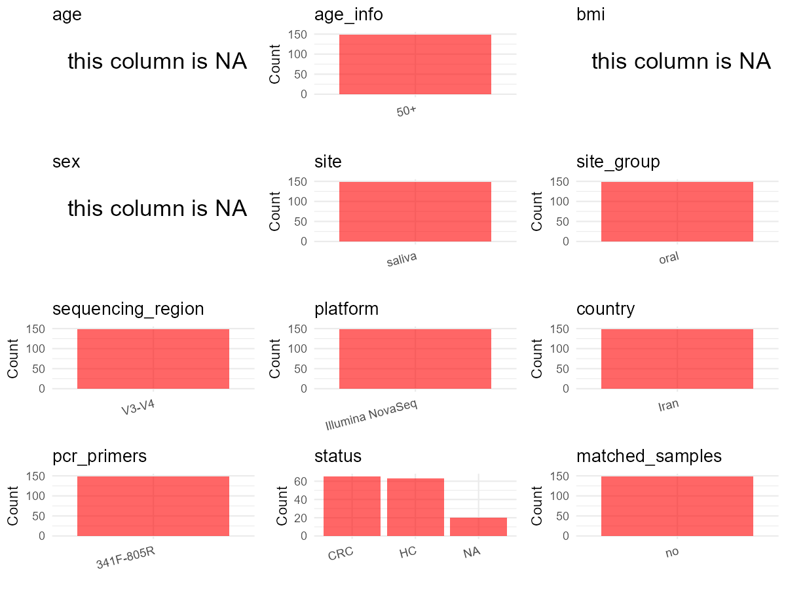

# Step 1: Obtain Initial Metadata from Each Project

This step sets the project directory, loads the raw SRA metadata, and optionally merges supplement tables.

```{r message=FALSE, warning=FALSE}
# =============================================================
# Curation Notes - PRJNA1228548
# bioproject  : initial_meta 'BioProject'; all PRJNA1228548
# sample_id   : initial_meta 'Run'; SRR accession
# subject_id  : initial_meta 'Sample Name'; no subject-level grouping available
# age         : NA — no age column in SRA metadata
# age_info    : "50+" — paper Methods 2.3 inclusion criterion
# bmi         : NA — not in metadata or paper
# sex         : NA — not in metadata or paper
# platform    : Paper Methods 2.5 — Illumina NovaSeq (NOT metadata Platform col)
# region      : Paper Methods 2.5 — V3-V4
# pcr_primers : Paper Methods 2.5 — V3-V4 primers (341F-805R)
# country     : "Iran" — paper location; metadata geo_loc is "uncalculated"
# site        : initial_meta 'isolation_source'; all "saliva"
# site_group  : "oral" — saliva is oral site type
# disease_study : "yes" — CRC case-control study
# status      : Sample Name prefix; C=CRC (paper case group), H=HC (paper controls), A=NA (unmapped)
# matched_samples : "no" — each Sample Name unique; no matched pairs
# is_time_series: "no" — single timepoint; no repeated individual sampling
# controls    : none
# non-human   : none — all Homo sapiens
# =============================================================
# Load libraries
library(dplyr)
library(ggplot2)
library(cowplot)

# (1) Setting working directory
project_id <- "PRJNA1228548"

base_dir <- "D:/metadata_collect"
setwd(file.path(base_dir, project_id))

# (2) Loading raw SRA metadata file
sra_file <- "SraRunTable.csv"
initial_meta <- read.csv(sra_file, header = TRUE)

# (3) OPTIONAL: If extra metadata (e.g., Table.x or supplemental materials) are available from the article, you may need to merge the file with initial_meta manually. Below is example code for merging. Depending on the specific case of each study, you can customize the code as needed.
# supp_table <- read.csv("supplemental_table.csv", header = TRUE)
# initial_meta <- left_join(initial_meta, supp_table, by = merge_col_name)
```

# Step 2: Data Overview

First, you need to get an overview of the data, which includes two steps: reading the article and reading the initial metadata. This step is very IMPORTANT!

```{r message=FALSE, warning=FALSE}
# (1) Read the article in the following order: abstract, the beginning of the results section, and the methods. Understand the sample size, experimental design, and disease group overview. Clarify the sampling sites; for oral and gut samples, specify the exact sites like supragingival plaque, tongue, etc.
# Paper: "Oral Microbiota as Novel Biomarkers for Colorectal Cancer Screening"
# Design: Case-control, CRC patients (TNM stage 0, I) vs healthy controls
# Location: Taleghani hospital, Tehran, Iran
# Samples: saliva (n=40) + fecal (n=40) from same subjects
# Platform: Illumina NovaSeq (Methods section 2.5)
# Region: 16S rRNA V3-V4 (Methods section 2.5)
# Age: 50+ inclusion criteria (Methods section 2.3); no individual ages reported

# (2) IMPORTANT: MUST go through each column of initial_meta
# CSV has 34 columns: Run, Assay Type, AvgSpotLen, Bases, BioProject, BioSample,
# BioSampleModel, Bytes, Center Name, Collection_Date, Consent, DATASTORE filetype,
# DATASTORE provider, DATASTORE region, Experiment, geo_loc_name_country,
# geo_loc_name_country_continent, geo_loc_name, Host, Instrument, isolation_source,
# lat_lon, Library Name, LibraryLayout, LibrarySelection, LibrarySource, Organism,
# Platform, ReleaseDate, create_date, version, Sample Name, SRA Study, tem

# Key column verification:
# Host: all "Homo sapiens" (1 unique)
# isolation_source: all "saliva" (1 unique)
# Organism: all "human saliva metagenome" (1 unique)
# Platform: all "ILLUMINA"; Instrument: all "Illumina MiSeq"
# geo_loc_name_country: all "uncalculated" (no country info in metadata)
# geo_loc_name: all "missing"
# Collection_Date: all "missing"
# ReleaseDate: all "2025-03-04T00:00:00Z"
# Sample Name: prefixes A(20), C(65), H(63) — total 148 rows
# tem: numeric 1-148, each unique
# No age, sex, or disease status columns in SRA metadata
```

# Step 3: Removing Control and Non-human Samples

First, we need to remove control samples(including both negative controls and positive controls) and non-human samples.

```{r}
# (1) Parameter setup
# No control samples found in metadata or paper; all samples are Homo sapiens
control_column <- ""   # column name in initial_meta
# unique(initial_meta[[control_column]])
control_keywords <- c()     # Enter exact keywords

species_column <- "Host"          # column name in initial_meta; all "Homo sapiens"
unique(initial_meta[[species_column]])
non_human_keywords <- c()            # No non-human samples; all Homo sapiens


# (2) Remove controls and non-human samples. DO NOT need to modify code in this part, just run it.
n_samples <- nrow(initial_meta)
# Control evaluation
if (length(control_keywords) > 0) {
  if (is.null(control_column) || control_column == "") {
    stop("Error: control_keywords provided but control_column is missing.")
  }

  if (!(control_column %in% colnames(initial_meta))) {
    stop(sprintf("Error: Column '%s' not found in initial_meta.", control_column))
  }

  control_pattern <- paste(control_keywords, collapse = "|")
  control_text <- initial_meta[[control_column]]
  is_control <- grepl(control_pattern, control_text)

} else {
  is_control <- rep(FALSE, n_samples)
}

# Non-human evaluation
if (length(non_human_keywords) > 0) {
  if (is.null(species_column) || species_column == "") {
    stop("Error: non_human_keywords provided but species_column is missing.")
  }

  if (!(species_column %in% colnames(initial_meta))) {
    stop(sprintf("Error: Column '%s' not found in initial_meta.", species_column))
  }

  non_human_pattern <- paste(non_human_keywords, collapse = "|")
  species_text <- initial_meta[[species_column]]
  is_non_human <- grepl(non_human_pattern, species_text)
} else {
  is_non_human <- rep(FALSE, n_samples)
}

# Execute removal
samples_to_remove <- is_control | is_non_human
initial_meta <- initial_meta[!samples_to_remove, ]

cat("Initial samples counts:",n_samples,"\n")
cat("Removed control samples:", sum(is_control), "\n")
cat("Removed non-human samples:", sum(is_non_human), "\n")
cat("Total samples removed ", sum(samples_to_remove), "\n")
cat("Remaining samples after Step 2:", nrow(initial_meta), "\n")
```

# Step 4: Creating a Uniform Metadata Template

This step converts the raw SRA table into the standard metadata format used in our meta-analysis.
The uniform metadata should include the following columns:
1. **bioproject**: Project ID from SRA or other database
   e.g. `PRJNA1234`, `CNP1234`, 'OEP1234', 'qiita_1234'
2. **sample_id**: SRA sample/run ID. Unique id for each sample!
   e.g. `DRR1234567`, `ERR1234567` and `SRR1234567`. If no such column exists, can use column like sample_name.
3. **subject_id**: subject id for each person if available.
   e.g. `patient_01`, `Host_03_before`, `subject12`
4. **age**: Age of the subject if available.
   e.g. `35`, `42` | not `adult`, `chilren`
5. **age_info**: If the age is not explicitly stated but approximate age range is available, mark it in this column.
   e.g., `18-55`, `children`, `infant`, `elder`
6. **bmi**: Body Mass Index if available.
   e.g. `22.5`, `18.9` | not `normal`, `overweight`
7. **sex**: Sex of the subject.
   Mandatory to write as M/F | not `female`, `woman`
8. **sequencing_region**: Targeted 16S rRNA region.
   e.g. `V3-V4`, `V4`
9. **platform**: Sequencing platform.
   e.g. `Illumina MiSeq`, `454 GS FLX Titanium`, `Ion Torrent`
10. **country**: Country of sample origin.
    e.g. `China`, `Japan` | not city name like `Beijing`
11. **site**: Sampling site. For oral and gut sites, specify the exact sites as detailed as possible.
    e.g. `saliva`, `tongue coating` | not broad term like `oral`
12. **site_group**: only accepts one of following three values: 'oral', 'gut', or 'other'.
13. **public_time**: Data release date.
    e.g. `2021-06-22` | not `June 2021`
14. **pcr_primers**: PCR primers used.
    e.g. `515F-806R`, `27F-338R` | not primer sequences
15. **title**: Title of the associated publication.
16. **disease_study**: Whether the study involves disease samples. Only three values: 'yes', 'no' or NA
17. **status**: Disease status for each sample if available. Only accept specified abbreviations.
18. **matched_samples**: Whether the subject has matched samples. Only accept 'yes' or 'no'.
19. **is_time_series**: Whether the study is a time series study. Only accept 'yes' or 'no'.

```{r}
# Extract columns from initial_meta as follows: (1) No modification needed -> extract directly. (2) Modification needed -> create a new column with the prefix raw_ and mark the original column as "pending". (3) Need to find or determine based on the article.
metadata <- data.frame(
  # From initial_meta column 'BioProject'; all rows same value
  bioproject = initial_meta$BioProject,
  # From initial_meta column 'Run'; SRR run accession, unique per row
  sample_id = initial_meta$Run,
  # From initial_meta column 'Sample Name'; no separate subject_id column exists in SRA metadata;
  # cannot map runs to same subject without supplemental data
  subject_id = initial_meta$Sample.Name,
  # NA — no age data in SRA metadata or paper (only "50+" inclusion criterion)
  age = NA,
  # "50+" from paper Methods section 2.3: "asymptomatic individuals aged 50 or above"
  age_info = "50+",
  # NA — no BMI data in metadata or paper
  bmi = NA,
  # NA — no sex data in SRA metadata
  sex = NA,
  # Paper Methods section 2.5 — 16S rRNA V3-V4 region targeted
  sequencing_region = "V3-V4",
  # Paper Methods section 2.5 — "Illumina NovaSeq platform" (NOT metadata Platform column)
  platform = "Illumina NovaSeq",
  # From paper: study conducted in Tehran, Iran; metadata geo_loc_name_country is "uncalculated"
  country = "Iran",
  # From initial_meta column 'isolation_source'; all rows are "saliva"
  site = initial_meta$isolation_source,
  # saliva is an oral sample type
  site_group = "oral",
  # From initial_meta column 'ReleaseDate'
  public_time = initial_meta$ReleaseDate,
  # Paper Methods section 2.5 — primers targeting V3-V4 region
  pcr_primers = "341F-805R",
  # Paper title
  title = "Oral Microbiota as Novel Biomarkers for Colorectal Cancer Screening",
  # Paper describes a CRC case-control study
  disease_study = "yes",
  # Cannot determine CRC/HC per sample from metadata alone;
  # Sample Name prefix A/C/H maps to group; see Step 5 conversion
  raw_status = initial_meta$Sample.Name,
  status = "pending",
  # One saliva sample per subject in this SRA deposit; no matched pairs
  matched_samples = "no",
  # Single timepoint design; no repeated sampling of same individual
  is_time_series = "no",
  stringsAsFactors = FALSE
)
metadata$public_time <- as.Date(metadata$public_time)
```

# Step 5: Manually solving pending issues

This step involves two parts: (1) handle the columns with the `raw_` prefix, and next (2) handle the `site_group` and `matched_samples` columns.

```{r}
# (1) Handle the columns with the `raw_` prefix.
# status: derived from Sample Name prefix (A/C/H) in raw_status column
# Prefix C = CRC (colorectal cancer patients), prefix H = HC (healthy controls)
# Prefix A = 20 samples not mapped to CRC/HC in paper; set NA
metadata <- metadata %>%
  mutate(status = case_when(
    grepl("^C", raw_status) ~ "CRC",  # C-prefix: CRC patients, paper describes CRC case group
    grepl("^H", raw_status) ~ "HC",   # H-prefix: healthy controls, per paper design
    TRUE ~ NA_character_               # A-prefix: 20 samples, group not identifiable from paper
  )) # Sample Name prefix maps to disease group: C=CRC, H=HC, A=NA (no paper mapping)
```

```{r}
# (2) Filling the 'site_group' and 'matched_samples' columns
# All samples are saliva, which is an oral site
unique(metadata$site)
# oral site list: saliva
Oral_site = c("saliva")
# gut site list: none present in this project
Gut_site = c()
# just run
metadata <- metadata %>%
  mutate(site_group = case_when(
    site %in% Oral_site ~ "oral",
    site %in% Gut_site ~ "gut",
    TRUE ~ "other"
  ))

# editing matched_samples, just run.
metadata$matched_samples <- ifelse(
  ave(metadata$subject_id, metadata$subject_id, FUN = length) > 1,
  "yes",
  "no"
)
```

```{r}
# (3) check if there is pending value in metadata. If there is pending value, go on modify the metadata.
# Function to check if a column contains "pending"
has_pending <- function(col) {
  if (is.character(col) || is.factor(col)) {
    any(col == "pending", na.rm = TRUE)
  } else {
    FALSE
  }
}

# Check for any pending value
any_pending_value <- any(sapply(metadata, has_pending))

if (!any_pending_value) {
  message("Good! No cell contains the value 'pending'.")
} else {
  pending_cols <- names(metadata)[sapply(metadata, has_pending)]
  message("Columns containing 'pending': ", paste(pending_cols, collapse = ", "))
  message("Please continue to resolve these pending columns!")
}
```

# Step 6: Visualize the Metadata

This step makes a quick set of plots for checking the distribution of key metadata fields.

```{r}
# Select columns for visualization, just run
plot_data <- metadata %>%
  select(-bioproject, -sample_id, -subject_id, -title)

create_simple_plots <- function(data) {
  plots <- list()
  continuous_vars <- c("age", "bmi")

  for (col in colnames(data)) {
    if (all(is.na(data[[col]]))) {
      p <- ggplot() +
        annotate("text", x = 0.5, y = 0.5, label = "this column is NA", size = 6) +
        labs(title = col) +
        theme_void()
    } else if (col %in% continuous_vars && is.numeric(data[[col]])) {
      p <- ggplot(data, aes(x = .data[[col]])) +
        geom_histogram(fill = "blue", alpha = 0.6, bins = 20, na.rm = TRUE) +
        labs(title = col, x = col, y = "Count") +
        theme_minimal()
    } else {
      count_data <- as.data.frame(table(data[[col]], useNA = "ifany"))
      p <- ggplot(count_data, aes(x = reorder(Var1, -Freq), y = Freq)) +
        geom_col(fill = "red", alpha = 0.6) +
        labs(title = col, x = NULL, y = "Count") +
        theme_minimal() +
        theme(axis.text.x = element_text(angle = 15, hjust = 1))
    }
    plots[[col]] <- p
  }

  return(plots)
}

# Generate and arrange plots
plots <- create_simple_plots(plot_data)
p <- plot_grid(plots$age,
               plots$age_info,
               plots$bmi,
               plots$sex,
               plots$site,
               plots$site_group,
               plots$sequencing_region,
               plots$platform,
               plots$country,
               plots$pcr_primers,
               plots$status,
               plots$matched_samples,
               ncol = 3, align = "hv", axis = "lb")
ggsave("Metadata_Summary_v2.png", plot = p, width = 8, height = 6, dpi = 150)
```

```{r}
# Insert Metadata_Summary_v2.png into the current Rmd output

```

# Step 7: Sort and export the metadata

This step saves the cleaned metadata table as the final `metadata.csv` file.

```{r}
# Reorder the data frame
fixed_cols <- c("bioproject", "sample_id", "subject_id", "age", "age_info",
                "bmi", "sex", "platform", "sequencing_region", "pcr_primers",
                "country", "site", "site_group", "disease_study", "status",
                "title", "public_time", "matched_samples", "is_time_series")
metadata <- metadata %>%
  select(all_of(fixed_cols), everything())

# save metadata
# head(metadata)
write.csv(metadata, file = "metadata_v2.csv", quote = TRUE)
```
