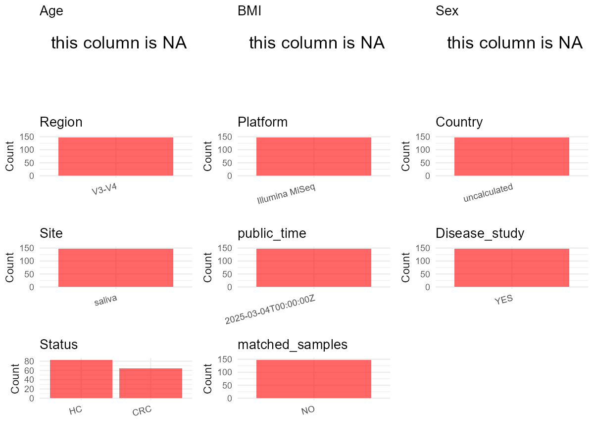

R Notebook: Metadata Processing Workflow
================

# Step 1: Obtain Initial Metadata from Each Project

To obtain the initial metadata: 1. Search for the BioProject ID (e.g.,
“PRJEBXXXX”) on the [NCBI SRA
website](https://www.ncbi.nlm.nih.gov/Traces/study/). 2. In the “Select”
table, click on “Metadata” and download the file. 3. The downloaded file
is typically named “SraRunTable.csv” and contains metadata for the
project.

``` r
# Load necessary libraries
library(dplyr)
library(ggplot2)
library(cowplot)

# Set working directory (update this path to your local directory)
setwd("D:/oral_project/PRJNA1228548")

# Read the initial metadata files
initial_meta<-read.csv("SraRunTable.csv",header = T)

# Combine the two metadata files
#meta <- rbind(initial_meta, initial_meta1)

#Remove entries non-oral samples
#initial_meta <- subset(initial_meta,isolate %in% c("saliva","tongue coat"))

# Check the number of samples containing "HT" in Sample.Name (e.g., healthy controls)
#nrow(subset(meta, grepl("HT", Sample.Name)))

# Display the first few rows of the metadata
head(initial_meta)
```

    ##           Run Assay.Type AvgSpotLen    Bases   BioProject    BioSample
    ## 1 SRR32502001   AMPLICON        602 32140780 PRJNA1228548 SAMN47099604
    ## 2 SRR32502002   AMPLICON        602 31098116 PRJNA1228548 SAMN47099603
    ## 3 SRR32502003   AMPLICON        602 31552626 PRJNA1228548 SAMN47099602
    ## 4 SRR32502004   AMPLICON        602 35454790 PRJNA1228548 SAMN47099601
    ## 5 SRR32502005   AMPLICON        602 37008552 PRJNA1228548 SAMN47099600
    ## 6 SRR32502006   AMPLICON        602 28625702 PRJNA1228548 SAMN47099599
    ##                BioSampleModel    Bytes                         Center.Name
    ## 1 Metagenome or environmental  9991890 RENMIN HOSPITAL OF WUHAN UNIVERSITY
    ## 2 Metagenome or environmental  9786065 RENMIN HOSPITAL OF WUHAN UNIVERSITY
    ## 3 Metagenome or environmental  9761487 RENMIN HOSPITAL OF WUHAN UNIVERSITY
    ## 4 Metagenome or environmental 10984675 RENMIN HOSPITAL OF WUHAN UNIVERSITY
    ## 5 Metagenome or environmental 11475328 RENMIN HOSPITAL OF WUHAN UNIVERSITY
    ## 6 Metagenome or environmental  8850090 RENMIN HOSPITAL OF WUHAN UNIVERSITY
    ##   Collection_Date Consent DATASTORE.filetype DATASTORE.provider
    ## 1         missing  public   fastq,run.zq,sra         gs,ncbi,s3
    ## 2         missing  public   fastq,run.zq,sra         gs,ncbi,s3
    ## 3         missing  public   fastq,run.zq,sra         gs,ncbi,s3
    ## 4         missing  public   fastq,run.zq,sra         gs,ncbi,s3
    ## 5         missing  public   fastq,run.zq,sra         gs,ncbi,s3
    ## 6         missing  public   fastq,run.zq,sra         gs,ncbi,s3
    ##                       DATASTORE.region  Experiment geo_loc_name_country
    ## 1 gs.us-east1,ncbi.public,s3.us-east-1 SRX27814576         uncalculated
    ## 2 gs.us-east1,ncbi.public,s3.us-east-1 SRX27814575         uncalculated
    ## 3 gs.us-east1,ncbi.public,s3.us-east-1 SRX27814574         uncalculated
    ## 4 gs.us-east1,ncbi.public,s3.us-east-1 SRX27814573         uncalculated
    ## 5 gs.us-east1,ncbi.public,s3.us-east-1 SRX27814572         uncalculated
    ## 6 gs.us-east1,ncbi.public,s3.us-east-1 SRX27814571         uncalculated
    ##   geo_loc_name_country_continent geo_loc_name         HOST     Instrument
    ## 1                   uncalculated      missing Homo sapiens Illumina MiSeq
    ## 2                   uncalculated      missing Homo sapiens Illumina MiSeq
    ## 3                   uncalculated      missing Homo sapiens Illumina MiSeq
    ## 4                   uncalculated      missing Homo sapiens Illumina MiSeq
    ## 5                   uncalculated      missing Homo sapiens Illumina MiSeq
    ## 6                   uncalculated      missing Homo sapiens Illumina MiSeq
    ##   isolation_source lat_lon Library.Name LibraryLayout LibrarySelection
    ## 1           saliva missing          H15        PAIRED              PCR
    ## 2           saliva missing          H14        PAIRED              PCR
    ## 3           saliva missing          H13        PAIRED              PCR
    ## 4           saliva missing          H12        PAIRED              PCR
    ## 5           saliva missing          H11        PAIRED              PCR
    ## 6           saliva missing          H10        PAIRED              PCR
    ##   LibrarySource                Organism Platform          ReleaseDate
    ## 1   METAGENOMIC human saliva metagenome ILLUMINA 2025-03-04T00:00:00Z
    ## 2   METAGENOMIC human saliva metagenome ILLUMINA 2025-03-04T00:00:00Z
    ## 3   METAGENOMIC human saliva metagenome ILLUMINA 2025-03-04T00:00:00Z
    ## 4   METAGENOMIC human saliva metagenome ILLUMINA 2025-03-04T00:00:00Z
    ## 5   METAGENOMIC human saliva metagenome ILLUMINA 2025-03-04T00:00:00Z
    ## 6   METAGENOMIC human saliva metagenome ILLUMINA 2025-03-04T00:00:00Z
    ##            create_date version Sample.Name SRA.Study tem
    ## 1 2025-02-26T21:52:00Z       1         H15 SRP566601 100
    ## 2 2025-02-26T21:52:00Z       1         H14 SRP566601  99
    ## 3 2025-02-26T21:52:00Z       1         H13 SRP566601  98
    ## 4 2025-02-26T21:52:00Z       1         H12 SRP566601  97
    ## 5 2025-02-26T21:52:00Z       1         H11 SRP566601  96
    ## 6 2025-02-26T21:52:00Z       1         H10 SRP566601  95

# Step 2: Create a Uniform Metadata Template

The uniform metadata should include the following columns:

1.  **BioProject**: Project ID (e.g., “PRJNA339212”)
2.  **Run**: Sample ID (e.g., “ERRXXXXXX” or “SRRXXXXXX”)
3.  **sample_name**: Original sample name submitted by the authors (not
    the database-assigned ID)
4.  **Age**: Age of the subject (if available)
5.  **BMI**: Body Mass Index (if available)
6.  **Sex**: Sex of the subject (“F” or “M”)
7.  **Region**: Targeted 16S rRNA region (e.g., “V3-V4”)
8.  **Platform**: Sequencing platform (e.g., “Illumina MiSeq”)
9.  **Country**: Country of sample origin (e.g., “China”)
10. **Site**: Sample site (e.g., “saliva”, “dental plaque”)
11. **public_time**: Data release date (format: “YYYY-MM-DD”)
12. **PCR_primers**: PCR primers used (e.g., “515F-806R”)
13. **title**: Title of the associated publication
14. **Disease_study**: Whether the study involves a disease (“YES” or
    “NO”)
15. **Status**: Disease status (e.g., “T2DM”, “HC”). Note: If the study
    includes both disease and healthy samples, this must be specified
    per sample.
16. **matched_samples**: matched samples (“YES” or “NO”)

``` r
# Create a uniform metadata dataframe
metadata <- data.frame(
  BioProject = initial_meta$BioProject,
  Run = initial_meta$Run,
  sample_name = initial_meta$Sample.Name,
  Age = NA,
  BMI = NA,
  Sex = NA,
  Region = "V3-V4",
  Platform = initial_meta$Instrument,
  Country = initial_meta$geo_loc_name_country,
  Site = initial_meta$isolation_source,
  public_time = initial_meta$ReleaseDate,
  stringsAsFactors = FALSE
)
```

# Step 3: Manually Add Information from the Publication

Some information (e.g. PCR primers, study title, disease status) must be
manually extracted from the publication and added to the metadata.

``` r
# Add information obtained from the publication
metadata$PCR_primers <- "TCGTCGGCAGCGTCAGATGTGTATAAGAGACAGCCTACGGGNGGCWGCAG-GTCTCGTGGGCTCGGAGATGTGTATAAGAGACAGGACTACHVGGGTATCTAATCC"
metadata$title <- "Oral Microbiota as Novel Biomarkers for Colorectal Cancer Screening"
metadata$Disease_study <- "YES"
# Assign disease status based on sample_name patterns
metadata <- metadata %>%
  mutate(Status = case_when(
    grepl("H|A", sample_name) ~ "HC",
    grepl("C", sample_name) ~ "CRC"
  ))

#get subjects id according to sample id
metadata$sample_name<-gsub("","",metadata$sample_name)
#get subjects id with Saliva available
keep_subjects<-subset(metadata,Site %in% "saliva")
#remove subjects without Saliva samples
metadata<-subset(metadata,sample_name %in% keep_subjects$sample_name)
#get subjects sampling counts
sample_counts <- table(metadata$sample_name)
# Create matched_samples column, any subjects have >=2 samples will be label "YES", otherwise "NO"
metadata$matched_samples <- ifelse(metadata$sample_name %in% names(sample_counts[sample_counts >= 2]), "YES", "NO")
```

# Step 4: Summarize and Validate the Metadata

``` r
# Check the number of unique runs and sample names
print(paste("Number of unique runs:", length(unique(metadata$Run))))
```

    ## [1] "Number of unique runs: 148"

``` r
print(paste("Number of unique sample names:", length(unique(metadata$sample_name))))
```

    ## [1] "Number of unique sample names: 148"

# Step 5: Visualize the Metadata

``` r

```


# Step 6: Finalize and Export the Metadata

``` r
# Reorder columns to match the desired format
metadata <- metadata[, c(
  "BioProject", "Run", "sample_name", "Age", "BMI", "Sex", 
  "Region", "Platform", "Country", "Site", "public_time", 
  "PCR_primers", "title", "Disease_study", "Status","matched_samples"
)]

# Export the uniform metadata to a CSV file
write.csv(metadata, file = "metadata.csv", quote = TRUE)
head(metadata)
```

    ##     BioProject         Run sample_name Age BMI Sex Region       Platform
    ## 1 PRJNA1228548 SRR32502001         H15  NA  NA  NA  V3-V4 Illumina MiSeq
    ## 2 PRJNA1228548 SRR32502002         H14  NA  NA  NA  V3-V4 Illumina MiSeq
    ## 3 PRJNA1228548 SRR32502003         H13  NA  NA  NA  V3-V4 Illumina MiSeq
    ## 4 PRJNA1228548 SRR32502004         H12  NA  NA  NA  V3-V4 Illumina MiSeq
    ## 5 PRJNA1228548 SRR32502005         H11  NA  NA  NA  V3-V4 Illumina MiSeq
    ## 6 PRJNA1228548 SRR32502006         H10  NA  NA  NA  V3-V4 Illumina MiSeq
    ##        Country   Site          public_time
    ## 1 uncalculated saliva 2025-03-04T00:00:00Z
    ## 2 uncalculated saliva 2025-03-04T00:00:00Z
    ## 3 uncalculated saliva 2025-03-04T00:00:00Z
    ## 4 uncalculated saliva 2025-03-04T00:00:00Z
    ## 5 uncalculated saliva 2025-03-04T00:00:00Z
    ## 6 uncalculated saliva 2025-03-04T00:00:00Z
    ##                                                                                                  PCR_primers
    ## 1 TCGTCGGCAGCGTCAGATGTGTATAAGAGACAGCCTACGGGNGGCWGCAG-GTCTCGTGGGCTCGGAGATGTGTATAAGAGACAGGACTACHVGGGTATCTAATCC
    ## 2 TCGTCGGCAGCGTCAGATGTGTATAAGAGACAGCCTACGGGNGGCWGCAG-GTCTCGTGGGCTCGGAGATGTGTATAAGAGACAGGACTACHVGGGTATCTAATCC
    ## 3 TCGTCGGCAGCGTCAGATGTGTATAAGAGACAGCCTACGGGNGGCWGCAG-GTCTCGTGGGCTCGGAGATGTGTATAAGAGACAGGACTACHVGGGTATCTAATCC
    ## 4 TCGTCGGCAGCGTCAGATGTGTATAAGAGACAGCCTACGGGNGGCWGCAG-GTCTCGTGGGCTCGGAGATGTGTATAAGAGACAGGACTACHVGGGTATCTAATCC
    ## 5 TCGTCGGCAGCGTCAGATGTGTATAAGAGACAGCCTACGGGNGGCWGCAG-GTCTCGTGGGCTCGGAGATGTGTATAAGAGACAGGACTACHVGGGTATCTAATCC
    ## 6 TCGTCGGCAGCGTCAGATGTGTATAAGAGACAGCCTACGGGNGGCWGCAG-GTCTCGTGGGCTCGGAGATGTGTATAAGAGACAGGACTACHVGGGTATCTAATCC
    ##                                                                 title
    ## 1 Oral Microbiota as Novel Biomarkers for Colorectal Cancer Screening
    ## 2 Oral Microbiota as Novel Biomarkers for Colorectal Cancer Screening
    ## 3 Oral Microbiota as Novel Biomarkers for Colorectal Cancer Screening
    ## 4 Oral Microbiota as Novel Biomarkers for Colorectal Cancer Screening
    ## 5 Oral Microbiota as Novel Biomarkers for Colorectal Cancer Screening
    ## 6 Oral Microbiota as Novel Biomarkers for Colorectal Cancer Screening
    ##   Disease_study Status matched_samples
    ## 1           YES     HC              NO
    ## 2           YES     HC              NO
    ## 3           YES     HC              NO
    ## 4           YES     HC              NO
    ## 5           YES     HC              NO
    ## 6           YES     HC              NO

## Notes for Students:

1.  **Metadata Accuracy**: Always cross-check the metadata with the
    original publication to ensure accuracy.
2.  **Manual Entries**: Columns like `PCR_primers`, and `Status` often
    require manual entry based on the publication.
3.  **Disease Status**: Be careful when assigning `Status`—some studies
    include both disease and healthy samples.
4.  **Visualization**: The plots help quickly identify the distribution
    of values in each column, which is useful for quality control.
5.  **Reproducibility**: Update the working directory and file paths to
    match your local environment.
