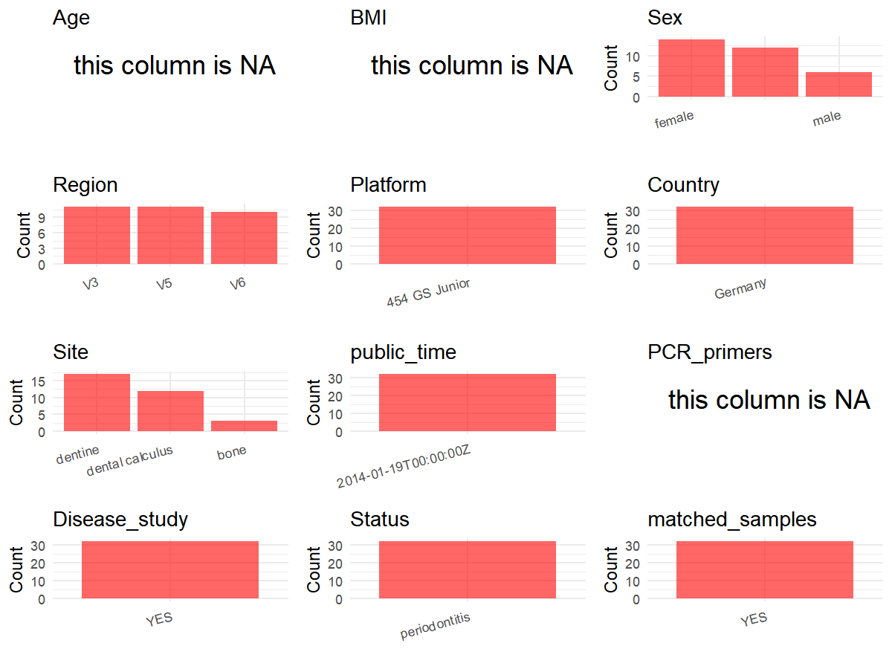

R Notebook: Metadata Processing Workflow
================

# Step 1: Obtain Initial Metadata from Each Project

To obtain the initial metadata: 1. Search for the BioProject ID (e.g.,
“PRJEBXXXX”) on the [NCBI SRA
website](https://www.ncbi.nlm.nih.gov/Traces/study/). 2. In the “Select”
table, click on “Metadata” and download the file. 3. The downloaded file
is typically named “SraRunTable.csv” and contains metadata for the
project.

``` r
# Load necessary libraries
library(dplyr)
library(ggplot2)
library(cowplot)

# Set working directory (update this path to your local directory)
setwd("D:/metadata/3/PRJNA216965")

# Read the initial metadata files
initial_meta<-read.csv("SraRunTable.csv",header = T)

# Combine the two metadata files
#meta <- rbind(initial_meta, initial_meta1)

#Remove entries non-oral samples

initial_meta <- initial_meta %>% 
  filter(!grepl("-Shot-", Sample.Name))

# Check the number of samples containing "HT" in Sample.Name (e.g., healthy controls)
#nrow(subset(meta, grepl("HT", Sample.Name)))

# Display the first few rows of the metadata
head(initial_meta)
```

    ##         Run Assay.Type AvgSpotLen   Bases           BIOME  BioProject
    ## 1 SRR986772   AMPLICON        224 1379528 dental calculus PRJNA216965
    ## 2 SRR986773   AMPLICON        184  988649 dental calculus PRJNA216965
    ## 3 SRR986774   AMPLICON        184 1100445 dental calculus PRJNA216965
    ## 4 SRR986775   AMPLICON        172 1063819 dental calculus PRJNA216965
    ## 5 SRR986776   AMPLICON        229 1526311         dentine PRJNA216965
    ## 6 SRR986777   AMPLICON        228 1337722         dentine PRJNA216965
    ##      BioSample                       BioSampleModel   Bytes
    ## 1 SAMN02333703 MIMS.me,MIGS/MIMS/MIMARKS.human-oral 3059443
    ## 2 SAMN02333704 MIMS.me,MIGS/MIMS/MIMARKS.human-oral 2321577
    ## 3 SAMN02333707 MIMS.me,MIGS/MIMS/MIMARKS.human-oral 2981614
    ## 4 SAMN02333708 MIMS.me,MIGS/MIMS/MIMARKS.human-oral 2956243
    ## 5 SAMN02333715 MIMS.me,MIGS/MIMS/MIMARKS.human-oral 3311882
    ## 6 SAMN02333716 MIMS.me,MIGS/MIMS/MIMARKS.human-oral 3290383
    ##              Center.Name Collection_Date Consent DATASTORE.filetype
    ## 1 UNIVERSITY OF OKLAHOMA         10/4/11  public     run.zq,sff,sra
    ## 2 UNIVERSITY OF OKLAHOMA         10/4/11  public     run.zq,sff,sra
    ## 3 UNIVERSITY OF OKLAHOMA         10/4/11  public     run.zq,sff,sra
    ## 4 UNIVERSITY OF OKLAHOMA         10/4/11  public     run.zq,sff,sra
    ## 5 UNIVERSITY OF OKLAHOMA         10/4/11  public     run.zq,sff,sra
    ## 6 UNIVERSITY OF OKLAHOMA         10/4/11  public     run.zq,sff,sra
    ##   DATASTORE.provider                     DATASTORE.region
    ## 1         gs,ncbi,s3 gs.us-east1,ncbi.public,s3.us-east-1
    ## 2         gs,ncbi,s3 gs.us-east1,ncbi.public,s3.us-east-1
    ## 3         gs,ncbi,s3 gs.us-east1,ncbi.public,s3.us-east-1
    ## 4         gs,ncbi,s3 gs.us-east1,ncbi.public,s3.us-east-1
    ## 5         gs,ncbi,s3 gs.us-east1,ncbi.public,s3.us-east-1
    ## 6         gs,ncbi,s3 gs.us-east1,ncbi.public,s3.us-east-1
    ##                    env_package Experiment  feature geo_loc_name_country
    ## 1 MIGS/MIMS/MIMARKS.human-oral  SRX351236 cemetery              Germany
    ## 2 MIGS/MIMS/MIMARKS.human-oral  SRX351237 cemetery              Germany
    ## 3 MIGS/MIMS/MIMARKS.human-oral  SRX351238 cemetery              Germany
    ## 4 MIGS/MIMS/MIMARKS.human-oral  SRX351239 cemetery              Germany
    ## 5 MIGS/MIMS/MIMARKS.human-oral  SRX351240 cemetery              Germany
    ## 6 MIGS/MIMS/MIMARKS.human-oral  SRX351241 cemetery              Germany
    ##   geo_loc_name_country_continent geo_loc_name  Host_disease    Instrument
    ## 1                         Europe      Germany periodontitis 454 GS Junior
    ## 2                         Europe      Germany periodontitis 454 GS Junior
    ## 3                         Europe      Germany periodontitis 454 GS Junior
    ## 4                         Europe      Germany periodontitis 454 GS Junior
    ## 5                         Europe      Germany periodontitis 454 GS Junior
    ## 6                         Europe      Germany periodontitis 454 GS Junior
    ##   investigation_type              isolate Label                lat_lon
    ## 1         metagenome Dalheim G12 skeleton   G12 51.565093 N 8.849015 E
    ## 2         metagenome Dalheim G12 skeleton   G12 51.565093 N 8.849015 E
    ## 3         metagenome Dalheim B61 skeleton   B61 51.565093 N 8.849015 E
    ## 4         metagenome Dalheim B61 skeleton   B61 51.565093 N 8.849015 E
    ## 5         metagenome Dalheim G12 skeleton   G12 51.565093 N 8.849015 E
    ## 6         metagenome Dalheim G12 skeleton   G12 51.565093 N 8.849015 E
    ##   LibraryLayout LibrarySelection LibrarySource material              Organism
    ## 1        SINGLE              PCR   METAGENOMIC     soil human oral metagenome
    ## 2        SINGLE              PCR   METAGENOMIC     soil human oral metagenome
    ## 3        SINGLE              PCR   METAGENOMIC     soil human oral metagenome
    ## 4        SINGLE              PCR   METAGENOMIC     soil human oral metagenome
    ## 5        SINGLE              PCR   METAGENOMIC     soil human oral metagenome
    ## 6        SINGLE              PCR   METAGENOMIC     soil human oral metagenome
    ##   Platform                               project_name          ReleaseDate
    ## 1    LS454 Analysis of archaeological dental calculus 2014-01-19T00:00:00Z
    ## 2    LS454 Analysis of archaeological dental calculus 2014-01-19T00:00:00Z
    ## 3    LS454 Analysis of archaeological dental calculus 2014-01-19T00:00:00Z
    ## 4    LS454 Analysis of archaeological dental calculus 2014-01-19T00:00:00Z
    ## 5    LS454 Analysis of archaeological dental calculus 2014-01-19T00:00:00Z
    ## 6    LS454 Analysis of archaeological dental calculus 2014-01-19T00:00:00Z
    ##            create_date version           Sample.Name specific_host SRA.Study
    ## 1 2013-09-13T15:32:00Z       1      S8-V3-E-G12-calc  Homo sapiens SRP029257
    ## 2 2013-09-13T15:32:00Z       1      S8-V5-O-G12-calc  Homo sapiens SRP029257
    ## 3 2013-09-13T15:32:00Z       1     S10-V5-Q-B61-calc  Homo sapiens SRP029257
    ## 4 2013-09-13T15:32:00Z       1    S10-V6-AA-B61-calc  Homo sapiens SRP029257
    ## 5 2013-09-13T15:32:00Z       1 S16S17-V3-A1-G12-root  Homo sapiens SRP029257
    ## 6 2013-09-13T15:32:00Z       1 S16S17-V3-A2-G12-root  Homo sapiens SRP029257
    ##              misc_param host_sex
    ## 1      S8-V3-E-G12-calc   female
    ## 2      S8-V5-O-G12-calc   female
    ## 3     S10-V5-Q-B61-calc     male
    ## 4    S10-V6-AA-B61-calc     male
    ## 5 S16S17-V3-A1-G12-root   female
    ## 6 S16S17-V3-A2-G12-root   female

# Step 2: Create a Uniform Metadata Template

The uniform metadata should include the following columns:

1.  **BioProject**: Project ID (e.g., “PRJNA339212”)
2.  **Run**: Sample ID (e.g., “ERRXXXXXX” or “SRRXXXXXX”)
3.  **sample_name**: Original sample name submitted by the authors (not
    the database-assigned ID)
4.  **Age**: Age of the subject (if available)
5.  **BMI**: Body Mass Index (if available)
6.  **Sex**: Sex of the subject (“F” or “M”)
7.  **Region**: Targeted 16S rRNA region (e.g., “V3-V4”)
8.  **Platform**: Sequencing platform (e.g., “Illumina MiSeq”)
9.  **Country**: Country of sample origin (e.g., “China”)
10. **Site**: Sample site (e.g., “saliva”, “dental plaque”)
11. **public_time**: Data release date (format: “YYYY-MM-DD”)
12. **PCR_primers**: PCR primers used (e.g., “515F-806R”)
13. **title**: Title of the associated publication
14. **Disease_study**: Whether the study involves a disease (“YES” or
    “NO”)
15. **Status**: Disease status (e.g., “T2DM”, “HC”). Note: If the study
    includes both disease and healthy samples, this must be specified
    per sample.
16. **matched_samples**: matched samples (“YES” or “NO”)

``` r
# Create a uniform metadata dataframe
metadata <- data.frame(
  BioProject = initial_meta$BioProject,
  Run = initial_meta$Run,
  sample_name = initial_meta$Sample.Name,
  Age = NA,
  BMI = NA,
  Sex = dplyr::coalesce(initial_meta$host_sex, NA_character_),
  #Region = "V1-V2",
  Platform = initial_meta$Instrument,
  Country = initial_meta$geo_loc_name_country,
  Site = initial_meta$BIOME,
  public_time = initial_meta$ReleaseDate,
  Status = initial_meta$Host_disease,
  PCR_primers = NA,
  stringsAsFactors = FALSE
)
```

# Step 3: Manually Add Information from the Publication

Some information (e.g. PCR primers, study title, disease status) must be
manually extracted from the publication and added to the metadata.

``` r
# Add information obtained from the publication
metadata$Region <- (
  initial_meta$Sample.Name %>%
    gsub(".*-(V\\d+).*", "\\1", .) %>%
    ifelse(grepl("^V\\d+$", .), ., NA_character_)
)
#metadata$PCR_primers <- "27F-338R"
metadata$title <- "Pathogens and host immunity in the ancient human oral cavity"
metadata$Disease_study <- "YES"
# Assign disease status based on sample_name patterns
#metadata <- metadata %>%
#  mutate(Status = case_when(
#    initial_meta$Sample.Name == "Oral mucosa of healthy patients" ~ "H",
#    initial_meta$Sample.Name %in% c("Oral mucosa from affected regions of oral lichen planus patients", "Bacterial community associated with the unaffected regions from oral mucosa of Oral Lichen Planus patients") ~ "OLP"
#  ))

label_cnt <- table(initial_meta$Label)


metadata$matched_samples <- ifelse(label_cnt[initial_meta$Label] >= 2, "YES", "NO")
#metadata$matched_samples <- "NO"
```

# Step 4: Summarize and Validate the Metadata

``` r
# Check the number of unique runs and sample names
print(paste("Number of unique runs:", length(unique(metadata$Run))))
```

    ## [1] "Number of unique runs: 32"

``` r
print(paste("Number of unique sample names:", length(unique(metadata$sample_name))))
```

    ## [1] "Number of unique sample names: 32"

# Step 5: Visualize the Metadata

``` r

```

<!-- -->

# Step 6: Finalize and Export the Metadata

``` r
# Reorder columns to match the desired format
metadata <- metadata[, c(
  "BioProject", "Run", "sample_name", "Age", "BMI", "Sex", 
  "Region", "Platform", "Country", "Site", "public_time", 
  "PCR_primers", "title", "Disease_study", "Status","matched_samples"
)]

# Export the uniform metadata to a CSV file
write.csv(metadata, file = "metadata.csv", quote = TRUE)
head(metadata)
```

    ##    BioProject       Run           sample_name Age BMI    Sex Region
    ## 1 PRJNA216965 SRR986772      S8-V3-E-G12-calc  NA  NA female     V3
    ## 2 PRJNA216965 SRR986773      S8-V5-O-G12-calc  NA  NA female     V5
    ## 3 PRJNA216965 SRR986774     S10-V5-Q-B61-calc  NA  NA   male     V5
    ## 4 PRJNA216965 SRR986775    S10-V6-AA-B61-calc  NA  NA   male     V6
    ## 5 PRJNA216965 SRR986776 S16S17-V3-A1-G12-root  NA  NA female     V3
    ## 6 PRJNA216965 SRR986777 S16S17-V3-A2-G12-root  NA  NA female     V3
    ##        Platform Country            Site          public_time PCR_primers
    ## 1 454 GS Junior Germany dental calculus 2014-01-19T00:00:00Z          NA
    ## 2 454 GS Junior Germany dental calculus 2014-01-19T00:00:00Z          NA
    ## 3 454 GS Junior Germany dental calculus 2014-01-19T00:00:00Z          NA
    ## 4 454 GS Junior Germany dental calculus 2014-01-19T00:00:00Z          NA
    ## 5 454 GS Junior Germany         dentine 2014-01-19T00:00:00Z          NA
    ## 6 454 GS Junior Germany         dentine 2014-01-19T00:00:00Z          NA
    ##                                                          title Disease_study
    ## 1 Pathogens and host immunity in the ancient human oral cavity           YES
    ## 2 Pathogens and host immunity in the ancient human oral cavity           YES
    ## 3 Pathogens and host immunity in the ancient human oral cavity           YES
    ## 4 Pathogens and host immunity in the ancient human oral cavity           YES
    ## 5 Pathogens and host immunity in the ancient human oral cavity           YES
    ## 6 Pathogens and host immunity in the ancient human oral cavity           YES
    ##          Status matched_samples
    ## 1 periodontitis             YES
    ## 2 periodontitis             YES
    ## 3 periodontitis             YES
    ## 4 periodontitis             YES
    ## 5 periodontitis             YES
    ## 6 periodontitis             YES

## Notes for Students:

1.  **Metadata Accuracy**: Always cross-check the metadata with the
    original publication to ensure accuracy.
2.  **Manual Entries**: Columns like `PCR_primers`, and `Status` often
    require manual entry based on the publication.
3.  **Disease Status**: Be careful when assigning `Status`—some studies
    include both disease and healthy samples.
4.  **Visualization**: The plots help quickly identify the distribution
    of values in each column, which is useful for quality control.
5.  **Reproducibility**: Update the working directory and file paths to
    match your local environment.
