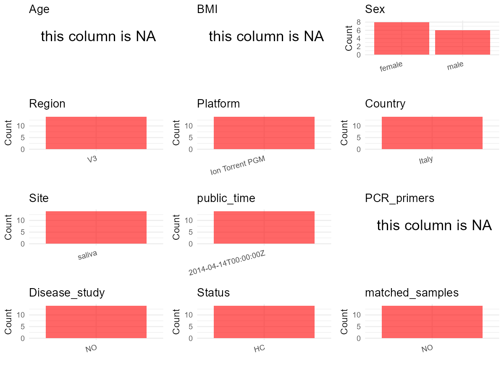

R Notebook: Metadata Processing Workflow
================

# Step 1: Obtain Initial Metadata from Each Project

To obtain the initial metadata: 1. Search for the BioProject ID (e.g.,
“PRJEBXXXX”) on the [NCBI SRA
website](https://www.ncbi.nlm.nih.gov/Traces/study/). 2. In the “Select”
table, click on “Metadata” and download the file. 3. The downloaded file
is typically named “SraRunTable.csv” and contains metadata for the
project.

``` r
# Load necessary libraries
library(dplyr)
library(ggplot2)
library(cowplot)

# Set working directory (update this path to your local directory)
setwd("D:/studylearning/董彪师兄项目/任务4_20251009/PRJNA227796")

# Read the initial metadata files
initial_meta<-read.csv("SraRunTable.csv",header = T)

# Display the first few rows of the metadata
head(initial_meta)
```

    ##          Run Assay.Type AvgSpotLen    Bases       BIOME  BioProject
    ## 1 SRR1030264   AMPLICON        169 33392532 urban biome PRJNA227796
    ## 2 SRR1030265   AMPLICON        167 35074267 urban biome PRJNA227796
    ## 3 SRR1030266   AMPLICON        154 29758334 urban biome PRJNA227796
    ## 4 SRR1030259   AMPLICON        160 45706193 urban biome PRJNA227796
    ## 5 SRR1030260   AMPLICON        166 56243240 urban biome PRJNA227796
    ## 6 SRR1030261   AMPLICON        157 39006592 urban biome PRJNA227796
    ##      BioSample                       BioSampleModel    Bytes
    ## 1 SAMN02402861 MIMS.me,MIGS/MIMS/MIMARKS.human-oral 27482956
    ## 2 SAMN02402862 MIMS.me,MIGS/MIMS/MIMARKS.human-oral 28779272
    ## 3 SAMN02402863 MIMS.me,MIGS/MIMS/MIMARKS.human-oral 24479148
    ## 4 SAMN02402857 MIMS.me,MIGS/MIMS/MIMARKS.human-oral 37651988
    ## 5 SAMN02402858 MIMS.me,MIGS/MIMS/MIMARKS.human-oral 45995596
    ## 6 SAMN02402859 MIMS.me,MIGS/MIMS/MIMARKS.human-oral 32120141
    ##                    Center.Name Collection_Date Consent DATASTORE.filetype
    ## 1 CIBIO - UNIVERSITY OF TRENTO      2013-10-23  public   fastq,run.zq,sra
    ## 2 CIBIO - UNIVERSITY OF TRENTO      2013-10-23  public   fastq,run.zq,sra
    ## 3 CIBIO - UNIVERSITY OF TRENTO      2013-10-23  public   fastq,run.zq,sra
    ## 4 CIBIO - UNIVERSITY OF TRENTO      2013-10-23  public   fastq,run.zq,sra
    ## 5 CIBIO - UNIVERSITY OF TRENTO      2013-10-23  public   fastq,run.zq,sra
    ## 6 CIBIO - UNIVERSITY OF TRENTO      2013-10-23  public   fastq,run.zq,sra
    ##   DATASTORE.provider                     DATASTORE.region
    ## 1         gs,ncbi,s3 gs.us-east1,ncbi.public,s3.us-east-1
    ## 2         gs,ncbi,s3 gs.us-east1,ncbi.public,s3.us-east-1
    ## 3         gs,ncbi,s3 gs.us-east1,ncbi.public,s3.us-east-1
    ## 4         gs,ncbi,s3 gs.us-east1,ncbi.public,s3.us-east-1
    ## 5         gs,ncbi,s3 gs.us-east1,ncbi.public,s3.us-east-1
    ## 6         gs,ncbi,s3 gs.us-east1,ncbi.public,s3.us-east-1
    ##                    env_package Experiment         feature geo_loc_name_country
    ## 1 MIGS/MIMS/MIMARKS.human-oral  SRX377911 organic feature                Italy
    ## 2 MIGS/MIMS/MIMARKS.human-oral  SRX377913 organic feature                Italy
    ## 3 MIGS/MIMS/MIMARKS.human-oral  SRX377914 organic feature                Italy
    ## 4 MIGS/MIMS/MIMARKS.human-oral  SRX377907 organic feature                Italy
    ## 5 MIGS/MIMS/MIMARKS.human-oral  SRX377908 organic feature                Italy
    ## 6 MIGS/MIMS/MIMARKS.human-oral  SRX377909 organic feature                Italy
    ##   geo_loc_name_country_continent  geo_loc_name host_sex      Instrument
    ## 1                         Europe Italy: Trento     male Ion Torrent PGM
    ## 2                         Europe Italy: Trento     male Ion Torrent PGM
    ## 3                         Europe Italy: Trento     male Ion Torrent PGM
    ## 4                         Europe Italy: Trento     male Ion Torrent PGM
    ## 5                         Europe Italy: Trento     male Ion Torrent PGM
    ## 6                         Europe Italy: Trento   female Ion Torrent PGM
    ##   investigation_type    label             lat_lon Library.Name LibraryLayout
    ## 1         metagenome     Lima 46.0793 N 11.1302 E          16S        SINGLE
    ## 2         metagenome     Mike 46.0793 N 11.1302 E          16S        SINGLE
    ## 3         metagenome November 46.0793 N 11.1302 E          16S        SINGLE
    ## 4         metagenome    Hotel 46.0793 N 11.1302 E          16S        SINGLE
    ## 5         metagenome    India 46.0793 N 11.1302 E          16S        SINGLE
    ## 6         metagenome   Juliet 46.0793 N 11.1302 E          16S        SINGLE
    ##   LibrarySelection LibrarySource material              Organism    Platform
    ## 1              PCR   METAGENOMIC   saliva human oral metagenome ION_TORRENT
    ## 2              PCR   METAGENOMIC   saliva human oral metagenome ION_TORRENT
    ## 3              PCR   METAGENOMIC   saliva human oral metagenome ION_TORRENT
    ## 4              PCR   METAGENOMIC   saliva human oral metagenome ION_TORRENT
    ## 5              PCR   METAGENOMIC   saliva human oral metagenome ION_TORRENT
    ## 6              PCR   METAGENOMIC   saliva human oral metagenome ION_TORRENT
    ##        project_name          ReleaseDate          create_date version
    ## 1 Saliva Microbiome 2014-04-14T00:00:00Z 2013-11-15T11:08:00Z       1
    ## 2 Saliva Microbiome 2014-04-14T00:00:00Z 2013-11-15T11:08:00Z       1
    ## 3 Saliva Microbiome 2014-04-14T00:00:00Z 2013-11-15T11:08:00Z       1
    ## 4 Saliva Microbiome 2014-04-14T00:00:00Z 2013-11-15T11:04:00Z       1
    ## 5 Saliva Microbiome 2014-04-14T00:00:00Z 2013-11-15T11:04:00Z       1
    ## 6 Saliva Microbiome 2014-04-14T00:00:00Z 2013-11-15T11:04:00Z       1
    ##   Sample.Name specific_host SRA.Study
    ## 1        Lima  Homo sapiens SRP033022
    ## 2        Mike  Homo sapiens SRP033022
    ## 3    November  Homo sapiens SRP033022
    ## 4       Hotel  Homo sapiens SRP033022
    ## 5       India  Homo sapiens SRP033022
    ## 6      Juliet  Homo sapiens SRP033022

# Step 2: Create a Uniform Metadata Template

The uniform metadata should include the following columns:

1.  **BioProject**: Project ID (e.g., “PRJNA339212”)
2.  **Run**: Sample ID (e.g., “ERRXXXXXX” or “SRRXXXXXX”)
3.  **sample_name**: Original sample name submitted by the authors (not
    the database-assigned ID)
4.  **Age**: Age of the subject (if available)
5.  **BMI**: Body Mass Index (if available)
6.  **Sex**: Sex of the subject (“F” or “M”)
7.  **Region**: Targeted 16S rRNA region (e.g., “V3-V4”)
8.  **Platform**: Sequencing platform (e.g., “Illumina MiSeq”)
9.  **Country**: Country of sample origin (e.g., “China”)
10. **Site**: Sample site (e.g., “saliva”, “dental plaque”)
11. **public_time**: Data release date (format: “YYYY-MM-DD”)
12. **PCR_primers**: PCR primers used (e.g., “515F-806R”)
13. **title**: Title of the associated publication
14. **Disease_study**: Whether the study involves a disease (“YES” or
    “NO”)
15. **Status**: Disease status (e.g., “T2DM”, “HC”). Note: If the study
    includes both disease and healthy samples, this must be specified
    per sample.

``` r
# Create a uniform metadata dataframe
metadata <- data.frame(
  BioProject = initial_meta$BioProject,
  Run = initial_meta$Run,
  sample_name = initial_meta$Sample.Name,
  Age = NA,
  BMI = NA,
  Sex= initial_meta$host_sex,
  Region = "V3",
  Platform = initial_meta$Instrument,
  Country = initial_meta$geo_loc_name_country,
  Site = initial_meta$material,
  public_time = initial_meta$ReleaseDate,
  stringsAsFactors = FALSE
)
```

# Step 3: Manually Add Information from the Publication

Some information (e.g. PCR primers, study title, disease status) must be
manually extracted from the publication and added to the metadata.

``` r
# Add information obtained from the publication
metadata$PCR_primers <- NA_character_  # Update based on the publication
metadata$title <- "Enhanced microbial diversity in the saliva microbiome induced by short-term probiotic intake revealed by 16S rRNA sequencing on the IonTorrent PGM platform"
metadata$Disease_study <- "NO"
metadata$Status <- "HC"

#extract subject id by remove prefix of sample_name
#metadata$sample_name <- gsub("_st|_sal", "", metadata$sample_name)

# Check initial data distribution
cat("Initial sample distribution:\n")
```

    ## Initial sample distribution:

``` r
table(metadata$sample_name)
```

    ## 
    ##    Alpha    Bravo  Charlie    Delta     Echo  Foxtrot     Golf    Hotel 
    ##        1        1        1        1        1        1        1        1 
    ##    India   Juliet     Kilo     Lima     Mike November 
    ##        1        1        1        1        1        1

``` r
table(metadata$Site)
```

    ## 
    ## saliva 
    ##     14

``` r
# Calculate sampling frequency per subject
sample_counts <- table(metadata$sample_name)
cat("\nNumber of samples per subject:\n")
```

    ## 
    ## Number of samples per subject:

``` r
print(sample_counts)
```

    ## 
    ##    Alpha    Bravo  Charlie    Delta     Echo  Foxtrot     Golf    Hotel 
    ##        1        1        1        1        1        1        1        1 
    ##    India   Juliet     Kilo     Lima     Mike November 
    ##        1        1        1        1        1        1

``` r
# Create matched_samples column
metadata$matched_samples <- ifelse(metadata$sample_name %in% names(sample_counts[sample_counts >= 2]), "YES", "NO")

cat("\nMatched samples distribution:\n")
```

    ## 
    ## Matched samples distribution:

``` r
table(metadata$matched_samples)
```

    ## 
    ## NO 
    ## 14

``` r
# Identify samples for removal: single samples excluding saliva
single_samples <- names(sample_counts[sample_counts == 1])
samples_to_remove <- metadata$sample_name %in% single_samples & !(metadata$Site %in% c("saliva"))

cat("\nNumber of samples to be removed:", sum(samples_to_remove), "\n")
```

    ## 
    ## Number of samples to be removed: 0

``` r
# Remove identified samples
metadata_clean <- metadata[!samples_to_remove, ]

cat("\nFinal sample distribution after cleaning:\n")
```

    ## 
    ## Final sample distribution after cleaning:

``` r
table(metadata_clean$sample_name)
```

    ## 
    ##    Alpha    Bravo  Charlie    Delta     Echo  Foxtrot     Golf    Hotel 
    ##        1        1        1        1        1        1        1        1 
    ##    India   Juliet     Kilo     Lima     Mike November 
    ##        1        1        1        1        1        1

``` r
table(metadata_clean$Site)
```

    ## 
    ## saliva 
    ##     14

``` r
table(metadata_clean$matched_samples)
```

    ## 
    ## NO 
    ## 14

``` r
# Use cleaned dataset for subsequent analysis
metadata <- metadata_clean
```

# Step 4: Summarize and Validate the Metadata

``` r
# Check the number of unique runs and sample names
print(paste("Number of unique runs:", length(unique(metadata$Run))))
```

    ## [1] "Number of unique runs: 14"

``` r
print(paste("Number of unique sample names:", length(unique(metadata$sample_name))))
```

    ## [1] "Number of unique sample names: 14"

# Step 5: Visualize the Metadata

``` r

```


# Step 6: Finalize and Export the Metadata

``` r
# Reorder columns to match the desired format
metadata <- metadata[, c(
  "BioProject", "Run", "sample_name", "Age", "BMI", "Sex", 
  "Region", "Platform", "Country", "Site", "public_time", 
  "PCR_primers", "title", "Disease_study", "Status","matched_samples"
)]

# Export the uniform metadata to a CSV file
write.csv(metadata, file = "metadata.csv", quote = FALSE)
head(metadata)
```

    ##    BioProject        Run sample_name Age BMI    Sex Region        Platform
    ## 1 PRJNA227796 SRR1030264        Lima  NA  NA   male     V3 Ion Torrent PGM
    ## 2 PRJNA227796 SRR1030265        Mike  NA  NA   male     V3 Ion Torrent PGM
    ## 3 PRJNA227796 SRR1030266    November  NA  NA   male     V3 Ion Torrent PGM
    ## 4 PRJNA227796 SRR1030259       Hotel  NA  NA   male     V3 Ion Torrent PGM
    ## 5 PRJNA227796 SRR1030260       India  NA  NA   male     V3 Ion Torrent PGM
    ## 6 PRJNA227796 SRR1030261      Juliet  NA  NA female     V3 Ion Torrent PGM
    ##   Country   Site          public_time PCR_primers
    ## 1   Italy saliva 2014-04-14T00:00:00Z        <NA>
    ## 2   Italy saliva 2014-04-14T00:00:00Z        <NA>
    ## 3   Italy saliva 2014-04-14T00:00:00Z        <NA>
    ## 4   Italy saliva 2014-04-14T00:00:00Z        <NA>
    ## 5   Italy saliva 2014-04-14T00:00:00Z        <NA>
    ## 6   Italy saliva 2014-04-14T00:00:00Z        <NA>
    ##                                                                                                                                                         title
    ## 1 Enhanced microbial diversity in the saliva microbiome induced by short-term probiotic intake revealed by 16S rRNA sequencing on the IonTorrent PGM platform
    ## 2 Enhanced microbial diversity in the saliva microbiome induced by short-term probiotic intake revealed by 16S rRNA sequencing on the IonTorrent PGM platform
    ## 3 Enhanced microbial diversity in the saliva microbiome induced by short-term probiotic intake revealed by 16S rRNA sequencing on the IonTorrent PGM platform
    ## 4 Enhanced microbial diversity in the saliva microbiome induced by short-term probiotic intake revealed by 16S rRNA sequencing on the IonTorrent PGM platform
    ## 5 Enhanced microbial diversity in the saliva microbiome induced by short-term probiotic intake revealed by 16S rRNA sequencing on the IonTorrent PGM platform
    ## 6 Enhanced microbial diversity in the saliva microbiome induced by short-term probiotic intake revealed by 16S rRNA sequencing on the IonTorrent PGM platform
    ##   Disease_study Status matched_samples
    ## 1            NO     HC              NO
    ## 2            NO     HC              NO
    ## 3            NO     HC              NO
    ## 4            NO     HC              NO
    ## 5            NO     HC              NO
    ## 6            NO     HC              NO

## Notes for Students:

1.  **Metadata Accuracy**: Always cross-check the metadata with the
    original publication to ensure accuracy.
2.  **Manual Entries**: Columns like `PCR_primers`, and `Status` often
    require manual entry based on the publication.
3.  **Disease Status**: Be careful when assigning `Status`—some studies
    include both disease and healthy samples.
4.  **Visualization**: The plots help quickly identify the distribution
    of values in each column, which is useful for quality control.
5.  **Reproducibility**: Update the working directory and file paths to
    match your local environment.
