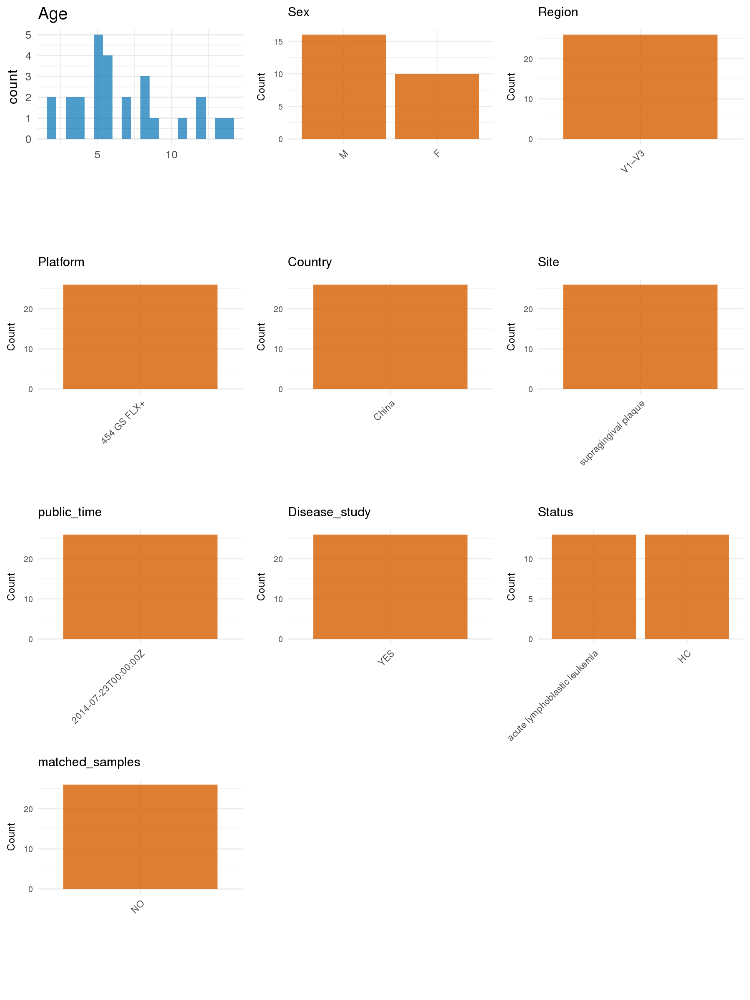

# Step 1: Obtain Initial Metadata from Each Project

This step sets the project directory, loads the raw SRA metadata, and merges the supplemental subject table.

```{r message=FALSE, warning=FALSE}
# Load libraries
library(dplyr)
library(ggplot2)
library(cowplot)

# (1) Setting working directory
project_id <- "PRJNA232543"

base_dir <- "E:/工作区/VSCode/RNAproject/collect_metadata_respon/project"
setwd(file.path(base_dir, project_id))

# (2) Loading raw SRA metadata file
sra_file <- "SraRunTable.csv"
initial_meta <- read.csv(sra_file, header = TRUE, stringsAsFactors = FALSE)

# (3) Merging supplemental subject table from the paper
supp_table <- read.csv("table.csv", header = TRUE, stringsAsFactors = FALSE)
```

# Step 2: Data Overview

First, you need to get an overview of the data, which includes two steps: reading the article and reading the initial metadata. This step is very IMPORTANT!

```{r message=FALSE, warning=FALSE}
# (1) Read the article in the following order: abstract, the beginning of the results section, and the methods.
# Paper summary used for this project:
# - Title: Oral Microbiota Distinguishes Acute Lymphoblastic Leukemia Pediatric Hosts from Healthy Populations
# - Study design: cross-sectional case-control study comparing pediatric acute lymphoblastic leukemia (ALL) patients with healthy controls
# - Sequencing cohort used in the paper: 13 ALL patients and 12 healthy controls after excluding one healthy sample (H04) for low sequence counts
# - Deposited SRA rows: 26 supragingival plaque samples (13 healthy + 13 ALL), including H04 with low sequencing depth
# - Sample type for this metadata: pooled supragingival plaque sampled from upper-right, upper-left, lower-right, and lower-left quadrants
# - Recruitment context from Methods: pediatric subjects in Chengdu, China
# - Sequencing from Methods: 16S rRNA hypervariable V1-V3 region amplified with forward primer 8F (5'-AGAGTTTGATCCTGGCTCAG-3') and reverse primer 533R (5'-TTACCGCGGCTGCTGGCAC-3') and sequenced using 454 pyrosequencing according to standard Roche 454 GS-FLX protocols
# - Subject-level age, sex, dentition, plaque index, plaque pH, caries score, periodontal condition, and antibiotic exposure are available in supplemental Table S1 (`table.csv`)
# - The paper uses the term ALL patients throughout; healthy controls are matched by age, sex, and caries status

# (2) IMPORTANT: MUST go through each column of initial_meta
head(initial_meta, 10)
colnames(initial_meta)
table(initial_meta$health_state)
table(initial_meta$sample_type)
table(initial_meta$Instrument)
table(initial_meta$Host_disease)
table(initial_meta$Sample.Name)
# All deposited rows are human supragingival plaque samples from the oral cavity.
# Sample names are H01-H13 for healthy controls and L01B-L13B for leukemia cases.
# The supplemental table uses L01-L13 without the trailing B, so leukemia sample names must be normalized before merging.
```

# Step 3: Removing Control and Non-human Samples

First, we need to remove control samples(including both negative controls and positive controls) and non-human samples.

```{r}
# (1) Parameter setup
control_column <- ""
control_keywords <- c()

species_column <- "specific_host"
unique(initial_meta[[species_column]])
non_human_keywords <- c()

# (2) Remove controls and non-human samples. DO NOT need to modify code in this part, just run it.
n_samples <- nrow(initial_meta)
# Control evaluation
if (length(control_keywords) > 0) {
  if (is.null(control_column) || control_column == "") {
    stop("Error: control_keywords provided but control_column is missing.")
  }

  if (!(control_column %in% colnames(initial_meta))) {
    stop(sprintf("Error: Column '%s' not found in initial_meta.", control_column))
  }

  control_pattern <- paste(control_keywords, collapse = "|")
  control_text <- initial_meta[[control_column]]
  is_control <- grepl(control_pattern, control_text)

} else {
  is_control <- rep(FALSE, n_samples)
}

# Non-human evaluation
if (length(non_human_keywords) > 0) {
  if (is.null(species_column) || species_column == "") {
    stop("Error: non_human_keywords provided but species_column is missing.")
  }

  if (!(species_column %in% colnames(initial_meta))) {
    stop(sprintf("Error: Column '%s' not found in initial_meta.", species_column))
  }

  non_human_pattern <- paste(non_human_keywords, collapse = "|")
  species_text <- initial_meta[[species_column]]
  is_non_human <- grepl(non_human_pattern, species_text)
} else {
  is_non_human <- rep(FALSE, n_samples)
}

# Execute removal
samples_to_remove <- is_control | is_non_human
initial_meta <- initial_meta[!samples_to_remove, ]

cat("Initial samples counts:", n_samples, "\n")
cat("Removed control samples:", sum(is_control), "\n")
cat("Removed non-human samples:", sum(is_non_human), "\n")
cat("Total samples removed ", sum(samples_to_remove), "\n")
cat("Remaining samples after Step 2:", nrow(initial_meta), "\n")
```

# Step 4: Creating a Uniform Metadata Template

This step converts the raw SRA table into the standard metadata format used in our meta-analysis.

```{r}
merge_id <- sub("B$", "", initial_meta$Sample.Name)
subject_info <- supp_table %>%
  transmute(
    merge_id = Sample.ID,
    age = as.numeric(Age),
    sex = Gender,
    periodontal_condition = Periodontal.condition
  )

metadata <- data.frame(
  bioproject = initial_meta$BioProject,
  sample_id = initial_meta$Run,
  raw_subject_id = initial_meta$Sample.Name,
  subject_id = merge_id,
  age = NA_real_,
  age_info = NA_character_,
  bmi = NA_real_,
  raw_status = initial_meta$health_state,
  sex = NA_character_,
  sequencing_region = "V1-V3",
  platform = "Roche 454 GS-FLX",
  country = initial_meta$geo_loc_name_country,
  site = "supragingival plaque",
  site_group = "pending",
  public_time = sub("T.*$", "", initial_meta$ReleaseDate),
  pcr_primers = "F-AGAGTTTGATCCTGGCTCAG,R-TTACCGCGGCTGCTGGCAC",
  title = "Oral Microbiota Distinguishes Acute Lymphoblastic Leukemia Pediatric Hosts from Healthy Populations",
  disease_study = "yes",
  status = ifelse(initial_meta$health_state == "healthy", "HC", "acute lymphoblastic leukemia"),
  matched_samples = "no",
  is_time_series = "no",
  stringsAsFactors = FALSE
)

metadata <- metadata %>%
  left_join(subject_info, by = c("subject_id" = "merge_id"), suffix = c("", ".supp")) %>%
  mutate(
    age = age.supp,
    sex = sex.supp
  ) %>%
  select(-age.supp, -sex.supp, -periodontal_condition)

# Field evidence map:
# - bioproject: SraRunTable.csv `BioProject`
# - sample_id: SraRunTable.csv `Run`
# - raw_subject_id: SraRunTable.csv `Sample Name` (imported by `read.csv()` as `Sample.Name`)
# - subject_id: SraRunTable.csv `Sample Name` after dropping a trailing `B` from leukemia rows to match Table S1 / `table.csv`
# - age: `table.csv` `Age`
# - age_info: NA because exact subject ages are available in Table S1
# - bmi: NA because BMI is not reported in SRA, paper, or supplement
# - sex: `table.csv` `Gender`
# - sequencing_region: paper Methods `Pyrosequencing and Data Analysis` -> `V1-V3`
# - platform: paper Methods `Pyrosequencing and Data Analysis` -> `Roche 454 GS-FLX`
# - country: SraRunTable.csv `geo_loc_name_country`
# - site: paper Methods `Sample Collection and Oral Examination` + SraRunTable.csv `sample_type` -> `supragingival plaque`
# - site_group: derived from `site` -> `oral`
# - public_time: SraRunTable.csv `ReleaseDate`
# - pcr_primers: paper Methods `Pyrosequencing and Data Analysis` -> exact sequencing primers `F-AGAGTTTGATCCTGGCTCAG,R-TTACCGCGGCTGCTGGCAC`
# - title: paper title
# - disease_study: paper design -> `yes`
# - raw_status: SraRunTable.csv `health_state`
# - status: SraRunTable.csv `health_state` / `Host_disease` + paper case-control design
# - matched_samples: `no`; one pooled plaque sample per subject
# - is_time_series: `no`; cross-sectional study
# - H04 had low sequence counts and was excluded only from downstream bioinformatics analyses in the paper; this curation retains all 26 deposited biological SRA rows rather than the 25-sample analysis subset
metadata$public_time <- as.Date(metadata$public_time)
```

# Step 5: Manually solving pending issues

This step involves two parts: (1) handle the columns with the `raw_` prefix, and next (2) handle the `site_group` and `matched_samples` columns.

```{r}
# (1) raw_subject_id and raw_status are already carried in metadata to preserve the deposited Sample Name and health_state used for subject/status mapping.
metadata <- metadata
```

```{r}
# (2) Filling the 'site_group' and 'matched_samples' columns
unique(metadata$site)
Oral_site = c("supragingival plaque")
Gut_site = c("feces")

metadata <- metadata %>%
  mutate(site_group = case_when(
    site %in% Oral_site ~ "oral",
    site %in% Gut_site ~ "gut",
    TRUE ~ "other"
  ))

metadata$matched_samples <- "no"
# Each subject contributes one pooled supragingival plaque sample.
```

```{r}
# (3) check if there is pending value in metadata. If there is pending value, go on modify the metadata.
has_pending <- function(col) {
  if (is.character(col) || is.factor(col)) {
    any(col == "pending", na.rm = TRUE)
  } else {
    FALSE
  }
}

any_pending_value <- any(sapply(metadata, has_pending))

if (!any_pending_value) {
  message("Good! No cell contains the value 'pending'.")
} else {
  pending_cols <- names(metadata)[sapply(metadata, has_pending)]
  message("Columns containing 'pending': ", paste(pending_cols, collapse = ", "))
  message("Please continue to resolve these pending columns!")
}
```

# Step 6: Visualize the Metadata

This step makes a quick set of plots for checking the distribution of key metadata fields.

```{r}
plot_data <- metadata %>%
  select(-bioproject, -sample_id, -subject_id, -title)

create_simple_plots <- function(data) {
  plots <- list()
  continuous_vars <- c("age", "bmi")

  for (col in colnames(data)) {
    if (all(is.na(data[[col]]))) {
      p <- ggplot() +
        annotate("text", x = 0.5, y = 0.5, label = "this column is NA", size = 6) +
        labs(title = col) +
        theme_void()
    } else if (col %in% continuous_vars && is.numeric(data[[col]])) {
      p <- ggplot(data, aes(x = .data[[col]])) +
        geom_histogram(fill = "blue", alpha = 0.6, bins = 20, na.rm = TRUE) +
        labs(title = col, x = col, y = "Count") +
        theme_minimal()
    } else {
      count_data <- as.data.frame(table(data[[col]], useNA = "ifany"))
      p <- ggplot(count_data, aes(x = reorder(Var1, -Freq), y = Freq)) +
        geom_col(fill = "red", alpha = 0.6) +
        labs(title = col, x = NULL, y = "Count") +
        theme_minimal() +
        theme(axis.text.x = element_text(angle = 15, hjust = 1))
    }
    plots[[col]] <- p
  }

  return(plots)
}

plots <- create_simple_plots(plot_data)
p <- plot_grid(plots$age,
               plots$bmi,
               plots$sex,
               plots$site,
               plots$site_group,
               plots$sequencing_region,
               plots$platform,
               plots$country,
               plots$status,
               plots$matched_samples,
               ncol = 3, align = "hv", axis = "lb")
ggsave("Metadata_Summary.png", plot = p, width = 8, height = 6, dpi = 150)
```

```{r}

```

# Step 7: Sort and export the metadata

This step saves the cleaned metadata table as the final `metadata_v2.csv` file.

```{r}
fixed_cols <- c("bioproject", "sample_id", "subject_id", "age", "age_info",
                "bmi", "sex", "platform", "sequencing_region", "pcr_primers",
                "country", "site", "site_group", "disease_study", "status",
                "title", "public_time", "matched_samples", "is_time_series")
metadata <- metadata %>%
  select(all_of(fixed_cols), starts_with("raw_"))

write.csv(metadata, file = "metadata_v2.csv", quote = TRUE, row.names = FALSE)
```
