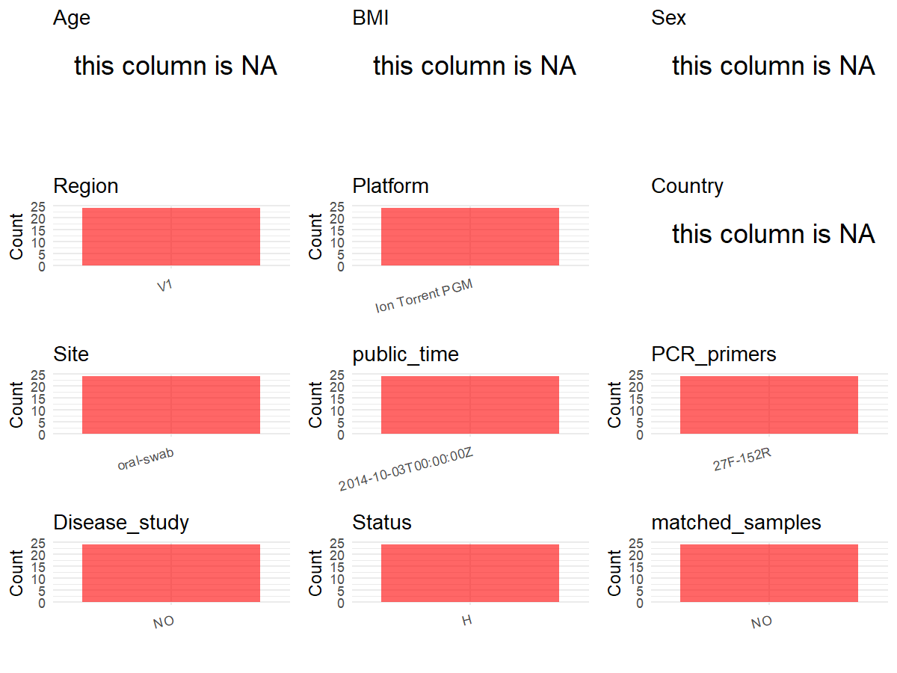

R Notebook: Metadata Processing Workflow
================

# Step 1: Obtain Initial Metadata from Each Project

To obtain the initial metadata: 1. Search for the BioProject ID (e.g.,
“PRJEBXXXX”) on the [NCBI SRA
website](https://www.ncbi.nlm.nih.gov/Traces/study/). 2. In the “Select”
table, click on “Metadata” and download the file. 3. The downloaded file
is typically named “SraRunTable.csv” and contains metadata for the
project.

``` r
# Load necessary libraries
library(dplyr)
library(ggplot2)
library(cowplot)

# Set working directory (update this path to your local directory)
setwd("D:/metadata/3/PRJNA255332")

# Read the initial metadata files
initial_meta<-read.csv("SraRunTable.csv",header = T)

# Combine the two metadata files
#meta <- rbind(initial_meta, initial_meta1)

#Remove entries non-oral samples
#initial_meta <- subset(initial_meta,BioSampleModel != "Metagenome or environmental")

# Check the number of samples containing "HT" in Sample.Name (e.g., healthy controls)
#nrow(subset(meta, grepl("HT", Sample.Name)))

# Display the first few rows of the metadata
head(initial_meta)
```

    ##          Run Assay.Type AvgSpotLen    BARCODE    Bases  BioProject    BioSample
    ## 1 SRR1515143   AMPLICON        116 CTAAGGTAAC 44305745 PRJNA255332 SAMN02910615
    ## 2 SRR1515152   AMPLICON        112 TAAGGAGAAC 33264472 PRJNA255332 SAMN02910616
    ## 3 SRR1515153   AMPLICON        115 AAGAGGATTC 39300198 PRJNA255332 SAMN02910617
    ## 4 SRR1515154   AMPLICON        116 TACCAAGATC 35430814 PRJNA255332 SAMN02910618
    ## 5 SRR1515157   AMPLICON        113 CAGAAGGAAC 28715177 PRJNA255332 SAMN02910619
    ## 6 SRR1515158   AMPLICON        115 TCTAGAGGTC 23341977 PRJNA255332 SAMN02912024
    ##                         BioSampleModel    Bytes              Center.Name
    ## 1 MIMS.me,MIGS/MIMS/MIMARKS.human-oral 34598496 AC CAMARGO CANCER CENTER
    ## 2 MIMS.me,MIGS/MIMS/MIMARKS.human-oral 27173280 AC CAMARGO CANCER CENTER
    ## 3 MIMS.me,MIGS/MIMS/MIMARKS.human-oral 31872328 AC CAMARGO CANCER CENTER
    ## 4 MIMS.me,MIGS/MIMS/MIMARKS.human-oral 28608221 AC CAMARGO CANCER CENTER
    ## 5 MIMS.me,MIGS/MIMS/MIMARKS.human-oral 23431833 AC CAMARGO CANCER CENTER
    ## 6 MIMS.me,MIGS/MIMS/MIMARKS.human-oral 17575885 AC CAMARGO CANCER CENTER
    ##   Collection_Date Consent DATASTORE.filetype DATASTORE.provider
    ## 1         2012-06  public   fastq,run.zq,sra         gs,ncbi,s3
    ## 2         2012-06  public   fastq,run.zq,sra         gs,ncbi,s3
    ## 3         2012-06  public   fastq,run.zq,sra         gs,ncbi,s3
    ## 4         2012-06  public   fastq,run.zq,sra         gs,ncbi,s3
    ## 5         2012-06  public   fastq,run.zq,sra         gs,ncbi,s3
    ## 6         2011-01  public   fastq,run.zq,sra         gs,ncbi,s3
    ##                       DATASTORE.region env_biome    env_feature env_material
    ## 1 gs.us-east1,ncbi.public,s3.us-east-1      oral smoker/drinker    oral-swab
    ## 2 gs.us-east1,ncbi.public,s3.us-east-1      oral smoker/drinker    oral-swab
    ## 3 gs.us-east1,ncbi.public,s3.us-east-1      oral smoker/drinker    oral-swab
    ## 4 gs.us-east1,ncbi.public,s3.us-east-1      oral smoker/drinker    oral-swab
    ## 5 gs.us-east1,ncbi.public,s3.us-east-1      oral smoker/drinker    oral-swab
    ## 6 gs.us-east1,ncbi.public,s3.us-east-1      oral        control    oral-swab
    ##   Experiment geo_loc_name_country geo_loc_name_country_continent geo_loc_name
    ## 1  SRX651796         uncalculated                   uncalculated      missing
    ## 2  SRX652757         uncalculated                   uncalculated      missing
    ## 3  SRX652760         uncalculated                   uncalculated      missing
    ## 4  SRX652761         uncalculated                   uncalculated      missing
    ## 5  SRX652762         uncalculated                   uncalculated      missing
    ## 6  SRX652763         uncalculated                   uncalculated      missing
    ##         HOST      Instrument lat_lon Library.Name LibraryLayout
    ## 1 human-oral Ion Torrent PGM missing           NA        SINGLE
    ## 2 human-oral Ion Torrent PGM missing           NA        SINGLE
    ## 3 human-oral Ion Torrent PGM missing           NA        SINGLE
    ## 4 human-oral Ion Torrent PGM missing           NA        SINGLE
    ## 5 human-oral Ion Torrent PGM missing           NA        SINGLE
    ## 6 human-oral Ion Torrent PGM missing           NA        SINGLE
    ##   LibrarySelection LibrarySource              Organism    Platform
    ## 1              PCR   METAGENOMIC human oral metagenome ION_TORRENT
    ## 2              PCR   METAGENOMIC human oral metagenome ION_TORRENT
    ## 3              PCR   METAGENOMIC human oral metagenome ION_TORRENT
    ## 4              PCR   METAGENOMIC human oral metagenome ION_TORRENT
    ## 5              PCR   METAGENOMIC human oral metagenome ION_TORRENT
    ## 6              PCR   METAGENOMIC human oral metagenome ION_TORRENT
    ##            ReleaseDate          create_date version Sample.Name SRA.Study
    ## 1 2014-10-03T00:00:00Z 2014-07-15T17:50:00Z       1        SD01 SRP044345
    ## 2 2014-10-03T00:00:00Z 2014-07-15T17:50:00Z       1        SD02 SRP044345
    ## 3 2014-10-03T00:00:00Z 2014-07-15T17:50:00Z       1        SD03 SRP044345
    ## 4 2014-10-03T00:00:00Z 2014-07-15T17:50:00Z       1        SD04 SRP044345
    ## 5 2014-10-03T00:00:00Z 2014-07-15T17:50:00Z       1        SD05 SRP044345
    ## 6 2014-10-03T00:00:00Z 2014-07-15T20:53:00Z       1   C02-run-2 SRP044345

# Step 2: Create a Uniform Metadata Template

The uniform metadata should include the following columns:

1.  **BioProject**: Project ID (e.g., “PRJNA339212”)
2.  **Run**: Sample ID (e.g., “ERRXXXXXX” or “SRRXXXXXX”)
3.  **sample_name**: Original sample name submitted by the authors (not
    the database-assigned ID)
4.  **Age**: Age of the subject (if available)
5.  **BMI**: Body Mass Index (if available)
6.  **Sex**: Sex of the subject (“F” or “M”)
7.  **Region**: Targeted 16S rRNA region (e.g., “V3-V4”)
8.  **Platform**: Sequencing platform (e.g., “Illumina MiSeq”)
9.  **Country**: Country of sample origin (e.g., “China”)
10. **Site**: Sample site (e.g., “saliva”, “dental plaque”)
11. **public_time**: Data release date (format: “YYYY-MM-DD”)
12. **PCR_primers**: PCR primers used (e.g., “515F-806R”)
13. **title**: Title of the associated publication
14. **Disease_study**: Whether the study involves a disease (“YES” or
    “NO”)
15. **Status**: Disease status (e.g., “T2DM”, “HC”). Note: If the study
    includes both disease and healthy samples, this must be specified
    per sample.
16. **matched_samples**: matched samples (“YES” or “NO”)

``` r
# Create a uniform metadata dataframe
metadata <- data.frame(
  BioProject = initial_meta$BioProject,
  Run = initial_meta$Run,
  sample_name = initial_meta$Sample.Name,
  Age = NA,
  BMI = NA,
  Sex=NA,
  Region = "V1",
  Platform = initial_meta$Instrument,
  Country = NA,
  Site = initial_meta$env_material,
  public_time = initial_meta$ReleaseDate,
  Status = "H",
  stringsAsFactors = FALSE
)
```

# Step 3: Manually Add Information from the Publication

Some information (e.g. PCR primers, study title, disease status) must be
manually extracted from the publication and added to the metadata.

``` r
# Add information obtained from the publication
metadata$PCR_primers <- "27F-152R"
metadata$title <- "Alcohol and tobacco consumption affects bacterial richness in oral cavity mucosa biofilms"
metadata$Disease_study <- "NO"
# Assign disease status based on sample_name patterns
#metadata <- metadata %>%
#  mutate(Status = case_when(
#    initial_meta$Sample.Name == "Oral mucosa of healthy patients" ~ "H",
#    initial_meta$Sample.Name %in% c("Oral mucosa from affected regions of oral lichen planus patients", "Bacterial community associated with the unaffected regions from oral mucosa of Oral Lichen Planus patients") ~ "OLP"
#  ))

metadata$matched_samples <- "NO"
```

# Step 4: Summarize and Validate the Metadata

``` r
# Check the number of unique runs and sample names
print(paste("Number of unique runs:", length(unique(metadata$Run))))
```

    ## [1] "Number of unique runs: 24"

``` r
print(paste("Number of unique sample names:", length(unique(metadata$sample_name))))
```

    ## [1] "Number of unique sample names: 24"

# Step 5: Visualize the Metadata

``` r

```

<!-- -->

# Step 6: Finalize and Export the Metadata

``` r
# Reorder columns to match the desired format
metadata <- metadata[, c(
  "BioProject", "Run", "sample_name", "Age", "BMI", "Sex", 
  "Region", "Platform", "Country", "Site", "public_time", 
  "PCR_primers", "title", "Disease_study", "Status","matched_samples"
)]

# Export the uniform metadata to a CSV file
write.csv(metadata, file = "metadata.csv", quote = TRUE)
head(metadata)
```

    ##    BioProject        Run sample_name Age BMI Sex Region        Platform Country
    ## 1 PRJNA255332 SRR1515143        SD01  NA  NA  NA     V1 Ion Torrent PGM      NA
    ## 2 PRJNA255332 SRR1515152        SD02  NA  NA  NA     V1 Ion Torrent PGM      NA
    ## 3 PRJNA255332 SRR1515153        SD03  NA  NA  NA     V1 Ion Torrent PGM      NA
    ## 4 PRJNA255332 SRR1515154        SD04  NA  NA  NA     V1 Ion Torrent PGM      NA
    ## 5 PRJNA255332 SRR1515157        SD05  NA  NA  NA     V1 Ion Torrent PGM      NA
    ## 6 PRJNA255332 SRR1515158   C02-run-2  NA  NA  NA     V1 Ion Torrent PGM      NA
    ##        Site          public_time PCR_primers
    ## 1 oral-swab 2014-10-03T00:00:00Z    27F-152R
    ## 2 oral-swab 2014-10-03T00:00:00Z    27F-152R
    ## 3 oral-swab 2014-10-03T00:00:00Z    27F-152R
    ## 4 oral-swab 2014-10-03T00:00:00Z    27F-152R
    ## 5 oral-swab 2014-10-03T00:00:00Z    27F-152R
    ## 6 oral-swab 2014-10-03T00:00:00Z    27F-152R
    ##                                                                                       title
    ## 1 Alcohol and tobacco consumption affects bacterial richness in oral cavity mucosa biofilms
    ## 2 Alcohol and tobacco consumption affects bacterial richness in oral cavity mucosa biofilms
    ## 3 Alcohol and tobacco consumption affects bacterial richness in oral cavity mucosa biofilms
    ## 4 Alcohol and tobacco consumption affects bacterial richness in oral cavity mucosa biofilms
    ## 5 Alcohol and tobacco consumption affects bacterial richness in oral cavity mucosa biofilms
    ## 6 Alcohol and tobacco consumption affects bacterial richness in oral cavity mucosa biofilms
    ##   Disease_study Status matched_samples
    ## 1            NO      H              NO
    ## 2            NO      H              NO
    ## 3            NO      H              NO
    ## 4            NO      H              NO
    ## 5            NO      H              NO
    ## 6            NO      H              NO

## Notes for Students:

1.  **Metadata Accuracy**: Always cross-check the metadata with the
    original publication to ensure accuracy.
2.  **Manual Entries**: Columns like `PCR_primers`, and `Status` often
    require manual entry based on the publication.
3.  **Disease Status**: Be careful when assigning `Status`—some studies
    include both disease and healthy samples.
4.  **Visualization**: The plots help quickly identify the distribution
    of values in each column, which is useful for quality control.
5.  **Reproducibility**: Update the working directory and file paths to
    match your local environment.
