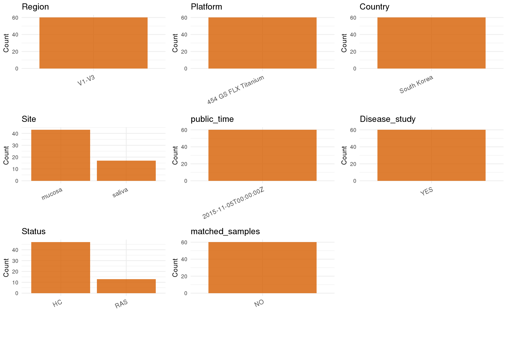

# Step 1: Obtain Initial Metadata from Each Project

This step sets the project directory and loads the raw SRA metadata.

```{r message=FALSE, warning=FALSE}
# Load libraries
library(dplyr)
library(ggplot2)
library(cowplot)

# (1) Setting working directory
project_id <- "PRJNA266382"

base_dir <- "E:/工作区/VSCode/RNAproject/collect_metadata_respon/project"
setwd(file.path(base_dir, project_id))

# (2) Loading raw SRA metadata file
sra_file <- "SraRunTable.csv"
initial_meta <- read.csv(sra_file, header = TRUE, stringsAsFactors = FALSE, check.names = FALSE)
```

# Step 2: Data Overview

First, you need to get an overview of the data, which includes two steps: reading the article and reading the initial metadata. This step is very IMPORTANT!

```{r message=FALSE, warning=FALSE}
# (1) Read the article in the following order: abstract, the beginning of the results section, and the methods.
# Paper summary used for this project:
# - Title: Mucosal and salivary microbiota associated with recurrent aphthous stomatitis
# - BioProject: PRJNA266382; SRA Study: SRP049562
# - Study design: adult case-control oral microbiome study comparing recurrent aphthous stomatitis (RAS) patients with active lesions against healthy controls
# - Deposited SRA rows: 60 total samples, consisting of 43 oral mucosa samples and 17 saliva samples
# - Paper sampling design: 40 mucosal samples and 20 salivary samples were subjected to pyrosequencing
# - Obtained data sets registered in SRP: 39 mucosal and 17 salivary microbiota communities
# - Final paper analysis cohort: 36 mucosal (18 control, 18 RAS) and 15 salivary (7 control, 8 RAS) communities after exclusion of smokers
# - Final mucosal cohort breakdown from Fig. 4: controls = labial 7 + buccal 11; RAS = labial 10 + buccal 4 + tongue 4
# - Sampling sites from Methods/Fig. 4: saliva and oral mucosa; exact mucosal subsites are described only at cohort level, not for each deposited SRA row
# - Subject age is only available as cohort-level summaries in Table 1 (controls 21-71 years; RAS 19-81 years)
# - Sequencing from Methods: bacterial 16S rRNA gene V1-V3 hypervariable regions sequenced on Roche 454 GS FLX Titanium
# - The accessible Methods text states only that primers targeting V1-V3 were used; exact primer names are not explicitly listed
# - The pyrosequencing data, including smokers, are available under SRP049562; smoker-inclusive analyses are provided in Additional file 1
# - Four deposited sample labels use the RAUPS prefix. Based on the article statement that four patients revisited after healing, these rows may represent post-healing follow-up mucosal samples, but the paper does not provide row-level confirmation, so their clinical status remains NA

# (2) IMPORTANT: MUST go through each column of initial_meta
head(initial_meta, 10)
colnames(initial_meta)
table(initial_meta$HOST)
table(initial_meta$Instrument)
table(initial_meta$geo_loc_name_country)
table(sub("(mu|sal)$", "", initial_meta$`Sample Name`))
# All retained rows are human oral samples from South Korea.
# Sample names end in mu (oral mucosa) or sal (saliva).
# Control1-8 and RAUAL1-6/8-10 have paired mucosa and saliva samples; additional RAUPS2/3/9/16 mucosa rows are deposited without saliva counterparts.
```

# Step 3: Removing Control and Non-human Samples

First, we need to remove control samples(including both negative controls and positive controls) and non-human samples.

```{r}
# (1) Parameter setup
control_column <- ""
control_keywords <- c()

species_column <- "HOST"
unique(initial_meta[[species_column]])
non_human_keywords <- c()

# (2) Remove controls and non-human samples. DO NOT need to modify code in this part, just run it.
n_samples <- nrow(initial_meta)
# Control evaluation
if (length(control_keywords) > 0) {
  if (is.null(control_column) || control_column == "") {
    stop("Error: control_keywords provided but control_column is missing.")
  }

  if (!(control_column %in% colnames(initial_meta))) {
    stop(sprintf("Error: Column '%s' not found in initial_meta.", control_column))
  }

  control_pattern <- paste(control_keywords, collapse = "|")
  control_text <- initial_meta[[control_column]]
  is_control <- grepl(control_pattern, control_text)

} else {
  is_control <- rep(FALSE, n_samples)
}

# Non-human evaluation
if (length(non_human_keywords) > 0) {
  if (is.null(species_column) || species_column == "") {
    stop("Error: non_human_keywords provided but species_column is missing.")
  }

  if (!(species_column %in% colnames(initial_meta))) {
    stop(sprintf("Error: Column '%s' not found in initial_meta.", species_column))
  }

  non_human_pattern <- paste(non_human_keywords, collapse = "|")
  species_text <- initial_meta[[species_column]]
  is_non_human <- grepl(non_human_pattern, species_text)
} else {
  is_non_human <- rep(FALSE, n_samples)
}

# Execute removal
samples_to_remove <- is_control | is_non_human
initial_meta <- initial_meta[!samples_to_remove, ]

cat("Initial samples counts:", n_samples, "\n")
cat("Removed control samples:", sum(is_control), "\n")
cat("Removed non-human samples:", sum(is_non_human), "\n")
cat("Total samples removed ", sum(samples_to_remove), "\n")
cat("Remaining samples after Step 2:", nrow(initial_meta), "\n")
```

# Step 4: Creating a Uniform Metadata Template

This step converts the raw SRA table into the standard metadata format used in our meta-analysis.

```{r}
sample_name <- initial_meta$`Sample Name`
subject_id <- sub("(mu|sal)$", "", sample_name)

metadata <- data.frame(
  bioproject = initial_meta$BioProject,
  sample_id = initial_meta$Run,
  subject_id = subject_id,
  age = NA_real_,
  age_info = "adults (controls 21-71 years; RAS 19-81 years)",
  bmi = NA_real_,
  sex = NA_character_,
  sequencing_region = "V1-V3",
  platform = "454 GS FLX Titanium",
  country = initial_meta$geo_loc_name_country,
  raw_site = sample_name,
  site = "pending",
  site_group = "pending",
  public_time = sub("T.*$", "", initial_meta$ReleaseDate),
  pcr_primers = NA_character_,
  title = "Mucosal and salivary microbiota associated with recurrent aphthous stomatitis",
  disease_study = "yes",
  status = case_when(
    grepl("^Control", sample_name) ~ "HC",
    grepl("^RAUAL", sample_name) ~ "recurrent aphthous stomatitis",
    grepl("^RAUPS", sample_name) ~ NA_character_,
    TRUE ~ NA_character_
  ),
  matched_samples = "pending",
  is_time_series = "no",
  stringsAsFactors = FALSE
)

# Source notes for non-obvious fields:
# - subject_id is taken directly from the sample-name stem after removing the mu/sal suffix.
# - age_info uses only study-level age ranges from Table 1 because exact per-subject ages are not reported.
# - sex and bmi remain NA because only cohort-level summaries are reported in the accessible paper.
# - sequencing_region and platform come from the Methods section, not SRA fields.
# - pcr_primers remains NA because the Methods specify V1-V3 targeting but do not name the exact primer pair in accessible text.
# - status is assigned only where the row-level label is explicit from the sample-name prefix: Control -> HC, RAUAL -> recurrent aphthous stomatitis.
# - The four RAUPS rows may represent post-healing follow-up mucosal samples based on the article statement that four patients revisited after healing, but the paper does not provide row-level confirmation, so their status remains NA.
# - is_time_series is kept as "no" for all rows because the article does not map any deposited SRA sample IDs to confirmed longitudinal follow-up records.
metadata$public_time <- as.Date(metadata$public_time)
```

# Step 5: Manually solving pending issues

This step involves two parts: (1) handle the columns with the `raw_` prefix, and next (2) handle the `site_group` and `matched_samples` columns.

```{r}
# (1) Handle the columns with the `raw_` prefix.
metadata <- metadata %>%
  mutate(site = case_when(
    grepl("mu$", raw_site) ~ "oral mucosa",
    grepl("sal$", raw_site) ~ "saliva",
    TRUE ~ NA_character_
  ))
```

```{r}
# (2) Filling the 'site_group' and 'matched_samples' columns
unique(metadata$site)
Oral_site = c("oral mucosa", "saliva")
Gut_site = c("feces")

metadata <- metadata %>%
  mutate(site_group = case_when(
    site %in% Oral_site ~ "oral",
    site %in% Gut_site ~ "gut",
    TRUE ~ "other"
  ))

metadata$matched_samples <- ifelse(
  ave(metadata$subject_id, metadata$subject_id, FUN = length) > 1,
  "yes",
  "no"
)
# Repeated subject IDs here capture only explicit mu/sal pairs sharing the same sample-name stem.
# RAUPS rows remain singletons because the article does not provide row-level confirmation linking them to active-lesion samples.
```

```{r}
# (3) check if there is pending value in metadata. If there is pending value, go on modify the metadata.
has_pending <- function(col) {
  if (is.character(col) || is.factor(col)) {
    any(col == "pending", na.rm = TRUE)
  } else {
    FALSE
  }
}

any_pending_value <- any(sapply(metadata, has_pending))

if (!any_pending_value) {
  message("Good! No cell contains the value 'pending'.")
} else {
  pending_cols <- names(metadata)[sapply(metadata, has_pending)]
  message("Columns containing 'pending': ", paste(pending_cols, collapse = ", "))
  message("Please continue to resolve these pending columns!")
}
```

# Step 6: Visualize the Metadata

This step makes a quick set of plots for checking the distribution of key metadata fields.

```{r}
plot_data <- metadata %>%
  select(-bioproject, -sample_id, -subject_id, -title, -raw_site)

create_simple_plots <- function(data) {
  plots <- list()
  continuous_vars <- c("age", "bmi")

  for (col in colnames(data)) {
    if (all(is.na(data[[col]]))) {
      p <- ggplot() +
        annotate("text", x = 0.5, y = 0.5, label = "this column is NA", size = 6) +
        labs(title = col) +
        theme_void()
    } else if (col %in% continuous_vars && is.numeric(data[[col]])) {
      p <- ggplot(data, aes(x = .data[[col]])) +
        geom_histogram(fill = "blue", alpha = 0.6, bins = 20, na.rm = TRUE) +
        labs(title = col, x = col, y = "Count") +
        theme_minimal()
    } else {
      count_data <- as.data.frame(table(data[[col]], useNA = "ifany"))
      p <- ggplot(count_data, aes(x = reorder(Var1, -Freq), y = Freq)) +
        geom_col(fill = "red", alpha = 0.6) +
        labs(title = col, x = NULL, y = "Count") +
        theme_minimal() +
        theme(axis.text.x = element_text(angle = 15, hjust = 1))
    }
    plots[[col]] <- p
  }

  return(plots)
}

plots <- create_simple_plots(plot_data)
p <- plot_grid(plots$age,
               plots$bmi,
               plots$sex,
               plots$site,
               plots$site_group,
               plots$sequencing_region,
               plots$platform,
               plots$country,
               plots$status,
               plots$matched_samples,
               ncol = 3, align = "hv", axis = "lb")
ggsave("Metadata_Summary.png", plot = p, width = 8, height = 6, dpi = 150)
```

```{r}

```

# Step 7: Sort and export the metadata

This step saves the cleaned metadata table as the final `metadata_v2.csv` file.

```{r}
fixed_cols <- c("bioproject", "sample_id", "subject_id", "age", "age_info",
                "bmi", "sex", "platform", "sequencing_region", "pcr_primers",
                "country", "site", "site_group", "disease_study", "status",
                "title", "public_time", "matched_samples", "is_time_series")
metadata <- metadata %>%
  select(all_of(fixed_cols), starts_with("raw_"))

write.csv(metadata, file = "metadata_v2.csv", quote = TRUE, row.names = FALSE)
```
