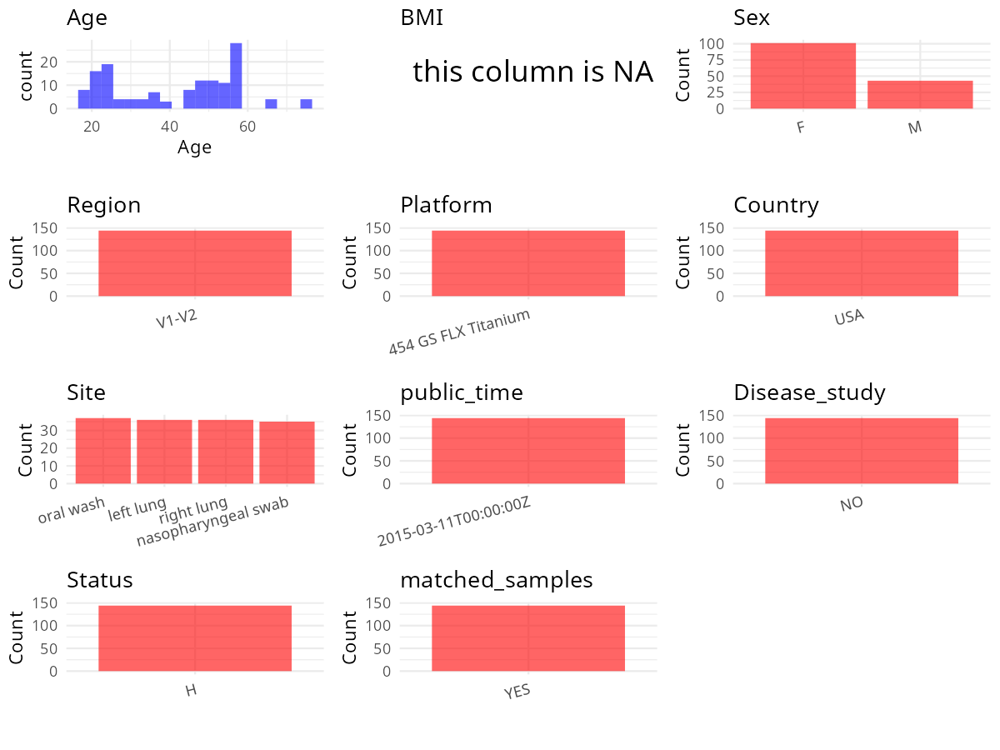

R Notebook: Metadata Processing Workflow
================

# Step 1: Obtain Initial Metadata from Each Project

To obtain the initial metadata: 1. Search for the BioProject ID (e.g.,
“PRJEBXXXX”) on the [NCBI SRA
website](https://www.ncbi.nlm.nih.gov/Traces/study/). 2. In the “Select”
table, click on “Metadata” and download the file. 3. The downloaded file
is typically named “SraRunTable.csv” and contains metadata for the
project.

``` r
# Load necessary libraries
library(dplyr)
library(ggplot2)
library(cowplot)
library(stringr)

# Set working directory (update this path to your local directory)
setwd("/home/hby/oral_project/PRJNA269493")

# Read the initial metadata files
initial_meta <- read.csv("SraRunTable.csv", header = T)

# Combine the two metadata files
# meta <- rbind(initial_meta, initial_meta1)

# Remove entries non-oral samples
# initial_meta <- subset(initial_meta,isolate %in% c("saliva","tongue coat"))

# Check the number of samples containing "HT" in Sample.Name (e.g., healthy controls)
# nrow(subset(meta, grepl("HT", Sample.Name)))

# Display the first few rows of the metadata
head(initial_meta)
```

    ##          Run AGE Assay.Type AvgSpotLen   Bases   BIOMATERIAL_PROVIDER  BioProject    BioSample BioSampleModel    Bytes            Center.Name Consent DATASTORE.filetype
    ## 1 SRR1702735  45   AMPLICON        584 2655328 University of Michigan PRJNA269493 SAMN03247142          Human  5708634 UNIVERSITY OF MICHIGAN  public     run.zq,sff,sra
    ## 2 SRR1702737  50   AMPLICON        586  342022 University of Michigan PRJNA269493 SAMN03247143          Human   770317 UNIVERSITY OF MICHIGAN  public     run.zq,sff,sra
    ## 3 SRR1702738  25   AMPLICON        600 1671279 University of Michigan PRJNA269493 SAMN03247144          Human  3568730 UNIVERSITY OF MICHIGAN  public     run.zq,sff,sra
    ## 4 SRR1702740  57   AMPLICON        500 9876879 University of Michigan PRJNA269493 SAMN03247145          Human 21908549 UNIVERSITY OF MICHIGAN  public     run.zq,sff,sra
    ## 5 SRR1702747  56   AMPLICON        555 2077066 University of Michigan PRJNA269493 SAMN03247146          Human  4431067 UNIVERSITY OF MICHIGAN  public     run.zq,sff,sra
    ## 6 SRR1702751  19   AMPLICON        584 4383937 University of Michigan PRJNA269493 SAMN03247168          Human  9431445 UNIVERSITY OF MICHIGAN  public     run.zq,sff,sra
    ##   DATASTORE.provider                     DATASTORE.region Experiment          Instrument isolate Library.Name LibraryLayout LibrarySelection LibrarySource              Organism Platform
    ## 1         gs,ncbi,s3 gs.us-east1,ncbi.public,s3.us-east-1  SRX803892 454 GS FLX Titanium    1002       LHMP 1        SINGLE              PCR   METAGENOMIC human lung metagenome    LS454
    ## 2         gs,ncbi,s3 gs.us-east1,ncbi.public,s3.us-east-1  SRX803897 454 GS FLX Titanium    1003       LHMP 1        SINGLE              PCR   METAGENOMIC human lung metagenome    LS454
    ## 3         gs,ncbi,s3 gs.us-east1,ncbi.public,s3.us-east-1  SRX803898 454 GS FLX Titanium    1004        LHMP1        SINGLE              PCR   METAGENOMIC human lung metagenome    LS454
    ## 4         gs,ncbi,s3 gs.us-east1,ncbi.public,s3.us-east-1  SRX803900 454 GS FLX Titanium    1005       LHMP 1        SINGLE              PCR   METAGENOMIC human lung metagenome    LS454
    ## 5         gs,ncbi,s3 gs.us-east1,ncbi.public,s3.us-east-1  SRX803903 454 GS FLX Titanium    1007       LHMP 2        SINGLE              PCR   METAGENOMIC human lung metagenome    LS454
    ## 6         gs,ncbi,s3 gs.us-east1,ncbi.public,s3.us-east-1  SRX803919 454 GS FLX Titanium    1008       LHMP 1        SINGLE              PCR   METAGENOMIC human lung metagenome    LS454
    ##            ReleaseDate          create_date version Sample.Name    sex SRA.Study    tissue smoking_status health_state fev1 Order_BAL_sample_taken
    ## 1 2015-03-11T00:00:00Z 2014-12-17T16:11:00Z       1   1002 LBAL   male SRP050998 left lung        current HIV negative  67%                 Second
    ## 2 2015-03-11T00:00:00Z 2014-12-17T16:09:00Z       1   1003 LBAL female SRP050998 left lung        current HIV negative 103%                  first
    ## 3 2015-03-11T00:00:00Z 2014-12-17T16:09:00Z       1   1004 LBAL female SRP050998 left lung          never HIV negative  97%                  First
    ## 4 2015-03-11T00:00:00Z 2014-12-17T16:06:00Z       1   1005 LBAL female SRP050998 left lung          never HIV negative 110%                  First
    ## 5 2015-03-11T00:00:00Z 2014-12-17T16:07:00Z       1   1007 LBAL female SRP050998 left lung          never HIV negative  87%                  First
    ## 6 2015-03-11T00:00:00Z 2014-12-17T16:12:00Z       1   1008 LBAL female SRP050998 left lung          never HIV negative 118%                  First

# Step 2: Create a Uniform Metadata Template

The uniform metadata should include the following columns:

1.  **BioProject**: Project ID (e.g., “PRJNA339212”)
2.  **Run**: Sample ID (e.g., “ERRXXXXXX” or “SRRXXXXXX”)
3.  **sample_name**: Original sample name submitted by the authors (not
    the database-assigned ID)
4.  **Age**: Age of the subject (if available)
5.  **BMI**: Body Mass Index (if available)
6.  **Sex**: Sex of the subject (“F” or “M”)
7.  **Region**: Targeted 16S rRNA region (e.g., “V3-V4”)
8.  **Platform**: Sequencing platform (e.g., “Illumina MiSeq”)
9.  **Country**: Country of sample origin (e.g., “China”)
10. **Site**: Sample site (e.g., “saliva”, “dental plaque”)
11. **public_time**: Data release date (format: “YYYY-MM-DD”)
12. **PCR_primers**: PCR primers used (e.g., “515F-806R”)
13. **title**: Title of the associated publication
14. **Disease_study**: Whether the study involves a disease (“YES” or
    “NO”)
15. **Status**: Disease status (e.g., “T2DM”, “HC”). Note: If the study
    includes both disease and healthy samples, this must be specified
    per sample.
16. **matched_samples**: matched samples (“YES” or “NO”)

``` r
# Create a uniform metadata dataframe
metadata <- data.frame(
  BioProject = initial_meta$BioProject,
  Run = initial_meta$Run,
  sample_name = initial_meta$isolate,
  Platform = initial_meta$Instrument,
  public_time = initial_meta$ReleaseDate,
  Sex = initial_meta$sex,
  Site = initial_meta$tissue,
  Age = initial_meta$AGE,
  BMI = NA
) %>%
  mutate(
    Sex = case_when(
      Sex == "female" ~ "F",
      Sex == "male" ~ "M",
      TRUE ~ as.character(Sex)
    )
  )
```

# Step 3: Manually Add Information from the Publication

Some information (e.g. PCR primers, study title, disease status) must be
manually extracted from the publication and added to the metadata.

``` r
# Add information obtained from the publication
metadata$Status <- "H"
metadata$Country <- "USA"
metadata$Region <- "V1-V2"
metadata$PCR_primers <- "FWD:AGAGTTTGATCCTGGCTCAG; REV:CTGCTGCCTYCCGTA"
metadata$title <- "Analysis of the Upper Respiratory Tract Microbiotas as the Source of the Lung and Gastric Microbiotas in Healthy Individuals"
metadata$Disease_study <- "NO"
# extract subject id by remove prefix of sample_name
metadata$subject_id <- metadata$sample_name

all_oral_sites <- c("saliva", "tongue coat", "buccal mucosa", "lower jaw mucosa", "lower labial mucosa", "upper jaw mucosa", "tongue", "oral wash")
# Check initial data distribution
cat("Initial sample distribution:\n")
```

    ## Initial sample distribution:

``` r
table(metadata$subject_id)
```

    ## 
    ## 1001 1002 1003 1004 1005 1007 1008 1009 1010 1011 1013 1014 1015 1017 1018 1019 1020 1021 1022 1023 1024 1025 1026 1027 1028 1029 1030 1031 1032 1033 1034 1035 1036 1037 1038 1039 1040 
    ##    4    4    4    4    4    4    4    4    4    4    4    4    4    4    4    4    4    3    4    3    4    4    3    4    4    4    4    4    4    4    4    4    4    4    3    4    4

``` r
table(metadata$Site)
```

    ## 
    ##           left lung nasopharyngeal swab           oral wash          right lung 
    ##                  36                  35                  37                  36

``` r
subjects_with_oral_samples <- metadata %>%
  filter(Site %in% all_oral_sites) %>%
  distinct(subject_id) %>%
  pull(subject_id)

metadata_clean <- metadata %>%
  filter(subject_id %in% subjects_with_oral_samples)


sample_counts <- metadata_clean %>%
  group_by(subject_id) %>%
  summarise(n_samples = n(), .groups = "drop")

metadata_clean <- merge(metadata_clean, sample_counts, by = "subject_id")

# Create matched_samples column
metadata_clean$matched_samples <- ifelse(metadata_clean$n_samples >= 2, "YES", "NO")

cat("\nFinal sample distribution after cleaning:\n")
```

    ## 
    ## Final sample distribution after cleaning:

``` r
print(table(metadata_clean$Site))
```

    ## 
    ##           left lung nasopharyngeal swab           oral wash          right lung 
    ##                  36                  35                  37                  36

``` r
cat("\nFinal sample distribution after cleaning:\n")
```

    ## 
    ## Final sample distribution after cleaning:

``` r
print(table(metadata_clean$matched_samples))
```

    ## 
    ## YES 
    ## 144

``` r
metadata_clean$subject_id <- NULL
metadata_clean$n_samples <- NULL

# Use cleaned dataset for subsequent analysis
metadata <- metadata_clean
```

# Step 4: Summarize and Validate the Metadata

``` r
# Check the number of unique runs and sample names
print(paste("Number of unique runs:", length(unique(metadata$Run))))
```

    ## [1] "Number of unique runs: 144"

``` r
print(paste("Number of unique sample names:", length(unique(metadata$sample_name))))
```

    ## [1] "Number of unique sample names: 37"

# Step 5: Visualize the Metadata

``` r

```


# Step 6: Finalize and Export the Metadata

``` r
# Reorder columns to match the desired format
metadata <- metadata[, c(
  "BioProject", "Run", "sample_name", "Age", "BMI", "Sex",
  "Region", "Platform", "Country", "Site", "public_time",
  "PCR_primers", "title", "Disease_study", "Status", "matched_samples"
)]

# Export the uniform metadata to a CSV file
write.csv(metadata, file = "metadata.csv", quote = FALSE)
head(metadata)
```

    ##    BioProject        Run sample_name Age BMI Sex Region            Platform Country                Site          public_time                                   PCR_primers
    ## 1 PRJNA269493 SRR1700631        1001  57  NA   M  V1-V2 454 GS FLX Titanium     USA           left lung 2015-03-11T00:00:00Z FWD:AGAGTTTGATCCTGGCTCAG; REV:CTGCTGCCTYCCGTA
    ## 2 PRJNA269493 SRR1713795        1001  57  NA   M  V1-V2 454 GS FLX Titanium     USA nasopharyngeal swab 2015-03-11T00:00:00Z FWD:AGAGTTTGATCCTGGCTCAG; REV:CTGCTGCCTYCCGTA
    ## 3 PRJNA269493 SRR1708167        1001  57  NA   M  V1-V2 454 GS FLX Titanium     USA           oral wash 2015-03-11T00:00:00Z FWD:AGAGTTTGATCCTGGCTCAG; REV:CTGCTGCCTYCCGTA
    ## 4 PRJNA269493 SRR1706019        1001  57  NA   M  V1-V2 454 GS FLX Titanium     USA          right lung 2015-03-11T00:00:00Z FWD:AGAGTTTGATCCTGGCTCAG; REV:CTGCTGCCTYCCGTA
    ## 5 PRJNA269493 SRR1702735        1002  45  NA   M  V1-V2 454 GS FLX Titanium     USA           left lung 2015-03-11T00:00:00Z FWD:AGAGTTTGATCCTGGCTCAG; REV:CTGCTGCCTYCCGTA
    ## 6 PRJNA269493 SRR1708502        1002  45  NA   M  V1-V2 454 GS FLX Titanium     USA           oral wash 2015-03-11T00:00:00Z FWD:AGAGTTTGATCCTGGCTCAG; REV:CTGCTGCCTYCCGTA
    ##                                                                                                                          title Disease_study Status matched_samples
    ## 1 Analysis of the Upper Respiratory Tract Microbiotas as the Source of the Lung and Gastric Microbiotas in Healthy Individuals            NO      H             YES
    ## 2 Analysis of the Upper Respiratory Tract Microbiotas as the Source of the Lung and Gastric Microbiotas in Healthy Individuals            NO      H             YES
    ## 3 Analysis of the Upper Respiratory Tract Microbiotas as the Source of the Lung and Gastric Microbiotas in Healthy Individuals            NO      H             YES
    ## 4 Analysis of the Upper Respiratory Tract Microbiotas as the Source of the Lung and Gastric Microbiotas in Healthy Individuals            NO      H             YES
    ## 5 Analysis of the Upper Respiratory Tract Microbiotas as the Source of the Lung and Gastric Microbiotas in Healthy Individuals            NO      H             YES
    ## 6 Analysis of the Upper Respiratory Tract Microbiotas as the Source of the Lung and Gastric Microbiotas in Healthy Individuals            NO      H             YES

## Notes for Students:

1.  **Metadata Accuracy**: Always cross-check the metadata with the
    original publication to ensure accuracy.
2.  **Manual Entries**: Columns like `PCR_primers`, and `Status` often
    require manual entry based on the publication.
3.  **Disease Status**: Be careful when assigning `Status`—some studies
    include both disease and healthy samples.
4.  **Visualization**: The plots help quickly identify the distribution
    of values in each column, which is useful for quality control.
5.  **Reproducibility**: Update the working directory and file paths to
    match your local environment.
