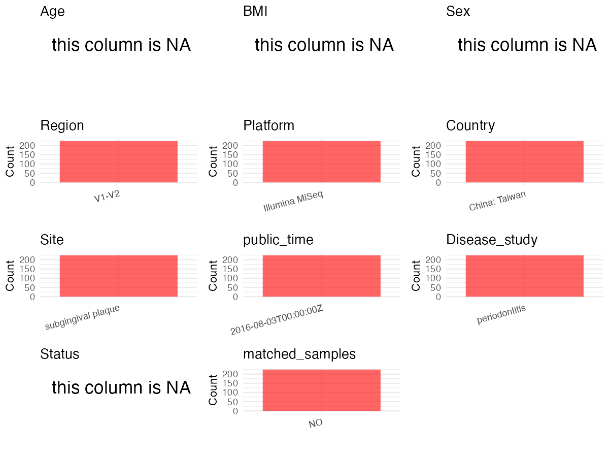

R Notebook: Metadata Processing Workflow
================

# Step 1: Obtain Initial Metadata from Each Project

To obtain the initial metadata: 1. Search for the BioProject ID (e.g.,
“PRJEBXXXX”) on the [NCBI SRA
website](https://www.ncbi.nlm.nih.gov/Traces/study/). 2. In the “Select”
table, click on “Metadata” and download the file. 3. The downloaded file
is typically named “SraRunTable.csv” and contains metadata for the
project.

``` r
# Load necessary libraries
library(dplyr)
library(ggplot2)
library(cowplot)
library(stringr)
# Set working directory (update this path to your local directory)
setwd("/Users/dongbiao/Documents/oral/PRJNA274944/")

# Read the initial metadata files
initial_meta <- read.csv("SraRunTable.csv",header = T)

head(initial_meta)
```

    ##          Run Assay.Type AvgSpotLen    Bases  BioProject    BioSample
    ## 1 SRR2086723   AMPLICON        490 21445830 PRJNA274944 SAMN03837865
    ## 2 SRR2086724   AMPLICON        490 35874370 PRJNA274944 SAMN03837866
    ## 3 SRR2086725   AMPLICON        490 14908250 PRJNA274944 SAMN03837867
    ## 4 SRR2086726   AMPLICON        490 29576400 PRJNA274944 SAMN03837868
    ## 5 SRR2086727   AMPLICON        490 19595590 PRJNA274944 SAMN03837869
    ## 6 SRR2086728   AMPLICON        490 24540670 PRJNA274944 SAMN03837870
    ##                BioSampleModel    Bytes                   Center.Name
    ## 1 Metagenome or environmental  9837790 NATIONAL TSING HUA UNIVERSITY
    ## 2 Metagenome or environmental 16250444 NATIONAL TSING HUA UNIVERSITY
    ## 3 Metagenome or environmental  6804714 NATIONAL TSING HUA UNIVERSITY
    ## 4 Metagenome or environmental 13317751 NATIONAL TSING HUA UNIVERSITY
    ## 5 Metagenome or environmental  8940462 NATIONAL TSING HUA UNIVERSITY
    ## 6 Metagenome or environmental 11413945 NATIONAL TSING HUA UNIVERSITY
    ##   Collection_Date Consent DATASTORE.filetype DATASTORE.provider
    ## 1      2014-04-29  public   fastq,run.zq,sra         gs,ncbi,s3
    ## 2      2014-04-29  public   fastq,run.zq,sra         gs,ncbi,s3
    ## 3      2014-04-29  public   fastq,run.zq,sra         gs,ncbi,s3
    ## 4      2014-04-29  public   fastq,run.zq,sra         gs,ncbi,s3
    ## 5      2014-05-28  public   fastq,run.zq,sra         gs,ncbi,s3
    ## 6      2014-05-28  public   fastq,run.zq,sra         gs,ncbi,s3
    ##                       DATASTORE.region Experiment geo_loc_name_country
    ## 1 gs.us-east1,ncbi.public,s3.us-east-1 SRX1080751               Taiwan
    ## 2 gs.us-east1,ncbi.public,s3.us-east-1 SRX1080752               Taiwan
    ## 3 gs.us-east1,ncbi.public,s3.us-east-1 SRX1080753               Taiwan
    ## 4 gs.us-east1,ncbi.public,s3.us-east-1 SRX1080754               Taiwan
    ## 5 gs.us-east1,ncbi.public,s3.us-east-1 SRX1080755               Taiwan
    ## 6 gs.us-east1,ncbi.public,s3.us-east-1 SRX1080756               Taiwan
    ##   geo_loc_name_country_continent                                  geo_loc_name
    ## 1                           Asia Taiwan:Chang Gung Memorial Hospital\\, Linkou
    ## 2                           Asia Taiwan:Chang Gung Memorial Hospital\\, Linkou
    ## 3                           Asia Taiwan:Chang Gung Memorial Hospital\\, Linkou
    ## 4                           Asia Taiwan:Chang Gung Memorial Hospital\\, Linkou
    ## 5                           Asia Taiwan:Chang Gung Memorial Hospital\\, Linkou
    ## 6                           Asia Taiwan:Chang Gung Memorial Hospital\\, Linkou
    ##           HOST     Instrument                  lat_lon LibraryLayout
    ## 1 Homo sapiens Illumina MiSeq 25.061413 N 121.367533 E        PAIRED
    ## 2 Homo sapiens Illumina MiSeq 25.061413 N 121.367533 E        PAIRED
    ## 3 Homo sapiens Illumina MiSeq 25.061413 N 121.367533 E        PAIRED
    ## 4 Homo sapiens Illumina MiSeq 25.061413 N 121.367533 E        PAIRED
    ## 5 Homo sapiens Illumina MiSeq 25.061413 N 121.367533 E        PAIRED
    ## 6 Homo sapiens Illumina MiSeq 25.061413 N 121.367533 E        PAIRED
    ##   LibrarySelection LibrarySource              Organism platform..run. Platform
    ## 1              PCR   METAGENOMIC human oral metagenome       ILLUMINA ILLUMINA
    ## 2              PCR   METAGENOMIC human oral metagenome       ILLUMINA ILLUMINA
    ## 3              PCR   METAGENOMIC human oral metagenome       ILLUMINA ILLUMINA
    ## 4              PCR   METAGENOMIC human oral metagenome       ILLUMINA ILLUMINA
    ## 5              PCR   METAGENOMIC human oral metagenome       ILLUMINA ILLUMINA
    ## 6              PCR   METAGENOMIC human oral metagenome       ILLUMINA ILLUMINA
    ##            ReleaseDate          create_date version sample_name..run.
    ## 1 2016-08-03T00:00:00Z 2015-07-04T09:43:00Z       1      SAMN03837865
    ## 2 2016-08-03T00:00:00Z 2015-07-04T09:43:00Z       1      SAMN03837866
    ## 3 2016-08-03T00:00:00Z 2015-07-04T09:46:00Z       1      SAMN03837867
    ## 4 2016-08-03T00:00:00Z 2015-07-04T09:46:00Z       1      SAMN03837868
    ## 5 2016-08-03T00:00:00Z 2015-07-04T09:46:00Z       1      SAMN03837869
    ## 6 2016-08-03T00:00:00Z 2015-07-04T09:46:00Z       1      SAMN03837870
    ##   Sample.Name source_material_id SRA.Study
    ## 1    MP002.16           MP002.16 SRP060310
    ## 2    MP002.26           MP002.26 SRP060310
    ## 3    MP002.37           MP002.37 SRP060310
    ## 4    MP002.46           MP002.46 SRP060310
    ## 5    MP003.14           MP003.14 SRP060310
    ## 6    MP003.34           MP003.34 SRP060310

# Step 2: Create a Uniform Metadata Template

The uniform metadata should include the following columns:

1.  **BioProject**: Project ID (e.g., “PRJNA339212”)
2.  **Run**: Sample ID (e.g., “ERRXXXXXX” or “SRRXXXXXX”)
3.  **sample_name**: Original sample name submitted by the authors (not
    the database-assigned ID)
4.  **Age**: Age of the subject (if available)
5.  **BMI**: Body Mass Index (if available)
6.  **Sex**: Sex of the subject (“F” or “M”)
7.  **Region**: Targeted 16S rRNA region (e.g., “V3-V4”)
8.  **Platform**: Sequencing platform (e.g., “Illumina MiSeq”)
9.  **Country**: Country of sample origin (e.g., “China”)
10. **Site**: Sample site (e.g., “saliva”, “dental plaque”)
11. **public_time**: Data release date (format: “YYYY-MM-DD”)
12. **PCR_primers**: PCR primers used (e.g., “515F-806R”)
13. **title**: Title of the associated publication
14. **Disease_study**: Whether the study involves a disease (“YES” or
    “NO”)
15. **Status**: Disease status (e.g., “T2DM”, “HC”). Note: If the study
    includes both disease and healthy samples, this must be specified
    per sample.
16. **matched_samples** : matched samples (“YES” or “NO”)

``` r
# Create a uniform metadata dataframe
sites <- str_extract(initial_meta$sample_type, "saliva|Plaque")
sites[sites == "Plaque"] <- "dental plaque"
metadata <- data.frame(
  BioProject = initial_meta$BioProject,
  Run = initial_meta$Run,
  sample_name = initial_meta$`Sample.Name`,
  Age = NA,
  BMI = NA,
  Sex=NA,
  Region = "V1-V2",
  Platform = initial_meta$Instrument,
  Country = "China: Taiwan",
  Site = "subgingival plaque",
  public_time = initial_meta$ReleaseDate,
  stringsAsFactors = FALSE
)
```

# Step 3: Manually Add Information from the Publication

Some information (e.g. PCR primers, study title, disease status) must be
manually extracted from the publication and added to the metadata.

``` r
# Add information obtained from the publication
metadata$PCR_primers <- "F: 5′-AGAGTTTGATCCTGGCTCAG-3′; R: 5′-TGCTGCCTCCCGTAGGAGT-3′"
metadata$title <- "Subgingival microbiota in individuals with severe chronic periodontitis"
metadata$Disease_study <- "periodontitis"

# Assign disease status based on sample_name patterns
metadata$Status <- NA

# Create matched_samples column
metadata$matched_samples <- "NO"

# Check initial data distribution
cat("Initial sample distribution:\n")
```

    ## Initial sample distribution:

``` r
table(metadata$sample_name)
```

    ## 
    ##     MP002.16     MP002.26     MP002.37     MP002.46     MP003.14     MP003.34 
    ##            1            1            1            1            1            1 
    ##     MP003.46  MP003.II.14  MP003.II.34  MP003.II.46 MP003.III.14 MP003.III.34 
    ##            1            1            1            1            1            1 
    ## MP003.III.46     MP004.14     MP004.24     MP004.46     MP004.47  MP004.II.14 
    ##            1            1            1            1            1            1 
    ##  MP004.II.24  MP004.II.46  MP004.II.47 MP004.III.14 MP004.III.24 MP004.III.46 
    ##            1            1            1            1            1            1 
    ## MP004.III.47    MP006.1.2  MP006.13.17  MP006.14.18     MP006.24     MP006.26 
    ##            1            1            1            1            1            1 
    ##     MP006.27    MP006.3.4     MP006.31     MP006.36     MP006.37     MP006.45 
    ##            1            1            1            1            1            1 
    ##     MP006.46  MP006.II.24  MP006.II.26  MP006.II.27  MP006.II.31  MP006.II.36 
    ##            1            1            1            1            1            1 
    ##  MP006.II.37  MP006.II.45  MP006.II.46     MP009.17     MP009.27     MP009.35 
    ##            1            1            1            1            1            1 
    ##     MP009.44  MP009.II.17  MP009.II.27  MP009.II.35  MP009.II.44 MP009.III.17 
    ##            1            1            1            1            1            1 
    ## MP009.III.27 MP009.III.35 MP009.III.44     MP011.17     MP011.21     MP011.24 
    ##            1            1            1            1            1            1 
    ##     MP011.35     MP011.46  MP011.II.17  MP011.II.21  MP011.II.24  MP011.II.35 
    ##            1            1            1            1            1            1 
    ##  MP011.II.46     MP013.11     MP013.15     MP013.34     MP013.46     MP014.13 
    ##            1            1            1            1            1            1 
    ##     MP014.16     MP014.22     MP014.36  MP014.II.13  MP014.II.16  MP014.II.22 
    ##            1            1            1            1            1            1 
    ##  MP014.II.36 MP014.III.13 MP014.III.16 MP014.III.22 MP014.III.34 MP014.III.36 
    ##            1            1            1            1            1            1 
    ##     MP015.11     MP015.13     MP015.22     MP015.44  MP015.II.11  MP015.II.13 
    ##            1            1            1            1            1            1 
    ##  MP015.II.22  MP015.II.44     MP016.17     MP016.27     MP016.36     MP016.47 
    ##            1            1            1            1            1            1 
    ##  MP016.II.11  MP016.II.13  MP016.II.22  MP016.II.44 MP016.III.17 MP016.III.27 
    ##            1            1            1            1            1            1 
    ## MP016.III.36 MP016.III.47     MP017.14     MP017.27     MP017.37     MP017.47 
    ##            1            1            1            1            1            1 
    ##  MP017.II.14  MP017.II.27  MP017.II.37  MP017.II.47 MP017.III.14 MP017.III.27 
    ##            1            1            1            1            1            1 
    ## MP017.III.37 MP017.III.47     MP018.13     MP018.24     MP018.42     MP018.45 
    ##            1            1            1            1            1            1 
    ##  MP018.II.13  MP018.II.24  MP018.II.42  MP018.II.45     MP021.11     MP021.14 
    ##            1            1            1            1            1            1 
    ##     MP021.23     MP021.27     MP021.35     MP021.48     MP022.15     MP022.23 
    ##            1            1            1            1            1            1 
    ##     MP022.26     MP022.36     MP022.45  MP022.II.15  MP022.II.23  MP022.II.26 
    ##            1            1            1            1            1            1 
    ##  MP022.II.36  MP022.II.45 MP022.III.15 MP022.III.23 MP022.III.26 MP022.III.36 
    ##            1            1            1            1            1            1 
    ## MP022.III.45     MP023.16     MP023.17     MP023.26     MP023.36     MP023.46 
    ##            1            1            1            1            1            1 
    ##  MP023.II.16  MP023.II.17  MP023.II.26  MP023.II.36  MP023.II.46 MP023.III.16 
    ##            1            1            1            1            1            1 
    ## MP023.III.17 MP023.III.26 MP023.III.36 MP023.III.46     MP024.14     MP024.18 
    ##            1            1            1            1            1            1 
    ##     MP024.21     MP024.34     MP024.43     MP024.44  MP024.II.14  MP024.II.18 
    ##            1            1            1            1            1            1 
    ##  MP024.II.21  MP024.II.34  MP024.II.43  MP024.II.44     MP025.11     MP025.17 
    ##            1            1            1            1            1            1 
    ##     MP025.25     MP025.36     MP025.44  MP025.II.11  MP025.II.17  MP025.II.25 
    ##            1            1            1            1            1            1 
    ##  MP025.II.36  MP025.II.44     MP027.14     MP027.16     MP027.21     MP027.34 
    ##            1            1            1            1            1            1 
    ##     MP027.36     MP027.41  MP027.II.14  MP027.II.16  MP027.II.21  MP027.II.34 
    ##            1            1            1            1            1            1 
    ##  MP027.II.36  MP027.II.41     MP029.11     MP029.13     MP029.23     MP029.25 
    ##            1            1            1            1            1            1 
    ##     MP029.34     MP029.36     MP029.45     MP029.47  MP029.II.11  MP029.II.13 
    ##            1            1            1            1            1            1 
    ##  MP029.II.23  MP029.II.25  MP029.II.34  MP029.II.36  MP029.II.45  MP029.II.47 
    ##            1            1            1            1            1            1 
    ##     MP030.11     MP030.15     MP030.17     MP030.26     MP030.34     MP030.36 
    ##            1            1            1            1            1            1 
    ##     MP030.47  MP030.II.11  MP030.II.15  MP030.II.17  MP030.II.26  MP030.II.34 
    ##            1            1            1            1            1            1 
    ##  MP030.II.36  MP030.II.47 
    ##            1            1

``` r
table(metadata$Site)
```

    ## 
    ## subgingival plaque 
    ##                224

# Step 4: Summarize and Validate the Metadata

``` r
# Check the number of unique runs and sample names
print(paste("Number of unique runs:", length(unique(metadata$Run))))
```

    ## [1] "Number of unique runs: 224"

``` r
print(paste("Number of unique sample names:", length(unique(metadata$sample_name))))
```

    ## [1] "Number of unique sample names: 224"

# Step 5: Visualize the Metadata

``` r
# Select columns for visualization
plot_data <- metadata %>%
  select(-BioProject, -Run, -sample_name, -title)

# Function to create simple plots for each column
create_simple_plots <- function(data) {
  plots <- list()
  
  for (col in colnames(data)) {
    # Check if the column is all NA
    if (all(is.na(data[[col]]))) {
      # Create an empty plot with text indicating all NA
      p <- ggplot() +
        annotate("text", x = 0.5, y = 0.5, label = "this column is NA", size = 6) +
        labs(title = col) +
        theme_void()
    } else if (is.numeric(data[[col]])) {
      # Numeric variable: histogram
      p <- ggplot(data, aes(x = .data[[col]])) +
        geom_histogram(fill = "blue", alpha = 0.6, bins = 20, na.rm = TRUE) +
        labs(title = col) +
        theme_minimal()
    } else {
      # Categorical variable: bar plot (remove NA values)
      count_data <- as.data.frame(table(data[[col]], useNA = "ifany"))
      p <- ggplot(count_data, aes(x = reorder(Var1, -Freq), y = Freq)) +
        geom_col(fill = "red", alpha = 0.6) +
        labs(title = col, x = NULL, y = "Count") +
        theme_minimal() +
        theme(axis.text.x = element_text(angle = 15, hjust = 1))
    }
    plots[[col]] <- p
  }
  
  return(plots)
}

# Generate and arrange plots
plots <- create_simple_plots(plot_data)
p<-plot_grid(plots$Age, 
          plots$BMI, 
          plots$Sex, 
          plots$Region, 
          plots$Platform, 
          plots$Country, 
          plots$Site,
          plots$public_time, 
          plots$Disease_study,
          plots$Status,
          plots$matched_samples,# add 
          ncol = 3, align = "hv", axis = "lb")
ggsave("Metadata_Summary.png", plot = p, width = 8, height = 6, dpi = 150)
```

``` r

```


# Step 6: Finalize and Export the Metadata

``` r
# Reorder columns to match the desired format
metadata <- metadata[, c(
  "BioProject", "Run", "sample_name", "Age", "BMI", "Sex", 
  "Region", "Platform", "Country", "Site", "public_time", 
  "PCR_primers", "title", "Disease_study", "Status","matched_samples"
)]

# Export the uniform metadata to a CSV file
write.csv(metadata, file = "metadata.csv", quote = FALSE)
head(metadata)
```

    ##    BioProject        Run sample_name Age BMI Sex Region       Platform
    ## 1 PRJNA274944 SRR2086723    MP002.16  NA  NA  NA  V1-V2 Illumina MiSeq
    ## 2 PRJNA274944 SRR2086724    MP002.26  NA  NA  NA  V1-V2 Illumina MiSeq
    ## 3 PRJNA274944 SRR2086725    MP002.37  NA  NA  NA  V1-V2 Illumina MiSeq
    ## 4 PRJNA274944 SRR2086726    MP002.46  NA  NA  NA  V1-V2 Illumina MiSeq
    ## 5 PRJNA274944 SRR2086727    MP003.14  NA  NA  NA  V1-V2 Illumina MiSeq
    ## 6 PRJNA274944 SRR2086728    MP003.34  NA  NA  NA  V1-V2 Illumina MiSeq
    ##         Country               Site          public_time
    ## 1 China: Taiwan subgingival plaque 2016-08-03T00:00:00Z
    ## 2 China: Taiwan subgingival plaque 2016-08-03T00:00:00Z
    ## 3 China: Taiwan subgingival plaque 2016-08-03T00:00:00Z
    ## 4 China: Taiwan subgingival plaque 2016-08-03T00:00:00Z
    ## 5 China: Taiwan subgingival plaque 2016-08-03T00:00:00Z
    ## 6 China: Taiwan subgingival plaque 2016-08-03T00:00:00Z
    ##                                                   PCR_primers
    ## 1 F: 5′-AGAGTTTGATCCTGGCTCAG-3′; R: 5′-TGCTGCCTCCCGTAGGAGT-3′
    ## 2 F: 5′-AGAGTTTGATCCTGGCTCAG-3′; R: 5′-TGCTGCCTCCCGTAGGAGT-3′
    ## 3 F: 5′-AGAGTTTGATCCTGGCTCAG-3′; R: 5′-TGCTGCCTCCCGTAGGAGT-3′
    ## 4 F: 5′-AGAGTTTGATCCTGGCTCAG-3′; R: 5′-TGCTGCCTCCCGTAGGAGT-3′
    ## 5 F: 5′-AGAGTTTGATCCTGGCTCAG-3′; R: 5′-TGCTGCCTCCCGTAGGAGT-3′
    ## 6 F: 5′-AGAGTTTGATCCTGGCTCAG-3′; R: 5′-TGCTGCCTCCCGTAGGAGT-3′
    ##                                                                     title
    ## 1 Subgingival microbiota in individuals with severe chronic periodontitis
    ## 2 Subgingival microbiota in individuals with severe chronic periodontitis
    ## 3 Subgingival microbiota in individuals with severe chronic periodontitis
    ## 4 Subgingival microbiota in individuals with severe chronic periodontitis
    ## 5 Subgingival microbiota in individuals with severe chronic periodontitis
    ## 6 Subgingival microbiota in individuals with severe chronic periodontitis
    ##   Disease_study Status matched_samples
    ## 1 periodontitis     NA              NO
    ## 2 periodontitis     NA              NO
    ## 3 periodontitis     NA              NO
    ## 4 periodontitis     NA              NO
    ## 5 periodontitis     NA              NO
    ## 6 periodontitis     NA              NO

## Notes for Students:

1.  **Metadata Accuracy**: Always cross-check the metadata with the
    original publication to ensure accuracy.
2.  **Manual Entries**: Columns like `PCR_primers`, and `Status` often
    require manual entry based on the publication.
3.  **Disease Status**: Be careful when assigning `Status`—some studies
    include both disease and healthy samples.
4.  **Visualization**: The plots help quickly identify the distribution
    of values in each column, which is useful for quality control.
5.  **Reproducibility**: Update the working directory and file paths to
    match your local environment.
