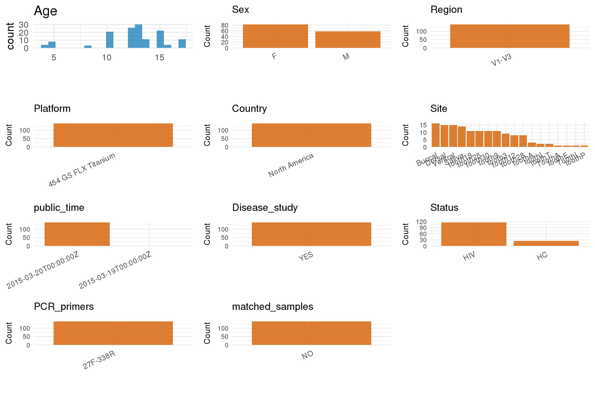

# Step 1: Obtain Initial Metadata from Each Project

This step sets the project directory and loads the raw SRA metadata.

```{r message=FALSE, warning=FALSE}
# Load libraries
library(dplyr)
library(ggplot2)
library(cowplot)

# (1) Setting working directory
project_id <- "PRJNA278076"

base_dir <- "E:/工作区/VSCode/RNAproject/collect_metadata_respon/project"
setwd(file.path(base_dir, project_id))

# (2) Loading raw SRA metadata file
sra_file <- "SraRunTable.csv"
initial_meta <- read.csv(sra_file, header = TRUE, stringsAsFactors = FALSE)
```

# Step 2: Data Overview

First, you need to get an overview of the data, which includes two steps: reading the article and reading the initial metadata. This step is very IMPORTANT!

```{r message=FALSE, warning=FALSE}
# (1) Read the article in the following order: abstract, the beginning of the results section, and the methods.
# The local paper.pdf is password-protected, so the evidence below was cross-checked from the PLOS article HTML/PMC page.
# Paper summary used for this project:
# - Title: The Oral Bacterial Communities of Children with Well-Controlled HIV Infection and without HIV Infection
# - Study design: cross-sectional single time point convenience-sample pediatric oral microbiome study comparing well-controlled HIV-positive children with HIV-negative controls
# - Results text says the cohort was aged 4-16 years, but article Table 1 and SraRunTable.csv both contain patient 11 aged 17; keep the row-level export aligned with Table 1/SRA and note the abstract-or-results wording discrepancy
# - Cohort structure in the paper: 11 HIV-positive children and 5 HIV-negative children
# - Sequenced/deposited cohort: 144 oral specimens were collected, 4 failed repeated PCR amplification, and 140 analyzed samples match the deposited SRA rows
# - Sampling sites in the paper: whole saliva, buccal mucosa, dorsal tongue, ventral tongue, and dental plaque from target teeth
# - Permanent-dentition target teeth were #3, #9, #12, #19, #25, #28, and #30; primary/mixed-dentition target teeth were #A, #T, #E, #P, and #I
# - Methods state that although subgingival sampling was allowed by protocol, all collected plaque samples in this cohort were supragingival because the enrolled patients were generally periodontally healthy
# - Sequencing from Methods: 16S rRNA V1-V3 hypervariable region amplified with barcoded 27F/338R primers and sequenced using 454 FLX Titanium technology
# - Downloaded article assets Table 1 and Table 5 were converted to CSV and cross-checked against SraRunTable.csv; Table 1 confirms patient-level age/sex/HIV labels and Table 5 confirms per-patient sampling-site coverage
# - No separate downloadable sample-level supplement has been identified yet; PLOS exposes Tables 1-6 and Figures 1-5 as article assets, and Table 1 / Table 5 are the most useful follow-up items for manual checking

# (2) IMPORTANT: MUST go through each column of initial_meta
head(initial_meta, 10)
colnames(initial_meta)
table(initial_meta$Host_disease)                 # status candidate
table(initial_meta$host_sex)                     # sex
table(initial_meta$Host_Age)                     # age
table(initial_meta$geo_loc_name_country)         # country
table(initial_meta$Instrument)                   # SRA instrument only; do not use for final platform
table(initial_meta$Assay.Type)                   # if present after name cleaning in R
table(initial_meta$HOST)                         # human filter
table(sub("^.*_", "", initial_meta$env_biome))  # raw site tokens
length(unique(sub("_.*$", "", initial_meta$env_biome))) # subject count
# Raw SRA columns directly useful for the 19-column export:
# - sample_id: Run
# - subject_id + site clue: env_biome
# - age: Host_Age
# - sex: host_sex
# - country: geo_loc_name_country
# - status: Host_disease
# - public_time: ReleaseDate
# - filtering / cohort structure: HOST, Assay Type, env_biome, Sample Name
# Fields that must come from the paper: sequencing_region, platform, pcr_primers, title, disease_study, is_time_series,
# and the interpretation of tooth-coded rows as supragingival plaque.
# Missing in the current raw table: BMI; no explicit per-row cohort label beyond HIV status.
```

# Step 3: Removing Control and Non-human Samples

First, we need to remove control samples(including both negative controls and positive controls) and non-human samples.

```{r}
# (1) Parameter setup
control_column <- ""
control_keywords <- c()

species_column <- "HOST"
unique(initial_meta[[species_column]])
non_human_keywords <- c()

# (2) Remove controls and non-human samples. DO NOT need to modify code in this part, just run it.
n_samples <- nrow(initial_meta)
# Control evaluation
if (length(control_keywords) > 0) {
  if (is.null(control_column) || control_column == "") {
    stop("Error: control_keywords provided but control_column is missing.")
  }

  if (!(control_column %in% colnames(initial_meta))) {
    stop(sprintf("Error: Column '%s' not found in initial_meta.", control_column))
  }

  control_pattern <- paste(control_keywords, collapse = "|")
  control_text <- initial_meta[[control_column]]
  is_control <- grepl(control_pattern, control_text)

} else {
  is_control <- rep(FALSE, n_samples)
}

# Non-human evaluation
if (length(non_human_keywords) > 0) {
  if (is.null(species_column) || species_column == "") {
    stop("Error: non_human_keywords provided but species_column is missing.")
  }

  if (!(species_column %in% colnames(initial_meta))) {
    stop(sprintf("Error: Column '%s' not found in initial_meta.", species_column))
  }

  non_human_pattern <- paste(non_human_keywords, collapse = "|")
  species_text <- initial_meta[[species_column]]
  is_non_human <- grepl(non_human_pattern, species_text)
} else {
  is_non_human <- rep(FALSE, n_samples)
}

# Execute removal
samples_to_remove <- is_control | is_non_human
initial_meta <- initial_meta[!samples_to_remove, ]

cat("Initial samples counts:", n_samples, "\n")
cat("Removed control samples:", sum(is_control), "\n")
cat("Removed non-human samples:", sum(is_non_human), "\n")
cat("Total samples removed ", sum(samples_to_remove), "\n")
cat("Remaining samples after Step 2:", nrow(initial_meta), "\n")
```

# Step 4: Creating a Uniform Metadata Template

This step converts the raw SRA table into the standard metadata format used in our meta-analysis.

```{r}
subject_id <- sub("_.*$", "", initial_meta$env_biome)
raw_site <- sub("^.*_", "", initial_meta$env_biome)
site_detail <- case_when(
  grepl("^tooth", raw_site, ignore.case = TRUE) ~ paste0("supragingival plaque (tooth ", sub("^tooth", "", raw_site, ignore.case = TRUE), ")"),
  raw_site %in% c("Buccal", "buccal") ~ "buccal mucosa",
  raw_site %in% c("Dorsal", "dorsal") ~ "tongue dorsum",
  raw_site %in% c("Ventral", "ventral") ~ "tongue ventral",
  raw_site %in% c("Saliva", "saliva") ~ "saliva",
  TRUE ~ NA_character_
)

metadata <- data.frame(
  bioproject = initial_meta$BioProject,
  sample_id = initial_meta$Run,
  subject_id = subject_id,
  age = suppressWarnings(as.numeric(initial_meta$Host_Age)),
  age_info = NA_character_,
  bmi = NA_real_,
  sex = case_when(
    initial_meta$host_sex == "male" ~ "M",
    initial_meta$host_sex == "female" ~ "F",
    TRUE ~ NA_character_
  ),
  sequencing_region = "V1-V3",
  platform = "454 GS FLX Titanium",
  country = initial_meta$geo_loc_name_country,
  raw_site = raw_site,
  site_detail = site_detail,
  site = "pending",
  site_group = "pending",
  public_time = sub("T.*$", "", initial_meta$ReleaseDate),
  pcr_primers = "27F-338R",
  title = "The Oral Bacterial Communities of Children with Well-Controlled HIV Infection and without HIV Infection",
  disease_study = "yes",
  status = case_when(
    initial_meta$Host_disease == "HIV" ~ "HIV",
    initial_meta$Host_disease == "Healthy" ~ "HC",
    TRUE ~ NA_character_
  ),
  matched_samples = "pending",
  is_time_series = "no",
  stringsAsFactors = FALSE
)

# Source notes for non-obvious fields:
# - subject_id is derived from the patient prefix encoded in env_biome (e.g. Patient13_Buccal -> Patient13).
# - age is taken from SraRunTable.csv Host_Age and matches the downloaded Table 1 patient-level ages, including patient 11 age 17.
# - sex is taken from SraRunTable.csv host_sex and matches the downloaded Table 1 patient-level sex labels.
# - age_info is left NA because row-level ages are present in SRA.
# - bmi remains NA because neither SRA nor the article reports BMI.
# - sequencing_region, platform, and pcr_primers come from the Methods section, not from SRA fields.
# - raw_site is parsed from env_biome. Tooth-coded rows are standardized to supragingival plaque because the Methods state all collected plaque samples were supragingival in this cohort, and the downloaded Table 5 site matrix matches the SRA-derived site coverage.
# - site_detail keeps the exact tooth identifier from env_biome for plaque rows, e.g. tooth19 -> supragingival plaque (tooth 19), so the Rmd preserves which target tooth was sampled.
# - country follows SraRunTable.csv geo_loc_name_country (USA for all rows); if Table 1 wording differs, keep the export rule documented in notes.
# - status uses the explicit Host_disease labels HIV vs Healthy, standardized to HIV and HC; these patient-level labels agree with Table 1 HIV/Neg. entries.
metadata$public_time <- as.Date(metadata$public_time)
```

# Step 5: Manually solving pending issues

This step involves two parts: (1) handle the columns with the `raw_` prefix, and next (2) handle the `site_group` and `matched_samples` columns.

```{r}
# (1) Handle the columns with the `raw_` prefix.
metadata <- metadata %>%
  mutate(site = case_when(
    grepl("^tooth", raw_site, ignore.case = TRUE) ~ site_detail,
    raw_site %in% c("Buccal", "buccal") ~ "buccal mucosa",
    raw_site %in% c("Dorsal", "dorsal") ~ "tongue dorsum",
    raw_site %in% c("Ventral", "ventral") ~ "tongue ventral",
    raw_site %in% c("Saliva", "saliva") ~ "saliva",
    TRUE ~ NA_character_
  ))
# All plaque rows are mapped to supragingival plaque because the Methods state that, although subgingival collection was allowed by protocol,
# all plaque samples obtained from the enrolled cohort were supragingival; the exact tooth number/letter is retained in site.
```

```{r}
# (2) Filling the 'site_group' and 'matched_samples' columns
unique(metadata$site)
Gut_site <- c("feces")

metadata <- metadata %>%
  mutate(site_group = case_when(
    grepl("^supragingival plaque", site) ~ "oral",
    site %in% c("buccal mucosa", "tongue dorsum", "tongue ventral", "saliva") ~ "oral",
    site %in% Gut_site ~ "gut",
    TRUE ~ "other"
  ))

metadata$matched_samples <- ifelse(
  ave(metadata$subject_id, metadata$subject_id, FUN = length) > 1,
  "yes",
  "no"
)
# This is a matched multi-site design because multiple oral specimens were collected per subject, and the per-patient site pattern matches downloaded Table 5; it is not a time-series study.
```

```{r}
# (3) check if there is pending value in metadata. If there is pending value, go on modify the metadata.
has_pending <- function(col) {
  if (is.character(col) || is.factor(col)) {
    any(col == "pending", na.rm = TRUE)
  } else {
    FALSE
  }
}

any_pending_value <- any(sapply(metadata, has_pending))

if (!any_pending_value) {
  message("Good! No cell contains the value 'pending'.")
} else {
  pending_cols <- names(metadata)[sapply(metadata, has_pending)]
  message("Columns containing 'pending': ", paste(pending_cols, collapse = ", "))
  message("Please continue to resolve these pending columns!")
}
```

# Step 6: Visualize the Metadata

This step makes a quick set of plots for checking the distribution of key metadata fields.

```{r}
plot_data <- metadata %>%
  select(-bioproject, -sample_id, -subject_id, -title, -raw_site, -site_detail)

create_simple_plots <- function(data) {
  plots <- list()
  continuous_vars <- c("age", "bmi")

  for (col in colnames(data)) {
    if (all(is.na(data[[col]]))) {
      p <- ggplot() +
        annotate("text", x = 0.5, y = 0.5, label = "this column is NA", size = 6) +
        labs(title = col) +
        theme_void()
    } else if (col %in% continuous_vars && is.numeric(data[[col]])) {
      p <- ggplot(data, aes(x = .data[[col]])) +
        geom_histogram(fill = "blue", alpha = 0.6, bins = 20, na.rm = TRUE) +
        labs(title = col, x = col, y = "Count") +
        theme_minimal()
    } else {
      count_data <- as.data.frame(table(data[[col]], useNA = "ifany"))
      p <- ggplot(count_data, aes(x = reorder(Var1, -Freq), y = Freq)) +
        geom_col(fill = "red", alpha = 0.6) +
        labs(title = col, x = NULL, y = "Count") +
        theme_minimal() +
        theme(axis.text.x = element_text(angle = 15, hjust = 1))
    }
    plots[[col]] <- p
  }

  return(plots)
}

plots <- create_simple_plots(plot_data)
p <- plot_grid(plots$age,
               plots$bmi,
               plots$sex,
               plots$site,
               plots$site_group,
               plots$sequencing_region,
               plots$platform,
               plots$country,
               plots$status,
               plots$matched_samples,
               ncol = 3, align = "hv", axis = "lb")
ggsave("Metadata_Summary.png", plot = p, width = 8, height = 6, dpi = 150)
```

```{r}

```

# Step 7: Sort and export the metadata

This step saves the cleaned metadata table as the final `metadata_v2.csv` file.

```{r}
fixed_cols <- c("bioproject", "sample_id", "subject_id", "age", "age_info",
                "bmi", "sex", "platform", "sequencing_region", "pcr_primers",
                "country", "site", "site_group", "disease_study", "status",
                "title", "public_time", "matched_samples", "is_time_series")
metadata <- metadata %>%
  select(all_of(fixed_cols), starts_with("raw_"))

write.csv(metadata, file = "metadata_v2.csv", quote = TRUE, row.names = FALSE)
```
