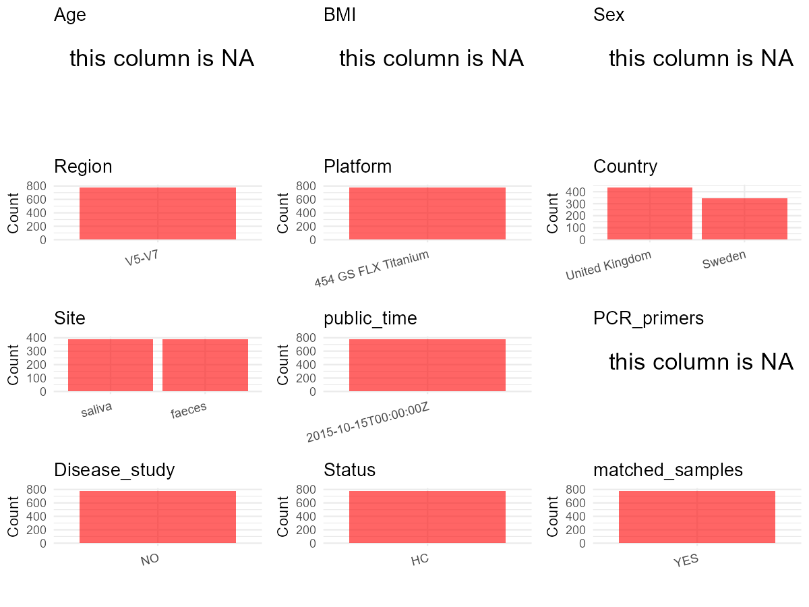

# Step 1: Obtain Initial Metadata from Each Project

To obtain the initial metadata: 1. Search for the BioProject ID (e.g.,
“PRJEBXXXX”) on the [NCBI SRA
website](https://www.ncbi.nlm.nih.gov/Traces/study/). 2. In the “Select”
table, click on “Metadata” and download the file. 3. The downloaded file
is typically named “SraRunTable.csv” and contains metadata for the
project.

    library(tidyverse)
    library(ggplot2)
    library(cowplot)

    setwd("C:/Users/zyc/Desktop/oral_project/data/projects/PRJNA281060")
    initial_meta <- read.csv("SraRunTable.csv", header = TRUE) 
    head(initial_meta)

    ##          Run Assay.Type AvgSpotLen   Bases  BioProject    BioSample                             BioSampleModel   Bytes Center.Name   centre
    ## 1 SRR1982882   AMPLICON        406 2159067 PRJNA281060 SAMN03494394 MIMS.me,MIGS/MIMS/MIMARKS.human-associated 1347962        ACTA Helperby
    ## 2 SRR1982883   AMPLICON        406 3129754 PRJNA281060 SAMN03494395 MIMS.me,MIGS/MIMS/MIMARKS.human-associated 1923443        ACTA Helperby
    ## 3 SRR1982884   AMPLICON        406 2404940 PRJNA281060 SAMN03494396 MIMS.me,MIGS/MIMS/MIMARKS.human-associated 1510379        ACTA Helperby
    ## 4 SRR1982885   AMPLICON        408 2411379 PRJNA281060 SAMN03494397 MIMS.me,MIGS/MIMS/MIMARKS.human-associated 1539137        ACTA Helperby
    ## 5 SRR1982886   AMPLICON        406 2748472 PRJNA281060 SAMN03494398 MIMS.me,MIGS/MIMS/MIMARKS.human-associated 1713639        ACTA Helperby
    ## 6 SRR1982887   AMPLICON        406 4686001 PRJNA281060 SAMN03494399 MIMS.me,MIGS/MIMS/MIMARKS.human-associated 2538637        ACTA Helperby
    ##   chem_administration Consent DATASTORE.filetype DATASTORE.provider                     DATASTORE.region env_biome env_feature env_material
    ## 1                amox  public   fastq,run.zq,sra         gs,ncbi,s3 gs.us-east1,ncbi.public,s3.us-east-1     human         gut       faeces
    ## 2                amox  public   fastq,run.zq,sra         gs,ncbi,s3 gs.us-east1,ncbi.public,s3.us-east-1     human         gut       faeces
    ## 3                amox  public   fastq,run.zq,sra         gs,ncbi,s3 gs.us-east1,ncbi.public,s3.us-east-1     human         gut       faeces
    ## 4                amox  public   fastq,run.zq,sra         gs,ncbi,s3 gs.us-east1,ncbi.public,s3.us-east-1     human         gut       faeces
    ## 5                amox  public   fastq,run.zq,sra         gs,ncbi,s3 gs.us-east1,ncbi.public,s3.us-east-1     human         gut       faeces
    ## 6                amox  public   fastq,run.zq,sra         gs,ncbi,s3 gs.us-east1,ncbi.public,s3.us-east-1     human         gut       faeces
    ##   Experiment geo_loc_name_country geo_loc_name_country_continent   geo_loc_name         HOST individual_niche_series          Instrument
    ## 1 SRX1001807       United Kingdom                         Europe United Kingdom Homo sapiens        HP1_faeces_amox2 454 GS FLX Titanium
    ## 2 SRX1001808       United Kingdom                         Europe United Kingdom Homo sapiens        HP1_faeces_amox3 454 GS FLX Titanium
    ## 3 SRX1001809       United Kingdom                         Europe United Kingdom Homo sapiens        HP1_faeces_amox4 454 GS FLX Titanium
    ## 4 SRX1001810       United Kingdom                         Europe United Kingdom Homo sapiens        HP1_faeces_amox5 454 GS FLX Titanium
    ## 5 SRX1001811       United Kingdom                         Europe United Kingdom Homo sapiens        HP1_faeces_amox6 454 GS FLX Titanium
    ## 6 SRX1001812       United Kingdom                         Europe United Kingdom Homo sapiens        HP1_faeces_amox7 454 GS FLX Titanium
    ##      library_id  Library.Name LibraryLayout LibrarySelection LibrarySource         Organism Platform          ReleaseDate
    ## 1  T30.1F.001.2  T30.1F.001.2        SINGLE              PCR   METAGENOMIC human metagenome    LS454 2015-10-15T00:00:00Z
    ## 2  T30.1F.001.3  T30.1F.001.3        SINGLE              PCR   METAGENOMIC human metagenome    LS454 2015-10-15T00:00:00Z
    ## 3  T30.1F.001.4  T30.1F.001.4        SINGLE              PCR   METAGENOMIC human metagenome    LS454 2015-10-15T00:00:00Z
    ## 4  T30.1F.001.5  T30.1F.001.5        SINGLE              PCR   METAGENOMIC human metagenome    LS454 2015-10-15T00:00:00Z
    ## 5  T30.1F.001.6  T30.1F.001.6        SINGLE              PCR   METAGENOMIC human metagenome    LS454 2015-10-15T00:00:00Z
    ## 6 T41.1.F.001.7 T41.1.F.001.7        SINGLE              PCR   METAGENOMIC human metagenome    LS454 2015-10-15T00:00:00Z
    ##            create_date version   Sample.Name SRA.Study     Time
    ## 1 2015-04-21T15:01:00Z       1  T30.1F.001.2 SRP057504 baseline
    ## 2 2015-04-21T15:02:00Z       1  T30.1F.001.3 SRP057504    week1
    ## 3 2015-04-21T15:01:00Z       1  T30.1F.001.4 SRP057504   month1
    ## 4 2015-04-21T15:01:00Z       1  T30.1F.001.5 SRP057504   month2
    ## 5 2015-04-21T15:01:00Z       1  T30.1F.001.6 SRP057504   month4
    ## 6 2015-04-21T15:01:00Z       1 T41.1.F.001.7 SRP057504  month12

# Step 2: Create a Uniform Metadata Template

The uniform metadata should include the following columns:

1.  **BioProject**: Project ID (e.g., “PRJNA339212”)
2.  **Run**: Sample ID (e.g., “ERRXXXXXX” or “SRRXXXXXX”)
3.  **sample\_name**: Original sample name submitted by the authors (not
    the database-assigned ID)
4.  **Age**: Age of the subject (if available)
5.  **BMI**: Body Mass Index (if available)
6.  **Sex**: Sex of the subject (“F” or “M”)
7.  **Region**: Targeted 16S rRNA region (e.g., “V3-V4”)
8.  **Platform**: Sequencing platform (e.g., “Illumina MiSeq”)
9.  **Country**: Country of sample origin (e.g., “China”)
10. **Site**: Sample site (e.g., “saliva”, “dental plaque”)
11. **public\_time**: Data release date (format: “YYYY-MM-DD”)
12. **PCR\_primers**: PCR primers used (e.g., “515F-806R”)
13. **title**: Title of the associated publication
14. **Disease\_study**: Whether the study involves a disease (“YES” or
    “NO”)
15. **Status**: Disease status (e.g., “T2DM”, “HC”). Note: If the study
    includes both disease and healthy samples, this must be specified
    per sample.
16. **matched\_samples**: matched samples (“YES” or “NO”)

<!-- -->

    metadata <- data.frame(
      BioProject = initial_meta$BioProject,
      Run = initial_meta$Run,
      sample_name = initial_meta$Sample.Name,
      Age = NA,
      BMI = NA,
      Sex = NA,
      Platform = initial_meta$Instrument,
      Country = initial_meta$geo_loc_name_country,
      Site = initial_meta$env_material,
      public_time = initial_meta$ReleaseDate,
      # Status = initial_meta$Sample.Name,
      stringsAsFactors = FALSE
    )

# Step 3: Manually Add Information from the Publication

Some information (e.g. PCR primers, study title, disease status) must be
manually extracted from the publication and added to the metadata.

     # metadata <- metadata %>%
     #  mutate(Sex = recode(Sex, "female" = "F", "male" = "M"))
    # metadata <-metadata%>%
    #   mutate(Status = case_when(Site == "mucous" ~ "OSCC",
    #                             Site == "dental plaque" ~ "OSCC",
    #                             Site == "tumor" ~ "OSCC",
    #                             TRUE ~ NA))

    metadata$Status <- "HC"
    metadata$matched_samples <- "YES"
    metadata$Region <- "V5-V7"
    metadata$title <- "Same Exposure but Two Radically Different Responses to Antibiotics:Resilience of the Salivary Microbiome versus Long-Term Microbial Shifts in Feces"
    metadata$Disease_study <- "NO"
    metadata$PCR_primers <- NA
    head(metadata)

    ##    BioProject        Run   sample_name Age BMI Sex            Platform        Country   Site          public_time Status matched_samples
    ## 1 PRJNA281060 SRR1982882  T30.1F.001.2  NA  NA  NA 454 GS FLX Titanium United Kingdom faeces 2015-10-15T00:00:00Z     HC             YES
    ## 2 PRJNA281060 SRR1982883  T30.1F.001.3  NA  NA  NA 454 GS FLX Titanium United Kingdom faeces 2015-10-15T00:00:00Z     HC             YES
    ## 3 PRJNA281060 SRR1982884  T30.1F.001.4  NA  NA  NA 454 GS FLX Titanium United Kingdom faeces 2015-10-15T00:00:00Z     HC             YES
    ## 4 PRJNA281060 SRR1982885  T30.1F.001.5  NA  NA  NA 454 GS FLX Titanium United Kingdom faeces 2015-10-15T00:00:00Z     HC             YES
    ## 5 PRJNA281060 SRR1982886  T30.1F.001.6  NA  NA  NA 454 GS FLX Titanium United Kingdom faeces 2015-10-15T00:00:00Z     HC             YES
    ## 6 PRJNA281060 SRR1982887 T41.1.F.001.7  NA  NA  NA 454 GS FLX Titanium United Kingdom faeces 2015-10-15T00:00:00Z     HC             YES
    ##   Region
    ## 1  V5-V7
    ## 2  V5-V7
    ## 3  V5-V7
    ## 4  V5-V7
    ## 5  V5-V7
    ## 6  V5-V7
    ##                                                                                                                                                 title
    ## 1 Same Exposure but Two Radically Different Responses to Antibiotics:Resilience of the Salivary Microbiome versus Long-Term Microbial Shifts in Feces
    ## 2 Same Exposure but Two Radically Different Responses to Antibiotics:Resilience of the Salivary Microbiome versus Long-Term Microbial Shifts in Feces
    ## 3 Same Exposure but Two Radically Different Responses to Antibiotics:Resilience of the Salivary Microbiome versus Long-Term Microbial Shifts in Feces
    ## 4 Same Exposure but Two Radically Different Responses to Antibiotics:Resilience of the Salivary Microbiome versus Long-Term Microbial Shifts in Feces
    ## 5 Same Exposure but Two Radically Different Responses to Antibiotics:Resilience of the Salivary Microbiome versus Long-Term Microbial Shifts in Feces
    ## 6 Same Exposure but Two Radically Different Responses to Antibiotics:Resilience of the Salivary Microbiome versus Long-Term Microbial Shifts in Feces
    ##   Disease_study PCR_primers
    ## 1            NO          NA
    ## 2            NO          NA
    ## 3            NO          NA
    ## 4            NO          NA
    ## 5            NO          NA
    ## 6            NO          NA

# Step 4: Summarize and Validate the Metadata

    print(paste("Number of unique runs:", length(unique(metadata$Run))))

    ## [1] "Number of unique runs: 781"

    print(paste("Number of unique sample names:", length(unique(metadata$sample_name))))

    ## [1] "Number of unique sample names: 781"

# Step 5: Visualize the Metadata

    plot_data <- metadata %>%
      select(-BioProject, -Run, -sample_name, -title)

    # Function to create simple plots for each column
    create_simple_plots <- function(data) {
      plots <- list()

      for (col in colnames(data)) {
        # Check if the column is all NA
        if (all(is.na(data[[col]]))) {
          # Create an empty plot with text indicating all NA
          p <- ggplot() +
            annotate("text", x = 0.5, y = 0.5, label = "this column is NA", size = 6) +
            labs(title = col) +
            theme_void()
        } else if (is.numeric(data[[col]])) {
          # Numeric variable: histogram
          p <- ggplot(data, aes(x = .data[[col]])) +
            geom_histogram(fill = "blue", alpha = 0.6, bins = 20, na.rm = T) +
            labs(title = col) +
            theme_minimal()
        } else {
          # Categorical variable: bar plot (remove NA values)
          count_data <- as.data.frame(table(data[[col]], useNA = "ifany"))
          p <- ggplot(count_data, aes(x = reorder(Var1, -Freq), y = Freq)) +
            geom_col(fill = "red", alpha = 0.6) +
            labs(title = col, x = NULL, y = "Count") +
            theme_minimal() +
            theme(axis.text.x = element_text(angle = 15, hjust = 1))
        }
        plots[[col]] <- p
      }

      return(plots)
    }

    plots <- create_simple_plots(plot_data)
    p<-plot_grid(plots$Age,
              plots$BMI,
              plots$Sex,
              plots$Region,
              plots$Platform,
              plots$Country,
              plots$Site,
              plots$public_time,
              plots$PCR_primers,
              plots$Disease_study,
              plots$Status,
              plots$matched_samples,# add
              ncol = 3, align = "hv", axis = "lb")
    ggsave("Metadata_Summary.png", plot = p, width = 8, height = 6, dpi = 150)

    

 \# Step 6: Finalize and Export the Metadata

    metadata <- metadata[, c(
      "BioProject", "Run", "sample_name", "Age", "BMI", "Sex",
      "Region", "Platform", "Country", "Site", "public_time",
      "PCR_primers", "title", "Disease_study", "Status","matched_samples"
    )]

    write.csv(metadata, file = "metadata.csv", quote = FALSE)
