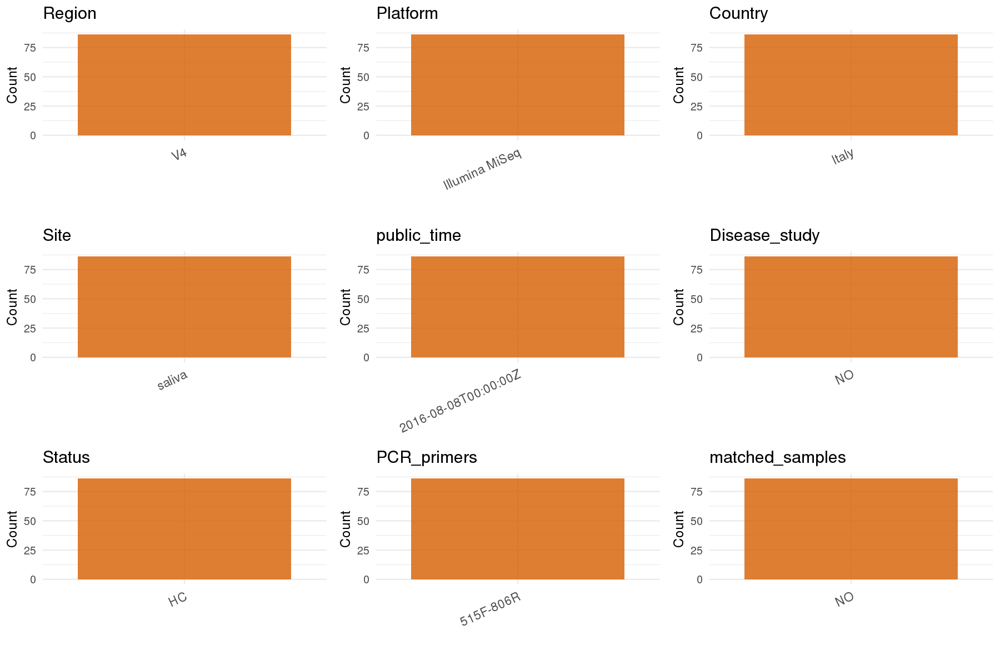

# Step 1: Obtain Initial Metadata from Each Project

To obtain the initial metadata: 1. Search for the BioProject ID (e.g., "PRJEBXXXX") on the [NCBI SRA website](https://www.ncbi.nlm.nih.gov/Traces/study/). 2. In the "Select" table, click on "Metadata" and download the file. 3. The downloaded file is typically named "SraRunTable.csv" and contains metadata for the project.

```{r message=FALSE, warning=FALSE}
# Load necessary libraries
library(dplyr)
library(ggplot2)
library(cowplot)


# Set working directory (update this path to your local directory)
setwd("/home/cjj/projects/collect_oral_data/global-oral-microbiome/data/tmp/PRJNA289189")
initial_meta<-read.csv("SraRunTable.csv",header = T)
colnames(initial_meta)

head(initial_meta , n=3)
library(readxl)


# table1 <- read_excel("Table 1.XLSX",)
# table2 <- read_excel("Table 1.XLSX",)
# head(table1 , n=3)
# head(table2 , n=3)
# ESM <- ESM[,c(1,3,4)]
# colnames(ESM) <- c("subject_id","Age","Sex")
# initial_meta_cbind <- left_join(initial_meta,ESM,by="subject_id")
# table(initial_meta_cbind$Age,initial_meta_cbind$Sex)
# Display the first few rows of the metadata
# head(initial_meta_cbind)
```

# Step 2: Create a Uniform Metadata Template

The uniform metadata should include the following columns:

1.  **BioProject**: Project ID (e.g., "PRJNA339212")
2.  **Run**: Sample ID (e.g., "ERRXXXXXX" or "SRRXXXXXX")
3.  **sample_name**: Original sample name submitted by the authors (not the database-assigned ID)
4.  **Age**: Age of the subject (if available)
5.  **BMI**: Body Mass Index (if available)
6.  **Sex**: Sex of the subject ("F" or "M")
7.  **Region**: Targeted 16S rRNA region (e.g., "V3-V4")
8.  **Platform**: Sequencing platform (e.g., "Illumina MiSeq")
9.  **Country**: Country of sample origin (e.g., "China")
10. **Site**: Sample site (e.g., "saliva", "dental plaque")
11. **public_time**: Data release date (format: "YYYY-MM-DD")
12. **PCR_primers**: PCR primers used (e.g., "515F-806R")
13. **title**: Title of the associated publication
14. **Disease_study**: Whether the study involves a disease ("YES" or "NO")
15. **Status**: Disease status (e.g., "T2DM", "HC"). Note: If the study includes both disease and healthy samples, this must be specified per sample.

```{r}
# Create a uniform metadata dataframe
metadata <- data.frame(
  BioProject = initial_meta$BioProject,
  Run = initial_meta$Run,
  sample_name = initial_meta$Sample.Name,
  Age = NA_character_,
  BMI = NA_character_,
  Sex= NA_character_,
  Region = "V4",
  Platform = initial_meta$Instrument,
  Country = initial_meta$geo_loc_name_country,
  Site = initial_meta$material,
  public_time = initial_meta$ReleaseDate,
  Disease_study = 'NO',
  Status = 'HC',
  stringsAsFactors = FALSE
)
```

# Step 3: Manually Add Information from the Publication

Some information (e.g. PCR primers, study title, disease status) must be manually extracted from the publication and added to the metadata.

```{r}
# Add information obtained from the publication
metadata_clean <- metadata
metadata_clean$PCR_primers <- '515F-806R'
metadata_clean$title <- "The short-term impact of probiotic consumption on the oral cavity microbiome"

metadata_clean$sample_name <- metadata$sample_name

# metadata_clean$Status <- ifelse(grepl("HIV", metadata$Status), "HIV", 
#                             ifelse(grepl("Healthy", metadata$Status), "HC",NA_character_)
#                                 )

metadata_clean$matched_samples <- "NO"

metadata_clean$Site <- metadata$Site

# metadata_clean$Age <- metadata$Age
# metadata_clean$Sex <- ifelse(metadata$Sex == "male", "M",
#                            ifelse(metadata$Sex == "female", "F", NA_character_)
#                      )

# metadata[which(metadata$Site=="SP"),]$Site <- "supragingival"
# metadata[which(metadata$Site=="T"),]$Site <- "tongue"
# metadata[which(metadata$Site=="SA"),]$Site <- "salivary"


# Use cleaned dataset for subsequent analysis
metadata <- metadata_clean
```

# Step 4: Summarize and Validate the Metadata

```{r}
# Check the number of unique runs and sample names
print(paste("Number of unique runs:", length(unique(metadata$Run))))
print(paste("Number of unique sample names:", length(unique(metadata$sample_name))))
```

# Step 5: Visualize the Metadata

```{r,fig.width=8, fig.height=6, fig.align='center',include=FALSE}
# Select columns for visualization
# 加载必要的包
library(dplyr)
library(ggplot2)
library(cowplot)

# 1. 准备数据：自动筛选需要可视化的列
#    - 移除ID和标题这类非统计列
#    - 关键一步: 使用where()自动移除所有值都是NA的列
plot_data <- metadata %>%
  select(
    -any_of(c("BioProject", "Run", "sample_name", "title")) # 移除ID和文本列
  ) %>%
  select(where(~!all(is.na(.)))) # 自动移除所有值都为空的列

# 2. 循环遍历筛选后的列，自动创建绘图列表
plots <- list()
for (col_name in names(plot_data)) {
  
  # 检查是数值型还是类别型
  if (is.numeric(plot_data[[col_name]])) {
    # 数值型变量 -> 绘制直方图 (分布图)
    p <- ggplot(plot_data, aes(x = .data[[col_name]])) +
      geom_histogram(bins = 20, fill = "#0072B2", alpha = 0.7, na.rm = TRUE) +
      labs(title = col_name, x = NULL) +
      theme_minimal(base_size = 16)
      
  } else {
    # 类别型变量 -> 绘制柱状图
    p <- plot_data %>%
      count(.data[[col_name]], sort = TRUE, name = "Count") %>% # 使用dplyr::count进行统计
      ggplot(aes(x = reorder(.data[[col_name]], -Count), y = Count)) +
      geom_col(fill = "#D55E00", alpha = 0.8) +
      labs(title = col_name, x = NULL, y = "Count") +
      theme_minimal(base_size = 12) +
      theme(axis.text.x = element_text(angle = 25, hjust = 1, size = 11)) # 优化x轴标签显示
  }
  
  plots[[col_name]] <- p
}

# 3. 自动组合所有生成的图并保存
if (length(plots) > 0) {
  # 使用 plotlist 参数来自动接收所有图
  p_final <- plot_grid(plotlist = plots, ncol = 3, align = "hv")
  
  # 保存图像
  ggsave("Metadata_Summary.png", plot = p_final, width = 12, height = 8, dpi = 150, bg = "white")
  
  print("图像已生成并保存为 Metadata_Summary.png")
  # print(p_final) # 如果想在RStudio里直接预览，可以取消这行注释
  
} else {
  print("没有可以绘制的列。")
}
```

```{r}

```

# Step 6: Finalize and Export the Metadata

```{r}
# Reorder columns to match the desired format
metadata <- metadata[, c(
  "BioProject", "Run", "sample_name", "Age", "BMI", "Sex", 
  "Region", "Platform", "Country", "Site", "public_time", 
  "PCR_primers", "title", "Disease_study", "Status","matched_samples"
)]

# Export the uniform metadata to a CSV file
write.csv(metadata, file = "metadata.csv", quote = TRUE)
head(metadata)
```

## Notes for Students:

1.  **Metadata Accuracy**: Always cross-check the metadata with the original publication to ensure accuracy.
2.  **Manual Entries**: Columns like `PCR_primers`, and `Status` often require manual entry based on the publication.
3.  **Disease Status**: Be careful when assigning `Status`—some studies include both disease and healthy samples.
4.  **Visualization**: The plots help quickly identify the distribution of values in each column, which is useful for quality control.
5.  **Reproducibility**: Update the working directory and file paths to match your local environment.
