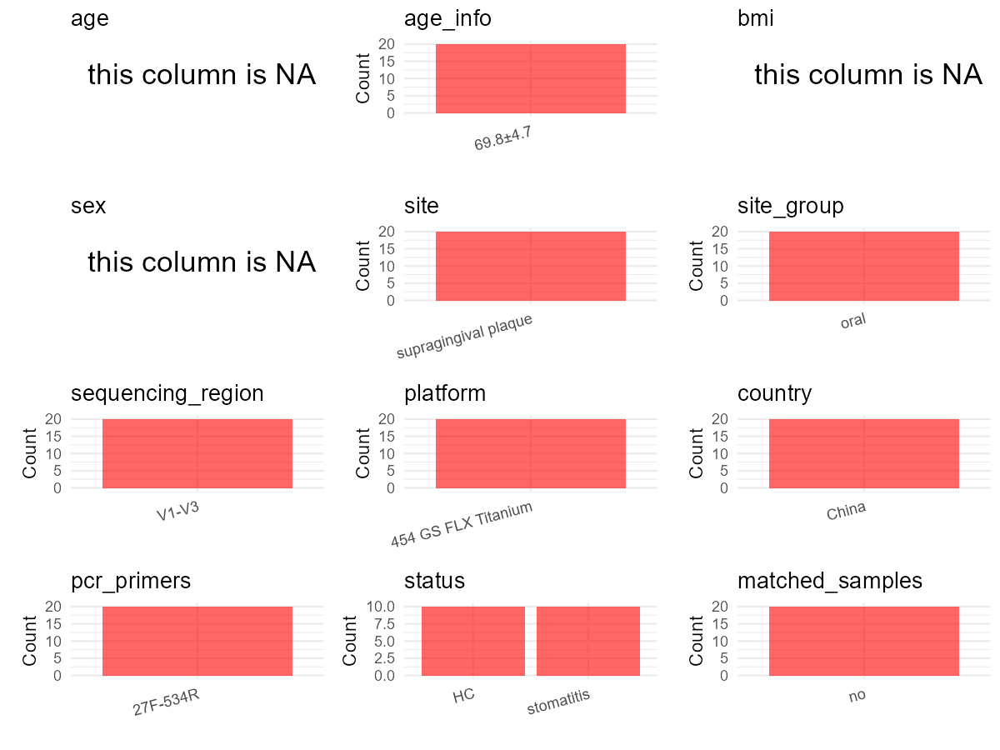

R Notebook: Metadata Processing Workflow
================

# Step 1: Obtain Initial Metadata from Each Project

This step sets the project directory, loads the raw SRA metadata, and
optionally merges supplement tables.

``` r
# Load libraries
library(dplyr)
library(ggplot2)
library(cowplot)

# (1) Setting working directory
# EDIT HERE: change project_id for each study
project_id <- "PRJNA292354" 

base_dir <- "E:/oral/26/metadata-2604/Oral-Metadata-YL-02"
setwd(file.path(base_dir, project_id))

# (2) Loading raw SRA metadata file
sra_file <- "SraRunTable.csv"
initial_meta <- read.csv(sra_file, header = TRUE)

# (3) OPTIONAL: If extra metadata (e.g., Table.x or supplemental materials) are available from the article, you may need to merge the file with initial_meta manually. Below is example code for merging. Depending on the specific case of each study, you can customize the code as needed.
#supp_table <- read.csv("supplemental_table_v2.csv", header = TRUE)
#initial_meta <- left_join(initial_meta, supp_table, by = "Sample.Name")
```

# Step 2: Data Overview

First, you need to get an overview of the data, which includes two
steps: reading the article and reading the initial metadata. This step
is very IMPORTANT!

``` r
# (1) Read the article in the following order: abstract, the beginning of the results section, and the methods. Understand the sample size, experimental design, and disease group overview. Clarify the sampling sites; for oral and gut samples, specify the exact sites like supragingival plaque, tongue, etc.

# (2) IMPORTANT: MUST go through each column of initial_meta
head(initial_meta, 10)
```

    ##           Run Assay.Type AvgSpotLen   Bases  BioProject    BioSample
    ## 1  SRR3381545   AMPLICON        459 1096526 PRJNA292354 SAMN04625859
    ## 2  SRR3381546   AMPLICON        441 1033969 PRJNA292354 SAMN04625860
    ## 3  SRR3381547   AMPLICON        458  860096 PRJNA292354 SAMN04625869
    ## 4  SRR3381548   AMPLICON        457 1765018 PRJNA292354 SAMN04625870
    ## 5  SRR3381549   AMPLICON        449 1121533 PRJNA292354 SAMN04625871
    ## 6  SRR3381550   AMPLICON        452  871490 PRJNA292354 SAMN04625872
    ## 7  SRR3381551   AMPLICON        453 1108783 PRJNA292354 SAMN04625873
    ## 8  SRR3381552   AMPLICON        447 1025042 PRJNA292354 SAMN04625874
    ## 9  SRR3381553   AMPLICON        455 1145447 PRJNA292354 SAMN04625875
    ## 10 SRR3381554   AMPLICON        439  870224 PRJNA292354 SAMN04625876
    ##                 BioSampleModel   Bytes              Center.Name Collection_Date
    ## 1  Metagenome or environmental  645567 UCLA SCHOOL OF DENTISTRY            2012
    ## 2  Metagenome or environmental  640851 UCLA SCHOOL OF DENTISTRY            2012
    ## 3  Metagenome or environmental  545779 UCLA SCHOOL OF DENTISTRY            2012
    ## 4  Metagenome or environmental 1018194 UCLA SCHOOL OF DENTISTRY            2012
    ## 5  Metagenome or environmental  689653 UCLA SCHOOL OF DENTISTRY            2012
    ## 6  Metagenome or environmental  550370 UCLA SCHOOL OF DENTISTRY            2012
    ## 7  Metagenome or environmental  692422 UCLA SCHOOL OF DENTISTRY            2012
    ## 8  Metagenome or environmental  667951 UCLA SCHOOL OF DENTISTRY            2012
    ## 9  Metagenome or environmental  718020 UCLA SCHOOL OF DENTISTRY            2012
    ## 10 Metagenome or environmental  566919 UCLA SCHOOL OF DENTISTRY            2012
    ##    Consent DATASTORE.filetype DATASTORE.provider
    ## 1   public   fastq,run.zq,sra         gs,ncbi,s3
    ## 2   public   fastq,run.zq,sra         gs,ncbi,s3
    ## 3   public   fastq,run.zq,sra         gs,ncbi,s3
    ## 4   public   fastq,run.zq,sra         gs,ncbi,s3
    ## 5   public   fastq,run.zq,sra         gs,ncbi,s3
    ## 6   public   fastq,run.zq,sra         gs,ncbi,s3
    ## 7   public   fastq,run.zq,sra         gs,ncbi,s3
    ## 8   public   fastq,run.zq,sra         gs,ncbi,s3
    ## 9   public   fastq,run.zq,sra         gs,ncbi,s3
    ## 10  public   fastq,run.zq,sra         gs,ncbi,s3
    ##                        DATASTORE.region Experiment geo_loc_name_country
    ## 1  gs.us-east1,ncbi.public,s3.us-east-1 SRX1704200                China
    ## 2  gs.us-east1,ncbi.public,s3.us-east-1 SRX1704201                China
    ## 3  gs.us-east1,ncbi.public,s3.us-east-1 SRX1704202                China
    ## 4  gs.us-east1,ncbi.public,s3.us-east-1 SRX1704203                China
    ## 5  gs.us-east1,ncbi.public,s3.us-east-1 SRX1704204                China
    ## 6  gs.us-east1,ncbi.public,s3.us-east-1 SRX1704205                China
    ## 7  gs.us-east1,ncbi.public,s3.us-east-1 SRX1704206                China
    ## 8  gs.us-east1,ncbi.public,s3.us-east-1 SRX1704207                China
    ## 9  gs.us-east1,ncbi.public,s3.us-east-1 SRX1704208                China
    ## 10 gs.us-east1,ncbi.public,s3.us-east-1 SRX1704210                China
    ##    geo_loc_name_country_continent                            geo_loc_name
    ## 1                            Asia China: Chengdu city\\, Sichuan province
    ## 2                            Asia China: Chengdu city\\, Sichuan province
    ## 3                            Asia China: Chengdu city\\, Sichuan province
    ## 4                            Asia China: Chengdu city\\, Sichuan province
    ## 5                            Asia China: Chengdu city\\, Sichuan province
    ## 6                            Asia China: Chengdu city\\, Sichuan province
    ## 7                            Asia China: Chengdu city\\, Sichuan province
    ## 8                            Asia China: Chengdu city\\, Sichuan province
    ## 9                            Asia China: Chengdu city\\, Sichuan province
    ## 10                           Asia China: Chengdu city\\, Sichuan province
    ##            HOST Instrument              isolation_source              lat_lon
    ## 1  Homo sapiens 454 GS FLX Denture of healthy subject #1 30.5728 N 104.0668 E
    ## 2  Homo sapiens 454 GS FLX   Tooth of healthy subject #1 30.5728 N 104.0668 E
    ## 3  Homo sapiens 454 GS FLX Denture of healthy subject #6 30.5728 N 104.0668 E
    ## 4  Homo sapiens 454 GS FLX   Tooth of healthy subject #6 30.5728 N 104.0668 E
    ## 5  Homo sapiens 454 GS FLX Denture of healthy subject #7 30.5728 N 104.0668 E
    ## 6  Homo sapiens 454 GS FLX   Tooth of healthy subject #7 30.5728 N 104.0668 E
    ## 7  Homo sapiens 454 GS FLX Denture of healthy subject #8 30.5728 N 104.0668 E
    ## 8  Homo sapiens 454 GS FLX   Tooth of healthy subject #8 30.5728 N 104.0668 E
    ## 9  Homo sapiens 454 GS FLX Denture of healthy subject #9 30.5728 N 104.0668 E
    ## 10 Homo sapiens 454 GS FLX   Tooth of healthy subject #9 30.5728 N 104.0668 E
    ##    Library.Name LibraryLayout LibrarySelection LibrarySource
    ## 1           HD1        SINGLE              PCR   METAGENOMIC
    ## 2           HT1        SINGLE              PCR   METAGENOMIC
    ## 3           HD6        SINGLE              PCR   METAGENOMIC
    ## 4           HT6        SINGLE              PCR   METAGENOMIC
    ## 5           HD7        SINGLE              PCR   METAGENOMIC
    ## 6           HT7        SINGLE              PCR   METAGENOMIC
    ## 7           HD8        SINGLE              PCR   METAGENOMIC
    ## 8           HT8        SINGLE              PCR   METAGENOMIC
    ## 9           HD9        SINGLE              PCR   METAGENOMIC
    ## 10          HT9        SINGLE              PCR   METAGENOMIC
    ##                 Organism Platform          ReleaseDate          create_date
    ## 1  human oral metagenome    LS454 2016-05-01T00:00:00Z 2016-04-21T14:36:00Z
    ## 2  human oral metagenome    LS454 2016-05-01T00:00:00Z 2016-04-21T14:36:00Z
    ## 3  human oral metagenome    LS454 2016-05-01T00:00:00Z 2016-04-21T14:36:00Z
    ## 4  human oral metagenome    LS454 2016-05-01T00:00:00Z 2016-04-21T14:36:00Z
    ## 5  human oral metagenome    LS454 2016-05-01T00:00:00Z 2016-04-21T14:36:00Z
    ## 6  human oral metagenome    LS454 2016-05-01T00:00:00Z 2016-04-21T14:36:00Z
    ## 7  human oral metagenome    LS454 2016-05-01T00:00:00Z 2016-04-21T14:36:00Z
    ## 8  human oral metagenome    LS454 2016-05-01T00:00:00Z 2016-04-21T14:36:00Z
    ## 9  human oral metagenome    LS454 2016-05-01T00:00:00Z 2016-04-21T14:36:00Z
    ## 10 human oral metagenome    LS454 2016-05-01T00:00:00Z 2016-04-21T14:36:00Z
    ##    version Sample.Name SRA.Study
    ## 1        1         HD1 SRP073270
    ## 2        1         HT1 SRP073270
    ## 3        1         HD6 SRP073270
    ## 4        1         HT6 SRP073270
    ## 5        1         HD7 SRP073270
    ## 6        1         HT7 SRP073270
    ## 7        1         HD8 SRP073270
    ## 8        1         HT8 SRP073270
    ## 9        1         HD9 SRP073270
    ## 10       1         HT9 SRP073270

``` r
# IMPORTANT: Check the unique values in the column of interest or query column.
lapply(initial_meta[c('isolation_source')], table) # site
```

    ## $isolation_source
    ## 
    ##  Denture of denture stomatitis patient #1 
    ##                                         1 
    ## Denture of denture stomatitis patient #10 
    ##                                         1 
    ##  Denture of denture stomatitis patient #2 
    ##                                         1 
    ##  Denture of denture stomatitis patient #3 
    ##                                         1 
    ##  Denture of denture stomatitis patient #4 
    ##                                         1 
    ##  Denture of denture stomatitis patient #5 
    ##                                         1 
    ##  Denture of denture stomatitis patient #6 
    ##                                         1 
    ##  Denture of denture stomatitis patient #7 
    ##                                         1 
    ##  Denture of denture stomatitis patient #8 
    ##                                         1 
    ##  Denture of denture stomatitis patient #9 
    ##                                         1 
    ##             Denture of healthy subject #1 
    ##                                         1 
    ##            Denture of healthy subject #10 
    ##                                         1 
    ##             Denture of healthy subject #2 
    ##                                         1 
    ##             Denture of healthy subject #3 
    ##                                         1 
    ##             Denture of healthy subject #4 
    ##                                         1 
    ##             Denture of healthy subject #5 
    ##                                         1 
    ##             Denture of healthy subject #6 
    ##                                         1 
    ##             Denture of healthy subject #7 
    ##                                         1 
    ##             Denture of healthy subject #8 
    ##                                         1 
    ##             Denture of healthy subject #9 
    ##                                         1 
    ##    Tooth of denture stomatitis patient #1 
    ##                                         1 
    ##   Tooth of denture stomatitis patient #10 
    ##                                         1 
    ##    Tooth of denture stomatitis patient #2 
    ##                                         1 
    ##    Tooth of denture stomatitis patient #3 
    ##                                         1 
    ##    Tooth of denture stomatitis patient #4 
    ##                                         1 
    ##    Tooth of denture stomatitis patient #5 
    ##                                         1 
    ##    Tooth of denture stomatitis patient #6 
    ##                                         1 
    ##    Tooth of denture stomatitis patient #7 
    ##                                         1 
    ##    Tooth of denture stomatitis patient #8 
    ##                                         1 
    ##    Tooth of denture stomatitis patient #9 
    ##                                         1 
    ##               Tooth of healthy subject #1 
    ##                                         1 
    ##              Tooth of healthy subject #10 
    ##                                         1 
    ##               Tooth of healthy subject #2 
    ##                                         1 
    ##               Tooth of healthy subject #3 
    ##                                         1 
    ##               Tooth of healthy subject #4 
    ##                                         1 
    ##               Tooth of healthy subject #5 
    ##                                         1 
    ##               Tooth of healthy subject #6 
    ##                                         1 
    ##               Tooth of healthy subject #7 
    ##                                         1 
    ##               Tooth of healthy subject #8 
    ##                                         1 
    ##               Tooth of healthy subject #9 
    ##                                         1

``` r
lapply(initial_meta[c('Organism', 'HOST')], table) # organism
```

    ## $Organism
    ## 
    ## human oral metagenome 
    ##                    40 
    ## 
    ## $HOST
    ## 
    ## Homo sapiens 
    ##           40

``` r
table(initial_meta$Sample.Name) # subject id
```

    ## 
    ##  HD1 HD10  HD2  HD3  HD4  HD5  HD6  HD7  HD8  HD9  HT1 HT10  HT2  HT3  HT4  HT5 
    ##    1    1    1    1    1    1    1    1    1    1    1    1    1    1    1    1 
    ##  HT6  HT7  HT8  HT9  SD1 SD10  SD2  SD3  SD4  SD5  SD6  SD7  SD8  SD9  ST1 ST10 
    ##    1    1    1    1    1    1    1    1    1    1    1    1    1    1    1    1 
    ##  ST2  ST3  ST4  ST5  ST6  ST7  ST8  ST9 
    ##    1    1    1    1    1    1    1    1

``` r
#table(initial_meta$sequencing_meth..exp.) # output is Sequencing by synthesis
table(initial_meta$Platform) # output is LS454. according to the methods, LS454 is correct.
```

    ## 
    ## LS454 
    ##    40

``` r
#table(initial_meta$target_subfragment..exp.)
```

# Step 3: Removing Control and Non-human Samples

First, we need to remove control samples(including both negative
controls and positive controls) and non-human samples.

``` r
# Remove denture samples
initial_meta <- initial_meta %>%
  filter(!grepl("HD|SD", Sample.Name))

# (1) EDIT HERE: Parameter setup
control_column <- "" # column name in initial_meta
# unique(initial_meta[[control_column]])
control_keywords <- c() # Enter exact keywords

species_column <- "" # column name in initial_meta
unique(initial_meta[[species_column]])
```

    ## NULL

``` r
non_human_keywords <- c() # Enter exact keywords

# (2) Remove controls and non-human samples. DO NOT need to modify code in this part, just run it.
n_samples <- nrow(initial_meta)
# Control evaluation
if (length(control_keywords) > 0) {
  if (is.null(control_column) || control_column == "") {
    stop("Error: control_keywords provided but control_column is missing.")
  }
  
  if (!(control_column %in% colnames(initial_meta))) {
    stop(sprintf("Error: Column '%s' not found in initial_meta.", control_column))
  }
  
  control_pattern <- paste(control_keywords, collapse = "|")
  control_text <- initial_meta[[control_column]]
  is_control <- grepl(control_pattern, control_text)
  
} else {
  is_control <- rep(FALSE, n_samples)
}

# Non-human evaluation
if (length(non_human_keywords) > 0) {
  if (is.null(species_column) || species_column == "") {
    stop("Error: non_human_keywords provided but species_column is missing.")
  }
  
  if (!(species_column %in% colnames(initial_meta))) {
    stop(sprintf("Error: Column '%s' not found in initial_meta.", species_column))
  }
  
  non_human_pattern <- paste(non_human_keywords, collapse = "|")
  species_text <- initial_meta[[species_column]]
  is_non_human <- grepl(non_human_pattern, species_text)
} else {
  is_non_human <- rep(FALSE, n_samples)
}

# Execute removal
samples_to_remove <- is_control | is_non_human
initial_meta <- initial_meta[!samples_to_remove, ]

cat("Initial samples counts:",n_samples,"\n")
```

    ## Initial samples counts: 20

``` r
cat("Removed control samples:", sum(is_control), "\n")
```

    ## Removed control samples: 0

``` r
cat("Removed non-human samples:", sum(is_non_human), "\n")
```

    ## Removed non-human samples: 0

``` r
cat("Total samples removed ", sum(samples_to_remove), "\n")
```

    ## Total samples removed  0

``` r
cat("Remaining samples after Step 2:", nrow(initial_meta), "\n")
```

    ## Remaining samples after Step 2: 20

# Step 4: Creating a Uniform Metadata Template

This step converts the raw SRA table into the standard metadata format
used in our meta-analysis. The uniform metadata should include the
following columns: 1. **bioproject**: Project ID from SRA or other
database e.g. `PRJNA1234`, `CNP1234`, ‘OEP1234’, ‘qiita_1234’ 2.
**sample_id**: SRA sample/run ID. Unique id for each sample!
e.g. `DRR1234567`, `ERR1234567` and `SRR1234567`. If no such column
exists, can use column like sample_name. 3. **subject_id**: subject id
for each person if available. e.g. `patient_01`, `Host_03_before`,
`subject12` 4. **age**: Age of the subject if available. e.g. `35`, `42`
\| not `adult`, `chilren` 5. **age_info**: If the age is not explicitly
stated but approximate age range information is available, mark it in
this column. e.g., `18-55`, `children`, `infant`, `elder` 6. **bmi**:
Body Mass Index if available. e.g. `22.5`, `18.9` \| not `normal`,
`overweight` 7. **sex**: Sex of the subject. Mandatory to write as M/F
\| not `female`, `woman` 8. **sequencing_region**: Targeted 16S rRNA
region. e.g. `V3-V4`, `V4` 9. **platform**: Sequencing platform.
e.g. `Illumina MiSeq`, `454 GS FLX Titanium`, `Ion Torrent` 10.
**country**: Country of sample origin. e.g. `China`, `Japan` \| not city
name like `Beijing` 11. **site**: Sampling site. For oral and gut sites,
specify the exact sites as detailed as possible. For example, if it is
known to be supragingival plaque, do not record it as ‘dental plaque’,
unless the original text provides only a vague description.
e.g. `saliva`, `tongue coating` \| not broad term like `oral` 12.
**site_group**: only accepts one of following three values: ‘oral’,
‘gut’, or ‘other’. 13. **public_time**: Data release date.
e.g. `2021-06-22` \| not `June 2021` 14. **pcr_primers**: PCR primers
used. e.g. `515F-806R`, `27F-338R` \| not primer sequences 15.
**title**: Title of the associated publication. 16. **disease_study**:
Whether the study involves disease samples. If it’s not clear, can
record as NA. Only three values accepted: ‘yes’, ‘no’ or NA 17.
**status**: Disease status for each sample if available, else record as
NA. Only accept following abbreviations, Write full names for all other
diseases. HC: healthy control CD: Crohn’s disease CRC: colorectal cancer
COPD: chronic obstructive pulmonary disease HIV: human immunodeficiency
virus ICU: intensive care unit OSCC: oral squamous cell carcinoma RA:
rheumatoid arthritis UC: ulcerative colitis 18. **matched_samples**:
Whether the subject has matched samples. Only accept ‘yes’ or ‘no’. 19.
**is_time_series**: Whether the study is a time series study. Only
accept ‘yes’ or ‘no’.

``` r
# Extract columns from initial_meta as follows: (1) No modification needed → extract directly. (2) Modification needed → create a new column with the prefix raw_ and mark the original column as “pending”. (3) Need to find or determine based on the article.
metadata <- data.frame(
  bioproject = initial_meta$BioProject,
  sample_id = initial_meta$Run,
  subject_id = initial_meta$Sample.Name,
  age = NA,
  age_info = "69.8±4.7", # Article: The group of healthy denture wearers consisted of five women and five men with a mean age of 69.8 ± 4.7 years.
  bmi = NA,
  sex = NA,
  sequencing_region = "V1-V3", # extract from methods section
  platform = "454 GS FLX Titanium", # extract from methods section, NOT initial_meta
  country = initial_meta$geo_loc_name_country,
  raw_site = initial_meta$isolation_source,
  site = "pending", # modify later
  site_group = "pending", # modify later
  public_time = initial_meta$ReleaseDate,
  pcr_primers = "27F-534R", # Format: xxF-xxR
  title = "The denture-associated oral microbiome in health and stomatitis", # extract from article
  disease_study = "yes", # determine according to the article
  raw_status = initial_meta$isolation_source,
  status = "pending", # modify later
  matched_samples = "pending", # modify later
  is_time_series = "no", 
  stringsAsFactors = FALSE
)
metadata$public_time <- as.Date(metadata$public_time)
```

# Step 5: Manually solving pending issues

This step involves two parts: (1) handle the columns with the `raw_`
prefix, and next (2) handle the `site_group` and `matched_samples`
columns.

``` r
# (1) Handle the columns with the `raw_` prefix.
# In this part, you need to customize the code based on the situation of the raw_ columns to obtain the content of the target columns. IMPORTANT: Add comments if the modification is not straightforward!!
metadata <- metadata %>%
  mutate(site = case_when(
    grepl("Tooth", raw_site) ~ "supragingival plaque",
    TRUE ~ NA_character_
  )) # according to the 'isolation_source' column of initial_meta

metadata <- metadata %>%
  mutate(status = case_when(
    grepl("healthy", raw_status) ~ "HC",
    grepl("stomatitis", raw_status) ~ "stomatitis",
    TRUE ~ NA_character_
  )) # according to the 'isolation_source' column of initial_meta
```

``` r
# (2) Filling the 'site_group' and 'matched_samples' columns
# editing site_group
unique(metadata$site)
```

    ## [1] "supragingival plaque"

``` r
# EDIT HERE: add oral sites
Oral_site = unique(metadata$site)
# EDIT HERE: add gut sites
Gut_site = c()
# just run
metadata <- metadata %>%
  mutate(site_group = case_when(
    site %in% Oral_site ~ "oral",
    site %in% Gut_site ~ "gut",
    TRUE ~ "other" 
  ))

# editing matched_samples, just run.
metadata$matched_samples <- ifelse(
  ave(metadata$subject_id, metadata$subject_id, FUN = length) > 1, 
  "yes", 
  "no"
)
```

``` r
# (3) check if there is pending value in metadata. If there is pending value, go on modify the metadata.
# Function to check if a column contains "pending"
has_pending <- function(col) {
  if (is.character(col) || is.factor(col)) {
    any(col == "pending", na.rm = TRUE)
  } else {
    FALSE
  }
}

# Check for any pending value
any_pending_value <- any(sapply(metadata, has_pending))

if (!any_pending_value) {
  message("Good! No cell contains the value 'pending'.")
} else {
  pending_cols <- names(metadata)[sapply(metadata, has_pending)]
  message("Columns containing 'pending': ", paste(pending_cols, collapse = ", "))
  message("Please continue to resolve these pending columns!")
}
```

    ## Good! No cell contains the value 'pending'.

# Step 6: Visualize the Metadata

This step makes a quick set of plots for checking the distribution of
key metadata fields.

``` r
# Select columns for visualization, just run
plot_data <- metadata %>%
  select(-bioproject, -sample_id, -subject_id, -title)

create_simple_plots <- function(data) {
  plots <- list()
  continuous_vars <- c("age", "bmi")

  for (col in colnames(data)) {
    if (all(is.na(data[[col]]))) {
      p <- ggplot() +
        annotate("text", x = 0.5, y = 0.5, label = "this column is NA", size = 6) +
        labs(title = col) +
        theme_void()
    } else if (col %in% continuous_vars && is.numeric(data[[col]])) {
      p <- ggplot(data, aes(x = .data[[col]])) +
        geom_histogram(fill = "blue", alpha = 0.6, bins = 20, na.rm = TRUE) +
        labs(title = col, x = col, y = "Count") +
        theme_minimal()
    } else {
      count_data <- as.data.frame(table(data[[col]], useNA = "ifany"))
      p <- ggplot(count_data, aes(x = reorder(Var1, -Freq), y = Freq)) +
        geom_col(fill = "red", alpha = 0.6) +
        labs(title = col, x = NULL, y = "Count") +
        theme_minimal() +
        theme(axis.text.x = element_text(angle = 15, hjust = 1))
    }
    plots[[col]] <- p
  }

  return(plots)
}

# Generate and arrange plots
plots <- create_simple_plots(plot_data)
p <- plot_grid(plots$age,
               plots$age_info,
               plots$bmi,
               plots$sex,
               plots$site,
               plots$site_group,
               plots$sequencing_region,
               plots$platform,
               plots$country,
               plots$pcr_primers,
               plots$status,
               plots$matched_samples,
               ncol = 3, align = "hv", axis = "lb")
ggsave("Metadata_Summary_v2.png", plot = p, width = 8, height = 6, dpi = 150)
```

``` r
# Insert Metadata_Summary.png into the current Rmd output

```


# Step 7: Sort and export the metadata

This step saves the cleaned metadata table as the final `metadata.csv`
file.

``` r
# Reorder the data frame
fixed_cols <- c("bioproject", "sample_id", "subject_id", "age", "age_info",
                "bmi", "sex", "platform", "sequencing_region", "pcr_primers", 
                "country", "site", "site_group", "disease_study", "status", 
                "title", "public_time", "matched_samples", "is_time_series")  
metadata <- metadata %>%
  select(all_of(fixed_cols), everything())

# save metadata 
# head(metadata)
write.csv(metadata, file = "metadata_v2.csv", quote = TRUE)
```
