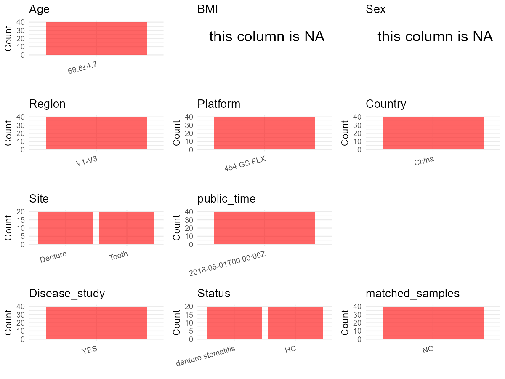

R Notebook: Metadata Processing Workflow
================

# Step 1: Obtain Initial Metadata from Each Project

To obtain the initial metadata: 1. Search for the BioProject ID (e.g.,
“PRJEBXXXX”) on the [NCBI SRA
website](https://www.ncbi.nlm.nih.gov/Traces/study/). 2. In the “Select”
table, click on “Metadata” and download the file. 3. The downloaded file
is typically named “SraRunTable.csv” and contains metadata for the
project.

``` r
# Load necessary libraries
library(dplyr)
library(ggplot2)
library(cowplot)

# Set working directory (update this path to your local directory)
setwd("D:/oral_project/PRJNA292354")

# Read the initial metadata files
initial_meta<-read.csv("SraRunTable.csv",header = T)

# Combine the two metadata files
#meta <- rbind(initial_meta, initial_meta1)

#Remove entries where Organism is "gut metagenome" (non-oral samples)
#initial_meta <- subset(initial_meta,isolation_source!= "feces")

# Check the number of samples containing "HT" in Sample.Name (e.g., healthy controls)
#nrow(subset(meta, grepl("HT", Sample.Name)))

# Display the first few rows of the metadata
head(initial_meta)
```

    ##          Run Assay.Type AvgSpotLen   Bases  BioProject    BioSample
    ## 1 SRR3381545   AMPLICON        459 1096526 PRJNA292354 SAMN04625859
    ## 2 SRR3381546   AMPLICON        441 1033969 PRJNA292354 SAMN04625860
    ## 3 SRR3381547   AMPLICON        458  860096 PRJNA292354 SAMN04625869
    ## 4 SRR3381548   AMPLICON        457 1765018 PRJNA292354 SAMN04625870
    ## 5 SRR3381549   AMPLICON        449 1121533 PRJNA292354 SAMN04625871
    ## 6 SRR3381550   AMPLICON        452  871490 PRJNA292354 SAMN04625872
    ##                BioSampleModel   Bytes              Center.Name Collection_Date
    ## 1 Metagenome or environmental  645567 UCLA SCHOOL OF DENTISTRY            2012
    ## 2 Metagenome or environmental  640851 UCLA SCHOOL OF DENTISTRY            2012
    ## 3 Metagenome or environmental  545779 UCLA SCHOOL OF DENTISTRY            2012
    ## 4 Metagenome or environmental 1018194 UCLA SCHOOL OF DENTISTRY            2012
    ## 5 Metagenome or environmental  689653 UCLA SCHOOL OF DENTISTRY            2012
    ## 6 Metagenome or environmental  550370 UCLA SCHOOL OF DENTISTRY            2012
    ##   Consent DATASTORE.filetype DATASTORE.provider
    ## 1  public   fastq,run.zq,sra         gs,ncbi,s3
    ## 2  public   fastq,run.zq,sra         gs,ncbi,s3
    ## 3  public   fastq,run.zq,sra         gs,ncbi,s3
    ## 4  public   fastq,run.zq,sra         gs,ncbi,s3
    ## 5  public   fastq,run.zq,sra         gs,ncbi,s3
    ## 6  public   fastq,run.zq,sra         gs,ncbi,s3
    ##                       DATASTORE.region Experiment geo_loc_name_country
    ## 1 gs.us-east1,ncbi.public,s3.us-east-1 SRX1704200                China
    ## 2 gs.us-east1,ncbi.public,s3.us-east-1 SRX1704201                China
    ## 3 gs.us-east1,ncbi.public,s3.us-east-1 SRX1704202                China
    ## 4 gs.us-east1,ncbi.public,s3.us-east-1 SRX1704203                China
    ## 5 gs.us-east1,ncbi.public,s3.us-east-1 SRX1704204                China
    ## 6 gs.us-east1,ncbi.public,s3.us-east-1 SRX1704205                China
    ##   geo_loc_name_country_continent                            geo_loc_name
    ## 1                           Asia China: Chengdu city\\, Sichuan province
    ## 2                           Asia China: Chengdu city\\, Sichuan province
    ## 3                           Asia China: Chengdu city\\, Sichuan province
    ## 4                           Asia China: Chengdu city\\, Sichuan province
    ## 5                           Asia China: Chengdu city\\, Sichuan province
    ## 6                           Asia China: Chengdu city\\, Sichuan province
    ##           HOST Instrument              isolation_source              lat_lon
    ## 1 Homo sapiens 454 GS FLX Denture of healthy subject #1 30.5728 N 104.0668 E
    ## 2 Homo sapiens 454 GS FLX   Tooth of healthy subject #1 30.5728 N 104.0668 E
    ## 3 Homo sapiens 454 GS FLX Denture of healthy subject #6 30.5728 N 104.0668 E
    ## 4 Homo sapiens 454 GS FLX   Tooth of healthy subject #6 30.5728 N 104.0668 E
    ## 5 Homo sapiens 454 GS FLX Denture of healthy subject #7 30.5728 N 104.0668 E
    ## 6 Homo sapiens 454 GS FLX   Tooth of healthy subject #7 30.5728 N 104.0668 E
    ##   Library.Name LibraryLayout LibrarySelection LibrarySource
    ## 1          HD1        SINGLE              PCR   METAGENOMIC
    ## 2          HT1        SINGLE              PCR   METAGENOMIC
    ## 3          HD6        SINGLE              PCR   METAGENOMIC
    ## 4          HT6        SINGLE              PCR   METAGENOMIC
    ## 5          HD7        SINGLE              PCR   METAGENOMIC
    ## 6          HT7        SINGLE              PCR   METAGENOMIC
    ##                Organism Platform          ReleaseDate          create_date
    ## 1 human oral metagenome    LS454 2016-05-01T00:00:00Z 2016-04-21T14:36:00Z
    ## 2 human oral metagenome    LS454 2016-05-01T00:00:00Z 2016-04-21T14:36:00Z
    ## 3 human oral metagenome    LS454 2016-05-01T00:00:00Z 2016-04-21T14:36:00Z
    ## 4 human oral metagenome    LS454 2016-05-01T00:00:00Z 2016-04-21T14:36:00Z
    ## 5 human oral metagenome    LS454 2016-05-01T00:00:00Z 2016-04-21T14:36:00Z
    ## 6 human oral metagenome    LS454 2016-05-01T00:00:00Z 2016-04-21T14:36:00Z
    ##   version Sample.Name SRA.Study
    ## 1       1         HD1 SRP073270
    ## 2       1         HT1 SRP073270
    ## 3       1         HD6 SRP073270
    ## 4       1         HT6 SRP073270
    ## 5       1         HD7 SRP073270
    ## 6       1         HT7 SRP073270

# Step 2: Create a Uniform Metadata Template

The uniform metadata should include the following columns:

1.  **BioProject**: Project ID (e.g., “PRJNA339212”)
2.  **Run**: Sample ID (e.g., “ERRXXXXXX” or “SRRXXXXXX”)
3.  **sample_name**: Original sample name submitted by the authors (not
    the database-assigned ID)
4.  **Age**: Age of the subject (if available)
5.  **BMI**: Body Mass Index (if available)
6.  **Sex**: Sex of the subject (“F” or “M”)
7.  **Region**: Targeted 16S rRNA region (e.g., “V3-V4”)
8.  **Platform**: Sequencing platform (e.g., “Illumina MiSeq”)
9.  **Country**: Country of sample origin (e.g., “China”)
10. **Site**: Sample site (e.g., “saliva”, “dental plaque”)
11. **public_time**: Data release date (format: “YYYY-MM-DD”)
12. **PCR_primers**: PCR primers used (e.g., “515F-806R”)
13. **title**: Title of the associated publication
14. **Disease_study**: Whether the study involves a disease (“YES” or
    “NO”)
15. **Status**: Disease status (e.g., “T2DM”, “HC”). Note: If the study
    includes both disease and healthy samples, this must be specified
    per sample.

``` r
# Create a uniform metadata dataframe
metadata <- data.frame(
  BioProject = initial_meta$BioProject,
  Run = initial_meta$Run,
  sample_name = initial_meta$Sample.Name,
  Age = "69.8±4.7",
  BMI = NA,
  Sex=NA,
  Region = "V1-V3",
  Platform = initial_meta$Instrument,
  Country = "China",
  Site = initial_meta$isolation_source,
  public_time = initial_meta$ReleaseDate,
  stringsAsFactors = FALSE
)
```

# Step 3: Manually Add Information from the Publication

Some information (e.g. PCR primers, study title, disease status) must be
manually extracted from the publication and added to the metadata.

``` r
# Add information obtained from the publication
metadata$PCR_primers <- "27F-534R"
metadata$title <- "The Denture-Associated Oral Microbiome in Health and Stomatitis"
#metadata<-subset(uniform_meta,Site!="feces")
metadata$Disease_study <- "YES"
# Assign disease status based on sample_name patterns
metadata <- metadata %>% 
  mutate(
    Status = ifelse(grepl("healthy", Site), "HC",
             ifelse(grepl("denture stomatitis", Site), "denture stomatitis", 
                    "other"))
  )

metadata <- metadata %>% mutate(Site=case_when(grepl("Denture",Site)~"Denture",grepl("Tooth",Site)~"Tooth"))

#extract subject id by remove prefix of sample_name
metadata$sample_name <- gsub("HD|HT|SD|ST", "", metadata$sample_name)

#get subjects id with Saliva available
#keep_subjects<-subset(metadata,Site %in% c("mouth_buccal","mouth_gum","mouth_saliva","mouth_tongue"))


#remove subjects without Saliva samples
#metadata<-subset(metadata,sample_name %in% keep_subjects$sample_name)
#get subjects sampling counts
#sample_counts <- table(metadata$sample_name)
# Create matched_samples column, any subjects have >=2 samples will be label "YES", otherwise "NO"
#metadata$matched_samples <- ifelse(metadata$sample_name %in% names(sample_counts[sample_counts >= 2]), "YES", "NO")
metadata$matched_samples<-"NO"
```

# Step 4: Summarize and Validate the Metadata

``` r
# Check the number of unique runs and sample names
print(paste("Number of unique runs:", length(unique(metadata$Run))))
```

    ## [1] "Number of unique runs: 40"

``` r
print(paste("Number of unique sample names:", length(unique(metadata$sample_name))))
```

    ## [1] "Number of unique sample names: 10"

# Step 5: Visualize the Metadata

``` r

```


# Step 6: Finalize and Export the Metadata

``` r
# Reorder columns to match the desired format
metadata <- metadata[, c(
  "BioProject", "Run", "sample_name", "Age", "BMI", "Sex", 
  "Region", "Platform", "Country", "Site", "public_time", 
  "PCR_primers", "title", "Disease_study", "Status","matched_samples"
)]

# Export the uniform metadata to a CSV file
write.csv(metadata, file = "metadata.csv", quote = FALSE)
head(metadata)
```

    ##    BioProject        Run sample_name      Age BMI Sex Region   Platform Country
    ## 1 PRJNA292354 SRR3381545           1 69.8±4.7  NA  NA  V1-V3 454 GS FLX   China
    ## 2 PRJNA292354 SRR3381546           1 69.8±4.7  NA  NA  V1-V3 454 GS FLX   China
    ## 3 PRJNA292354 SRR3381547           6 69.8±4.7  NA  NA  V1-V3 454 GS FLX   China
    ## 4 PRJNA292354 SRR3381548           6 69.8±4.7  NA  NA  V1-V3 454 GS FLX   China
    ## 5 PRJNA292354 SRR3381549           7 69.8±4.7  NA  NA  V1-V3 454 GS FLX   China
    ## 6 PRJNA292354 SRR3381550           7 69.8±4.7  NA  NA  V1-V3 454 GS FLX   China
    ##      Site          public_time PCR_primers
    ## 1 Denture 2016-05-01T00:00:00Z    27F-534R
    ## 2   Tooth 2016-05-01T00:00:00Z    27F-534R
    ## 3 Denture 2016-05-01T00:00:00Z    27F-534R
    ## 4   Tooth 2016-05-01T00:00:00Z    27F-534R
    ## 5 Denture 2016-05-01T00:00:00Z    27F-534R
    ## 6   Tooth 2016-05-01T00:00:00Z    27F-534R
    ##                                                             title Disease_study
    ## 1 The Denture-Associated Oral Microbiome in Health and Stomatitis           YES
    ## 2 The Denture-Associated Oral Microbiome in Health and Stomatitis           YES
    ## 3 The Denture-Associated Oral Microbiome in Health and Stomatitis           YES
    ## 4 The Denture-Associated Oral Microbiome in Health and Stomatitis           YES
    ## 5 The Denture-Associated Oral Microbiome in Health and Stomatitis           YES
    ## 6 The Denture-Associated Oral Microbiome in Health and Stomatitis           YES
    ##   Status matched_samples
    ## 1     HC              NO
    ## 2     HC              NO
    ## 3     HC              NO
    ## 4     HC              NO
    ## 5     HC              NO
    ## 6     HC              NO

## Notes for Students:

1.  **Metadata Accuracy**: Always cross-check the metadata with the
    original publication to ensure accuracy.
2.  **Manual Entries**: Columns like `PCR_primers`, and `Status` often
    require manual entry based on the publication.
3.  **Disease Status**: Be careful when assigning `Status`—some studies
    include both disease and healthy samples.
4.  **Visualization**: The plots help quickly identify the distribution
    of values in each column, which is useful for quality control.
5.  **Reproducibility**: Update the working directory and file paths to
    match your local environment.
