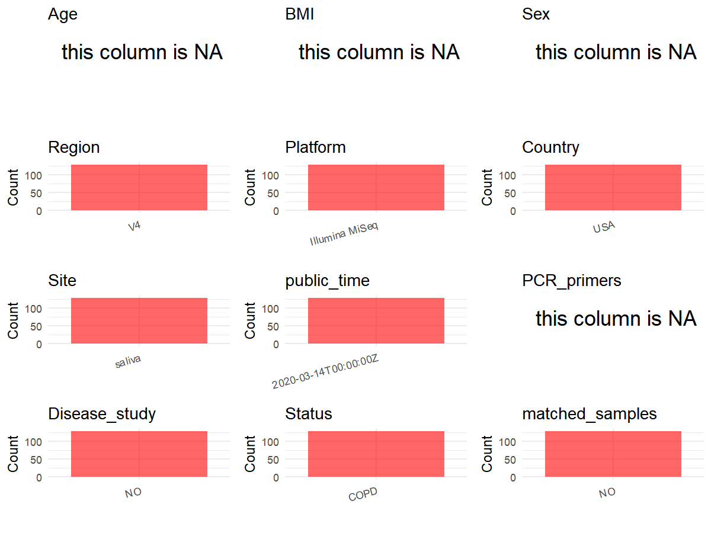

R Notebook: Metadata Processing Workflow
================

# Step 1: Obtain Initial Metadata from Each Project

To obtain the initial metadata: 1. Search for the BioProject ID (e.g.,
“PRJEBXXXX”) on the [NCBI SRA
website](https://www.ncbi.nlm.nih.gov/Traces/study/). 2. In the “Select”
table, click on “Metadata” and download the file. 3. The downloaded file
is typically named “SraRunTable.csv” and contains metadata for the
project.

``` r
# Load necessary libraries
library(dplyr)
library(ggplot2)
library(cowplot)

# Set working directory (update this path to your local directory)
setwd("D:/metadata/3/PRJNA308310")

# Read the initial metadata files
initial_meta<-read.csv("SraRunTable.csv",header = T)

# Combine the two metadata files
#meta <- rbind(initial_meta, initial_meta1)

#Remove entries non-oral samples
#initial_meta <- subset(initial_meta,BioSampleModel != "Metagenome or environmental")

# Check the number of samples containing "HT" in Sample.Name (e.g., healthy controls)
#nrow(subset(meta, grepl("HT", Sample.Name)))

# Display the first few rows of the metadata
head(initial_meta)
```

    ##          Run Assay.Type AvgSpotLen   Bases  BioProject    BioSample
    ## 1 SRR3224817   AMPLICON        247  909830 PRJNA308310 SAMN04395510
    ## 2 SRR3224818   AMPLICON        245 1064165 PRJNA308310 SAMN04395511
    ## 3 SRR3224819   AMPLICON        268   30391 PRJNA308310 SAMN04395520
    ## 4 SRR3224821   AMPLICON        251  430252 PRJNA308310 SAMN04395610
    ## 5 SRR3224822   AMPLICON        247  487351 PRJNA308310 SAMN04395611
    ## 6 SRR3224823   AMPLICON        234  451599 PRJNA308310 SAMN04395612
    ##                         BioSampleModel  Bytes         Center.Name
    ## 1 MIMS.me,MIGS/MIMS/MIMARKS.human-oral 691025 NEW YORK UNIVERSITY
    ## 2 MIMS.me,MIGS/MIMS/MIMARKS.human-oral 803383 NEW YORK UNIVERSITY
    ## 3 MIMS.me,MIGS/MIMS/MIMARKS.human-oral 100685 NEW YORK UNIVERSITY
    ## 4 MIMS.me,MIGS/MIMS/MIMARKS.human-oral 357273 NEW YORK UNIVERSITY
    ## 5 MIMS.me,MIGS/MIMS/MIMARKS.human-oral 407605 NEW YORK UNIVERSITY
    ## 6 MIMS.me,MIGS/MIMS/MIMARKS.human-oral 376786 NEW YORK UNIVERSITY
    ##   Collection_Date Consent DATASTORE.filetype DATASTORE.provider
    ## 1      2011-06-17  public   fastq,run.zq,sra         gs,ncbi,s3
    ## 2      2011-05-31  public   fastq,run.zq,sra         gs,ncbi,s3
    ## 3      2011-06-30  public   fastq,run.zq,sra         gs,ncbi,s3
    ## 4      2011-09-26  public   fastq,run.zq,sra         gs,ncbi,s3
    ## 5      2011-09-29  public   fastq,run.zq,sra         gs,ncbi,s3
    ## 6      2011-03-29  public   fastq,run.zq,sra         gs,ncbi,s3
    ##                       DATASTORE.region     env_biome  env_feature  env_material
    ## 1 gs.us-east1,ncbi.public,s3.us-east-1 not collected not colleted not collected
    ## 2 gs.us-east1,ncbi.public,s3.us-east-1 not collected not colleted not collected
    ## 3 gs.us-east1,ncbi.public,s3.us-east-1 not collected not colleted not collected
    ## 4 gs.us-east1,ncbi.public,s3.us-east-1 not collected not colleted not collected
    ## 5 gs.us-east1,ncbi.public,s3.us-east-1 not collected not colleted not collected
    ## 6 gs.us-east1,ncbi.public,s3.us-east-1 not collected not colleted not collected
    ##   Experiment geo_loc_name_country geo_loc_name_country_continent
    ## 1 SRX1631016                  USA                  North America
    ## 2 SRX1631017                  USA                  North America
    ## 3 SRX1631018                  USA                  North America
    ## 4 SRX1631019                  USA                  North America
    ## 5 SRX1631020                  USA                  North America
    ## 6 SRX1631021                  USA                  North America
    ##      geo_loc_name         HOST     Instrument             lat_lon
    ## 1 USA: Pittsburgh Homo sapiens Illumina MiSeq 40.4397 N 79.9764 W
    ## 2 USA: Pittsburgh Homo sapiens Illumina MiSeq 40.4397 N 79.9764 W
    ## 3 USA: Pittsburgh Homo sapiens Illumina MiSeq 40.4397 N 79.9764 W
    ## 4 USA: Pittsburgh Homo sapiens Illumina MiSeq 40.4397 N 79.9764 W
    ## 5 USA: Pittsburgh Homo sapiens Illumina MiSeq 40.4397 N 79.9764 W
    ## 6 USA: Pittsburgh Homo sapiens Illumina MiSeq 40.4397 N 79.9764 W
    ##       Library.Name LibraryLayout LibrarySelection LibrarySource
    ## 1 allseqs_27F.001a        PAIRED              PCR   METAGENOMIC
    ## 2 allseqs_27F.002a        PAIRED              PCR   METAGENOMIC
    ## 3 allseqs_27F.016a        PAIRED              PCR   METAGENOMIC
    ## 4 allseqs_27F.089a        PAIRED              PCR   METAGENOMIC
    ## 5 allseqs_27F.090a        PAIRED              PCR   METAGENOMIC
    ## 6 allseqs_27F.090b        PAIRED              PCR   METAGENOMIC
    ##                Organism Patient_ID Platform          ReleaseDate
    ## 1 human oral metagenome          6 ILLUMINA 2020-03-14T00:00:00Z
    ## 2 human oral metagenome         13 ILLUMINA 2020-03-14T00:00:00Z
    ## 3 human oral metagenome          3 ILLUMINA 2020-03-14T00:00:00Z
    ## 4 human oral metagenome          7 ILLUMINA 2020-03-14T00:00:00Z
    ## 5 human oral metagenome          8 ILLUMINA 2020-03-14T00:00:00Z
    ## 6 human oral metagenome         12 ILLUMINA 2020-03-14T00:00:00Z
    ##            create_date version sample_ids      Sample.Name SRA.Study visit_id
    ## 1 2016-03-14T18:58:00Z       1       001a allseqs_27F.001a SRP071751        9
    ## 2 2016-03-14T18:58:00Z       1       002a allseqs_27F.002a SRP071751        7
    ## 3 2016-03-14T18:58:00Z       1       016a allseqs_27F.016a SRP071751        6
    ## 4 2016-03-14T18:58:00Z       1       089a allseqs_27F.089a SRP071751        1
    ## 5 2016-03-14T18:58:00Z       1       090a allseqs_27F.090a SRP071751        1
    ## 6 2016-03-14T18:58:00Z       1       090b allseqs_27F.090b SRP071751        5

# Step 2: Create a Uniform Metadata Template

The uniform metadata should include the following columns:

1.  **BioProject**: Project ID (e.g., “PRJNA339212”)
2.  **Run**: Sample ID (e.g., “ERRXXXXXX” or “SRRXXXXXX”)
3.  **sample_name**: Original sample name submitted by the authors (not
    the database-assigned ID)
4.  **Age**: Age of the subject (if available)
5.  **BMI**: Body Mass Index (if available)
6.  **Sex**: Sex of the subject (“F” or “M”)
7.  **Region**: Targeted 16S rRNA region (e.g., “V3-V4”)
8.  **Platform**: Sequencing platform (e.g., “Illumina MiSeq”)
9.  **Country**: Country of sample origin (e.g., “China”)
10. **Site**: Sample site (e.g., “saliva”, “dental plaque”)
11. **public_time**: Data release date (format: “YYYY-MM-DD”)
12. **PCR_primers**: PCR primers used (e.g., “515F-806R”)
13. **title**: Title of the associated publication
14. **Disease_study**: Whether the study involves a disease (“YES” or
    “NO”)
15. **Status**: Disease status (e.g., “T2DM”, “HC”). Note: If the study
    includes both disease and healthy samples, this must be specified
    per sample.
16. **matched_samples**: matched samples (“YES” or “NO”)

``` r
# Create a uniform metadata dataframe
metadata <- data.frame(
  BioProject = initial_meta$BioProject,
  Run = initial_meta$Run,
  sample_name = initial_meta$Sample.Name,
  Age = NA,
  BMI = NA,
  Sex=NA,
  Region = "V4",
  Platform = initial_meta$Instrument,
  Country = initial_meta$geo_loc_name_country,
  Site = "saliva",
  public_time = initial_meta$ReleaseDate,
  Status = "COPD",
  PCR_primers = NA,
  stringsAsFactors = FALSE
)
```

# Step 3: Manually Add Information from the Publication

Some information (e.g. PCR primers, study title, disease status) must be
manually extracted from the publication and added to the metadata.

``` r
# Add information obtained from the publication
#metadata$PCR_primers <- "27F-907R"
metadata$title <- "Measuring associations between the microbiota and repeated measures of continuous clinical variables using a lasso-penalized generalized linear mixed model"
metadata$Disease_study <- "NO"
# Assign disease status based on sample_name patterns
#metadata <- metadata %>%
#  mutate(Status = case_when(
#    initial_meta$Sample.Name == "Oral mucosa of healthy patients" ~ "H",
#    initial_meta$Sample.Name %in% c("Oral mucosa from affected regions of oral lichen planus patients", "Bacterial community associated with the unaffected regions from oral mucosa of Oral Lichen Planus patients") ~ "OLP"
#  ))

metadata$matched_samples <- "NO"
```

# Step 4: Summarize and Validate the Metadata

``` r
# Check the number of unique runs and sample names
print(paste("Number of unique runs:", length(unique(metadata$Run))))
```

    ## [1] "Number of unique runs: 128"

``` r
print(paste("Number of unique sample names:", length(unique(metadata$sample_name))))
```

    ## [1] "Number of unique sample names: 128"

# Step 5: Visualize the Metadata

``` r

```

<!-- -->

# Step 6: Finalize and Export the Metadata

``` r
# Reorder columns to match the desired format
metadata <- metadata[, c(
  "BioProject", "Run", "sample_name", "Age", "BMI", "Sex", 
  "Region", "Platform", "Country", "Site", "public_time", 
  "PCR_primers", "title", "Disease_study", "Status","matched_samples"
)]

# Export the uniform metadata to a CSV file
write.csv(metadata, file = "metadata.csv", quote = TRUE)
head(metadata)
```

    ##    BioProject        Run      sample_name Age BMI Sex Region       Platform
    ## 1 PRJNA308310 SRR3224817 allseqs_27F.001a  NA  NA  NA     V4 Illumina MiSeq
    ## 2 PRJNA308310 SRR3224818 allseqs_27F.002a  NA  NA  NA     V4 Illumina MiSeq
    ## 3 PRJNA308310 SRR3224819 allseqs_27F.016a  NA  NA  NA     V4 Illumina MiSeq
    ## 4 PRJNA308310 SRR3224821 allseqs_27F.089a  NA  NA  NA     V4 Illumina MiSeq
    ## 5 PRJNA308310 SRR3224822 allseqs_27F.090a  NA  NA  NA     V4 Illumina MiSeq
    ## 6 PRJNA308310 SRR3224823 allseqs_27F.090b  NA  NA  NA     V4 Illumina MiSeq
    ##   Country   Site          public_time PCR_primers
    ## 1     USA saliva 2020-03-14T00:00:00Z          NA
    ## 2     USA saliva 2020-03-14T00:00:00Z          NA
    ## 3     USA saliva 2020-03-14T00:00:00Z          NA
    ## 4     USA saliva 2020-03-14T00:00:00Z          NA
    ## 5     USA saliva 2020-03-14T00:00:00Z          NA
    ## 6     USA saliva 2020-03-14T00:00:00Z          NA
    ##                                                                                                                                                         title
    ## 1 Measuring associations between the microbiota and repeated measures of continuous clinical variables using a lasso-penalized generalized linear mixed model
    ## 2 Measuring associations between the microbiota and repeated measures of continuous clinical variables using a lasso-penalized generalized linear mixed model
    ## 3 Measuring associations between the microbiota and repeated measures of continuous clinical variables using a lasso-penalized generalized linear mixed model
    ## 4 Measuring associations between the microbiota and repeated measures of continuous clinical variables using a lasso-penalized generalized linear mixed model
    ## 5 Measuring associations between the microbiota and repeated measures of continuous clinical variables using a lasso-penalized generalized linear mixed model
    ## 6 Measuring associations between the microbiota and repeated measures of continuous clinical variables using a lasso-penalized generalized linear mixed model
    ##   Disease_study Status matched_samples
    ## 1            NO   COPD              NO
    ## 2            NO   COPD              NO
    ## 3            NO   COPD              NO
    ## 4            NO   COPD              NO
    ## 5            NO   COPD              NO
    ## 6            NO   COPD              NO

## Notes for Students:

1.  **Metadata Accuracy**: Always cross-check the metadata with the
    original publication to ensure accuracy.
2.  **Manual Entries**: Columns like `PCR_primers`, and `Status` often
    require manual entry based on the publication.
3.  **Disease Status**: Be careful when assigning `Status`—some studies
    include both disease and healthy samples.
4.  **Visualization**: The plots help quickly identify the distribution
    of values in each column, which is useful for quality control.
5.  **Reproducibility**: Update the working directory and file paths to
    match your local environment.
