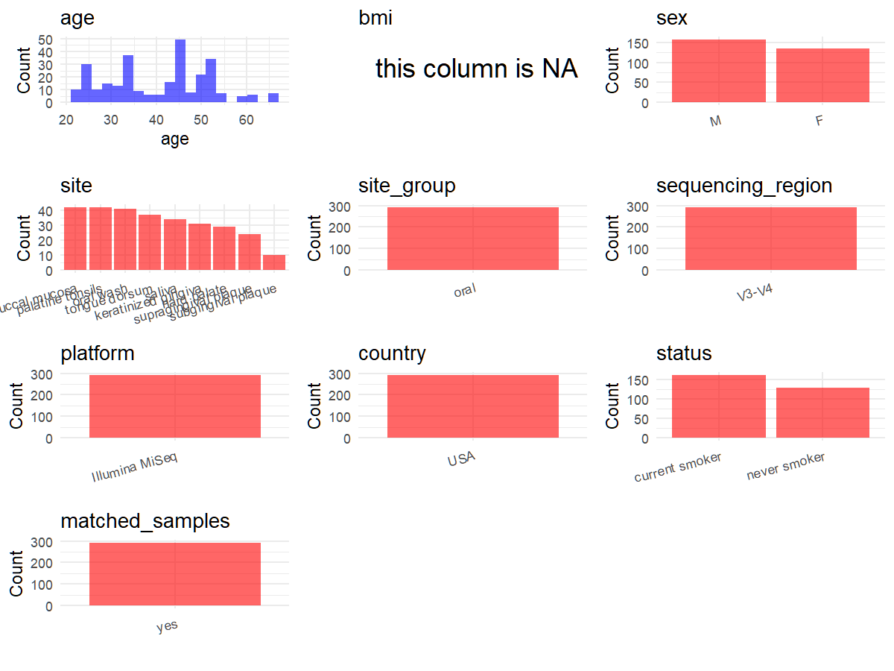

# Step 1: Obtain Initial Metadata from Each Project

This step sets the project directory and loads the raw SRA metadata.

```{r message=FALSE, warning=FALSE}
# Load libraries
library(dplyr)
library(ggplot2)
library(cowplot)

# (1) Setting working directory
project_id <- "PRJNA316469"

base_dir <- "E:/工作区/VSCode/RNAproject/collect_metadata_respon/project"
setwd(file.path(base_dir, project_id))

# (2) Loading raw SRA metadata file
sra_file <- "SraRunTable.csv"
initial_meta <- read.csv(sra_file, header = TRUE, stringsAsFactors = FALSE)
```

# Step 2: Data Overview

First, you need to get an overview of the data, which includes two steps: reading the article and reading the initial metadata. This step is very IMPORTANT!

```{r message=FALSE, warning=FALSE}
# (1) Read the article in the following order: abstract, the beginning of the results section, and the methods.
# Paper summary used for this project:
# - Title: The effect of cigarette smoking on the oral and nasal microbiota
# - Study design: cross-sectional matched-group exposure study comparing 23 current smokers with 20 never smokers
# - Raw deposited SRA rows: 328 samples from oral and nasal sites across 43 adults
# - Study protocol collected 9 samples per subject: supragingival plaque, subgingival plaque, saliva, swabs from five oral soft tissue sites, and one nasal swab
# - This metadata project retains only oral samples and excludes anterior nares swabs because the repository standard is oral/gut site curation
# - Retained oral rows after excluding nasal swabs: 290
# - Sequencing from Methods: V3-V4 region of the 16S rRNA gene sequenced on an Illumina MiSeq using the 300 paired-end protocol
# - The accessible paper text does not explicitly name the PCR primer pair
# - The manuscript notes that subgingival plaque had the smallest retained sample size because of sequencing failure; this matches the smaller plaque code in SRA and supports the code-based site mapping below

# (2) IMPORTANT: MUST go through each column of initial_meta
head(initial_meta, 10)
colnames(initial_meta)
table(initial_meta$env_material)
table(initial_meta$smoker)
table(initial_meta$host_sex)
table(initial_meta$geo_loc_name_country)
table(initial_meta$Instrument)
table(initial_meta$host_subject_id)
# The SRA env_material field already identifies most sites, but the two plaque codes both appear as supragingival in SRA.
# Based on the paper's sample-site counts and the note that subgingival plaque had the smallest sample size, code 0801 is treated as subgingival plaque and code 0701 as supragingival plaque.
```

# Step 3: Removing Control and Non-human Samples

First, we need to remove control samples(including both negative controls and positive controls) and non-human samples.

```{r}
# (1) Parameter setup
control_column <- ""
control_keywords <- c()

species_column <- "HOST"
unique(initial_meta[[species_column]])
non_human_keywords <- c()

# (2) Remove controls and non-human samples. DO NOT need to modify code in this part, just run it.
n_samples <- nrow(initial_meta)
# Control evaluation
if (length(control_keywords) > 0) {
  if (is.null(control_column) || control_column == "") {
    stop("Error: control_keywords provided but control_column is missing.")
  }

  if (!(control_column %in% colnames(initial_meta))) {
    stop(sprintf("Error: Column '%s' not found in initial_meta.", control_column))
  }

  control_pattern <- paste(control_keywords, collapse = "|")
  control_text <- initial_meta[[control_column]]
  is_control <- grepl(control_pattern, control_text)

} else {
  is_control <- rep(FALSE, n_samples)
}

# Non-human evaluation
if (length(non_human_keywords) > 0) {
  if (is.null(species_column) || species_column == "") {
    stop("Error: non_human_keywords provided but species_column is missing.")
  }

  if (!(species_column %in% colnames(initial_meta))) {
    stop(sprintf("Error: Column '%s' not found in initial_meta.", species_column))
  }

  non_human_pattern <- paste(non_human_keywords, collapse = "|")
  species_text <- initial_meta[[species_column]]
  is_non_human <- grepl(non_human_pattern, species_text)
} else {
  is_non_human <- rep(FALSE, n_samples)
}

# Additional filtering for this repository: keep oral samples and exclude anterior nares only
is_anterior_nares <- initial_meta$env_material == "Human anteior nares swab from both sides"

# Execute removal
samples_to_remove <- is_control | is_non_human | is_anterior_nares
initial_meta <- initial_meta[!samples_to_remove, ]

cat("Initial samples counts:", n_samples, "\n")
cat("Removed control samples:", sum(is_control), "\n")
cat("Removed non-human samples:", sum(is_non_human), "\n")
cat("Removed anterior nares samples:", sum(is_anterior_nares), "\n")
cat("Total samples removed ", sum(samples_to_remove), "\n")
cat("Remaining oral samples after filtering:", nrow(initial_meta), "\n")
```

# Step 4: Creating a Uniform Metadata Template

This step converts the raw SRA table into the standard metadata format used in our meta-analysis.

```{r}
metadata <- data.frame(
  bioproject = initial_meta$BioProject,
  sample_id = initial_meta$Run,
  subject_id = initial_meta$host_subject_id,
  age = suppressWarnings(as.numeric(initial_meta$host_age)),
  age_info = NA_character_,
  bmi = NA_real_,
  sex = case_when(
    initial_meta$host_sex == "male" ~ "M",
    initial_meta$host_sex == "female" ~ "F",
    TRUE ~ NA_character_
  ),
  sequencing_region = "V3-V4",
  platform = "Illumina MiSeq",
  country = initial_meta$geo_loc_name_country,
  raw_site = initial_meta$env_material,
  raw_code = sub("^[^.]+\\.(\\d{4})\\..*$", "\\1", initial_meta$Sample.Name),
  site = "pending",
  site_group = "pending",
  public_time = sub("T.*$", "", initial_meta$ReleaseDate),
  pcr_primers = NA_character_,
  title = "The effect of cigarette smoking on the oral and nasal microbiota",
  disease_study = "no",
  status = case_when(
    initial_meta$smoker == "smoker" ~ "current smoker",
    initial_meta$smoker == "never" ~ "never smoker",
    TRUE ~ NA_character_
  ),
  matched_samples = "pending",
  is_time_series = "no",
  stringsAsFactors = FALSE
)

# Source notes for non-obvious fields:
# - subject_id uses host_subject_id directly; each subject contributes multiple oral-site samples in a single visit.
# - age and sex are taken directly from SRA subject-level columns.
# - age_info remains NA because exact row-level ages are available.
# - bmi remains NA because no BMI values are reported in SRA or the accessible paper.
# - sequencing_region and platform come from the Methods section, not from SRA.
# - pcr_primers remains NA because the accessible Methods text specifies V3-V4 sequencing but does not name the exact primer pair.
# - raw_code is parsed from Sample Name. The smaller plaque code 0801 is mapped to subgingival plaque because the paper states subgingival plaque had the smallest retained sample size after sequencing failure; 0701 is therefore mapped to supragingival plaque.
# - status records the smoking exposure groups used in the study: current smoker vs never smoker.
metadata$public_time <- as.Date(metadata$public_time)
```

# Step 5: Manually solving pending issues

This step involves two parts: (1) handle the columns with the `raw_` prefix, and next (2) handle the `site_group` and `matched_samples` columns.

```{r}
# (1) Handle the columns with the `raw_` prefix.
metadata <- metadata %>%
  mutate(site = case_when(
    raw_code == "0102" ~ "saliva",
    raw_code == "0201" ~ "tongue dorsum",
    raw_code == "0301" ~ "hard palate",
    raw_code == "0401" ~ "buccal mucosa",
    raw_code == "0501" ~ "keratinized gingiva",
    raw_code == "0601" ~ "palatine tonsils",
    raw_code == "0701" ~ "supragingival plaque",
    raw_code == "0801" ~ "subgingival plaque",
    raw_code == "1002" ~ "oral wash",
    TRUE ~ NA_character_
  ))
```

```{r}
# (2) Filling the 'site_group' and 'matched_samples' columns
unique(metadata$site)
Oral_site = c("saliva", "tongue dorsum", "hard palate", "buccal mucosa", "keratinized gingiva", "palatine tonsils", "supragingival plaque", "subgingival plaque", "oral wash")
Gut_site = c("feces")

metadata <- metadata %>%
  mutate(site_group = case_when(
    site %in% Oral_site ~ "oral",
    site %in% Gut_site ~ "gut",
    TRUE ~ "other"
  ))

metadata$matched_samples <- ifelse(
  ave(metadata$subject_id, metadata$subject_id, FUN = length) > 1,
  "yes",
  "no"
)
# Repeated subject IDs reflect matched oral-site sampling within one visit, not longitudinal follow-up.
```

```{r}
# (3) check if there is pending value in metadata. If there is pending value, go on modify the metadata.
has_pending <- function(col) {
  if (is.character(col) || is.factor(col)) {
    any(col == "pending", na.rm = TRUE)
  } else {
    FALSE
  }
}

any_pending_value <- any(sapply(metadata, has_pending))

if (!any_pending_value) {
  message("Good! No cell contains the value 'pending'.")
} else {
  pending_cols <- names(metadata)[sapply(metadata, has_pending)]
  message("Columns containing 'pending': ", paste(pending_cols, collapse = ", "))
  message("Please continue to resolve these pending columns!")
}
```

# Step 6: Visualize the Metadata

This step makes a quick set of plots for checking the distribution of key metadata fields.

```{r}
plot_data <- metadata %>%
  select(-bioproject, -sample_id, -subject_id, -title, -raw_site, -raw_code)

create_simple_plots <- function(data) {
  plots <- list()
  continuous_vars <- c("age", "bmi")

  for (col in colnames(data)) {
    if (all(is.na(data[[col]]))) {
      p <- ggplot() +
        annotate("text", x = 0.5, y = 0.5, label = "this column is NA", size = 6) +
        labs(title = col) +
        theme_void()
    } else if (col %in% continuous_vars && is.numeric(data[[col]])) {
      p <- ggplot(data, aes(x = .data[[col]])) +
        geom_histogram(fill = "blue", alpha = 0.6, bins = 20, na.rm = TRUE) +
        labs(title = col, x = col, y = "Count") +
        theme_minimal()
    } else {
      count_data <- as.data.frame(table(data[[col]], useNA = "ifany"))
      p <- ggplot(count_data, aes(x = reorder(Var1, -Freq), y = Freq)) +
        geom_col(fill = "red", alpha = 0.6) +
        labs(title = col, x = NULL, y = "Count") +
        theme_minimal() +
        theme(axis.text.x = element_text(angle = 15, hjust = 1))
    }
    plots[[col]] <- p
  }

  return(plots)
}

plots <- create_simple_plots(plot_data)
p <- plot_grid(plots$age,
               plots$bmi,
               plots$sex,
               plots$site,
               plots$site_group,
               plots$sequencing_region,
               plots$platform,
               plots$country,
               plots$status,
               plots$matched_samples,
               ncol = 3, align = "hv", axis = "lb")
ggsave("Metadata_Summary.png", plot = p, width = 8, height = 6, dpi = 150)
```

```{r}

```

# Step 7: Sort and export the metadata

This step saves the cleaned metadata table as the final `metadata_v2.csv` file.

```{r}
fixed_cols <- c("bioproject", "sample_id", "subject_id", "age", "age_info",
                "bmi", "sex", "platform", "sequencing_region", "pcr_primers",
                "country", "site", "site_group", "disease_study", "status",
                "title", "public_time", "matched_samples", "is_time_series")
metadata <- metadata %>%
  select(all_of(fixed_cols), starts_with("raw_"))

write.csv(metadata, file = "metadata_v2.csv", quote = TRUE, row.names = FALSE)
```
