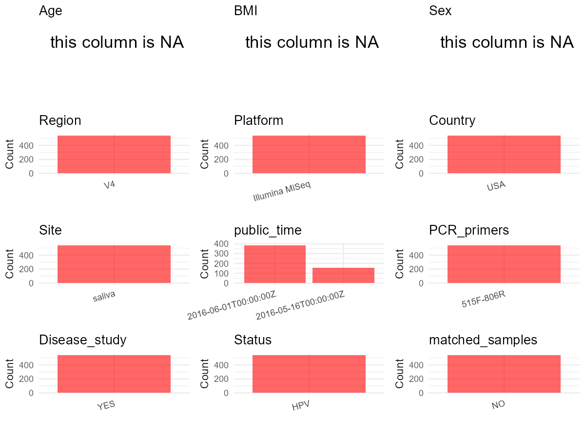

R Notebook: Metadata Processing Workflow
================

# Step 1: Obtain Initial Metadata from Each Project

To obtain the initial metadata: 1. Search for the BioProject ID (e.g.,
“PRJEBXXXX”) on the [NCBI SRA
website](https://www.ncbi.nlm.nih.gov/Traces/study/). 2. In the “Select”
table, click on “Metadata” and download the file. 3. The downloaded file
is typically named “SraRunTable.csv” and contains metadata for the
project.

``` r
# Load necessary libraries
library(dplyr)
library(ggplot2)
library(cowplot)

# Set working directory (update this path to your local directory)
setwd("D:/oral_project/PRJNA321193")

# Read the initial metadata files
initial_meta<-read.csv("SraRunTable.csv",header = T)

# Combine the two metadata files
#meta <- rbind(initial_meta, initial_meta1)

#Remove entries non-oral samples
#initial_meta <- subset(initial_meta,isolate %in% c("saliva","tongue coat"))

# Check the number of samples containing "HT" in Sample.Name (e.g., healthy controls)
#nrow(subset(meta, grepl("HT", Sample.Name)))

# Display the first few rows of the metadata
head(initial_meta)
```

    ##          Run Assay.Type AvgSpotLen   Bases  BioProject    BioSample
    ## 1 SRR3498386   AMPLICON         12  148078 PRJNA321193 SAMN04977373
    ## 2 SRR3498387   AMPLICON         12 1443794 PRJNA321193 SAMN04977719
    ## 3 SRR3498388   AMPLICON         12 1484958 PRJNA321193 SAMN04977761
    ## 4 SRR3498389   AMPLICON         12  274506 PRJNA321193 SAMN04977505
    ## 5 SRR3498390   AMPLICON         12  779418 PRJNA321193 SAMN04977507
    ## 6 SRR3498391   AMPLICON         12  277053 PRJNA321193 SAMN04977353
    ##                         BioSampleModel  Bytes Center.Name Collection_Date
    ## 1 MIMS.me,MIGS/MIMS/MIMARKS.human-oral 128514        HMP2      2011-08-01
    ## 2 MIMS.me,MIGS/MIMS/MIMARKS.human-oral 512678        HMP2      2011-08-01
    ## 3 MIMS.me,MIGS/MIMS/MIMARKS.human-oral 512263        HMP2      2011-08-01
    ## 4 MIMS.me,MIGS/MIMS/MIMARKS.human-oral 165544        HMP2      2011-08-01
    ## 5 MIMS.me,MIGS/MIMS/MIMARKS.human-oral 338608        HMP2      2011-08-01
    ## 6 MIMS.me,MIGS/MIMS/MIMARKS.human-oral 170834        HMP2      2011-08-01
    ##   Consent DATASTORE.filetype DATASTORE.provider
    ## 1  public   fasta,run.zq,sra         gs,ncbi,s3
    ## 2  public   fasta,run.zq,sra         gs,ncbi,s3
    ## 3  public   fasta,run.zq,sra         gs,ncbi,s3
    ## 4  public   fasta,run.zq,sra         gs,ncbi,s3
    ## 5  public   fasta,run.zq,sra         gs,ncbi,s3
    ## 6  public   fasta,run.zq,sra         gs,ncbi,s3
    ##                       DATASTORE.region     env_biome   env_feature
    ## 1 gs.us-east1,ncbi.public,s3.us-east-1 ENVO:00000428 ENVO:00000856
    ## 2 gs.us-east1,ncbi.public,s3.us-east-1 ENVO:00000428 ENVO:00000856
    ## 3 gs.us-east1,ncbi.public,s3.us-east-1 ENVO:00000428 ENVO:00000856
    ## 4 gs.us-east1,ncbi.public,s3.us-east-1 ENVO:00000428 ENVO:00000856
    ## 5 gs.us-east1,ncbi.public,s3.us-east-1 ENVO:00000428 ENVO:00000856
    ## 6 gs.us-east1,ncbi.public,s3.us-east-1 ENVO:00000428 ENVO:00000856
    ##    env_material Experiment geo_loc_name_country geo_loc_name_country_continent
    ## 1 ENVO:02000036 SRX1756927                  USA                  North America
    ## 2 ENVO:02000036 SRX1756928                  USA                  North America
    ## 3 ENVO:02000036 SRX1756929                  USA                  North America
    ## 4 ENVO:02000036 SRX1756930                  USA                  North America
    ## 5 ENVO:02000036 SRX1756931                  USA                  North America
    ## 6 ENVO:02000036 SRX1756932                  USA                  North America
    ##   geo_loc_name         HOST     Instrument lat_lon LibraryLayout
    ## 1     USA:Ohio Homo sapiens Illumina MiSeq missing        SINGLE
    ## 2     USA:Ohio Homo sapiens Illumina MiSeq missing        SINGLE
    ## 3     USA:Ohio Homo sapiens Illumina MiSeq missing        SINGLE
    ## 4     USA:Ohio Homo sapiens Illumina MiSeq missing        SINGLE
    ## 5     USA:Ohio Homo sapiens Illumina MiSeq missing        SINGLE
    ## 6     USA:Ohio Homo sapiens Illumina MiSeq missing        SINGLE
    ##   LibrarySelection LibrarySource              Organism Platform
    ## 1              PCR   METAGENOMIC human oral metagenome ILLUMINA
    ## 2              PCR   METAGENOMIC human oral metagenome ILLUMINA
    ## 3              PCR   METAGENOMIC human oral metagenome ILLUMINA
    ## 4              PCR   METAGENOMIC human oral metagenome ILLUMINA
    ## 5              PCR   METAGENOMIC human oral metagenome ILLUMINA
    ## 6              PCR   METAGENOMIC human oral metagenome ILLUMINA
    ##            ReleaseDate                                      Sample.Name
    ## 1 2016-05-16T00:00:00Z 13887338764508253430:sample:13344064764411700970
    ## 2 2016-05-16T00:00:00Z 13887338764508253430:sample:16886304699978071187
    ## 3 2016-05-16T00:00:00Z 13887338764508253430:sample:17886322700115071429
    ## 4 2016-05-16T00:00:00Z 13887338764508253430:sample:13344066764413700991
    ## 5 2016-05-16T00:00:00Z 13887338764508253430:sample:13344066764414700979
    ## 6 2016-05-16T00:00:00Z 13887338764508253430:sample:13344064764409700986
    ##   SRA.Study          create_date version
    ## 1 SRP074853 2016-05-11T15:04:00Z       1
    ## 2 SRP074853 2016-05-11T15:04:00Z       1
    ## 3 SRP074853 2016-05-11T15:04:00Z       1
    ## 4 SRP074853 2016-05-11T15:04:00Z       1
    ## 5 SRP074853 2016-05-11T15:04:00Z       1
    ## 6 SRP074853 2016-05-11T15:04:00Z       1

# Step 2: Create a Uniform Metadata Template

The uniform metadata should include the following columns:

1.  **BioProject**: Project ID (e.g., “PRJNA339212”)
2.  **Run**: Sample ID (e.g., “ERRXXXXXX” or “SRRXXXXXX”)
3.  **sample_name**: Original sample name submitted by the authors (not
    the database-assigned ID)
4.  **Age**: Age of the subject (if available)
5.  **BMI**: Body Mass Index (if available)
6.  **Sex**: Sex of the subject (“F” or “M”)
7.  **Region**: Targeted 16S rRNA region (e.g., “V3-V4”)
8.  **Platform**: Sequencing platform (e.g., “Illumina MiSeq”)
9.  **Country**: Country of sample origin (e.g., “China”)
10. **Site**: Sample site (e.g., “saliva”, “dental plaque”)
11. **public_time**: Data release date (format: “YYYY-MM-DD”)
12. **PCR_primers**: PCR primers used (e.g., “515F-806R”)
13. **title**: Title of the associated publication
14. **Disease_study**: Whether the study involves a disease (“YES” or
    “NO”)
15. **Status**: Disease status (e.g., “T2DM”, “HC”). Note: If the study
    includes both disease and healthy samples, this must be specified
    per sample.
16. **matched_samples**: matched samples (“YES” or “NO”)

``` r
# Create a uniform metadata dataframe
metadata <- data.frame(
  BioProject = initial_meta$BioProject,
  Run = initial_meta$Run,
  sample_name = initial_meta$Sample.Name,
  Age = NA,
  BMI = NA,
  Sex = NA,
  Region = "V4",
  Platform = initial_meta$Instrument,
  Country = initial_meta$geo_loc_name_country,
  Site = replace(initial_meta$Organism, initial_meta$Organism == "human oral metagenome", "saliva"),
  public_time = initial_meta$ReleaseDate,
  stringsAsFactors = FALSE
)
```

# Step 3: Manually Add Information from the Publication

Some information (e.g. PCR primers, study title, disease status) must be
manually extracted from the publication and added to the metadata.

``` r
# Add information obtained from the publication
metadata$PCR_primers <- "515F-806R"
metadata$title <- "Alterations in oral bacterial communities are associated with risk factors for oral and oropharyngeal cancer"
metadata$Disease_study <- "YES"
# Assign disease status based on sample_name patterns
metadata$Status<-"HPV"

#get subjects id according to sample id
metadata$sample_name<-gsub("13887338764508253430:sample:","",metadata$sample_name)
#get subjects id with Saliva available
keep_subjects<-subset(metadata,Site %in% "saliva")
#remove subjects without Saliva samples
metadata<-subset(metadata,sample_name %in% keep_subjects$sample_name)
#get subjects sampling counts
sample_counts <- table(metadata$sample_name)
# Create matched_samples column, any subjects have >=2 samples will be label "YES", otherwise "NO"
metadata$matched_samples <- ifelse(metadata$sample_name %in% names(sample_counts[sample_counts >= 2]), "YES", "NO")
```

# Step 4: Summarize and Validate the Metadata

``` r
# Check the number of unique runs and sample names
print(paste("Number of unique runs:", length(unique(metadata$Run))))
```

    ## [1] "Number of unique runs: 542"

``` r
print(paste("Number of unique sample names:", length(unique(metadata$sample_name))))
```

    ## [1] "Number of unique sample names: 542"

# Step 5: Visualize the Metadata

``` r

```


# Step 6: Finalize and Export the Metadata

``` r
# Reorder columns to match the desired format
metadata <- metadata[, c(
  "BioProject", "Run", "sample_name", "Age", "BMI", "Sex", 
  "Region", "Platform", "Country", "Site", "public_time", 
  "PCR_primers", "title", "Disease_study", "Status","matched_samples"
)]

# Export the uniform metadata to a CSV file
write.csv(metadata, file = "metadata.csv", quote = TRUE)
head(metadata)
```

    ##    BioProject        Run          sample_name Age BMI Sex Region       Platform
    ## 1 PRJNA321193 SRR3498386 13344064764411700970  NA  NA  NA     V4 Illumina MiSeq
    ## 2 PRJNA321193 SRR3498387 16886304699978071187  NA  NA  NA     V4 Illumina MiSeq
    ## 3 PRJNA321193 SRR3498388 17886322700115071429  NA  NA  NA     V4 Illumina MiSeq
    ## 4 PRJNA321193 SRR3498389 13344066764413700991  NA  NA  NA     V4 Illumina MiSeq
    ## 5 PRJNA321193 SRR3498390 13344066764414700979  NA  NA  NA     V4 Illumina MiSeq
    ## 6 PRJNA321193 SRR3498391 13344064764409700986  NA  NA  NA     V4 Illumina MiSeq
    ##   Country   Site          public_time PCR_primers
    ## 1     USA saliva 2016-05-16T00:00:00Z   515F-806R
    ## 2     USA saliva 2016-05-16T00:00:00Z   515F-806R
    ## 3     USA saliva 2016-05-16T00:00:00Z   515F-806R
    ## 4     USA saliva 2016-05-16T00:00:00Z   515F-806R
    ## 5     USA saliva 2016-05-16T00:00:00Z   515F-806R
    ## 6     USA saliva 2016-05-16T00:00:00Z   515F-806R
    ##                                                                                                          title
    ## 1 Alterations in oral bacterial communities are associated with risk factors for oral and oropharyngeal cancer
    ## 2 Alterations in oral bacterial communities are associated with risk factors for oral and oropharyngeal cancer
    ## 3 Alterations in oral bacterial communities are associated with risk factors for oral and oropharyngeal cancer
    ## 4 Alterations in oral bacterial communities are associated with risk factors for oral and oropharyngeal cancer
    ## 5 Alterations in oral bacterial communities are associated with risk factors for oral and oropharyngeal cancer
    ## 6 Alterations in oral bacterial communities are associated with risk factors for oral and oropharyngeal cancer
    ##   Disease_study Status matched_samples
    ## 1           YES    HPV              NO
    ## 2           YES    HPV              NO
    ## 3           YES    HPV              NO
    ## 4           YES    HPV              NO
    ## 5           YES    HPV              NO
    ## 6           YES    HPV              NO

## Notes for Students:

1.  **Metadata Accuracy**: Always cross-check the metadata with the
    original publication to ensure accuracy.
2.  **Manual Entries**: Columns like `PCR_primers`, and `Status` often
    require manual entry based on the publication.
3.  **Disease Status**: Be careful when assigning `Status`—some studies
    include both disease and healthy samples.
4.  **Visualization**: The plots help quickly identify the distribution
    of values in each column, which is useful for quality control.
5.  **Reproducibility**: Update the working directory and file paths to
    match your local environment.
