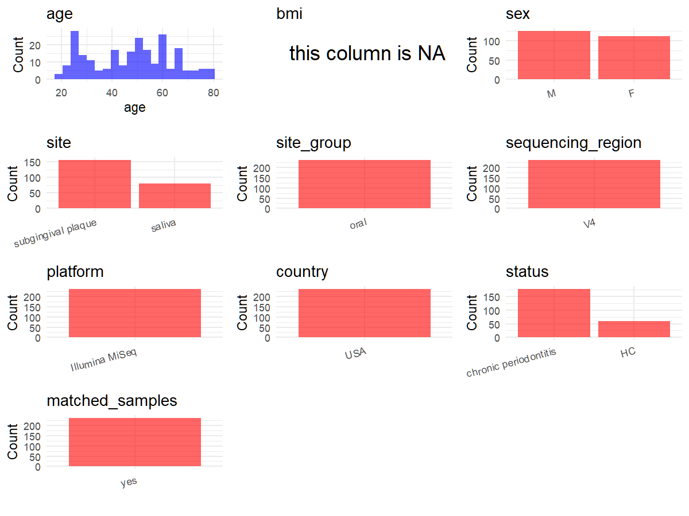

R Notebook: Metadata Processing Workflow
================

# Step 1: Obtain Initial Metadata from Each Project

To obtain the initial metadata: 1. Search for the BioProject ID (e.g.,
“PRJEBXXXX”) on the [NCBI SRA
website](https://www.ncbi.nlm.nih.gov/Traces/study/). 2. In the “Select”
table, click on “Metadata” and download the file. 3. The downloaded file
is typically named “SraRunTable.csv” and contains metadata for the
project.

``` r
# Load necessary libraries
library(dplyr)
library(ggplot2)
library(cowplot)

# Set working directory (update this path to your local directory)
setwd("D:/studylearning/董彪师兄项目/任务/修改20250922/PRJNA321534")

# Read the initial metadata files
initial_meta<-read.csv("SraRunTable.csv",header = T)

# Combine the two metadata files
#meta <- rbind(initial_meta, initial_meta1)

#Remove entries non-oral samples
#initial_meta <- subset(initial_meta,isolate %in% c("saliva","tongue coat"))

# Check the number of samples containing "HT" in Sample.Name (e.g., healthy controls)
#nrow(subset(meta, grepl("HT", Sample.Name)))

# Display the first few rows of the metadata
head(initial_meta)
```

    ##          Run AGE Alcohol Assay.Type AvgSpotLen    Bases  BioProject
    ## 1 SRR3503165  40       n   AMPLICON        252 10664192 PRJNA321534
    ## 2 SRR3503166  40       n   AMPLICON        252 12004218 PRJNA321534
    ## 3 SRR3503167  58       n   AMPLICON        252  8506781 PRJNA321534
    ## 4 SRR3503168  67       n   AMPLICON        252  7221103 PRJNA321534
    ## 5 SRR3503169  67       n   AMPLICON        252 15024168 PRJNA321534
    ## 6 SRR3503170  67       n   AMPLICON        252 12826932 PRJNA321534
    ##      BioSample                       BioSampleModel   Bytes
    ## 1 SAMN04999594 MIMS.me,MIGS/MIMS/MIMARKS.human-oral 5251834
    ## 2 SAMN04999595 MIMS.me,MIGS/MIMS/MIMARKS.human-oral 6088841
    ## 3 SAMN04999604 MIMS.me,MIGS/MIMS/MIMARKS.human-oral 4094730
    ## 4 SAMN04999694 MIMS.me,MIGS/MIMS/MIMARKS.human-oral 3603029
    ## 5 SAMN04999695 MIMS.me,MIGS/MIMS/MIMARKS.human-oral 6480670
    ## 6 SAMN04999696 MIMS.me,MIGS/MIMS/MIMARKS.human-oral 6091650
    ##              Center.Name Collection_Date Consent DATASTORE.filetype
    ## 1 UNIVERISTY OF OKLAHOMA            2012  public   fastq,run.zq,sra
    ## 2 UNIVERISTY OF OKLAHOMA            2012  public   fastq,run.zq,sra
    ## 3 UNIVERISTY OF OKLAHOMA            2012  public   fastq,run.zq,sra
    ## 4 UNIVERISTY OF OKLAHOMA            2012  public   fastq,run.zq,sra
    ## 5 UNIVERISTY OF OKLAHOMA            2012  public   fastq,run.zq,sra
    ## 6 UNIVERISTY OF OKLAHOMA            2012  public   fastq,run.zq,sra
    ##   DATASTORE.provider                     DATASTORE.region Diseased
    ## 1         gs,ncbi,s3 gs.us-east1,ncbi.public,s3.us-east-1        y
    ## 2         gs,ncbi,s3 gs.us-east1,ncbi.public,s3.us-east-1        y
    ## 3         gs,ncbi,s3 gs.us-east1,ncbi.public,s3.us-east-1        n
    ## 4         gs,ncbi,s3 gs.us-east1,ncbi.public,s3.us-east-1        y
    ## 5         gs,ncbi,s3 gs.us-east1,ncbi.public,s3.us-east-1        y
    ## 6         gs,ncbi,s3 gs.us-east1,ncbi.public,s3.us-east-1        y
    ##        env_biome    env_feature   env_material Experiment gender
    ## 1 not applicable not applicable not applicable SRX1760742   male
    ## 2 not applicable not applicable not applicable SRX1760743   male
    ## 3 not applicable not applicable not applicable SRX1760744 female
    ## 4 not applicable not applicable not applicable SRX1760745 female
    ## 5 not applicable not applicable not applicable SRX1760746 female
    ## 6 not applicable not applicable not applicable SRX1760747 female
    ##   geo_loc_name_country geo_loc_name_country_continent   geo_loc_name
    ## 1         uncalculated                   uncalculated not applicable
    ## 2         uncalculated                   uncalculated not applicable
    ## 3         uncalculated                   uncalculated not applicable
    ## 4         uncalculated                   uncalculated not applicable
    ## 5         uncalculated                   uncalculated not applicable
    ## 6         uncalculated                   uncalculated not applicable
    ##           Host     Instrument        lat_lon  Library.Name LibraryLayout
    ## 1 Homo sapiens Illumina MiSeq not applicable   D1P_P1_14MB        SINGLE
    ## 2 Homo sapiens Illumina MiSeq not applicable    D1P_P1_2MB        SINGLE
    ## 3 Homo sapiens Illumina MiSeq not applicable    HP_P12_3MP        SINGLE
    ## 4 Homo sapiens Illumina MiSeq not applicable     D1S_S48SB        SINGLE
    ## 5 Homo sapiens Illumina MiSeq not applicable D2P_P48_14MPR        SINGLE
    ## 6 Homo sapiens Illumina MiSeq not applicable     D2S_S48SR        SINGLE
    ##   LibrarySelection LibrarySource              Organism Platform
    ## 1              PCR   METAGENOMIC human oral metagenome ILLUMINA
    ## 2              PCR   METAGENOMIC human oral metagenome ILLUMINA
    ## 3              PCR   METAGENOMIC human oral metagenome ILLUMINA
    ## 4              PCR   METAGENOMIC human oral metagenome ILLUMINA
    ## 5              PCR   METAGENOMIC human oral metagenome ILLUMINA
    ## 6              PCR   METAGENOMIC human oral metagenome ILLUMINA
    ##            ReleaseDate          create_date version   Sample.Name sample_site
    ## 1 2016-05-18T00:00:00Z 2016-05-13T15:13:00Z       1   D1P_P1_14MB      Plaque
    ## 2 2016-05-18T00:00:00Z 2016-05-13T15:13:00Z       1    D1P_P1_2MB      Plaque
    ## 3 2016-05-18T00:00:00Z 2016-05-13T15:13:00Z       1    HP_P12_3MP      Plaque
    ## 4 2016-05-18T00:00:00Z 2016-05-13T15:13:00Z       1     D1S_S48SB      Saliva
    ## 5 2016-05-18T00:00:00Z 2016-05-13T15:13:00Z       1 D2P_P48_14MPR      Plaque
    ## 6 2016-05-18T00:00:00Z 2016-05-13T15:13:00Z       1     D2S_S48SR      Saliva
    ##   SRA.Study subject Tobacco_1 Tobacco_2 treatment    whole_name
    ## 1 SRP075100       1         n         1       D1P   D1P_P1_14MB
    ## 2 SRP075100       1         n         1       D1P    D1P_P1_2MB
    ## 3 SRP075100      12         y         3        HP    HP_P12_3MP
    ## 4 SRP075100      48         n         1       D1S     D1S_S48SB
    ## 5 SRP075100      48         n         1       D2P D2P_P48_14MPR
    ## 6 SRP075100      48         n         1       D2S     D2S_S48SR

# Step 2: Create a Uniform Metadata Template

The uniform metadata should include the following columns:

1.  **BioProject**: Project ID (e.g., “PRJNA339212”)
2.  **Run**: Sample ID (e.g., “ERRXXXXXX” or “SRRXXXXXX”)
3.  **sample_name**: Original sample name submitted by the authors (not
    the database-assigned ID)
4.  **Age**: Age of the subject (if available)
5.  **BMI**: Body Mass Index (if available)
6.  **Sex**: Sex of the subject (“F” or “M”)
7.  **Region**: Targeted 16S rRNA region (e.g., “V3-V4”)
8.  **Platform**: Sequencing platform (e.g., “Illumina MiSeq”)
9.  **Country**: Country of sample origin (e.g., “China”)
10. **Site**: Sample site (e.g., “saliva”, “dental plaque”)
11. **public_time**: Data release date (format: “YYYY-MM-DD”)
12. **PCR_primers**: PCR primers used (e.g., “515F-806R”)
13. **title**: Title of the associated publication
14. **Disease_study**: Whether the study involves a disease (“YES” or
    “NO”)
15. **Status**: Disease status (e.g., “T2DM”, “HC”). Note: If the study
    includes both disease and healthy samples, this must be specified
    per sample.
16. **matched_samples**: matched samples (“YES” or “NO”)

``` r
# Create a uniform metadata dataframe
metadata <- data.frame(
  BioProject = initial_meta$BioProject,
  Run = initial_meta$Run,
  sample_name = initial_meta$Sample.Name,
  Age = initial_meta$AGE,
  BMI = NA,
  Sex= initial_meta$gender,
  Region = "V4",
  Platform = initial_meta$Instrument,
  Country = "USA",
  Site = initial_meta$sample_site,
  public_time = initial_meta$ReleaseDate,
  Status = initial_meta$Diseased,
  stringsAsFactors = FALSE
)
```

# Step 3: Manually Add Information from the Publication

Some information (e.g. PCR primers, study title, disease status) must be
manually extracted from the publication and added to the metadata.

``` r
# Add information obtained from the publication
metadata$PCR_primers <- "515F-806R"
metadata$title <- "Oral microbiota of periodontal health and disease and their changes after nonsurgical periodontal therapy"
metadata$Disease_study <- "YES"
# Assign disease status based on sample_name patterns
metadata <- metadata %>% 
  mutate(Status = case_when(
    grepl("n",Status) ~ "HC",
    grepl("y",Status) ~ "PD"
  ))
metadata <- metadata %>% 
  mutate(Sex = case_when(
    grepl("f",Sex) ~ "F",
    grepl("m",Sex) ~ "M"
  ))
metadata <- metadata %>% 
  mutate(Site = case_when(
    grepl("P",Site) ~ "plaque",
    grepl("S",Site) ~ "saliva"
  ))

#extract subject id by remove prefix of sample_name
#metadata$sample_name <- gsub("T|CR|CS|C|N|S", "", metadata$sample_name)

# Check initial data distribution
cat("Initial sample distribution:\n")
```

    ## Initial sample distribution:

``` r
table(metadata$sample_name)
```

    ## 
    ##   D1P_P1_14MB    D1P_P1_2MB  D1P_P14_14MP   D1P_P14_2MP  D1P_P15_15MP 
    ##             1             1             1             1             1 
    ##   D1P_P15_3MP  D1P_P16_14MP   D1P_P16_3MP  D1P_P17_15MP   D1P_P17_2MP 
    ##             1             1             1             1             1 
    ##  D1P_P18_14MP   D1P_P18_3MP  D1P_P20_14MP   D1P_P20_3MP  D1P_P21_16MP 
    ##             1             1             1             1             1 
    ##   D1P_P21_2MP  D1P_P22_15MP   D1P_P22_3MP  D1P_P23_13MP   D1P_P23_4MP 
    ##             1             1             1             1             1 
    ##  D1P_P24_14MP   D1P_P24_3MP  D1P_P26_15MP   D1P_P26_1MP  D1P_P29_15MP 
    ##             1             1             1             1             1 
    ##   D1P_P29_2MP  D1P_P30_14MP   D1P_P30_3MP  D1P_P31_15MP   D1P_P31_1MP 
    ##             1             1             1             1             1 
    ##  D1P_P32_15MP   D1P_P32_2MP  D1P_P33_14MP   D1P_P33_3MP  D1P_P35_15MP 
    ##             1             1             1             1             1 
    ##   D1P_P35_2MP  D1P_P48_14MP   D1P_P48_3MP  D1P_P49_14MP   D1P_P49_3MP 
    ##             1             1             1             1             1 
    ##  D1P_P50_14DP   D1P_P50_3DP  D1P_P51_14MP   D1P_P51_3MP  D1P_P52_14MP 
    ##             1             1             1             1             1 
    ##   D1P_P52_3MP  D1P_P53_14MP   D1P_P53_3MP  D1P_P56_14DP   D1P_P56_3DP 
    ##             1             1             1             1             1 
    ##  D1P_P61_14MP   D1P_P61_3MP  D1P_P64_14MP   D1P_P64_3MP  D1P_P67_14MP 
    ##             1             1             1             1             1 
    ##   D1P_P67_3MP  D1P_P68_15MP   D1P_P68_2MP  D1P_P69_14MP   D1P_P69_3MP 
    ##             1             1             1             1             1 
    ##   D1P_P7_14DB    D1P_P7_3DB  D1P_P70_15MP   D1P_P70_2MP  D1P_P74_15MP 
    ##             1             1             1             1             1 
    ##   D1P_P74_2MP  D1P_P75_14MP   D1P_P75_3MP  D1P_P78_14MP   D1P_P78_3MP 
    ##             1             1             1             1             1 
    ##  D1P_P80_15MP   D1P_P80_2MP  D1P_P81_15MP   D1P_P81_3MP  D1P_P82_15MP 
    ##             1             1             1             1             1 
    ##   D1P_P82_2MP  D1P_P84_14MP   D1P_P84_3MP  D1P_P85_15MP   D1P_P85_2MP 
    ##             1             1             1             1             1 
    ##  D1P_P86_15MP   D1P_P86_2MP  D1P_P87_14MP   D1P_P87_3MP  D1P_P88_15MP 
    ##             1             1             1             1             1 
    ##   D1P_P88_2MP  D1P_P89_14MP   D1P_P89_3MP  D1P_P90_15MP   D1P_P90_2MP 
    ##             1             1             1             1             1 
    ##  D1P_P91_15MP   D1P_P91_2MP   D1P_PD_14MP    D1P_PD_1MP   D1P_PG_14MP 
    ##             1             1             1             1             1 
    ##    D1P_PG_3MP     D1S_S14SB     D1S_S15SB     D1S_S16SB     D1S_S17SB 
    ##             1             1             1             1             1 
    ##     D1S_S18SB      D1S_S1SB     D1S_S20SB     D1S_S21SB     D1S_S22SB 
    ##             1             1             1             1             1 
    ##     D1S_S24SB     D1S_S26SB     D1S_S29SB     D1S_S30SB     D1S_S32SB 
    ##             1             1             1             1             1 
    ##     D1S_S33SB     D1S_S48SB     D1S_S49SB     D1S_S50SB     D1S_S51SB 
    ##             1             1             1             1             1 
    ##     D1S_S52SB     D1S_S53SB     D1S_S56SB     D1S_S61SB     D1S_S64SB 
    ##             1             1             1             1             1 
    ##     D1S_S67SB     D1S_S68SB     D1S_S69SB     D1S_S70SB     D1S_S74SB 
    ##             1             1             1             1             1 
    ##     D1S_S75SB     D1S_S78SB      D1S_S7SB     D1S_S80SB     D1S_S81SB 
    ##             1             1             1             1             1 
    ##     D1S_S82SB     D1S_S84SB     D1S_S85SB     D1S_S86SB     D1S_S87SB 
    ##             1             1             1             1             1 
    ##     D1S_S88SB     D1S_S89SB     D1S_S90SB     D1S_S91SB      D1S_SDSB 
    ##             1             1             1             1             1 
    ##      D1S_SGSB  D2P_P17_2MPR  D2P_P18_3MPR D2P_P21_16MPR  D2P_P22_3MPR 
    ##             1             1             1             1             1 
    ##  D2P_P24_3MPR D2P_P26_15MPR  D2P_P30_3MPR  D2P_P32_2MPR D2P_P33_14MPR 
    ##             1             1             1             1             1 
    ##  D2P_P35_2MPR D2P_P48_14MPR D2P_P53_14MPR D2P_P56_14DPR  D2P_P69_3MPR 
    ##             1             1             1             1             1 
    ##  D2P_P74_2MPR D2P_P84_14MPR  D2P_P91_2MPR  D2P_PD_14MPR  D2P_PG_14MPR 
    ##             1             1             1             1             1 
    ##     D2S_S17SR     D2S_S18SR     D2S_S21SR     D2S_S22SR     D2S_S24SR 
    ##             1             1             1             1             1 
    ##     D2S_S26SR     D2S_S30SR     D2S_S32SR     D2S_S33SR     D2S_S48SR 
    ##             1             1             1             1             1 
    ##     D2S_S53SR     D2S_S56SR     D2S_S69SR     D2S_S74SR     D2S_S84SR 
    ##             1             1             1             1             1 
    ##     D2S_S91SR      D2S_SDSR      D2S_SGSR   HP_P11_14MP    HP_P11_3MP 
    ##             1             1             1             1             1 
    ##   HP_P12_14MP    HP_P12_3MP   HP_P13_14MP    HP_P13_3MP   HP_P37_14MP 
    ##             1             1             1             1             1 
    ##    HP_P37_3MP   HP_P38_14MP    HP_P38_3MP   HP_P39_14MP    HP_P39_3MP 
    ##             1             1             1             1             1 
    ##   HP_P40_14MP    HP_P40_3MP   HP_P44_14MP    HP_P44_3MP   HP_P47_14MP 
    ##             1             1             1             1             1 
    ##    HP_P47_3MP   HP_P55_14MP    HP_P55_3MP   HP_P57_14MP    HP_P57_3MP 
    ##             1             1             1             1             1 
    ##   HP_P58_14MP    HP_P58_3MP   HP_P60_14MP    HP_P60_3MP   HP_P62_14MP 
    ##             1             1             1             1             1 
    ##    HP_P62_3MP   HP_P63_14MP    HP_P63_3MP   HP_P65_14MP    HP_P65_3MP 
    ##             1             1             1             1             1 
    ##   HP_P66_14MP    HP_P66_3MP   HP_P72_14MP    HP_P72_3MP   HP_P73_14MP 
    ##             1             1             1             1             1 
    ##    HP_P73_3MP   HP_P76_14MP    HP_P76_3MP   HP_P77_14MP    HP_P77_3MP 
    ##             1             1             1             1             1 
    ##      HS_S11SB      HS_S12SB      HS_S13SB      HS_S38SB      HS_S39SB 
    ##             1             1             1             1             1 
    ##      HS_S40SB      HS_S47SB      HS_S55SB      HS_S57SB      HS_S60SB 
    ##             1             1             1             1             1 
    ##      HS_S62SB      HS_S63SB      HS_S65SB      HS_S66SB      HS_S72SB 
    ##             1             1             1             1             1 
    ##      HS_S73SB      HS_S76SB      HS_S77SB 
    ##             1             1             1

``` r
table(metadata$Site)
```

    ## 
    ## plaque saliva 
    ##    157     81

``` r
# Calculate sampling frequency per subject
sample_counts <- table(metadata$sample_name)
cat("\nNumber of samples per subject:\n")
```

    ## 
    ## Number of samples per subject:

``` r
print(sample_counts)
```

    ## 
    ##   D1P_P1_14MB    D1P_P1_2MB  D1P_P14_14MP   D1P_P14_2MP  D1P_P15_15MP 
    ##             1             1             1             1             1 
    ##   D1P_P15_3MP  D1P_P16_14MP   D1P_P16_3MP  D1P_P17_15MP   D1P_P17_2MP 
    ##             1             1             1             1             1 
    ##  D1P_P18_14MP   D1P_P18_3MP  D1P_P20_14MP   D1P_P20_3MP  D1P_P21_16MP 
    ##             1             1             1             1             1 
    ##   D1P_P21_2MP  D1P_P22_15MP   D1P_P22_3MP  D1P_P23_13MP   D1P_P23_4MP 
    ##             1             1             1             1             1 
    ##  D1P_P24_14MP   D1P_P24_3MP  D1P_P26_15MP   D1P_P26_1MP  D1P_P29_15MP 
    ##             1             1             1             1             1 
    ##   D1P_P29_2MP  D1P_P30_14MP   D1P_P30_3MP  D1P_P31_15MP   D1P_P31_1MP 
    ##             1             1             1             1             1 
    ##  D1P_P32_15MP   D1P_P32_2MP  D1P_P33_14MP   D1P_P33_3MP  D1P_P35_15MP 
    ##             1             1             1             1             1 
    ##   D1P_P35_2MP  D1P_P48_14MP   D1P_P48_3MP  D1P_P49_14MP   D1P_P49_3MP 
    ##             1             1             1             1             1 
    ##  D1P_P50_14DP   D1P_P50_3DP  D1P_P51_14MP   D1P_P51_3MP  D1P_P52_14MP 
    ##             1             1             1             1             1 
    ##   D1P_P52_3MP  D1P_P53_14MP   D1P_P53_3MP  D1P_P56_14DP   D1P_P56_3DP 
    ##             1             1             1             1             1 
    ##  D1P_P61_14MP   D1P_P61_3MP  D1P_P64_14MP   D1P_P64_3MP  D1P_P67_14MP 
    ##             1             1             1             1             1 
    ##   D1P_P67_3MP  D1P_P68_15MP   D1P_P68_2MP  D1P_P69_14MP   D1P_P69_3MP 
    ##             1             1             1             1             1 
    ##   D1P_P7_14DB    D1P_P7_3DB  D1P_P70_15MP   D1P_P70_2MP  D1P_P74_15MP 
    ##             1             1             1             1             1 
    ##   D1P_P74_2MP  D1P_P75_14MP   D1P_P75_3MP  D1P_P78_14MP   D1P_P78_3MP 
    ##             1             1             1             1             1 
    ##  D1P_P80_15MP   D1P_P80_2MP  D1P_P81_15MP   D1P_P81_3MP  D1P_P82_15MP 
    ##             1             1             1             1             1 
    ##   D1P_P82_2MP  D1P_P84_14MP   D1P_P84_3MP  D1P_P85_15MP   D1P_P85_2MP 
    ##             1             1             1             1             1 
    ##  D1P_P86_15MP   D1P_P86_2MP  D1P_P87_14MP   D1P_P87_3MP  D1P_P88_15MP 
    ##             1             1             1             1             1 
    ##   D1P_P88_2MP  D1P_P89_14MP   D1P_P89_3MP  D1P_P90_15MP   D1P_P90_2MP 
    ##             1             1             1             1             1 
    ##  D1P_P91_15MP   D1P_P91_2MP   D1P_PD_14MP    D1P_PD_1MP   D1P_PG_14MP 
    ##             1             1             1             1             1 
    ##    D1P_PG_3MP     D1S_S14SB     D1S_S15SB     D1S_S16SB     D1S_S17SB 
    ##             1             1             1             1             1 
    ##     D1S_S18SB      D1S_S1SB     D1S_S20SB     D1S_S21SB     D1S_S22SB 
    ##             1             1             1             1             1 
    ##     D1S_S24SB     D1S_S26SB     D1S_S29SB     D1S_S30SB     D1S_S32SB 
    ##             1             1             1             1             1 
    ##     D1S_S33SB     D1S_S48SB     D1S_S49SB     D1S_S50SB     D1S_S51SB 
    ##             1             1             1             1             1 
    ##     D1S_S52SB     D1S_S53SB     D1S_S56SB     D1S_S61SB     D1S_S64SB 
    ##             1             1             1             1             1 
    ##     D1S_S67SB     D1S_S68SB     D1S_S69SB     D1S_S70SB     D1S_S74SB 
    ##             1             1             1             1             1 
    ##     D1S_S75SB     D1S_S78SB      D1S_S7SB     D1S_S80SB     D1S_S81SB 
    ##             1             1             1             1             1 
    ##     D1S_S82SB     D1S_S84SB     D1S_S85SB     D1S_S86SB     D1S_S87SB 
    ##             1             1             1             1             1 
    ##     D1S_S88SB     D1S_S89SB     D1S_S90SB     D1S_S91SB      D1S_SDSB 
    ##             1             1             1             1             1 
    ##      D1S_SGSB  D2P_P17_2MPR  D2P_P18_3MPR D2P_P21_16MPR  D2P_P22_3MPR 
    ##             1             1             1             1             1 
    ##  D2P_P24_3MPR D2P_P26_15MPR  D2P_P30_3MPR  D2P_P32_2MPR D2P_P33_14MPR 
    ##             1             1             1             1             1 
    ##  D2P_P35_2MPR D2P_P48_14MPR D2P_P53_14MPR D2P_P56_14DPR  D2P_P69_3MPR 
    ##             1             1             1             1             1 
    ##  D2P_P74_2MPR D2P_P84_14MPR  D2P_P91_2MPR  D2P_PD_14MPR  D2P_PG_14MPR 
    ##             1             1             1             1             1 
    ##     D2S_S17SR     D2S_S18SR     D2S_S21SR     D2S_S22SR     D2S_S24SR 
    ##             1             1             1             1             1 
    ##     D2S_S26SR     D2S_S30SR     D2S_S32SR     D2S_S33SR     D2S_S48SR 
    ##             1             1             1             1             1 
    ##     D2S_S53SR     D2S_S56SR     D2S_S69SR     D2S_S74SR     D2S_S84SR 
    ##             1             1             1             1             1 
    ##     D2S_S91SR      D2S_SDSR      D2S_SGSR   HP_P11_14MP    HP_P11_3MP 
    ##             1             1             1             1             1 
    ##   HP_P12_14MP    HP_P12_3MP   HP_P13_14MP    HP_P13_3MP   HP_P37_14MP 
    ##             1             1             1             1             1 
    ##    HP_P37_3MP   HP_P38_14MP    HP_P38_3MP   HP_P39_14MP    HP_P39_3MP 
    ##             1             1             1             1             1 
    ##   HP_P40_14MP    HP_P40_3MP   HP_P44_14MP    HP_P44_3MP   HP_P47_14MP 
    ##             1             1             1             1             1 
    ##    HP_P47_3MP   HP_P55_14MP    HP_P55_3MP   HP_P57_14MP    HP_P57_3MP 
    ##             1             1             1             1             1 
    ##   HP_P58_14MP    HP_P58_3MP   HP_P60_14MP    HP_P60_3MP   HP_P62_14MP 
    ##             1             1             1             1             1 
    ##    HP_P62_3MP   HP_P63_14MP    HP_P63_3MP   HP_P65_14MP    HP_P65_3MP 
    ##             1             1             1             1             1 
    ##   HP_P66_14MP    HP_P66_3MP   HP_P72_14MP    HP_P72_3MP   HP_P73_14MP 
    ##             1             1             1             1             1 
    ##    HP_P73_3MP   HP_P76_14MP    HP_P76_3MP   HP_P77_14MP    HP_P77_3MP 
    ##             1             1             1             1             1 
    ##      HS_S11SB      HS_S12SB      HS_S13SB      HS_S38SB      HS_S39SB 
    ##             1             1             1             1             1 
    ##      HS_S40SB      HS_S47SB      HS_S55SB      HS_S57SB      HS_S60SB 
    ##             1             1             1             1             1 
    ##      HS_S62SB      HS_S63SB      HS_S65SB      HS_S66SB      HS_S72SB 
    ##             1             1             1             1             1 
    ##      HS_S73SB      HS_S76SB      HS_S77SB 
    ##             1             1             1

``` r
# Create matched_samples column
metadata$matched_samples <- ifelse(metadata$sample_name %in% names(sample_counts[sample_counts >= 2]), "YES", "NO")

cat("\nMatched samples distribution:\n")
```

    ## 
    ## Matched samples distribution:

``` r
table(metadata$matched_samples)
```

    ## 
    ##  NO 
    ## 238

``` r
# Identify samples for removal: single samples excluding saliva and plaque
single_samples <- names(sample_counts[sample_counts == 1])
samples_to_remove <- metadata$sample_name %in% single_samples & !(metadata$Site %in% c("saliva", "plaque"))

cat("\nNumber of samples to be removed:", sum(samples_to_remove), "\n")
```

    ## 
    ## Number of samples to be removed: 0

``` r
# Remove identified samples
metadata_clean <- metadata[!samples_to_remove, ]

cat("\nFinal sample distribution after cleaning:\n")
```

    ## 
    ## Final sample distribution after cleaning:

``` r
table(metadata_clean$sample_name)
```

    ## 
    ##   D1P_P1_14MB    D1P_P1_2MB  D1P_P14_14MP   D1P_P14_2MP  D1P_P15_15MP 
    ##             1             1             1             1             1 
    ##   D1P_P15_3MP  D1P_P16_14MP   D1P_P16_3MP  D1P_P17_15MP   D1P_P17_2MP 
    ##             1             1             1             1             1 
    ##  D1P_P18_14MP   D1P_P18_3MP  D1P_P20_14MP   D1P_P20_3MP  D1P_P21_16MP 
    ##             1             1             1             1             1 
    ##   D1P_P21_2MP  D1P_P22_15MP   D1P_P22_3MP  D1P_P23_13MP   D1P_P23_4MP 
    ##             1             1             1             1             1 
    ##  D1P_P24_14MP   D1P_P24_3MP  D1P_P26_15MP   D1P_P26_1MP  D1P_P29_15MP 
    ##             1             1             1             1             1 
    ##   D1P_P29_2MP  D1P_P30_14MP   D1P_P30_3MP  D1P_P31_15MP   D1P_P31_1MP 
    ##             1             1             1             1             1 
    ##  D1P_P32_15MP   D1P_P32_2MP  D1P_P33_14MP   D1P_P33_3MP  D1P_P35_15MP 
    ##             1             1             1             1             1 
    ##   D1P_P35_2MP  D1P_P48_14MP   D1P_P48_3MP  D1P_P49_14MP   D1P_P49_3MP 
    ##             1             1             1             1             1 
    ##  D1P_P50_14DP   D1P_P50_3DP  D1P_P51_14MP   D1P_P51_3MP  D1P_P52_14MP 
    ##             1             1             1             1             1 
    ##   D1P_P52_3MP  D1P_P53_14MP   D1P_P53_3MP  D1P_P56_14DP   D1P_P56_3DP 
    ##             1             1             1             1             1 
    ##  D1P_P61_14MP   D1P_P61_3MP  D1P_P64_14MP   D1P_P64_3MP  D1P_P67_14MP 
    ##             1             1             1             1             1 
    ##   D1P_P67_3MP  D1P_P68_15MP   D1P_P68_2MP  D1P_P69_14MP   D1P_P69_3MP 
    ##             1             1             1             1             1 
    ##   D1P_P7_14DB    D1P_P7_3DB  D1P_P70_15MP   D1P_P70_2MP  D1P_P74_15MP 
    ##             1             1             1             1             1 
    ##   D1P_P74_2MP  D1P_P75_14MP   D1P_P75_3MP  D1P_P78_14MP   D1P_P78_3MP 
    ##             1             1             1             1             1 
    ##  D1P_P80_15MP   D1P_P80_2MP  D1P_P81_15MP   D1P_P81_3MP  D1P_P82_15MP 
    ##             1             1             1             1             1 
    ##   D1P_P82_2MP  D1P_P84_14MP   D1P_P84_3MP  D1P_P85_15MP   D1P_P85_2MP 
    ##             1             1             1             1             1 
    ##  D1P_P86_15MP   D1P_P86_2MP  D1P_P87_14MP   D1P_P87_3MP  D1P_P88_15MP 
    ##             1             1             1             1             1 
    ##   D1P_P88_2MP  D1P_P89_14MP   D1P_P89_3MP  D1P_P90_15MP   D1P_P90_2MP 
    ##             1             1             1             1             1 
    ##  D1P_P91_15MP   D1P_P91_2MP   D1P_PD_14MP    D1P_PD_1MP   D1P_PG_14MP 
    ##             1             1             1             1             1 
    ##    D1P_PG_3MP     D1S_S14SB     D1S_S15SB     D1S_S16SB     D1S_S17SB 
    ##             1             1             1             1             1 
    ##     D1S_S18SB      D1S_S1SB     D1S_S20SB     D1S_S21SB     D1S_S22SB 
    ##             1             1             1             1             1 
    ##     D1S_S24SB     D1S_S26SB     D1S_S29SB     D1S_S30SB     D1S_S32SB 
    ##             1             1             1             1             1 
    ##     D1S_S33SB     D1S_S48SB     D1S_S49SB     D1S_S50SB     D1S_S51SB 
    ##             1             1             1             1             1 
    ##     D1S_S52SB     D1S_S53SB     D1S_S56SB     D1S_S61SB     D1S_S64SB 
    ##             1             1             1             1             1 
    ##     D1S_S67SB     D1S_S68SB     D1S_S69SB     D1S_S70SB     D1S_S74SB 
    ##             1             1             1             1             1 
    ##     D1S_S75SB     D1S_S78SB      D1S_S7SB     D1S_S80SB     D1S_S81SB 
    ##             1             1             1             1             1 
    ##     D1S_S82SB     D1S_S84SB     D1S_S85SB     D1S_S86SB     D1S_S87SB 
    ##             1             1             1             1             1 
    ##     D1S_S88SB     D1S_S89SB     D1S_S90SB     D1S_S91SB      D1S_SDSB 
    ##             1             1             1             1             1 
    ##      D1S_SGSB  D2P_P17_2MPR  D2P_P18_3MPR D2P_P21_16MPR  D2P_P22_3MPR 
    ##             1             1             1             1             1 
    ##  D2P_P24_3MPR D2P_P26_15MPR  D2P_P30_3MPR  D2P_P32_2MPR D2P_P33_14MPR 
    ##             1             1             1             1             1 
    ##  D2P_P35_2MPR D2P_P48_14MPR D2P_P53_14MPR D2P_P56_14DPR  D2P_P69_3MPR 
    ##             1             1             1             1             1 
    ##  D2P_P74_2MPR D2P_P84_14MPR  D2P_P91_2MPR  D2P_PD_14MPR  D2P_PG_14MPR 
    ##             1             1             1             1             1 
    ##     D2S_S17SR     D2S_S18SR     D2S_S21SR     D2S_S22SR     D2S_S24SR 
    ##             1             1             1             1             1 
    ##     D2S_S26SR     D2S_S30SR     D2S_S32SR     D2S_S33SR     D2S_S48SR 
    ##             1             1             1             1             1 
    ##     D2S_S53SR     D2S_S56SR     D2S_S69SR     D2S_S74SR     D2S_S84SR 
    ##             1             1             1             1             1 
    ##     D2S_S91SR      D2S_SDSR      D2S_SGSR   HP_P11_14MP    HP_P11_3MP 
    ##             1             1             1             1             1 
    ##   HP_P12_14MP    HP_P12_3MP   HP_P13_14MP    HP_P13_3MP   HP_P37_14MP 
    ##             1             1             1             1             1 
    ##    HP_P37_3MP   HP_P38_14MP    HP_P38_3MP   HP_P39_14MP    HP_P39_3MP 
    ##             1             1             1             1             1 
    ##   HP_P40_14MP    HP_P40_3MP   HP_P44_14MP    HP_P44_3MP   HP_P47_14MP 
    ##             1             1             1             1             1 
    ##    HP_P47_3MP   HP_P55_14MP    HP_P55_3MP   HP_P57_14MP    HP_P57_3MP 
    ##             1             1             1             1             1 
    ##   HP_P58_14MP    HP_P58_3MP   HP_P60_14MP    HP_P60_3MP   HP_P62_14MP 
    ##             1             1             1             1             1 
    ##    HP_P62_3MP   HP_P63_14MP    HP_P63_3MP   HP_P65_14MP    HP_P65_3MP 
    ##             1             1             1             1             1 
    ##   HP_P66_14MP    HP_P66_3MP   HP_P72_14MP    HP_P72_3MP   HP_P73_14MP 
    ##             1             1             1             1             1 
    ##    HP_P73_3MP   HP_P76_14MP    HP_P76_3MP   HP_P77_14MP    HP_P77_3MP 
    ##             1             1             1             1             1 
    ##      HS_S11SB      HS_S12SB      HS_S13SB      HS_S38SB      HS_S39SB 
    ##             1             1             1             1             1 
    ##      HS_S40SB      HS_S47SB      HS_S55SB      HS_S57SB      HS_S60SB 
    ##             1             1             1             1             1 
    ##      HS_S62SB      HS_S63SB      HS_S65SB      HS_S66SB      HS_S72SB 
    ##             1             1             1             1             1 
    ##      HS_S73SB      HS_S76SB      HS_S77SB 
    ##             1             1             1

``` r
table(metadata_clean$Site)
```

    ## 
    ## plaque saliva 
    ##    157     81

``` r
table(metadata_clean$matched_samples)
```

    ## 
    ##  NO 
    ## 238

``` r
# Use cleaned dataset for subsequent analysis
metadata <- metadata_clean
```

# Step 4: Summarize and Validate the Metadata

``` r
# Check the number of unique runs and sample names
print(paste("Number of unique runs:", length(unique(metadata$Run))))
```

    ## [1] "Number of unique runs: 238"

``` r
print(paste("Number of unique sample names:", length(unique(metadata$sample_name))))
```

    ## [1] "Number of unique sample names: 238"

# Step 5: Visualize the Metadata

``` r

```


# Step 6: Finalize and Export the Metadata

``` r
# Reorder columns to match the desired format
metadata <- metadata[, c(
  "BioProject", "Run", "sample_name", "Age", "BMI", "Sex", 
  "Region", "Platform", "Country", "Site", "public_time", 
  "PCR_primers", "title", "Disease_study", "Status","matched_samples"
)]

# Export the uniform metadata to a CSV file
write.csv(metadata, file = "metadata.csv", quote = FALSE)
head(metadata)
```

    ##    BioProject        Run   sample_name Age BMI Sex Region       Platform
    ## 1 PRJNA321534 SRR3503165   D1P_P1_14MB  40  NA   M     V4 Illumina MiSeq
    ## 2 PRJNA321534 SRR3503166    D1P_P1_2MB  40  NA   M     V4 Illumina MiSeq
    ## 3 PRJNA321534 SRR3503167    HP_P12_3MP  58  NA   F     V4 Illumina MiSeq
    ## 4 PRJNA321534 SRR3503168     D1S_S48SB  67  NA   F     V4 Illumina MiSeq
    ## 5 PRJNA321534 SRR3503169 D2P_P48_14MPR  67  NA   F     V4 Illumina MiSeq
    ## 6 PRJNA321534 SRR3503170     D2S_S48SR  67  NA   F     V4 Illumina MiSeq
    ##   Country   Site          public_time PCR_primers
    ## 1     USA plaque 2016-05-18T00:00:00Z   515F-806R
    ## 2     USA plaque 2016-05-18T00:00:00Z   515F-806R
    ## 3     USA plaque 2016-05-18T00:00:00Z   515F-806R
    ## 4     USA saliva 2016-05-18T00:00:00Z   515F-806R
    ## 5     USA plaque 2016-05-18T00:00:00Z   515F-806R
    ## 6     USA saliva 2016-05-18T00:00:00Z   515F-806R
    ##                                                                                                       title
    ## 1 Oral microbiota of periodontal health and disease and their changes after nonsurgical periodontal therapy
    ## 2 Oral microbiota of periodontal health and disease and their changes after nonsurgical periodontal therapy
    ## 3 Oral microbiota of periodontal health and disease and their changes after nonsurgical periodontal therapy
    ## 4 Oral microbiota of periodontal health and disease and their changes after nonsurgical periodontal therapy
    ## 5 Oral microbiota of periodontal health and disease and their changes after nonsurgical periodontal therapy
    ## 6 Oral microbiota of periodontal health and disease and their changes after nonsurgical periodontal therapy
    ##   Disease_study Status matched_samples
    ## 1           YES     PD              NO
    ## 2           YES     PD              NO
    ## 3           YES     HC              NO
    ## 4           YES     PD              NO
    ## 5           YES     PD              NO
    ## 6           YES     PD              NO

## Notes for Students:

1.  **Metadata Accuracy**: Always cross-check the metadata with the
    original publication to ensure accuracy.
2.  **Manual Entries**: Columns like `PCR_primers`, and `Status` often
    require manual entry based on the publication.
3.  **Disease Status**: Be careful when assigning `Status`—some studies
    include both disease and healthy samples.
4.  **Visualization**: The plots help quickly identify the distribution
    of values in each column, which is useful for quality control.
5.  **Reproducibility**: Update the working directory and file paths to
    match your local environment.
