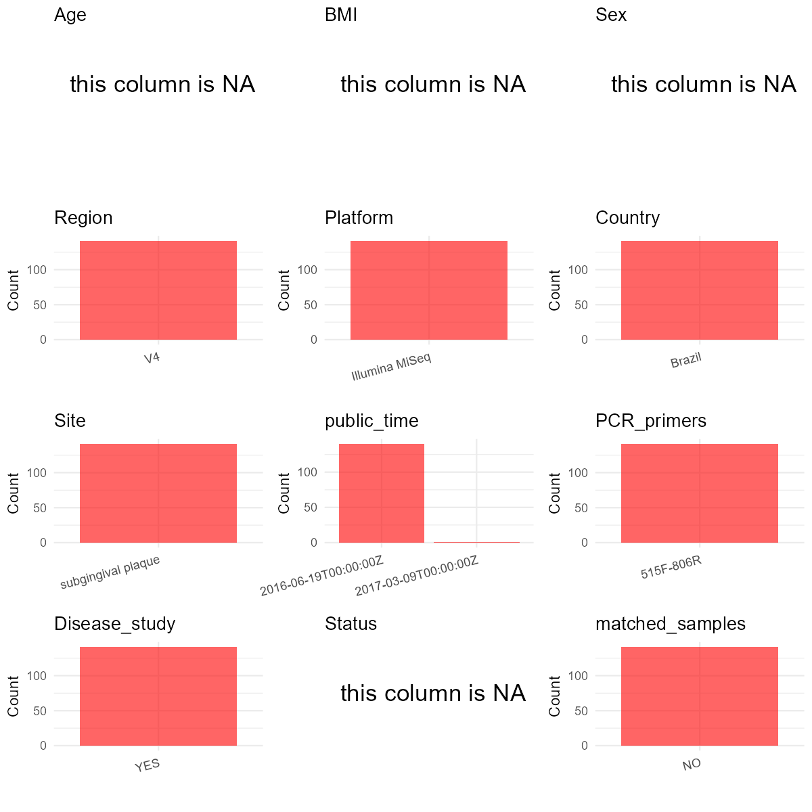

# Step 1: Obtain Initial Metadata from Each Project

This step sets the project directory and loads the raw SRA metadata.

```{r message=FALSE, warning=FALSE}
# Load libraries
library(dplyr)
library(ggplot2)
library(cowplot)

# (1) Setting working directory
project_id <- "PRJNA325500"

base_dir <- "E:/工作区/VSCode/RNAproject/collect_metadata_respon/project"
setwd(file.path(base_dir, project_id))

# (2) Loading raw SRA metadata file
sra_file <- "SraRunTable.csv"
initial_meta <- read.csv(sra_file, header = TRUE, stringsAsFactors = FALSE, check.names = FALSE)
```

# Step 2: Data Overview

First, you need to get an overview of the data, which includes two steps: reading the article and reading the initial metadata. This step is very IMPORTANT!

```{r message=FALSE, warning=FALSE}
# (1) Read the article in the following order: abstract, the beginning of the results section, and the methods.
# Paper summary used for this project:
# - Title: Subgingival microbiota dysbiosis in systemic lupus erythematosus: association with periodontal status.
# - Study design: cross-sectional case-control study.
# - Main paper cohort: 52 SLE patients and 52 matched subjects without SLE.
# - Periodontal subgroup counts reported in Table 1: controls = 24 Non-CP + 28 CP; SLE = 17 Non-CP + 35 CP.
# - Sampling site: subgingival dental plaque collected from the five deepest periodontal pockets and pooled into one sample per subject.
# - Sequencing workflow: V4 region amplified with 515F (GTGCCAGCMGCCGCGGTAA) and 806R (GGACTACHVGGGTWTCTAAT), sequenced on Illumina MiSeq.
# - Paper Table 1 reports 24 control Non-CP, 28 control CP, 17 SLE Non-CP, and 35 SLE CP subjects; age is available only as subgroup summaries.
# - Local SRA has 141 rows total, but one row is non-human Streptococcus mitis and should be removed.
# - Additional file 2 provides a 104-sample OTU table with sample-level Group and Periodontitis columns that can be matched to most local Sample Name values after replacing '.' with '_'.
# - The local BioProject still contains extra human runs beyond the 104-sample paper cohort, so unmatched human rows should be retained with status = NA rather than forced into paper groups.
# - Supplement relevance checked from the paper: Additional file 1 is a serum cytokine table and Additional file 2 is an OTU table; Additional file 2 is useful for status mapping, while Additional file 1 remains low priority for the 19-column metadata table.

# (2) IMPORTANT: MUST go through each column of initial_meta
head(initial_meta, 10)
colnames(initial_meta)
table(initial_meta$Organism)
table(initial_meta$Instrument)
table(initial_meta$geo_loc_name_country)
table(initial_meta$geo_loc_name)
table(initial_meta$env_feature)
table(initial_meta$env_material)
table(initial_meta$LibrarySource)
table(initial_meta$LibrarySelection)
table(initial_meta$`Assay Type`)
table(substr(initial_meta$`Sample Name`, 1, 1))
# Raw-table overview for this project:
# - sample_id / subject_id candidates already present in SRA: Run, Sample Name, BioSample.
# - country / public_time already present in SRA: geo_loc_name_country, geo_loc_name, ReleaseDate.
# - site-related context already present in SRA but still needs paper wording confirmation: env_feature = oral, env_material = biofilm.
# - sequencing workflow hints present in SRA but not authoritative for final curation: Instrument = Illumina MiSeq, Assay Type = AMPLICON, LibrarySelection = PCR.
# - likely useful for filtering: Organism distinguishes 140 human oral metagenome rows from 1 Streptococcus mitis row.
# - not present in local SRA and must come from paper or supplement if available: age, sex, bmi, disease group, periodontal subgroup, sequencing primers.
# - still missing after the current local audit: a defensible run-level mapping from Sample Name prefixes (A/C/L) to the paper's control/SLE and Non-CP/CP groups.
# The local table contains 140 human oral biofilm rows plus 1 non-human Streptococcus mitis row.
```

# Step 3: Removing Control and Non-human Samples

First, we need to remove control samples(including both negative controls and positive controls) and non-human samples.

```{r}
# (1) Parameter setup
control_column <- ""
control_keywords <- c()

species_column <- "Organism"
unique(initial_meta[[species_column]])
non_human_keywords <- c("Streptococcus mitis")

# (2) Remove controls and non-human samples. DO NOT need to modify code in this part, just run it.
n_samples <- nrow(initial_meta)
# Control evaluation
if (length(control_keywords) > 0) {
  if (is.null(control_column) || control_column == "") {
    stop("Error: control_keywords provided but control_column is missing.")
  }

  if (!(control_column %in% colnames(initial_meta))) {
    stop(sprintf("Error: Column '%s' not found in initial_meta.", control_column))
  }

  control_pattern <- paste(control_keywords, collapse = "|")
  control_text <- initial_meta[[control_column]]
  is_control <- grepl(control_pattern, control_text)

} else {
  is_control <- rep(FALSE, n_samples)
}

# Non-human evaluation
if (length(non_human_keywords) > 0) {
  if (is.null(species_column) || species_column == "") {
    stop("Error: non_human_keywords provided but species_column is missing.")
  }

  if (!(species_column %in% colnames(initial_meta))) {
    stop(sprintf("Error: Column '%s' not found in initial_meta.", species_column))
  }

  non_human_pattern <- paste(non_human_keywords, collapse = "|")
  species_text <- initial_meta[[species_column]]
  is_non_human <- grepl(non_human_pattern, species_text)
} else {
  is_non_human <- rep(FALSE, n_samples)
}

# Execute removal
samples_to_remove <- is_control | is_non_human
initial_meta <- initial_meta[!samples_to_remove, ]

cat("Initial samples counts:", n_samples, "\n")
cat("Removed control samples:", sum(is_control), "\n")
cat("Removed non-human samples:", sum(is_non_human), "\n")
cat("Total samples removed ", sum(samples_to_remove), "\n")
cat("Remaining samples after Step 2:", nrow(initial_meta), "\n")
```

# Step 4: Creating a Uniform Metadata Template

This step converts the raw SRA table into the standard metadata format used in our meta-analysis.

```{r}
otu_status <- read.delim("40168_2017_252_MOESM2_ESM.txt",
                         header = TRUE,
                         sep = "\t",
                         stringsAsFactors = FALSE,
                         check.names = FALSE)

otu_status <- data.frame(
  sample_name_key = gsub("\\.", "_", otu_status[[1]]),
  raw_group = otu_status[[3]],
  raw_periodontitis = otu_status[[4]],
  stringsAsFactors = FALSE
)

metadata <- data.frame(
  bioproject = initial_meta$BioProject,
  sample_id = initial_meta$Run,
  subject_id = initial_meta$`Sample Name`,
  age = NA_real_,
  age_info = "Control Non-CP: 34.7 ± 15.9 years; Control CP: 46.3 ± 13.2 years; SLE Non-CP: 31.2 ± 5.2 years; SLE CP: 40.5 ± 10.1 years",
  bmi = NA_real_,
  sex = NA_character_,
  sequencing_region = "V4",
  platform = "Illumina MiSeq",
  country = initial_meta$geo_loc_name_country,
  site = "subgingival dental plaque",
  site_group = "pending",
  public_time = sub("T.*$", "", initial_meta$ReleaseDate),
  pcr_primers = "F-GTGCCAGCMGCCGCGGTAA,R-GGACTACHVGGGTWTCTAAT",
  title = "Subgingival microbiota dysbiosis in systemic lupus erythematosus: association with periodontal status",
  disease_study = "yes",
  status = NA_character_,
  matched_samples = "pending",
  is_time_series = "no",
  stringsAsFactors = FALSE
) %>%
  mutate(sample_name_key = subject_id) %>%
  left_join(otu_status, by = "sample_name_key") %>%
  mutate(
    status = case_when(
      raw_group == "Control" & raw_periodontitis == "No" ~ "HC",
      raw_group == "Control" & raw_periodontitis == "Yes" ~ "chronic periodontitis",
      raw_group == "SLE" & raw_periodontitis == "No" ~ "systemic lupus erythematosus",
      raw_group == "SLE" & raw_periodontitis == "Yes" ~ "systemic lupus erythematosus with chronic periodontitis",
      TRUE ~ NA_character_
    )
  )

# Source notes for non-obvious fields:
# - sample_id comes from SRA Run and subject_id uses Sample Name because no separate host identifier is present in the local SRA table.
# - age and sex stay NA because the paper provides only subgroup-level summaries in Table 1, not per-sample values.
# - age_info stores the Table 1 subgroup summaries instead of inventing per-sample ages.
# - sequencing_region, platform, and pcr_primers are taken from the paper methods rather than SRA instrument fields.
# - site is set from the paper methods, which explicitly describe pooled subgingival dental plaque sampling from the five deepest pockets.
# - status is mapped from Additional file 2 for matched paper-cohort samples; extra human runs that are not represented in Additional file 2 are retained with status = NA.
metadata$public_time <- as.Date(metadata$public_time)
```

# Step 5: Manually solving pending issues

This step involves two parts: (1) handle the columns with the `raw_` prefix, and next (2) handle the `site_group` and `matched_samples` columns.

```{r}
# (1) Status is partially resolved from Additional file 2.
# Evidence summary by target field:
# - bioproject / sample_id / subject_id / country / public_time: directly available in SRA.
# - site / site_group / sequencing_region / platform / pcr_primers / title: confirmed from the paper.
# - age / age_info / sex: only subgroup-level evidence is available from Table 1.
# - bmi: no usable evidence found in local SRA or accessible paper text.
# - disease_study: confirmed by the case-control design in the paper.
# - status: mapped for the 104-sample paper cohort via Additional file 2 and left as NA for extra human runs outside that cohort.
# - matched_samples / is_time_series: derived from one row per subject_id and the cross-sectional study design.
metadata <- metadata %>%
  select(-sample_name_key, -raw_group, -raw_periodontitis)
```

```{r}
# (2) Filling the 'site_group' and 'matched_samples' columns
unique(metadata$site)
Oral_site = c("subgingival dental plaque")
Gut_site = c("feces")

metadata <- metadata %>%
  mutate(site_group = case_when(
    site %in% Oral_site ~ "oral",
    site %in% Gut_site ~ "gut",
    TRUE ~ "other"
  ))

metadata$matched_samples <- ifelse(
  ave(metadata$subject_id, metadata$subject_id, FUN = length) > 1,
  "yes",
  "no"
)
# Each retained subject_id appears once in the local human-row subset.
```

```{r}
# (3) check if there is pending value in metadata. If there is pending value, go on modify the metadata.
has_pending <- function(col) {
  if (is.character(col) || is.factor(col)) {
    any(col == "pending", na.rm = TRUE)
  } else {
    FALSE
  }
}

any_pending_value <- any(sapply(metadata, has_pending))

if (!any_pending_value) {
  message("Good! No cell contains the value 'pending'.")
} else {
  pending_cols <- names(metadata)[sapply(metadata, has_pending)]
  message("Columns containing 'pending': ", paste(pending_cols, collapse = ", "))
  message("Please continue to resolve these pending columns!")
}
```

# Step 6: Visualize the Metadata

This step makes a quick set of plots for checking the distribution of key metadata fields.

```{r}
plot_data <- metadata %>%
  select(-bioproject, -sample_id, -subject_id, -title)

create_simple_plots <- function(data) {
  plots <- list()
  continuous_vars <- c("age", "bmi")

  for (col in colnames(data)) {
    if (all(is.na(data[[col]]))) {
      p <- ggplot() +
        annotate("text", x = 0.5, y = 0.5, label = "this column is NA", size = 6) +
        labs(title = col) +
        theme_void()
    } else if (col %in% continuous_vars && is.numeric(data[[col]])) {
      p <- ggplot(data, aes(x = .data[[col]])) +
        geom_histogram(fill = "blue", alpha = 0.6, bins = 20, na.rm = TRUE) +
        labs(title = col, x = col, y = "Count") +
        theme_minimal()
    } else {
      count_data <- as.data.frame(table(data[[col]], useNA = "ifany"))
      p <- ggplot(count_data, aes(x = reorder(Var1, -Freq), y = Freq)) +
        geom_col(fill = "red", alpha = 0.6) +
        labs(title = col, x = NULL, y = "Count") +
        theme_minimal() +
        theme(axis.text.x = element_text(angle = 15, hjust = 1))
    }
    plots[[col]] <- p
  }

  return(plots)
}

plots <- create_simple_plots(plot_data)
p <- plot_grid(plots$age,
               plots$bmi,
               plots$sex,
               plots$site,
               plots$site_group,
               plots$sequencing_region,
               plots$platform,
               plots$country,
               plots$status,
               plots$matched_samples,
               ncol = 3, align = "hv", axis = "lb")
ggsave("Metadata_Summary.png", plot = p, width = 8, height = 6, dpi = 150)
```

```{r}

```

# Step 7: Sort and export the metadata

This step saves the cleaned metadata table as the final `metadata_v2.csv` file.

```{r}
fixed_cols <- c("bioproject", "sample_id", "subject_id", "age", "age_info",
                "bmi", "sex", "platform", "sequencing_region", "pcr_primers",
                "country", "site", "site_group", "disease_study", "status",
                "title", "public_time", "matched_samples", "is_time_series")
metadata <- metadata %>%
  select(all_of(fixed_cols), starts_with("raw_"))

write.csv(metadata, file = "metadata_v2.csv", quote = TRUE, row.names = FALSE)
```
