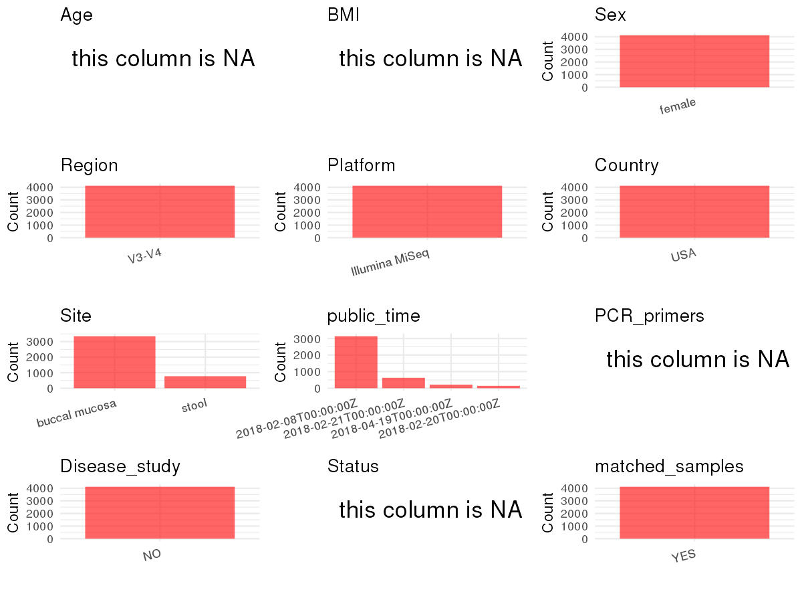

R Notebook: Metadata Processing Workflow
================

# Step 1: Obtain Initial Metadata from Each Project

To obtain the initial metadata: 1. Search for the BioProject ID (e.g.,
“PRJEBXXXX”) on the [NCBI SRA
website](https://www.ncbi.nlm.nih.gov/Traces/study/). 2. In the “Select”
table, click on “Metadata” and download the file. 3. The downloaded file
is typically named “SraRunTable.csv” and contains metadata for the
project.

``` r
# Load necessary libraries
library(dplyr)
library(stringr)
library(ggplot2)
library(cowplot)

# Set working directory (update this path to your local directory)
setwd("/home/dongbiao/word_embedding_microbiome/all_data/oral/global-oral-microbiome/data/projects/PRJNA326441")

# Read the initial metadata files
initial_meta <- read.csv("SraRunTable.csv", header = T) %>% filter(env_material %in% c("human-oral", "human-gut"))

# Display the first few rows of the metadata
head(initial_meta)
```

    ##          Run Assay.Type AvgSpotLen    Bases  BioProject    BioSample
    ## 1 SRR6697211   AMPLICON        591 53045796 PRJNA326441 SAMN08505734
    ## 2 SRR6697213   AMPLICON        588  1380624 PRJNA326441 SAMN08505482
    ## 3 SRR6697215   AMPLICON        590  2016620 PRJNA326441 SAMN08505480
    ## 4 SRR6697220   AMPLICON        594 30604068 PRJNA326441 SAMN08505485
    ## 5 SRR6697223   AMPLICON        588   808500 PRJNA326441 SAMN08505607
    ## 6 SRR6697228   AMPLICON        588 38585148 PRJNA326441 SAMN08505602
    ##                                      BioSampleModel    Bytes
    ## 1 MIMARKS.survey,MIGS/MIMS/MIMARKS.human-associated 36229235
    ## 2 MIMARKS.survey,MIGS/MIMS/MIMARKS.human-associated   990732
    ## 3 MIMARKS.survey,MIGS/MIMS/MIMARKS.human-associated  1548896
    ## 4 MIMARKS.survey,MIGS/MIMS/MIMARKS.human-associated 19933502
    ## 5 MIMARKS.survey,MIGS/MIMS/MIMARKS.human-associated   617539
    ## 6 MIMARKS.survey,MIGS/MIMS/MIMARKS.human-associated 26401601
    ##                                      Center.Name Consent DATASTORE.filetype
    ## 1 JGEORGE@SOM.UMARYLAND.EDU'S SHARED SUBMISSIONS  public   fastq,run.zq,sra
    ## 2 JGEORGE@SOM.UMARYLAND.EDU'S SHARED SUBMISSIONS  public   fastq,run.zq,sra
    ## 3 JGEORGE@SOM.UMARYLAND.EDU'S SHARED SUBMISSIONS  public   fastq,run.zq,sra
    ## 4 JGEORGE@SOM.UMARYLAND.EDU'S SHARED SUBMISSIONS  public   fastq,run.zq,sra
    ## 5 JGEORGE@SOM.UMARYLAND.EDU'S SHARED SUBMISSIONS  public   fastq,run.zq,sra
    ## 6 JGEORGE@SOM.UMARYLAND.EDU'S SHARED SUBMISSIONS  public   fastq,run.zq,sra
    ##   DATASTORE.provider                     DATASTORE.region
    ## 1         gs,ncbi,s3 gs.us-east1,ncbi.public,s3.us-east-1
    ## 2         gs,ncbi,s3 gs.us-east1,ncbi.public,s3.us-east-1
    ## 3         gs,ncbi,s3 gs.us-east1,ncbi.public,s3.us-east-1
    ## 4         gs,ncbi,s3 gs.us-east1,ncbi.public,s3.us-east-1
    ## 5         gs,ncbi,s3 gs.us-east1,ncbi.public,s3.us-east-1
    ## 6         gs,ncbi,s3 gs.us-east1,ncbi.public,s3.us-east-1
    ##                           env_biome env_material Experiment
    ## 1 terrestrial biome [ENVO:00000446]   human-oral SRX3671378
    ## 2 terrestrial biome [ENVO:00000446]   human-oral SRX3671376
    ## 3 terrestrial biome [ENVO:00000446]   human-oral SRX3671374
    ## 4 terrestrial biome [ENVO:00000446]   human-oral SRX3671369
    ## 5 terrestrial biome [ENVO:00000446]    human-gut SRX3671366
    ## 6 terrestrial biome [ENVO:00000446]   human-oral SRX3671361
    ##   geo_loc_name_country geo_loc_name_country_continent geo_loc_name         Host
    ## 1                  USA                  North America          USA Homo sapiens
    ## 2                  USA                  North America          USA Homo sapiens
    ## 3                  USA                  North America          USA Homo sapiens
    ## 4                  USA                  North America          USA Homo sapiens
    ## 5                  USA                  North America          USA Homo sapiens
    ## 6                  USA                  North America          USA Homo sapiens
    ##   host_sex host_subject_id host_visit_number     Instrument     Library.Name
    ## 1   female        EP547297                40 Illumina MiSeq EP547297_40_BCKD
    ## 2   female        EP804945                 4 Illumina MiSeq  EP804945_4_MCKD
    ## 3   female        EP804945                 3 Illumina MiSeq  EP804945_3_MCKD
    ## 4   female        EP983489                 1 Illumina MiSeq  EP983489_1_MCKD
    ## 5   female        EP296970                 6 Illumina MiSeq  EP296970_6_BS1D
    ## 6   female        EP296970                 4 Illumina MiSeq  EP296970_4_MCKD
    ##   LibraryLayout LibrarySelection LibrarySource         Organism Platform
    ## 1        PAIRED              PCR   METAGENOMIC human metagenome ILLUMINA
    ## 2        PAIRED              PCR   METAGENOMIC human metagenome ILLUMINA
    ## 3        PAIRED              PCR   METAGENOMIC human metagenome ILLUMINA
    ## 4        PAIRED              PCR   METAGENOMIC human metagenome ILLUMINA
    ## 5        PAIRED              PCR   METAGENOMIC human metagenome ILLUMINA
    ## 6        PAIRED              PCR   METAGENOMIC human metagenome ILLUMINA
    ##            ReleaseDate                        sample_id        Sample.Name
    ## 1 2018-02-08T00:00:00Z 8938ac880f194a32bc6b736c150f3a1b EP547297_K400_BCKD
    ## 2 2018-02-08T00:00:00Z 8938ac880f194a32bc6b736c15074351  EP804945_K40_MCKD
    ## 3 2018-02-08T00:00:00Z 8938ac880f194a32bc6b736c1507390f  EP804945_K30_MCKD
    ## 4 2018-02-08T00:00:00Z 8938ac880f194a32bc6b736c150758db  EP983489_K10_MCKD
    ## 5 2018-02-08T00:00:00Z 8938ac880f194a32bc6b736c150b334c  EP296970_K60_BS1D
    ## 6 2018-02-08T00:00:00Z 8938ac880f194a32bc6b736c150b0f11  EP296970_K40_MCKD
    ##   SRA.Study          create_date version host_body_product
    ## 1 SRP132490 2018-05-04T18:17:00Z       4     buccal mucosa
    ## 2 SRP132490 2018-05-04T18:15:00Z       4     buccal mucosa
    ## 3 SRP132490 2018-05-04T18:15:00Z       4     buccal mucosa
    ## 4 SRP132490 2018-05-04T18:16:00Z       4     buccal mucosa
    ## 5 SRP132490 2021-10-22T19:05:00Z       5             stool
    ## 6 SRP132490 2018-05-04T18:16:00Z       4     buccal mucosa
    ##            host_body_site
    ## 1 saliva [UBERON:0001836]
    ## 2 saliva [UBERON:0001836]
    ## 3 saliva [UBERON:0001836]
    ## 4 saliva [UBERON:0001836]
    ## 5  feces [UBERON:0001988]
    ## 6 saliva [UBERON:0001836]

# Step 2: Create a Uniform Metadata Template

The uniform metadata should include the following columns:

1.  **BioProject**: Project ID (e.g., “PRJNA339212”)
2.  **Run**: Sample ID (e.g., “ERRXXXXXX” or “SRRXXXXXX”)
3.  **sample_name**: Original sample name submitted by the authors (not
    the database-assigned ID)
4.  **Age**: Age of the subject (if available)
5.  **BMI**: Body Mass Index (if available)
6.  **Sex**: Sex of the subject (“F” or “M”)
7.  **Region**: Targeted 16S rRNA region (e.g., “V3-V4”)
8.  **Platform**: Sequencing platform (e.g., “Illumina MiSeq”)
9.  **Country**: Country of sample origin (e.g., “China”)
10. **Site**: Sample site (e.g., “saliva”, “dental plaque”)
11. **public_time**: Data release date (format: “YYYY-MM-DD”)
12. **PCR_primers**: PCR primers used (e.g., “515F-806R”)
13. **title**: Title of the associated publication
14. **Disease_study**: Whether the study involves a disease (“YES” or
    “NO”)
15. **Status**: Disease status (e.g., “T2DM”, “HC”). Note: If the study
    includes both disease and healthy samples, this must be specified
    per sample.
16. **matched_samples**: matched samples (“YES” or “NO”)

``` r
# Create a uniform metadata dataframe
metadata <- data.frame(
  BioProject = initial_meta$BioProject,
  Run = initial_meta$Run,
  sample_name = initial_meta$host_subject_id,
  Age = NA,
  Sex = initial_meta$host_sex,
  BMI = NA,  
  Region = "V3-V4",
  Platform = initial_meta$Instrument,
  Country = initial_meta$geo_loc_name,
  Site = initial_meta$host_body_product,
  public_time = initial_meta$ReleaseDate,
  stringsAsFactors = FALSE
)
```

# Step 3: Manually Add Information from the Publication

Some information (e.g. PCR primers, study title, disease status) must be
manually extracted from the publication and added to the metadata.

``` r
# Add information obtained from the publication
metadata$PCR_primers <- NA
metadata$title <- "The association of maternal factors with the neonatal microbiota and health"
metadata$Disease_study <- "NO"

metadata$Status <- NA

# Check initial data distribution
cat("Initial sample distribution:\n")
```

    ## Initial sample distribution:

``` r
table(metadata$sample_name)
```

    ## 
    ## EP003595 EP004835 EP005972 EP007214 EP010982 EP013002 EP013417 EP013894 
    ##        1        8        4       10        9       11        5       12 
    ## EP016061 EP016916 EP018067 EP021899 EP023111 EP028055 EP031863 EP034068 
    ##        8       10        6        8        5        8        6       10 
    ## EP035045 EP036702 EP038468 EP044068 EP044415 EP045004 EP049012 EP052210 
    ##        5        7       10       10        6        9       10        8 
    ## EP056457 EP059416 EP062329 EP063938 EP065458 EP066677 EP067259 EP070043 
    ##        4        8        9        8        9        2        8        9 
    ## EP072314 EP072463 EP074002 EP075340 EP075428 EP077464 EP077500 EP080581 
    ##        7        2        6        3        7        1        6        7 
    ## EP081373 EP081859 EP082756 EP085140 EP086560 EP087695 EP090347 EP090829 
    ##        9        1       11        2        1        7        4        8 
    ## EP093201 EP094101 EP096310 EP096728 EP097937 EP098909 EP100948 EP101319 
    ##        5        5        6        6        7        8        6        6 
    ## EP101628 EP103789 EP104056 EP107715 EP111886 EP113416 EP113600 EP113883 
    ##       10        7        9        5        8        8        9        8 
    ## EP116104 EP117219 EP117702 EP117915 EP119655 EP120862 EP123585 EP123900 
    ##        1        8        9        7        2       31        1       10 
    ## EP126323 EP129024 EP129845 EP131173 EP131838 EP134204 EP136122 EP137942 
    ##        7        8       10        8        9       10       10        6 
    ## EP145184 EP153366 EP154266 EP155239 EP156198 EP164977 EP169772 EP171330 
    ##        9       10       14        4        8       10        6       11 
    ## EP172676 EP174763 EP175456 EP175511 EP179901 EP181675 EP182431 EP182444 
    ##        6        8       10        5        1        1        1        8 
    ## EP186689 EP190835 EP191772 EP191897 EP196783 EP198705 EP201349 EP203336 
    ##        2        5        6        3        2       21        2        1 
    ## EP205465 EP206375 EP207166 EP207828 EP209572 EP211731 EP213757 EP216429 
    ##       10        4        3        6        8        4       10       12 
    ## EP217091 EP218239 EP218253 EP219711 EP219915 EP222037 EP222364 EP223167 
    ##        5       10       10       10        7        9        2        7 
    ## EP227762 EP229454 EP230041 EP230807 EP233566 EP235198 EP237361 EP238282 
    ##        7        8       11        7        9        9        9        8 
    ## EP238905 EP239957 EP240606 EP243415 EP243618 EP243984 EP244800 EP246574 
    ##        9        4        1        7       10        9        6       10 
    ## EP247202 EP247445 EP249375 EP251134 EP253266 EP255636 EP256139 EP256568 
    ##       12       12        7       11        5        7        8        8 
    ## EP257801 EP261740 EP263846 EP264961 EP266208 EP266239 EP267601 EP271595 
    ##        8       10        1        6        3        7        3        6 
    ## EP272531 EP273209 EP273248 EP273768 EP275797 EP277370 EP277571 EP280575 
    ##        8        2       16        6        9        3        1       10 
    ## EP280926 EP282097 EP283033 EP284529 EP285481 EP285667 EP285935 EP286550 
    ##        6        6        8        7       14        9        9        9 
    ## EP286906 EP287690 EP288001 EP288825 EP290639 EP291560 EP291588 EP291636 
    ##        2       10        5       10        2        9       10        9 
    ## EP292127 EP292135 EP294770 EP295439 EP296970 EP300768 EP304007 EP307640 
    ##        4        7        1        8        9       12        9        9 
    ## EP310863 EP311478 EP311701 EP312022 EP312275 EP313109 EP313641 EP314756 
    ##        8       10        4        8       11        5        5       10 
    ## EP315426 EP316551 EP318569 EP319072 EP319164 EP323428 EP325547 EP325577 
    ##        5        9        5        3        3       10        7        2 
    ## EP327746 EP328824 EP331612 EP333268 EP333479 EP334990 EP336335 EP337075 
    ##        8       10        9        9        8        4        6        4 
    ## EP337457 EP338059 EP342029 EP346384 EP346571 EP351505 EP353148 EP354309 
    ##       10        9        6       11       10        2        9        1 
    ## EP356729 EP356792 EP360379 EP361548 EP362253 EP362721 EP364626 EP366104 
    ##        2        2        6        9        1       10        9        6 
    ## EP367695 EP368327 EP368562 EP370370 EP371302 EP373403 EP376025 EP376101 
    ##        1        7        9        6        8        7        7        9 
    ## EP376326 EP377475 EP388069 EP388920 EP389265 EP389504 EP391714 EP392045 
    ##       10        8        5        6        7       15       11        5 
    ## EP392047 EP392122 EP395934 EP396857 EP401821 EP404399 EP406987 EP407012 
    ##       11        6        2       11        8        9        7        8 
    ## EP409071 EP410533 EP413477 EP416016 EP416787 EP418446 EP422409 EP424615 
    ##        2       10        9        3        6        7       16       10 
    ## EP426527 EP426750 EP428956 EP429081 EP432041 EP435885 EP435908 EP436435 
    ##       10        7        8        7        9        6        2       10 
    ## EP437943 EP438112 EP438714 EP438739 EP439098 EP442697 EP443695 EP445627 
    ##       10        9        7        7       11       11        2       10 
    ## EP446223 EP450448 EP451329 EP451380 EP451548 EP458322 EP459065 EP459223 
    ##        6        5        5       10        2        5        7        5 
    ## EP460410 EP460880 EP461986 EP462254 EP463151 EP464472 EP466802 EP467840 
    ##        9        5        5        2        6        7        1        8 
    ## EP470665 EP470960 EP473070 EP474224 EP474673 EP479947 EP481651 EP482764 
    ##        7       10        9        8        8        2       10       10 
    ## EP483200 EP483320 EP483776 EP483881 EP485566 EP487163 EP488403 EP489199 
    ##       11        2        9       11        4        9       11        5 
    ## EP491548 EP491593 EP492275 EP492355 EP492474 EP494740 EP495523 EP495882 
    ##       10        2        4       10        6        5        9        9 
    ## EP500700 EP502991 EP503295 EP504516 EP505314 EP509951 EP514824 EP515317 
    ##       11        2        7       10        2       12       12       10 
    ## EP516732 EP516855 EP519031 EP520093 EP521049 EP522897 EP523733 EP524246 
    ##       10        2        9        9       10        5        1       10 
    ## EP527930 EP533526 EP537290 EP542437 EP542782 EP543835 EP545197 EP547297 
    ##        9       15        9        8        7        7        3       37 
    ## EP548439 EP548641 EP550087 EP550598 EP553021 EP553472 EP557758 EP558013 
    ##        1       10        4       10        7       10       12       11 
    ## EP560280 EP563046 EP564900 EP566557 EP566677 EP569268 EP569649 EP571527 
    ##        7        8        6        2        8        7       10        2 
    ## EP573286 EP573960 EP575820 EP577384 EP580086 EP580652 EP581561 EP581708 
    ##       11        8       10       10       10        8        5       12 
    ## EP583097 EP584156 EP584338 EP587032 EP588271 EP591995 EP596677 EP598179 
    ##       10       27        9        2        2        5       10        9 
    ## EP599902 EP601434 EP602090 EP603154 EP604653 EP607311 EP607978 EP608013 
    ##        6        7        5        7        8        8        8        4 
    ## EP612207 EP612777 EP615135 EP618350 EP622928 EP623316 EP625455 EP628259 
    ##        9        6        3        5        2        5        4        9 
    ## EP631608 EP631955 EP634595 EP637055 EP637810 EP641566 EP642005 EP642999 
    ##        5        9        3       12        7       50        7        9 
    ## EP643672 EP645846 EP646001 EP646235 EP647247 EP647996 EP649700 EP649984 
    ##       10        8        7       11        2        9        5        2 
    ## EP651434 EP652669 EP656868 EP657828 EP658321 EP659201 EP660313 EP663155 
    ##        2        2        9        5        9        1        4        8 
    ## EP663711 EP664320 EP668636 EP673071 EP673818 EP675794 EP678863 EP683846 
    ##       10        5        2        7        9        5        9        6 
    ## EP685717 EP686265 EP694022 EP694646 EP699720 EP700088 EP705519 EP705715 
    ##        5        6        6        9        8        2        5        7 
    ## EP707684 EP708835 EP708966 EP716298 EP717203 EP718673 EP719882 EP724185 
    ##        9        9        2        4        9        7        6        7 
    ## EP724739 EP727301 EP733790 EP739912 EP740729 EP740843 EP741069 EP742234 
    ##        2       10        9        9        5       10        5        5 
    ## EP747703 EP749232 EP750568 EP750844 EP751500 EP752976 EP754016 EP754866 
    ##        3        7        7        8        4        9        6        1 
    ## EP758715 EP759641 EP761009 EP765637 EP766458 EP769777 EP771695 EP772621 
    ##        8       10       10       10        9        8        8        5 
    ## EP773241 EP779613 EP783101 EP785033 EP786740 EP789683 EP791525 EP791691 
    ##        7        5        9        9       11        5        8        7 
    ## EP791888 EP792982 EP794231 EP798108 EP799931 EP804124 EP804945 EP808470 
    ##       11        8        1        7        5        9        4        1 
    ## EP809211 EP811525 EP813212 EP824061 EP824738 EP826415 EP828081 EP828421 
    ##        6        9       11       11       11        5        7        8 
    ## EP828710 EP833671 EP837596 EP840663 EP841660 EP841667 EP841683 EP842327 
    ##        8       10       10        9        4       11       11        4 
    ## EP843963 EP844868 EP845775 EP850673 EP853831 EP860829 EP861388 EP863344 
    ##       11        3       11        9        5        8        9        5 
    ## EP868014 EP869641 EP870480 EP871285 EP873739 EP879870 EP882960 EP883575 
    ##        5        7        6        5       10        9        7       10 
    ## EP885097 EP886691 EP888674 EP889264 EP891353 EP891541 EP892824 EP893965 
    ##        5        1        7        8        8        9       10        9 
    ## EP897729 EP899509 EP903758 EP908409 EP909375 EP912225 EP912323 EP915249 
    ##        9        7        5       10        7        2        9        7 
    ## EP919343 EP925066 EP925694 EP926005 EP926575 EP929440 EP931682 EP933492 
    ##       10        8        9        8        8       14        3        6 
    ## EP934299 EP936022 EP936464 EP941670 EP944038 EP949081 EP951326 EP954767 
    ##       11        3        9        9        6        4        4        9 
    ## EP956934 EP957861 EP958168 EP959101 EP959897 EP966032 EP970774 EP972345 
    ##        2        5        7       12        8        5       10        4 
    ## EP972460 EP972800 EP974070 EP977267 EP978121 EP980061 EP982160 EP982611 
    ##       10        2        9       11        5        9       10        2 
    ## EP982951 EP983084 EP983489 EP988019 EP989401 EP992349 EP994584 EP994895 
    ##       10       11       11       10        5        6        6       10 
    ## EP996091 EP997385 
    ##       13        8

``` r
table(metadata$Site)
```

    ## 
    ## buccal mucosa         stool 
    ##          3347           774

``` r
# Calculate sampling frequency per subject
sample_counts <- table(metadata$sample_name)
cat("\nNumber of samples per subject:\n")
```

    ## 
    ## Number of samples per subject:

``` r
print(sample_counts)
```

    ## 
    ## EP003595 EP004835 EP005972 EP007214 EP010982 EP013002 EP013417 EP013894 
    ##        1        8        4       10        9       11        5       12 
    ## EP016061 EP016916 EP018067 EP021899 EP023111 EP028055 EP031863 EP034068 
    ##        8       10        6        8        5        8        6       10 
    ## EP035045 EP036702 EP038468 EP044068 EP044415 EP045004 EP049012 EP052210 
    ##        5        7       10       10        6        9       10        8 
    ## EP056457 EP059416 EP062329 EP063938 EP065458 EP066677 EP067259 EP070043 
    ##        4        8        9        8        9        2        8        9 
    ## EP072314 EP072463 EP074002 EP075340 EP075428 EP077464 EP077500 EP080581 
    ##        7        2        6        3        7        1        6        7 
    ## EP081373 EP081859 EP082756 EP085140 EP086560 EP087695 EP090347 EP090829 
    ##        9        1       11        2        1        7        4        8 
    ## EP093201 EP094101 EP096310 EP096728 EP097937 EP098909 EP100948 EP101319 
    ##        5        5        6        6        7        8        6        6 
    ## EP101628 EP103789 EP104056 EP107715 EP111886 EP113416 EP113600 EP113883 
    ##       10        7        9        5        8        8        9        8 
    ## EP116104 EP117219 EP117702 EP117915 EP119655 EP120862 EP123585 EP123900 
    ##        1        8        9        7        2       31        1       10 
    ## EP126323 EP129024 EP129845 EP131173 EP131838 EP134204 EP136122 EP137942 
    ##        7        8       10        8        9       10       10        6 
    ## EP145184 EP153366 EP154266 EP155239 EP156198 EP164977 EP169772 EP171330 
    ##        9       10       14        4        8       10        6       11 
    ## EP172676 EP174763 EP175456 EP175511 EP179901 EP181675 EP182431 EP182444 
    ##        6        8       10        5        1        1        1        8 
    ## EP186689 EP190835 EP191772 EP191897 EP196783 EP198705 EP201349 EP203336 
    ##        2        5        6        3        2       21        2        1 
    ## EP205465 EP206375 EP207166 EP207828 EP209572 EP211731 EP213757 EP216429 
    ##       10        4        3        6        8        4       10       12 
    ## EP217091 EP218239 EP218253 EP219711 EP219915 EP222037 EP222364 EP223167 
    ##        5       10       10       10        7        9        2        7 
    ## EP227762 EP229454 EP230041 EP230807 EP233566 EP235198 EP237361 EP238282 
    ##        7        8       11        7        9        9        9        8 
    ## EP238905 EP239957 EP240606 EP243415 EP243618 EP243984 EP244800 EP246574 
    ##        9        4        1        7       10        9        6       10 
    ## EP247202 EP247445 EP249375 EP251134 EP253266 EP255636 EP256139 EP256568 
    ##       12       12        7       11        5        7        8        8 
    ## EP257801 EP261740 EP263846 EP264961 EP266208 EP266239 EP267601 EP271595 
    ##        8       10        1        6        3        7        3        6 
    ## EP272531 EP273209 EP273248 EP273768 EP275797 EP277370 EP277571 EP280575 
    ##        8        2       16        6        9        3        1       10 
    ## EP280926 EP282097 EP283033 EP284529 EP285481 EP285667 EP285935 EP286550 
    ##        6        6        8        7       14        9        9        9 
    ## EP286906 EP287690 EP288001 EP288825 EP290639 EP291560 EP291588 EP291636 
    ##        2       10        5       10        2        9       10        9 
    ## EP292127 EP292135 EP294770 EP295439 EP296970 EP300768 EP304007 EP307640 
    ##        4        7        1        8        9       12        9        9 
    ## EP310863 EP311478 EP311701 EP312022 EP312275 EP313109 EP313641 EP314756 
    ##        8       10        4        8       11        5        5       10 
    ## EP315426 EP316551 EP318569 EP319072 EP319164 EP323428 EP325547 EP325577 
    ##        5        9        5        3        3       10        7        2 
    ## EP327746 EP328824 EP331612 EP333268 EP333479 EP334990 EP336335 EP337075 
    ##        8       10        9        9        8        4        6        4 
    ## EP337457 EP338059 EP342029 EP346384 EP346571 EP351505 EP353148 EP354309 
    ##       10        9        6       11       10        2        9        1 
    ## EP356729 EP356792 EP360379 EP361548 EP362253 EP362721 EP364626 EP366104 
    ##        2        2        6        9        1       10        9        6 
    ## EP367695 EP368327 EP368562 EP370370 EP371302 EP373403 EP376025 EP376101 
    ##        1        7        9        6        8        7        7        9 
    ## EP376326 EP377475 EP388069 EP388920 EP389265 EP389504 EP391714 EP392045 
    ##       10        8        5        6        7       15       11        5 
    ## EP392047 EP392122 EP395934 EP396857 EP401821 EP404399 EP406987 EP407012 
    ##       11        6        2       11        8        9        7        8 
    ## EP409071 EP410533 EP413477 EP416016 EP416787 EP418446 EP422409 EP424615 
    ##        2       10        9        3        6        7       16       10 
    ## EP426527 EP426750 EP428956 EP429081 EP432041 EP435885 EP435908 EP436435 
    ##       10        7        8        7        9        6        2       10 
    ## EP437943 EP438112 EP438714 EP438739 EP439098 EP442697 EP443695 EP445627 
    ##       10        9        7        7       11       11        2       10 
    ## EP446223 EP450448 EP451329 EP451380 EP451548 EP458322 EP459065 EP459223 
    ##        6        5        5       10        2        5        7        5 
    ## EP460410 EP460880 EP461986 EP462254 EP463151 EP464472 EP466802 EP467840 
    ##        9        5        5        2        6        7        1        8 
    ## EP470665 EP470960 EP473070 EP474224 EP474673 EP479947 EP481651 EP482764 
    ##        7       10        9        8        8        2       10       10 
    ## EP483200 EP483320 EP483776 EP483881 EP485566 EP487163 EP488403 EP489199 
    ##       11        2        9       11        4        9       11        5 
    ## EP491548 EP491593 EP492275 EP492355 EP492474 EP494740 EP495523 EP495882 
    ##       10        2        4       10        6        5        9        9 
    ## EP500700 EP502991 EP503295 EP504516 EP505314 EP509951 EP514824 EP515317 
    ##       11        2        7       10        2       12       12       10 
    ## EP516732 EP516855 EP519031 EP520093 EP521049 EP522897 EP523733 EP524246 
    ##       10        2        9        9       10        5        1       10 
    ## EP527930 EP533526 EP537290 EP542437 EP542782 EP543835 EP545197 EP547297 
    ##        9       15        9        8        7        7        3       37 
    ## EP548439 EP548641 EP550087 EP550598 EP553021 EP553472 EP557758 EP558013 
    ##        1       10        4       10        7       10       12       11 
    ## EP560280 EP563046 EP564900 EP566557 EP566677 EP569268 EP569649 EP571527 
    ##        7        8        6        2        8        7       10        2 
    ## EP573286 EP573960 EP575820 EP577384 EP580086 EP580652 EP581561 EP581708 
    ##       11        8       10       10       10        8        5       12 
    ## EP583097 EP584156 EP584338 EP587032 EP588271 EP591995 EP596677 EP598179 
    ##       10       27        9        2        2        5       10        9 
    ## EP599902 EP601434 EP602090 EP603154 EP604653 EP607311 EP607978 EP608013 
    ##        6        7        5        7        8        8        8        4 
    ## EP612207 EP612777 EP615135 EP618350 EP622928 EP623316 EP625455 EP628259 
    ##        9        6        3        5        2        5        4        9 
    ## EP631608 EP631955 EP634595 EP637055 EP637810 EP641566 EP642005 EP642999 
    ##        5        9        3       12        7       50        7        9 
    ## EP643672 EP645846 EP646001 EP646235 EP647247 EP647996 EP649700 EP649984 
    ##       10        8        7       11        2        9        5        2 
    ## EP651434 EP652669 EP656868 EP657828 EP658321 EP659201 EP660313 EP663155 
    ##        2        2        9        5        9        1        4        8 
    ## EP663711 EP664320 EP668636 EP673071 EP673818 EP675794 EP678863 EP683846 
    ##       10        5        2        7        9        5        9        6 
    ## EP685717 EP686265 EP694022 EP694646 EP699720 EP700088 EP705519 EP705715 
    ##        5        6        6        9        8        2        5        7 
    ## EP707684 EP708835 EP708966 EP716298 EP717203 EP718673 EP719882 EP724185 
    ##        9        9        2        4        9        7        6        7 
    ## EP724739 EP727301 EP733790 EP739912 EP740729 EP740843 EP741069 EP742234 
    ##        2       10        9        9        5       10        5        5 
    ## EP747703 EP749232 EP750568 EP750844 EP751500 EP752976 EP754016 EP754866 
    ##        3        7        7        8        4        9        6        1 
    ## EP758715 EP759641 EP761009 EP765637 EP766458 EP769777 EP771695 EP772621 
    ##        8       10       10       10        9        8        8        5 
    ## EP773241 EP779613 EP783101 EP785033 EP786740 EP789683 EP791525 EP791691 
    ##        7        5        9        9       11        5        8        7 
    ## EP791888 EP792982 EP794231 EP798108 EP799931 EP804124 EP804945 EP808470 
    ##       11        8        1        7        5        9        4        1 
    ## EP809211 EP811525 EP813212 EP824061 EP824738 EP826415 EP828081 EP828421 
    ##        6        9       11       11       11        5        7        8 
    ## EP828710 EP833671 EP837596 EP840663 EP841660 EP841667 EP841683 EP842327 
    ##        8       10       10        9        4       11       11        4 
    ## EP843963 EP844868 EP845775 EP850673 EP853831 EP860829 EP861388 EP863344 
    ##       11        3       11        9        5        8        9        5 
    ## EP868014 EP869641 EP870480 EP871285 EP873739 EP879870 EP882960 EP883575 
    ##        5        7        6        5       10        9        7       10 
    ## EP885097 EP886691 EP888674 EP889264 EP891353 EP891541 EP892824 EP893965 
    ##        5        1        7        8        8        9       10        9 
    ## EP897729 EP899509 EP903758 EP908409 EP909375 EP912225 EP912323 EP915249 
    ##        9        7        5       10        7        2        9        7 
    ## EP919343 EP925066 EP925694 EP926005 EP926575 EP929440 EP931682 EP933492 
    ##       10        8        9        8        8       14        3        6 
    ## EP934299 EP936022 EP936464 EP941670 EP944038 EP949081 EP951326 EP954767 
    ##       11        3        9        9        6        4        4        9 
    ## EP956934 EP957861 EP958168 EP959101 EP959897 EP966032 EP970774 EP972345 
    ##        2        5        7       12        8        5       10        4 
    ## EP972460 EP972800 EP974070 EP977267 EP978121 EP980061 EP982160 EP982611 
    ##       10        2        9       11        5        9       10        2 
    ## EP982951 EP983084 EP983489 EP988019 EP989401 EP992349 EP994584 EP994895 
    ##       10       11       11       10        5        6        6       10 
    ## EP996091 EP997385 
    ##       13        8

``` r
# Create matched_samples column
metadata$matched_samples <- "YES"
```

# Step 4: Summarize and Validate the Metadata

``` r
# Check the number of unique runs and sample names
print(paste("Number of unique runs:", length(unique(metadata$Run))))
```

    ## [1] "Number of unique runs: 4121"

``` r
print(paste("Number of unique sample names:", length(unique(metadata$sample_name))))
```

    ## [1] "Number of unique sample names: 562"

# Step 5: Visualize the Metadata

``` r

```


# Step 6: Finalize and Export the Metadata

``` r
# Reorder columns to match the desired format
metadata <- metadata[, c(
  "BioProject", "Run", "sample_name", "Age", "BMI", "Sex", 
  "Region", "Platform", "Country", "Site", "public_time", 
  "PCR_primers", "title", "Disease_study", "Status", "matched_samples"
)]

# Export the uniform metadata to a CSV file
write.csv(metadata, file = "metadata.csv", quote = TRUE)
head(metadata)
```

    ##    BioProject        Run sample_name Age BMI    Sex Region       Platform
    ## 1 PRJNA326441 SRR6697211    EP547297  NA  NA female  V3-V4 Illumina MiSeq
    ## 2 PRJNA326441 SRR6697213    EP804945  NA  NA female  V3-V4 Illumina MiSeq
    ## 3 PRJNA326441 SRR6697215    EP804945  NA  NA female  V3-V4 Illumina MiSeq
    ## 4 PRJNA326441 SRR6697220    EP983489  NA  NA female  V3-V4 Illumina MiSeq
    ## 5 PRJNA326441 SRR6697223    EP296970  NA  NA female  V3-V4 Illumina MiSeq
    ## 6 PRJNA326441 SRR6697228    EP296970  NA  NA female  V3-V4 Illumina MiSeq
    ##   Country          Site          public_time PCR_primers
    ## 1     USA buccal mucosa 2018-02-08T00:00:00Z          NA
    ## 2     USA buccal mucosa 2018-02-08T00:00:00Z          NA
    ## 3     USA buccal mucosa 2018-02-08T00:00:00Z          NA
    ## 4     USA buccal mucosa 2018-02-08T00:00:00Z          NA
    ## 5     USA         stool 2018-02-08T00:00:00Z          NA
    ## 6     USA buccal mucosa 2018-02-08T00:00:00Z          NA
    ##                                                                         title
    ## 1 The association of maternal factors with the neonatal microbiota and health
    ## 2 The association of maternal factors with the neonatal microbiota and health
    ## 3 The association of maternal factors with the neonatal microbiota and health
    ## 4 The association of maternal factors with the neonatal microbiota and health
    ## 5 The association of maternal factors with the neonatal microbiota and health
    ## 6 The association of maternal factors with the neonatal microbiota and health
    ##   Disease_study Status matched_samples
    ## 1            NO     NA             YES
    ## 2            NO     NA             YES
    ## 3            NO     NA             YES
    ## 4            NO     NA             YES
    ## 5            NO     NA             YES
    ## 6            NO     NA             YES

## Notes for Students:

1.  **Metadata Accuracy**: Always cross-check the metadata with the
    original publication to ensure accuracy.
2.  **Manual Entries**: Columns like `PCR_primers`, and `Status` often
    require manual entry based on the publication.
3.  **Disease Status**: Be careful when assigning `Status`—some studies
    include both disease and healthy samples.
4.  **Visualization**: The plots help quickly identify the distribution
    of values in each column, which is useful for quality control.
5.  **Reproducibility**: Update the working directory and file paths to
    match your local environment.
