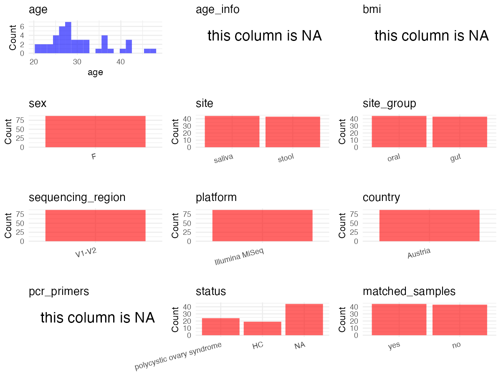

# Step 1: Obtain Initial Metadata from Each Project

This step sets the project directory, loads the raw SRA metadata, and optionally merges supplement tables.

```{r message=FALSE, warning=FALSE}
# =============================================================
# Curation Notes - PRJNA326866
# title         : Alterations in Gut Microbiome Composition and Barrier Function
#                 Are Associated with Reproductive and Metabolic Defects in Women
#                 with Polycystic Ovary Syndrome (PCOS): A Pilot Study
# age           : From initial_meta AGE column; European decimal format "47\,3" = 47.3;
#                 available for saliva samples only — stool samples have no individual age
# sex           : "F" hardcoded — paper: all participants are premenopausal women;
#                 saliva metadata confirms sex="female"; stool rows have empty sex column
# subject_id    : From initial_meta host_subject_id (C001-C025 = controls, P001-P025 = PCOS)
# status        : Derived from host_subject_id prefix: P = Polycystic ovary syndrome, C = HC;
#                 Host_disease column empty for saliva rows so prefix used for all
# platform      : Paper Methods — Illumina MiSeq
# region        : Paper Methods — V1-V2 region of 16S rRNA gene
# site          : Combined tissue + env_material columns (tolower): saliva rows use tissue="saliva";
#                 stool rows have empty tissue so fall back to env_material="Stool" -> "stool"
# country       : "Austria" hardcoded — paper: all recruited at University Hospital Graz;
#                 saliva samples have empty geo_loc_name_country in metadata
# disease_study : "yes" — PCOS disease cohort vs healthy controls
# is_time_series: "no" — paper: "There was no follow-up visit"; all samples labeled T0
# pcr_primers   : NA — V1-V2 primers not named in main paper text; details only in S1 File
# controls      : isolate column, keyword "Mock" — one PBS negative control (SRR5330825)
# non-human     : none (all Organism values are Homo sapiens or human metagenome)
# =============================================================
library(dplyr)
library(ggplot2)
library(cowplot)

# (1) Setting working directory
project_id <- "PRJNA326866"
base_dir <- "/Users/dongbiao/Documents/软件开发/oral/metadata_collect"
setwd(file.path(base_dir, project_id))

# (2) Loading raw SRA metadata file
sra_file <- "SraRunTable.csv"
initial_meta <- read.csv(sra_file, header = TRUE)

# (3) No supplemental tables needed for this project
```

# Step 2: Data Overview

First, you need to get an overview of the data, which includes two steps: reading the article and reading the initial metadata. This step is very IMPORTANT!

```{r message=FALSE, warning=FALSE}
# (1) Paper: "Alterations in Gut Microbiome Composition and Barrier Function Are
#     Associated with Reproductive and Metabolic Defects in Women with PCOS: A Pilot Study"
#     - 24 PCOS patients and 19 healthy controls (stool); single visit, no follow-up
#     - SRA project also contains saliva samples from the same cohort (not in paper)
#     - All participants: premenopausal women aged >=18, recruited at University Hospital Graz, Austria
#     - Sequencing: V1-V2 region of 16S rRNA gene, Illumina MiSeq

# (2) IMPORTANT: MUST go through each column of initial_meta
# head(initial_meta, 5)

# lapply(initial_meta[c("tissue", "Host_disease", "Organism")], table)
# table(initial_meta$isolate)           # "Mock" = PBS negative control (1 sample)
# table(initial_meta$host_subject_id)   # C001-C025 (controls), P001-P025 (PCOS)
# table(initial_meta$sex)               # "female" for saliva rows, "" for stool rows
# head(initial_meta$AGE)                # European decimal "47\,3" (saliva only); empty for stool
# table(initial_meta$geo_loc_name_country)  # "Austria" for stool rows; empty for saliva rows
```

# Step 3: Removing Control and Non-human Samples

First, we need to remove control samples(including both negative controls and positive controls) and non-human samples.

```{r}
# (1) EDIT HERE: Parameter setup
control_column <- "isolate"
# unique(initial_meta[[control_column]])
control_keywords <- c("Mock")  # PBS negative control: SRR5330825, Library Name = "Mock"

species_column <- ""          # No non-human samples; all Organism = Homo sapiens or human metagenome
non_human_keywords <- c()

# (2) Remove controls and non-human samples. DO NOT need to modify code in this part, just run it.
n_samples <- nrow(initial_meta)
# Control evaluation
if (length(control_keywords) > 0) {
  if (is.null(control_column) || control_column == "") {
    stop("Error: control_keywords provided but control_column is missing.")
  }

  if (!(control_column %in% colnames(initial_meta))) {
    stop(sprintf("Error: Column '%s' not found in initial_meta.", control_column))
  }

  control_pattern <- paste(control_keywords, collapse = "|")
  control_text <- initial_meta[[control_column]]
  is_control <- grepl(control_pattern, control_text)

} else {
  is_control <- rep(FALSE, n_samples)
}

# Non-human evaluation
if (length(non_human_keywords) > 0) {
  if (is.null(species_column) || species_column == "") {
    stop("Error: non_human_keywords provided but species_column is missing.")
  }

  if (!(species_column %in% colnames(initial_meta))) {
    stop(sprintf("Error: Column '%s' not found in initial_meta.", species_column))
  }

  non_human_pattern <- paste(non_human_keywords, collapse = "|")
  species_text <- initial_meta[[species_column]]
  is_non_human <- grepl(non_human_pattern, species_text)
} else {
  is_non_human <- rep(FALSE, n_samples)
}

# Execute removal
samples_to_remove <- is_control | is_non_human
initial_meta <- initial_meta[!samples_to_remove, ]

cat("Initial samples counts:", n_samples, "\n")
cat("Removed control samples:", sum(is_control), "\n")
cat("Removed non-human samples:", sum(is_non_human), "\n")
cat("Total samples removed ", sum(samples_to_remove), "\n")
cat("Remaining samples after Step 3:", nrow(initial_meta), "\n")
```

# Step 4: Creating a Uniform Metadata Template

This step converts the raw SRA table into the standard metadata format used in our meta-analysis.
The uniform metadata should include the following columns:
1. **bioproject**: Project ID from SRA or other database
   e.g. `PRJNA1234`, `CNP1234`, 'OEP1234', 'qiita_1234'
2. **sample_id**: SRA sample/run ID. Unique id for each sample!
   e.g. `DRR1234567`, `ERR1234567` and `SRR1234567`. If no such column exists, can use column like sample_name.
3. **subject_id**: subject id for each person if available.
   e.g. `patient_01`, `Host_03_before`, `subject12`
4. **age**: Age of the subject if available.
   e.g. `35`, `42` | not `adult`, `chilren`
5. **age_info**: If the age is not explicitly stated but approximate age range information is available, mark it in this column.
   e.g., `18-55`, `children`, `infant`, `elder`
6. **bmi**: Body Mass Index if available.
   e.g. `22.5`, `18.9` | not `normal`, `overweight`
7. **sex**: Sex of the subject.
   Mandatory to write as M/F | not `female`, `woman`
8. **sequencing_region**: Targeted 16S rRNA region.
   e.g. `V3-V4`, `V4`
9. **platform**: Sequencing platform.
   e.g. `Illumina MiSeq`, `454 GS FLX Titanium`, `Ion Torrent`
10. **country**: Country of sample origin.
   e.g. `China`, `Japan` | not city name like `Beijing`
11. **site**: Sampling site. For oral and gut sites, specify the exact sites as detailed as possible. For example, if it is known to be supragingival plaque, do not record it as 'dental plaque', unless the original text provides only a vague description.
    e.g. `saliva`, `tongue coating` | not broad term like `oral`
12. **site_group**: only accepts one of following three values: 'oral', 'gut', or 'other'.
13. **public_time**: Data release date.
    e.g. `2021-06-22` | not `June 2021`
14. **pcr_primers**: PCR primers used.
    e.g. `515F-806R`, `27F-338R` | not primer sequences
15. **title**: Title of the associated publication.
16. **disease_study**: Whether the study involves disease samples. If it's not clear, can record as NA. Only three values accepted: 'yes', 'no' or NA
17. **status**: Disease status for each sample if available, else record as NA. Only accept following abbreviations, Write full names for all other diseases.
    HC: healthy control
    CD: Crohn's disease
    CRC: colorectal cancer
    COPD: chronic obstructive pulmonary disease
    HIV: human immunodeficiency virus
    ICU: intensive care unit
    OSCC: oral squamous cell carcinoma
    RA: rheumatoid arthritis
    UC: ulcerative colitis
18. **matched_samples**: Whether the subject has matched samples. Only accept 'yes' or 'no'.
19. **is_time_series**: Whether the study is a time series study. Only accept 'yes' or 'no'.

```{r}
# Extract columns from initial_meta as follows: (1) No modification needed -> extract directly.
# (2) Modification needed -> create a new column with the prefix raw_ and mark the original as "pending".
# (3) Need to find or determine based on the article.
metadata <- data.frame(
  bioproject = initial_meta$BioProject,
  sample_id = initial_meta$Run,
  subject_id = initial_meta$host_subject_id,
  raw_age = initial_meta$AGE,  # European decimal format "47\,3"; only saliva rows have values; stool rows are NA
  age = "pending",
  age_info = NA,
  bmi = NA,
  sex = "F",  # From paper: all participants are premenopausal women; saliva metadata confirms "female"; stool rows have empty sex
  sequencing_region = "V1-V2",  # From paper Methods: V1-V2 region of bacterial 16S rRNA gene
  platform = "Illumina MiSeq",  # From paper Methods: amplicons sequenced on MiSeq desktop sequencer
  country = "Austria",  # From paper: all recruited at University Hospital Graz, Austria; saliva rows have empty geo_loc_name_country
  raw_site = ifelse(!is.na(initial_meta$tissue) & initial_meta$tissue != "",
                   initial_meta$tissue,
                   initial_meta$env_material),
  # tissue column: "saliva" for oral samples, NA/empty for stool samples
  # env_material column: "Stool" for gut samples, empty for oral samples
  # Combined: saliva rows use tissue; stool rows fall back to env_material
  site = "pending",
  site_group = "pending",
  public_time = initial_meta$ReleaseDate,
  pcr_primers = NA,  # V1-V2 primers not named in main paper text; detailed only in supplemental S1 File (not provided)
  title = "Alterations in Gut Microbiome Composition and Barrier Function Are Associated with Reproductive and Metabolic Defects in Women with polycystic Ovary Syndrome (PCOS): A Pilot Study",
  disease_study = "yes",  # PCOS disease cohort compared against healthy controls
  status = case_when(
    grepl("^P", initial_meta$host_subject_id) ~ "polycystic ovary syndrome",
    grepl("^C", initial_meta$host_subject_id) ~ "HC",
    TRUE ~ NA_character_
  ),  # Derived from host_subject_id prefix: P = polycystic ovary syndrome patient, C = healthy Control
  matched_samples = "pending",
  is_time_series = "no",  # From paper: "There was no follow-up visit"; all sample names contain T0
  stringsAsFactors = FALSE
)
metadata$public_time <- as.Date(substr(metadata$public_time, 1, 10))
```

# Step 5: Manually solving pending issues

This step involves two parts: (1) handle the columns with the `raw_` prefix, and next (2) handle the `site_group` and `matched_samples` columns.

```{r}
# (1) Handle the columns with the `raw_` prefix.
metadata <- metadata %>%
  mutate(age = suppressWarnings(as.numeric(gsub(",", ".", gsub("\\\\", "", raw_age)))))
  # AGE column uses European decimal notation "47\,3" (= 47.3 years); stool rows have empty AGE -> NA after conversion

metadata$site <- tolower(metadata$raw_site)
# tissue="saliva" -> "saliva"; env_material="Stool" -> "stool"
```

```{r}
# (2) Filling the 'site_group' and 'matched_samples' columns
# editing site_group
unique(metadata$site)
# EDIT HERE: add oral sites
Oral_site = c("saliva")
# EDIT HERE: add gut sites
Gut_site = c("stool")
# just run
metadata <- metadata %>%
  mutate(site_group = case_when(
    site %in% Oral_site ~ "oral",
    site %in% Gut_site ~ "gut",
    TRUE ~ "other"
  ))

# editing matched_samples, just run.
metadata$matched_samples <- ifelse(
  ave(metadata$subject_id, metadata$subject_id, FUN = length) > 1,
  "yes", "no"
)
```

```{r}
# (3) check if there is pending value in metadata. If there is pending value, go on modify the metadata.
# Function to check if a column contains "pending"
has_pending <- function(col) {
  if (is.character(col) || is.factor(col)) {
    any(col == "pending", na.rm = TRUE)
  } else {
    FALSE
  }
}

# Check for any pending value
any_pending_value <- any(sapply(metadata, has_pending))

if (!any_pending_value) {
  message("Good! No cell contains the value 'pending'.")
} else {
  pending_cols <- names(metadata)[sapply(metadata, has_pending)]
  message("Columns containing 'pending': ", paste(pending_cols, collapse = ", "))
  message("Please continue to resolve these pending columns!")
}
```

# Step 6: Visualize the Metadata

This step makes a quick set of plots for checking the distribution of key metadata fields.

```{r}
# Select columns for visualization, just run
plot_data <- metadata %>%
  select(-bioproject, -sample_id, -subject_id, -title)

create_simple_plots <- function(data) {
  plots <- list()
  continuous_vars <- c("age", "bmi")

  for (col in colnames(data)) {
    if (all(is.na(data[[col]]))) {
      p <- ggplot() +
        annotate("text", x = 0.5, y = 0.5, label = "this column is NA", size = 6) +
        labs(title = col) +
        theme_void()
    } else if (col %in% continuous_vars && is.numeric(data[[col]])) {
      p <- ggplot(data, aes(x = .data[[col]])) +
        geom_histogram(fill = "blue", alpha = 0.6, bins = 20, na.rm = TRUE) +
        labs(title = col, x = col, y = "Count") +
        theme_minimal()
    } else {
      count_data <- as.data.frame(table(data[[col]], useNA = "ifany"))
      p <- ggplot(count_data, aes(x = reorder(Var1, -Freq), y = Freq)) +
        geom_col(fill = "red", alpha = 0.6) +
        labs(title = col, x = NULL, y = "Count") +
        theme_minimal() +
        theme(axis.text.x = element_text(angle = 15, hjust = 1))
    }
    plots[[col]] <- p
  }

  return(plots)
}

# Generate and arrange plots
plots <- create_simple_plots(plot_data)
p <- plot_grid(plots$age,
               plots$age_info,
               plots$bmi,
               plots$sex,
               plots$site,
               plots$site_group,
               plots$sequencing_region,
               plots$platform,
               plots$country,
               plots$pcr_primers,
               plots$status,
               plots$matched_samples,
               ncol = 3, align = "hv", axis = "lb")
ggsave("Metadata_Summary.png", plot = p, width = 8, height = 6, dpi = 150)
```

```{r}
# Insert Metadata_Summary.png into the current Rmd output

```

# Step 7: Sort and export the metadata

This step saves the cleaned metadata table as the final `metadata.csv` file.

```{r}
# Reorder the data frame
fixed_cols <- c("bioproject", "sample_id", "subject_id", "age", "age_info",
                "bmi", "sex", "platform", "sequencing_region", "pcr_primers",
                "country", "site", "site_group", "disease_study", "status",
                "title", "public_time", "matched_samples", "is_time_series")
metadata <- metadata %>%
  select(all_of(fixed_cols), everything())

# save metadata
# head(metadata)
write.csv(metadata, file = "metadata_v2.csv", quote = TRUE)
```
