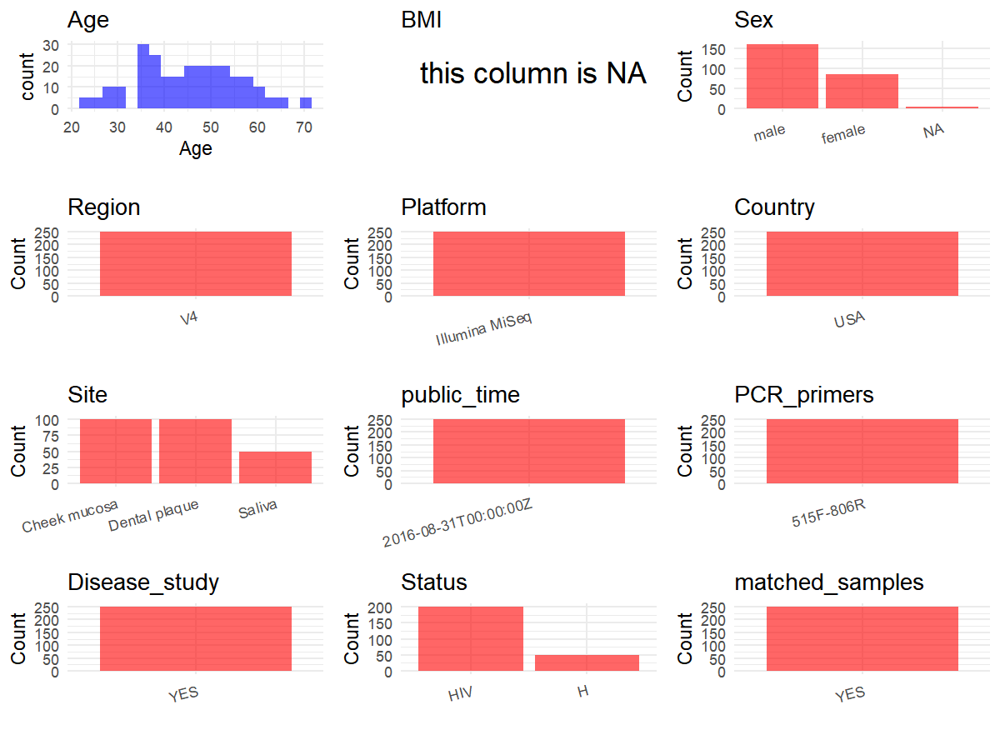

R Notebook: Metadata Processing Workflow
================

# Step 1: Obtain Initial Metadata from Each Project

To obtain the initial metadata: 1. Search for the BioProject ID (e.g.,
“PRJEBXXXX”) on the [NCBI SRA
website](https://www.ncbi.nlm.nih.gov/Traces/study/). 2. In the “Select”
table, click on “Metadata” and download the file. 3. The downloaded file
is typically named “SraRunTable.csv” and contains metadata for the
project.

``` r
# Load necessary libraries
library(dplyr)
library(ggplot2)
library(cowplot)

# Set working directory (update this path to your local directory)
setwd("D:/metadata/3/PRJNA330897")

# Read the initial metadata files
initial_meta<-read.csv("SraRunTable.csv",header = T)

# Combine the two metadata files
#meta <- rbind(initial_meta, initial_meta1)

#Remove entries non-oral samples
#initial_meta <- subset(initial_meta,BioSampleModel != "Metagenome or environmental")

# Check the number of samples containing "HT" in Sample.Name (e.g., healthy controls)
#nrow(subset(meta, grepl("HT", Sample.Name)))

# Display the first few rows of the metadata
head(initial_meta)
```

    ##          Run Assay.Type AvgSpotLen   Bases  BioProject    BioSample
    ## 1 SRR3951008   AMPLICON        498 9521107 PRJNA330897 SAMN05432264
    ## 2 SRR3951009   AMPLICON        450 9491312 PRJNA330897 SAMN05432273
    ## 3 SRR3951010   AMPLICON        494 5311065 PRJNA330897 SAMN05432363
    ## 4 SRR3951012   AMPLICON        497 8662558 PRJNA330897 SAMN05432365
    ## 5 SRR3951014   AMPLICON        437 4463753 PRJNA330897 SAMN05432367
    ## 6 SRR3951022   AMPLICON        480 6209528 PRJNA330897 SAMN05432374
    ##                                  BioSampleModel biotic_relationship   Bytes
    ## 1 MIMARKS.specimen,MIGS/MIMS/MIMARKS.human-oral           commensal 5192404
    ## 2 MIMARKS.specimen,MIGS/MIMS/MIMARKS.human-oral           commensal 5433003
    ## 3 MIMARKS.specimen,MIGS/MIMS/MIMARKS.human-oral           commensal 3215828
    ## 4 MIMARKS.specimen,MIGS/MIMS/MIMARKS.human-oral           commensal 4870973
    ## 5 MIMARKS.specimen,MIGS/MIMS/MIMARKS.human-oral           commensal 2500510
    ## 6 MIMARKS.specimen,MIGS/MIMS/MIMARKS.human-oral           commensal 3344577
    ##            Center.Name Collection_Date Consent DATASTORE.filetype
    ## 1 IRSICAIXA FOUNDATION       2011/3/16  public   fastq,run.zq,sra
    ## 2 IRSICAIXA FOUNDATION       2011/3/22  public   fastq,run.zq,sra
    ## 3 IRSICAIXA FOUNDATION       2011/3/16  public   fastq,run.zq,sra
    ## 4 IRSICAIXA FOUNDATION       2011/3/16  public   fastq,run.zq,sra
    ## 5 IRSICAIXA FOUNDATION       2011/3/16  public   fastq,run.zq,sra
    ## 6 IRSICAIXA FOUNDATION       2011/3/29  public   fastq,run.zq,sra
    ##   DATASTORE.provider                     DATASTORE.region
    ## 1         gs,ncbi,s3 gs.us-east1,ncbi.public,s3.us-east-1
    ## 2         gs,ncbi,s3 gs.us-east1,ncbi.public,s3.us-east-1
    ## 3         gs,ncbi,s3 gs.us-east1,ncbi.public,s3.us-east-1
    ## 4         gs,ncbi,s3 gs.us-east1,ncbi.public,s3.us-east-1
    ## 5         gs,ncbi,s3 gs.us-east1,ncbi.public,s3.us-east-1
    ## 6         gs,ncbi,s3 gs.us-east1,ncbi.public,s3.us-east-1
    ##                  env_biome env_feature  env_material ethinicity Experiment
    ## 1 human-associated habitat human mouth  Cheek mucosa      white SRX1975994
    ## 2 human-associated habitat human mouth  Cheek mucosa      black SRX1975995
    ## 3 human-associated habitat human mouth  Cheek mucosa      white SRX1975996
    ## 4 human-associated habitat human mouth        Saliva      white SRX1975998
    ## 5 human-associated habitat human mouth Dental plaque      white SRX1976000
    ## 6 human-associated habitat human mouth  Cheek mucosa      white SRX1976008
    ##   geo_loc_name_country geo_loc_name_country_continent geo_loc_name Host_Age
    ## 1                  USA                  North America USA: Atlanta    49.38
    ## 2                  USA                  North America USA: Atlanta    40.97
    ## 3                  USA                  North America USA: Atlanta    35.70
    ## 4                  USA                  North America USA: Atlanta    35.70
    ## 5                  USA                  North America USA: Atlanta    35.70
    ## 6                  USA                  North America USA: Atlanta    37.75
    ##            Host_ART Host_BrushTeeth Host_CD4 Host_CurrentAlcohol Host_DrinkSoda
    ## 1 TDF/FTC/AZT/ATV/r             Yes      166               No,No             No
    ## 2       AZT/3TC/EFV             Yes      233             Yes,Yes             No
    ## 3 TDF/FTC/LPV/r/RAL             Yes      254             Yes,Yes            Yes
    ## 4 TDF/FTC/LPV/r/RAL             Yes      254             Yes,Yes            Yes
    ## 5 TDF/FTC/LPV/r/RAL             Yes      254             Yes,Yes            Yes
    ## 6 FTC/TDF/ATV/r/RAL             Yes      414              Yes,No             No
    ##   Host_EatCandy Host_FinancialStatus Host_FlossTeeth host_gender
    ## 1           Yes                    0             Yes        male
    ## 2           Yes                    0              No        male
    ## 3           Yes                    0             Yes        male
    ## 4           Yes                    0             Yes        male
    ## 5           Yes                    0             Yes        male
    ## 6            No                    1             Yes        male
    ##   Host_HIVViralLoad  Host_PD Host_SalivapH         HOST Host_SexBeh
    ## 1               Det   SEVERE          blue Homo sapiens         MSM
    ## 2               Und   SEVERE        yellow Homo sapiens         HET
    ## 3               Und   SEVERE          blue Homo sapiens         MSM
    ## 4               Und   SEVERE          blue Homo sapiens         MSM
    ## 5               Und   SEVERE          blue Homo sapiens         MSM
    ## 6               Und MODERATE          blue Homo sapiens         MSM
    ##   Host_SmokeTobacco     Instrument
    ## 1                No Illumina MiSeq
    ## 2               Yes Illumina MiSeq
    ## 3                No Illumina MiSeq
    ## 4                No Illumina MiSeq
    ## 5                No Illumina MiSeq
    ## 6                No Illumina MiSeq
    ##                                    isol_growth_condt         lat_lon
    ## 1 https://mobio.com/powersoil-dna-isolation-kit.html 33.75 N 84.38 W
    ## 2 https://mobio.com/powersoil-dna-isolation-kit.html 33.75 N 84.38 W
    ## 3 https://mobio.com/powersoil-dna-isolation-kit.html 33.75 N 84.38 W
    ## 4 https://mobio.com/powersoil-dna-isolation-kit.html 33.75 N 84.38 W
    ## 5 https://mobio.com/powersoil-dna-isolation-kit.html 33.75 N 84.38 W
    ## 6 https://mobio.com/powersoil-dna-isolation-kit.html 33.75 N 84.38 W
    ##   Library.Name LibraryLayout LibrarySelection LibrarySource
    ## 1  Lib_A001_RC        PAIRED              PCR   METAGENOMIC
    ## 2  Lib_A003_LC        PAIRED              PCR   METAGENOMIC
    ## 3  Lib_B001_LC        PAIRED              PCR   METAGENOMIC
    ## 4  Lib_B001_Sa        PAIRED              PCR   METAGENOMIC
    ## 5  Lib_B001_T2        PAIRED              PCR   METAGENOMIC
    ## 6  Lib_B003_RC        PAIRED              PCR   METAGENOMIC
    ##                Organism Platform          ReleaseDate          create_date
    ## 1 human oral metagenome ILLUMINA 2016-08-31T00:00:00Z 2016-07-25T16:54:00Z
    ## 2 human oral metagenome ILLUMINA 2016-08-31T00:00:00Z 2016-07-25T16:54:00Z
    ## 3 human oral metagenome ILLUMINA 2016-08-31T00:00:00Z 2016-07-25T16:54:00Z
    ## 4 human oral metagenome ILLUMINA 2016-08-31T00:00:00Z 2016-07-25T16:54:00Z
    ## 5 human oral metagenome ILLUMINA 2016-08-31T00:00:00Z 2016-07-25T16:54:00Z
    ## 6 human oral metagenome ILLUMINA 2016-08-31T00:00:00Z 2016-07-25T16:56:00Z
    ##   version Sample.Name SRA.Study strain Study_AnatomicSite Study_HIVStatus
    ## 1       1     A001_RC SRP079702     NA         RightCheek          HIVpos
    ## 2       1     A003_LC SRP079702     NA          LeftCheek          HIVpos
    ## 3       1     B001_LC SRP079702     NA          LeftCheek          HIVpos
    ## 4       1     B001_Sa SRP079702     NA             Saliva          HIVpos
    ## 5       1     B001_T2 SRP079702     NA             Tooth2          HIVpos
    ## 6       1     B003_RC SRP079702     NA         RightCheek          HIVpos
    ##   Study_SampleID study_site Study_SubjectID
    ## 1        A001_RC      Cheek            A001
    ## 2        A003_LC      Cheek            A003
    ## 3        B001_LC      Cheek            B001
    ## 4        B001_Sa     Saliva            B001
    ## 5        B001_T2      Teeth            B001
    ## 6        B003_RC      Cheek            B003

# Step 2: Create a Uniform Metadata Template

The uniform metadata should include the following columns:

1.  **BioProject**: Project ID (e.g., “PRJNA339212”)
2.  **Run**: Sample ID (e.g., “ERRXXXXXX” or “SRRXXXXXX”)
3.  **sample_name**: Original sample name submitted by the authors (not
    the database-assigned ID)
4.  **Age**: Age of the subject (if available)
5.  **BMI**: Body Mass Index (if available)
6.  **Sex**: Sex of the subject (“F” or “M”)
7.  **Region**: Targeted 16S rRNA region (e.g., “V3-V4”)
8.  **Platform**: Sequencing platform (e.g., “Illumina MiSeq”)
9.  **Country**: Country of sample origin (e.g., “China”)
10. **Site**: Sample site (e.g., “saliva”, “dental plaque”)
11. **public_time**: Data release date (format: “YYYY-MM-DD”)
12. **PCR_primers**: PCR primers used (e.g., “515F-806R”)
13. **title**: Title of the associated publication
14. **Disease_study**: Whether the study involves a disease (“YES” or
    “NO”)
15. **Status**: Disease status (e.g., “T2DM”, “HC”). Note: If the study
    includes both disease and healthy samples, this must be specified
    per sample.
16. **matched_samples**: matched samples (“YES” or “NO”)

``` r
# Create a uniform metadata dataframe
metadata <- data.frame(
  BioProject = initial_meta$BioProject,
  Run = initial_meta$Run,
  sample_name = initial_meta$Sample.Name,
  Age = initial_meta$Host_Age,
  BMI = NA,
  Sex=initial_meta$host_gender,
  Region = "V4",
  Platform = initial_meta$Instrument,
  Country = initial_meta$geo_loc_name_country,
  Site = initial_meta$env_material,
  public_time = initial_meta$ReleaseDate,
  stringsAsFactors = FALSE
)
```

# Step 3: Manually Add Information from the Publication

Some information (e.g. PCR primers, study title, disease status) must be
manually extracted from the publication and added to the metadata.

``` r
# Add information obtained from the publication
metadata$PCR_primers <- "515F-806R"
metadata$title <- "Oral microbiome in HIV-associated periodontitis"
metadata$Disease_study <- "YES"
# Assign disease status based on sample_name patterns
metadata <- metadata %>%
  mutate(Status = case_when(
    initial_meta$Study_HIVStatus == "HIVneg" ~ "H",
    initial_meta$Study_HIVStatus == "HIVpos" ~ "HIV"
  ))

label_cnt <- table(initial_meta$Study_SubjectID)


metadata$matched_samples <- ifelse(label_cnt[initial_meta$Study_SubjectID] >= 2, "YES", "NO")
```

# Step 4: Summarize and Validate the Metadata

``` r
# Check the number of unique runs and sample names
print(paste("Number of unique runs:", length(unique(metadata$Run))))
```

    ## [1] "Number of unique runs: 250"

``` r
print(paste("Number of unique sample names:", length(unique(metadata$sample_name))))
```

    ## [1] "Number of unique sample names: 250"

# Step 5: Visualize the Metadata

``` r

```

<!-- -->

# Step 6: Finalize and Export the Metadata

``` r
# Reorder columns to match the desired format
metadata <- metadata[, c(
  "BioProject", "Run", "sample_name", "Age", "BMI", "Sex", 
  "Region", "Platform", "Country", "Site", "public_time", 
  "PCR_primers", "title", "Disease_study", "Status","matched_samples"
)]

# Export the uniform metadata to a CSV file
write.csv(metadata, file = "metadata.csv", quote = TRUE)
head(metadata)
```

    ##    BioProject        Run sample_name   Age BMI  Sex Region       Platform
    ## 1 PRJNA330897 SRR3951008     A001_RC 49.38  NA male     V4 Illumina MiSeq
    ## 2 PRJNA330897 SRR3951009     A003_LC 40.97  NA male     V4 Illumina MiSeq
    ## 3 PRJNA330897 SRR3951010     B001_LC 35.70  NA male     V4 Illumina MiSeq
    ## 4 PRJNA330897 SRR3951012     B001_Sa 35.70  NA male     V4 Illumina MiSeq
    ## 5 PRJNA330897 SRR3951014     B001_T2 35.70  NA male     V4 Illumina MiSeq
    ## 6 PRJNA330897 SRR3951022     B003_RC 37.75  NA male     V4 Illumina MiSeq
    ##   Country          Site          public_time PCR_primers
    ## 1     USA  Cheek mucosa 2016-08-31T00:00:00Z   515F-806R
    ## 2     USA  Cheek mucosa 2016-08-31T00:00:00Z   515F-806R
    ## 3     USA  Cheek mucosa 2016-08-31T00:00:00Z   515F-806R
    ## 4     USA        Saliva 2016-08-31T00:00:00Z   515F-806R
    ## 5     USA Dental plaque 2016-08-31T00:00:00Z   515F-806R
    ## 6     USA  Cheek mucosa 2016-08-31T00:00:00Z   515F-806R
    ##                                             title Disease_study Status
    ## 1 Oral microbiome in HIV-associated periodontitis           YES    HIV
    ## 2 Oral microbiome in HIV-associated periodontitis           YES    HIV
    ## 3 Oral microbiome in HIV-associated periodontitis           YES    HIV
    ## 4 Oral microbiome in HIV-associated periodontitis           YES    HIV
    ## 5 Oral microbiome in HIV-associated periodontitis           YES    HIV
    ## 6 Oral microbiome in HIV-associated periodontitis           YES    HIV
    ##   matched_samples
    ## 1             YES
    ## 2             YES
    ## 3             YES
    ## 4             YES
    ## 5             YES
    ## 6             YES

## Notes for Students:

1.  **Metadata Accuracy**: Always cross-check the metadata with the
    original publication to ensure accuracy.
2.  **Manual Entries**: Columns like `PCR_primers`, and `Status` often
    require manual entry based on the publication.
3.  **Disease Status**: Be careful when assigning `Status`—some studies
    include both disease and healthy samples.
4.  **Visualization**: The plots help quickly identify the distribution
    of values in each column, which is useful for quality control.
5.  **Reproducibility**: Update the working directory and file paths to
    match your local environment.
