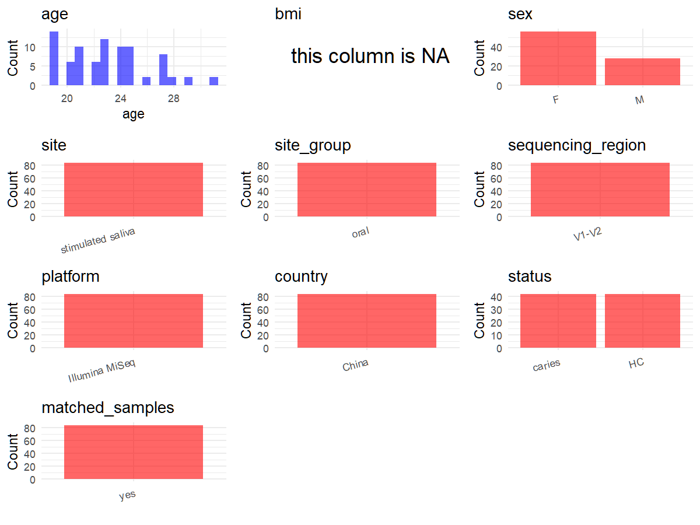

# Step 1: Obtain Initial Metadata from Each Project

This step sets the project directory, loads the raw SRA metadata, and merges the subject-level demographic table transcribed from Supplementary Table S1.

```{r message=FALSE, warning=FALSE}
# Load libraries
library(dplyr)
library(ggplot2)
library(cowplot)

# (1) Setting working directory
project_id <- "PRJNA339212"

base_dir <- "E:/工作区/VSCode/RNAproject/collect_metadata_respon/project"
setwd(file.path(base_dir, project_id))

# (2) Loading raw SRA metadata file
sra_file <- "SraRunTable.csv"
initial_meta <- read.csv(sra_file, header = TRUE, stringsAsFactors = FALSE)

# (3) Subject-level demographic table transcribed from Supplementary Table S1.
# This small CSV keeps the sample-level age/sex/DMFT evidence separate from the Rmd body.
supp_subject <- read.csv("supplementary_table_s1_subjects.csv", header = TRUE, stringsAsFactors = FALSE)

# Quick validation against Supplementary Table S1 structure.
stopifnot(nrow(supp_subject) == 42)
stopifnot(all(c("subject_id", "age", "sex", "dmft") %in% colnames(supp_subject)))
stopifnot(all(sort(supp_subject$subject_id) == sort(c(paste0("CF-", 1:21), paste0("CA-", 1:21)))))

# Keep sex coding consistent with the project schema.
supp_subject$sex <- toupper(supp_subject$sex)
stopifnot(all(supp_subject$sex %in% c("M", "F")))

# CF rows should have DMFT = 0 according to Supplementary Table S1.
stopifnot(all(supp_subject$dmft[grepl("^CF-", supp_subject$subject_id)] == 0))

# Sort rows to make joins and manual inspection stable.
supp_subject <- supp_subject %>% arrange(subject_id)
head(supp_subject)
supp_subject[, c("subject_id", "age", "sex", "dmft")]

# (4) Derive subject_id from Sample_ID.
# Sample_ID prefixes A/B/C/D align with the study design and Supplementary Table S1 numbering:
# A = CF pre, B = CF post, C = CA pre, D = CA post.
initial_meta <- initial_meta %>%
  mutate(
    sample_prefix = substr(Sample_ID, 1, 1),
    sample_index = as.integer(sub("^[A-Z]", "", Sample_ID)),
    raw_timepoint = case_when(
      sample_prefix %in% c("A", "C") ~ "pre",
      sample_prefix %in% c("B", "D") ~ "post",
      TRUE ~ NA_character_
    ),
    raw_cohort = case_when(
      sample_prefix %in% c("A", "B") ~ "CF",
      sample_prefix %in% c("C", "D") ~ "CA",
      TRUE ~ NA_character_
    ),
    subject_id = paste0(raw_cohort, "-", sample_index)
  ) %>%
  left_join(supp_subject, by = "subject_id")
```

# Step 2: Data Overview

First, you need to get an overview of the data, which includes two steps: reading the article and reading the initial metadata. This step is very IMPORTANT!

```{r message=FALSE, warning=FALSE}
# (1) Read the article in the following order: abstract, the beginning of the results section, and the methods.
# Main evidence used here:
# - paper.pdf results/methods: 21 caries-free + 21 caries-active subjects, pre/post saliva sampling,
#   2-week washout + 2-week 8% arginine treatment, stimulated saliva, Illumina MiSeq, ~330 bp reads.
# - supplementary_information.pdf page 2: V1-V2 region, primers 27F/338R.
# - supplementary_information.pdf page 10: sample-level age/sex/DMFT in Supplementary Table S1.

# (2) IMPORTANT: MUST go through each column of initial_meta
head(initial_meta, 10)
colnames(initial_meta)

# IMPORTANT: Check the unique values in the columns of interest.
table(initial_meta$sample_group)
table(initial_meta$env_material)
table(initial_meta$geo_loc_name_country)
table(initial_meta$Instrument)
table(initial_meta$HOST)
table(initial_meta$Collection_Date)
head(initial_meta[, c("Run", "Sample_ID", "sample_group", "subject_id", "age", "sex")], 10)
```

# Step 3: Removing Control and Non-human Samples

First, we need to remove control samples(including both negative controls and positive controls) and non-human samples.

```{r}
# (1) Parameter setup
control_column <- ""
control_keywords <- c()

species_column <- "HOST"
unique(initial_meta[[species_column]])
non_human_keywords <- c()

# (2) Remove controls and non-human samples. No rows are expected to be removed for this project.
n_samples <- nrow(initial_meta)

if (length(control_keywords) > 0) {
  if (is.null(control_column) || control_column == "") {
    stop("Error: control_keywords provided but control_column is missing.")
  }

  if (!(control_column %in% colnames(initial_meta))) {
    stop(sprintf("Error: Column '%s' not found in initial_meta.", control_column))
  }

  control_pattern <- paste(control_keywords, collapse = "|")
  control_text <- initial_meta[[control_column]]
  is_control <- grepl(control_pattern, control_text)
} else {
  is_control <- rep(FALSE, n_samples)
}

if (length(non_human_keywords) > 0) {
  if (is.null(species_column) || species_column == "") {
    stop("Error: non_human_keywords provided but species_column is missing.")
  }

  if (!(species_column %in% colnames(initial_meta))) {
    stop(sprintf("Error: Column '%s' not found in initial_meta.", species_column))
  }

  non_human_pattern <- paste(non_human_keywords, collapse = "|")
  species_text <- initial_meta[[species_column]]
  is_non_human <- grepl(non_human_pattern, species_text)
} else {
  is_non_human <- rep(FALSE, n_samples)
}

samples_to_remove <- is_control | is_non_human
initial_meta <- initial_meta[!samples_to_remove, ]

cat("Initial samples counts:", n_samples, "\n")
cat("Removed control samples:", sum(is_control), "\n")
cat("Removed non-human samples:", sum(is_non_human), "\n")
cat("Total samples removed ", sum(samples_to_remove), "\n")
cat("Remaining samples after Step 3:", nrow(initial_meta), "\n")
```

# Step 4: Creating a Uniform Metadata Template

This step converts the raw SRA table into the standard metadata format used in our meta-analysis.

```{r}
metadata <- data.frame(
  bioproject = initial_meta$BioProject,
  sample_id = initial_meta$Run,
  subject_id = initial_meta$subject_id,
  age = initial_meta$age,
  age_info = NA,
  bmi = NA,
  sex = initial_meta$sex,
  sequencing_region = "V1-V2", # Supporting Information page 2: "16S rRNA amplicon (V1-V2 region)"
  platform = "Illumina MiSeq", # paper.pdf methods: barcoded 16S rRNA amplicon sequencing via Illumina MiSeq
  country = initial_meta$geo_loc_name_country,
  site = "stimulated saliva", # paper.pdf methods: stimulated saliva was collected for the salivary microbiome analysis
  site_group = "oral",
  public_time = initial_meta$ReleaseDate,
  pcr_primers = "F-AGAGTTTGATCCTGGCTCAG,R-TGCTGCCTCCCGTAGGAGT", # Supporting Information page 2 gives exact sequencing primer sequences
  title = "Ecological Effect of Arginine on Oral Microbiota",
  disease_study = "yes",
  raw_sample_group = initial_meta$sample_group,
  raw_timepoint = initial_meta$raw_timepoint,
  status = "pending",
  matched_samples = "yes", # all subjects have paired pre/post saliva samples
  is_time_series = "no", # intervention follow-up study; keep repeated design in matched_samples rather than time series
  stringsAsFactors = FALSE
)
metadata$public_time <- as.Date(metadata$public_time)
```

# Step 5: Manually solving pending issues

This step involves two parts: (1) handle the columns with the `raw_` prefix, and next (2) handle any remaining checks.

```{r}
# (1) Resolve status from the SRA sample_group field.
# The raw value "carie active-pre" in SRA is a spelling variant and is standardized here to "caries active-pre".
metadata <- metadata %>%
  mutate(
    raw_sample_group = case_when(
      raw_sample_group == "carie active-pre" ~ "caries active-pre",
      TRUE ~ raw_sample_group
    ),
    status = case_when(
      raw_sample_group %in% c("caries free-pre", "caries free-post") ~ "HC",
      raw_sample_group %in% c("caries active-pre", "caries active-post") ~ "caries",
      TRUE ~ NA_character_
    )
  )
```

```{r}
# (2) Check if there is pending value in metadata.
has_pending <- function(col) {
  if (is.character(col) || is.factor(col)) {
    any(col == "pending", na.rm = TRUE)
  } else {
    FALSE
  }
}

any_pending_value <- any(sapply(metadata, has_pending))

if (!any_pending_value) {
  message("Good! No cell contains the value 'pending'.")
} else {
  pending_cols <- names(metadata)[sapply(metadata, has_pending)]
  message("Columns containing 'pending': ", paste(pending_cols, collapse = ", "))
  message("Please continue to resolve these pending columns!")
}
```

# Step 6: Visualize the Metadata

This step makes a quick set of plots for checking the distribution of key metadata fields.

```{r}
plot_data <- metadata %>%
  select(-bioproject, -sample_id, -subject_id, -title)

create_simple_plots <- function(data) {
  plots <- list()
  continuous_vars <- c("age", "bmi")

  for (col in colnames(data)) {
    if (all(is.na(data[[col]]))) {
      p <- ggplot() +
        annotate("text", x = 0.5, y = 0.5, label = "this column is NA", size = 6) +
        labs(title = col) +
        theme_void()
    } else if (col %in% continuous_vars && is.numeric(data[[col]])) {
      p <- ggplot(data, aes(x = .data[[col]])) +
        geom_histogram(fill = "blue", alpha = 0.6, bins = 20, na.rm = TRUE) +
        labs(title = col, x = col, y = "Count") +
        theme_minimal()
    } else {
      count_data <- as.data.frame(table(data[[col]], useNA = "ifany"))
      p <- ggplot(count_data, aes(x = reorder(Var1, -Freq), y = Freq)) +
        geom_col(fill = "red", alpha = 0.6) +
        labs(title = col, x = NULL, y = "Count") +
        theme_minimal() +
        theme(axis.text.x = element_text(angle = 15, hjust = 1))
    }
    plots[[col]] <- p
  }

  return(plots)
}

plots <- create_simple_plots(plot_data)
p <- plot_grid(
  plots$age,
  plots$bmi,
  plots$sex,
  plots$site,
  plots$site_group,
  plots$sequencing_region,
  plots$platform,
  plots$country,
  plots$status,
  plots$matched_samples,
  ncol = 3, align = "hv", axis = "lb"
)
ggsave("Metadata_Summary.png", plot = p, width = 8, height = 6, dpi = 150)
```

```{r}

```

# Step 7: Sort and export the metadata

This step saves the cleaned metadata table as the final `metadata_v2.csv` file.

```{r}
fixed_cols <- c(
  "bioproject", "sample_id", "subject_id", "age", "age_info", "bmi", "sex",
  "platform", "sequencing_region", "pcr_primers", "country", "site", "site_group",
  "disease_study", "status", "title", "public_time", "matched_samples", "is_time_series"
)
metadata <- metadata %>%
  select(all_of(fixed_cols), starts_with("raw_"))

write.csv(metadata, file = "metadata_v2.csv", quote = TRUE, row.names = FALSE)
```
