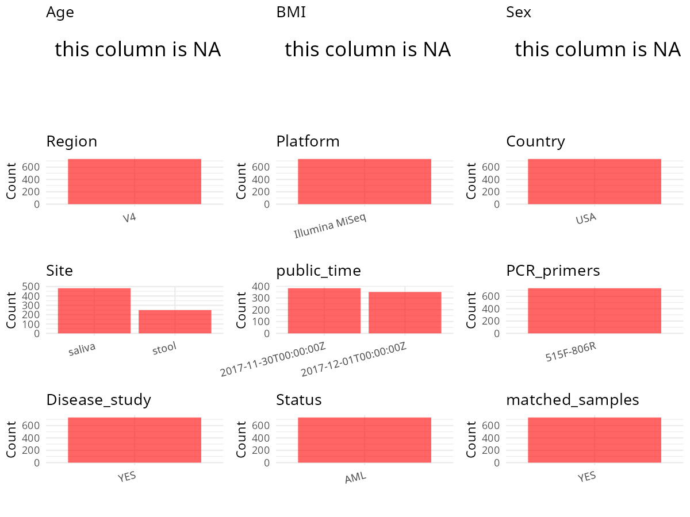

R Notebook: Metadata Processing Workflow
================

# Step 1: Obtain Initial Metadata from Each Project

To obtain the initial metadata: 1. Search for the BioProject ID (e.g.,
“PRJEBXXXX”) on the [NCBI SRA
website](https://www.ncbi.nlm.nih.gov/Traces/study/). 2. In the “Select”
table, click on “Metadata” and download the file. 3. The downloaded file
is typically named “SraRunTable.csv” and contains metadata for the
project.

``` r
# Load necessary libraries
library(dplyr)
library(ggplot2)
library(cowplot)
library(stringr)

# Set working directory (update this path to your local directory)
setwd("/home/hby/oral_project/PRJNA352060")

# Read the initial metadata files
initial_meta <- read.csv("SraRunTable.csv", header = T)

# Combine the two metadata files
# meta <- rbind(initial_meta, initial_meta1)

# Remove entries non-oral samples
# initial_meta <- subset(initial_meta,isolate %in% c("saliva","tongue coat"))

# Check the number of samples containing "HT" in Sample.Name (e.g., healthy controls)
# nrow(subset(meta, grepl("HT", Sample.Name)))

# Display the first few rows of the metadata
head(initial_meta)
```

    ##          Run Assay.Type AvgSpotLen    Bases  BioProject    BioSample              BioSampleModel    Bytes                                           Center.Name Collection_Date Consent
    ## 1 SRR4790413   AMPLICON        500 19816500 PRJNA352060 SAMN05962033 Metagenome or environmental 12563505 ALKEK CENTER FOR METAGENOMICS AND MICROBIOME RESEARCH          14-Oct  public
    ## 2 SRR4790414   AMPLICON        500 20899000 PRJNA352060 SAMN05962034 Metagenome or environmental 13275084 ALKEK CENTER FOR METAGENOMICS AND MICROBIOME RESEARCH          14-Oct  public
    ## 3 SRR4790415   AMPLICON        500 18069000 PRJNA352060 SAMN05962035 Metagenome or environmental 11535324 ALKEK CENTER FOR METAGENOMICS AND MICROBIOME RESEARCH          14-Oct  public
    ## 4 SRR4790416   AMPLICON        500 11138000 PRJNA352060 SAMN05962036 Metagenome or environmental  7306337 ALKEK CENTER FOR METAGENOMICS AND MICROBIOME RESEARCH          14-Oct  public
    ## 5 SRR4790417   AMPLICON        500 18664500 PRJNA352060 SAMN05962029 Metagenome or environmental 12378560 ALKEK CENTER FOR METAGENOMICS AND MICROBIOME RESEARCH          14-Oct  public
    ## 6 SRR4790418   AMPLICON        500 15027000 PRJNA352060 SAMN05962030 Metagenome or environmental  9740058 ALKEK CENTER FOR METAGENOMICS AND MICROBIOME RESEARCH          14-Oct  public
    ##   DATASTORE.filetype DATASTORE.provider                     DATASTORE.region Experiment file_prefix geo_loc_name_country geo_loc_name_country_continent          geo_loc_name
    ## 1   fastq,run.zq,sra         gs,ncbi,s3 gs.us-east1,ncbi.public,s3.us-east-1 SRX2318614      GP0623                  USA                  North America USA: Houston\\, Texas
    ## 2   fastq,run.zq,sra         gs,ncbi,s3 gs.us-east1,ncbi.public,s3.us-east-1 SRX2318615      GP0624                  USA                  North America USA: Houston\\, Texas
    ## 3   fastq,run.zq,sra         gs,ncbi,s3 gs.us-east1,ncbi.public,s3.us-east-1 SRX2318616      GP0625                  USA                  North America USA: Houston\\, Texas
    ## 4   fastq,run.zq,sra         gs,ncbi,s3 gs.us-east1,ncbi.public,s3.us-east-1 SRX2318617      GP0626                  USA                  North America USA: Houston\\, Texas
    ## 5   fastq,run.zq,sra         gs,ncbi,s3 gs.us-east1,ncbi.public,s3.us-east-1 SRX2318618      GP0619                  USA                  North America USA: Houston\\, Texas
    ## 6   fastq,run.zq,sra         gs,ncbi,s3 gs.us-east1,ncbi.public,s3.us-east-1 SRX2318619      GP0620                  USA                  North America USA: Houston\\, Texas
    ##           HOST     Instrument                     lat_lon                         Library_Name LibraryLayout LibrarySelection LibrarySource             Organism Platform ref_biomaterial
    ## 1 Homo sapiens Illumina MiSeq 29.76305555 N 95.36305555 W IAP_AYPOJP.Ayvaz-P156-B-1_1pA.GP0623        PAIRED              PCR   METAGENOMIC human gut metagenome ILLUMINA           Stool
    ## 2 Homo sapiens Illumina MiSeq 29.76305555 N 95.36305555 W IAP_AYPOJP.Ayvaz-P156-B-1_1pA.GP0624        PAIRED              PCR   METAGENOMIC human gut metagenome ILLUMINA           Stool
    ## 3 Homo sapiens Illumina MiSeq 29.76305555 N 95.36305555 W IAP_AYPOJP.Ayvaz-P156-B-1_1pA.GP0625        PAIRED              PCR   METAGENOMIC human gut metagenome ILLUMINA           Stool
    ## 4 Homo sapiens Illumina MiSeq 29.76305555 N 95.36305555 W IAP_AYPOJP.Ayvaz-P156-B-1_1pA.GP0626        PAIRED              PCR   METAGENOMIC human gut metagenome ILLUMINA          Saliva
    ## 5 Homo sapiens Illumina MiSeq 29.76305555 N 95.36305555 W IAP_AYPOJP.Ayvaz-P156-B-1_1pA.GP0619        PAIRED              PCR   METAGENOMIC human gut metagenome ILLUMINA          Saliva
    ## 6 Homo sapiens Illumina MiSeq 29.76305555 N 95.36305555 W IAP_AYPOJP.Ayvaz-P156-B-1_1pA.GP0620        PAIRED              PCR   METAGENOMIC human gut metagenome ILLUMINA          Saliva
    ##            ReleaseDate                                  samp_collect_device Sample_Name SRA.Study          create_date version
    ## 1 2017-12-01T00:00:00Z Fresh frozen or Epicentre Catch All Collection Swabs      GP0623 SRP092421 2016-11-03T12:06:00Z       1
    ## 2 2017-12-01T00:00:00Z Fresh frozen or Epicentre Catch All Collection Swabs      GP0624 SRP092421 2016-11-03T12:07:00Z       1
    ## 3 2017-12-01T00:00:00Z Fresh frozen or Epicentre Catch All Collection Swabs      GP0625 SRP092421 2016-11-03T12:42:00Z       1
    ## 4 2017-12-01T00:00:00Z Fresh frozen or Epicentre Catch All Collection Swabs      GP0626 SRP092421 2016-11-03T13:07:00Z       1
    ## 5 2017-12-01T00:00:00Z Fresh frozen or Epicentre Catch All Collection Swabs      GP0619 SRP092421 2016-11-03T13:48:00Z       1
    ## 6 2017-12-01T00:00:00Z Fresh frozen or Epicentre Catch All Collection Swabs      GP0620 SRP092421 2016-11-03T13:24:00Z       1

# Step 2: Create a Uniform Metadata Template

The uniform metadata should include the following columns:

1.  **BioProject**: Project ID (e.g., “PRJNA339212”)
2.  **Run**: Sample ID (e.g., “ERRXXXXXX” or “SRRXXXXXX”)
3.  **sample_name**: Original sample name submitted by the authors (not
    the database-assigned ID)
4.  **Age**: Age of the subject (if available)
5.  **BMI**: Body Mass Index (if available)
6.  **Sex**: Sex of the subject (“F” or “M”)
7.  **Region**: Targeted 16S rRNA region (e.g., “V3-V4”)
8.  **Platform**: Sequencing platform (e.g., “Illumina MiSeq”)
9.  **Country**: Country of sample origin (e.g., “China”)
10. **Site**: Sample site (e.g., “saliva”, “dental plaque”)
11. **public_time**: Data release date (format: “YYYY-MM-DD”)
12. **PCR_primers**: PCR primers used (e.g., “515F-806R”)
13. **title**: Title of the associated publication
14. **Disease_study**: Whether the study involves a disease (“YES” or
    “NO”)
15. **Status**: Disease status (e.g., “T2DM”, “HC”). Note: If the study
    includes both disease and healthy samples, this must be specified
    per sample.
16. **matched_samples**: matched samples (“YES” or “NO”)

``` r
# Create a uniform metadata dataframe
metadata <- data.frame(
  BioProject = initial_meta$BioProject,
  Run = initial_meta$Run,
  sample_name = initial_meta$Library_Name,
  Platform = initial_meta$Instrument,
  Site = initial_meta$ref_biomaterial,
  Country = initial_meta$geo_loc_name_country,
  public_time = initial_meta$ReleaseDate,
  stringsAsFactors = FALSE,
  Sex = NA,
  Age = NA,
  BMI = NA
) %>%
  mutate(Site = ifelse(Site == "Saliva", "saliva",
    ifelse(Site == "Stool", "stool", Site)
  ))
```

# Step 3: Manually Add Information from the Publication

Some information (e.g. PCR primers, study title, disease status) must be
manually extracted from the publication and added to the metadata.

``` r
# Add information obtained from the publication
metadata$Status <- "AML"
metadata$Region <- "V4"
metadata$PCR_primers <- "515F-806R"
metadata$title <- "Characterization of oral and gut microbiome temporal variability in hospitalized cancer patients"
metadata$Disease_study <- "YES"


# extract subject id by remove prefix of sample_name
metadata$subject_id <- str_extract(metadata$sample_name, "P\\d+")

all_oral_sites <- c("saliva", "tongue coat", "buccal mucosa", "lower jaw mucosa", "lower labial mucosa", "upper jaw mucosa", "tongue", "buccal")
# Check initial data distribution
cat("Initial sample distribution:\n")
```

    ## Initial sample distribution:

``` r
table(metadata$subject_id)
```

    ## 
    ## P113 P131 P133 P146 P149 P156 P163 P170  P89 
    ##  139   58   90   60   84   96  150  153   20

``` r
table(metadata$Site)
```

    ## 
    ## saliva  stool 
    ##    483    367

``` r
subjects_with_oral_samples <- metadata %>%
  filter(Site %in% all_oral_sites) %>%
  distinct(subject_id) %>%
  pull(subject_id)

metadata_clean <- metadata %>%
  filter(subject_id %in% subjects_with_oral_samples)


sample_counts <- metadata_clean %>%
  group_by(subject_id) %>%
  summarise(n_samples = n(), .groups = "drop")

metadata_clean <- merge(metadata_clean, sample_counts, by = "subject_id")

# Create matched_samples column
metadata_clean$matched_samples <- ifelse(metadata_clean$n_samples >= 2, "YES", "NO")

cat("\nFinal sample distribution after cleaning:\n")
```

    ## 
    ## Final sample distribution after cleaning:

``` r
print(table(metadata_clean$Site))
```

    ## 
    ## saliva  stool 
    ##    483    249

``` r
cat("\nFinal sample distribution after cleaning:\n")
```

    ## 
    ## Final sample distribution after cleaning:

``` r
print(table(metadata_clean$matched_samples))
```

    ## 
    ## YES 
    ## 732

``` r
metadata_clean$subject_id <- NULL
metadata_clean$n_samples <- NULL

# Use cleaned dataset for subsequent analysis
metadata <- metadata_clean
```

# Step 4: Summarize and Validate the Metadata

``` r
# Check the number of unique runs and sample names
print(paste("Number of unique runs:", length(unique(metadata$Run))))
```

    ## [1] "Number of unique runs: 732"

``` r
print(paste("Number of unique sample names:", length(unique(metadata$sample_name))))
```

    ## [1] "Number of unique sample names: 732"

# Step 5: Visualize the Metadata

``` r

```


# Step 6: Finalize and Export the Metadata

``` r
# Reorder columns to match the desired format
metadata <- metadata[, c(
  "BioProject", "Run", "sample_name", "Age", "BMI", "Sex",
  "Region", "Platform", "Country", "Site", "public_time",
  "PCR_primers", "title", "Disease_study", "Status", "matched_samples"
)]

# Export the uniform metadata to a CSV file
write.csv(metadata, file = "metadata.csv", quote = FALSE)
head(metadata)
```

    ##    BioProject        Run                           sample_name Age BMI Sex Region       Platform Country   Site          public_time PCR_primers
    ## 1 PRJNA352060 SRR4935090 IAP_AYPOJP.Ayvaz-P113-T4-1_1pA.GP0023  NA  NA  NA     V4 Illumina MiSeq     USA saliva 2017-11-30T00:00:00Z   515F-806R
    ## 2 PRJNA352060 SRR4935080 IAP_AYPOJP.Ayvaz-P113-T4-1_1pA.GP0125  NA  NA  NA     V4 Illumina MiSeq     USA saliva 2017-11-30T00:00:00Z   515F-806R
    ## 3 PRJNA352060 SRR4935070 IAP_AYPOJP.Ayvaz-P113-T4-1_1pA.GP0025  NA  NA  NA     V4 Illumina MiSeq     USA saliva 2017-11-30T00:00:00Z   515F-806R
    ## 4 PRJNA352060 SRR4935210 IAP_AYPOJP.Ayvaz-P113-T4-1_1pA.GP0149  NA  NA  NA     V4 Illumina MiSeq     USA  stool 2017-11-30T00:00:00Z   515F-806R
    ## 5 PRJNA352060 SRR4935195 IAP_AYPOJP.Ayvaz-P113-T4-1_1pA.GP0066  NA  NA  NA     V4 Illumina MiSeq     USA  stool 2017-11-30T00:00:00Z   515F-806R
    ## 6 PRJNA352060 SRR4934994 IAP_AYPOJP.Ayvaz-P113-T4-1_1pA.GP0092  NA  NA  NA     V4 Illumina MiSeq     USA  stool 2017-11-30T00:00:00Z   515F-806R
    ##                                                                                              title Disease_study Status matched_samples
    ## 1 Characterization of oral and gut microbiome temporal variability in hospitalized cancer patients           YES    AML             YES
    ## 2 Characterization of oral and gut microbiome temporal variability in hospitalized cancer patients           YES    AML             YES
    ## 3 Characterization of oral and gut microbiome temporal variability in hospitalized cancer patients           YES    AML             YES
    ## 4 Characterization of oral and gut microbiome temporal variability in hospitalized cancer patients           YES    AML             YES
    ## 5 Characterization of oral and gut microbiome temporal variability in hospitalized cancer patients           YES    AML             YES
    ## 6 Characterization of oral and gut microbiome temporal variability in hospitalized cancer patients           YES    AML             YES

## Notes for Students:

1.  **Metadata Accuracy**: Always cross-check the metadata with the
    original publication to ensure accuracy.
2.  **Manual Entries**: Columns like `PCR_primers`, and `Status` often
    require manual entry based on the publication.
3.  **Disease Status**: Be careful when assigning `Status`—some studies
    include both disease and healthy samples.
4.  **Visualization**: The plots help quickly identify the distribution
    of values in each column, which is useful for quality control.
5.  **Reproducibility**: Update the working directory and file paths to
    match your local environment.
