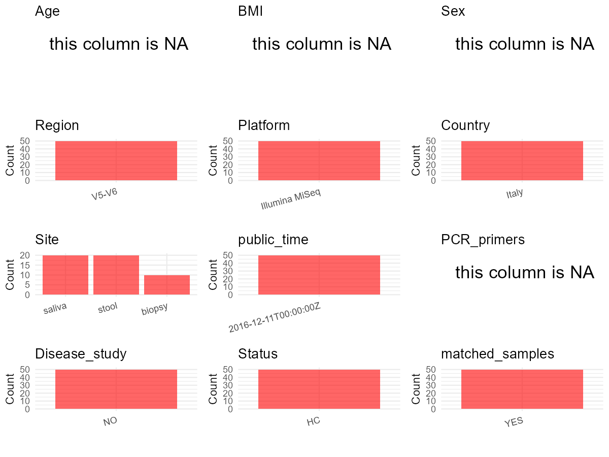

R Notebook: Metadata Processing Workflow
================

# Step 1: Obtain Initial Metadata from Each Project

To obtain the initial metadata: 1. Search for the BioProject ID (e.g.,
“PRJEBXXXX”) on the [NCBI SRA
website](https://www.ncbi.nlm.nih.gov/Traces/study/). 2. In the “Select”
table, click on “Metadata” and download the file. 3. The downloaded file
is typically named “SraRunTable.csv” and contains metadata for the
project.

``` r
# Load necessary libraries
library(dplyr)
library(ggplot2)
library(cowplot)

# Set working directory (update this path to your local directory)
setwd("D:/studylearning/董彪师兄项目/任务4_20251009/PRJNA356414")

# Read the initial metadata files
initial_meta<-read.csv("SraRunTable.csv",header = T)

# Display the first few rows of the metadata
head(initial_meta)
```

    ##          Run Assay.Type AvgSpotLen     Bases  BioProject    BioSample
    ## 1 SRR5080247   AMPLICON        597 326980380 PRJNA356414 SAMN06113512
    ## 2 SRR5080253   AMPLICON        601  27182868 PRJNA356414 SAMN06113485
    ## 3 SRR5080254   AMPLICON        600  64897103 PRJNA356414 SAMN06113522
    ## 4 SRR5080255   AMPLICON        600 106521262 PRJNA356414 SAMN06113521
    ## 5 SRR5080256   AMPLICON        601  17606745 PRJNA356414 SAMN06113489
    ## 6 SRR5080257   AMPLICON        600 188528981 PRJNA356414 SAMN06113495
    ##                                        BioSampleModel     Bytes
    ## 1 MIMARKS.specimen,MIGS/MIMS/MIMARKS.human-associated 240679250
    ## 2 MIMARKS.specimen,MIGS/MIMS/MIMARKS.human-associated  18828171
    ## 3 MIMARKS.specimen,MIGS/MIMS/MIMARKS.human-associated  38104323
    ## 4 MIMARKS.specimen,MIGS/MIMS/MIMARKS.human-associated  63442844
    ## 5 MIMARKS.specimen,MIGS/MIMS/MIMARKS.human-associated  12215125
    ## 6 MIMARKS.specimen,MIGS/MIMS/MIMARKS.human-associated 114041780
    ##              Center.Name Collection_Date Consent DATASTORE.filetype
    ## 1 UNIVERSITY OF FLORENCE   not collected  public   fastq,run.zq,sra
    ## 2 UNIVERSITY OF FLORENCE   not collected  public   fastq,run.zq,sra
    ## 3 UNIVERSITY OF FLORENCE   not collected  public   fastq,run.zq,sra
    ## 4 UNIVERSITY OF FLORENCE   not collected  public   fastq,run.zq,sra
    ## 5 UNIVERSITY OF FLORENCE   not collected  public   fastq,run.zq,sra
    ## 6 UNIVERSITY OF FLORENCE   not collected  public   fastq,run.zq,sra
    ##   DATASTORE.provider                     DATASTORE.region env_biome
    ## 1         gs,ncbi,s3 gs.us-east1,ncbi.public,s3.us-east-1     human
    ## 2         gs,ncbi,s3 gs.us-east1,ncbi.public,s3.us-east-1     human
    ## 3         gs,ncbi,s3 gs.us-east1,ncbi.public,s3.us-east-1     human
    ## 4         gs,ncbi,s3 gs.us-east1,ncbi.public,s3.us-east-1     human
    ## 5         gs,ncbi,s3 gs.us-east1,ncbi.public,s3.us-east-1     human
    ## 6         gs,ncbi,s3 gs.us-east1,ncbi.public,s3.us-east-1     human
    ##        env_feature env_material Experiment geo_loc_name_country
    ## 1 digestive system        stool SRX2398661                Italy
    ## 2 digestive system        stool SRX2398667                Italy
    ## 3      oral cavity       saliva SRX2398668                Italy
    ## 4      oral cavity       saliva SRX2398669                Italy
    ## 5 digestive system        stool SRX2398670                Italy
    ## 6      oral cavity       saliva SRX2398671                Italy
    ##   geo_loc_name_country_continent          geo_loc_name         HOST
    ## 1                         Europe Italy: Florence\\, FI Homo sapiens
    ## 2                         Europe Italy: Florence\\, FI Homo sapiens
    ## 3                         Europe Italy: Florence\\, FI Homo sapiens
    ## 4                         Europe Italy: Florence\\, FI Homo sapiens
    ## 5                         Europe Italy: Florence\\, FI Homo sapiens
    ## 6                         Europe Italy: Florence\\, FI Homo sapiens
    ##   host_subject_id     Instrument isol_growth_condt isolate
    ## 1            CM11 Illumina MiSeq    not applicable missing
    ## 2            CFP3 Illumina MiSeq    not applicable missing
    ## 3            CM22 Illumina MiSeq    not applicable missing
    ## 4            CM20 Illumina MiSeq    not applicable missing
    ## 5            CFP8 Illumina MiSeq    not applicable missing
    ## 6            CFP3 Illumina MiSeq    not applicable missing
    ##                   lat_lon   Library.Name LibraryLayout LibrarySelection
    ## 1 43.803903 N 11.246223 E FAS-1 PILOT 31        PAIRED              PCR
    ## 2 43.803903 N 11.246223 E FAS-1 PILOT 04        PAIRED              PCR
    ## 3 43.803903 N 11.246223 E FAS-1 PILOT 41        PAIRED              PCR
    ## 4 43.803903 N 11.246223 E FAS-1 PILOT 40        PAIRED              PCR
    ## 5 43.803903 N 11.246223 E FAS-1 PILOT 08        PAIRED              PCR
    ## 6 43.803903 N 11.246223 E FAS-1 PILOT 14        PAIRED              PCR
    ##   LibrarySource         Organism Platform          ReleaseDate
    ## 1   METAGENOMIC human metagenome ILLUMINA 2016-12-11T00:00:00Z
    ## 2   METAGENOMIC human metagenome ILLUMINA 2016-12-11T00:00:00Z
    ## 3   METAGENOMIC human metagenome ILLUMINA 2016-12-11T00:00:00Z
    ## 4   METAGENOMIC human metagenome ILLUMINA 2016-12-11T00:00:00Z
    ## 5   METAGENOMIC human metagenome ILLUMINA 2016-12-11T00:00:00Z
    ## 6   METAGENOMIC human metagenome ILLUMINA 2016-12-11T00:00:00Z
    ##            create_date version     Sample.Name SRA.Study
    ## 1 2016-12-06T11:58:00Z       1    FAS_1T_pilot SRP094636
    ## 2 2016-12-06T11:57:00Z       1 FAS_RFa13_pilot SRP094636
    ## 3 2016-12-06T11:58:00Z       1  FAS_RF24_pilot SRP094636
    ## 4 2016-12-06T11:58:00Z       1  FAS_RF22_pilot SRP094636
    ## 5 2016-12-06T11:57:00Z       1 FAS_RFa17_pilot SRP094636
    ## 6 2016-12-06T12:01:00Z       1  FAS_RFa3_pilot SRP094636

# Step 2: Create a Uniform Metadata Template

The uniform metadata should include the following columns:

1.  **BioProject**: Project ID (e.g., “PRJNA339212”)
2.  **Run**: Sample ID (e.g., “ERRXXXXXX” or “SRRXXXXXX”)
3.  **sample_name**: Original sample name submitted by the authors (not
    the database-assigned ID)
4.  **Age**: Age of the subject (if available)
5.  **BMI**: Body Mass Index (if available)
6.  **Sex**: Sex of the subject (“F” or “M”)
7.  **Region**: Targeted 16S rRNA region (e.g., “V3-V4”)
8.  **Platform**: Sequencing platform (e.g., “Illumina MiSeq”)
9.  **Country**: Country of sample origin (e.g., “China”)
10. **Site**: Sample site (e.g., “saliva”, “dental plaque”)
11. **public_time**: Data release date (format: “YYYY-MM-DD”)
12. **PCR_primers**: PCR primers used (e.g., “515F-806R”)
13. **title**: Title of the associated publication
14. **Disease_study**: Whether the study involves a disease (“YES” or
    “NO”)
15. **Status**: Disease status (e.g., “T2DM”, “HC”). Note: If the study
    includes both disease and healthy samples, this must be specified
    per sample.

``` r
# Create a uniform metadata dataframe
metadata <- data.frame(
  BioProject = initial_meta$BioProject,
  Run = initial_meta$Run,
  sample_name = initial_meta$host_subject_id,
  Age = NA,
  BMI = NA,
  Sex= NA,
  Region = "V5-V6",
  Platform = initial_meta$Instrument,
  Country = initial_meta$geo_loc_name_country,
  Site = initial_meta$env_material,
  public_time = initial_meta$ReleaseDate,
  stringsAsFactors = FALSE
)
```

# Step 3: Manually Add Information from the Publication

Some information (e.g. PCR primers, study title, disease status) must be
manually extracted from the publication and added to the metadata.

``` r
# Add information obtained from the publication
metadata$PCR_primers <- NA_character_  # Update based on the publication
metadata$title <- "G2S: A New Deep Learning Tool for Predicting Stool Microbiome Structure From Oral Microbiome Data"
metadata$Disease_study <- "NO"
metadata$Status <- "HC"

#extract subject id by remove prefix of sample_name
#metadata$sample_name <- gsub("_st|_sal", "", metadata$sample_name)

# Check initial data distribution
cat("Initial sample distribution:\n")
```

    ## Initial sample distribution:

``` r
table(metadata$sample_name)
```

    ## 
    ##  CFP1 CFP10 CFP11  CFP2  CFP3  CFP4  CFP6  CFP7  CFP8  CFP9  CM10  CM11  CM18 
    ##     2     2     2     2     2     2     2     2     2     2     3     3     3 
    ##  CM19  CM20  CM22  CM23  CM24   CM7   CM8 
    ##     3     3     3     3     3     3     3

``` r
table(metadata$Site)
```

    ## 
    ## biopsy saliva  stool 
    ##     10     20     20

``` r
# Calculate sampling frequency per subject
sample_counts <- table(metadata$sample_name)
cat("\nNumber of samples per subject:\n")
```

    ## 
    ## Number of samples per subject:

``` r
print(sample_counts)
```

    ## 
    ##  CFP1 CFP10 CFP11  CFP2  CFP3  CFP4  CFP6  CFP7  CFP8  CFP9  CM10  CM11  CM18 
    ##     2     2     2     2     2     2     2     2     2     2     3     3     3 
    ##  CM19  CM20  CM22  CM23  CM24   CM7   CM8 
    ##     3     3     3     3     3     3     3

``` r
# Create matched_samples column
metadata$matched_samples <- ifelse(metadata$sample_name %in% names(sample_counts[sample_counts >= 2]), "YES", "NO")

cat("\nMatched samples distribution:\n")
```

    ## 
    ## Matched samples distribution:

``` r
table(metadata$matched_samples)
```

    ## 
    ## YES 
    ##  50

``` r
# Identify samples for removal: single samples excluding saliva 
single_samples <- names(sample_counts[sample_counts == 1])
samples_to_remove <- metadata$sample_name %in% single_samples & !(metadata$Site %in% c("saliva"))

cat("\nNumber of samples to be removed:", sum(samples_to_remove), "\n")
```

    ## 
    ## Number of samples to be removed: 0

``` r
# Remove identified samples
metadata_clean <- metadata[!samples_to_remove, ]

cat("\nFinal sample distribution after cleaning:\n")
```

    ## 
    ## Final sample distribution after cleaning:

``` r
table(metadata_clean$sample_name)
```

    ## 
    ##  CFP1 CFP10 CFP11  CFP2  CFP3  CFP4  CFP6  CFP7  CFP8  CFP9  CM10  CM11  CM18 
    ##     2     2     2     2     2     2     2     2     2     2     3     3     3 
    ##  CM19  CM20  CM22  CM23  CM24   CM7   CM8 
    ##     3     3     3     3     3     3     3

``` r
table(metadata_clean$Site)
```

    ## 
    ## biopsy saliva  stool 
    ##     10     20     20

``` r
table(metadata_clean$matched_samples)
```

    ## 
    ## YES 
    ##  50

``` r
# Use cleaned dataset for subsequent analysis
metadata <- metadata_clean
```

# Step 4: Summarize and Validate the Metadata

``` r
# Check the number of unique runs and sample names
print(paste("Number of unique runs:", length(unique(metadata$Run))))
```

    ## [1] "Number of unique runs: 50"

``` r
print(paste("Number of unique sample names:", length(unique(metadata$sample_name))))
```

    ## [1] "Number of unique sample names: 20"

# Step 5: Visualize the Metadata

``` r

```


# Step 6: Finalize and Export the Metadata

``` r
# Reorder columns to match the desired format
metadata <- metadata[, c(
  "BioProject", "Run", "sample_name", "Age", "BMI", "Sex", 
  "Region", "Platform", "Country", "Site", "public_time", 
  "PCR_primers", "title", "Disease_study", "Status","matched_samples"
)]

# Export the uniform metadata to a CSV file
write.csv(metadata, file = "metadata.csv", quote = FALSE)
head(metadata)
```

    ##    BioProject        Run sample_name Age BMI Sex Region       Platform Country
    ## 1 PRJNA356414 SRR5080247        CM11  NA  NA  NA  V5-V6 Illumina MiSeq   Italy
    ## 2 PRJNA356414 SRR5080253        CFP3  NA  NA  NA  V5-V6 Illumina MiSeq   Italy
    ## 3 PRJNA356414 SRR5080254        CM22  NA  NA  NA  V5-V6 Illumina MiSeq   Italy
    ## 4 PRJNA356414 SRR5080255        CM20  NA  NA  NA  V5-V6 Illumina MiSeq   Italy
    ## 5 PRJNA356414 SRR5080256        CFP8  NA  NA  NA  V5-V6 Illumina MiSeq   Italy
    ## 6 PRJNA356414 SRR5080257        CFP3  NA  NA  NA  V5-V6 Illumina MiSeq   Italy
    ##     Site          public_time PCR_primers
    ## 1  stool 2016-12-11T00:00:00Z        <NA>
    ## 2  stool 2016-12-11T00:00:00Z        <NA>
    ## 3 saliva 2016-12-11T00:00:00Z        <NA>
    ## 4 saliva 2016-12-11T00:00:00Z        <NA>
    ## 5  stool 2016-12-11T00:00:00Z        <NA>
    ## 6 saliva 2016-12-11T00:00:00Z        <NA>
    ##                                                                                               title
    ## 1 G2S: A New Deep Learning Tool for Predicting Stool Microbiome Structure From Oral Microbiome Data
    ## 2 G2S: A New Deep Learning Tool for Predicting Stool Microbiome Structure From Oral Microbiome Data
    ## 3 G2S: A New Deep Learning Tool for Predicting Stool Microbiome Structure From Oral Microbiome Data
    ## 4 G2S: A New Deep Learning Tool for Predicting Stool Microbiome Structure From Oral Microbiome Data
    ## 5 G2S: A New Deep Learning Tool for Predicting Stool Microbiome Structure From Oral Microbiome Data
    ## 6 G2S: A New Deep Learning Tool for Predicting Stool Microbiome Structure From Oral Microbiome Data
    ##   Disease_study Status matched_samples
    ## 1            NO     HC             YES
    ## 2            NO     HC             YES
    ## 3            NO     HC             YES
    ## 4            NO     HC             YES
    ## 5            NO     HC             YES
    ## 6            NO     HC             YES

## Notes for Students:

1.  **Metadata Accuracy**: Always cross-check the metadata with the
    original publication to ensure accuracy.
2.  **Manual Entries**: Columns like `PCR_primers`, and `Status` often
    require manual entry based on the publication.
3.  **Disease Status**: Be careful when assigning `Status`—some studies
    include both disease and healthy samples.
4.  **Visualization**: The plots help quickly identify the distribution
    of values in each column, which is useful for quality control.
5.  **Reproducibility**: Update the working directory and file paths to
    match your local environment.
