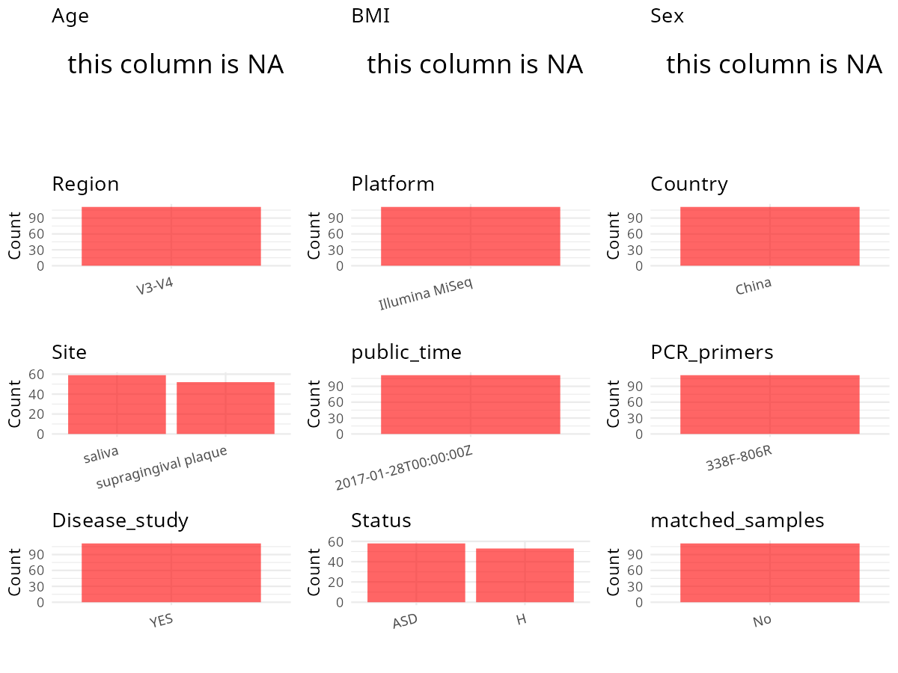

R Notebook: Metadata Processing Workflow
================

# Step 1: Obtain Initial Metadata from Each Project

To obtain the initial metadata: 1. Search for the BioProject ID (e.g.,
“PRJEBXXXX”) on the [NCBI SRA
website](https://www.ncbi.nlm.nih.gov/Traces/study/). 2. In the “Select”
table, click on “Metadata” and download the file. 3. The downloaded file
is typically named “SraRunTable.csv” and contains metadata for the
project.

``` r
# Load necessary libraries
library(dplyr)
library(ggplot2)
library(cowplot)
library(stringr)

# Set working directory (update this path to your local directory)
setwd("/home/hby/oral_project/PRJNA362687")

# Read the initial metadata files
initial_meta <- read.csv("SraRunTable.csv", header = T)

# Combine the two metadata files
# meta <- rbind(initial_meta, initial_meta1)

# Remove entries non-oral samples
# initial_meta <- subset(initial_meta,isolate %in% c("saliva","tongue coat"))

# Check the number of samples containing "HT" in Sample.Name (e.g., healthy controls)
# nrow(subset(meta, grepl("HT", Sample.Name)))

# Display the first few rows of the metadata
head(initial_meta)
```

    ##          Run Assay.Type AvgSpotLen    Bases  BioProject    BioSample              BioSampleModel    Bytes       Center.Name Collection_Date Consent DATASTORE.filetype DATASTORE.provider
    ## 1 SRR5196331   AMPLICON        602 18500664 PRJNA362687 SAMN06248894 Metagenome or environmental 10192223 TONGJI UNIVERSITY       2016/4/15  public   fastq,run.zq,sra         gs,ncbi,s3
    ## 2 SRR5196332   AMPLICON        602 16398480 PRJNA362687 SAMN06248893 Metagenome or environmental  9037348 TONGJI UNIVERSITY       2016/4/15  public   fastq,run.zq,sra         gs,ncbi,s3
    ## 3 SRR5196333   AMPLICON        602 19915966 PRJNA362687 SAMN06248892 Metagenome or environmental 10918737 TONGJI UNIVERSITY       2016/4/15  public   fastq,run.zq,sra         gs,ncbi,s3
    ## 4 SRR5196334   AMPLICON        602 21156086 PRJNA362687 SAMN06248891 Metagenome or environmental 11739907 TONGJI UNIVERSITY       2016/4/15  public   fastq,run.zq,sra         gs,ncbi,s3
    ## 5 SRR5196335   AMPLICON        602 22755600 PRJNA362687 SAMN06248890 Metagenome or environmental 12187728 TONGJI UNIVERSITY       2016/4/15  public   fastq,run.zq,sra         gs,ncbi,s3
    ## 6 SRR5196336   AMPLICON        602 23261280 PRJNA362687 SAMN06248889 Metagenome or environmental 12921829 TONGJI UNIVERSITY       2016/4/15  public   fastq,run.zq,sra         gs,ncbi,s3
    ##                       DATASTORE.region Experiment geo_loc_name_country geo_loc_name_country_continent geo_loc_name     Instrument  isolation_source lat_lon state   site Library.Name
    ## 1 gs.us-east1,ncbi.public,s3.us-east-1 SRX2511992         uncalculated                   uncalculated      missing Illumina MiSeq human oral cavity missing     H saliva      H33-Sal
    ## 2 gs.us-east1,ncbi.public,s3.us-east-1 SRX2511993         uncalculated                   uncalculated      missing Illumina MiSeq human oral cavity missing     H saliva      H32-Sal
    ## 3 gs.us-east1,ncbi.public,s3.us-east-1 SRX2511994         uncalculated                   uncalculated      missing Illumina MiSeq human oral cavity missing     H saliva      H31-Sal
    ## 4 gs.us-east1,ncbi.public,s3.us-east-1 SRX2511995         uncalculated                   uncalculated      missing Illumina MiSeq human oral cavity missing     H saliva      H30-Sal
    ## 5 gs.us-east1,ncbi.public,s3.us-east-1 SRX2511996         uncalculated                   uncalculated      missing Illumina MiSeq human oral cavity missing     H saliva      H29-Sal
    ## 6 gs.us-east1,ncbi.public,s3.us-east-1 SRX2511997         uncalculated                   uncalculated      missing Illumina MiSeq human oral cavity missing     H saliva      H28-Sal
    ##   LibraryLayout LibrarySelection LibrarySource              Organism Platform          ReleaseDate          create_date version Sample_Name SRA.Study temp
    ## 1        PAIRED              PCR   METAGENOMIC human oral metagenome ILLUMINA 2017-01-28T00:00:00Z 2017-01-23T22:12:00Z       1     H33-Sal SRP097646  111
    ## 2        PAIRED              PCR   METAGENOMIC human oral metagenome ILLUMINA 2017-01-28T00:00:00Z 2017-01-23T22:12:00Z       1     H32-Sal SRP097646  110
    ## 3        PAIRED              PCR   METAGENOMIC human oral metagenome ILLUMINA 2017-01-28T00:00:00Z 2017-01-23T22:12:00Z       1     H31-Sal SRP097646  109
    ## 4        PAIRED              PCR   METAGENOMIC human oral metagenome ILLUMINA 2017-01-28T00:00:00Z 2017-01-23T22:12:00Z       1     H30-Sal SRP097646  108
    ## 5        PAIRED              PCR   METAGENOMIC human oral metagenome ILLUMINA 2017-01-28T00:00:00Z 2017-01-23T22:12:00Z       1     H29-Sal SRP097646  107
    ## 6        PAIRED              PCR   METAGENOMIC human oral metagenome ILLUMINA 2017-01-28T00:00:00Z 2017-01-23T22:12:00Z       1     H28-Sal SRP097646  106

# Step 2: Create a Uniform Metadata Template

The uniform metadata should include the following columns:

1.  **BioProject**: Project ID (e.g., “PRJNA339212”)
2.  **Run**: Sample ID (e.g., “ERRXXXXXX” or “SRRXXXXXX”)
3.  **sample_name**: Original sample name submitted by the authors (not
    the database-assigned ID)
4.  **Age**: Age of the subject (if available)
5.  **BMI**: Body Mass Index (if available)
6.  **Sex**: Sex of the subject (“F” or “M”)
7.  **Region**: Targeted 16S rRNA region (e.g., “V3-V4”)
8.  **Platform**: Sequencing platform (e.g., “Illumina MiSeq”)
9.  **Country**: Country of sample origin (e.g., “China”)
10. **Site**: Sample site (e.g., “saliva”, “dental plaque”)
11. **public_time**: Data release date (format: “YYYY-MM-DD”)
12. **PCR_primers**: PCR primers used (e.g., “515F-806R”)
13. **title**: Title of the associated publication
14. **Disease_study**: Whether the study involves a disease (“YES” or
    “NO”)
15. **Status**: Disease status (e.g., “T2DM”, “HC”). Note: If the study
    includes both disease and healthy samples, this must be specified
    per sample.
16. **matched_samples**: matched samples (“YES” or “NO”)

``` r
# Create a uniform metadata dataframe
metadata <- data.frame(
  BioProject = initial_meta$BioProject,
  Run = initial_meta$Run,
  sample_name = initial_meta$Sample_Name,
  Platform = initial_meta$Instrument,
  Status = initial_meta$state,
  Site = initial_meta$site,
  public_time = initial_meta$ReleaseDate,
  Sex = NA,
  Age = NA,
  BMI = NA
)
```

# Step 3: Manually Add Information from the Publication

Some information (e.g. PCR primers, study title, disease status) must be
manually extracted from the publication and added to the metadata.

``` r
# Add information obtained from the publication
metadata$Country <- "China"
metadata$Region <- "V3-V4"
metadata$PCR_primers <- "338F-806R"
metadata$title <- "Alterations of oral microbiota distinguish children with autism spectrum disorders from healthy controls"
metadata$Disease_study <- "YES"
metadata$matched_samples <- "No"
```

# Step 4: Summarize and Validate the Metadata

``` r
# Check the number of unique runs and sample names
print(paste("Number of unique runs:", length(unique(metadata$Run))))
```

    ## [1] "Number of unique runs: 111"

``` r
print(paste("Number of unique sample names:", length(unique(metadata$sample_name))))
```

    ## [1] "Number of unique sample names: 111"

# Step 5: Visualize the Metadata

``` r

```


# Step 6: Finalize and Export the Metadata

``` r
# Reorder columns to match the desired format
metadata <- metadata[, c(
  "BioProject", "Run", "sample_name", "Age", "BMI", "Sex",
  "Region", "Platform", "Country", "Site", "public_time",
  "PCR_primers", "title", "Disease_study", "Status", "matched_samples"
)]

# Export the uniform metadata to a CSV file
write.csv(metadata, file = "metadata.csv", quote = FALSE)
head(metadata)
```

    ##    BioProject        Run sample_name Age BMI Sex Region       Platform Country   Site          public_time PCR_primers
    ## 1 PRJNA362687 SRR5196331     H33-Sal  NA  NA  NA  V3-V4 Illumina MiSeq   China saliva 2017-01-28T00:00:00Z   338F-806R
    ## 2 PRJNA362687 SRR5196332     H32-Sal  NA  NA  NA  V3-V4 Illumina MiSeq   China saliva 2017-01-28T00:00:00Z   338F-806R
    ## 3 PRJNA362687 SRR5196333     H31-Sal  NA  NA  NA  V3-V4 Illumina MiSeq   China saliva 2017-01-28T00:00:00Z   338F-806R
    ## 4 PRJNA362687 SRR5196334     H30-Sal  NA  NA  NA  V3-V4 Illumina MiSeq   China saliva 2017-01-28T00:00:00Z   338F-806R
    ## 5 PRJNA362687 SRR5196335     H29-Sal  NA  NA  NA  V3-V4 Illumina MiSeq   China saliva 2017-01-28T00:00:00Z   338F-806R
    ## 6 PRJNA362687 SRR5196336     H28-Sal  NA  NA  NA  V3-V4 Illumina MiSeq   China saliva 2017-01-28T00:00:00Z   338F-806R
    ##                                                                                                      title Disease_study Status matched_samples
    ## 1 Alterations of oral microbiota distinguish children with autism spectrum disorders from healthy controls           YES      H              No
    ## 2 Alterations of oral microbiota distinguish children with autism spectrum disorders from healthy controls           YES      H              No
    ## 3 Alterations of oral microbiota distinguish children with autism spectrum disorders from healthy controls           YES      H              No
    ## 4 Alterations of oral microbiota distinguish children with autism spectrum disorders from healthy controls           YES      H              No
    ## 5 Alterations of oral microbiota distinguish children with autism spectrum disorders from healthy controls           YES      H              No
    ## 6 Alterations of oral microbiota distinguish children with autism spectrum disorders from healthy controls           YES      H              No

## Notes for Students:

1.  **Metadata Accuracy**: Always cross-check the metadata with the
    original publication to ensure accuracy.
2.  **Manual Entries**: Columns like `PCR_primers`, and `Status` often
    require manual entry based on the publication.
3.  **Disease Status**: Be careful when assigning `Status`—some studies
    include both disease and healthy samples.
4.  **Visualization**: The plots help quickly identify the distribution
    of values in each column, which is useful for quality control.
5.  **Reproducibility**: Update the working directory and file paths to
    match your local environment.
