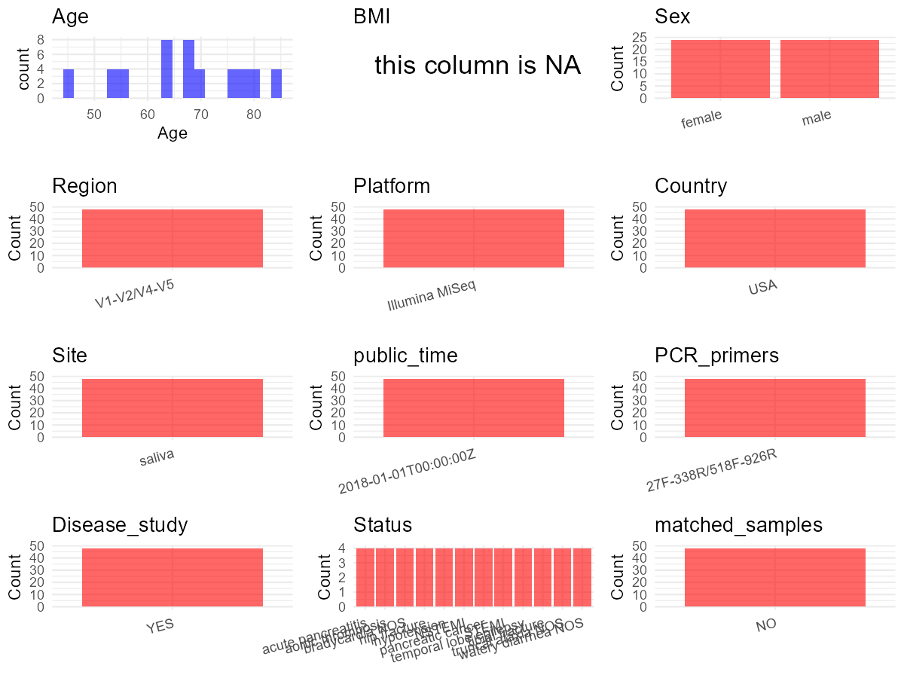

R Notebook: Metadata Processing Workflow
================

# Step 1: Obtain Initial Metadata from Each Project

To obtain the initial metadata: 1. Search for the BioProject ID (e.g.,
“PRJEBXXXX”) on the [NCBI SRA
website](https://www.ncbi.nlm.nih.gov/Traces/study/). 2. In the “Select”
table, click on “Metadata” and download the file. 3. The downloaded file
is typically named “SraRunTable.csv” and contains metadata for the
project.

``` r
# Load necessary libraries
library(dplyr)
library(ggplot2)
library(cowplot)

# Set working directory (update this path to your local directory)
setwd("D:/studylearning/董彪师兄项目/任务3_20251004/PRJNA380250")

# Read the initial metadata files
initial_meta<-read.csv("SraRunTable.csv",header = T)

# Display the first few rows of the metadata
head(initial_meta)
```

    ##          Run Assay.Type AvgSpotLen    Bases  BioProject    BioSample
    ## 1 SRR5380009   AMPLICON        501 78907667 PRJNA380250 SAMN06638059
    ## 2 SRR5380010   AMPLICON        501 83469328 PRJNA380250 SAMN06638058
    ## 3 SRR5380011   AMPLICON        501 80675527 PRJNA380250 SAMN06638057
    ## 4 SRR5380012   AMPLICON        501 81530077 PRJNA380250 SAMN06638056
    ## 5 SRR5380013   AMPLICON        501 50964606 PRJNA380250 SAMN06638055
    ## 6 SRR5380014   AMPLICON        501 65450225 PRJNA380250 SAMN06638054
    ##                                BioSampleModel biotic_relationship    Bytes
    ## 1 MIMARKS.survey,MIGS/MIMS/MIMARKS.human-oral           commensal 56734838
    ## 2 MIMARKS.survey,MIGS/MIMS/MIMARKS.human-oral           commensal 59734645
    ## 3 MIMARKS.survey,MIGS/MIMS/MIMARKS.human-oral           commensal 56809383
    ## 4 MIMARKS.survey,MIGS/MIMS/MIMARKS.human-oral           commensal 57422103
    ## 5 MIMARKS.survey,MIGS/MIMS/MIMARKS.human-oral           commensal 37298597
    ## 6 MIMARKS.survey,MIGS/MIMS/MIMARKS.human-oral           commensal 46575355
    ##        Center.Name chem_administration Collection_Date Consent       Cultivar
    ## 1 BROWN UNIVERSITY                none         missing  public not applicable
    ## 2 BROWN UNIVERSITY                none         missing  public not applicable
    ## 3 BROWN UNIVERSITY                none         missing  public not applicable
    ## 4 BROWN UNIVERSITY                none         missing  public not applicable
    ## 5 BROWN UNIVERSITY                none         missing  public not applicable
    ## 6 BROWN UNIVERSITY                none         missing  public not applicable
    ##   DATASTORE.filetype DATASTORE.provider                     DATASTORE.region
    ## 1   fastq,run.zq,sra         gs,ncbi,s3 gs.us-east1,ncbi.public,s3.us-east-1
    ## 2   fastq,run.zq,sra         gs,ncbi,s3 gs.us-east1,ncbi.public,s3.us-east-1
    ## 3   fastq,run.zq,sra         gs,ncbi,s3 gs.us-east1,ncbi.public,s3.us-east-1
    ## 4   fastq,run.zq,sra         gs,ncbi,s3 gs.us-east1,ncbi.public,s3.us-east-1
    ## 5   fastq,run.zq,sra         gs,ncbi,s3 gs.us-east1,ncbi.public,s3.us-east-1
    ## 6   fastq,run.zq,sra         gs,ncbi,s3 gs.us-east1,ncbi.public,s3.us-east-1
    ##   Day_of_Collection        Ecotype      env_biome    env_feature env_material
    ## 1                 3 not applicable not applicable not applicable       saliva
    ## 2                 0 not applicable not applicable not applicable       saliva
    ## 3                 3 not applicable not applicable not applicable       saliva
    ## 4                 0 not applicable not applicable not applicable       saliva
    ## 5                 3 not applicable not applicable not applicable       saliva
    ## 6                 0 not applicable not applicable not applicable       saliva
    ##       ethnicity Experiment geo_loc_name_country geo_loc_name_country_continent
    ## 1 not collected SRX2675239                  USA                  North America
    ## 2 not collected SRX2675240                  USA                  North America
    ## 3 not collected SRX2675241                  USA                  North America
    ## 4 not collected SRX2675242                  USA                  North America
    ## 5 not collected SRX2675243                  USA                  North America
    ## 6 not collected SRX2675244                  USA                  North America
    ##                                     geo_loc_name Host_Age host_body_product
    ## 1 USA: Rhode Island Hospital\\, Providence\\, RI       64            saliva
    ## 2 USA: Rhode Island Hospital\\, Providence\\, RI       64            saliva
    ## 3 USA: Rhode Island Hospital\\, Providence\\, RI       45            saliva
    ## 4 USA: Rhode Island Hospital\\, Providence\\, RI       45            saliva
    ## 5 USA: Rhode Island Hospital\\, Providence\\, RI       84            saliva
    ## 6 USA: Rhode Island Hospital\\, Providence\\, RI       84            saliva
    ##             Host_disease         HOST host_sex host_subject_id     Instrument
    ## 1     acute pancreatitis Homo sapiens     male             C27 Illumina MiSeq
    ## 2     acute pancreatitis Homo sapiens     male             C27 Illumina MiSeq
    ## 3 temporal lobe epilepsy Homo sapiens   female             C25 Illumina MiSeq
    ## 4 temporal lobe epilepsy Homo sapiens   female             C25 Illumina MiSeq
    ## 5           hip fracture Homo sapiens   female             C21 Illumina MiSeq
    ## 6           hip fracture Homo sapiens   female             C21 Illumina MiSeq
    ##   isol_growth_condt        isolate isolation_source        lat_lon Library.Name
    ## 1    not applicable not applicable           saliva not applicable        JIW72
    ## 2    not applicable not applicable           saliva not applicable        JIW71
    ## 3    not applicable not applicable           saliva not applicable        JIW70
    ## 4    not applicable not applicable           saliva not applicable        JIW69
    ## 5    not applicable not applicable           saliva not applicable        JIW68
    ## 6    not applicable not applicable           saliva not applicable        JIW67
    ##   LibraryLayout LibrarySelection LibrarySource              Organism
    ## 1        PAIRED              PCR   METAGENOMIC human oral metagenome
    ## 2        PAIRED              PCR   METAGENOMIC human oral metagenome
    ## 3        PAIRED              PCR   METAGENOMIC human oral metagenome
    ## 4        PAIRED              PCR   METAGENOMIC human oral metagenome
    ## 5        PAIRED              PCR   METAGENOMIC human oral metagenome
    ## 6        PAIRED              PCR   METAGENOMIC human oral metagenome
    ##      perturbation Platform          ReleaseDate        samp_collect_device
    ## 1 hospitalization ILLUMINA 2018-01-01T00:00:00Z OMNIgene Oral kit (OM-505)
    ## 2 hospitalization ILLUMINA 2018-01-01T00:00:00Z OMNIgene Oral kit (OM-505)
    ## 3 hospitalization ILLUMINA 2018-01-01T00:00:00Z OMNIgene Oral kit (OM-505)
    ## 4 hospitalization ILLUMINA 2018-01-01T00:00:00Z OMNIgene Oral kit (OM-505)
    ## 5 hospitalization ILLUMINA 2018-01-01T00:00:00Z OMNIgene Oral kit (OM-505)
    ## 6 hospitalization ILLUMINA 2018-01-01T00:00:00Z OMNIgene Oral kit (OM-505)
    ##                            samp_mat_process samp_size samp_vol_we_dna_ext
    ## 1 proteinase K\\, lysozyme and bead bashing      1 mL                2 mL
    ## 2 proteinase K\\, lysozyme and bead bashing      1 mL                2 mL
    ## 3 proteinase K\\, lysozyme and bead bashing      1 mL                2 mL
    ## 4 proteinase K\\, lysozyme and bead bashing      1 mL                2 mL
    ## 5 proteinase K\\, lysozyme and bead bashing      1 mL                2 mL
    ## 6 proteinase K\\, lysozyme and bead bashing      1 mL                2 mL
    ##        Sample.Name source_material_id SRA.Study         strain
    ## 1 Patient_12_Day_3           C27_Day3 SRP102523 not applicable
    ## 2 Patient_12_Day_0           C27_Day0 SRP102523 not applicable
    ## 3 Patient_11_Day_3           C25_Day3 SRP102523 not applicable
    ## 4 Patient_11_Day_0           C25_Day0 SRP102523 not applicable
    ## 5 Patient_10_Day_3           C21_Day3 SRP102523 not applicable
    ## 6 Patient_10_Day_0           C21_Day0 SRP102523 not applicable
    ##            create_date version
    ## 1 2017-03-27T13:47:00Z       1
    ## 2 2017-03-27T13:47:00Z       1
    ## 3 2017-03-27T13:47:00Z       1
    ## 4 2017-03-27T13:47:00Z       1
    ## 5 2017-03-27T13:47:00Z       1
    ## 6 2017-03-27T13:47:00Z       1

# Step 2: Create a Uniform Metadata Template

The uniform metadata should include the following columns:

1.  **BioProject**: Project ID (e.g., “PRJNA339212”)
2.  **Run**: Sample ID (e.g., “ERRXXXXXX” or “SRRXXXXXX”)
3.  **sample_name**: Original sample name submitted by the authors (not
    the database-assigned ID)
4.  **Age**: Age of the subject (if available)
5.  **BMI**: Body Mass Index (if available)
6.  **Sex**: Sex of the subject (“F” or “M”)
7.  **Region**: Targeted 16S rRNA region (e.g., “V3-V4”)
8.  **Platform**: Sequencing platform (e.g., “Illumina MiSeq”)
9.  **Country**: Country of sample origin (e.g., “China”)
10. **Site**: Sample site (e.g., “saliva”, “dental plaque”)
11. **public_time**: Data release date (format: “YYYY-MM-DD”)
12. **PCR_primers**: PCR primers used (e.g., “515F-806R”)
13. **title**: Title of the associated publication
14. **Disease_study**: Whether the study involves a disease (“YES” or
    “NO”)
15. **Status**: Disease status (e.g., “T2DM”, “HC”). Note: If the study
    includes both disease and healthy samples, this must be specified
    per sample.

``` r
# Create a uniform metadata dataframe
metadata <- data.frame(
  BioProject = initial_meta$BioProject,
  Run = initial_meta$Run,
  sample_name = initial_meta$Library.Name,
  Age = initial_meta$Host_Age,
  BMI = NA,
  Sex= initial_meta$host_sex,
  Region = "V1-V2/V4-V5",
  Platform = initial_meta$Instrument,
  Country = initial_meta$geo_loc_name_country,
  Site = initial_meta$host_body_product,
  public_time = initial_meta$ReleaseDate,
  stringsAsFactors = FALSE
)
```

# Step 3: Manually Add Information from the Publication

Some information (e.g. PCR primers, study title, disease status) must be
manually extracted from the publication and added to the metadata.

``` r
# Add information obtained from the publication
metadata$PCR_primers <- "27F-338R/518F-926R"  # Update based on the publication
metadata$title <- "The salivary microbiome is consistent between subjects and resistant to impacts of short-term hospitalization"
metadata$Disease_study <- "YES"
metadata$Status <- initial_meta$Host_disease

#extract subject id by remove prefix of sample_name
#metadata$sample_name <- gsub("_st|_sal", "", metadata$sample_name)

# Check initial data distribution
cat("Initial sample distribution:\n")
```

    ## Initial sample distribution:

``` r
table(metadata$sample_name)
```

    ## 
    ## JIW25 JIW26 JIW27 JIW28 JIW29 JIW30 JIW31 JIW32 JIW33 JIW34 JIW35 JIW36 JIW37 
    ##     1     1     1     1     1     1     1     1     1     1     1     1     1 
    ## JIW38 JIW39 JIW40 JIW41 JIW42 JIW43 JIW44 JIW45 JIW46 JIW47 JIW48 JIW49 JIW50 
    ##     1     1     1     1     1     1     1     1     1     1     1     1     1 
    ## JIW51 JIW52 JIW53 JIW54 JIW55 JIW56 JIW57 JIW58 JIW59 JIW60 JIW61 JIW62 JIW63 
    ##     1     1     1     1     1     1     1     1     1     1     1     1     1 
    ## JIW64 JIW65 JIW66 JIW67 JIW68 JIW69 JIW70 JIW71 JIW72 
    ##     1     1     1     1     1     1     1     1     1

``` r
table(metadata$Site)
```

    ## 
    ## saliva 
    ##     48

``` r
# Calculate sampling frequency per subject
sample_counts <- table(metadata$sample_name)
cat("\nNumber of samples per subject:\n")
```

    ## 
    ## Number of samples per subject:

``` r
print(sample_counts)
```

    ## 
    ## JIW25 JIW26 JIW27 JIW28 JIW29 JIW30 JIW31 JIW32 JIW33 JIW34 JIW35 JIW36 JIW37 
    ##     1     1     1     1     1     1     1     1     1     1     1     1     1 
    ## JIW38 JIW39 JIW40 JIW41 JIW42 JIW43 JIW44 JIW45 JIW46 JIW47 JIW48 JIW49 JIW50 
    ##     1     1     1     1     1     1     1     1     1     1     1     1     1 
    ## JIW51 JIW52 JIW53 JIW54 JIW55 JIW56 JIW57 JIW58 JIW59 JIW60 JIW61 JIW62 JIW63 
    ##     1     1     1     1     1     1     1     1     1     1     1     1     1 
    ## JIW64 JIW65 JIW66 JIW67 JIW68 JIW69 JIW70 JIW71 JIW72 
    ##     1     1     1     1     1     1     1     1     1

``` r
# Create matched_samples column
metadata$matched_samples <- ifelse(metadata$sample_name %in% names(sample_counts[sample_counts >= 2]), "YES", "NO")

cat("\nMatched samples distribution:\n")
```

    ## 
    ## Matched samples distribution:

``` r
table(metadata$matched_samples)
```

    ## 
    ## NO 
    ## 48

``` r
# Identify samples for removal: single samples excluding saliva 
single_samples <- names(sample_counts[sample_counts == 1])
samples_to_remove <- metadata$sample_name %in% single_samples & !(metadata$Site %in% c("saliva"))

cat("\nNumber of samples to be removed:", sum(samples_to_remove), "\n")
```

    ## 
    ## Number of samples to be removed: 0

``` r
# Remove identified samples
metadata_clean <- metadata[!samples_to_remove, ]

cat("\nFinal sample distribution after cleaning:\n")
```

    ## 
    ## Final sample distribution after cleaning:

``` r
table(metadata_clean$sample_name)
```

    ## 
    ## JIW25 JIW26 JIW27 JIW28 JIW29 JIW30 JIW31 JIW32 JIW33 JIW34 JIW35 JIW36 JIW37 
    ##     1     1     1     1     1     1     1     1     1     1     1     1     1 
    ## JIW38 JIW39 JIW40 JIW41 JIW42 JIW43 JIW44 JIW45 JIW46 JIW47 JIW48 JIW49 JIW50 
    ##     1     1     1     1     1     1     1     1     1     1     1     1     1 
    ## JIW51 JIW52 JIW53 JIW54 JIW55 JIW56 JIW57 JIW58 JIW59 JIW60 JIW61 JIW62 JIW63 
    ##     1     1     1     1     1     1     1     1     1     1     1     1     1 
    ## JIW64 JIW65 JIW66 JIW67 JIW68 JIW69 JIW70 JIW71 JIW72 
    ##     1     1     1     1     1     1     1     1     1

``` r
table(metadata_clean$Site)
```

    ## 
    ## saliva 
    ##     48

``` r
table(metadata_clean$matched_samples)
```

    ## 
    ## NO 
    ## 48

``` r
# Use cleaned dataset for subsequent analysis
metadata <- metadata_clean
```

# Step 4: Summarize and Validate the Metadata

``` r
# Check the number of unique runs and sample names
print(paste("Number of unique runs:", length(unique(metadata$Run))))
```

    ## [1] "Number of unique runs: 48"

``` r
print(paste("Number of unique sample names:", length(unique(metadata$sample_name))))
```

    ## [1] "Number of unique sample names: 48"

# Step 5: Visualize the Metadata

``` r

```


# Step 6: Finalize and Export the Metadata

``` r
# Reorder columns to match the desired format
metadata <- metadata[, c(
  "BioProject", "Run", "sample_name", "Age", "BMI", "Sex", 
  "Region", "Platform", "Country", "Site", "public_time", 
  "PCR_primers", "title", "Disease_study", "Status","matched_samples"
)]

# Export the uniform metadata to a CSV file
write.csv(metadata, file = "metadata.csv", quote = FALSE)
head(metadata)
```

    ##    BioProject        Run sample_name Age BMI    Sex      Region       Platform
    ## 1 PRJNA380250 SRR5380009       JIW72  64  NA   male V1-V2/V4-V5 Illumina MiSeq
    ## 2 PRJNA380250 SRR5380010       JIW71  64  NA   male V1-V2/V4-V5 Illumina MiSeq
    ## 3 PRJNA380250 SRR5380011       JIW70  45  NA female V1-V2/V4-V5 Illumina MiSeq
    ## 4 PRJNA380250 SRR5380012       JIW69  45  NA female V1-V2/V4-V5 Illumina MiSeq
    ## 5 PRJNA380250 SRR5380013       JIW68  84  NA female V1-V2/V4-V5 Illumina MiSeq
    ## 6 PRJNA380250 SRR5380014       JIW67  84  NA female V1-V2/V4-V5 Illumina MiSeq
    ##   Country   Site          public_time        PCR_primers
    ## 1     USA saliva 2018-01-01T00:00:00Z 27F-338R/518F-926R
    ## 2     USA saliva 2018-01-01T00:00:00Z 27F-338R/518F-926R
    ## 3     USA saliva 2018-01-01T00:00:00Z 27F-338R/518F-926R
    ## 4     USA saliva 2018-01-01T00:00:00Z 27F-338R/518F-926R
    ## 5     USA saliva 2018-01-01T00:00:00Z 27F-338R/518F-926R
    ## 6     USA saliva 2018-01-01T00:00:00Z 27F-338R/518F-926R
    ##                                                                                                           title
    ## 1 The salivary microbiome is consistent between subjects and resistant to impacts of short-term hospitalization
    ## 2 The salivary microbiome is consistent between subjects and resistant to impacts of short-term hospitalization
    ## 3 The salivary microbiome is consistent between subjects and resistant to impacts of short-term hospitalization
    ## 4 The salivary microbiome is consistent between subjects and resistant to impacts of short-term hospitalization
    ## 5 The salivary microbiome is consistent between subjects and resistant to impacts of short-term hospitalization
    ## 6 The salivary microbiome is consistent between subjects and resistant to impacts of short-term hospitalization
    ##   Disease_study                 Status matched_samples
    ## 1           YES     acute pancreatitis              NO
    ## 2           YES     acute pancreatitis              NO
    ## 3           YES temporal lobe epilepsy              NO
    ## 4           YES temporal lobe epilepsy              NO
    ## 5           YES           hip fracture              NO
    ## 6           YES           hip fracture              NO

## Notes for Students:

1.  **Metadata Accuracy**: Always cross-check the metadata with the
    original publication to ensure accuracy.
2.  **Manual Entries**: Columns like `PCR_primers`, and `Status` often
    require manual entry based on the publication.
3.  **Disease Status**: Be careful when assigning `Status`—some studies
    include both disease and healthy samples.
4.  **Visualization**: The plots help quickly identify the distribution
    of values in each column, which is useful for quality control.
5.  **Reproducibility**: Update the working directory and file paths to
    match your local environment.
