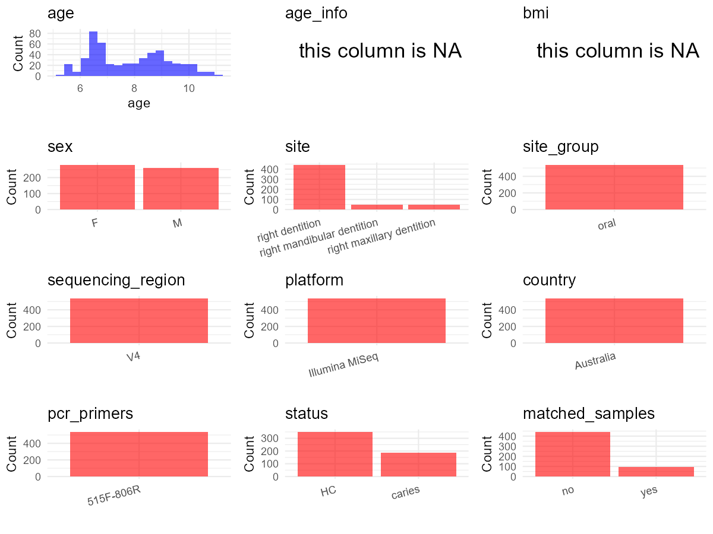

# Step 1: Obtain Initial Metadata from Each Project

To obtain the initial metadata: 1. Search for the BioProject ID (e.g.,
“PRJEBXXXX”) on the [NCBI SRA
website](https://www.ncbi.nlm.nih.gov/Traces/study/). 2. In the “Select”
table, click on “Metadata” and download the file. 3. The downloaded file
is typically named “SraRunTable.csv” and contains metadata for the
project.

    library(tidyverse)
    library(ggplot2)
    library(cowplot)

    setwd("C:/Users/zyc/Desktop/oral_project/data/projects/PRJNA383868")
    initial_meta <- read.csv("SraRunTable.csv", header = TRUE) 
    head(initial_meta)

    ##          Run Assay.Type AvgSpotLen    Bases  BioProject    BioSample                       BioSampleModel    Bytes               Center.Name
    ## 1 SRR5467622   AMPLICON        502 12991258 PRJNA383868 SAMN06818328 MIMS.me,MIGS/MIMS/MIMARKS.human-oral  8392295 J. CRAIG VENTER INSTITUTE
    ## 2 SRR5467623   AMPLICON        502 21643228 PRJNA383868 SAMN06818327 MIMS.me,MIGS/MIMS/MIMARKS.human-oral 13831072 J. CRAIG VENTER INSTITUTE
    ## 3 SRR5467624   AMPLICON        502 21135706 PRJNA383868 SAMN06818326 MIMS.me,MIGS/MIMS/MIMARKS.human-oral 13491196 J. CRAIG VENTER INSTITUTE
    ## 4 SRR5467625   AMPLICON        502  7511928 PRJNA383868 SAMN06818325 MIMS.me,MIGS/MIMS/MIMARKS.human-oral  4718731 J. CRAIG VENTER INSTITUTE
    ## 5 SRR5467626   AMPLICON        502  6295582 PRJNA383868 SAMN06818324 MIMS.me,MIGS/MIMS/MIMARKS.human-oral  3970507 J. CRAIG VENTER INSTITUTE
    ## 6 SRR5467627   AMPLICON        502 15582582 PRJNA383868 SAMN06818323 MIMS.me,MIGS/MIMS/MIMARKS.human-oral 10037418 J. CRAIG VENTER INSTITUTE
    ##   chem_administration Collection_Date Consent DATASTORE.filetype DATASTORE.provider                     DATASTORE.region     env_biome
    ## 1      not applicable      2014-10-27  public   fastq,run.zq,sra         gs,ncbi,s3 gs.us-east1,ncbi.public,s3.us-east-1 ENVO:01000418
    ## 2      not applicable      2014-11-24  public   fastq,run.zq,sra         gs,ncbi,s3 gs.us-east1,ncbi.public,s3.us-east-1 ENVO:01000418
    ## 3      not applicable      2014-11-24  public   fastq,run.zq,sra         gs,ncbi,s3 gs.us-east1,ncbi.public,s3.us-east-1 ENVO:01000418
    ## 4      not applicable      2014-06-25  public   fastq,run.zq,sra         gs,ncbi,s3 gs.us-east1,ncbi.public,s3.us-east-1 ENVO:01000418
    ## 5      not applicable      2014-06-25  public   fastq,run.zq,sra         gs,ncbi,s3 gs.us-east1,ncbi.public,s3.us-east-1 ENVO:01000418
    ## 6      not applicable      2014-12-17  public   fastq,run.zq,sra         gs,ncbi,s3 gs.us-east1,ncbi.public,s3.us-east-1 ENVO:01000418
    ##     env_feature  env_material Experiment geo_loc_name_country geo_loc_name_country_continent                geo_loc_name  Host_Age
    ## 1 ENVO:00002034 ENVO:01000156 SRX2752978            Australia                        Oceania Australia: Melbourne\\, VIC 78 months
    ## 2 ENVO:00002034 ENVO:01000156 SRX2752979            Australia                        Oceania Australia: Melbourne\\, VIC 79 months
    ## 3 ENVO:00002034 ENVO:01000156 SRX2752980            Australia                        Oceania Australia: Melbourne\\, VIC 79 months
    ## 4 ENVO:00002034 ENVO:01000156 SRX2752981            Australia                        Oceania Australia: Melbourne\\, VIC 77 months
    ## 5 ENVO:00002034 ENVO:01000156 SRX2752982            Australia                        Oceania Australia: Melbourne\\, VIC 77 months
    ## 6 ENVO:00002034 ENVO:01000156 SRX2752983            Australia                        Oceania Australia: Melbourne\\, VIC 80 months
    ##         Host_disease host_family_relationship         HOST host_sex host_subject_id host_tissue_sampled     Instrument isolation_source
    ## 1      dental caries           sibling 2028.2 Homo sapiens   female          2028.1       dental plaque Illumina MiSeq            teeth
    ## 2      dental caries           sibling 2026.1 Homo sapiens   female          2026.2       dental plaque Illumina MiSeq            teeth
    ## 3      dental caries           sibling 2026.2 Homo sapiens   female          2026.1       dental plaque Illumina MiSeq            teeth
    ## 4 dental caries free           sibling 2023.1 Homo sapiens     male          2023.2       dental plaque Illumina MiSeq            teeth
    ## 5 dental caries free           sibling 2023.2 Homo sapiens     male          2023.1       dental plaque Illumina MiSeq            teeth
    ## 6 dental caries free           sibling 2020.1 Homo sapiens     male          2020.2       dental plaque Illumina MiSeq            teeth
    ##                   lat_lon   Library.Name LibraryLayout LibrarySelection LibrarySource nose_mouth_teeth_throat_disord              Organism
    ## 1 37.793742 S 144.94921 E CAR_2028.1_RD1        PAIRED              PCR   METAGENOMIC                 not applicable human oral metagenome
    ## 2 37.793742 S 144.94921 E CAR_2026.2_RD1        PAIRED              PCR   METAGENOMIC                          cleft human oral metagenome
    ## 3 37.793742 S 144.94921 E CAR_2026.1_RD1        PAIRED              PCR   METAGENOMIC                 not applicable human oral metagenome
    ## 4 37.793742 S 144.94921 E CAR_2023.2_RD1        PAIRED              PCR   METAGENOMIC                 not applicable human oral metagenome
    ## 5 37.793742 S 144.94921 E CAR_2023.1_RD1        PAIRED              PCR   METAGENOMIC                 not applicable human oral metagenome
    ## 6 37.793742 S 144.94921 E CAR_2020.2_RD1        PAIRED              PCR   METAGENOMIC                 not applicable human oral metagenome
    ##   Platform          ReleaseDate samp_collect_device    samp_store_temp samp_vol_we_dna_ext Sample.Name SRA.Study          create_date
    ## 1 ILLUMINA 2017-04-22T00:00:00Z          oral swabs -80 degree Celsius              750 uL  2028.1_RD1 SRP104798 2017-04-22T00:07:00Z
    ## 2 ILLUMINA 2017-04-22T00:00:00Z          oral swabs -80 degree Celsius              750 uL  2026.2_RD1 SRP104798 2017-04-22T00:07:00Z
    ## 3 ILLUMINA 2017-04-22T00:00:00Z          oral swabs -80 degree Celsius              750 uL  2026.1_RD1 SRP104798 2017-04-22T00:07:00Z
    ## 4 ILLUMINA 2017-04-22T00:00:00Z          oral swabs -80 degree Celsius              750 uL  2023.2_RD1 SRP104798 2017-04-22T00:06:00Z
    ## 5 ILLUMINA 2017-04-22T00:00:00Z          oral swabs -80 degree Celsius              750 uL  2023.1_RD1 SRP104798 2017-04-22T00:07:00Z
    ## 6 ILLUMINA 2017-04-22T00:00:00Z          oral swabs -80 degree Celsius              750 uL  2020.2_RD1 SRP104798 2017-04-22T00:07:00Z
    ##   version  host_body_site host_body_product misc_param source_material_id
    ## 1       1 right dentition                                                
    ## 2       1 right dentition                                                
    ## 3       1 right dentition                                                
    ## 4       1 right dentition                                                
    ## 5       1 right dentition                                                
    ## 6       1 right dentition

# Step 2: Create a Uniform Metadata Template

The uniform metadata should include the following columns:

1.  **BioProject**: Project ID (e.g., “PRJNA339212”)
2.  **Run**: Sample ID (e.g., “ERRXXXXXX” or “SRRXXXXXX”)
3.  **sample\_name**: Original sample name submitted by the authors (not
    the database-assigned ID)
4.  **Age**: Age of the subject (if available)
5.  **BMI**: Body Mass Index (if available)
6.  **Sex**: Sex of the subject (“F” or “M”)
7.  **Region**: Targeted 16S rRNA region (e.g., “V3-V4”)
8.  **Platform**: Sequencing platform (e.g., “Illumina MiSeq”)
9.  **Country**: Country of sample origin (e.g., “China”)
10. **Site**: Sample site (e.g., “saliva”, “dental plaque”)
11. **public\_time**: Data release date (format: “YYYY-MM-DD”)
12. **PCR\_primers**: PCR primers used (e.g., “515F-806R”)
13. **title**: Title of the associated publication
14. **Disease\_study**: Whether the study involves a disease (“YES” or
    “NO”)
15. **Status**: Disease status (e.g., “T2DM”, “HC”). Note: If the study
    includes both disease and healthy samples, this must be specified
    per sample.
16. **matched\_samples**: matched samples (“YES” or “NO”)

<!-- -->

    metadata <- data.frame(
      BioProject = initial_meta$BioProject,
      Run = initial_meta$Run,
      sample_name = initial_meta$Library.Name,
      Age = initial_meta$Host_Age, 
      BMI = NA,  
      Sex = initial_meta$host_sex,
      Region = "V4",
      Platform = initial_meta$Instrument,
      Country = initial_meta$geo_loc_name_country,
      Site = initial_meta$host_tissue_sampled,
      public_time = initial_meta$ReleaseDate,
      matched_samples = "NO",
      Status = initial_meta$Host_disease,
      stringsAsFactors = FALSE
    )

# Step 3: Manually Add Information from the Publication

Some information (e.g. PCR primers, study title, disease status) must be
manually extracted from the publication and added to the metadata.

     metadata <- metadata %>%
      mutate(Sex = recode(Sex, "female" = "F", "male" = "M"))
    metadata <- metadata %>%mutate(Age = as.numeric(sapply(str_split(Age, " "), function(x) head(x, 1))))%>%mutate(Age = Age/12)

    metadata$title <- "Host Genetic Control of the Oral Microbiome in Health and Disease"
    metadata$Disease_study <- "YES"
    metadata$PCR_primers <- "515F-806R"

    head(metadata)

    ##    BioProject        Run    sample_name      Age BMI Sex Region       Platform   Country          Site          public_time matched_samples
    ## 1 PRJNA383868 SRR5467622 CAR_2028.1_RD1 6.500000  NA   F     V4 Illumina MiSeq Australia dental plaque 2017-04-22T00:00:00Z              NO
    ## 2 PRJNA383868 SRR5467623 CAR_2026.2_RD1 6.583333  NA   F     V4 Illumina MiSeq Australia dental plaque 2017-04-22T00:00:00Z              NO
    ## 3 PRJNA383868 SRR5467624 CAR_2026.1_RD1 6.583333  NA   F     V4 Illumina MiSeq Australia dental plaque 2017-04-22T00:00:00Z              NO
    ## 4 PRJNA383868 SRR5467625 CAR_2023.2_RD1 6.416667  NA   M     V4 Illumina MiSeq Australia dental plaque 2017-04-22T00:00:00Z              NO
    ## 5 PRJNA383868 SRR5467626 CAR_2023.1_RD1 6.416667  NA   M     V4 Illumina MiSeq Australia dental plaque 2017-04-22T00:00:00Z              NO
    ## 6 PRJNA383868 SRR5467627 CAR_2020.2_RD1 6.666667  NA   M     V4 Illumina MiSeq Australia dental plaque 2017-04-22T00:00:00Z              NO
    ##               Status                                                             title Disease_study PCR_primers
    ## 1      dental caries Host Genetic Control of the Oral Microbiome in Health and Disease           YES   515F-806R
    ## 2      dental caries Host Genetic Control of the Oral Microbiome in Health and Disease           YES   515F-806R
    ## 3      dental caries Host Genetic Control of the Oral Microbiome in Health and Disease           YES   515F-806R
    ## 4 dental caries free Host Genetic Control of the Oral Microbiome in Health and Disease           YES   515F-806R
    ## 5 dental caries free Host Genetic Control of the Oral Microbiome in Health and Disease           YES   515F-806R
    ## 6 dental caries free Host Genetic Control of the Oral Microbiome in Health and Disease           YES   515F-806R

# Step 4: Summarize and Validate the Metadata

    print(paste("Number of unique runs:", length(unique(metadata$Run))))

    ## [1] "Number of unique runs: 719"

    print(paste("Number of unique sample names:", length(unique(metadata$sample_name))))

    ## [1] "Number of unique sample names: 719"

# Step 5: Visualize the Metadata

    plot_data <- metadata %>%
      select(-BioProject, -Run, -sample_name, -title)

    # Function to create simple plots for each column
    create_simple_plots <- function(data) {
      plots <- list()
      
      for (col in colnames(data)) {
        # Check if the column is all NA
        if (all(is.na(data[[col]]))) {
          # Create an empty plot with text indicating all NA
          p <- ggplot() +
            annotate("text", x = 0.5, y = 0.5, label = "this column is NA", size = 6) +
            labs(title = col) +
            theme_void()
        } else if (is.numeric(data[[col]])) {
          # Numeric variable: histogram
          p <- ggplot(data, aes(x = .data[[col]])) +
            geom_histogram(fill = "blue", alpha = 0.6, bins = 20, na.rm = TRUE) +
            labs(title = col) +
            theme_minimal()
        } else {
          # Categorical variable: bar plot (remove NA values)
          count_data <- as.data.frame(table(data[[col]], useNA = "ifany"))
          p <- ggplot(count_data, aes(x = reorder(Var1, -Freq), y = Freq)) +
            geom_col(fill = "red", alpha = 0.6) +
            labs(title = col, x = NULL, y = "Count") +
            theme_minimal() +
            theme(axis.text.x = element_text(angle = 30, hjust = 1))
        }
        plots[[col]] <- p
      }
      
      return(plots)
    }

    plots <- create_simple_plots(plot_data)
    p<-plot_grid(plots$Age, 
              plots$BMI, 
              plots$Sex, 
              plots$Region, 
              plots$Platform, 
              plots$Country, 
              plots$Site,
              plots$public_time, 
              plots$PCR_primers,
              plots$Disease_study,
              plots$Status,
              plots$matched_samples,# add 
              ncol = 3, align = "hv", axis = "lb")
    ggsave("metadata_summary.png", plot = p, width = 8, height = 8, dpi = 150)

    

# Step 6: Finalize and Export the Metadata

    metadata <- metadata[, c(
      "BioProject", "Run", "sample_name", "Age", "BMI", "Sex", 
      "Region", "Platform", "Country", "Site", "public_time", 
      "PCR_primers", "title", "Disease_study", "Status","matched_samples"
    )]

    write.csv(metadata, file = "metadata.csv", quote = FALSE)
