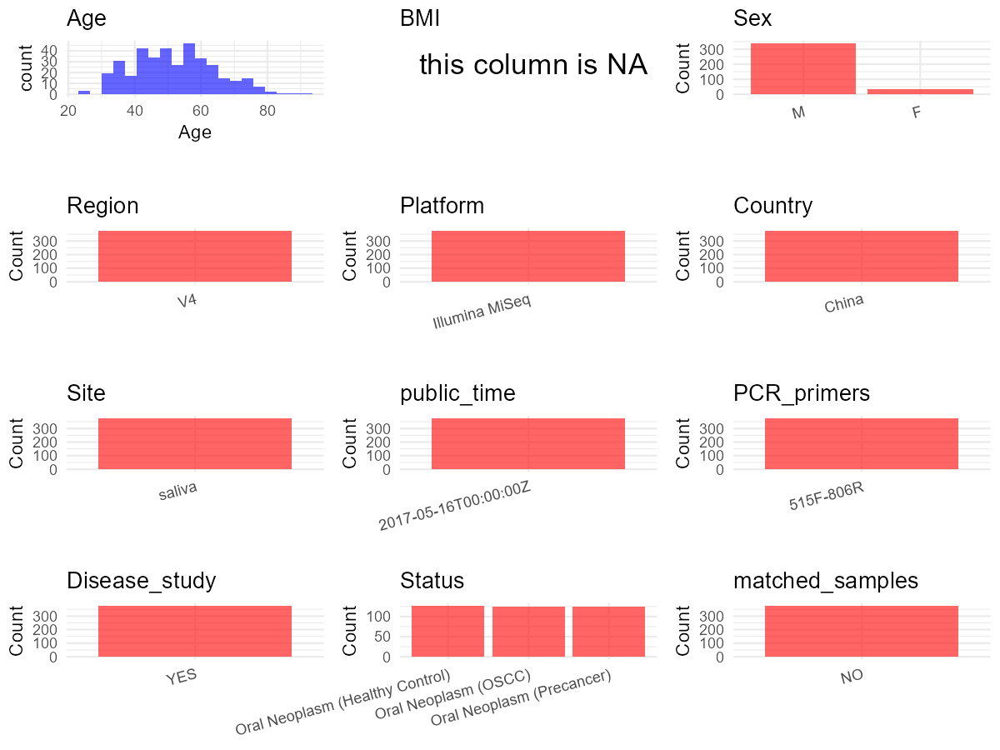

# Step 1: Obtain Initial Metadata from Each Project

To obtain the initial metadata: 1. Search for the BioProject ID (e.g.,
“PRJEBXXXX”) on the [NCBI SRA
website](https://www.ncbi.nlm.nih.gov/Traces/study/). 2. In the “Select”
table, click on “Metadata” and download the file. 3. The downloaded file
is typically named “SraRunTable.csv” and contains metadata for the
project.

    library(tidyverse)
    library(ggplot2)
    library(cowplot)

    setwd("C:/Users/zyc/Desktop/oral_project/data/projects/PRJNA386665")
    initial_meta <- read.csv("SraRunTable.csv", header = TRUE) 
    head(initial_meta)

    ##          Run Assay.Type AvgSpotLen    Bases  BioProject    BioSample                       BioSampleModel    Bytes
    ## 1 SRR5559350   AMPLICON        237 16038869 PRJNA386665 SAMN07123899 MIMS.me,MIGS/MIMS/MIMARKS.human-oral  9554916
    ## 2 SRR5559351   AMPLICON        240 34345656 PRJNA386665 SAMN07123898 MIMS.me,MIGS/MIMS/MIMARKS.human-oral 20613255
    ## 3 SRR5559352   AMPLICON        241 18993837 PRJNA386665 SAMN07123897 MIMS.me,MIGS/MIMS/MIMARKS.human-oral 11302436
    ## 4 SRR5559353   AMPLICON        239 41486674 PRJNA386665 SAMN07123904 MIMS.me,MIGS/MIMS/MIMARKS.human-oral 24388147
    ## 5 SRR5559354   AMPLICON        240 24754734 PRJNA386665 SAMN07123903 MIMS.me,MIGS/MIMS/MIMARKS.human-oral 14674278
    ## 6 SRR5559355   AMPLICON        241 37150589 PRJNA386665 SAMN07123902 MIMS.me,MIGS/MIMS/MIMARKS.human-oral 21175392
    ##                      Center.Name Collection_Date Consent DATASTORE.filetype DATASTORE.provider                     DATASTORE.region
    ## 1 NATIONAL CHIAO TUNG UNIVERSITY      2014-05-29  public   fastq,run.zq,sra         gs,ncbi,s3 gs.us-east1,ncbi.public,s3.us-east-1
    ## 2 NATIONAL CHIAO TUNG UNIVERSITY      2014-05-29  public   fastq,run.zq,sra         gs,ncbi,s3 gs.us-east1,ncbi.public,s3.us-east-1
    ## 3 NATIONAL CHIAO TUNG UNIVERSITY      2014-05-29  public   fastq,run.zq,sra         gs,ncbi,s3 gs.us-east1,ncbi.public,s3.us-east-1
    ## 4 NATIONAL CHIAO TUNG UNIVERSITY      2014-06-24  public   fastq,run.zq,sra         gs,ncbi,s3 gs.us-east1,ncbi.public,s3.us-east-1
    ## 5 NATIONAL CHIAO TUNG UNIVERSITY      2014-06-17  public   fastq,run.zq,sra         gs,ncbi,s3 gs.us-east1,ncbi.public,s3.us-east-1
    ## 6 NATIONAL CHIAO TUNG UNIVERSITY      2014-06-10  public   fastq,run.zq,sra         gs,ncbi,s3 gs.us-east1,ncbi.public,s3.us-east-1
    ##   env_biome env_feature env_material Experiment geo_loc_name_country geo_loc_name_country_continent geo_loc_name Host_Age
    ## 1     mouth  human oral       saliva SRX2822798               Taiwan                           Asia       Taiwan       50
    ## 2     mouth  human oral       saliva SRX2822797               Taiwan                           Asia       Taiwan       38
    ## 3     mouth  human oral       saliva SRX2822796               Taiwan                           Asia       Taiwan       45
    ## 4     mouth  human oral       saliva SRX2822795               Taiwan                           Asia       Taiwan       67
    ## 5     mouth  human oral       saliva SRX2822794               Taiwan                           Asia       Taiwan       41
    ## 6     mouth  human oral       saliva SRX2822793               Taiwan                           Asia       Taiwan       52
    ##                Host_disease         HOST host_sex     Instrument          lat_lon Library.Name LibraryLayout LibrarySelection LibrarySource
    ## 1 Oral Neoplasm (Precancer) Homo sapiens     male Illumina MiSeq 24.12 N 120.65 E  Saliva_P021        PAIRED              PCR   METAGENOMIC
    ## 2 Oral Neoplasm (Precancer) Homo sapiens     male Illumina MiSeq 24.12 N 120.65 E  Saliva_P020        PAIRED              PCR   METAGENOMIC
    ## 3 Oral Neoplasm (Precancer) Homo sapiens     male Illumina MiSeq 24.12 N 120.65 E  Saliva_P019        PAIRED              PCR   METAGENOMIC
    ## 4 Oral Neoplasm (Precancer) Homo sapiens     male Illumina MiSeq 24.12 N 120.65 E  Saliva_P028        PAIRED              PCR   METAGENOMIC
    ## 5 Oral Neoplasm (Precancer) Homo sapiens     male Illumina MiSeq 24.12 N 120.65 E  Saliva_P027        PAIRED              PCR   METAGENOMIC
    ## 6 Oral Neoplasm (Precancer) Homo sapiens     male Illumina MiSeq 24.12 N 120.65 E  Saliva_P025        PAIRED              PCR   METAGENOMIC
    ##                Organism Platform          ReleaseDate samp_store_temp Sample.Name SRA.Study          create_date version
    ## 1 human oral metagenome ILLUMINA 2017-05-16T00:00:00Z            -80C Saliva_P021 SRP107079 2017-05-16T16:45:00Z       1
    ## 2 human oral metagenome ILLUMINA 2017-05-16T00:00:00Z            -80C Saliva_P020 SRP107079 2017-05-16T16:45:00Z       1
    ## 3 human oral metagenome ILLUMINA 2017-05-16T00:00:00Z            -80C Saliva_P019 SRP107079 2017-05-16T16:45:00Z       1
    ## 4 human oral metagenome ILLUMINA 2017-05-16T00:00:00Z            -80C Saliva_P028 SRP107079 2017-05-16T16:46:00Z       1
    ## 5 human oral metagenome ILLUMINA 2017-05-16T00:00:00Z            -80C Saliva_P027 SRP107079 2017-05-16T16:45:00Z       1
    ## 6 human oral metagenome ILLUMINA 2017-05-16T00:00:00Z            -80C Saliva_P025 SRP107079 2017-05-16T16:45:00Z       1

# Step 2: Create a Uniform Metadata Template

The uniform metadata should include the following columns:

1.  **BioProject**: Project ID (e.g., “PRJNA339212”)
2.  **Run**: Sample ID (e.g., “ERRXXXXXX” or “SRRXXXXXX”)
3.  **sample\_name**: Original sample name submitted by the authors (not
    the database-assigned ID)
4.  **Age**: Age of the subject (if available)
5.  **BMI**: Body Mass Index (if available)
6.  **Sex**: Sex of the subject (“F” or “M”)
7.  **Region**: Targeted 16S rRNA region (e.g., “V3-V4”)
8.  **Platform**: Sequencing platform (e.g., “Illumina MiSeq”)
9.  **Country**: Country of sample origin (e.g., “China”)
10. **Site**: Sample site (e.g., “saliva”, “dental plaque”)
11. **public\_time**: Data release date (format: “YYYY-MM-DD”)
12. **PCR\_primers**: PCR primers used (e.g., “515F-806R”)
13. **title**: Title of the associated publication
14. **Disease\_study**: Whether the study involves a disease (“YES” or
    “NO”)
15. **Status**: Disease status (e.g., “T2DM”, “HC”). Note: If the study
    includes both disease and healthy samples, this must be specified
    per sample.
16. **matched\_samples**: matched samples (“YES” or “NO”)

<!-- -->

    metadata <- data.frame(
      BioProject = initial_meta$BioProject,
      Run = initial_meta$Run,
      sample_name = initial_meta$Sample.Name,
      Age = initial_meta$Host_Age, 
      BMI = NA,  
      Sex = initial_meta$host_sex,
      Region = "V4",
      Platform = initial_meta$Instrument,
      Country = initial_meta$geo_loc_name_country,
      Site = initial_meta$env_material,
      public_time = initial_meta$ReleaseDate,
      matched_samples = "NO",
      Status = initial_meta$Host_disease,
      stringsAsFactors = FALSE
    )

# Step 3: Manually Add Information from the Publication

Some information (e.g. PCR primers, study title, disease status) must be
manually extracted from the publication and added to the metadata.

     metadata <- metadata %>%
      mutate(Sex = recode(Sex, "female" = "F", "male" = "M"))
    metadata <-metadata%>%
      mutate(Country = case_when(Country == "Taiwan" ~ "China"))

    metadata$title <- "Bacterial alterations in salivary microbiota and their association in oral cancer"
    metadata$Disease_study <- "YES"
    metadata$PCR_primers <- "515F-806R"

    head(metadata)

    ##    BioProject        Run sample_name Age BMI Sex Region       Platform Country   Site          public_time matched_samples
    ## 1 PRJNA386665 SRR5559350 Saliva_P021  50  NA   M     V4 Illumina MiSeq   China saliva 2017-05-16T00:00:00Z              NO
    ## 2 PRJNA386665 SRR5559351 Saliva_P020  38  NA   M     V4 Illumina MiSeq   China saliva 2017-05-16T00:00:00Z              NO
    ## 3 PRJNA386665 SRR5559352 Saliva_P019  45  NA   M     V4 Illumina MiSeq   China saliva 2017-05-16T00:00:00Z              NO
    ## 4 PRJNA386665 SRR5559353 Saliva_P028  67  NA   M     V4 Illumina MiSeq   China saliva 2017-05-16T00:00:00Z              NO
    ## 5 PRJNA386665 SRR5559354 Saliva_P027  41  NA   M     V4 Illumina MiSeq   China saliva 2017-05-16T00:00:00Z              NO
    ## 6 PRJNA386665 SRR5559355 Saliva_P025  52  NA   M     V4 Illumina MiSeq   China saliva 2017-05-16T00:00:00Z              NO
    ##                      Status                                                                             title Disease_study PCR_primers
    ## 1 Oral Neoplasm (Precancer) Bacterial alterations in salivary microbiota and their association in oral cancer           YES   515F-806R
    ## 2 Oral Neoplasm (Precancer) Bacterial alterations in salivary microbiota and their association in oral cancer           YES   515F-806R
    ## 3 Oral Neoplasm (Precancer) Bacterial alterations in salivary microbiota and their association in oral cancer           YES   515F-806R
    ## 4 Oral Neoplasm (Precancer) Bacterial alterations in salivary microbiota and their association in oral cancer           YES   515F-806R
    ## 5 Oral Neoplasm (Precancer) Bacterial alterations in salivary microbiota and their association in oral cancer           YES   515F-806R
    ## 6 Oral Neoplasm (Precancer) Bacterial alterations in salivary microbiota and their association in oral cancer           YES   515F-806R

# Step 4: Summarize and Validate the Metadata

    print(paste("Number of unique runs:", length(unique(metadata$Run))))

    ## [1] "Number of unique runs: 376"

    print(paste("Number of unique sample names:", length(unique(metadata$sample_name))))

    ## [1] "Number of unique sample names: 376"

# Step 5: Visualize the Metadata

    plot_data <- metadata %>%
      select(-BioProject, -Run, -sample_name, -title)

    # Function to create simple plots for each column
    create_simple_plots <- function(data) {
      plots <- list()
      
      for (col in colnames(data)) {
        # Check if the column is all NA
        if (all(is.na(data[[col]]))) {
          # Create an empty plot with text indicating all NA
          p <- ggplot() +
            annotate("text", x = 0.5, y = 0.5, label = "this column is NA", size = 6) +
            labs(title = col) +
            theme_void()
        } else if (is.numeric(data[[col]])) {
          # Numeric variable: histogram
          p <- ggplot(data, aes(x = .data[[col]])) +
            geom_histogram(fill = "blue", alpha = 0.6, bins = 20, na.rm = TRUE) +
            labs(title = col) +
            theme_minimal()
        } else {
          # Categorical variable: bar plot (remove NA values)
          count_data <- as.data.frame(table(data[[col]], useNA = "ifany"))
          p <- ggplot(count_data, aes(x = reorder(Var1, -Freq), y = Freq)) +
            geom_col(fill = "red", alpha = 0.6) +
            labs(title = col, x = NULL, y = "Count") +
            theme_minimal() +
            theme(axis.text.x = element_text(angle = 15, hjust = 1))
        }
        plots[[col]] <- p
      }
      
      return(plots)
    }

    plots <- create_simple_plots(plot_data)
    p<-plot_grid(plots$Age, 
              plots$BMI, 
              plots$Sex, 
              plots$Region, 
              plots$Platform, 
              plots$Country, 
              plots$Site,
              plots$public_time, 
              plots$PCR_primers,
              plots$Disease_study,
              plots$Status,
              plots$matched_samples,# add 
              ncol = 3, align = "hv", axis = "lb")
    ggsave("metadata_summary.png", plot = p, width = 8, height = 6, dpi = 150)

    

 \# Step 6: Finalize and Export the Metadata

    metadata <- metadata[, c(
      "BioProject", "Run", "sample_name", "Age", "BMI", "Sex", 
      "Region", "Platform", "Country", "Site", "public_time", 
      "PCR_primers", "title", "Disease_study", "Status","matched_samples"
    )]

    write.csv(metadata, file = "metadata.csv", quote = FALSE)
