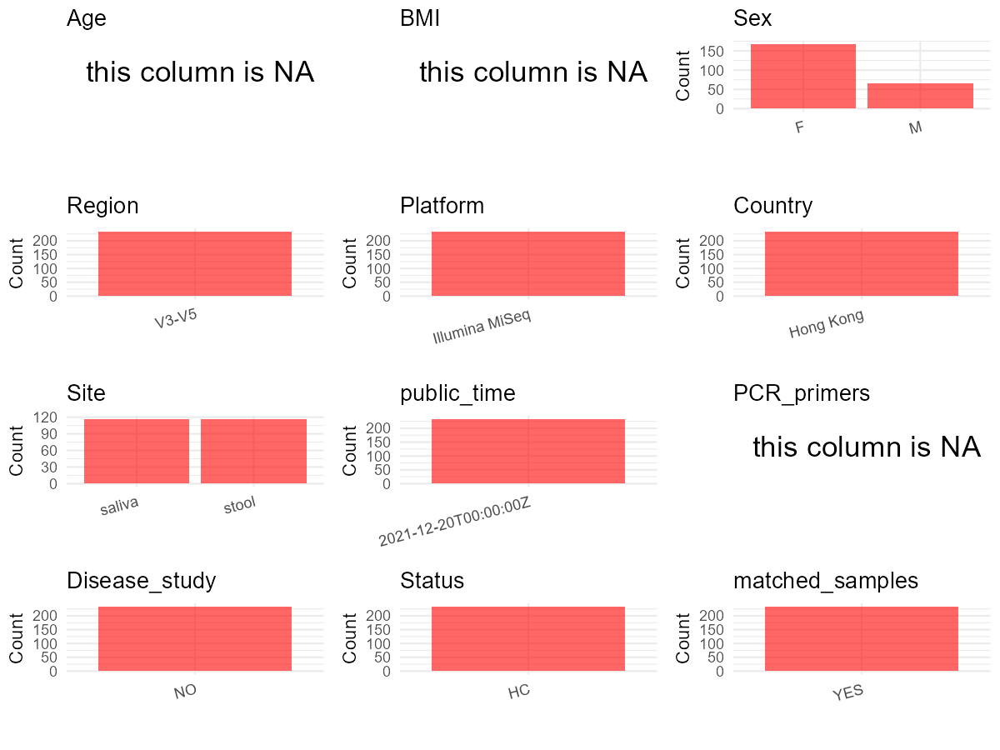

R Notebook: Metadata Processing Workflow
================

# Step 1: Obtain Initial Metadata from Each Project

To obtain the initial metadata: 1. Search for the BioProject ID (e.g.,
“PRJEBXXXX”) on the [NCBI SRA
website](https://www.ncbi.nlm.nih.gov/Traces/study/). 2. In the “Select”
table, click on “Metadata” and download the file. 3. The downloaded file
is typically named “SraRunTable.csv” and contains metadata for the
project.

``` r
# Load necessary libraries
library(dplyr)
library(ggplot2)
library(cowplot)

# Set working directory (update this path to your local directory)
setwd("D:/oral_project/PRJNA411767")

# Read the initial metadata files
initial_meta<-read.csv("SraRunTable.csv",header = T)

# Combine the two metadata files
#meta <- rbind(initial_meta, initial_meta1)

#Remove entries non-oral samples
#initial_meta <- subset(initial_meta,isolate %in% c("saliva","tongue coat"))

# Check the number of samples containing "HT" in Sample.Name (e.g., healthy controls)
#nrow(subset(meta, grepl("HT", Sample.Name)))

# Display the first few rows of the metadata
head(initial_meta)
```

    ##          Run Assay.Type AvgSpotLen    Bases  BioProject    BioSample
    ## 1 SRR6407155   AMPLICON        600 34645200 PRJNA411767 SAMN08174434
    ## 2 SRR6407156   AMPLICON        600 31325400 PRJNA411767 SAMN08174583
    ## 3 SRR6407157   AMPLICON        600 29728200 PRJNA411767 SAMN08174582
    ## 4 SRR6407158   AMPLICON        600 10143600 PRJNA411767 SAMN08174579
    ## 5 SRR6407159   AMPLICON        600 39532800 PRJNA411767 SAMN08174578
    ## 6 SRR6407160   AMPLICON        600 16980000 PRJNA411767 SAMN08174581
    ##                              BioSampleModel    Bytes
    ## 1 MIMS.me,MIGS/MIMS/MIMARKS.host-associated 23181788
    ## 2 MIMS.me,MIGS/MIMS/MIMARKS.host-associated 20847192
    ## 3 MIMS.me,MIGS/MIMS/MIMARKS.host-associated 19464128
    ## 4 MIMS.me,MIGS/MIMS/MIMARKS.host-associated  6883321
    ## 5 MIMS.me,MIGS/MIMS/MIMARKS.host-associated 25552575
    ## 6 MIMS.me,MIGS/MIMS/MIMARKS.host-associated 11454840
    ##                       Center.Name Collection_Date Consent DATASTORE.filetype
    ## 1 CHINESE UNIVERSITY OF HONG KONG      2016-09-13  public         run.zq,sra
    ## 2 CHINESE UNIVERSITY OF HONG KONG      2016-11-24  public         run.zq,sra
    ## 3 CHINESE UNIVERSITY OF HONG KONG      2016-11-24  public         run.zq,sra
    ## 4 CHINESE UNIVERSITY OF HONG KONG      2016-11-24  public         run.zq,sra
    ## 5 CHINESE UNIVERSITY OF HONG KONG      2016-11-24  public         run.zq,sra
    ## 6 CHINESE UNIVERSITY OF HONG KONG      2016-11-24  public         run.zq,sra
    ##   DATASTORE.provider                     DATASTORE.region     env_biome
    ## 1         gs,ncbi,s3 gs.us-east1,ncbi.public,s3.us-east-1 national park
    ## 2         gs,ncbi,s3 gs.us-east1,ncbi.public,s3.us-east-1 national park
    ## 3         gs,ncbi,s3 gs.us-east1,ncbi.public,s3.us-east-1 national park
    ## 4         gs,ncbi,s3 gs.us-east1,ncbi.public,s3.us-east-1 national park
    ## 5         gs,ncbi,s3 gs.us-east1,ncbi.public,s3.us-east-1 national park
    ## 6         gs,ncbi,s3 gs.us-east1,ncbi.public,s3.us-east-1 national park
    ##                   env_feature env_material Experiment geo_loc_name_country
    ## 1 mammalia-associated habitat         swab SRX3500647            Hong Kong
    ## 2 mammalia-associated habitat         swab SRX3500646            Hong Kong
    ## 3 mammalia-associated habitat         swab SRX3500645            Hong Kong
    ## 4 mammalia-associated habitat         swab SRX3500644            Hong Kong
    ## 5 mammalia-associated habitat         swab SRX3500643            Hong Kong
    ## 6 mammalia-associated habitat         swab SRX3500642            Hong Kong
    ##   geo_loc_name_country_continent                     geo_loc_name
    ## 1                           Asia Hong Kong: Kam Shan Country Park
    ## 2                           Asia Hong Kong: Kam Shan Country Park
    ## 3                           Asia Hong Kong: Kam Shan Country Park
    ## 4                           Asia Hong Kong: Kam Shan Country Park
    ## 5                           Asia Hong Kong: Kam Shan Country Park
    ## 6                           Asia Hong Kong: Kam Shan Country Park
    ##             HOST host_sex host_subject_id host_taxid     Instrument
    ## 1 Macaca mulatta   female           PM024       9544 Illumina MiSeq
    ## 2 Macaca mulatta   female           PM078       9544 Illumina MiSeq
    ## 3 Macaca mulatta   female           PM078       9544 Illumina MiSeq
    ## 4 Macaca mulatta   female           PM077       9544 Illumina MiSeq
    ## 5 Macaca mulatta   female           PM076       9544 Illumina MiSeq
    ## 6 Macaca mulatta   female           PM077       9544 Illumina MiSeq
    ##            lat_lon Library.Name LibraryLayout LibrarySelection LibrarySource
    ## 1 22.36 N 114.15 E     PM024_S2        PAIRED              PCR   METAGENOMIC
    ## 2 22.36 N 114.15 E     PM078_S2        PAIRED              PCR   METAGENOMIC
    ## 3 22.36 N 114.15 E     PM078_S1        PAIRED              PCR   METAGENOMIC
    ## 4 22.36 N 114.15 E     PM077_S1        PAIRED              PCR   METAGENOMIC
    ## 5 22.36 N 114.15 E     PM076_S3        PAIRED              PCR   METAGENOMIC
    ## 6 22.36 N 114.15 E     PM077_S3        PAIRED              PCR   METAGENOMIC
    ##             Organism Platform          ReleaseDate          create_date version
    ## 1     gut metagenome ILLUMINA 2021-12-20T00:00:00Z 2017-12-21T09:18:00Z       1
    ## 2     gut metagenome ILLUMINA 2021-12-20T00:00:00Z 2017-12-21T09:18:00Z       1
    ## 3    oral metagenome ILLUMINA 2021-12-20T00:00:00Z 2017-12-21T09:18:00Z       1
    ## 4    oral metagenome ILLUMINA 2021-12-20T00:00:00Z 2017-12-21T09:18:00Z       1
    ## 5 vaginal metagenome ILLUMINA 2021-12-20T00:00:00Z 2017-12-21T09:18:00Z       1
    ## 6 vaginal metagenome ILLUMINA 2021-12-20T00:00:00Z 2017-12-21T09:18:00Z       1
    ##   Sample.Name SRA.Study
    ## 1    PM024_S2 SRP127304
    ## 2    PM078_S2 SRP127304
    ## 3    PM078_S1 SRP127304
    ## 4    PM077_S1 SRP127304
    ## 5    PM076_S3 SRP127304
    ## 6    PM077_S3 SRP127304

# Step 2: Create a Uniform Metadata Template

The uniform metadata should include the following columns:

1.  **BioProject**: Project ID (e.g., “PRJNA339212”)
2.  **Run**: Sample ID (e.g., “ERRXXXXXX” or “SRRXXXXXX”)
3.  **sample_name**: Original sample name submitted by the authors (not
    the database-assigned ID)
4.  **Age**: Age of the subject (if available)
5.  **BMI**: Body Mass Index (if available)
6.  **Sex**: Sex of the subject (“F” or “M”)
7.  **Region**: Targeted 16S rRNA region (e.g., “V3-V4”)
8.  **Platform**: Sequencing platform (e.g., “Illumina MiSeq”)
9.  **Country**: Country of sample origin (e.g., “China”)
10. **Site**: Sample site (e.g., “saliva”, “dental plaque”)
11. **public_time**: Data release date (format: “YYYY-MM-DD”)
12. **PCR_primers**: PCR primers used (e.g., “515F-806R”)
13. **title**: Title of the associated publication
14. **Disease_study**: Whether the study involves a disease (“YES” or
    “NO”)
15. **Status**: Disease status (e.g., “T2DM”, “HC”). Note: If the study
    includes both disease and healthy samples, this must be specified
    per sample.
16. **matched_samples**: matched samples (“YES” or “NO”)

``` r
# Create a uniform metadata dataframe
metadata <- data.frame(
  BioProject = initial_meta$BioProject,
  Run = initial_meta$Run,
  sample_name = initial_meta$Sample.Name,
  Age = NA,
  BMI = NA,
  Sex = initial_meta$host_sex,
  Region = "V3-V5",
  Platform = initial_meta$Instrument,
  Country = initial_meta$geo_loc_name_country,
  Site = ifelse(initial_meta$Organism == "oral metagenome", "saliva",
         ifelse(initial_meta$Organism == "vaginal metagenome", "vaginal",
         ifelse(initial_meta$Organism == "gut metagenome", "stool",
                initial_meta$Organism))),
  public_time = initial_meta$ReleaseDate,
  stringsAsFactors = FALSE
)
```

``` r
metadata <- metadata %>%
  mutate(            
    Sex = case_when(
      Sex == "female" ~ "F",
      Sex == "male" ~ "M",
    )
  )
```

# Step 3: Manually Add Information from the Publication

Some information (e.g. PCR primers, study title, disease status) must be
manually extracted from the publication and added to the metadata.

``` r
# Add information obtained from the publication
metadata$PCR_primers <- NA
metadata$title <- "Diversity of macaque microbiota compared to the human counterparts"
metadata$Disease_study <- "NO"
# Assign disease status based on sample_name patterns
metadata$Status<-"HC"

#get subjects id according to sample id
metadata$sample_name<-gsub("PM|_S2|_S1","",metadata$sample_name)
#get subjects id with Saliva available
keep_subjects<-subset(metadata,Site %in% "saliva")
#remove subjects without Saliva samples
metadata<-subset(metadata,sample_name %in% keep_subjects$sample_name)
#get subjects sampling counts
sample_counts <- table(metadata$sample_name)
# Create matched_samples column, any subjects have >=2 samples will be label "YES", otherwise "NO"
metadata$matched_samples <- ifelse(metadata$sample_name %in% names(sample_counts[sample_counts >= 2]), "YES", "NO")
```

# Step 4: Summarize and Validate the Metadata

``` r
# Check the number of unique runs and sample names
print(paste("Number of unique runs:", length(unique(metadata$Run))))
```

    ## [1] "Number of unique runs: 234"

``` r
print(paste("Number of unique sample names:", length(unique(metadata$sample_name))))
```

    ## [1] "Number of unique sample names: 117"

# Step 5: Visualize the Metadata

``` r

```


# Step 6: Finalize and Export the Metadata

``` r
# Reorder columns to match the desired format
metadata <- metadata[, c(
  "BioProject", "Run", "sample_name", "Age", "BMI", "Sex", 
  "Region", "Platform", "Country", "Site", "public_time", 
  "PCR_primers", "title", "Disease_study", "Status","matched_samples"
)]

# Export the uniform metadata to a CSV file
write.csv(metadata, file = "metadata.csv", quote = TRUE)
head(metadata)
```

    ##    BioProject        Run sample_name Age BMI Sex Region       Platform
    ## 1 PRJNA411767 SRR6407155         024  NA  NA   F  V3-V5 Illumina MiSeq
    ## 2 PRJNA411767 SRR6407156         078  NA  NA   F  V3-V5 Illumina MiSeq
    ## 3 PRJNA411767 SRR6407157         078  NA  NA   F  V3-V5 Illumina MiSeq
    ## 4 PRJNA411767 SRR6407158         077  NA  NA   F  V3-V5 Illumina MiSeq
    ## 7 PRJNA411767 SRR6407161         077  NA  NA   F  V3-V5 Illumina MiSeq
    ## 9 PRJNA411767 SRR6407163         075  NA  NA   F  V3-V5 Illumina MiSeq
    ##     Country   Site          public_time PCR_primers
    ## 1 Hong Kong  stool 2021-12-20T00:00:00Z          NA
    ## 2 Hong Kong  stool 2021-12-20T00:00:00Z          NA
    ## 3 Hong Kong saliva 2021-12-20T00:00:00Z          NA
    ## 4 Hong Kong saliva 2021-12-20T00:00:00Z          NA
    ## 7 Hong Kong  stool 2021-12-20T00:00:00Z          NA
    ## 9 Hong Kong  stool 2021-12-20T00:00:00Z          NA
    ##                                                                title
    ## 1 Diversity of macaque microbiota compared to the human counterparts
    ## 2 Diversity of macaque microbiota compared to the human counterparts
    ## 3 Diversity of macaque microbiota compared to the human counterparts
    ## 4 Diversity of macaque microbiota compared to the human counterparts
    ## 7 Diversity of macaque microbiota compared to the human counterparts
    ## 9 Diversity of macaque microbiota compared to the human counterparts
    ##   Disease_study Status matched_samples
    ## 1            NO     HC             YES
    ## 2            NO     HC             YES
    ## 3            NO     HC             YES
    ## 4            NO     HC             YES
    ## 7            NO     HC             YES
    ## 9            NO     HC             YES

## Notes for Students:

1.  **Metadata Accuracy**: Always cross-check the metadata with the
    original publication to ensure accuracy.
2.  **Manual Entries**: Columns like `PCR_primers`, and `Status` often
    require manual entry based on the publication.
3.  **Disease Status**: Be careful when assigning `Status`—some studies
    include both disease and healthy samples.
4.  **Visualization**: The plots help quickly identify the distribution
    of values in each column, which is useful for quality control.
5.  **Reproducibility**: Update the working directory and file paths to
    match your local environment.
