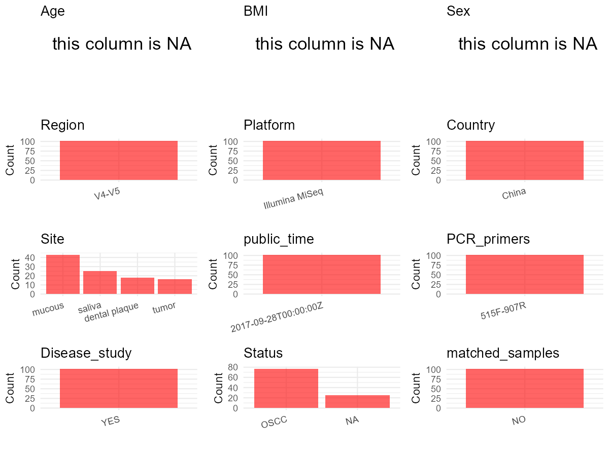

# Step 1: Obtain Initial Metadata from Each Project

To obtain the initial metadata: 1. Search for the BioProject ID (e.g.,
“PRJEBXXXX”) on the [NCBI SRA
website](https://www.ncbi.nlm.nih.gov/Traces/study/). 2. In the “Select”
table, click on “Metadata” and download the file. 3. The downloaded file
is typically named “SraRunTable.csv” and contains metadata for the
project.

    library(tidyverse)
    library(ggplot2)
    library(cowplot)

    setwd("C:/Users/zyc/Desktop/oral_project/PRJNA412445")
    initial_meta <- read.csv("SraRunTable.csv", header = TRUE) 
    head(initial_meta)

    ##          Run Assay.Type AvgSpotLen    Bases  BioProject    BioSample              BioSampleModel   Bytes        Center.Name
    ## 1 SRR6110868   AMPLICON        502  8895440 PRJNA412445 SAMN07714275 Metagenome or environmental 5147904 SICHUAN UNIVERSITY
    ## 2 SRR6110869   AMPLICON        502 11343192 PRJNA412445 SAMN07714274 Metagenome or environmental 6815670 SICHUAN UNIVERSITY
    ## 3 SRR6110870   AMPLICON        502 10845710 PRJNA412445 SAMN07714269 Metagenome or environmental 6278837 SICHUAN UNIVERSITY
    ## 4 SRR6110871   AMPLICON        502 11606742 PRJNA412445 SAMN07714268 Metagenome or environmental 6672423 SICHUAN UNIVERSITY
    ## 5 SRR6110872   AMPLICON        502  9961186 PRJNA412445 SAMN07714267 Metagenome or environmental 5859940 SICHUAN UNIVERSITY
    ## 6 SRR6110873   AMPLICON        502 10642400 PRJNA412445 SAMN07714266 Metagenome or environmental 6030339 SICHUAN UNIVERSITY
    ##   Collection_Date Consent DATASTORE.filetype DATASTORE.provider                     DATASTORE.region Experiment
    ## 1            2015  public   fastq,run.zq,sra         gs,ncbi,s3 gs.us-east1,ncbi.public,s3.us-east-1 SRX3225824
    ## 2            2015  public   fastq,run.zq,sra         gs,ncbi,s3 gs.us-east1,ncbi.public,s3.us-east-1 SRX3225823
    ## 3            2015  public   fastq,run.zq,sra         gs,ncbi,s3 gs.us-east1,ncbi.public,s3.us-east-1 SRX3225822
    ## 4            2015  public   fastq,run.zq,sra         gs,ncbi,s3 gs.us-east1,ncbi.public,s3.us-east-1 SRX3225821
    ## 5            2015  public   fastq,run.zq,sra         gs,ncbi,s3 gs.us-east1,ncbi.public,s3.us-east-1 SRX3225820
    ## 6            2015  public   fastq,run.zq,sra         gs,ncbi,s3 gs.us-east1,ncbi.public,s3.us-east-1 SRX3225819
    ##   geo_loc_name_country geo_loc_name_country_continent geo_loc_name         HOST     Instrument isolation_source          lat_lon
    ## 1                China                           Asia        China Homo sapiens Illumina MiSeq           mucous 30.67 N 104.55 E
    ## 2                China                           Asia        China Homo sapiens Illumina MiSeq           mucous 30.67 N 104.54 E
    ## 3                China                           Asia        China Homo sapiens Illumina MiSeq           mucous 30.67 N 104.48 E
    ## 4                China                           Asia        China Homo sapiens Illumina MiSeq           mucous 30.67 N 104.46 E
    ## 5                China                           Asia        China Homo sapiens Illumina MiSeq           mucous 30.67 N 104.45 E
    ## 6                China                           Asia        China Homo sapiens Illumina MiSeq           mucous 30.67 N 104.43 E
    ##   Library.Name LibraryLayout LibrarySelection LibrarySource              Organism Platform          ReleaseDate
    ## 1          25b        PAIRED              PCR   METAGENOMIC human oral metagenome ILLUMINA 2017-09-28T00:00:00Z
    ## 2          24b        PAIRED              PCR   METAGENOMIC human oral metagenome ILLUMINA 2017-09-28T00:00:00Z
    ## 3          18b        PAIRED              PCR   METAGENOMIC human oral metagenome ILLUMINA 2017-09-28T00:00:00Z
    ## 4          16b        PAIRED              PCR   METAGENOMIC human oral metagenome ILLUMINA 2017-09-28T00:00:00Z
    ## 5          15b        PAIRED              PCR   METAGENOMIC human oral metagenome ILLUMINA 2017-09-28T00:00:00Z
    ## 6          13b        PAIRED              PCR   METAGENOMIC human oral metagenome ILLUMINA 2017-09-28T00:00:00Z
    ##            create_date version Sample.Name SRA.Study
    ## 1 2017-09-28T04:21:00Z       1         25b SRP119028
    ## 2 2017-09-28T04:21:00Z       1         24b SRP119028
    ## 3 2017-09-28T04:21:00Z       1         18b SRP119028
    ## 4 2017-09-28T04:21:00Z       1         16b SRP119028
    ## 5 2017-09-28T04:21:00Z       1         15b SRP119028
    ## 6 2017-09-28T04:21:00Z       1         13b SRP119028

# Step 2: Create a Uniform Metadata Template

The uniform metadata should include the following columns:

1.  **BioProject**: Project ID (e.g., “PRJNA339212”)
2.  **Run**: Sample ID (e.g., “ERRXXXXXX” or “SRRXXXXXX”)
3.  **sample\_name**: Original sample name submitted by the authors (not
    the database-assigned ID)
4.  **Age**: Age of the subject (if available)
5.  **BMI**: Body Mass Index (if available)
6.  **Sex**: Sex of the subject (“F” or “M”)
7.  **Region**: Targeted 16S rRNA region (e.g., “V3-V4”)
8.  **Platform**: Sequencing platform (e.g., “Illumina MiSeq”)
9.  **Country**: Country of sample origin (e.g., “China”)
10. **Site**: Sample site (e.g., “saliva”, “dental plaque”)
11. **public\_time**: Data release date (format: “YYYY-MM-DD”)
12. **PCR\_primers**: PCR primers used (e.g., “515F-806R”)
13. **title**: Title of the associated publication
14. **Disease\_study**: Whether the study involves a disease (“YES” or
    “NO”)
15. **Status**: Disease status (e.g., “T2DM”, “HC”). Note: If the study
    includes both disease and healthy samples, this must be specified
    per sample.
16. **matched\_samples**: matched samples (“YES” or “NO”)

<!-- -->

    metadata <- data.frame(
      BioProject = initial_meta$BioProject,
      Run = initial_meta$Run,
      sample_name = initial_meta$Sample.Name,
      Age = NA, 
      BMI = NA,  
      Sex = NA,
      Region = "V4-V5",
      Platform = initial_meta$Instrument,
      Country = initial_meta$geo_loc_name_country,
      Site = initial_meta$isolation_source,
      public_time = initial_meta$ReleaseDate,
      matched_samples = "NO",
      stringsAsFactors = FALSE
    )

# Step 3: Manually Add Information from the Publication

Some information (e.g. PCR primers, study title, disease status) must be
manually extracted from the publication and added to the metadata.

     # metadata <- metadata %>%
     #  mutate(Sex = recode(Sex, "female" = "F", "male" = "M"))
    metadata <-metadata%>%
      mutate(Status = case_when(Site == "mucous" ~ "OSCC",
                                Site == "dental plaque" ~ "OSCC",
                                Site == "tumor" ~ "OSCC",
                                TRUE ~ NA))

    metadata$title <- "The Clinical Potential of Oral Microbiota as a Screening Tool for Oral Squamous Cell Carcinomas"
    metadata$Disease_study <- "YES"
    metadata$PCR_primers <- "515F-907R"
    head(metadata)

    ##    BioProject        Run sample_name Age BMI Sex Region       Platform Country   Site          public_time matched_samples
    ## 1 PRJNA412445 SRR6110868         25b  NA  NA  NA  V4-V5 Illumina MiSeq   China mucous 2017-09-28T00:00:00Z              NO
    ## 2 PRJNA412445 SRR6110869         24b  NA  NA  NA  V4-V5 Illumina MiSeq   China mucous 2017-09-28T00:00:00Z              NO
    ## 3 PRJNA412445 SRR6110870         18b  NA  NA  NA  V4-V5 Illumina MiSeq   China mucous 2017-09-28T00:00:00Z              NO
    ## 4 PRJNA412445 SRR6110871         16b  NA  NA  NA  V4-V5 Illumina MiSeq   China mucous 2017-09-28T00:00:00Z              NO
    ## 5 PRJNA412445 SRR6110872         15b  NA  NA  NA  V4-V5 Illumina MiSeq   China mucous 2017-09-28T00:00:00Z              NO
    ## 6 PRJNA412445 SRR6110873         13b  NA  NA  NA  V4-V5 Illumina MiSeq   China mucous 2017-09-28T00:00:00Z              NO
    ##   Status                                                                                           title Disease_study
    ## 1   OSCC The Clinical Potential of Oral Microbiota as a Screening Tool for Oral Squamous Cell Carcinomas           YES
    ## 2   OSCC The Clinical Potential of Oral Microbiota as a Screening Tool for Oral Squamous Cell Carcinomas           YES
    ## 3   OSCC The Clinical Potential of Oral Microbiota as a Screening Tool for Oral Squamous Cell Carcinomas           YES
    ## 4   OSCC The Clinical Potential of Oral Microbiota as a Screening Tool for Oral Squamous Cell Carcinomas           YES
    ## 5   OSCC The Clinical Potential of Oral Microbiota as a Screening Tool for Oral Squamous Cell Carcinomas           YES
    ## 6   OSCC The Clinical Potential of Oral Microbiota as a Screening Tool for Oral Squamous Cell Carcinomas           YES
    ##   PCR_primers
    ## 1   515F-907R
    ## 2   515F-907R
    ## 3   515F-907R
    ## 4   515F-907R
    ## 5   515F-907R
    ## 6   515F-907R

# Step 4: Summarize and Validate the Metadata

    print(paste("Number of unique runs:", length(unique(metadata$Run))))

    ## [1] "Number of unique runs: 102"

    print(paste("Number of unique sample names:", length(unique(metadata$sample_name))))

    ## [1] "Number of unique sample names: 102"

# Step 5: Visualize the Metadata

    plot_data <- metadata %>%
      select(-BioProject, -Run, -sample_name, -title)

    # Function to create simple plots for each column
    create_simple_plots <- function(data) {
      plots <- list()
      
      for (col in colnames(data)) {
        # Check if the column is all NA
        if (all(is.na(data[[col]]))) {
          # Create an empty plot with text indicating all NA
          p <- ggplot() +
            annotate("text", x = 0.5, y = 0.5, label = "this column is NA", size = 6) +
            labs(title = col) +
            theme_void()
        } else if (is.numeric(data[[col]])) {
          # Numeric variable: histogram
          p <- ggplot(data, aes(x = .data[[col]])) +
            geom_histogram(fill = "blue", alpha = 0.6, bins = 20, na.rm = T) +
            labs(title = col) +
            theme_minimal()
        } else {
          # Categorical variable: bar plot (remove NA values)
          count_data <- as.data.frame(table(data[[col]], useNA = "ifany"))
          p <- ggplot(count_data, aes(x = reorder(Var1, -Freq), y = Freq)) +
            geom_col(fill = "red", alpha = 0.6) +
            labs(title = col, x = NULL, y = "Count") +
            theme_minimal() +
            theme(axis.text.x = element_text(angle = 15, hjust = 1))
        }
        plots[[col]] <- p
      }
      
      return(plots)
    }

    plots <- create_simple_plots(plot_data)
    p<-plot_grid(plots$Age, 
              plots$BMI, 
              plots$Sex, 
              plots$Region, 
              plots$Platform, 
              plots$Country, 
              plots$Site,
              plots$public_time, 
              plots$PCR_primers,
              plots$Disease_study,
              plots$Status,
              plots$matched_samples,# add 
              ncol = 3, align = "hv", axis = "lb")
    ggsave("Metadata_Summary.png", plot = p, width = 8, height = 6, dpi = 150)

    

 \# Step 6: Finalize and Export the Metadata

    metadata <- metadata[, c(
      "BioProject", "Run", "sample_name", "Age", "BMI", "Sex", 
      "Region", "Platform", "Country", "Site", "public_time", 
      "PCR_primers", "title", "Disease_study", "Status","matched_samples"
    )]

    write.csv(metadata, file = "metadata.csv", quote = FALSE)
